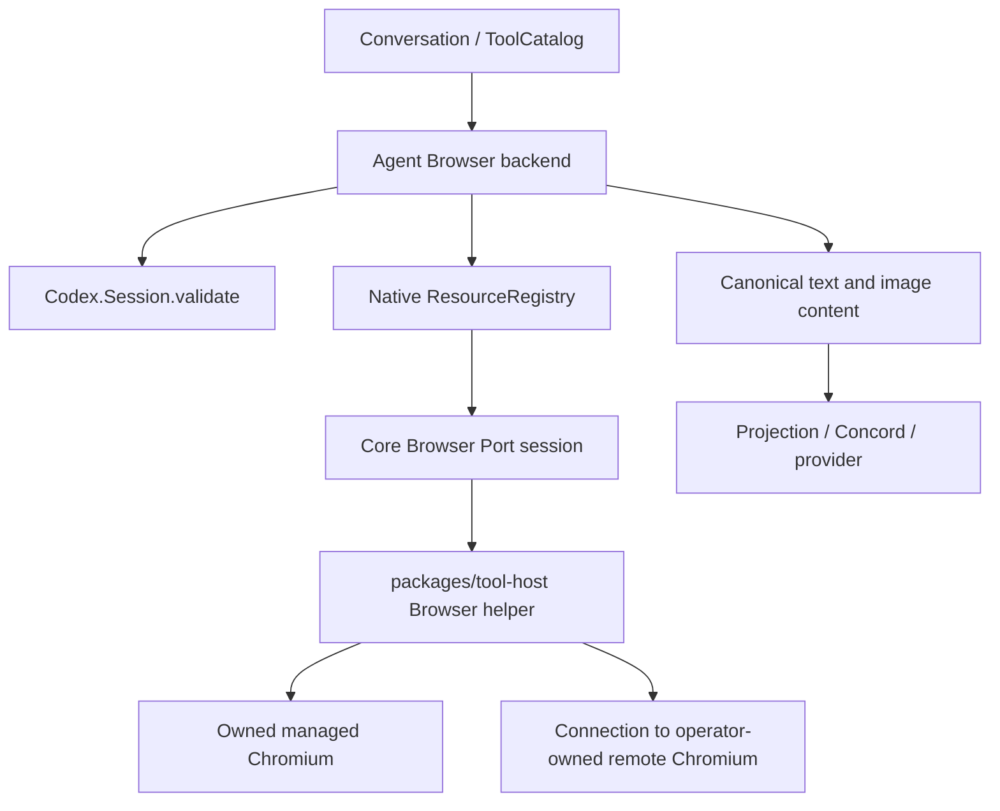

# Browser native host integration

The approved P8 end state covers the complete pinned Browser capability, while
Backplane remains the execution authority. This design uses the public
Backplane 1.10.38 Session and ResourceRegistry APIs. The managed-host subset is
wired through production Browser registration and SessionAdapter. The remote-CDP
extension reuses that native resource boundary; other actions, drivers and routes
remain open.

## Reference contract

The reference is OpenClaw `488631c18fae7cc541ba8fc8beff6cbb0438787b`.
`extensions/browser/src/browser-tool.schema.ts` builds a flattened schema;
action-specific requirements are enforced at execution. Captured schemas live
in the `browser/*` recipe rows of
`apps/synapsis_agent/test/fixtures/openclaw/488631c/capture.json`.
The unchanged actual factory now has 36 recorded construction cases, including
24 representative contexts; full returned metadata and `outputSchema` match the
independently invoked definition in fresh VMs. The SDK config reader receives a
recorded synthetic input, rather than running its real implementation. Eight
supplied-capability variants establish constructor/schema agreement, not host
profile resolution. Separately, 35 exact-source projected lazy callback cases
verify ordinary config precedence, context/options and full definition metadata;
the whole plugin registration function and loader are not executed. Runtime
admission/assembly and actions remain unverified. See `scripts/openclaw/README.md`
for provenance and reproduction.

| Surface | Complete reference set |
| --- | --- |
| Top-level actions (24) | doctor, status, start, stop, profiles, importprofile, tabs, open, focus, close, snapshot, screenshot, navigate, console, requests, errors, text, emulate, pdf, download, waitfordownload, upload, dialog, act |
| Model act kinds (14) | batch, click, clickCoords, type, press, hover, scrollIntoView, drag, select, fill, resize, wait, evaluate, close |
| Routes | host, sandbox, node |
| Distinct drivers | managed browser, remote CDP, existing-session Chrome DevTools MCP; engine-specific capabilities remain explicit |

`insertText`, drag selector alternatives and raw server routes are implementation
APIs rather than additional advertised model actions. An existing-session
connection is not interchangeable with a remote-CDP connection. Missing routes
must report unavailable without silently switching execution owners.

## Ownership and native lifetime



The static descriptor is `synapsis::browser`, explicitly selected and
`direct_model_only` because it may return screenshots. It uses existing catalog,
preparation and settlement paths. It does not require dynamic publication or
CodeMode and must not introduce a workaround for Backplane #111 or #113.

The agent layer owns descriptor/schema, trusted Agent configuration binding,
classification, native Session validation and artifact/result adaptation. Core
owns bounded asynchronous Port I/O and transport state. The Node helper owns
browser interaction and actual browser process handles. Core must not depend
on agent, provider or workspace orchestration.

Create a dormant Port-session process under the native registry worker
supervisor and register a `:browser` resource before any browser launch. Cache
only its private handle keyed by native owner identity; fetch it through public
ResourceRegistry APIs before reuse. Validate each invocation with
`Codex.Session.validate/2`. Separate child Sessions get separate resources.
The shorter-lived invocation resource-owner PID is not the persistent browser
owner.

SessionAdapter keeps private resource records keyed by the native Session
identity for both root and child options. Preparation returns the updated cache
with its host metadata; the cache is never persisted in Concord or exposed in
provider metadata. Each later invocation validates its Session binding and fetches
the exact resource handle. A configuration replacement first releases the old
resource and requires confirmed cleanup before registering a replacement.

Successful turn detach retains session-owned resources. Cancellation, failed or
uncertain runs, Session close, owner loss and configuration replacement must
settle outstanding work and close the resource before reuse. Never restore a
browser handle or replay browser actions from Concord. A closed Port alone does
not prove its Chromium child exited.

## Helper and protocol

`packages/tool-host` pins `playwright-core` 1.64.0. For managed-host profiles,
the helper receives the trusted executable path and creates an isolated, owned temporary user-data
directory beneath its configured data directory. It does not download browsers
or reuse a user's Chrome profile. Node owns the Chromium child and observes its
exit; Playwright uses its public CDP connection API.

The version-1 newline JSON protocol has fixed `initialize`, `call`, `cancel`
and `close` methods. Requests carry IDs; calls carry profile generation,
arguments and a finite deadline. Initialize is dormant. Standard output carries
only protocol frames. Calls are serialized, and cancellation remains responsive
while an action is pending. A cancel acknowledgement is not settlement.
The helper admits at most four requests and 2 MiB of request text, with bounded
partial-frame/chunk storage. Output admits at most four frames and 4 MiB,
serializes writes and awaits pipe drain with a five-second write deadline.
Error replies use the same reservations. Every error carries current generation;
failures and serialization fallbacks preserve prior dispatch evidence.
Unconfirmed Chromium cleanup retains its owned handles and prevents replacement.

`Synapsis.Browser.PortSession` supplies the core transport. `start_link/1` is
fully dormant; `initialize/1` starts Node without launching Chromium. The broker
admits one action, one cancellation and one close control, uses bounded frames
and nonblocking Port writes, and updates generation from helper receipts.
It monitors the persistent owner separately from the invocation caller; caller
loss cancels the pending action, while owner loss closes the helper. `close/1`
returns `:ok` only after confirmed browser cleanup and observed helper exit 0.
A closed broker remains alive for idempotence until its owner/supervisor stops it.
SessionAdapter registers and adopts these brokers through the public native
resource APIs. Native Session cleanup uses 20 seconds; Browser-selected
Conversations use 20 seconds, with 25-second owner-stop headroom, covering the
broker's 12-second observation deadline. The private cache is capped at 64 native
owners; confirmed closed child records are removed before stopping their Session
and registry. Unconfirmed records remain available for inspection.

A failure before dispatch may use native rejection proof. Losing a reply after
sending a browser mutation is `unknown_outcome`; the caller cannot infer that
nothing happened. Cleanup must wait for owned browser exit and helper shutdown,
or retain uncertainty. External browsers, when their distinct adapters are
implemented, must only be detached from rather than terminated.

## Configuration, refs and images

### Sequential condition waits

`act.wait` checks `timeMs`, `text`, `textGone`, `selector` (or the existing
exact `ref` extension), `url`, `loadState`, then `fn` in that order. Selector
waits use the first match, as in the pinned Playwright reference. All conditions
share the finite invocation deadline. The action-timing section below describes
the independent condition-phase limits and recursive batch budget now installed.
Before execution, including nested batch leaves, the helper trims string-valued
`loadState`, `text`, `textGone`, `selector`, `url` and `fn`, omitting blank values
on its private request copies; raw caller input and durable ToolUse/history remain
unchanged.

`fn` accepts a function, expression, or statement body. It polls until the result
is truthy, including asynchronous predicates that resolve false before succeeding.
The predicate retains its pending/settled state so a Promise alone cannot count as
success and asynchronous polls cannot overlap. Before any prerequisites, the helper
captures the live document handle and document generation. It checks that document
after each prerequisite and before predicate dispatch, and passes its handle into
Playwright's polling state so the predicate cannot restart in a replacement
execution context. The document and successful result handles are disposed when
waiting settles. Invocation cancellation, timeout, dialog handling and native
resource ownership continue through the existing Browser lifecycle.

This uses the same configured Browser capability as `evaluate`; it adds no runtime
or permission policy. Current ordinary fixture evidence covers successful polling,
condition ordering and durable native results. It does not establish the complete
reference navigation guard, all interruption branches, or whole Browser parity.

### Pointer and keyboard input phases

Element `click.delayMs` accepts 0..5000 ms. A nonzero delay first hovers the
resolved target, then waits using the current operation's abort signal before
clicking. It checks the operation and document after hover and delay. Double-click
uses Playwright's actual double-click operation, including both click events.
Existing button and modifier inputs remain in effect. For `clickCoords`, the same
0..5000 ms option is passed as Playwright's mouse-down/up delay instead of a
pre-click pause.

`press` normalizes the pinned aliases `Esc`, `Return`, `Del`, `Ctrl`, `Cmd` and
`space`, including the exact literal-space case. Other inputs are trimmed as a
whole before splitting chords; empty segments preserve literal plus keys. Named
`Ctrl+Space` remains a chord. Canonicalization uses private request copies at every
batch level, so the native ToolUse and durable history preserve the original raw
model arguments. Both focused-page keyboard presses and the existing ref/selector
extension pass `delayMs` as key-down/up delay. This host bounds key delay to
0..120000 ms, under the existing whole-invocation deadline.

Ordinary `type` still fills the value. With `slowly:true`, the helper clicks the
target and types at the resulting caret, preserving existing text rather than
clearing it. The reference default is 75 ms per character; the existing host
extension accepts explicit `delayMs` in 0..1000 ms. Optional Enter submission
continues after typing.

These phases share the existing operation, native owner and finite invocation
timeout. The action-timing section below describes the recursive budget and
independent phase options, including the separate treatment of the trusted
profile timeout. The fixed source has broader navigation guards; ordinary input
success does not establish complete parity for those guards or interruption/error
branches.

### Select targets and option values

`select` trims string refs on private execution copies before resolving the
retained snapshot handle, including recursive batch leaves. Option strings pass
unchanged to Playwright: empty values and surrounding whitespace remain content,
and input array order is preserved. The selected options and form data follow the
control's DOM order. Ref targeting keeps precedence over the existing selector
extension. Raw ToolUse arguments and durable history retain the original ref and
values. Target currentness, dispatch and the finite invocation deadline use the
existing action path. This is the select normalizer correspondence at fixed
OpenClaw `488631c`, not complete Browser or select compatibility.

### Form filling

`fill` accepts 1..100 field objects. Every standalone or nested batch leaf is
normalized on private execution copies before any child action runs; the original
ToolUse and durable history retain the caller's arguments. Reference strings are
trimmed and must be nonblank. Field keys are limited to `ref`, `type`, `value`,
plus the existing Synapsis `selector` targeting extension. Ref targeting keeps
precedence over selector targeting, and selectors keep their existing scope.

Type labels are trimmed nonblank strings, otherwise `text`; they remain
case-sensitive and have no whitelist. Missing/null values are omitted from the
execution field; string, number and boolean values retain their raw scalar value,
including string whitespace. Exact `checkbox` and `radio` types call `setChecked`,
with checked=true only for raw `true`, `1`, `"1"` or `"true"`. Other accepted values,
including missing/null, mean unchecked. Every other type calls `fill` with
`String(value ?? '')`, so missing/null clears text, numbers become text and a
boolean with omitted type becomes `"true"` or `"false"`. Checkbox/radio behavior
therefore requires an explicit type. `select` remains a separate action; `fill`
does not add select-option behavior.

Fields execute in order through the existing target/currentness checks,
interaction timeout, dispatch tracking and finite native invocation owner. These
semantics follow the pinned form normalizer and Playwright fill action, with the
explicit local selector exception; they do not establish whole Browser parity.

### Action timing and the native deadline boundary

The official Backplane1.10.44 contract closes the historical
[backplane#121](https://github.com/gsmlg-opt/backplane/issues/121) release gate.
This batch connects that API through the existing runtime and Browser owners;
implementation and scoped ordinary verification are recorded below.
It does not enlarge the shared600,000ms effect default.

`Policy.tool_effect_timeout/2` delegates timing selection only. The Browser
selector reads the exact descriptor from the invocation's pinned public
`ToolRegistry`, checks its backend/revision, and uses that descriptor's trusted
config with the final immutable arguments. Other tools return`:default`.
Core's pure`Synapsis.Browser.Timing` computes the action watchdog without I/O;
selection cannot launch a helper or replace arguments. Native intent ACK still
precedes backend execution.

| Input | Outer helper watchdog |
| --- | --- |
| Explicit top-level`timeout_ms` | One whole-action override,1..2,147,000,000ms |
|`act` with no outer override | Pinned model-local recursive action calculation |
| Other single-profile action with no override | Existing trusted profile timeout |
|`profiles` with no override | Sum of addressed profile timeouts; a top-level override applies once to the aggregate |

This intentionally replaces the profile whole-action fallback for omitted`act`
watchdogs: retaining that cap would continue to abort valid serial work. The
profile timeout remains the configured driver/startup/non-act default. Model
`request.timeoutMs` sets a phase duration, separately from the snake_case outer
field. A private copy receives60,000ms only for the reference's applicable
standalone kinds; injection is shallow. Batch children retain interaction8,000ms
and wait20,000ms defaults. The raw ToolUse and durable history are unchanged.

The planner follows complete pinned`act-policy.ts`: saturated serial phase sums,
per-kind phase counts, the public client's existing-session compatibility floor,
and one5,000ms transport slack after the full calculation. Interaction phases
clamp500..60,000ms; wait/scroll/evaluate phases clamp500..120,000ms. Each wait
condition receives its own full phase timeout; there is no blanket child timer
and no per-child transport slack. Evaluate retains its source-specific inner
asynchronous-function deadline. Node passes these timeouts to the actual
Playwright methods without mutating a context's global defaults; the existing
whole-operation timer, cancellation and resource cleanup continue to own work.

Existing host extensions remain explicit: ref waits count one condition,
selector-only fill fields count as fields, targeted press budgets its locator
phase plus key hold, drag budgets its two existing independent scroll phases,
and slow typing with a delay over75ms reserves the extra
UTF16-length-based delay in its typing phase and execution sum. These conservative
host additions do not change the ordinary no-extension reference vectors.
The conservative2,147,000,000ms source cap leaves room below Backplane's selected
2,147,483,647ms ceiling for bounded host overhead. Large calculations are
arithmetic evidence, never a claim that a multi-hour action was executed.

The native selected allowance contains the outer watchdog,10,000ms initialize
reserve per addressed broker, and one13,000ms settlement reserve (12,000ms Port
cleanup observation plus1,000ms caller handoff). Execution retains the official
`effect_deadline/0` getter ephemerally. After each initialize, immediately before
Port dispatch, it uses the smaller of the remaining shared outer allocation and
`remaining_ms` minus settlement reserve. Initialization consumes its separate
native reserve; serial Port calls consume one outer allocation rather than
renewing it for every profile. The selected value is not the clipped allowance:
the runtime's remaining value still incorporates finite root and enclosing
limits. The getter and its live-VM monotonic absolute deadline never enter Node,
model output or Concord; only the immediate portable remaining milliseconds do.

Browser remains`direct_model_only`; this timing work does not make it a nested
CodeMode tool. Supported nested deadline behavior is a separate public runtime
contract. Native human interactions pause native active-time budgets, whereas a
page JavaScript dialog is a separate Browser mechanism. The helper watchdog is
still a wall-clock bound; no claim is made that native interaction pauses Node.
The existing runtime remains authoritative for cancellation and final settlement.

Historical complete-source calculations and the1.10.42 blocker are retained at
`/tmp/synapsis-browser-timing-upstream-0sedwg9a/`. A fresh standalone capture uses
Node24.22.1 and complete pinned arithmetic modules. It distinguishes executed
modules from provenance-only dispatch/driver/default-injection sources, and
arithmetic from production Browser behavior. Navigation-grace arithmetic does
not establish navigation interception, existing-session/other-driver routes or
full Browser equivalence. Concord#109 original large/file/image native cases
remain unchanged and unrun. Current batch evidence is collected at
`/tmp/synapsis-browser-deadline-m0T43DSy/`. Dedicated Core6/0 and Agent3/0 cover
the actual 2000ms wait and 1800ms batch beyond a1500ms profile, forwarded runtime
allowance, raw ToolUse, next Gaoxy request, PartJSON/Concord and replay without
another Browser dispatch. Separate public Conversation/EphemeralStore observers
prove successful root/enclosing clipping and non-renewing getter reads; these
are not nested production Browser scenarios. Profiles aggregation has pure
coverage; the actual Worker chain uses one profile. Native human-pause behavior
remains source-only.

Coordinator Node integration passed22/0; source tests passed4/0 with a fresh
15-vector capture equal to the fixture. Seven complete modules execute and ten
sources supply provenance only; all58,558 tracked source blobs match before and
after. Coordinator Elixir integration passed18 of19: the unchanged legacy
`native_browser_functional_test.exs:31` expects57 static tools but observes61
before its Browser harness starts. Both that test and Profiles retain their
baseline hashes, and this batch leaves Browser names unchanged. The assertion is
preserved; the affected old PNG scenario was not fixed, skipped or rerun and
remains unverified. This integration is not all green.

Independent SPEC then fresh QUALITY passed with no actionable findings. Scoped
formatting and development compilation passed. The managed restart replaced
PID1560962 with1629980; the old process exited and the root checkout reported
manager ready and `/api/health`200/ok. Final scope/config/runtime and note
readback receipts are recorded in the batch summary. All15 worker files remain
frozen,1677 protected paths and HEAD/index are preserved, and configuration
changes are limited to automatic Backplane connection metadata. Strict reference
verification remains inventory-valid, incomplete, with2824 gaps; other169 rows
and all170 whole-reference gates are unchanged. This accepts the ordinary timing
slice while whole Browser/P8/reference remain open.

### Nested action batches

`act` batches execute depth-first and sequentially on the selected tab. A batch
must contain actions; the outer batch may contain at most 100 recursive
descendants, counting nested batch nodes. The outer batch has depth zero and
nested batch depth may reach five. The helper checks this structure before
dispatching page actions. These limits follow the pinned reference's
`agent.act.normalize.ts` contract.

Each batch applies its own `stopOnError`. A nested batch with any failed child
is a failed parent action even when that child batch continued through its
remaining actions. Synapsis preserves its existing detailed action results,
including `value` and structured errors, and retains nested `results`. The
reference's parent projections contain only success or an error string, so the
result shapes are deliberately different.

A committed main-frame navigation, including a reload to the same URL, stops
remaining actions at every enclosing level. The completed result records
`navigated` and `url`. Navigation or tab closure adds `aborted` with `reason`,
`afterAction`, `url` and `skipped` only when that level has remaining actions.
Dialog intervention, cancellation and timeout continue through their existing
operation lifecycle rather than becoming ordinary per-action errors.

The existing finite invocation deadline bounds the whole batch. Recursive
budget calculation and independent phase timeout options are now the subject of
the action-timing section above; their verification is separate from the older
batch ordering evidence below.
Nested `targetId` values resolve once to the selected canonical tab before
effects; label and raw-ID normalization is described under Tab labels and exact aliases.
Confident target replacement continuity is described under Tab labels and exact aliases.

Six dedicated ordinary helper cases verify ordering, rich nested results, the
valid 100-descendant/depth-five shape, navigation, same-URL reload, tab closure
and dialog intervention. A new real Worker case verifies nested result and abort
receipts in each subsequent local Anthropic fixture request, Part JSON, Concord
reload and restart replay without repeating HTTP markers or navigation. Worker
stop confirms owned Node/Chromium exit; the restarted broker remains dormant.
The coordinator integration passes 17 helper cases and eight native/core cases
(seed 26026). Error-policy and rejected-boundary branches are source-reviewed
only. These checks leave the original complete file-action acceptance and its
Concord blocker unchanged.

Trusted configuration belongs to the existing AgentConfig.config store, with
an explicit default profile and per-profile target/driver/executable or endpoint
references. Model arguments select a configured route/profile/tab; they do not
supply process launch configuration or credentials. Preparation and execution
must resolve the same configuration identity. Node defaults belong to the
execution-owning node, not the gateway host.

### Remote CDP ownership contract

A host profile may use `driver: "remote-cdp"` and an explicit trusted `endpoint`
(`http`, `https`, `ws` or `wss`) instead of `executable` and `data_dir`. Common
Node/helper paths, profile names, timeout and image budgets keep their existing
meaning. The endpoint participates in the normalized configuration fingerprint;
model arguments cannot supply it. This is a connection to an external Chromium,
distinct from the existing-session Chrome DevTools MCP driver and sandbox/node
routing. The managed-host editor continues to treat other drivers as unsupported
saved configuration rather than converting them.

The helper uses public Playwright `connectOverCDP` with `noDefaults: true`.
It registers existing pages from the default context and can open additional
pages. It owns the CDP connection and its client-side tasks; the operator owns
the browser process, profile and pages. Stop, cancellation, Session close and
configuration replacement disconnect the client and settle its tasks. They do
not terminate external Chromium, close its default context or all its tabs, or
delete its profile. Explicit tab-close actions still close the selected tab.
An in-progress connection must remain owned until it settles and any late
successful connection has been disconnected. Missing child-process ownership
alone cannot establish successful cleanup.

Disconnecting settles local Playwright calls but cannot cancel or roll back
JavaScript or effects already dispatched inside external Chromium. Cleanup
confirmation for this driver means connection/client-task cleanup only. Separate
Session resources configured with the same endpoint still share the external
browser and its pages; they do not inherit managed-host browser isolation.

Screenshots and PDF bytes travel over CDP; uploads use file byte payloads rather
than paths on the browser host. Downloads are a separate capability gap: direct
remote CDP is not a remote Playwright server. Playwright `Download.saveAs` uses
Node-local artifact paths, and `noDefaults` leaves external download behavior
unchanged. The remote driver must report `download` and `waitfordownload`
unavailable before their effects and omit them from its advertised action list.
No shared filesystem, download-policy mutation or local artifact workaround is
assumed. This differs from the pinned reference's advertised remote download
capability and remains an explicit alignment gap.

The managed-host trusted `AgentConfig.config["browser"]` shape is:

```json
{
  "default_profile": "managed",
  "node_executable": "/absolute/path/to/node",
  "helper_path": "/absolute/path/to/Synapsis/packages/tool-host/src/browser/stdio.mjs",
  "profiles": {
    "managed": {
      "target": "host",
      "driver": "managed-host",
      "executable": "/absolute/path/to/chromium",
      "data_dir": "/absolute/path/to/browser-data",
      "timeout_ms": 15000,
      "max_image_bytes": 196608
    }
  }
}
```

A remote profile in that same `profiles` map uses this shape instead:

```json
{
  "target": "host",
  "driver": "remote-cdp",
  "endpoint": "http://127.0.0.1:9222",
  "timeout_ms": 15000,
  "max_image_bytes": 196608
}
```

Use one to eight explicitly named profiles and select
`synapsis::browser` separately with native tool contract version 1. The default
profile must name one of those profiles. Timeout defaults to 15000 ms and image
budget to 196608 raw bytes when omitted; the maximum timeout is 120000 ms.
Node/helper paths are explicit for the current source checkout; release packaging
remains unfinished. The Agent Tools tab now provides Browser configuration fields
for those paths, the default profile, and up to eight managed-host profiles.
Profile slots have fixed field identities so the existing React form can preserve
drafts across tab remounts and catalog refreshes. Unused slots stay collapsed;
blank numeric fields retain the runtime defaults without writing them explicitly.
Profile removals and removal of the whole Browser configuration are explicit.

The server-side apply function preserves absent/null and unsupported saved Browser
values when the submitted representation is unchanged. Unsupported configurations
remain read-only in this editor and can be explicitly removed. Ordinary Agent
saves rebase the Browser value onto the freshly read
record. A changed Browser submission whose loaded baseline differs from that
record returns a reload message, preserving the draft. This is a scoped stale-form
check, not an atomic concurrent-write guarantee across the store update. Other
configuration sections retain their existing save behavior. No saved Agent is
migrated or selected automatically; Browser tool selection remains separate.

Full connected-browser save acceptance is blocked by
[phoenix-duskmoon-ui#210](https://github.com/duskmoon-dev/phoenix-duskmoon-ui/issues/210).
Installed phoenix_duskmoon 10.0.11 resnapshots disabled numeric inputs during final
submit, normalizing saved strings such as `"0010"` to `10`. Explicitly disabling
children fixes the local change snapshot but does not fix upstream submission.
The seven ordinary LiveView functional cases bypass that browser hook; their
passing results do not establish read-only save preservation in a browser.
The source-projected upstream submit probe reproduces this normalization; it is
not a full hook mount. No local workaround is installed. Separately, the actual
cold browser load failed on el-markdown/register.js with ERR_EMPTY_RESPONSE and
never connected LiveView. Local duskmoon_bundler 10.0.4 has not consumed closed
[duskmoon-bundler#10](https://github.com/duskmoon-dev/duskmoon-bundler/issues/10);
connected interaction and responsive acceptance remain unverified.

Model input is `{action, args?, profile?, timeout_ms?}`. For example,
`{"action":"open","args":{"targetUrl":"http://localhost:8080"}}` selects the
configured default profile. `act` accepts
`{"action":"act","args":{"request":{"kind":"evaluate","fn":"() => document.title"}}}`.
`profiles` aggregates all configured profiles. Unsupported routing is rejected
before that aggregation. The native classification resource uses an argument
digest rather than duplicating input in interaction metadata; native invocation
identity continues to bind the exact original arguments.

Refs retain private tab/document/frame/snapshot identity. Navigation, document
replacement, frame detachment, tab closure and reconnection invalidate affected
refs. A stale ref requires a new snapshot; do not guess a locator from an old
ref. AI snapshots default to page-wide public Playwright YAML and return
`refsType: "aria"`. Native role captures use Chromium's native accessibility tree
and exact backend DOM identity when role-shaping or scope options request them.
Raw AX-format snapshots use a third capture path described below.

The managed request resolver follows the pin before applying local defaults:
`labels: true`, `urls: true`, `mode: "efficient"`, `interactive: true`,
`compact: true`, an explicit valid `depth` (including zero), or `selector`/`frame`
requests native role capture unless `refs: "aria"` is explicit. Without those
triggers, AI capture is page-wide ARIA even with `refs: "role"` alone, explicit
false booleans, or only `limit`/`maxChars`. Explicit ARIA still rejects
selector/frame. This changes the earlier local native-role default; it reuses
the existing captures, ref binding and output budgets. The actual capture selects
the public refs type and delta identity family.

Dedicated ordinary default-dispatch tests pass five helper cases and one real
Worker case. The helper observes one public YAML capture, exact source binding,
main/shadow/same-process/OOP frame actions, stable source-ref deltas and preserved
native role triggers. The Worker verifies next local Anthropic fixture requests,
Part JSON, Concord reload, normal owned Node/Chromium exit and dormant replay
without repeated effects; its child frame is same-process. Related selected
ordinary integration passes 27 helper and eight native cases (seed 287005),
including these new cases. Reference correspondence is static pinned-source
inspection, not execution of the original dispatcher or route. Initial native
fixture cleanup assertions were corrected twice before its genuine dispatch RED;
the corrected independent test bytes then passed unchanged. No excluded tests or
whole Browser equivalence are claimed. Evidence:
`/tmp/synapsis-browserdefault166-g7_33fgu/`.

### Native role snapshots

`snapshotFormat: "ai"` with a role-shaping or scope trigger and without explicit
`refs: "aria"` captures native Chromium AX roles,
accessible names, values and checked/disabled/expanded/pressed/selected/level/
invalid states. Native names and values retain their exact whitespace. `selector`
selects a root within the main frame or an explicit iframe selected by `frame`
CSS. Open shadow roots are supported. Iframes are leaves in the selected tree;
their children require an explicit frame snapshot.

`mode: "efficient"` defaults to interactive controls, compact output, depth six
and 8000 characters. Explicit false and zero values override applicable defaults.
Ordinary snapshots default to 40000 characters. Host limits remain 100 lines by
default, at most 500 lines, depth 100 and 131072 characters, with a 262144-byte
snapshot-text ceiling and the final native projection budgets below. These host
line and depth budgets are not a claim of exact reference budget parity.

Ignored, none, presentation, fragment and unnamed generic nodes are transparent
and do not consume depth. Other omitted structural nodes still consume depth.
Compact mode suppresses unnamed structural nodes while preserving indentation;
interactive mode exports controls and iframes with flat indentation. Named content
roles also receive refs in ordinary snapshots. The scoped path does not infer
controls from cursor, onclick or tabindex attributes.

Duplicate role/name occurrences follow the original AX node-array order before
rendered depth, interactive/compact selection and output budgets. Later occurrences
show `[nth=N]` after the ref, starting at1; the first occurrence has no nth suffix.
The same ordinal defines the existing role/name/occurrence delta identity. This
marker describes the snapshot; actions still use exact retained ElementHandles.
Public refs keep their existing ref/role/name shape. A genuinely empty scoped tree
returns `(empty)`, or `(no interactive elements)` in interactive mode, without
refs. These strings share the ordinary line/character/byte budgets. A nonempty
result whose first line exceeds the budget remains empty and truncated; it does
not become an empty-tree success marker. URL/delta appendices and combined label
images consume that finalized body through the existing pipeline.

The scoped native-role oracle executes the complete pinned public CDP-session
entrypoint, including its private ordinal assignment, tree renderer and finalizer.
Its nine complete modules and three explicit platform facades are recorded in
`browser-native-role-format.json`; twelve synthetic successful AX vectors cover
ordering, filtering, ignored-root recovery, iframe leaves, states and empty trees.
Local compact indentation remains depth-preserving even at the beginning of an
output; the pin's final trim can remove that leading indentation. The oracle's
compact comparison starts with a visible root, so it does not claim that remaining
boundary is equivalent. Browser routes, real driver assembly and full reference
parity are outside this oracle.

The new formatting regressions pass17 ordinary cases; five related Node files
pass40 cases. The existing real Worker scenario now retains all eight original
calls and adds two empty captures, proving the later duplicate action, exact
provider history, Part/Concord persistence, owned exit and new Worker replay.
It passes together with the intact URL/delta/combined-label chains (four native
cases, seed273403). Evidence: `/tmp/synapsis-browser-role-format-wcquvrij/`.

The helper opens a capture-owned public CDP session on the selected frame. Only
Playwright's specific same-process-frame response permits ascending to a parent
session; OOP frames retain their own session. A temporary unique root marker
resolves the fixed root's backend DOM ID. AX query capture falls back to the
selected frame's full AX tree only for an omitted ignored root, following that
root's child IDs. Structured records are budgeted before exported nodes are bound
to fixed ElementHandles using capture-owned temporary markers and public CDP DOM
APIs. Role/name/nth guessing and parsing refs out of page-provided names are not
used. An unbound exported node fails the capture rather than publishing a partial
reference set.

Old refs are invalidated before capture. Every frame navigation or detachment
invalidates the snapshot epoch; only main-frame navigation advances the document
generation used by action batches. Capture checks the epoch and operation between
awaits, cleans its markers, remote objects, search IDs, root handles and CDP
session, and adopts the completed reference map synchronously after a final
guard. Failed adoption disposes unadopted handles. Cleanup failure prevents
success; disconnection may prevent marker removal and cannot promise rollback.
Temporary DOM marker writes count as dispatched work. The existing invocation
deadline, shutdown and task-settlement path bounds capture without leaving an
unowned timeout race. Capture sessions never use or detach the emulation owner's
CDP session.

Automatic delta and URL appendix behavior are described below. The role path deliberately
does not recurse into iframe children, matching the pinned Playwright-owned
driver's role-request branch; explicit frame scope provides those nodes. Default
unshaped AI requests instead use the page-wide ARIA path below. This slice does
not establish full Browser snapshot or reference equivalence.

Four dedicated positive helper cases verify native names/states and named content,
fixed identity after duplicate-node reordering and targeted capture, transparent
depth zero, compact indentation, efficient overrides, open shadow roots, explicit
same-process and OOP frame scope, line/character/byte shaping, marker cleanup,
retained emulation and owned process exit. The OOP case confirms the public CDP
target type. A new eight-call real Worker case verifies scoped main/frame refs,
retained fill/click effects, every next local Anthropic fixture request, exact
Part JSON and Concord reload, owned Node/Chromium exit and restart replay without
repeating page loads or effects; its new broker remains dormant. Coordinator
integration passes 25 helper and ten native/core cases (seed 261027). Initial
helper RED was three failures and one pass; native RED failed before request
four. Subsequent fixture corrections wait for iframe load and preserve exact
native trailing whitespace. Cancellation, changed-scope, unbound-node and cleanup
failures are source-reviewed only. No security or permission tests were run.
Evidence: `/tmp/browser-native-role-coordinator-8hfvc7vt/`. The intact original
native file-chain acceptance and Concord #109 blocker remain unchanged.

### AI ARIA refs and raw AX snapshots

`snapshotFormat: "ai"` without a role-shaping or scope trigger, or with explicit
`refs: "aria"`, uses one public Playwright
`page.ariaSnapshot({mode: "ai", timeout, signal})` YAML capture. It includes
main-document, open-shadow and child-iframe content. The helper preserves the
formatter's ordinary role lines, scalar quoting, states and nested `/url` and
`/placeholder` property lines. Interactive shaping reconstructs flat headers as
in the pin; depth and compact operate on rendered lines. Compact suppresses
an entire unnamed structural header even when its scalar text is on that line,
matching the pin; ordinary noncompact snapshots retain that text. Input values remain
text, while native AX descriptions and backend IDs belong to the raw format.

Only formatter-owned references on retained complete output lines are bound.
Public `page.getByRef` resolves the original main/frame-qualified source reference
to a fixed ElementHandle. Public host refs remain monotonically allocated `eN`
aliases; their spelling differs from Playwright refs and never reuses IDs across
documents. There is no second JSON/YAML capture. Selector/frame remain unsupported
for this page-wide path. Existing line/character/UTF-8 budgets, efficient defaults,
URL appendix and source-ref delta identity remain; exact reference truncation
markers and whole Browser parity are separate limits.

Playwright's YAML formatter intentionally omits accessible names longer than900
UTF-16 units. The exported public ref metadata follows that formatter rather than
recovering a second full name from JSON. The original exact Element remains
bound and actionable; this behavior does not change the separate raw AX format's
name/whole-node budget. The former JSON-specific inline-property layout and full
long-name metadata contract are superseded by this formatter adoption.

`snapshotFormat: "aria"` instead captures the main document's native Chromium
AX tree through a separate public CDP session. It returns a preorder `nodes`
array with native role/name, optional value/description/backend DOM ID, depth and
an informational `axN` ref. Document, ignored, text and virtual nodes remain in
the output. An explicit `actionable` flag distinguishes nodes bound to actual
DOM Elements. `nodeCount` counts all returned nodes; `refs` and `refCount` count
only the actionable Element subset. Element-backed refs use exact backend
identity; informational nodes never acquire a guessed role/name locator. Raw
refs also use the host's monotonic sequence rather than restarting at `ax1`.

Native AX can expose Elements inside browser-owned input shadow roots. Ordinary
CSS cannot select those Elements even after a temporary attribute is attached.
Raw binding therefore places the exact resolved DOM object in a capture-owned,
nonenumerable, configurable document property, reads it with public
`page.evaluateHandle`, and retains its public `asElement()` handle. Before any
mutation, a read-only call retains the original Document remote object; the
capture records that object before its epoch guard and records property cleanup
ownership before dispatch. Creation checks the Element still belongs to that
Document. Cleanup deletes through this fixed Document, even if adoption changes
the Element's ownerDocument or a mutating CDP reply is lost. Binding also checks
that the public handle belongs to the main document. This preserves exact
identity without a selector fallback; normal and failed captures remove the
bridge property and release their remote objects and temporary CDP session.

The raw format defaults to 500 nodes and permits up to 2000. Whole-node output
shaping and the final native projection budgets still apply; native names,
values and descriptions are not silently shortened. It is main-document-only:
selector/frame and efficient mode are unavailable. Valid AI role-shaping fields
do not shape raw nodes, matching the pinned raw route; the descriptor documents
which options apply. The reply uses `refsType: "ax"`; AI ARIA replies use
`refsType: "aria"` and the existing snapshot/ref-array shape.

Both paths retain the existing operation and snapshot epoch guards, owned
cleanup and final atomic reference adoption. Native role capture remains
separate. Raw capture sessions never use the emulation owner's CDP session.
Failure to bind an exported Element or confirm cleanup prevents success;
disconnection can leave cleanup uncertain. Cancellation and failure branches
receive source review under the current test restriction.

Five new ordinary helper cases cover single structured capture, exact main/shadow/
same-process/OOP frame refs, native raw topology/value/description, separate
informational and actionable counts, duplicate-node reordering, fill/click and
target PNGs, compact text retention, shaping/budgets, temporary property cleanup,
emulation ownership and actual Chromium exit. The new eight-call Worker case
verifies main and frame fill/click, raw AX refs, both results in every subsequent
local Anthropic fixture request, exact Part JSON/Concord reload, owned process
exit and dormant restart replay without repeated loads or effects. Initial helper
RED was five failures; native RED failed before provider request four. Two source
repairs fixed UA-shadow identity binding and compact text loss, each followed by
GREEN; fixture position corrections retained exact screenshot dimensions.
Final integrated evidence and independent reviews are recorded in the approved
plan and `/tmp/browser-aria-coordinator-o9la5zjc/`. No security or permission tests
were added or run. The original file-chain Concord #109 blocker remains intact.

Screenshots use canonical ordered text/image content through the existing
projection and provider mapping, without pretending to be `view_image`.
The current portable string limit is 262144 bytes and total payload limit is
1048576 bytes. One inline base64 image can therefore contain at most 196608 raw
bytes; larger images need an explicit budget error or an implemented artifact
strategy. A file link alone does not establish delivery of pixels to the model.
The Browser backend checks the public fields and complete canonical projection
before returning a native payload. Combining snapshot text with ref metadata can
exceed the text or aggregate budget even when each helper field fits. Such a
completed action returns a settled error explaining that its result exceeded the
budget; it never claims that the browser action was not dispatched.

### Targeted screenshots

`screenshot` may select a current snapshot `ref` or the first match of a CSS
`element` selector. When both are supplied, `ref` takes precedence, matching the
pinned reference. Targeted capture scrolls the fixed element handle into view;
it cannot be combined with `fullPage`. A selector handle belongs to that capture
and is disposed afterward. A snapshot ref remains owned by its snapshot and can
be used by later actions until its normal invalidation.

Without device metrics, the helper uses the public element screenshot API.
With device metrics, capture uses the existing metrics owner's CDP session and
translates the public element bounding box into document coordinates. Flooring
the origin and rounding up the far edge includes fractional CSS bounds. Large
elements can extend capture beyond the viewport without changing its device
metrics. The same touch restoration and operation lifecycle apply to both page
and targeted capture. Scrolling is dispatched work, so later failures must
retain that evidence.

PNG and JPEG retain the existing canonical ordered text/image result and image
budgets. Playwright JPEG capture leaves quality at its public default, matching
the pinned path; device-owned CDP capture requests quality85. The two subsequent
normalization stages are described below. `labels: false` requests ordinary
capture; `labels: true` uses the annotation path below. Screenshot file-path
output is now available through the trusted result mode described below; inline
model pixels remain the default delivery contract. Targeted capture can
use retained Element refs from either AI path or the raw AX Element subset.

Four dedicated ordinary helper cases verify target dimensions and decoded pixels,
reference precedence and reuse, first-match selectors, scrolling, fractional and
oversized bounds, PNG/JPEG, and unchanged emulation observations across target,
full-page and viewport captures. A remote-CDP case confirms that stopping the
client retains the fixture-owned browser, profile and page. The new native Worker
case verifies both cropped PNGs in subsequent Anthropic fixture requests, exact
image/history projection, Part JSON and Concord reload, retained-ref use, owned
process exit and restart replay without repeating page loads or effects. Fresh
coordinator integration passes 21 helper and nine native/core cases (seed 261026).
Invalid/stale targets, conflicting options, labels, path and budget failures are
source-reviewed only. The original complete file-chain test and Concord blocker
remain unchanged.

### Labeled screenshots

`screenshot` accepts `labels: true` for viewport, full-page, current ref, or CSS
element captures. As in the pinned Playwright route, a request without `ref`
refreshes role refs first, including when an `element` selector is supplied.
The refresh uses the existing local maximum of 500 lines and 131072 characters;
this is a bounded local difference from the reference's default role capture.
Its internal snapshot supplies the existing `:root` selector explicitly so the
page-wide AI default does not change this native-role refresh.
The normal snapshot invalidation and delta-cache rules apply. An explicit ref
uses the current snapshot's exact handles without refreshing or rebinding them.
Private role/name metadata is adopted with those handles and cleared with them;
raw AX nodes participate only when they have an actual retained Element handle.

After target scrolling, the helper measures document-space boxes and plans at
most 150 overlays. Viewport-offscreen refs remain in `annotations` with their
out-of-image coordinates and increment `labelsSkipped`, without consuming the
drawn-label budget. Element capture includes only boxes overlapping its clip;
full-page capture counts refs beyond the first 150 as skipped. Partial boxes
retain their full dimensions. The image and canonical text metadata include
`labels: true`, `labelsCount`, `labelsSkipped`, optional `annotations`, and any
snapshot `truncated` flag. Each annotation carries its current ref, numeric ref
portion, role, optional name, and image-pixel box.

Coordinates use the actual capture clip and PNG/JPEG header dimensions, rather
than assuming that `devicePixelRatio` is the output density. This accounts for
scroll, fractional target clips, full-page origins, and the existing emulation
owner's capture scale. Raw capture boxes are subsequently scaled once into the
normalized saved artifact dimensions, using the pinned rounding rules. The
existing raw196608-byte/base64262144-byte budgets and final native projection
checks remain. The pin has no `encoding` input; normalization and trusted
path-result behavior are described below.

Overlays use orange borders and ref tags in one temporary root. The helper
acquires a detached root handle and records ownership before checking scope or
attaching it. Cleanup removes and disposes exactly that root, even after a later
capture or guard failure; it never searches for and removes unrelated page
nodes. An unconfirmed cleanup cannot publish success. Existing operation
deadlines, document/snapshot guards, device-session capture, touch restoration,
and selector-handle disposal apply. Successful capture leaves the refs available
for later actions. False or absent `labels` keeps the ordinary result shape.

Seven dedicated ordinary helper cases cover decoded border pixels and clean
subsequent capture, exact ref reuse/precedence, first CSS match and scrolling,
full-page 150-label accounting, snapshot truncation, fractional device captures
and zoom/pan, actual same-process/OOP iframe refs, raw Element refs, and remote
PNG/JPEG ownership. A seven-call native Worker chain checks metadata and all
three PNGs in each later Anthropic fixture request, Part JSON, Concord reload,
owned-process exit, and replay without repeated page/effect work. Final scoped
integration passes 49 helper and 14 native/core cases (seed 261032); failure and
cancellation branches are source-reviewed only. No security or permission tests
were added or run. Evidence: `/tmp/browser-labels-coordinator-0mvnv4h6/`.

This slice covers screenshot labels only. Combined labeled snapshots, trusted
path results and generated-media persistence are described in the later sections.
Exact rendering across drivers, other drivers/routes, and full Browser
acceptance remain open.

## Implementation and verification boundaries

The managed-host helper addresses status/start/stop/profiles/tabs/open/
focus/close/navigate/snapshot/act/screenshot/doctor, plus console/requests/errors/
text/emulate/dialog and pdf/download/waitfordownload/upload. The full reference
set above remains the acceptance target. Profile import, other drivers and sandbox/node routing require
separate implemented and verified behavior; merely returning unavailable does
not complete them.

## Browser files

The native descriptor binds the canonical trusted session `context.project_path`
to the helper's `project_root`; this root is part of the resource-cache fingerprint.
It is independent of the profile's temporary browser-data directory and cannot
be selected through model arguments. Explicit paths go through the existing
`Synapsis.Filesystem.Local.resolve/2` before dispatch and are checked again by the
helper at file use. Relative paths use this project root.

`pdf` prints the selected page with background graphics. It accepts an optional
output path. `download` arms capture before clicking a current snapshot `ref`
and requires an output path. `waitfordownload` waits for the next download and
accepts an optional path. Omitted output paths use unique names beneath
`.synapsis/browser-files` in the project. Saved files survive Browser and native
Session cleanup; browser profiles and staging remain temporary owned resources.

File results contain a path, byte count and SHA-256 receipt. They do not carry
bulk PDF/download bytes over the helper protocol. A saved local PDF path is file
production evidence; it does not establish PDF-content delivery to a model.

`upload` accepts one to 32 project files, totaling at most 64 MiB. The helper
captures bounded file payloads before installing the chooser, avoiding deferred
file reads after the invocation. `inputRef` or `element` assigns an input
directly; `ref` arms a chooser, clicks the referenced control and completes the
upload in one invocation. Omitting these targets arms the next chooser with a
finite lifetime. Passive completion belongs to the tab and Browser owner across
invocations. Its state and terminal outcome must remain observable; supersession
and cleanup join earlier native completion before releasing ownership.
`browserState.upload` exposes the current upload and up to ten prior outcomes.
Status includes at most 50 compact tab observations and reports truncation.

The dedicated helper file passes two ordinary cases covering PDF signatures,
download bytes/hashes, all four upload routes, passive supersession, tab cleanup
and actual Chromium exit. The final coordinator three-file helper integration
passes nine cases. Existing native Browser/observation and core broker integration
still passes six cases (seed 111408), checking the earlier slices after the new
source. Native file-action Worker acceptance remains blocked: the unchanged functional test
fails before provider request 17 with `{:invalid_txn, :spec_too_large}`. Its later
complete-history, retained-owner, cleanup and replay assertions have not passed.

The existing `Synapsis.Runtime.Store` CAS includes both current and next opaque
stages in one transaction. Concord 3.1.8 limits transaction specifications to
1,000,000 bytes, despite its separate 16 MiB value budget. This is an explicit
supported limit, not a claim that Concord violates its contract. A public bounded
large-value atomic update is requested in
[Concord #109](https://github.com/gsmlg-dev/concord/issues/109). Switching to a
compact revision comparison alone would not support a new value above that
transaction ceiling. The failing test remains intact; no local limit change,
dependency patch or smaller-run rewrite bypasses this blocker. Resume this
acceptance after consuming an official upstream capability through a scoped
data-only adapter change.

Console, request and page-error histories belong to their tab and use bounded
retention and output. Reads report returned counts, truncation and dropped
entries; optional clear consumes the selected history. Requests expose public
method/URL/status observations without response bodies. Text reads visible
`innerText`, optionally narrowed by a selector, and reports truncation.

Emulation applies the requested Playwright Chromium device, media color scheme,
timezone and locale to the selected tab in that order. It returns the settings
actually applied. It does not recreate the tab or erase its existing page state.
Dialog handling can respond to a currently observed dialog or arm one response
for the next dialog with a finite lifetime. A dialog that blocks an action must
produce an intervention receipt containing `dialogPending` and
`browserState.dialogs.pending` so the next tool call can answer it. This is a
dispatched action with pending page interaction; treating it as a pre-dispatch
rejection or waiting indefinitely would lose the browser's usable state.
Answering a dialog settles the response immediately; original page JavaScript
may still need a later action to finish. Retain at most eight original interrupted
actions per tab, each with a separate 120-second expiry, and expose their IDs and
deadlines in `browserState.pendingActions`. Response wrappers never consume that
capacity. A full capacity returns `actionPending` before starting more page work;
logs, dialog responses and closing remain available. Expiry closes the owned
browser and requires actual task/process settlement before reuse. Timers are
removed on task settlement, tab closure or shutdown.
Tab listing also remains available: a tab with an open dialog exposes its
observed dialog state and `titleUnavailable` instead of waiting on a renderer
title query. A dialog arriving during a title query returns the same intervention
receipt used by other blocked page actions.

Device emulation and capture share the same CDP session. Capturing through a
different session can reset Chromium's DPR, screen and touch state; the ordinary
full-page capture check observes these fields before and after. Screenshot
encoding and native image budgets still apply.

Only dedicated ordinary functional files may run: owned local HTTP fixtures,
owned Chromium lifecycle, shared state across calls, snapshots and actions,
screenshots, actual cleanup and later native Worker/provider/Concord replay.
No security or permission tests, mixed suites or modifications to their existing
tests are permitted. A helper test does not establish production catalog
installation, provider media readiness, release packaging or full P8 equivalence.

The dedicated native Browser functional file verifies real Worker execution,
canonical PNG delivery in the next Anthropic request, Part JSON and Concord
reload, Worker restart replay without repeating page loads or mutations, and
retained page/handle state across successful turns. Public Session close and
Worker stop are checked against actual owned Node/Chromium process exit. These
tests also execute native spawn/wait with separate parent and child Sessions:
each keeps its own page marker, registry, resource handle and broker; closing the
root Session confirms cleanup of both owners' processes. The three cases pass
with seed 941250. These checks use owned local HTTP fixtures and do not establish other provider
protocols, external accounts or full reference parity.

The dedicated observation helper file adds four ordinary cases covering bounded
log reads and clear/filter operations, visible text, complete device/media/
timezone/locale observations, full-page screenshot state retention, and current
and prearmed dialogs. The native observation file drives all six new actions
through Worker and verifies each result in subsequent Anthropic fixture HTTP
requests, Part JSON, Concord reload and Worker restart replay. Current-dialog
acceptance preserves the same Session, handle, broker and processes while the
original JavaScript still waits; a later action releases it and proves one DOM/
HTTP side effect. The final integrated two native files plus core broker file
pass six tests with seed 831620. Expiry, capacity and failure branches are source
reviewed only; no security or permission tests were run.


### Snapshot URL appendix

AI snapshots accept `urls: true` to append `\n\nLinks:\n` followed by numbered
`N. label -> absoluteURL` lines. Collection follows the pinned Playwright path:
`document.querySelectorAll('a[href]')`, exact absolute `anchor.href` deduplication,
first occurrence order, and at most 100 unique URLs. Labels use textContent,
then aria-label, then the URL; whitespace is collapsed, and labels retain at
most 120 UTF-16 units without splitting a surrogate pair. Collection reads
anchors without navigating to them.

The native role path reuses its fixed selected Frame and collects that entire
frame document even when the AX root selector is smaller. Page-wide AI ARIA
collects only the main document's anchors. This appendix collection does not
pierce shadow roots or recurse into child frames, although the AI ARIA body
still includes those controls and its public URL properties. Raw AX format
accepts a valid `urls` boolean but ignores it, as its pinned route does.

Absent or false adds no appendix; an empty collection leaves the body intact.
The body line limit does not count appendix entries. Both share the existing
maxChars and 262144-byte UTF-8 limit: whole numbered entries fit or are omitted
with `truncated: true`, without emitting a bare Links header. Collection itself
also bounds its serialized UTF-8 output to 262144 bytes and preserves whole
entries. Existing body refs remain bound exactly as rendered; appendix entries
create no refs. Evaluation errors fail the capture through its owned cleanup,
rather than becoming a successful empty appendix as in the pin's catch-to-empty.

The pin's Playwright scoped-role call passes `urlEntries` but does not forward
`urls` into its CDP renderer. Inline `[url=...]` metadata belongs to the separate
CDP driver and is not added to this driver. This source distinction also applies
to the earlier remaining-work notes; URL appendix support does not establish
other-driver parity. Automatic comparable-snapshot delta is described below.


### Automatic comparable-snapshot delta

AI role and AI ARIA snapshots compare automatically against the last successful
capture in the same tab, document and normalized options family. There is no
model `delta` argument. The first capture omits `newElements`; later comparable
captures include the number of newly exported identities, including zero. Each
new ref line gains ` [new]`. A nonzero result appends
`N new element(s) since last snapshot` after any URL appendix when that whole
line fits. Raw AX snapshots neither emit delta fields nor replace an AI baseline.

Role identity uses normalized role, exact name and duplicate occurrence index
from selected native AX subtree preorder before output shaping. Duplicate
insertion therefore has positional semantics, as in the pin. AI ARIA identity
uses the original public Playwright source ref, including frame-qualified refs;
the host's monotonic aliases do not create false additions. Identity metadata
stays private, and public refs retain exactly ref/role/name.

The BrowserHost owns at most 32 process-local LRU baselines. Families distinguish
identity mode, normalized interactive/compact/depth/selector/frame/urls/maxChars
and the local body line limit. Including that limit is a host extension because
the pinned role driver has no equivalent line-count option. Tab close removes
its families, and host stop clears all baselines; Concord never restores them.
Only identities actually rendered and bound in a successful published result
become the next baseline.

Capture-owned public CDP `Page.getFrameTree` supplies committed loader IDs.
Unscoped main-role snapshots with role-shaping options use the main loader.
Explicit-frame role and page-wide AI ARIA snapshots, including default unshaped
AI requests, merge sorted frame-ID/loader-ID pairs from the main
and public OOP Frame sessions for the whole frame tree. An ordinary probe proved
the main target omits OOP roots, so the pin's main-only fingerprint misses their
reloads. Only the specific same-process no-separate-CDP error permits using the
parent tree; other session errors fail the capture. The fixed public Frame set
must remain covered and unchanged through both observations. Same-document hash changes keep a baseline, while same-URL reloads
replace it. Missing loader metadata disables the relevant comparison rather than
substituting a URL or a snapshot epoch. The identity is read before capture and
again before publication. Operation/document/snapshot guards still apply after
awaits. Every owned identity session detaches before handle adoption and cache commit;
a late failure disposes all unadopted handles and cannot publish cleanup success
when disposal or any session detach is unconfirmed. The emulation session is separate.

Markers participate in the existing whole-line character and UTF-8 budgets
before refs bind. Omitted refs do not count toward newElements or the next
baseline. The summary shares maxChars/262144-byte limits; if it cannot fit,
truncated is true and visible refs/count remain accurate. The body line limit
excludes summaries and URL entries, and explicit maxChars zero still wins.
Local whole-line truncation and summary placement are documented host behavior,
rather than exact pinned YAML/truncation-marker parity. Cancellation, failed
capture and changed-scope branches receive source review only in this batch.


### Tab labels and exact aliases

`open` accepts an optional trimmed, case-sensitive label of 1–64 ASCII letters,
digits or `_.:-`; blank is absent. Validation precedes page creation. A label is
adopted only after successful open, moving it from an older live tab when reused.
The older tab keeps its real CDP target identity and connection-local `tN` alias.
Open results and tab listings (including `status`, `doctor`, and the status returned
by `start`) expose the actual CDP `targetId`, separate `tN` `tabId`,
`suggestedTargetId` equal to the label or `tabId`, and optional `label`.
Snapshot, screenshot, navigation and act metadata return the actual CDP `targetId`
with their existing URL and result fields. Existing exact `tN` inputs remain valid.

Explicit tab references trim and match exact live raw IDs, `tN` aliases or
case-sensitive labels. Matches deduplicate by page identity; a cross-namespace
collision is ambiguous. Only when no exact match exists, resolution accepts one
unique case-insensitive raw CDP ID prefix. Friendly `tN` aliases do not gain prefix
matching. Raw IDs come from public CDP `Target.getTargetInfo`, independently checked
against the browser by the ordinary helper tests.

Identity discovery owns a short-lived public Playwright CDP session with an
explicit deadline and cancellation owner. Start, open, tabs and selected actions
await discovery before using an ID. Concurrent status stays synchronous and lists
only ready identities, setting `tabsTruncated` while discovery is pending; recorded
discovery errors propagate. Detach and late attachment remain tracked through
shutdown, so cleanup is not confirmed while identity work is unsettled. The helper
keeps `tN` for active selection, refs and delta cache ownership, while the tab map
uses ready raw IDs and retains registration order.
Implicit selection reads the stored canonical active ID directly, so adopting a
label equal to another tab's ID cannot redirect the active tab. Successful page
selection for a tab action remembers that page for subsequent targetless actions,
without bringing it to the foreground. `open` selects its new page and `focus`
also brings the selected page forward; `tabs`, `status` and `doctor` only observe.
Before any selection exists, a targetless action chooses the first live page.
Popup adoption does not select the popup.

Dedicated `close` of a background page preserves the remembered page. Explicitly
closing the selected page, including an act or nested batch close, clears that
identity; the next targetless action chooses the first live page. External page
disappearance retains the missing sticky identity unless the complete live-page
snapshot proves a replacement under the rules below. Otherwise an explicit new
selection is required. Stop and reconnect reset
connection-local selection. Missing-target and failure branches receive source
review only; ordinary positive checks cover selection and explicit-close lifecycle.
Remote background pointer input remains outside this acceptance: the new ref-click
fixture reached Playwright's visible/enabled/stable wait until the existing deadline.
The ordinary pointer case now foregrounds its public Page as a fixture precondition
and confirms that this alone leaves host selection unchanged. Separate read tests
verify that host selection does not foreground a page. No focus-emulation, driver
default or timeout change was introduced.

Before act effects, the helper clones and canonicalizes the complete bounded
request tree (depth at most five, at most 100 descendants). A root override resolves
against the selected tab alone; descendant overrides resolve against one fixed
live-tab set, then must identify that same selected canonical tab. The caller's
request remains unchanged and batch children do not re-resolve labels mid-run.
Existing navigation/closure abort and dialog/cancellation/deadline behavior stays
in the original action executor.

The host keeps a metadata-only alias ledger keyed by raw target ID. A closed page
leaves only its friendly ID, label and last observed URL in this ledger. A selected
action or tab listing reads the full public Playwright context page set, waits for
all identities and rechecks that the live set has not changed. It retries a changed
set within the existing operation deadline. Only this complete, ready snapshot
can reconcile and retire aliases; synchronous status remains an observation.

Reconciliation follows pinned `target-id.ts`: one stale and one new target form a
replacement even when the URL changes. Larger sets require an exact one-to-one
bucket of trimmed, nonempty URLs. It never guesses from position or duplicate URLs.
A confident replacement keeps the friendly `tN`, label and remembered selection,
and exposes the new raw CDP target ID. Page registration order has its own immutable
sequence and stays independent of migrated friendly IDs. The new Page keeps its
own refs, document/snapshot epochs, dialogs, emulation and upload owners. Old refs
are disposed on close; both old and provisional delta slots clear before adoption.

Dedicated `open` reserves its own fresh alias before a later reconciliation, and
moves a reused label in both the ledger and live pages. Successful dedicated or act
close explicitly retires its ledger entry. Once a complete snapshot has observed
a disappearance without a replacement, that alias expires. Stop/reconnect clears
the ledger; labels remain connection-local. The same live remote page retains its
raw CDP identity across reconnect while receiving a fresh monotonic `tN` alias.
Route-only index/relabel operations and other drivers remain separate capabilities.
Positive helper and real Worker checks cover label
movement, canonical identity, nested ordered effects, image/history persistence,
owned cleanup and replay without repeated browser effects. Ambiguity and invalid
input branches received source review only; no security or permission tests run.


### Combined snapshot text and label images

AI snapshots accept `labels=true` with either role or AI ARIA refs. The helper
annotates only refs exported by that exact finalized capture; it does not take
a second role snapshot. Role selector/frame, interactive/compact/depth/limit,
URL appendix and text budgets remain effective. AI ARIA keeps its existing
page-wide scope. The initial capture is a viewport PNG even for a selected subtree or
iframe; the normalization stages below may deliver JPEG. Snapshot inputs do not forward standalone screenshot type, fullPage,
ref or element cropping controls. Raw ARIA does not support labels=true.
Labels=false or absent retains the ordinary text-only result.

Candidate Element handles, role/name metadata and truncation stay private during
image measurement and capture. A private capture method borrows those handles;
its overlay removal, temporary handle cleanup, emulation restoration and image
budget checks complete before the delta wrapper's final loader observations and
owned-session detach. Only then does the synchronous adoption install the exact
handles and record the delta baseline. Any pre-adoption failure disposes candidate
handles; unconfirmed disposal or overlay removal cannot return success. Existing
standalone screenshot refresh, exact-ref and device-owner behavior remains.

The combined response preserves every existing snapshot field, including refs,
snapshot text, document/snapshot generations, delta, truncation and semantics.
It adds image type/byte count and label metadata. Ordered canonical content is
complete public metadata JSON (including helper generation), then the independently normalized inline image.
The native adapter keeps the same public metadata in structured output; no second
snapshot or screenshot tool receipt is created. Empty exported refs still yield
an image with zero label counts and no annotations. The existing 150-overlay and
viewport-offscreen annotation rules apply. Labels is absent from the delta family,
so labeled and ordinary captures share the same semantic baseline.

This is the host adaptation of pinned finalized refs plus viewport image, with
staged local adoption. Combined snapshots retain inline images even when standalone
screenshots use the trusted path mode below; both forms also retain generated
files as described below. The two normalization stages now follow the pinned
2000-pixel and1200-pixel algorithms; exact rendering across drivers remains open.
Existing raw/base64 image limits stay unchanged. The native adapter's complete
result and transport budgets still apply after helper settlement; the helper's
image checks do not guarantee every combined native result fits. No model-supplied
screenshot path or new image dependency is introduced. Failure, cancellation,
changed-scope and cleanup-exception branches receive source review only.


## Trusted screenshot path results

The trusted top-level Agent Browser option `screenshot_result_mode` accepts
`image` or `path`. An absent option resolves to `image` in runtime memory; saved
configuration is not rewritten. The option belongs to the trusted initialization
and fingerprint, so replacing it uses the existing confirmed resource cleanup.
Image-mode helper initialization keeps its previous map shape and relies on the
helper's image default; path mode explicitly forwards the trusted option.
It is not a model argument. Configurations with this extra field remain read-only
in the current Browser editor, which preserves the raw map on unrelated saves.

Standalone path-mode screenshots capture and normalize the same artifact pixels,
target and optional labels as image mode. Path mode does not compute an unused
inline representation. Capture and publication use one existing
`fileTask` owner and invocation deadline. Image cleanup and current image budgets
complete before publication. The helper generates a unique project-local path
under `.synapsis/browser-files`, stages beside the destination, writes exclusively,
rechecks the destination and atomically renames the artifact. It removes staging
before returning success. Published files survive Browser and Session cleanup;
a post-publication interruption may leave a file and retains dispatched/unknown
outcome semantics. There is no automatic retry or published-file rollback.

The public result is a bounded path receipt with image type, byte count and hash,
`media.outbound: false`, and an annotation count for labeled captures. It contains
no inline image/base64 payload or full annotation list. The returned path has the
reference's 4096 UTF-16-unit ceiling. This is a host adaptation of the pinned
trusted `screenshotResultMode: path` and persistence callback, using the existing
project artifact publisher rather than the reference media storage service.
All standalone screenshots and labeled snapshots are execute-classified because
they publish durable image files. Ordinary text-only snapshots remain read
operations. The private capture used by `snapshot labels=true` supplies inline
pixels and generated-media metadata in either trusted result mode.

The current raw/base64 image limits continue to apply in both modes, after
normalization. Explicit sharing/channel delivery, other drivers/routes and
whole Browser acceptance remain open. This feature stores a small native receipt and leaves the existing
Concord #109 blocked full file-action test intact; it does not alter the data
adapter or solve large atomic CAS. Ordinary helper/Worker verification and
independent reviews are recorded in the approved plan and coordinator evidence;
failure/cancellation/classification/permission branches receive source review only.


## Generated media for every image result

The pinned Browser saves both standalone screenshots and the image attached to
a labeled AI snapshot before constructing the model result. Synapsis applies
that persistence contract to both managed-host and remote-CDP captures. Every
image-producing helper fixture supplies its trusted temporary project root;
production already injects the canonical Session project root. There is no
browser-profile-directory fallback or optional persistence branch.

One existing `fileTask` owns each public screenshot or labeled snapshot. The
shared publisher reuses the prior path-mode staging, exclusive write, destination
recheck and atomic rename under `.synapsis/browser-files`. It publishes the
final captured bytes after image cleanup and budget checks. For combined
snapshots publication stays inside the staged capture, before the final loader
check and synchronous refs/delta adoption. A successful image result therefore
names a saved file without taking another screenshot or replacing the finalized
ref set. Failure after publication can leave the artifact; files belong to the
project and survive Browser and Session cleanup. No rollback or retry is implied.

Standalone image results retain ordered metadata text and inline image content
and add `path`, `sha256`, and `media: {outbound: false, mediaUrl: path}`. Combined
role/AI-ARIA labeled snapshots additionally expose `imagePath` and `imageType`,
while retaining snapshot text, refs, annotations, generations, delta and the same
inline image. Standalone trusted path mode keeps its existing small text-only
receipt; its format does not change. A path-mode labeled snapshot remains an
inline image result and also receives the generated-file fields. Model arguments
cannot choose a file path, and the local media reference does not publish a URL or
automatically deliver a channel attachment.

## Two-stage screenshot normalization

Browser screenshots now use the pinned Rastermill0.4.0 codec and two independent
representations. `screenshot-normalization.mjs` probes the valid PNG/JPEG capture
header on the main helper loop. Within-limit images preserve their exact bytes.
Actual encoding runs in `image-worker.mjs`, using the same internal Photon backend
and25-million-pixel input/output limits as the pinned compute worker. One worker
belongs to the current Browser operation; completion waits for its actual exit.
The operation AbortSignal requests termination and settlement also waits for exit.
No external native-codec fallback, extra scheduler or persistent image worker pool
is installed. Existing fileTask ownership, deadlines and loader guards remain.

First, the artifact stage preserves captures within2000px per side and5MiB.
Otherwise it tries the original input at each descending unique max-side candidate
from `[sideStart,1800,1600,1400,1200,1000,800]`, capped to2000, with JPEG qualities
85,75,65,55,45,35 at each side. The first candidate within5MiB wins; candidates do
not enlarge or cumulatively recompress the input. Converted files use the actual
JPEG type and existing generated `.jpeg` extension (the pin's media store uses
`.jpg`). Their size and hash refer only to the saved artifact.

Raw capture annotations are scaled into actual saved-image dimensions once, with
rounded x/y and width/height clamped to at least one. The second stage independently
normalizes the artifact to1200px/5MiB for inline delivery, with the same search
order and codec. It changes only inline bytes and MIME. Saved path/type/size/hash,
imageType and annotation coordinates continue to describe the artifact, matching
the reference split. A1500px PNG may therefore remain a saved PNG while its model
image becomes JPEG; a2400px capture becomes a2000px saved JPEG and1200px inline
JPEG. Standalone path mode has no inline image; combined labeled snapshots remain
inline in either trusted mode. Small captures retain the prior byte identity.

The configured196608-byte raw/262144-character base64 limits still apply to each
accepted representation after its normalization. The codec's quality search targets
5MiB rather than silently reducing quality to the smaller native envelope. Native
aggregate, transport and Concord limits are unchanged; these mechanisms do not
resolve the original Concord#109 file-action blocker. This Browser-owned path does
not install generic sanitization for every other tool, historical-image verification,
external codec fallback or the pin's image worker cache. Such failure/omission and
replay-decoding behaviors are outside this ordinary valid-screenshot acceptance.

`scripts/openclaw/capture-browser-images.mjs` executes complete pinned normalization,
annotation and model-content modules with actual Rastermill bytes. Its process/logging
facades and13 executed versus7 provenance-only sources are explicit in the frozen
fixture. Six successful vectors cover passthrough, independent stages, tall/rounded
sizes and the5MiB byte trigger. Browser route registration, storage and full plugin
assembly are not executed by this oracle. Actual Browser/Worker integration has
separate scoped tests; no security or permission tests are run. Final results and
remaining verification limits are recorded in the approved plan and evidence.

## Compact page state after navigation

Successful top-level `navigate` now captures the loaded tab through the existing
snapshot path with only `mode: efficient`. It keeps the navigation receipt and
adds `pageState`, including the complete snapshot metadata, helper/document/
snapshot generations, bounded text and actual retained actionable refs. The next
model request can click one of those refs without an explicit snapshot call.
Canonical IDs and friendly aliases both resolve once to that same tab; navigation
snapshot parameters are not forwarded to the implicit capture.

The existing efficient defaults apply: AI native-role format, interactive and
compact rendering, depth6, 8000 characters and the host's100-line default. Same-URL
reloads and hash navigation capture fresh handles; the existing loader-scoped delta
cache determines whether a comparable baseline exists. Open retains its existing
receipt without an implicit snapshot.

Batch `act` results also receive `pageState` when the completed root result has
`aborted.reason: navigation` or any root `results` entry has `navigated: true`.
Each enclosing batch already observes the main-frame document generation, including
same-URL reloads, so nested navigation reaches this root predicate. The outer
dispatcher captures once on the exact selected canonical tab, after assembling the
existing rich result; recursive execution and stop rules are unchanged. Navigation
in the final action still marks the result without adding an empty `aborted` object.
A standalone click that navigates has no batch marker and still requires an explicit
snapshot before using new-page refs.

The shared feedback helper accepts that completed result, tab and original operation.
It adds no load wait or grace timer: batch feedback may be captured at navigation
commit, so later content can require another snapshot. The trigger follows fixed
488631c `browser-tool-dispatch.ts:169-173,415-437`, with batch marker propagation in
`browser/pw-tools-core.interactions.execution.ts:272-350`; standalone behavior is
described in `browser-tool-description.ts:74`. These source relationships are
statically verified, not an executed source dispatcher oracle.

This follows fixed488631c `browser-tool-dispatch.ts:568-595` and
`browser-tool.snapshot.ts:404-442`. The host retains its portable JSON result and
structured projection instead of the source's separate wrapped text content and
snapshot details. Its public snapshot includes refs and generation metadata rather
than only the source's reference count. Source engine defaults, text envelopes,
download navigation and full Browser equivalence are not implied.

Feedback shares the current invocation and its existing deadline; it does not
start another20-second allowance or another resource owner. An ordinary snapshot
failure after successful navigation produces explicit `pageStateUnavailable`
feedback rather than suggesting that the navigation was not dispatched. Existing
abort, timeout, dialog and unconfirmed-cleanup paths still propagate through their
owners. Those branches are source-reviewed only; this slice executes ordinary
successful navigation/ref actions and normal resource cleanup, with local fixtures.
