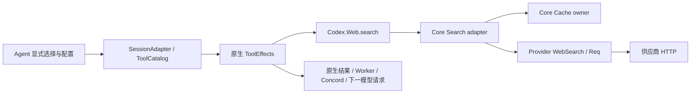

# 原生 Web 搜索的宿主适配

适用范围：Synapsis root `main` 未提交实现，Backplane 1.10.44，参考 OpenClaw `488631c18fae7cc541ba8fc8beff6cbb0438787b`。这是 P8 的普通搜索切片，完整参考能力和验收仍开放。

## 契约选择与所有权

原生 `service_compat` 的 `web::search` 只有 query 便捷 schema，无法表达参考供应商选项。对于已实现的结果列表分支，公开 `ToolCatalog.admit_batch/2`、宿主 `ToolEffects` 与 `Codex.Web.search/3` 足以保留其配置及选项：描述符持有 backend_context，Web 将 opts 交给宿主 adapter，再检查 results 列表和总体大小。因此扩展宿主描述符，不修改依赖或建立另一条执行链。正式1.10.44已增加kind:answer/content/有序citations契约，答案宿主接线沿用同一边界，见下文。

Backplane 继续拥有调用、效果取消、会话与结果契约；Agent 层负责已选择名称、动态 schema 和配置引用；Core 负责缓存及通用输出；Provider 负责供应商请求、响应及日期映射。既有 `web::fetch` 保持原契约。

## 可选工具与配置

新增名称只在 Agent 明确选择后装配，没有旧名别名、默认选择、环境探测或供应商 fallback：

| 原生名称 | enabled Agent 的 config 字段 | 行为 |
| --- | --- | --- |
| `synapsis::web_search` | `web_search` | 明确选择 Brave、Tavily、Firecrawl、firecrawl-free 或 Perplexity；结果模式最多10条，Perplexity Sonar为答案/引用 |
| `synapsis::tavily_search` | `tavily_search` | Tavily 专用选项、最多 20 条、answer 和 score |
| `synapsis::firecrawl_search` | `firecrawl_search` | Firecrawl 专用选项、最多 100 条及可选抓取 Markdown |

通用配置必须给 `provider`；专用配置固定对应供应商，Firecrawl 可明确选 `firecrawl-free`。配置支持 `credential_id`、`base_url`、`timeout_ms`、`cache_ttl_ms`、`count`、`mode`；Perplexity另支持可信`model`。除明确 keyless 外，使用既有 Credentials 引用，执行时 resolve/version；描述符不保存明文 key。

默认 HTTP timeout 30000ms、缓存 TTL 900000ms、count 5；Brave mode 默认 `web`，也可选 `llm-context`。TTL 0 跳过缓存读取与写入，且不淘汰已有条目。没有新增配置 UI 或保存现场配置；这些是 Agent config 的宿主 API。

工具公共参数统一用 `count`，对应参考 Tavily 的 `max_results` 和 Firecrawl 的 `limit`。供应商、endpoint 和 credential 不来自模型参数。在私有执行副本 trim query、补默认 count，并在缓存前归一化 Brave locale/time 字段；原始 ToolUse 和模型历史保留原文。

## 普通请求与输出

- Brave：base path 后追加 `/res/v1/web/search` 或 `/res/v1/llm/context`；传递 country、language/search_lang、ui_lang 及 freshness/date 范围。LLM 模式不发送 count/ui_lang，按返回顺序取请求数量，使用首个 snippet，绝对 age 槽映射为 published。
- Tavily：base path 后追加 `/search`，JSON `query`/`max_results`；专用工具另支持 search_depth、topic、include_answer、time_range 和 include/exclude_domains。
- Firecrawl：base URL 的根路径 `/v2/search`，JSON `query`/`limit`；专用工具另支持 sources、categories、include/exclude_domains、tbs、location、country、scrape_results 和 timeout_seconds。支持 data/results/nested data/web-news-images/legacy web 的普通结果 envelope。
- Brave和Perplexity按各自动态schema保留通用参数；其余通用工具只转发query/count，不将专用选项混入通用schema。

通用输出为 kind/provider/query/count/results/tookMs，以及可选 cached/truncated；每行只保留 title/url/snippet/published/siteName。先为最多 10 行保留 URL，再在共享 20000 UTF-16 单元预算中分配 title/snippet/siteName，避免首行长文本吞掉后续来源；与固定参考一致，published 日期元数据不扣此 URL/正文预算。专用结果保留 answer、scores、description 和抓取 content，Tavily/Firecrawl 正文共享 20000 UTF-16 单元预算。

宿主将公开 map 同时编码到 `content` 供模型消费；既有 ResultProjection、单字符串 262144 bytes 及总体预算保持。编码超限明确返回预算错误，不静默通过截断证明完整丰富结果等价。普通有效 Unicode 的 Provider/Core 预算已对照，完整原生持久化、极大来源/metadata、参考输出包装与全部结果分支仍未完成。Brave locale/time 的普通请求与缓存等价输入在后续切片完成，下文说明精确准备边界；领域无效参数分支只经源码复核，没有执行拒绝类测试。

## Unicode 与正文预算所有权

搜索专用的 `Provider.WebSearch.TextBudget` 按 UTF-16 单元计数：BMP codepoint 占一，补充平面 codepoint 占二；`take/2` 返回完整 Unicode scalar 的前缀及实际消耗单元数，不产生半个 surrogate。组合音标、ZWJ 和 variation selector 按各自 codepoint 消耗，可在字素内部停下，保持固定 JavaScript helper 的语义，不做 Unicode 归一化。一个补充字符放不下时，保留的一单元可由下一字段使用。

Brave 的完整 web/LLM callback 没有独立 20000 正文上限，Provider 因而保留其完整 title/description/snippets，再交 Core 通用投影。这样首行 20000 个空格不会提前耗尽后续来源的正文。Core 对普通文本先 trim 边缘空白，再按已预留 URL 后的预算依次处理 title/snippet/siteName。Tavily、Firecrawl 仍在 Provider 内依原顺序分配专用共享预算：逐行 title→snippet 或 description→content，最后 Tavily answer；通用调用随后再做 Core 投影。正文结果长度与 UTF-8 编码字节上限是两种独立边界。

参考捕获执行固定488631c的完整 `normalizeWebSearchOutput`、UTF-16/正文前缀 helper、Tavily/Firecrawl client search 函数及公开 Brave web/LLM callbacks。57份 source records 中38个完整模块执行、19份只作 provenance；实际 TypeBox1.3.37 的372份加载依赖记录hash。12个通用、7个供应商和8个前缀观察由本机Gaoxy/纯前缀用例直接消费。比较时仅移除参考封套及metadata stamp、排除真实耗时；专用结果另保留只去封套而不trim的字段，避免隐藏空白差异。普通有效UTF8和ASCII HTTP URL是本批输入范围，不证明完整封套、URL规范化、其他输出分支或runtime assembly。Node8/0；Provider7+Core4新例通过，与既有普通搜索/缓存/Worker八文件整合41/0（Provider7+Core31+Agent3，seed271907）。

完整原生Unicode/cache/Concord/新Worker回放用例先于产品修复运行时，在第三次fixture模型HTTP前storage_failed。临时只读native事件追踪确认 `{:invalid_txn, :spec_too_large}`；Concord/ex_turso3.1.8、最新正式v3.1.8及[Concord#109](https://github.com/gsmlg-dev/concord/issues/109#issuecomment-6430495888)已核对。该场景保留原完整响应/断言及上游TODO，未缩短、拆分、skip或改Store；诊断移除，停止该受阻验证。41/0包含既有三个短结果Worker，不包含这个原生Unicode用例，不能称Unicode持久化已通过。待正式大值原子CAS能力可消费后，再验原完整场景。

本批证据 `/tmp/synapsis-search-unicode-kmf8noic/`。独立SPEC→freshQUALITY均PASS；scopedformat与devcompile均exit0，实际managed PID582303→605901、旧进程退出/rootcwd/managerready/health200通过，收尾再次核对605901与health200。12路径范围、717保护文件、HEAD/index保持；八份配置仅Backplane自动attempt/success/sync时间与token变化，无手工保存。既有架构说明在project=synapsis、revision96按完整正文及labels精确读回，未新增任务状态note；reviewed代码/测试/脚本/fixture/map冻结，收尾只改两份文档验证元数据。Unicode原生持久化仍BLOCKED_UPSTREAM，完整P8与Goal保持active，未提交/推送/发布/部署。

## Perplexity Search API 与 Sonar 答案

历史1.10.42缺少答案契约，已按源码登记[backplane#125](https://github.com/gsmlg-opt/backplane/issues/125)，没有运行失败/拒绝复现。正式1.10.44已发布并消费原生`Web.search/3`及`x_search/3`的`kind:answer`、非空`content`与有序`citations`；该上游门槛已解除。以下为已接线的普通宿主契约，独立SPEC→freshQUALITY均PASS；完整参考验收仍受下述边界限制。

选中`synapsis::web_search`并在`Agent.config.web_search`明确设置`provider:perplexity`。复用现有`mode`，接受`search_api`（默认）或`chat_completions`；两模式默认`base_url:https://api.perplexity.ai`，均支持明确的可信代理地址。可选`model`默认`perplexity/sonar-pro`，仅是Perplexity配置字段；直接Perplexity主机的chat请求去掉开头`perplexity/`，OpenRouter或自定义主机保留命名空间。模型不是工具参数，也不进入通用公开输出。其他供应商的配置和默认值保持。

这是显式宿主适配：固定参考按credential provenance/key prefix及baseUrl/model override推断transport，且Search API地址固定；宿主使用既有配置/credential引用和明确mode/base_url，支持本机HTTP夹具及受控代理，不新增环境探测、供应商fallback、UI配置迁移或默认工具选择。

| 模式 | 模型可见参数 | HTTP与公共输出 |
| --- | --- | --- |
| `search_api` | query/count/freshness，另有country/language/date_after/date_before/domain_filter/max_tokens/max_tokens_per_page | POST base path + `/search`；query/max_results及映射过滤项；公开kind/results/provider/query/count/tookMs |
| `chat_completions` | query/count/freshness | POST base path + `/chat/completions`；model/messages及可选search_recency_filter；公开kind:answer/provider/query/content/citations/tookMs，省略results/count/model |

私有准备trim请求query与字符串、freshness别名规范为day/week/month/year、日期接受ISO或M/D/YYYY并规范化、domain过滤保持顺序和重复。Search请求把语言放入单项`search_language_filter`，日期变为无补零M/D/YYYY过滤项。count范围1..10、默认5；max_tokens上限1000000，max_tokens_per_page为正safe integer。Sonar的count保留在schema和原始ToolUse，但不发送HTTP，也不区分缓存键。领域无效参数分支仅源码审查，不新增或运行拒绝、安全或权限用例。

供应商层保留Search完整title/snippet文本，日期映射published；Sonar读取首choice.message.content，非空顶层引用优先、按原字符串首次出现去重，否则从全部choice的url_citation annotations按顺序取nested/flat URL并trim去重。返回的provider-only model只用于供应商结果和缓存身份，Core通用投影移除。两模式共享现有linked HTTP Transport与有限timeout，没有第二个请求owner。

Core通过公开原生Web callback返回真实答案map，不补空results或把答案变成结果行。答案投影按参考顺序最多扫描1000个引用、接受20个有效HTTP(S) URL，单URL最多2048单元；先为所有保留引用URL预留共享20000 UTF-16预算，再分配答案正文，最后分配可选引用标题，保留来源顺序和truncated标记。独立普通来源/预算用例与完整native大值持久化是不同证据。原始ToolUse不改，Perplexity公共query保留当前原文；私有trim后的等价query可复用缓存，命中后只为当前返回值恢复当前query，不改缓存中的canonical值。

原生宿主延续模型可见JSON文本，同时对answer使用已有native`structured`字段保留完整公开map及原始答案content。ToolResult的文本JSON、结构化projection、Part JSON、Concord和新Worker回放分别核对；不修改全局ResultProjection或provider mapper，不覆盖结构化答案的正文。结果列表工具保持既有shape。原生262144-byte单字符串和1MiB级总体预算保持。

缓存沿用现有100项owner及TTL策略，mode/base_url/model/credential version和准备参数区分身份，chat的无效应count排除；timeout和TTL仍不进入键。命中保留首次tookMs并加cached:true，TTL0不读写或淘汰。参考来源捕获只执行固定488631c完整factory/shared/runtime/normalizer，实际TypeBox1.3.37及纯helper；HTTP/JSON/header policy/deadline/字面量凭据是显式夹具边界，不声称其生产行为、完整plugin/runtime装配或真实供应商验收。

Concord#109仍OPEN，原完整Unicode/大值native场景保持未改且不重跑，不以其他Worker成功替代它。[Backplane#129](https://github.com/gsmlg-opt/backplane/issues/129)已由正式1.10.46修复并在本仓采用：公开Web.search允许带有效非空引用和truncated:true的空正文答案，原有大小界限保持。新增专用普通验收直接读取未改参考answer-citations-exhaust-body：供应商非空原文、20个各1000 UTF16单元的有效URL，经真实Gaoxy Sonar/Worker/native Web得到kind:answer/content空字符串、完整有序citations和truncated:true，与原publicUnwrappedResult仅排除tookMs及参考wrapper externalContent后完整相等。下一模型HTTP、structured投影、Part JSON、实际Concord list/get和新Worker下一回合重放均保留结果；仅一次搜索HTTP，无占位正文、删引用、预算变化、替代结果或依赖补丁。该完整引用预算分支已通过，不能扩展为Concord#109原Unicode场景、全部URL语义或真实provider验收。

当前URI投影已对照普通ASCII URL的主机大小写、默认port与percent编码等记录；完整WHATWG的Unicode hostname、dot-segment等序列化语义尚未证明等价，保留在完整P8/reference待办，不在生产增加ASCII-only拒绝来缩窄合法输入。本批两模式普通HTTP/Worker/Concord/replay、独立完整文本预算、预算耗尽callback与上述缺口分别记录，完整Perplexity参考/P8及Goal保持active。

本批协调普通整合Provider12+Core38+Agent5=55/0（seed276503），Node24.22.1为10/0且fresh capture等于冻结fixture；scopedformat/check和devcompile均通过，独立SPEC→freshQUALITY无待修发现。restart返回0但两次仍旧1488482，managedstop确认旧退出/无listener/stopped，再start实际1560962；rootcwd/managerready/health200通过。14允许路径外1639保护文件及HEAD/index保持，八份生产TOML仅Backplane后台同步时间与两个token自动变化。严格reference与baseline完整相等：inventoryVerified=true、complete=false、2824gaps，预期exit2/stderr0；其他169行/170whole-reference gates保持。现有canonical工程说明project=synapsis、revision120按完整正文/title/labels/attachments精确读回。收尾只更新本设计、计划及map本行的验证元数据，十份reviewed源码/测试/exporter/fixture保持冻结。证据`/tmp/synapsis-perplexity-host-cb_6s6n4/summary.json`；默认YOLO，无安全/权限或真实provider测试，未提交/推送/发布/部署，完整P8/Goal保持active。

## Brave 参数准备与一次执行边界

`Provider.WebSearch.Brave.prepare/3` 对照固定参考的完整 country/search-language 集合、六个语言别名及 UI locale 正则，trim、规范大小写并保留非空 search_lang 优先于 language 的规则；国家代码按参考映射为支持代码或 ALL，缺省不主动注入 US。输入的 search 字段可被视为 UI locale、且 UI 字段可被视为支持的 search language 时，按参考规则交换两者。

这一步不能重复执行。例如 search_lang=en-gb、ui_lang=pt-BR 首次归一化得到 pt-br/en-GB，再做一次会交换回来。Core 在缓存前调用 `WebSearch.prepare/2` 一次，miss 后直接使用同一 Provider 的 `search_prepared/2` HTTP 实现；直接 Provider `search/2` 调用也只准备一次再转入该实现。没有额外 runtime owner、模型字段标记或第二条 HTTP 实现。

freshness 的 day/week/month/year 和 pd/pw/pm/py 统一为 Brave shortcut，也接受有效 ISO 显式范围；日期接受 ISO 或 M/D/YYYY 并规范为 ISO。有效 bounded/same-day、web before-only 和两模式 after-only 的实际请求已对照。LLM after-only 在准备结果中冻结当前 UTC date_before，供缓存键使用；web after-only 则保留缺省 end、HTTP 才补当天，保持参考的不对称行为。LLM 不接受 UI locale，date_before 需要 date_after；日期顺序、冲突参数及必填 query 约束映射为原生 validation Error。这些领域约束由源码复核支持，普通成功路径之外未增加或运行测试。

新增捕获器执行完整、字节核对 pin 的公共 provider factory/runtime 及真实参数、时间、缓存、配置合并和 lazy-load 模块，记录 23 组/60 次普通 callback。44 份 source records 中 33 个模块执行、11 份只作来源核对；各记录明确标记 executed，不能将44都称为执行模块。HTTP wrapper、响应解析、deadline、endpoint classification、literal-secret 配置及日志是明确记录的夹具边界；这不证明生产网络、secret resolution、plugin registration 或完整 runtime assembly。没有截取函数体后重写归一化规则。Node 6/0；Core 对实际 fixture 中 21 组/56 个非午夜观察逐项比较 HTTP 与 cached 标志，组内 query 加后缀隔离缓存，隐式 UTC end 按当天重算。两个午夜组只在参考 synthetic clock 中执行，生产未做跨午夜现场等待。

新增 Core9/0、Worker1/0，与上一批两个普通文件整合18/0（seed271704）；Worker 保留四个原始别名/日期调用，实际仅两次搜索 HTTP，六次模型 HTTP、Part JSON/Concord 重读及新 Worker 无额外搜索回放。该批 SPEC 与 freshQUALITY 均PASS、scopedformat/devcompile均通过；managed restart实际513133→561660，旧PID退出、rootcwd/managerready/health200已核对。11允许路径之外零变更、711保护文件及HEAD/index保持；八份配置仅Backplane自动同步时间/token变化，无手工保存。canonical工程说明project=synapsis、revision94正文及labels精确读回。最终范围与证据见批准计划及 `/tmp/synapsis-brave-search-filters-jkns3518/summary.json`；完整P8与Goal保持active。

## 缓存、期限与生命周期

`Synapsis.Web.Search.Cache` 是 Core supervisor 下的独立 owner，最多 100 项，使用单调时钟。键包含供应商、结果配置、规范参数、既有 credential version/digest 和输出格式；HTTP timeout、cache TTL、已由显式 count 覆盖的配置默认 count 不进入键，Firecrawl 单次 timeout_seconds 也不进入键。通用与专用投影仍独立。Brave 参数准备只执行一次，命中保留初次 tookMs 并加 cached:true；HTTP 在调用者执行，缓存进程不等待网络，没有并发请求合并或重启恢复。

每项分别保留 inserted_at 和写入时 expires_at；当前调用的 TTL 只能缩短复用期限，不能延长原始到期时间。较短 TTL 导致 miss 时不删除仍可供较长 TTL 调用复用的条目；后续成功 HTTP 可以刷新共享值及写入期限。TTL 0 在读写前直接返回，不修改状态。对照固定参考，仅读取的目标到期时删除，不在任意读写时全表清扫；写入前满容量先移除最早插入项至 99，再 set。更新尚存的 key 保留原插入顺序，若 key 已在前一步淘汰，则重插入到末尾。这些策略由完整参考 helper 与普通成功 HTTP 验证；其余供应商参数规范化、base URL 等价形式和完整结果格式仍须各自对齐，不能称全部搜索行为等价。

该缓存策略切片证据 `/tmp/synapsis-search-cache-policy-hz1ucd_9/`：完整固定 Brave factory/runtime 的两模式共 8 组/36 次 callback、真实共享 helper 7 组/336 步，44 份 source records 中 33 模块执行、11 provenance-only。Node 新增 8/0，原 locale/time 6/0；旧捕获器仅导出已有 class，原 fixture 只更新 harness SHA，全部既有观察保持。Core 新增 11 例，包括直接消费上述全部公开调用及 helper 观察；时钟夹具按输入重置缓存时间戳并等比放大 100 倍留出调度余量，不替换生产时钟，不证明生产 wall-clock/午夜或跨主机时间行为。真实 Worker 三个 raw timeout_seconds=1/2/1 调用只有一次搜索 HTTP，五次模型 HTTP（含新 Worker 回放）；schema、原始 wire、Part JSON、Concord list/get_turn 与无重复搜索回放逐项核对。最终普通六文件整合 30/0（Core27+Agent3，seed271804）。独立 SPEC 与 freshQUALITY 均 PASS，scoped format/dev compile exit0。restart 两次观察仍为旧 PID561660，随后 managed stop 确认旧退出且无 listener，再 start 实际582303；root cwd、manager ready、health200 通过。12路径之外零变更、713保护文件及HEAD/index保持，审查源码冻结，收尾仅改两份文档验证元数据。八份配置只Backplane自动同步时间/token变化，无手工保存；canonical工程说明project=synapsis、revision95正文/labels精确读回。最终证据 `/tmp/synapsis-search-cache-policy-hz1ucd_9/summary.json`；完整 P8/Goal 保持 active。

Req 请求禁用自动 retry/redirect，流式累计 JSON 最多 16MiB；连接、pool、读、请求及 linked Task 总等待都有明确 timeout。错误转为领域原因，再映射为原生 Error。Task 链接到 effect，取消沿用原生 effect 终止；无独立 detached 网络 worker。专用 Firecrawl timeout_seconds 只选择 HTTP timeout，既有原生 600000ms effect watchdog 仍是更外层边界；timer-safe 配置范围不表示可完成同等长度的原生调用。

这些错误与取消机制目前主要由源码复核支持；本切片的执行验证限定为普通成功、缓存到期及 Worker 重启回放，不代表已验证所有网络错误或取消结算。

## 验证与剩余范围

证据目录：`/tmp/synapsis-native-web-search-ovxyhyvh/`。

新增独立 Core 用例覆盖 Brave 两个 endpoint、请求选项和来源顺序，Tavily 20/通用 10 条分界，Firecrawl 100 条、六种 envelope 和抓取正文，以及缓存重复/选项区分/到期、关闭缓存时保留满容量已有条目、通用正文预算。新增 Worker 用例使用本机 Gaoxy HTTP，覆盖三个 selected schema、四次原始调用、下一模型请求、Part JSON、Concord 重读、新 Worker 回放及 HTTP 不重复。独立 Core7/0（seed271611）、Worker1/0（seed271608）。首轮整合11/0（seed271609）、format/dev compile和managed410651→485436已通过；其后QUALITY发现满容量时TTL0写入仍淘汰旧项，专用第七例RED7/1（seed271610）复现，增加零TTL无状态变更分支后GREEN7/0。最终整合12/0（Core7+Agent5，seed271612）、SPEC→QUALITY复审PASS、scopedformat check和dev compile均通过。修正后restart命令未更换485436，确认两次后managed stop并核对旧PID退出/无listener，再start实际513133；root cwd、manager ready及health200通过。八份配置仅Backplane自动同步时间/token变化，无手工保存。最终范围证据见批准计划及该目录 summary.json；以上本地证据不代表真实供应商或发布验收。

不执行安全、权限、auth/TLS、negative、mixed suite 或真实供应商测试；保持默认 YOLO 行为。其余供应商、自动选择/fallback、参考 factory/runtime assembly、非搜索 Tavily/Firecrawl 工具、配置 UI、完整长调用/取消及极大结果持久化均未完成。既有Concord大值限制独立保留；Browser自动预算的官方API已随1.10.44消费，宿主预算接线仍开放；本切片不绕过这些限制。没有 commit、push、发布或部署。

## Exa 普通供应商接线

选择既有 `synapsis::web_search`，在 `Agent.config.web_search.provider` 显式设置 `exa`，并提供既有 `credential_id`；不新增工具名、默认选择、环境探测或现场配置迁移。默认 endpoint 为 `https://api.exa.ai/search`，timeout 为30000ms、count 为5、cache TTL 为15分钟。base_url 按供应商格式在缓存前规范化：trim、无 scheme 时补 HTTPS、路径去尾斜杠并只追加一次 `/search`、保留 query、去除 fragment。实际头 `x-exa-integration:synapsis` 标识本宿主；参考的 `openclaw` 值保留在 oracle 中，作为明确适配差异。

Provider.Exa 负责真实 POST、六种 type（auto/neural/fast/deep/deep-reasoning/instant）、最多100条供应商结果、ISO或M/D/YYYY日期与 freshness、contents 布尔或对象选项。省略/空 contents 规范为 `{highlights:true}`，嵌套 query 原文保留；type/count/contents/日期在缓存前准备一次。相对日期在实际 HTTP 请求时计算，保留 UTC 时分秒与毫秒；month 夹到前一月末，year 保持 JavaScript 闰日滚动语义。纯 `freshness_start/2` 与实际请求使用同一实现，可独立核对固定日历边界，无配置时钟入口。

供应商层先筛 record 再取 count，保留 title/url、按顺序 trim 后拼接的 highlights，依次 fallback 到 summary/text；独立 summary、有限数字 highlightScores、publishedDate 原文和包含 www 的 hostname 保留，不加20000正文预截断。Core 延续通用结果合同：最多10行，先保留 URL，再在共享20000 UTF16单元中分配 title/snippet/siteName，公开结果不包含供应商专用 summary/scores。Exa 复用现有普通 URL/日期规范化；完整 WHATWG URL 语义仍未证明。body 字节、单字符串、native aggregate 和 Concord 原有界限不改变。

缓存复用既有100项 Search.Cache，身份包含规范 endpoint、credential/version、type/private query/count、日期/freshness和完整 contents；timeout/TTL不拆键，TTL0不读写。公开 query 始终恢复当前调用原文，包括缓存命中，原始 ToolUse 不改。模型 schema 支持 count1..100、六种 type、日期/freshness与 typed contents；参考 factory 未标 query required、contents 子项只给描述，宿主按 callback 的实际必需 query 和布尔/对象规则生成更明确的原生 schema。配置仍使用已有 typed count/timeout/TTL 字段，不声称自动迁移参考插件配置。

固定488631c完整 Exa factory/runtime/config/readers/cache/output/byte reader捕获50组72次 callback，其中55个 HTTP、17个参考 cache hit及另6个纯 normalizer向量；34个完整模块执行、14个仅 provenance、真实 TypeBox1.3.37的372文件及58558 tracked blobs前后核对。原带frame结果保留，providerPortableResult只去精确frame和externalContent、不trim供应商原文；publicPortableResult来自真实通用normalizer，再移除frame/stamp。Provider与Core分别经实际Gaoxy比较全部55个HTTP-bearing callback的完整公开map，只归一tookMs；source固定 freshness日期另由同一纯日历函数核对，实际请求日期落在调用前后UTC窗口内。参考17个cache-hit和1ms合成clock策略属于source证明；Core另有实际默认/contents/query/timeout/TTL0与cache区分回归，不把source-only1ms时序称为现场验收。

本批先观察原生1/1、Core3/3、Provider8/8缺实现的RED。首次整合15项有两项失败：Provider的oracle计数在source新增7组后仍期待48（已同步55）；Core result-fallbacks未应用参考日期规范化。保留原失败证据，Core只将既有URL/日期通用准备扩展到Exa，并把新helper移至同arity定义组之后，随后三文件15/0（seed282705）。真实Worker覆盖12条供应商结果到10条通用结果、精确schema/raw调用/下一模型HTTP、PartJSON、Concord读回与完成后新Worker无额外搜索回放。协调最终18份专用正向文件85/0（Provider64/Core15/Agent6，seed282706），包括原搜索/提取/抓取/xsearch/codeexecution普通链；独立SPEC→freshQUALITY、最新进程替换/健康及范围收据随后记录于计划。证据 `/tmp/synapsis-exa-search-d8kredsw/`。这仍是普通供应商局部验收：完整来源装配、全WHATWG/sanitizer/wrapper、native大值与longdeadline、UI、真实账号、失败/取消/崩溃恢复均未验收；不运行安全/权限或其他排除测试，完整P8/Goal保持开放。

## Grok 网页搜索

Agent 显式选择既有 `synapsis::web_search`，在 `config.web_search` 设置
`provider: "grok"` 和既有 `credential_id`。可配置 `base_url`、`model`、
`inline_citations`、`timeout_ms`、`cache_ttl_ms`、`count` 和既有 `mode`；默认
`https://api.x.ai/v1`、`grok-4.7`、false、60000ms、900000ms、5、web。
count 会校验但不影响请求/缓存，mode 对 Grok 不影响请求/缓存。无新工具名、
环境探测、凭据 fallback、配置 UI 或现场配置写入。默认请求超时不代表长调用验收；
现有 Backplane effect deadline 与取消所有权继续有效。

Provider.WebSearch.Grok 沿既有 Transport POST `/responses`，body 为模型、一个
trimmed query 用户输入、`tools:[{type:"web_search"}]`、`store:false` 和按模型兼容的
low reasoning。共享 Responses 模型别名、reasoning 和解析器复用；不使用 XSearch.prepare，
其 X 帖子工具、默认30秒、偏好 none 和 filters 均属另一契约。根地址 trim/去尾 slash 后
保持大小写路径，每次构造请求时追加 `/responses`；输入已带该后缀仍会追加，重复准备配置
本身不改变根地址。准备使用私有参数副本，模型历史保留原始 ToolUse。

供应商结果保留原正文空白、model、有序引用和可选 inlineCitations；Core 复用现有 answer
投影，输出 kind/provider/当前 authored query/trimmed content/引用对象/tookMs，省略 model
和 inlineCitations。源码 framed/providerPortable/genericPortable 是分开的资格阶段，宿主
结果 envelope 和完整 WHATWG/Unicode/sanitizer/framing 仍是明确适配边界。缓存沿既有
Search.Cache，身份含规范根地址/model/inline、credential identity/version/digest、trimmed
大小写敏感 query 及通用投影；count/mode/HTTP timeout/TTL 不拆键，TTL0 不读写原条目。
命中后恢复本次 authored query，保持调用者不同的外围空白。

独立三份普通测试在四生产文件写入前冻结并观察缺实现 RED；Provider 对照固定488631c的
全部48个纯/真实本机 POST 完整请求与原始结果，Core 经实际 native Web.search 对照59次
完整公开结果（48 POST/11缓存命中）。两项真实 Worker 用例核对默认目录、显式配置、
两个原始调用、一次 POST、下一模型 wire、结构化 projection、Part JSON、Concord 和正常
新 Worker 回放无重复 HTTP。首版只有本机空根路径 fixture 构造失败；一处 routing 表达式
修正后，全部断言和原预期保持，同 seed 六项通过，生产实现无修复。格式 AST 与冻结断言
核对通过；当前范围和后续审查/重启/回归收据见
`/tmp/synapsis-grok318-evidence/summary.json`。未执行安全/权限或其他排除域、真实 xAI、
完整平台装配、失败/超时/取消/恢复和预算边界验收；这不关闭完整 P8/reference 或 P0–P15。

## SearXNG 自托管搜索

`web_search.provider = "searxng"` 现在沿同一个 selected-only `synapsis::web_search`
进入既有 Provider.WebSearch、Core.Search.Cache、native Web.search/ToolEffects 和
Worker/Part/Concord；没有新工具名、运行时、缓存或历史 writer。Agent 必须显式给出
`base_url`，没有公共实例默认值，也不读取环境/SecretRef。SearXNG 源把实例 URL 称为
credential，但它不需要 API key；宿主使用现有 keyless runtime，不创建或解析假凭据。
可选 `categories`/`language` 是字符串；默认 count5、HTTP timeout20000ms、TTL900000ms。
配置要求可选项为 nil 或字符串，空字符串视为未指定；模型 schema 只包含 query/count/
categories/language，count 保持来源 integer，另按现有 native 约定要求 query。

Searxng adapter 在缓存前 materialize 私有 trimmed query、有效 count/categories/language；
模型非空参数优先于配置。base trim/去尾斜杠，保留配置身份和路径大小写。请求清空原 query，
路径已以 `/search` 结尾则保留，否则追加；按 q、format=json、categories、language 顺序
编码 GET query，不发送 count 或 body。原始 ToolUse 不改。成功响应保留按顺序具备字符串
URL/title 的行，再应用 count；原始 title/snippet 空白、img_src 和 plain siteName 保留，
siteName 不删除 www。成功解析为空且分类列表不含 general 时，只再查询一次 general；
这不是 HTTP 失败重试，也没有供应商 fallback。

两次 GET 继续使用既有 linked Transport，每次显式1,000,000-byte响应界限，共享 adapter
绝对 deadline 的剩余时间；外层 native effect deadline 和任务所有权保持权威。来源每次
请求的 timeout 与宿主共享 deadline 是明确的接入差异，短成功用例不证明长调用/取消行为。
Core 继续拥有通用 URL/正文处理和缓存：闭合结果移除 img_src、trim prose，公开 query 在
fresh/hit 都恢复当前调用原文。identity 保留 source 的规范配置 base（含实际发送时舍弃的
旧 query）、有效 count/categories/language/private query，排除 mode/timeout/TTL 及被模型
覆盖的原配置 categories/language。TTL0 不读写原条目；再次启用可复用原 tookMs/结果。

冻结来源319的32组55callbacks保持；宿主独立三份功能测试先 actualRED6/6，再写四生产文件，
首轮 GREEN6/0。Provider 对照43个HTTP-bearingcallbacks的44次pure/本机GaoxyGET与完整rawmap；
Core 对照全部55个generic map、44GET和12sourcecachehits，另验证effective defaults/config
override、TTL0保留旧值和basequeryidentity。真实Worker分别检查默认目录和三次原始调用/
缓存/成功分类回退，完整下一模型wire、PartJSON、Concordlist/get与正常完成后新Worker不
重复HTTP回放。13个相关普通回归通过；七formatAST及三冻结testAST保持，devcompile与
审查/进程证据见 `/tmp/synapsis-searxng320-evidence/summary.json`。没有产品或夹具修复。

当前仍采用宿主已有显式 HTTP(S) endpoint 传输契约；来源 DNS/private/strict endpoint
分类和网络策略等价保持未验证，没有新增网络权限或分类策略。source封套/stamp有意省略，
完整 WHATWG/Unicode/sanitizer、非普通输出分支、env/SecretRef/plugin 平台、真实SearXNG服务
及失败/取消/恢复、预算/截断/阈值等排除域未验收；未运行安全、权限或认证/TLS测试。
这是普通本地宿主接线，完整 P8/reference/Goal 仍未完成；没有生产配置迁移或发布部署。

## DuckDuckGo HTML 搜索：部分实现，上游阻塞

DuckDuckGo 的 Provider/Core/native 接线已暂存，但模型目录入口暂停。独立冻结测试的首轮
集成运行中，7 项有 5 项通过，2 项普通 raw 成功场景在 Backplane 1.10.57 公共 `Web.search`
边界失败。其 normalizer 只接受 results/answer，不能携带来源实际产生的完整 raw envelope。
已登记 Feature/internal request/blocker [backplane#155](https://github.com/gsmlg-opt/backplane/issues/155)，
在 native provider admission 处返回 unsupported_capability 并保留 TODO。不得制造空 results、
重写 URL、丢弃 raw data、绕过公共 Web.search 或修改依赖来激活；须等待正式版本、在授权
范围更新依赖，并以原冻结测试核对完整链后再开放。本节不宣称原生链或整个 P8 已完成。

暂存设计复用原 Provider.WebSearch、Core.Search.Cache、native Web.search/ToolEffects 和
Worker/Part/Concord。显式 keyless provider=`duckduckgo`，默认完整 endpoint 为
`https://html.duckduckgo.com/html`；base_url 覆盖也表示完整 endpoint，不追加 `/html`。
配置 trim 后保留路径和旧 query 身份，请求覆盖旧 query。默认 timeout20000ms、TTL900000ms、
count5、modeweb、regionnil、safe_searchmoderate，无虚构 credential 或环境发现。
来源 factory 忽略声明的配置 count，模型 count 有效；宿主也保留该行为。宿主显式 timeout
控制实际 HTTP，是相对来源忽略配置 timeout 的接入差异。模型非空 region 优先于配置。

请求只按 q、可选 kl、kp 顺序发送 GET，不带 count/body，显式 header 仅真实 Synapsis UA。
新增 Transport.text 与既有 JSON 入口共用 linked task、有限 timeout、Req collector 和默认
16MiB 响应界限，仅最后 decode 分支不同。provider 私有 parser 保留 pinned anchor/class/
双引号属性规则，snippet 限在下一个 result 之前；先移除 b、其他 tag 转空格、collapse/trim，
再解码有限 named/numeric entity 一次，并替换解码后 NBSP/dashes/ellipsis；没有 DOM 依赖。
URL 解码一次，仅为检查第一个 uddg 参数临时补 https；无 target 的 `//` URL 保持原样且不
添加 siteName，绝对 URL 的 www 保留。SafeSearch 可选路由仅静态核对，专门配置/变化/过滤
测试按范围排除，固定默认 wire 出现在完整普通比较中。

来源新增的普通 raw 缓存回调证实 generic 恰为 `{kind, provider, data}`，无外层 query/time/
cached；命中仅增加 `data.cached:true`，保留原 trimmed query/tookMs。绝对结果继续闭合通用
投影并恢复当前 authored query。缓存只用现有 owner，以有效 query/count/region/safeSearch
和完整配置 endpoint 为身份，排除无关 mode、声明配置 count/被覆盖默认项/timeout/TTL；
TTL0 不读写旧条目。raw 逻辑已暂存，完整 native 通过性仍受 #155 阻塞。

来源26组48callbacks/34HTTP/14hits、CLI0和独立Node7/0通过；三份宿主测试先冻结并实际
RED7/7，首轮集成 Provider2/0、Core2/1、native3/1，无编译或 harness 失败。Provider 两项
包含34个完整 pure/真实本机Gaoxy GET 与原始结果。其余成功观察来自入口暂停前，不能替代
最终目录资格；原测试/预期保留，阻塞 consumer 不再重试。证据在
`/tmp/synapsis-duckduckgo322-evidence/summary.json`。安全/权限及既有排除域、真实服务、
完整平台/WHATWG/Unicode/封套和长 deadline 未验收；没有配置/依赖修改或发布部署。
