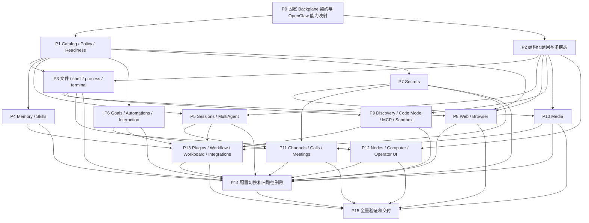

# Synapsis OpenClaw 工具体系全面替换实施计划

> **For agentic workers:** 使用 `subagent-driven-development` 或 `executing-plans` 按独立子项目执行；有依赖的任务串行，无依赖的任务可并行。每个子项目限定文件责任和 scoped tests。任务使用 `- [ ]` 跟踪；直接在 root checkout 的 `main` 开发，不得新建 worktree。每批修改结束后从 root 重启 `devenv processes`，Mix/Devenv builds 保持串行。

**Goal:** 删除旧工具及其执行旁路，基于 `backplane_agent_runtime` 的原生契约，参考固定 OpenClaw 基线补齐工具能力，保留现有运行时和持久业务能力。

**最新范围决定（2026-11-05，优先于下文历史迁移任务）：** 用户明确“全面替换, 不需要考虑迁移, 没有历史数据需要处理”。直接替换生产工具目录、factory/callers/默认配置并删除旧模型工具执行链；不再开发历史兼容、存量选择/权限/queued快照迁移、迁移收据、碰撞处置或迁移磁盘readback设施。下文相关设计/任务/证据保留为变更前历史，不再作为完成前置。保留Elixir/Phoenix、Concord、现有领域/UI及新运行产生的正常持久化；无关凭据/Provider/领域数据不在删除范围，也不因此中断运行中的工作。

**Architecture:** 用户已确认保留 Elixir/Phoenix、Concord 和 Backplane，并明确以 Backplane 契约为准。优先复用原生 profile/bundle，缺失的领域能力按其 descriptor/backend/result 协议扩展，统一接入现有 Conversation/ToolCatalog。所有入口共用准入、权限、执行日志、资源和取消链，不再包裹旧 Registry/Gateway/Executor。

**Tech Stack:** Elixir/OTP、Phoenix LiveView、Concord、TOML Config.Store、Backplane runtime/AI/MCP/skill protocols、Gaoxy.Test、DuskmoonBundler/npm workspaces；窄用途 JS/浏览器 helper 由 Port 监督。

**状态：** 完整剩余范围已设置为 active Goal，直接在 root `main` 持续开发。基础实现以 `f97ea32` 合入；当前未提交源码已将真实 Worker 接入原生 Conversation、Catalog/Policy/Readiness、精确权限与审批、结果持久化、原生本地命令/协作，以及文件、Memory、Skills、会话状态、摘要、MCP、持久邮箱、Swarm、会话注册观察和配置 Agent 目录工具。用户确认 UI/API 的访问者就是可信操作者，统一使用 `synapsis:operator`，不增加登录前置条件。普通配置保留与原生目录编辑器已通过独立 spec→quality 审查；新建 UI Agent/Toolset 明确使用 version1，该阶段曾要求既有 version0 显式迁移，现已由上述最新范围决定取消。配置目录已从有界数据 API 经 core/native/Profiles 接入 Worker，公开页面和游标实际进入下一次模型请求；该批整合201/0、spec→quality通过。另六类宿主工具已由各backend把受检公共结果放入content，真实Worker的下一fixture provider请求核对页面、消息、待办、元数据、候选和receipt；独立整合80/0、spec→quality通过，两组测试有重叠，不能相加为独立覆盖。后续新增只读automations list/get与REST/channel历史projection，15文件整合291/0、spec→quality通过；静态目录增加至45项。CLI随后接入投影预览，与覆盖基线整合33/0、spec→quality通过；CLI批次实际restart为2981004→3010753；后续P2原生view_image已完成有界结果展示和Concord→本机Anthropic fixture HTTP验证，生产目录仍45项。该批整合77/0，补充canonical Base64与基线44/0（存在重叠），spec→quality通过。图像批次经manager stop/start实际替换3010753→3110130，旧进程退出、root cwd、manager ready和health通过，三份完整配置指纹不变。新Toolset页45项与LiveView/WebSocket通过；另一Agent配置页phoenix.js返回ERR_EMPTY_RESPONSE且未建立连接，双页浏览器验收未全通过，Duskmoon#10仍开放。原始Responses/raw custom传输切片曾在1.10.36完成本机HTTP、Concord及第二请求重放，限定20文件357/0；initial/completion-only输入流保护另有历史回归证据。当前已在后续批次消费正式1.10.42并接入patch、view_image、CodeMode和Browser等工具，最新实现及验证限制以对应后文切片为准。生产配置接线、动态目录发布与context刷新、旧入口退出、P0全部参考证据和P2多模态全链均未完成，不能据此宣称全面对齐。

**设计与基线：** [设计](../specs/2026-10-23-openclaw-tool-alignment-design.md)、[170 项能力参考 JSON](../specs/2026-10-23-openclaw-tool-alignment-baseline.json)、[逐项覆盖矩阵](../specs/2026-10-23-openclaw-tool-alignment-coverage.md)。OpenClaw pin：`488631c18fae7cc541ba8fc8beff6cbb0438787b`。`f97ea32` 合入 root `main` 时的运行时契约基线为 `backplane_agent_runtime 1.10.31`，以 `mix.lock` 的 artifact checksum 和包内公开 API 固定；当前未提交批次已将 runtime 更新到正式 Hex 1.10.61，并采用必需的 backplane_json_schema 1.10.60 与 ex_json_pointer 0.9.0；AI/MCP/skill/plugin 保留受支持的 1.10.57，八包 HTTP 0.21.19 closure 不变。原生结果契约的普通直接/嵌套验证与完整 Skills 消费者接线分开记录；契约快照覆盖 `Approval.decide/2`、child interaction resolution/cancellation、`Codex.Session` managed-child adoption 与可选 `Plugins.Session` API；保留 1.10.28、1.10.30、1.10.31、1.10.32、1.10.34、1.10.35、1.10.36、1.10.37、1.10.38 历史夹具。

**阅读规则：** 下列阶段中的 OpenClaw 工具名、schema、profile 和 controls 是能力索引与比较样本，不是强制本地接口。P0 将其映射到 Backplane 原生工具或宿主描述符；多对一、一对多均可。冲突时遵循 Backplane 的身份、准入、授权、结果和生命周期契约，记录行为差异与未覆盖能力；不为同名外观重建运行时或修改已授权调用。

---

## 1. 完成标准与执行约束

1. 67 个 core catalog 名、34 个插件声明中的 103 个独有名，共 170 个上游参考项，以及实际装配的 runtime controls 均有能力映射与验收项；不要求新增 170 个同名工具，不把可选/未配置解释成能力已完成。
2. 所有实际工具通过 Backplane 原生契约验证。另对照上游 factory 的条件、action、输入约束、成功/拒绝/超时/取消/恢复/多模态结果，记录等价点、宿主适配及缺口；同名或 schema 相似不能证明能力已覆盖。
3. 复用现有 SessionAdapter、Provider adapters、Runtime.Store 和 Concord CAS，以及适用的 Backplane 原生 local/collaboration/interactive/services/dynamic/CodeMode/extensions bundle；不重复实现已具备的工具与基础设施。
4. 开发中可在独立测试环境使用新 catalog；不引入运行时自动 fallback。最终产品只保留新的执行链。
5. 按最新用户决定直接全面替换，无历史数据迁移或旧工具兼容要求；新工具仍按 Backplane 原生契约接入。权限不得因为合并工具或 `full` profile 自动扩大。
6. 全部测试按任务范围运行。遇到范围外失败列出并停止，不能顺手修复其他子系统；Mix/Devenv builds 串行，不能用并行子代理同时占用同一 build tree。每批修改结束后从 root 执行 `devenv processes restart synapsis`；无 process manager 时先执行 `devenv up -d synapsis`。检查 process status 和 `/api/health` readiness 后再报告该批完成，不能仅凭重启命令退出成功宣称服务可用。
7. 单元/契约、真实浏览器、真实外部账号、发布/部署分别记录。完成 mock 不能给 live verification 打勾。
8. 每个任务先添加列出的行为用例，证明集成或能力缺口，再实现最小变更并运行对应 scoped tests。该计划是多子系统的总计划；实际接口以 P0 固定的 Backplane 原生契约及能力映射为准，不从参考名称臆造参数。

**当前验证限制（用户最新指示）：** 默认使用 yolo 自动通过权限；不新增或运行安全、权限相关测试，也不运行包含这类用例的混合测试集。下文历史 Run 命令不覆盖此限制；当前仅运行独立的普通功能与生命周期用例，其他相关逻辑以源码审查记录，不能声称已有测试覆盖。

## 2. 阶段与并行依赖



P14 的代码准备可以早于长尾实现完成；实际整体切换要求覆盖矩阵所有配置中已使用的能力可用，且资源已 settled。只有 P15 覆盖全部目标后才能称“全面对齐”。部署不属于本次计划编写的授权动作。

**实施依赖细化（2026-10-23）：** P1 中 Backplane 原生 bundle 的组合、严格准入，以及原生 `prepare_tool/2` 上的独立宿主 Policy/Readiness 检查，可在原生契约夹具通过后实施，不依赖全部 OpenClaw factory 的导出。此细化只推进原生基础；P0 保持进行中，参考 action 的宿主 adapter、业务分类与配置迁移、能力等价验收、Worker 接线和整体切换仍须满足各自的来源、权限、结果与生命周期前置验证。

P2a 也可按已核对的原生 `{:ok, map}`、`{:error, Error}`、invocation-bound Rejection 和 Conversation 结果独立准备投影，再经现有 Part/Message/Store 持久化；不依赖全部参考 factory。这个切片不安装执行消费者、不改变 provider 编码，也不证明媒体可用性。P2 的全链验收仍须逐段接线和验证。

| 并行工作线 | 独占责任 | 共享依赖 |
| --- | --- | --- |
| A：基础执行 | P1、P3、P5、P9；原生 bundle 装配、agent tools/catalog 和 SessionAdapter 接口 | 与 B 约定原生结果的持久化/展示投影；P5 不依赖 #74 |
| B：数据与产品投影 | P2、P7、P12；data/provider/result、server/web/cli 展示 | 不能与 A 同时修改 SessionAdapter；按阶段合入 |
| C：领域与集成 | P4、P6、P8、P10、P11、P13 的独立目录 | P1 descriptor/policy 与 P2 result 协议稳定后分批开展 |

实际 worker 只有可用并发数时才调度。所有 worker 共用 root `main`，不得新建 worktree，并按文件独占责任；已合入的资源/投影批次曾由资源 worker 负责生命周期测试、投影 worker 负责 helper/测试、协调者负责 data 字段/序列化与文档。后续批次重新明确文件责任。公共契约按依赖串行确认，所有 Mix/Devenv 命令共用一个独占构建时段，不覆盖其他任务文件。协调者在每批修改结束后执行上述服务重启和 readiness 检查。禁止以并行工作为由绕过显式依赖。

## 3. 文件职责

以下 **Create** 路径是拟新增文件；**Modify/Retire** 指本轮已核对存在的路径。运行前先确认工作区变更，保护用户已有依赖/transport/测试修改。

| 区域 | 文件及责任 |
| --- | --- |
| 规范采集 | Create `scripts/openclaw/capture-contracts.mjs`、`scripts/openclaw/verify-baseline.py`；上游样本放 `apps/synapsis_agent/test/fixtures/openclaw/`，原生契约样本放 `test/fixtures/backplane/`，能力映射单独建账 |
| catalog | Create `apps/synapsis_agent/lib/synapsis/agent/tools/{capability_map,catalog,profiles,readiness,policy,permission_snapshot,backend}.ex`；复用 Backplane descriptor 协议，不新增本地 Contract 类型；仅缺失领域能力新增 adapter |
| 结果/交互 | Create `agent/tools/{result_projection,interactions,approval}.ex`；Modify data Part.ToolResult、ProviderMessages、MessageMapper、MCP.Response、worker/runtime.ex 及客户端投影；执行返回仍采用原生结果协议 |
| resources | 复用原生 local/ResourceRegistry；仅额外领域资源 Create `agent/tools/execution/{terminal,resource_owner}.ex` 等 adapter，不重复实现已有 exec/write_stdin 执行器 |
| 领域 adapters | Create `agent/tools/{filesystem,memory,skills,sessions,collaboration,goals,automations,secrets,browser,media,messaging,nodes,operator_ui,plugins,workflows,workboard,external_agents,github}.ex` 或对应目录；只转换契约并调用所属领域服务 |
| 配置 | Create `apps/synapsis_data/lib/synapsis/config/tool_migration.ex`；Modify Config.Store types/reader/schema、AgentConfigs、Toolset、SessionPermission、daemon/toolsets 与 resolver |
| helper | Create `packages/tool-host/`；固定 IPC、依赖和资源终止协议，使用 `mix npm.install` 管理workspace，不另加bun构建链 |
| 文档 | 实施完成时更新 `docs/architecture/05_TOOLS.md`、`08_SUBAGENTS.md`、相关 ADR/guardrails、PRD及 README；不得提前把提案写成已实现事实 |

## 4. 任务清单

### P0：固定 Backplane 契约、OpenClaw 参考与能力映射

**Scope:** 固定实际运行时契约，独立采集上游参考样本，再建立能力映射；不执行真实供应商、渠道、安装或设备操作。

**Create:** 上表两个采集/验证脚本；`apps/synapsis_agent/test/synapsis/agent/tools/{baseline,conformance,publication,resource_lifecycle}_test.exs`；`test/fixtures/openclaw/<pin>/` 与 `test/fixtures/backplane/1.10.37/`；历史 `1.10.28/`、`1.10.30/`、`1.10.31/`、`1.10.32/`、`1.10.34/`、`1.10.35/`、`1.10.36/` 保留。

- [x] 固定 Backplane 1.10.37 包版本、artifact checksum、公开 API、可选 preparation callbacks 与来源 hash；采集 7 个原生 family、60 个 descriptor、schema、安全属性、binding 类型与 exact grants/revisions。1.10.37 profiles 增加 direct_model_only exposure 与 tagged memories.match_mode，unconfigured 列表不变；当前快照还记录 `MultiAgent.cancel_interaction/3`、`Codex.Session` managed-child adoption 与可选 `Plugins.Session` API。这些 API 与来源证据不代表全部子代理生命周期、`append_feedback` 或插件目录已安装到 Synapsis 生产运行链。
- [ ] 补齐 operation、结果/拒绝、资源与 catalog publication 的完整观察样本。现有 conformance 已验证先提交意图、拒绝身份及不确定结果；本批补充以下有界进程资源观察，实际 shell/PTY/Code Mode/设备及完整恢复样本仍待实现。原生契约测试不能用 OpenClaw schema 替代。
- [x] 原生 ResourceRegistry/Conversation/Session 的有界观察：foreign/stale handle 不触发 cleanup，精确 release 只清理一次；owner death 关闭准入且不触碰其他 owner；cleanup timeout 后任务终止但实际资源仍存活，保留 uncertain 状态并拒绝重用；取消/期限到达停止真实 provider/资源进程。借用 registry 的 Conversation 终止后外部基础设施和其他 owner 仍存活；Session.close 只关闭资源，Session 进程终止另清理其自有 registry/supervisor。非 terminal run 恢复进入 recovery_required，不重放或改写 EphemeralStore。不是实际命令、完整 Concord 或恢复后 Session binding 验收；此版本 Session 只创建自有 registry，没有可用的 registry 借用接口。
- [x] P1d 补充原生 publication 行为观察：producer 内 token-bound stage 与可信宿主 receipt 对账；当前批次继续使用旧 catalog，成功结算并提交批次后下一 provider 才看到新 revision；失败/error-marked/cancel 丢弃暂存，陈旧 run/incarnation/revision、非 +1 更新与冲突发布原子拒绝，已发布 receipt 可重放、旧 effect token 不可复用。仅隔离 Conversation/EphemeralStore，不等于完整 Concord 恢复或生产 publication。
- [x] 校验附件的 67 core、174 manifests、34 tool manifests、109 plugin names、170 union，并记录来源 SHA-256。采集前后逐 blob 核对完整固定 tree；更新 pin 仍须单独评审新增/删除/动作变化。
- [ ] 从固定 tree 和实际 tool factory 导出 schema，覆盖 primary/child/scheduled、coding/messaging/minimal/full、有无凭据/插件/视觉/设备/客户端等代表性 context；记录 schema variant 与 eligibility。
- [x] 有界来源前置：独立采集真实默认 `createCronToolSchema()` 与完整 `CronToolOutputSchema`，保留原缓存/TypeBox Clone、完整结果分支及可重算来源；只记 schema 证据，全部 cron 工厂、装配和动作验收仍未完成（见后文 P0 cron schema）。
- [ ] 扫描实际 plugin 注册与工具装配，补齐 manifest 外动态声明。`search/find/grep/glob` 仅是 runtime facts 认可名，在没有 factory 证据前标为 recognized-only；不凭此新增四个默认工具。
- [ ] 每个 callable action 至少保存 valid、invalid、denied、unavailable 与 effect/结果期望；资源型另存 timeout/cancel/owner-loss/restore。不把随机 ID、时间戳和provider敏感内容固化为golden。
- [x] 为全部 170 项建立逐工具初步映射和处置，区分 12 项原生复用候选、145 项宿主扩展、12 项宿主适配与 1 项缺口；所有实现证据保持未完成。另记录 controls 和 recognized-only 名字。
- [ ] 逐参考 action 记录目标工具/服务、原生 profile/descriptor、输入结果转换、`native-reuse/host-extension/host-adapted/gap`、权限上限、行为差异和验收证据；保留未覆盖状态，不因工具名不同重复实现。
- [x] 实际复制的来源快照保留并验证适用 LICENSE；本批没有复制 TypeBox 依赖实现，只记录其版本和文件 hash。不预设后续实现文件同一许可证。

**已实现的采集/验证接口（采集输出目录须不存在）：**

```sh
node scripts/openclaw/capture-contracts.mjs --source /tmp/openclaw-488631c --pin 488631c18fae7cc541ba8fc8beff6cbb0438787b --out /tmp/openclaw-reference-capture --offline
python3 scripts/openclaw/verify-baseline.py --manifest docs/superpowers/specs/2026-10-23-openclaw-tool-alignment-baseline.json --fixtures apps/synapsis_agent/test/fixtures/openclaw/488631c
devenv shell --no-tui -- mix test apps/synapsis_agent/test/synapsis/agent/tools/baseline_test.exs apps/synapsis_agent/test/synapsis/agent/tools/conformance_test.exs apps/synapsis_agent/test/synapsis/agent/tools/catalog_test.exs
```

采集和验证脚本已新增；source 参数只接受逐 blob 校验且 commit 匹配的完整 checkout。`--offline` 禁止网络/安装/发送等 effect。验证结果区分来源错误（退出 1）和有效来源但覆盖不完整（退出 2）；不能把后者当作 P0 完成。

当前保存了49个来源可追踪的schema/factory recipe：原五个voice-call/Canvas/llm-task、Browser八个schema及36个实际factory构造。Browser包括四个直接构造、八个显式capability变体、24个role/profile/configured context；完整metadata含outputSchema与fresh VM独立调用的definition一致。readRuntimeConfig仅接受有来源记录的合成输入，未执行真实配置实现；engine capability输入不证明host profile解析。未调用execute，另有35份独立browserRegistrations捕获，执行原始api.registerTool完整statement与三个完整helper的精确字节投影，验证普通配置优先级/context/metadata；不执行整个registerBrowserPlugin或plugin loader。generic scanner、完整注册、运行时assembly/eligibility及动作效果仍未验证。真实固定源码用Node24.22.1与TypeBox1.3.37采集，58,558个tracked blobs前后核对，来源许可证保留；verifier仍有效但不完整exit2。详见[采集说明](../../../scripts/openclaw/README.md)。

### P1：基于原生契约的 Catalog、Policy、Readiness

**Create:** `agent/tools/{capability_map,catalog,profiles,readiness,policy,permission_snapshot,freshness,backend,approval}.ex`；相同命名的 `agent/tools/*_test.exs`。
**Modify:** `apps/synapsis_agent/mix.exs` 的 MCP umbrella dependency；暂不切换 Worker。

本批实现 `Catalog.compose/4` 和独立的 `Policy.prepare_tool/2`、`Policy.evaluate/2`、`Readiness.check/2`、`PermissionSnapshot.compile/4`、`Approval.request/3`、`Approval.resolve/4`、`Freshness.capture/3` 与 `Freshness.check/2`。组合器显式选择、核对 caller/run 和授权上限后，重新进行原生 strict admission。Policy 使用可信宿主 context 中的 scope、逐工具 revision、分类函数及精确 action/resource 决策；Readiness 要求同 scope、同 revision 的明确证据。它们只在隔离 Conversation 测试中通过原生 hooks 启用。完整配置/业务分类迁移、真实宿主审批端点、生产 publication 和执行接线仍属于后续 P1 工作；不能以本批测试通过勾选整个 P1。

- [x] P1a：实现原生 descriptor 组合、显式 none/选择、caller/run fence、重名拒绝及从授权上限缩小 grants/revisions；真实原生 strict admission 的组合测试通过。
- [x] P1a 补充：Backplane 1.10.30 的 fingerprinted collaboration binding 成套保留，选中名称和 `:none` 同时收窄 binding authority；陈旧/伪造身份和替换 manager 被拒绝。仅测试自定义契约，不增加生产别名。
- [x] P1b：在原生 `prepare_tool/2` 上执行无副作用的 Policy/Readiness 检查；按 exact caller/run/incarnation/catalog/tool revision fence 和 tool/action/resource 决策拒绝缺失、陈旧、不支持及不可用输入。未解决的 ask 返回 approval-required。原生 Conversation 的 allow/deny/ask/stale-readiness 测试验证拒绝不提交工具意图、不调用 backend；自定义 raw input 的保留目前仅有直接单元覆盖。
- [x] P1c：从显式 raw SessionPermission 编译有限 exact tool/action/resource 的权限快照；四级设置在 interactive/autonomous 都生效；session 与完整记录 fingerprint 必须匹配可信 scope。只保留精确名称及旧解析器可表达的 `name(*)`，未知名称、窄模式、歧义或畸形数据要求 needs_review，不丢弃限制、不补默认值、不做工具别名。动态 ask 通过原生 interact 暂停，再由认证宿主按原生 interaction/operation/scope 解答；回答后刷新策略、readiness、身份、分类目标与到期时间。无生产接线。
- [x] P1d：`Freshness.capture/3` 从显式 raw permission 与有限 provider/credential ID 读取当前证据；缺失、畸形、不可用或读取失败均拒绝。只返回身份和指纹，不输出配置、明文凭据或运行句柄。`check/2` 校验 canonical evidence 后严格比较；隔离原生测试分别在 Policy 之前和 Approval.refresh 中调用，证明权限变化/审批中凭据轮换时无工具意图或 effect。没有修改生产 Policy、Approval、SessionAdapter 或 Worker。

**P1c 权限源与边界：** 编译器不调用旧 Registry、PolicySnapshot、CapabilityPolicy 或 Grant；也不使用缺失记录时会补默认值的 `Permission.session_config/1`。可信宿主负责读取原始记录、给出预期 fingerprint、有限分类目标及新鲜 readiness；fingerprint 只是记录内容身份，不提供单调版本、实时撤销或 ABA 检测。四个 allow 字段必须显式存在，无人值守不会跳过其中任一限制。当前 `/4` 接口只知道 bindings 中的工具，因此集合外的 override 即使可能属于未选中工具，也要求人工迁移审查。

**P1c 动态审批边界：** 只接受不可变原 invocation 的 `:approved`，拒绝编辑和畸形回答；回答后允许期限缩短，禁止延长，并再次核对实际 action/resource。原生 Conversation 继续拥有 interaction ID、单次解答、取消和持久化；没有本地审批账本或 legacy Grant。host expiry 在请求、解答与刷新后执行检查，没有自动到期 timer，过期的人类等待仍可保持 pending。`Approval.resolve/4` 仅处理本模块含 scope 的动态请求。descriptor 的 `requires_approval` 是独立原生 gate；当前测试只证明该 gate 仍独立，尚不支持安全的双审批宿主接线。后续必须禁止静态 gate 编辑绕过分类，并在其等待后重查动态 policy/expiry，不能把本批检查称为全流程持续 freshness。[backplane#80](https://github.com/gsmlg-opt/backplane/issues/80) 的 resolver identity 结构校验已进入正式 1.10.32 四包，本轮更新后以原生 `Approval.decide/2` 消费回归验证 approve/deny 均拒绝缺失、空白、非 binary 和模型自身身份。移除过时 workaround 注释，保留宿主自己的 scope、当前 operation、expiry 与认证责任；原生接受 opaque identity 的结构不代表已经认证。

**P1d 时效与发布边界：** 默认 reader 使用公开 Store/Config.Store/Providers/Credentials API；permission 不补默认值，provider 同时验证当前可用性与 authentication_generation，credential 先验证可解析再取版本。`PermissionSnapshot.validate/2` 复用原始结构/语法/session 校验，不替代 exact binding/target 的 compile。当前证据不覆盖 MCP live discovery、OAuth 全部状态或 generation 以外的配置；跨 store 采样不原子，也不证明远端授权、实时撤销或 ABA 防护。真实 readiness 仍须独立校验。publication 只发布原生 catalog，不刷新静态 provider_context；旧 policy/readiness scope 对新 revision 仍会拒绝。生产接线须解决原生下一 provider 请求前的可信 context 重建，不能仅靠事件处理刷新后宣称没有竞态。

- [ ] 用 Backplane fixtures 验证 descriptor 的 tool_name/tool_revision/schema/backend/backend_context/safety；宿主 backend 导出 execute/1，结果遵循 `{:ok, map}`、`{:error, Error}` 或 invocation-bound Rejection，不另定义运行时协议。
- [ ] 从原生 `bundle.registry.tools` 取得 descriptors，按 P0 映射补宿主 descriptors，拒绝重名；构造完整 exact grants/revision map，调用 `Backplane.AgentRuntime.ToolCatalog.admit_batch/2` 并成套传递 registry/tools/authority。沿用 SessionAdapter 已有 strict admission 组合方式，不在授权后改名或复用不匹配 grants。
- [ ] 原生 profiles 按当前公开接口显式选择；OpenClaw minimal/coding/messaging/full 只作能力分组参考。显式 none、deny、credentials、device/client readiness、无人值守和 action policy 均不因 bundle 合并扩权。
- [ ] 配置名称/参数迁移在最终 descriptor 准入前完成；source/credential/policy revision fencing 和不可用原因可追踪。active catalog 仅走受支持的 stage_catalog publication，不能后台直接改列表；MCP不可信annotation默认不升级为只读授权。
- [ ] 将旧 deny/ask/allow 和安全能力迁到新 policy；按 action+资源求权限，维持 invocation/argument digest/interaction到期校验，不调用旧 Gateway。

**验收例，行为型测试而非mock内部调用：**

```elixir
test "strict admission refuses a descriptor missing from exact grants", %{
  native_descriptors: descriptors,
  authority: authority
} do
  [candidate | _] = descriptors
  denied = %{authority | grants: List.delete(authority.grants, candidate.tool_name)}

  assert {:error, _reason} =
           Backplane.AgentRuntime.ToolCatalog.admit_batch(descriptors,
             authority: denied,
             mode: :strict
           )
end
```

测试 setup 从 P0 原生 fixture 构造有效的 descriptors 与对应 run 的 authority；只删除其中一项 grant，再直接验证公开 admission API 拒绝完整候选集合。另用 effect counter 验证 revision/schema/approval 拒绝时无进程启动或终止，不用自定义 Contract 或模拟的本地授权 API 代替运行时边界。

**当前批次 Run:** `MIX_ENV=test devenv shell --no-tui -- mix test apps/synapsis_agent/test/synapsis/agent/tools/`。未来 profiles、完整宿主审批、生产 publication/context 刷新与执行接线分别新增对应 scoped tests。

### P2：结构化结果与多模态全链保真

**Create:** `apps/synapsis_agent/lib/synapsis/agent/tools/result_projection.ex` 及 `test/synapsis/agent/tools/result_test.exs`。
**Modify:** `apps/synapsis_data/lib/synapsis/{part/tool_result,part,message}.ex` 及对应 tests；后续再接 agent runtime `provider_messages.ex`、`provider_events.ex`、`session/worker/runtime.ex`、provider `message_mapper.ex`、MCP `response.ex`、server channels/controllers、CLI SSE解析和 web 结果组件。

**P2a 有界切片：** `Part.ToolResult.projection` 是可选 opaque map，`content` 保持旧文本；data 层仅保存/读取，不依赖 runtime。agent helper `ResultProjection.to_part/3` 把受检原生公共结果转为 `%{"version" => 1, "result" => portable_native_map}`；`from_part/1` 校验 v1 投影并可只读解析旧字符串。保留原生字段名、内容顺序、structured/artifacts/progress/details 和其他可移植公共字段，不新增 backend 返回协议。非文本只留在投影，不生成 JSON 文本或 unsupported 成功占位；这不证明 provider 支持这些 block。

原生 Error 仅保留有效 class、固定安全 message 和可移植 details，丢弃 cause；拒绝 proof 使用原生验证，且 operation.tool_call_id 必须匹配展示的 tool_use_id。proof 身份和操作上下文不持久化。明确 auth/runtime 容器及非可移植值递归拒绝，key collision/版本/内外错误状态不一致拒绝。任意公共文本或 metadata 中的秘密无法从内容推断，可信调用者仍须提供公共结果。

Part dump/load/cast 与 Message.encode/Concord read 保留 projection，nil 时不增加序列化字段。实际 `Store.commit_turn` 测试验证富结果保真、旧 turn 不变和同一 turn 幂等覆盖。`Session.Snapshot.encode_message` 委托 Message.encode；本批没有调用 snapshot 的全历史重写路径，也没有安装新的生产结果 producer/consumer。

- [x] P2a：实现上述独立 helper、可选 opaque 字段与旧格式兼容，并通过真实 Concord per-turn roundtrip；明确 auth/runtime 容器的大小写/分隔符变体递归拒绝，只转换受支持 type/status enum atom。按原生默认集合/深度/节点/字节预算在 JSON 前逐步规范化，再进行原生 Validation/Serialization；精确容器深度边界与原生一致。
- [x] P2b 前置切片：在 provider MessageMapper 消费可选 v1 projection，旧 nil 路径保持原样。用原生 Validation 校验预算与可移植性，仅显式 text/image 内容进入原生 Codec；Anthropic 保持顺序，OpenAI/Google 不支持的工具媒体明确拒绝。结构化 sidecar 只保留在存储，不隐式字符串化；无可支持内容时明确失败。暂不切换 ProviderMessages/Worker producer，避免现有无 content 的 collaboration 返回在 replay 时回归。
- [x] 修正宿主presence、mail、todo_read、teammate、summary、handoff的模型可见结果；仅由对应backend选择公开数据进入content，保留sidecar、隐私、预算和部分效果语义，不在通用provider mapper字符串化全部metadata。真实Worker下一次fixture请求包含实际页面/消息/待办/元数据/候选/receipt；独立整合80/0、spec→quality通过。保留所有既有预算；summary近上限拒绝没有新增fixture，不因此扩大验收。
- [x] P2 history切片：REST会话历史和channel join历史保留非nil的公共projection，旧nil结果不增加字段；真实Concord重读与REST/channel、现有live channel/SSE逐项核对。不解释或获取媒体引用，UI/CLI展示另行接线。
- [x] P2 CLI展示切片：真实Main.run HTTP/SSE消费可选v1投影，有序文本和图片摘要、公开sidecars及原生错误可见；不支持内容显式标明，不取引用或打印媒体body。新版预览最多500字符并显示截断，nil/absent旧文本行为保持；非法projection明确展示错误，不静默成功回退。独立spec→quality与限定26/0通过，不代表图形媒体或安装包验收。

- [x] P2 Web展示切片（局部完成）：既有React Chat通过共享`ToolResultView`读取受检projection；live/history/code-agent展示有序literal text、inline image、公开JSON sidecars及error，URI/resource/audio只显示metadata。Code-agent按tool_use_id关联交错结果；history不把原始projection与display重复发送。仅展示层，不改runtime/store/provider契约，不据此宣称整个P2/reference完成。普通功能8/0、六项选定回归6/0、独立SPEC→freshQUALITY及真实served hook桌面/390px四类快照展示通过；仅PNG实际解码，其他MIME仅表示保真。证据`/tmp/synapsis-tool-result-ui-wfbau0pt/`，范围与managed验收见后文。
- [x] P2原生图像结果展示切片：只按原始`view_image`身份把受检原生raw bytes/data URL转换为有序文本摘要和canonical base64图像，保留path/detail/MIME/bytes；不复制两份媒体、不读取引用或解码/缩放。泛用可移植性预算不变，原始数据最多196608bytes，超限在Base64/JSON分配前拒绝。已转为portable的历史直接校验canonical内容，不重建原生raw结果；旧nil/text历史保持兼容，实时同名摘要仍严格校验。真实原生profile/Conversation读取有效PNG，经Part/Concord重读后进入本机Gaoxy Anthropic HTTP，逐字节、顺序、状态和call ID核对；原生文件错误仍显式传递，限定整合77/0。生产NativeLocal/Profiles目录与read权限/provider-model readiness尚未接入，静态目录仍45项；OpenAI/Responses/Google工具图像由原生Codec明确拒绝。此切片不代表P3/P10或完整P2已完成。
- [x] P2原生补丁结果展示前置：精确`apply_patch`身份的有限成功形状保留有序added/updated/deleted/moved证据，包含重复路径和同路径move；错误只公开class、已完成files和uncertain_files，保留重复/重叠事实，移除原始message/cause与无关诊断。摘要明确失败或unknown outcome，不推断未变化、事务或回滚。路径原始UTF8保存在projection，ASCII/Unicode controls与分隔符仅在摘要中转义；字符串、列表、节点和完整摘要+证据预算不变，超限在摘要/JSON分配前拒绝。ProviderMessages实时文本、host转换、Part dump/load与真实Concord重读/replay限定整合105/0（含13个新用例），旧nil/text兼容；测试使用合成原生结果，不证明实际custom调用、provider HTTP或patch执行。原生准入受下述#104/#105阻塞，静态目录仍45项，整项reference evidence保持planned/unverified。
- [x] P2原始custom传输切片：显式atom/string `openai_responses`复用原生Codec，root或/v1端点含尾斜线统一到/v1/responses，保留原有监督、取消、deadline和bearer凭据处理。当前目录/唯一性/resolver fence保持；custom format与原始UTF8字符串（含空值/空白/多行）经typed completion、ToolUse、Part/Concord及第二次HTTP请求保持，返回匹配custom_tool_call_output；map参数继续作为JSON function。Anthropic/Chat/Google对custom声明和空目录下custom历史均在HTTP前拒绝。新增独立Responses配置选项、type/registry及默认URL，测试聊天复用canonical formatter，模型仍须显式import；原有presets与身份不变，本地UI error不作为用户消息重放。此为通用raw_probe与本机Gaoxy验证，不证明实际patch执行、真实供应商/Azure/OAuth或全P2完成，生产静态目录仍45项。
- [ ] 将版本化持久化/展示投影接到生产结果路径：ordered content blocks、structured content、错误、details、媒体引用、分页/截断、任务状态；保留旧字符串读取兼容。外部 isError 转为受检原生结果，不定义另一个 backend 返回协议。
- [ ] 将 text/image/audio/resource/link 从 MCP 到 Conversation、provider、Concord、API/SSE和客户端逐段保真，移除原先通用JSON字符串化和unsupported占位的成功路径。
- [ ] 大媒体经 Workspace blob和有权限引用交付；provider不支持相应block时能力装配或执行明确拒绝。
- [x] P2/P10普通TTS文件消费：不可变私有delivery fact保留原root/bound，公开ref→完整HTTP→shared聊天audio controls；38/0、SPEC→freshQUALITY、桌面/390px本机WAV播放及独立BEAM持久引用读回通过。旧locator迁移/Range/其他codec/渠道/真实provider和恢复不据此完成。
- [ ] 对旧历史只读解析，确保不修改既有transcript、不执行旧tool call、重复terminal事件不重复append。

**Run，先新建 `agent/tools/result_test.exs`：**

```sh
devenv shell --no-tui -- mix test apps/synapsis_agent/test/synapsis/agent/tools/result_test.exs apps/synapsis_agent/test/synapsis/agent/runtime/provider_messages_test.exs apps/synapsis_agent/test/synapsis/agent/runtime/provider_events_test.exs
devenv shell --no-tui -- mix test apps/synapsis_provider/test/synapsis/provider/protocol_codec_integration_test.exs apps/synapsis_mcp/test/synapsis/mcp/tool_call_contract_test.exs
```

**Pass:** 包含文本、图片及结构化字段的一次工具调用，经真实本地provider协议fixture及Concord重读后保持顺序、归属和内容；secret/token不进入任何结果。

### P3：文件、shell、process、共享终端

**Create:** `agent/tools/filesystem/`、`agent/tools/execution/`；`agent/tools/{filesystem,execution,process_lifecycle,terminal}_test.exs`。
**Reuse:** Workspace PathResolver/Permissions/FileDocuments/blob、Backplane 原生 `exec_command/write_stdin/apply_patch/view_image` 及 ResourceRegistry；先验证集成与权限，再只补缺失领域能力。

**原生补丁历史阻塞与当前接线（2026-10-26）：** 1.10.36的链接路径写入及缺失全目标公开preflight曾分别上报[backplane#104](https://github.com/gsmlg-opt/backplane/issues/104)/[#105](https://github.com/gsmlg-opt/backplane/issues/105)。正式1.10.37已消费，当前selected-only `NativeLocal`复用公开`Codex.ApplyPatch.preflight/2`、原始custom descriptor及native Backend接入真实Worker；不复制parser或改写输入。普通多action功能、原始Responses传输、Concord重读和下一请求/下一回合回放已限定验证，静态目录51项。用户要求不运行安全/权限测试，compound要求与全目标预检接线仅源码审查；不把普通成功用例当作路径隔离或完整授权验收。执行仍为顺序partial effect，不承诺事务/rollback，完整参考等价保持未完成；详见末尾生产补丁切片。

- [ ] 将 `ls/read/write/edit/apply_patch` 的参考动作映射到原生工具或必要宿主 adapter；验证分页continuation、图像读取、编辑、无变化、rename/delete和不确定写入证据；每种路径都验证项目/Workspace权限。
- [x] P3原生补丁普通功能切片：原始custom语法、全目标公开预检、selected-only原生执行、重复路径顺序结果、Concord重读及下一请求/下一回合回放；2项正常功能与独立目录枚举通过。安全/权限逻辑只源码审查，全部参考action、失败恢复与现场已保存选择执行未完成。
- [ ] 以原生 exec_command/write_stdin 覆盖 shell/process 交互；核对句柄、poll/log/stdin/kill/timeout、输出预算、PTY和目标路由的实际支持。缺口单列，不另建 OpenClaw exec/process 调度器，不把旧一次性 `/bin/sh` 当成backend。
- [ ] 核对短命令与后台服务的能力差异；Stop、kill、资源归属与存续遵循 Backplane 生命周期，不能为匹配上游参数绕过 owner/fence；资源仅能被授权owner访问。
- [ ] 实现 operator `terminal` 共享输入的显式权限，和process后台命令分开管理；客户端未连接或sandbox不允许时不构造该工具。
- [ ] 验证超时、child crash、owner death、重启旧handle拒绝；OS隔离、平台PTY、run间资源存续任何不满足处先定依赖issue，不用字符串过滤伪装隔离。

**Run:** `devenv shell --no-tui -- mix test apps/synapsis_agent/test/synapsis/agent/tools/filesystem_test.exs apps/synapsis_agent/test/synapsis/agent/tools/execution_test.exs apps/synapsis_agent/test/synapsis/agent/tools/process_lifecycle_test.exs apps/synapsis_agent/test/synapsis/agent/tools/terminal_test.exs apps/synapsis_workspace/test/synapsis/workspace/file_documents_test.exs apps/synapsis_workspace/test/synapsis/workspace/permissions_test.exs`。

### P4：Memory、Skills、个人指令

**Create:** `agent/tools/{memory,host_memory,workspace_memory,skills,personal_instructions}.ex` 和对应限定测试；core `memory/{scoped_reader,host_agent,workspace_reader,settings}.ex`；memory/skill持久服务按需增量修改，不换掉已有数据authority。

- [x] P4a 有界切片：新增 core `Memory.ScopedReader` 与原生 `synapsis::memory_search`/`synapsis::memory_read` descriptor，读取真实 FileAdapter 项目记录。可信宿主固定 project/session/run 身份，模型只能提供 query/limit 或 memory_id；不经旧工具、Retriever、缓存或 touch_accessed。读取前缩小目录，拒绝静态 symlink、hardlink、越界和记录归属不符；限制候选数、文件、输出与执行期限，错误不伪装为空结果。仅项目 scope；缺少可验证项目关联的 session 记录不开放。引用为真实 semantic record ID，检索为有界词面匹配；不是 OpenClaw 文件行号、向量或全 corpus 等价实现。文件描述符与前后身份检查不能宣称原子的 openat 防替换保证。
- [x] P4b host-agent 切片：通过 core `Memory.HostAgent` 接本机 `4222` 的公共 recall API，agent `Tools.HostMemory` 提供原生 `memory::recall`（`memory.read` 权限）。可信宿主绑定 source/loopback endpoint/run；模型只能给 query/limit，资源与引用标明 host 默认分区，不声称项目/session 隔离。保留受检 online/offline、canonical/provisional 与 stale 状态；不可用、超限及畸形结果显式失败，无旧文件回退。HTTP 接收字节/总期限与 owner-loss 清理有界，不复制 host gateway 凭据，不继承全局 Req 默认认证或 transport hooks，不声明远端取消或 retry-safe。生产 config、目录和全局 Memory adapter 尚不切换。
- [x] P4c 默认来源与配置：`WorkspaceReader` 读取 Agent workspace 的 `MEMORY.md` 和 `memory/**/*.md`，不要求 YAML、不自动创建，小写根 `memory.md` 不默认加载。生产 `memory_search` 默认给出真实文件/行号的词面命中；旧 semantic records 显式 `source=records` 可达。主会话有界预载 `MEMORY.md`，Backplane 子代理使用单独预建的无 memory prompt，legacy child/session 与 QueryLoop 也排除自动记忆注入。`memory.toml` 经 Config.Store 保存，host 默认关闭，显式启用后才允许领域入口和原生 descriptor 执行；禁用或更换 source 后旧绑定拒绝。Settings `/settings/memory` 只配置，内容统一 `/agent/memory`，保留旧 Knowledge/Events/Checkpoints。此切片使用现有生产注册通道，不整体切换原生 Catalog/Policy。
- [x] P4d 原生 workspace 切片：`WorkspaceMemory` 提供 `synapsis::workspace_memory_search`/`synapsis::workspace_memory_get`，复用 core reader 的真实 Markdown 搜索与按行读取。可信宿主固定 canonical workspace/run/incarnation/catalog，模型只能给 query/limit 或相对 path/from/lines；分类精确到 workspace 或文件，校验完整 backend context。text 与 structured 合并限制 64 KiB，保留真实行号、截断与 partial-line 提示。真实原生 admission/Execution 验证成功读取和撤销 grant 时无 dispatch/intent；不改变旧 semantic descriptors，不安装生产 Catalog。
- [x] P4e host exact get 切片：按 [backplane#84](https://github.com/gsmlg-opt/backplane/issues/84) 的公开授权接口新增 `Memory.get_host`、`HostAgent.get` 与原生 `memory::get`。模型仅能提供 lowercase canonical UUID，权限精确到 host 默认分区的记录；执行时复查持久 Settings 与完整来源。只接受 online/canonical 单记录及一致 ID，不要求或伪造 recall 的 pending count；固定错误、响应/合并输出预算和绝对期限有界，无 list/recall/mirror fallback。通过 fixture 与原生 Execution 验证，未安装生产目录。4222 现场 discovery 仍没有 get，现场读取验收另行完成。
- [x] P4f 原生 Skills 读取切片：core `SkillReader` 保留持久 Skill UUID 与 source-qualified 外部 ID 的区别，原生 `synapsis::skills_search`/`synapsis::skills_read` 仅访问可信 Agent 已分配且允许模型自动调用的条目。搜索仅含元数据，读取按精确 locator 返回惰性文本；执行复查分配、来源、版本、可选摘要和可用性，不执行指令或调用旧 Tool.execute。现有 legacy loader/validation 提取为共享领域 helper，旧显式调用行为保留。候选、文件、结果、期限及 owner-loss 有界；历史 nil digest 不伪装成内容快照，远端取消为合作式，不承诺强杀后的临时目录清理。尚未安装生产 Catalog，也未实现 workshop。
- [ ] 完整实现原生 `memory_search/memory_get` 和 memory-core `intent`；workspace 原生搜索/按行 get 与 host 默认分区 exact get 已提供，生产接线与会话/vector corpus 仍未完成。上游 [backplane#83](https://github.com/gsmlg-opt/backplane/issues/83)/[#84](https://github.com/gsmlg-opt/backplane/issues/84) 的源码修复已核对；客户端项目/source/access 授权与过滤仍需独立实现、验收，不能从上游关闭 issue 推断本地已有项目/session 隔离。
- [ ] 接 `memory_store/recall/forget`、`wiki_apply/get/lint/search/status` 的可选契约，补关键词/向量/混合检索；索引能力与实际可用embedding分开报告。
- [ ] 完成 Skills 生产接线及 `skill_workshop` 创建、验证、版本/归档/恢复；P4f 已提供 installed-eligible 原生搜索/读取的独立切片，保持现有 source UUID/revision/可选 digest 和 agent 分配，不把 skill 文本执行成工具。
- [ ] `personal_instructions` 绑定认证requester，不绑定session owner或任意传入ID；共享会话跨用户测试必须隔离。
- [ ] 旧 memory_save/update/session_summarize/todo projection 的业务数据在新tool或host hook可达；使用可选memory插件不丢既有记忆。

**Run:** `devenv shell --no-tui -- mix test apps/synapsis_agent/test/synapsis/agent/tools/memory_test.exs apps/synapsis_agent/test/synapsis/agent/tools/skills_test.exs apps/synapsis_core/test/synapsis/skill_catalog_test.exs apps/synapsis_workspace/test/synapsis/workspace/file_documents_test.exs`。

### P5：持久 Sessions、子代理与外部会话身份

**Create:** `agent/tools/{sessions,collaboration,presence,task_suggestions}.ex` 和相应测试。
**Modify:** 现有 `agent/runtime/session_adapter.ex`、Sessions领域服务、Worker runtime及相关UI；保持现有Journal/Store。

- [ ] 先独立实现 `sessions/sessions_create/list/history/search/session_status`、`presence`、`suggest_task/dismiss_task`；历史分页、可见范围、当前requester、建议未执行/非持久语义按fixtures验证。
- [x] `synapsis::agents_list` 提供启用配置Agent的有界公共目录，经 `AgentConfigs.directory/2`、core/native和生产Profiles/Worker接线；同健康Store快照验证可信requester，公开JSON及游标进入下一次模型请求。当前child roster仍由原生`list_agents`提供，不混用，不把configured视作spawn eligibility。
- [x] P5历史读取数据前置：data-only `Session.Store.list_turn_page/2` 按canonical UUID和exclusive整数cursor读取升序稀疏turn；每页1..100项、最多512次一键keys_only seek，共享最多五秒期限。只点读选中key，额外canonical key仅判断has_more；malformed key耗尽、读取消失、非map、超时、存储错误与payload超限均显式失败，不空成功或返回部分页。默认64KiB、最大1MiB是已读opaque turn的external_size合计上限，不是解码前分配限制或模型JSON预算；不做序列化。真实Concord新增12项先RED后GREEN，与旧Store/presence/commit/pending-input整合46/0、spec→quality通过；旧API源码逐字保留。此API只读durable历史，每次独立观察当前状态；不保证compaction/import/重写后的snapshot分页，不读取live Worker，也不证明会话存在或可见。stale_page与读后超时分支已源码核对，未加确定性竞争fixture。该数据前置当时尚未接入core/native；后续sessions_history与sessions_list的限定生产接线见本节及末尾批次证据，完整P5未完成。
- [ ] 直接复用原生 collaboration_v2 的 `spawn_agent/send_message/followup_task/interrupt_agent/list_agents/wait_agent`，在准入前选定该 bundle；将上游 sessions_spawn/send/wait/yield/subagents 参考动作逐项映射并记录差异。#74 是可选名称扩展，不作为本阶段前置条件，不改写已准入 invocation。
- [ ] 覆盖task/session持久性区别、followup、嵌套、独立模型/推理参数、collector输出、root/child权限与预算继承、等待环、容量拒绝、owner loss和未知结果。只有实际缺失的必需能力路由上游；参数表达不同不自动成为 blocker，也不能静默忽略行为差异。
- [x] P5持久历史原生切片：`synapsis::sessions_history`以exact persisted Session UUID读取有界durable页，默认当前session；core公共投影、selected-only Profiles、静态目录和真实Worker下一fixture请求已接线。完整参考offset/anchor/pending及稳定snapshot分页仍未完成，详见末尾本批证据。

- [x] P5持久会话目录基础：`synapsis::sessions_list`以有界UUID候选和metadata提供公共列表、Agent/关键词/更新时间过滤、完整有界候选集上的最近排序与offset；真实Worker结果/下一fixture请求和静态目录接线完成。置顶/归档/预览/live与完整reference等价仍待实现。

- [x] P5会话状态观察：`synapsis::session_status`提供source auto/live/durable，live从Worker-owned状态有界投影、durable只读metadata；自身活动回合与下一fixture请求/Concord结果接线完成。模型切换/default reset、usage/cost、状态事件/version和capabilities仍待实现。

模型选择写入受[concord#107](https://github.com/gsmlg-dev/concord/issues/107)阻塞。固定参考的override/default intent与实际attempt模型分开，变更报告pending；recovery/compaction可采用新选择，不能承诺一律下一turn生效。现有Synapsis idle-only switch在Worker内同步预检完整历史并写回整个metadata，与独立turn/title写者存在覆盖风险。revision-fenced字段patch与atomic append-and-patch是待审设计，尚未实施；不引入selection sidecar或本地timeout绕过。需先消费并验证正式Concord期限修复，再确认writer边界和采用时机；尚无证据证明Backplane缺少必需接口。

- [x] P5非持久任务建议原生基础：`synapsis::suggest_task/dismiss_task`经有界内存服务与selected-only Profiles接入Worker；只记录/撤回proposal，不创建会话或启动任务。专用功能9/0、独立目录1项与spec→quality通过。后续operator pending卡片、实时list/dismiss与导航清理已接线，专用UI功能7/0及SPEC→QUALITY通过；历史Concord#107前置已由正式3.1.13满足；batch360已接入本地目录accept/start/回执重放，其他模式和完整恢复仍未完成，见后文。

- [ ] subagents=false仍走Conversation，只减少协作catalog；跨任意历史session发送通过Sessions服务，不能用MultiAgent.snapshot替代。

**Run:** `devenv shell --no-tui -- mix test apps/synapsis_agent/test/synapsis/agent/tools/sessions_test.exs apps/synapsis_agent/test/synapsis/agent/tools/collaboration_test.exs apps/synapsis_agent/test/synapsis/session/worker_runtime_test.exs apps/synapsis_agent/test/synapsis/session/worker_subagents_test.exs apps/synapsis_agent/test/synapsis/agent/runtime/store_test.exs apps/synapsis_data/test/synapsis/runtime/store_test.exs`。

P5 使用现有 MultiAgent 生命周期推进原生协作集成，不依赖自定义名称接口，也不在 Synapsis 实现临时子代理管理器。持久会话与跨会话权限仍须单独实现和验证。

### P6：Goals、进度、交互、决策与 Automations

**Create:** `agent/tools/{goals,progress,interactions,decisions,automations}.ex` 及相应测试；data新增所需data-only目标/automation记录。
**Reuse:** Routines/Heartbeat/Daemon运行链，保持Daemon→Sessions→Worker。

- [ ] `create/get/update_goal` 严格保留显式目标请求、显式预算、完成/blocked状态约束；todo转换不自动创建目标或预算。`progress_card` 保留root资格和持久parent归属。
- [ ] 优先复用 Backplane interactive 控制族表达用户输入与审批，经可信primary surface解答并暂停执行budget，拒绝child/无人值守不支持的交互；一次回答只推进对应interaction，记录与上游 ask_user 的映射差异。
- [ ] `decision_evaluate` 按version/tagged inputs实现boolean/choice/score/sort/tags/box和provider-neutral结果/usage，unsupported明确返回。
- [ ] `automations` actions=`status/list/get/add/update/remove/run/runs/wake`，覆盖at/every/cron/stream/event、管理场景on-exit、timezone、systemEvent/agentTurn/script payload和none/announce/webhook投递。
- [ ] 保存creator authority与工具权限上限，启用/禁用trigger时裁剪schema；重启、取消、自删scope、run-once、重复触发和事件游标都有契约测试。现有UI建立的routine可从新工具查询和管理。

**P6只读先行切片（2026-10-25）：** 新增data-only `RoutineConfigs.directory/get_visible`，只读取routine和legacy heartbeat配置，经健康Store内ETS公共字段投影、同一有界期限、分页和exact source+UUID查询，按可信Agent的实际`agent_name`执行路由可见；缺省路由遵循现有main默认，不能把路由称为creator ownership。与固定OpenClaw ownerless legacy routing visibility对照，不推断project/account/session授权。配置只输出id/source/name/kind/enabled/schedule/timezone/agent_name，不读取prompt/provider/model/metadata/tool权限或scheduler。core `AutomationDirectory`与原生 `synapsis::automations` revision1已按selected-only Profiles接入Worker，使用`:read`权限、exact scope/grant/revision和绑定session/requester/page或source/id的纯分类。公共页面JSON进入content并保留structured，两者合计最多64KiB；真实下一次fixture provider请求及Concord重读均核对。随后新增的`status`仅观察实际生产`Heartbeat.LocalScheduler`进程和最近一次reload结果，下述限制仍适用；runs/写入/触发和creator authority保持未完成。

- [x] P6只读配置数据API与有界公开投影；UI既有routine和heartbeat可达，其他Agent路由不可见，缺失/损坏Store不能空成功。
- [x] P6原生automations list/get接入同一Catalog/Policy/Worker，结果进入下一fixture模型请求；不赋予调度或写入能力。
- [x] P6原生automations status接入同一Worker与结果链；只返回node-local进程运行观察和最近reload结果，有限等待且不枚举配置或任务。
- [x] P6来源明确的终态runs：真实producer保存配置collection+UUID，data/core/native revision2提供有界当前历史页和exact run_id，下一fixture请求及Concord/newWorker回放通过；旧来源未知明确保留，不等于完整runs历史、delivery或全部P6。
- [x] P6既有cron字符串的显式timezone：生产LocalScheduler经独立CronSchedule使用锁定tzdata/IANA数据，不改全局Calendar；保留默认UTC、严格未来、fold仅首次及gap跳过重匹配，timezone-only更新替换对应timer，持久时间仍为UTC。仅此调度语义切片，完整at/every/trigger/payload/delivery与模型写入仍开放。

**status边界：** `Heartbeat.LocalScheduler.public_status/1`使用唯一且封闭的server/deadline选项，共享最多五秒绝对期限；调用前、O(1)回调和返回前复查。超时、缺失或退出明确失败，不把不可用改成空或健康成功。固定公共结果只有engine/running/reload_status，后者为pending/ok/failed；ok仅代表既有loader及协调回调正常返回，既有legacy fallback和逐任务skip不因此变成配置健康或可执行保证。旧`status/0,1`仍保持兼容，模型工具不调用它。原生status不接受任何附加模型参数，纯分类仍绑定可信session/requester和engine，保留`:read`、scope、grant、revision及64KiB合并结果预算。既有加载流程仅记录结果，不增加加载、触发、存储访问或调度分支。原生及真实Worker新增用例先RED15项，再与旧LocalScheduler、Profiles、原覆盖基线和完整native-domain文件整合105/0，seed0，独立spec→quality通过。`devenv restart`未替换PID，经manager stop/start实际3136033→3182196；旧进程退出、root cwd、manager ready、health通过，三份完整已存配置指纹不变。未调用真实provider、迁移现场配置或触发现场任务；未重做浏览器验收，Duskmoon#10仍开放。证据`automation-status-final-integrated.log`与`native-directory-automation-status-final-runtime.json`。

Goals优先复用Backplane `Codex.ExtensionRuntime` 与 `Goal`/`GoalBridge`，不把无持久backend的reference mode装成生产支持。当前已采用Concord3.1.13，完整Goal.Store后端已完成174；175接通普通终态provider用量归一化。286接通真实Adapterowner/WorkerHost边界、普通root/child归因核算和terminaloutbox的publicdelivery/ACK/startupreadiness。Host当前明确不准入自动continuation或伪造instructionACK；完整reservation/release/continuation、canonicalhostcontrol与publicdescriptors仍未启用，也未签发authoritative-usage capability。普通路径不等于完整Goal工具或预算资格。旧Concord#107阻塞描述仅属于历史版本，不再是这些本地任务的当前门槛。

**Run:** `devenv shell --no-tui -- mix test apps/synapsis_agent/test/synapsis/agent/tools/goals_test.exs apps/synapsis_agent/test/synapsis/agent/tools/automations_test.exs apps/synapsis_agent/test/synapsis/agent/tools/interactions_test.exs apps/synapsis_agent/test/synapsis/agent/tools/decisions_test.exs apps/synapsis_agent/test/synapsis/agent/routine_trigger_test.exs apps/synapsis_agent/test/synapsis/agent/routines_test.exs`。

### P7：Secrets、凭据引用与输出隔离

**Create:** `agent/tools/secrets.ex`、core凭据输入/egress服务、必要data-only引用记录、`agent/tools/secrets_test.exs`。
**Modify:** Credentials metadata API、server可信输入endpoint和web安全输入组件。

- [ ] `request/list/delete` 只向模型提供metadata/SecretRef；秘密通过可信UI直接进加密store，不经过prompt/tool result/日志/SSE/history。
- [ ] secret注入按entry+destination+invocation授权，区分env可读值和protected secret；代理/进程grant随退出、取消、timeout撤销。
- [ ] 已有provider Credential保持独立UUID、空值保留和rotation fencing；不能把通用secret请求误写成修改provider认证。
- [ ] 用标记secret做全链泄漏检查：模型请求、文本结果、Concord、client DOM、日志均不得出现明文。subagent/无人值守不能索取凭据。

**Run:** `devenv shell --no-tui -- mix test apps/synapsis_agent/test/synapsis/agent/tools/secrets_test.exs apps/synapsis_provider/test/synapsis/provider_credentials_test.exs apps/synapsis_mcp/test/synapsis/mcp/credential_rotation_test.exs`。外部真实凭据仅在用户实际配置后另记live验证。

### P8：Web 与 Browser

**Create:** `agent/tools/web/`、`agent/tools/browser.ex`、`packages/tool-host/src/browser/`；`agent/tools/{web,browser}_test.exs`。

- [ ] 优先用原生 services profile + 宿主 adapter/configuration 覆盖 web_search/web_fetch；核对搜索供应商、引用、正文提取、缓存/大小/重定向/timeout及网络policy。Tavily/Firecrawl 参考能力按原生 descriptor 扩展，不要求保留其外观 schema。
- [x] P8 原生 fetch 切片：显式选择原始 `web::fetch`，从 enabled Agent 的 `config.web_allowed_hosts` 构建原生 service profile；有限 Req transport、公共正文投影与 Worker/Concord/模型请求/重启回放普通验收通过。Agent Tools 页提供独立主机列表字段，仅完成源码复核、格式与编译，没有 UI 行为测试。搜索、正文提取、缓存和 Browser 仍单列，完整参考证据保持 planned。
- [x] P8 原生搜索普通功能切片：三个 selected-only 宿主 descriptor 经公开 `Codex.Web.search/3` 接 Core adapter/cache 和 Provider HTTP；显式配置 Brave web/LLM、Tavily、Firecrawl，专用选项与20/100条结果保留，通用最多10条/共享20000字符。Core7/0（seed271611）、真实Worker1/0（seed271608）覆盖schema/原始调用/下一模型HTTP/Concord/新Worker无重复搜索回放；完整locale/Unicode/丰富大结果、其余供应商、factory/assembly与外部验收仍开放，整合审查收尾见末尾。
- [x] P8 Brave普通参数对齐：locale/六别名/UI交换、freshness与日期归一化在Provider准备一次后用于Core缓存；原始调用保留。完整固定factory/runtime/helper23组60callback、Node6/0，Core实际重放21组56个HTTP/cache观察与Worker整合18/0（seed271704）；UTC午夜仅参考synthetic-clock，完整缓存策略/输出/装配仍开放，收尾见末尾。
- [x] P8 搜索缓存执行策略对齐：timeout/TTL/已覆盖默认count及Firecrawl单call timeout不拆结果key；当前TTL与原始expiry共同限复用、TTL0读写无状态变更、key-local expiry与固定插入顺序/满容量先prune后set。固定完整Brave8组36callback及helper7组336步经Core重放，Node新增8/0、普通整合30/0（seed271804）；原始native调用/Concord/新Worker回放保持。完整参数/输出/装配仍开放，最终收尾见末尾。
- [x] P8 普通Unicode的Provider/Core预算：UTF16完整scalar前缀、组合/ZWJ逐codepoint计数、URL先reserve及字段顺序；Brave不做Provider预cap，Tavily/Firecrawl保留专用共享cap。完整固定normalizer/clients/helper共12通用+7provider+8prefix观察，本机直接消费，Node8/0、普通八文件41/0（seed271907）。原完整Brave原生Unicode持久化已由下述319采用通过，其他provider/完整输出与装配仍开放。
- [x] P8 原完整原生Unicode/cache/Concord/新Worker回放：正式Concord3.1.9及Runtime.Store公开storage-mod_revision CAS采用后，原fixture/全部断言通过，见下文319采用与seed319008的42/0收据。3.1.8的spec_too_large保留为历史；不据此证明其他provider或完整P8。
- [ ] P8 Perplexity完整参考：正式1.10.44已解除#125，宿主显式SearchAPI/Sonar两模式的普通HTTP/Worker/Part/Concord/新Worker回放已接通，专用Provider5+Core7+Agent2=14/0（seed276502），source Node10/0。完整预算的合法citation-only答案已随正式1.10.46解除[backplane#129](https://github.com/gsmlg-opt/backplane/issues/129)：原20个有效URL占满20000单元/空正文的完整来源用例通过真实native Worker/下一模型HTTP/Part/Concord/新Worker不重复效果回放；见后文282420验收，无拒绝测试或绕过。完整WHATWG URL/wrapper语义、长调用/取消及真实供应商仍未完成，不能以普通两模式称完整参考能力。独立SPEC→freshQUALITY均PASS，协调普通整合55/0及Node10/0、实际进程替换/健康与范围核对通过，完整P8保持unchecked。
- [x] P8 Browser参考捕获切片：固定源码八种schema（默认24 actions/14 kinds）与36个实际factory构造，完整metadata/outputSchema经fresh VM definition独立比较；配置读取使用记录的合成输入，不证明真实配置解析。另有35个精确source投影lazy callback普通配置/context/metadata用例，不执行完整plugin注册。整体校验保持有效但不完整exit2；runtime assembly/eligibility与动作执行仍未验证。
- [x] P8 Browser managed-host基础与生产接线：隔离Chromium的Node helper、dormant core Port broker、selected-only direct_model_only descriptor、native ResourceRegistry及SessionAdapter已连接，目录54项；13 actions/14核心act路径、有限IPC、真实退出与取消结算。普通helper3/0、core2/0、真实Worker3/0及SPEC→QUALITY通过，覆盖PNG/Concord/下一模型请求、重启回放、跨turn保留及child隔离；不完成下列全量Browser要求。
- [x] P8 Browser observation/emulation/dialog切片：补齐console/requests/errors/text/emulate/dialog，当前19 actions；有界逐tab记录与正文、设备/媒体/时区/locale、当前与预设dialog、全页截图保持模拟状态。普通helper新4/0+原3/0，原生两文件+core整合6/0（seed831620），SPEC→QUALITY通过；expiry/capacity异常分支仅源码复核，其余5个action及全量等价仍未完成。
- [x] P8 Browser文件原生整链：正式Concord3.1.9公开大值CAS与Runtime.Store采用后，原完整pdf/download/waitfordownload/upload及history/owner/正常cleanup/newWorker replay已通过，见下文319采用seed319008的42/0收据。原场景/payload/断言保持，未绕过上游。其余importprofile/driver/routes/options/UI/packaging仍开放。
- [x] P8 Browser AI ARIA YAML正文切片：一次公开YAMLcapture、固定rendered-line depth/interactive/compact、源ref精确绑定、longname formatter行为已接线；4份完整源/12向量oracle、五Node文件27/0及原四完整nativeARIA/URLs/delta/labels链4/0（seed273303），SPEC→freshQUALITY通过。host aliases/预算/finalizer与完整Browser仍单列，详见末尾本批证据。
- [x] P8 Browser两阶段图像处理源码与普通helper：保存2000px/5MiB、送模1200px/5MiB、独立artifact/inline、一次annotation rescale与owned compute Worker退出已接线；固定完整源13executed+7provenance/6精确向量，新13/0、六Node文件45/0及旧小图原生链3/0（seed273204）。原完整native链已由下述319采用通过，不升级整项Browser。
- [x] P8 Browser两阶段完整Worker/history/Concord/replay：正式Concord3.1.9及Runtime.Store采用已解除原provider6前的storage失败；十call原图/预算/字节/尺寸/效果/历史断言保留，仅修正为使用各次labels返回的当前ref。原完整链与正常退出/新Worker回放已通过，见下文319采用seed319007及319008收据；完整Browser保持开放。
- [x] P8 Browser条件等待切片：`act.wait`支持同步/异步fn的false→truthy轮询、function/expression/body归一化，按timeMs/text/textGone/selector或ref/url/loadState/fn顺序执行，selector使用首个匹配；沿用原生owner、整个调用deadline及handle清理。独立helper6/0、真实Worker/Concord/重启回放与既有普通整合7/0；扩展Node回归最初15/17；后续独立夹具批次补齐project_root与清理顺序，原17例全部通过，两个截图兼容缺口已关闭。完整Browser仍开放，详见末尾证据与限制。
- [x] P8 Browser输入阶段切片：元素hover后延迟/真实双击、坐标按下到释放延迟、参考key aliases及按键hold、保留原文的75ms默认slow type；递归私有归一化保留原始ToolUse。专用Node5/0、真实Worker1/0（seed271401）通过，整合与审查收尾见末尾；不增加整个调用deadline，递归预算及完整导航协议仍开放。
- [x] P8 Browser逐调用自动预算普通切片：正式1.10.44的#121经纯planner/官方selector/剩余Port预算与Node独立phase timeout接线，显式outer覆盖、rawToolUse及全局effect600000保持。专用Elixir9/0、Node整合22/0、source4/0，独立SPEC→freshQUALITY均PASS；Elixir扩展整合19项中18通过，旧静态工具数57对61的范围外失败保留，受影响旧PNG场景未验收。18路径基线与证据见`/tmp/synapsis-browser-deadline-m0T43DSy/`；native human-pause源码证据、profiles纯聚合/live单profile、完整Browser保持独立，原三项Concord#109大值链的当前通过证据见下文319采用。
- [ ] browser实现实际schema列出的所有动作，含status/start/stop/tabs/open/navigate/snapshot/act/screenshot/requests/errors/text/emulate/doctor等；稳定ref失效需重取，不猜旧ref。
- [ ] 支持host/sandbox/node、managed/existing-session/remote CDP profiles所需路由与权限；缺目标时不悄悄切回host。浏览器helper经Port接受窄IPC，取消清理自己创建的资源。
- [ ] 本地fixture站点验证点击/填表/导航/下载、网络错误、移动模拟、截图多模态送模、停止和重开；不使用真实登录账号测试。

**Run:** `devenv shell --no-tui -- mix test apps/synapsis_agent/test/synapsis/agent/tools/web_test.exs apps/synapsis_agent/test/synapsis/agent/tools/browser_test.exs`；随后由隔离浏览器访问fixture站点，保存截图/DOM/console证据。HTTP/provider用Gaoxy.Test。

### P9：Tool Search、Code Mode、MCP、Sandbox 统一接入

**Create:** 原生 dynamic/CodeMode 配置与宿主接入所需的 `agent/tools/{discovery,code_mode,mcp}.ex` 和对应测试；不新增另一套 Code Mode executor。
**Modify:** MCP.Server/Response及facade、Sandbox.Bridge；替换旧catalog registration，不能让mcp/sandbox反向依赖agent。

- [ ] 优先复用原生 dynamic 工具框架；将 tool_search/tool_describe/dispatch_action 的发现、描述与分发能力映射到同一授权catalog，保留direct-only能力，不强制三个参考名称或 schema。
- [ ] 复用原生 CodeMode profile/bundle 的工具名、等待、恢复及 continuation；核对精简目录、MCP命名空间、shell桥接、direct-only媒体。不得为兼容 OpenClaw exec/wait 外观新建 JS 调度器；provider batch 名称仍须无冲突。
- [ ] 测试原生装配条件、显式启用/禁用、模型支持、executor失败、审批budget暂停、continuation恢复和嵌套调用身份；对上游互斥/awaitResults/restartSafe 等行为单列能力映射和缺口，不照搬为执行规则。
- [ ] MCP改为可信session/run dispatcher+不可变source snapshot，保留source UUID、all/selected/none、刷新/撤权/同名替换fencing、调用超时及caller-owned取消；按pin接resources与事件协议，`mcp_events`纳入工具覆盖。
  - #132的公开caller-owned Events页API已随正式146采用；#144的EventRequest身份/controlled wait/retirement与native注册/清理桥接已随正式151采用，原生Conversation/nested Headless普通验收见后文151批次。mcp_events只浏览一页descriptor，不订阅/调度；生产模型入口仍等待独立Events来源范围决定，资源UUID不替代该决定。没有fake resource handle/name、私有RPC或本地tracker。
  - 资源历史#123/#130/#139门槛均已正式采用；当前151保留独立Agent.config.mcp_resource_source_ids默认[]、source snapshot/Daemon冻结与原生list/templates/read模型入口，省略server按保存顺序查询全部显式来源。普通Worker/Concord/replay证据见后文资源批次；dynamic展示与事件来源/生命周期仍独立，完整P9未完成。
- [x] Sandbox Bridge支持层反向调用使用宿主注入的同一原生dispatcher，移除Executor/allow_missing_session/default-yolo旁路；缺绑定不分发仅源码审查。真实native夹具验证嵌套意图先于效果、完成提交先于回复及取消资源结束；没有安装生产model-facing Sandbox工具，P9其他项仍开放。

**Run:** `devenv shell --no-tui -- mix test apps/synapsis_agent/test/synapsis/agent/tools/discovery_test.exs apps/synapsis_agent/test/synapsis/agent/tools/code_mode_test.exs apps/synapsis_mcp/test/synapsis/mcp/server_test.exs apps/synapsis_mcp/test/synapsis/mcp/tool_call_contract_test.exs apps/synapsis_sandbox/test/synapsis/sandbox/bridge_test.exs apps/synapsis_agent/test/synapsis/session/mcp_refresh_test.exs`。

### P10：图像、PDF、语音、视频、音乐与远程分析

**Create:** `agent/tools/media/`、provider capability adapters、blob交付组件；`agent/tools/{media,pdf,media_lifecycle}_test.exs`。

**原生图像历史问题与当前准入（2026-10-26）：** 1.10.36的两级symlink越界读取曾由公开PathGuard与Tools.call在临时fixture复现，并上报[backplane#106](https://github.com/gsmlg-opt/backplane/issues/106)。后续正式1.10.38已消费递归target修复和原生image回归，当前1.10.42保留该实现，NativeLocal现已按显式选择安装view_image；旧TODO与准入阻塞不再适用。修复后的路径实现按用户当前限制只做源码核对，不运行安全/权限测试；普通Anthropic/Responses图像Worker/HTTP/Concord/replay验收见后文。原历史fixture已清理，其日志不证明当前包仍有缺陷或具备并发race隔离；provider/model readiness和完整P10仍未完成。

- [ ] 复用原生 view_image，补齐 pdf 的文本/分页/原生视觉宿主能力；保持已实现用户图片输入，验证Agent主动文件读取和 provider 结果投影。
  - Backplane#116 的正式 inline user PDF codec 已随1.10.43消费，宿主临时canonical resource已接入MessageMapper并按候选选择原生/提取路径。Anthropic/Google普通HTTP、Worker/Part/Concord/replay局部验收见后文2026-10-27 inline PDF切片与`/tmp/synapsis-inline-pdf143-0sp1iqba/`；两份完整PDF原bytes按序送模，native-first无pdfHost/提取Port。混合fallback、完整option/lifecycle、全reference与真实provider仍未完成，不能把局部接线或既有HTTPS链接称完整P10完成；继续保留公开codec与内容预算。
- [ ] 实现 `image_generate/video_generate/music_generate/tts`、入站音视频理解与STT，异步生成有submission、task ID、取消、完成投递、失败和重启不重放状态。
  - OpenAI-compatible STT 的独立 provider 协议切片见后文：仅显式 bytes→text、固定来源 oracle 与本机 Gaoxy 普通功能，不启用入站预处理、不新增模型工具，不代表本项完成。
- [ ] 接 `x_search/code_execution` 的真实provider协议，不在本地伪造远程执行；接 `local_image` 可选本地模型能力。
- [ ] 按pin供应商capability逐项建立fixture与adapter，保留不同编辑/参考媒体/异步限制；具体provider未配置只影响readiness，不删除实现验收项。
  - OpenRouter 音乐的独立协议切片见后文：固定来源 SSE oracle、显式请求与本机普通 HTTP 对比，不注册模型工具或推导异步任务完成。
- [ ] 用小型本地图片/PDF/音视频fixture验证解析与媒体引用，再单列真实provider输出的成本/授权和live证据，不在测试调用真实API。

**Run:** `devenv shell --no-tui -- mix test apps/synapsis_agent/test/synapsis/agent/tools/media_test.exs apps/synapsis_agent/test/synapsis/agent/tools/pdf_test.exs apps/synapsis_agent/test/synapsis/agent/tools/media_lifecycle_test.exs`；仅运行本任务新增的provider adapter scoped tests，使用Gaoxy.Test。

### P11：消息、渠道、电话与会议

**Create:** `agent/tools/messaging/`、core渠道服务与provider/transport adapters、`agent/tools/{messaging,meetings,transcripts}_test.exs`。

- [ ] `message` 保留实际渠道支持的动作，`conversations_list/send/turn` 使用精确conversationRef、相关reply和参与者authority；内部AgentMessages不冒充外部渠道。
- [ ] 为pin的channel manifest逐项实现传输、thread/reply、附件、反应/投票等支持动作及readiness；权限不支持的动作从schema裁剪。不能只挑一个聊天渠道后称完成。
- [ ] 飞书14项、`zalouser`、WhatsApp登录/电话、`voice_call/facetime_call/talk_voice`、`google_meet/slack_huddles/teams_meetings/zoom_meetings` 全部逐action实现；硬件/账号依赖独立标记。
- [ ] 实现 `transcripts` 捕获/读取/授权、语音会话生命周期和会议结束清理；退出后不得继续录音或沿用capture grant。
- [ ] Automations announce/webhook与媒体完成投递复用相同渠道服务，失败/重复/uncertain delivery不盲目重发；保留requester和目的地记录。

**Run:** `devenv shell --no-tui -- mix test apps/synapsis_agent/test/synapsis/agent/tools/messaging_test.exs apps/synapsis_agent/test/synapsis/agent/tools/meetings_test.exs apps/synapsis_agent/test/synapsis/agent/tools/transcripts_test.exs`。真实发送、登录、呼叫和会议要有实际授权，不能拿测试fixture当已接通证据。

### P12：设备节点、桌面手机、交互面板与门户

**Create:** `agent/tools/{nodes,computer,mobile_ui,operator_ui,portal}.ex`；设备协议、server/web presenter及相应测试。

- [ ] nodes支持配对/状态/能力/通知/摄像/屏幕/位置及pin列出的全部动作；`computer/mobile_ui` 按设备支持动作构建schema，权限和目标离线明确拒绝，不回退到其他设备。
- [ ] `file_fetch/dir_list/dir_fetch/file_write` 及 `node_inference` 走节点/文件传递服务，不能误用同名旧file_write；大文件blob、链接权限和目标路径分别校验。
- [ ] 分别实现 `screen/theme/dashboard/show_widget/canvas/portal`：operator panes、持久布局、内联widget、配对Mac panel和local web app入口各有独立归属，不全部用HTML字符串代替。
- [ ] widget/页面嵌入需来源与能力隔离、可撤销媒体/portal引用；停止/归档会话时按资源合同关闭，不能留下未知公开入口。
- [ ] Linux/macOS/Windows/Android/iOS及特定Mac canvas等实际平台支持以pin设备矩阵建账；无真实设备只完成协议fixture，live栏保留未验证。

**Run:** `devenv shell --no-tui -- mix test apps/synapsis_agent/test/synapsis/agent/tools/nodes_test.exs apps/synapsis_agent/test/synapsis/agent/tools/operator_ui_test.exs apps/synapsis_agent/test/synapsis/agent/tools/portal_test.exs`，再运行本任务新增web测试和浏览器E2E。UI使用DuskMoon/LiveView及现有asset构建链。

### P13：插件生命周期、工作流、Workboard 与外部集成

本阶段分四个可独立提交、验证的子项目，不能做成一个巨型PR。每个插件的确切名字和来源见覆盖矩阵，以下任务必须覆盖全部分配项。

**P13A — 插件与宿主管理。** Create `agent/tools/plugins.ex`、core integration lifecycle/config服务及 `agent/tools/plugins_test.exs`。实现 `plugins` 的list/inspect/search/install/enable/disable/uninstall/reload/reloadAndResume、capability review、generation drain/activate/dispose；`gateway/openclaw` 映射Synapsis host配置/更新/修复委派，逐action保留host-adapted差异。外部TS插件不能直接当可信Elixir模块加载；使用显式包格式/manifest与受限host bridge，不以MCP CRUD替代插件生命周期。`crabbox`、`autoreview`、`visitor_invite/revoke/list` 归本子项目，保持隔离/身份/撤权语义。

**P13B — Workflow 与呈现。** Create `agent/tools/workflows.ex`、持久continuation记录及 `agent/tools/workflows_test.exs`。实现 `llm-task` 的单次JSON/schema校验及明确model/auth override权；`lobster` 的pipeline、审批/输入checkpoint、resume token与已完成步骤不重跑；`diffs` 实现渲染/交付而非直接改文件。无同步LLM阻塞Worker，全部使用监督任务。

**P13C — Workboard 与讨论。** Create `agent/tools/workboard.ex`、data-only boards/items/claims/events stores及 `agent/tools/workboard_test.exs`。逐项覆盖38个workboard工具和 `discussion`，包括board CRUD、link、claim/lease/heartbeat/reclaim、附件、通知游标、proof/log/violation、dispatch/release、block/unblock/move、specify/decompose。持久状态仍用Concord/文件；实际工作通过Sessions/Conversation，不另建执行调度authority。测试重复claim、lease过期、旧worker提交、取消、幂等通知推进和数据隔离。

**P13D — GitHub、外部 Codex 与1Password。** Create `agent/tools/{github,external_agents}.ex`、对应adapter和测试。实现 `github_identity_status/publish/read/search`，保持选择的身份、draft PR、工作树与session绑定；Codex七项区分外部Codex会话和Synapsis子代理，检查目标owner、interrupt和发送权限；`onepassword` 使用受监督CLI/协议，不暴露明文秘密。真实PR/消息/凭据操作只有任务明确授权时执行。

**Run，四条串行执行：**

```sh
devenv shell --no-tui -- mix test apps/synapsis_agent/test/synapsis/agent/tools/plugins_test.exs
devenv shell --no-tui -- mix test apps/synapsis_agent/test/synapsis/agent/tools/workflows_test.exs
devenv shell --no-tui -- mix test apps/synapsis_agent/test/synapsis/agent/tools/workboard_test.exs
devenv shell --no-tui -- mix test apps/synapsis_agent/test/synapsis/agent/tools/github_test.exs apps/synapsis_agent/test/synapsis/agent/tools/external_agents_test.exs
```

### P14：配置迁移、统一入口、旧工具删除

**Create:** `config/tool_migration.ex`、`agent/tools/{migration,retirement}_test.exs`。
**Modify/Retire:** 设计文档第8节及下表列出的完整调用链；按caller逐项删除，保留领域服务。

- [x] 普通 Agent/Toolset writer 在 Config.Store 写锁内读取当前 raw、只合并实际 changeset 字段；未知/省略字段、版本与有序重复链接保留，提交 ID 不改变目标，已删除记录不复活。
- [x] startup seed 保留已保存的 assistant/build/plan；现有 main 只按既有规则提升默认标记，不自动迁移工具。
- [x] Toolset 表单保留不可用/已退休保存名称，按名称取消选择；浏览器 DOM 顺序和合并重复项不改写仍选名称的原顺序/次数，每个名称仅显示一个可取消控件。未取消时完整 raw 记录保持不变。
- [x] Agent 表单保留失效 Toolset ID 与已删除 MCP 来源的规则；checked unavailable 控件保留 raw 顺序、重复项和 singular/plural 元数据，显式取消或 inherit 后才移除。
- [x] 运行时按实际生效的 raw Agent/Toolset 来源检查显式整数版本1；Profiles 与三种 PermissionSnapshot 入口独立拒绝旧版本，Daemon 旧 override 不继承 Agent 的新版来源；新 Session 仅在创建时明确写入原生权限版本。
- [x] 接入原生目录元数据与新配置版本，不从展示推导授权；新建 UI Agent/Toolset 服务端明确 author1，既有版本0配置仍须显式迁移。静态目录不构造 descriptor/resource，MCP 仅取本机 UUID snapshot；完整 raw 选择、重复/失效项及草稿保留，ignored form 的结构包含实际渲染来源元数据。
- [ ] 提供dry-run差异、受保护备份、schema版本和幂等迁移；一对多工具映射保留action限制和deny，无法等价映射的配置明确needs_review。MCP `none`、旧session显式选择和历史provider身份保持。
- [ ] SessionAdapter从新catalog取得完整bundle，不再调用旧ToolRegistry/SessionTools/ToolBackend。开启/关闭子代理、mode/model变化、queue、approval和terminal append使用同一Conversation路径。
- [x] 删除Worker的legacy graph/QueryLoop/StreamingExecutor回合路径；删除ToolDispatcher独立调用，MCP与Sandbox旧Registry/Executor依赖退出。
- [x] P14 Worker不可达私有回合分支退役：typed Session已固定原生Runtime，移除旧graph/QueryLoop启动器及retry/regenerate/checkpoint fallback共233行；保留reachable cancel与GlobalAgent共享API。普通功能6/0，完整旧模块退役仍待调用者迁移。
- [x] P14旧task执行退役：保留disabled历史登记/name/schema，删除QueryLoop/SessionBridge前后台执行及relay/waiter；直接调用明确返回retired，filtered可用目录排除。未映射native别名或改写保存选择/Daemon profiles；整体旧注册与配置退役仍开放。
- [x] P14无生产调用的Runtime包装退役：删除ToolRegistry/SessionTools/ToolBackend三模块共439行，原生SessionAdapter/Profiles/Catalog路径保持；普通queued/cancel两个精确用例及原生Browser三例通过，SPEC→QUALITY通过。旧直接调用fixture保持原样且未运行，核心Registry/Gateway/Executor与共享graph仍须独立处理。
- [x] P14 callerless QueryLoop执行岛退役：删除QueryLoop、QueryLoop.Executor、StreamingExecutor三份执行模块及专属query_event/旧Task完成和DOWN投影；纯Context/State与历史直接fixture保留。实际:query_loop模式继续转原生RuntimeSession，shared questions/graph/core工具链未改变；普通queued/cancel/process/remoteBrowser四项前后通过。
- [x] P14 callerless ToolDispatcher执行入口退役：删除execute_async/3、dispatch_all/4及独占error_message/1和Logger；classify/3,4及tool_available?/2逐字保留，共享ToolDispatch/CodingLoop/Worker.IOHandler保持。历史九项直接旧API测试原样保留且未运行，不声明全套测试兼容；普通queued/cancel/process/remoteBrowser四项前后通过。
- [x] P14 session graph执行链退役：Boot/cancel直接初始化receive/awaiting_input兼容元数据；删除Worker图回调与step_engine、11个执行node及Helpers、IOHandler/Auditor和剩余ToolDispatcher。纯initial_state、ProviderError、generic graph/checkpoints及native/questions/queue保留，完整核心Registry/catalog/config迁移仍开放。
- [x] P14核心旧执行岛退役：完整caller audit后整组删除Gateway/Executor/CapabilityPolicy/Grant/legacyPolicySnapshot五模块；保留实际metadata消费者、shared Permission APIs与native PermissionSnapshot，历史直接fixtures保持，全部配置/目录迁移仍开放。
- [x] P14真实ContextBuilder提示描述改走选中原生metadata：显式resolved_tools含[]权威，否则nativev1选择按顺序投影DisplayCatalog/已捕获MCP快照；消除旧Swarm send_message混淆，provider schema及root/child memory行为保持。完整Health/UI/Daemon/catalog迁移仍开放。
- [x] P14无生产调用的MessageBuilder与Worker.Config.refresh_turn_tools退役：删除旧Registry请求构造模块及独立refresh API，真实MCPSources→SessionAdapter→Profiles→Conversation→ProviderAdapter路径保留；历史直接API fixtures不变，普通功能与最终审查证据见本批记录。
- [x] P14 Health退出旧Registry健康依赖：改查三项Session生命周期Registry与实际turn preparation Task.Supervisor，保留聚合/metadata；只表示host进程存活，不冒充per-run工具readiness。MCP页面计数已走source-owned metadata，PromptBuilder无工具目录consumer；legacy UI/Daemon配置仍需显式迁移。
- [x] P14 callerless MCPSelection解析链退役：删除names/apply/catalog/refresh_agent/refresh_required?/resolve_agent及独占Registry alias/import；UI实际使用的display_catalog/from_legacy/refresh/mcp_name?完整字节保留。Resolver/MCPSources的原生选择与实际Worker MCP调用在删除前后普通3/0；历史直接fixture原样保留，退休API不再兼容，不声明完整suite通过或改变MCP展示方式。
- [x] P14 Toolsets旧目录consumer迁移：全表单读取静态原生目录与本机UUID MCP快照，v0保留可取消的保存选择并只读展示完整原生目录；v1全部61项可选，Media PDF/TTS恢复显示。没有自动迁移现场配置或消除Daemon旧profile；专用9/0、整合13/0、独立SPEC→freshQUALITY及1440/390真实浏览器保存通过，详见末尾证据。
- [x] P14空Workspace启动登记及无caller的Daemon QueryLoop解析器退役：删除空module/独占optional启动helper及resolve_for_query_loop/1/独占map和predicate；实际Builtin启动、profiles/resolve/1/MCP metadata选择保持。原生Daemon普通七例删除前后均7/0，完整旧profile/Registry迁移仍开放。
- [x] P14旧Tool声明退出生产构建：完整caller审计后将无生产consumer的Synapsis.Tool宏/behaviour逐byte移入core/test/support；dev的BEAM/appmodule缺席、test编译来源为test-only路径，全部历史fixture及断言保持。历史Registry fixtures本身仍未验收，详见288。
- [ ] 将剩余legacy UI/toolsets、daemon heartbeat/dream提示和工具选择改为新catalog/readiness；新UI完整显示目录再允许配置，不因为当前未配置就隐藏整个能力类别。
- [ ] 执行caller audit后删除旧Builtin/Registry/Gateway/Executor、旧concrete工具、旧behavior和仅供旧路径使用的nodes；新旧同名工具按module/source/schema provenance核查。
- [ ] 切换演练先settle或保留unknown outcome fence，验证备份恢复不把新格式数据交给旧binary，也不自动重放外部动作。

| 必须退出的旧路径 | 实际位置 |
| --- | --- |
| 启动和重注册 | `apps/synapsis_agent/lib/synapsis_agent/application.ex`、`apps/synapsis_core/lib/synapsis_core/application.ex`、`tool/registry.ex` |
| 定义与执行内核 | Gateway/Executor/CapabilityPolicy/Grant/legacyPolicySnapshot、Tool.Behaviour/Tool.Context、Builtin/Registry/Permissions及25个旧模型wrapper已删除；独立Synapsis.Tool声明仅留test/support，shared Permission/SessionConfig由真实Session/Worker/Daemon继续使用 |
| 当前Runtime旧包装 | `runtime/{tool_registry,session_tools,tool_backend}.ex` 三模块已删除；当前 `session_adapter.ex` 通过原生 Profiles/Catalog 构建 bundle，完整目录与其他旧消费者迁移仍单列 |
| 另一执行owner | `agent/query_loop.ex`、`query_loop/executor.ex`、`streaming_executor.ex`和session图执行链已删除；纯Context/State/CodingLoop.initial_state、Worker兼容元数据及generic graph/checkpoints保留 |
| 独立工具分派 | `ToolDispatcher`、旧tool_dispatch/approval_gate/tool_execute等session executor nodes及`Worker.IOHandler`已随实际Worker consumer迁移删除；Registry/Builtin/concrete metadata及独立UI/Daemon/catalog消费者仍待迁移 |
| 支持层旁路 | MCP.Server旧登记/执行入口已退役；Sandbox.Bridge已走原生nested_dispatch；空`workspace/tools.ex`及其启动调用已退役 |
| 目录消费者 | legacy agent_live/toolsets、resolver/config、daemon/toolsets与execution提示；MessageBuilder与refresh_turn_tools已删除，MCP页面已用source metadata，Health已转实际会话基础进程 |

**Run:** 新retirement/migration测试，加以下已存在行为回归：

```sh
devenv shell --no-tui -- mix test apps/synapsis_agent/test/synapsis/agent/tools/retirement_test.exs apps/synapsis_agent/test/synapsis/agent/tools/migration_test.exs apps/synapsis_agent/test/synapsis/session/worker_runtime_test.exs apps/synapsis_agent/test/synapsis/session/interactive_characterization_test.exs apps/synapsis_agent/test/synapsis/agent/daemon_tools_integration_test.exs apps/synapsis_agent/test/synapsis/agent/daemon_toolsets_test.exs
devenv shell --no-tui -- mix test apps/synapsis_server/test/synapsis_server/channels/session_channel_test.exs apps/synapsis_server/test/synapsis_server/controllers/session_controller_test.exs apps/synapsis_web/test/synapsis_web/live/agent_live/toolsets_test.exs apps/synapsis_web/test/synapsis_web/live/agent_live/sessions_test.exs
```

旧实现耦合测试只有对应安全/行为要求已转移到新tests时才能删除；不通过删除回归要求消除失败。

### P15：全量契约、产品与包装验证

**Create:** `agent/tools/{acceptance,qa_recovery}_test.exs`、逐能力证据ledger；QA插件两个工具仅在隔离测试构造。
**Modify:** 相关架构/PRD/guardrails/README、packaging/workflow依赖与scope内release smoke。

- [ ] 逐项核对覆盖矩阵，170个静态参考项及P0动态增量都有能力映射、行为差异与action/条件/失败/生命周期证据；实际目标工具全部通过 Backplane 原生契约验证，controls有各自装配证明。未覆盖能力仍为未完成，recognized-only名字不虚构factory，不用工具名称/数量一致代替功能验收。
- [ ] 运行真实本地Concord、provider fixture、MCP服务器、子代理、Sandbox reverse call的组合测试；验证commit拒绝零副作用、未知结果保留和restart不重放。
- [ ] 用 `qa_restart_wait/qa_restart_unsafe_probe` 验证restart-safe与unsafe边界；生产catalog拒绝这些测试专用工具。
- [ ] 浏览器覆盖聊天工具结果、图片/PDF、进程流、审批/取消、子代理、计划任务、动态widget和工具配置；验证真实served assets/DOM/console，证据标明端口与构建。
- [ ] 对所有已支持发布平台验证helper/PTY/browser/native依赖的可用性、版本与终止；缺backend时readiness正确，不声称该平台完整可用。
- [ ] 每个外部provider/channel/device分别记录implemented/local_contract_verified/live_verified/blocked；保持未验证项，不能用总测试数填补。
- [ ] 更新旧文档错误描述与目录；在项目政策允许时写一份整体架构/行为/证据说明的Agent Note，label `project: synapsis`，不逐任务写状态笔记。

**Run，限定改动范围后串行：**

```sh
python scripts/openclaw/verify-baseline.py --manifest docs/superpowers/specs/2026-10-23-openclaw-tool-alignment-baseline.json --fixtures apps/synapsis_agent/test/fixtures/openclaw/488631c --require-coverage
devenv shell --no-tui -- mix test apps/synapsis_agent/test/synapsis/agent/tools/acceptance_test.exs apps/synapsis_agent/test/synapsis/agent/tools/qa_recovery_test.exs apps/synapsis_agent/test/synapsis/session/release_readiness_test.exs
devenv shell --no-tui -- sh -c 'cd apps/synapsis_web && mix assets.build'
git diff --check
```

相关hook/helper新增后另运行本任务定义的npm tests和typecheck；不将每个任务扩大成全umbrella suite。发布、推送、安装或部署若被后续明确授权，再执行相应流程并分别报告结果。

## 5. 可复用回归与旧数据去向

| 当前能力/工具 | 新去向与保留条件 |
| --- | --- |
| 文件工具、grep/glob/list_dir | 原生local工具及必要文件/搜索宿主扩展；旧窄搜索权限不自动授任意exec |
| bash | 原生exec_command/write_stdin及必要资源扩展；不自动注册上游别名，资源存续和timeout按旧policy上限迁移 |
| todo_read/write、plan mode | 现有todo保留作宿主数据，进度投影到progress_card；goal仅显式创建，mode为host policy |
| task、teammate、team_delete与旧协作包装 | 原生collaboration_v2六工具和单一MultiAgent；持久Sessions扩展独立处理，不依赖#74 |
| agent_send/ask/reply/handoff/discover/inbox/status | Sessions/AgentMessages领域服务保留，映射持久会话通信、目录及handoff工作流；空agent_status不算新状态实现 |
| memory_save/update、session_summarize | 新memory/intent/可选memory插件及宿主摘要hook；保留文件、scope和作者归属 |
| skill | 新skills_search/read/workshop；保留assignment/source revision/digest |
| tool_search | 新structured discovery；不复用旧mark_loaded行为 |
| mcp:* | 新动态catalog保留源UUID、选择策略和raw工具名映射；不恢复旧Registry |
| Workspace VFS | FileDocuments/PathResolver与blob权限；不同资源协议明确处理，不假设通用双向Projection |
| sleep、ask_user | sleep按上游actual factory/harness归属处理，不凭空添加core名；ask_user使用新primary interaction接口 |

## 6. 阻塞、风险和停止条件

| 条件 | 处理 |
| --- | --- |
| 仅因原生工具名与OpenClaw不同 | 使用Backplane原生契约并记录映射；[backplane#74](https://github.com/gsmlg-opt/backplane/issues/74)已关闭、1.10.29起提供可选自定义binding，不阻塞P5 |
| 新发现内部依赖缺少PTY/资源转移/schema/JS所需能力 | 检查package source并查重，Feature/Bug+internal request+severity；blocker不做本地绕过，标真实callsite |
| host Memory 项目过滤的客户端授权和部署验收尚未完成 | [backplane#83](https://github.com/gsmlg-opt/backplane/issues/83) 已关闭，`7b90b6e` 修复离线过滤顺序并明确拒绝不支持的条件；上游源码阻塞已解除。本地 slice 仍只开放显式 host 默认分区，不把路由 agent/project/cwd 当作授权 |
| host Memory exact get 的服务部署与现场验收尚未完成 | [backplane#84](https://github.com/gsmlg-opt/backplane/issues/84) 已关闭，公开 canonical get 在 `7b90b6e` 提供。P4e 已接客户端及 fixture；4222 仍自报 1.10.32 且工具列表无 get，不以 list/recall/mirror 替代，也不推断 canonical 服务已部署 |
| 未配置账号/provider/device | 不伪造readiness或live通过；实现和本地契约可继续，外部验证明确未完成 |
| 无法等价迁移既有权限或历史格式 | dry-run标needs_review并阻止该配置启用；不静默改成full、不重写历史 |
| 范围外测试失败 | 记录范围和失败，停止当前子项目；不得扩大修改修复 |
| 上游pin更新 | 单独更新基线和diff评审，未核对的滚动最新不能改变本次验收目标 |

## 7. 已合入批次的实际交付与历史验证

以下实现和测试记录来自合入前的有界批次；当时的未提交状态、文件快照和命令结果仅描述历史，不代表 root `main` 的新一轮验证。实现已以 `f97ea32` 合入 `/home/gao/Workspace/gsmlg-opt/Synapsis` 的 `main`；合入本身不证明发布、部署、服务 readiness 或生产工具链切换。

已实现：Backplane 原生契约采集脚本及活动 1.10.31 / 历史 1.10.28、1.10.30 夹具；OpenClaw 固定源码采集/验证脚本、来源与许可证快照及 5 个 schema/factory recipe；170 项逐工具初步能力映射；原生 Catalog 组合、binding fidelity、独立 Policy/Readiness preparation、P1c 原始权限快照编译与动态审批，以及 P1d freshness 证据组件和原生 publication 观察用例。四包从 1.10.30 统一更新到 1.10.31，锁文件只改变这四项，无额外依赖变化。组合器仍只缩小显式授权上限，不重命名工具、不改变 schema/backend binding、不调用旧执行器。

1.10.31 的源码差异是 Codex.Session 终止时清理自有 ResourceRegistry（#79）；已核对上游源码/测试，本批新增本仓有界资源生命周期观察，包含 close/termination 与实际外部 registry 所有权。没有执行上游完整测试套件。Conversation、ToolCatalog、Approval 与 preparation 公开契约未变；7 类/60 个 descriptor、unconfigured profiles 与历史相同，captured public API 与 1.10.30 相同。静态审批编辑不会重跑宿主 prepare_tool，人类等待也不提供绝对 host expiry timer。

P1d 已记录的本地验证：整个工具目录十个文件共 **107 项 Elixir 测试，0 失败**（seed 450228）；工具目录 source/test、四个 Mixfile 与原生采集脚本的格式检查通过。publication 单独 4 项通过（seed 347998）；freshness/permission snapshot 单独 25 项通过（seed 855981）。初始测试先证明 helper/API 缺失，再复现畸形 provider 被规范化后错误生成 evidence，最后验证默认 reader 在规范化前检查持久字段并拒绝。独立 spec 评审通过。测试使用脚本化 provider、惰性 backend、本地 Store/Config.Store 和 ephemeral journal，不访问真实供应商。

P1d 在私有 1.10.31 依赖上重跑的兼容范围：provider codec/adapter/三种 transport **65 项**、MCP transport/call/Backplane client/skill loader **41 项**、core SkillCatalog **6 项**、Python verifier **10 项**全部通过；原生采集与 `--offline --check` 均通过。协议 HTTP 验证使用 Gaoxy.Test。Node 采集器 16 项与 OpenClaw 固定源码逐字节复采仍属于更早批次证据。P2a 批次没有变更依赖/采集器，不重复该兼容范围；这些局部证据不代表真实供应商授权、线上升级或全量回归。

P2a 与资源并行批次新增：独立 `ResultProjection`、data 的可选字段和序列化保留、原生 ResourceRegistry/Conversation/Session 生命周期测试。先复现 data 丢字段和 helper 缺失，再补齐实现。独立 spec/quality 审查促成明确运行时容器/凭据键拦截、JSON 前预算、非法 options 的安全拒绝、原生精确深度边界，以及真实外部 registry teardown 证据；最终两项审查通过。清理超时中的 monitor race 和 encoder tracing 的首次加载顺序依赖也已消除，没有修改依赖。

P2a 切片已记录的集成验证：data 的 `part_test.exs`、`message_test.exs` **47 项**；agent/tools 十二个文件 **133 项**（既有 107 + resource 7 + result 19），合计 **180 项、0 失败**，seed `171463`。精确深度边界修复后的 result 单独 **19 项、0 失败**（seed `928937`），先前同 seed 已复现边界拒绝与 trace 首次加载问题。本批八个 source/test 文件的格式检查及 diff whitespace 检查通过。复现：

```sh
MIX_ENV=test devenv shell --no-tui -- mix test apps/synapsis_data/test/synapsis/part_test.exs apps/synapsis_data/test/synapsis/message_test.exs apps/synapsis_agent/test/synapsis/agent/tools/
```

P2a 切片没有修改 Worker、ProviderMessages、MessageMapper、MCP.Response 或 UI/API 消费者；其媒体证据只在独立投影里保留。后续 P2b 已补充下述可选 provider 消费分支，尚未接入 runtime producer。实际命令/PTY/Code Mode/设备清理、完整 Concord 恢复与恢复后 Session binding 尚未验证。

P2b/P4a 工具切片已补 provider 可选 v1 消费，以及真实 FileAdapter 项目记录的原生 Memory search/read。provider 不依赖 agent helper，仅将受检 text/image 内容送入原生 Codec；sidecar 不转发，无明确内容时失败，nil 旧映射不变。Gaoxy HTTP 验证合成 Anthropic 内容顺序和不支持结果零请求；OpenAI/Google 维持原生非文本拒绝。Memory 有精确分类/授权、归属/链接/类型检查、读取前目录限制、完整有界摘要匹配、限额与 guardian 清理；只输出公共记录引用，不经过旧工具或缓存/统计写入。真实 FileAdapter.store 与原生 Execution 分别证明数据兼容、只读及执行/拒绝边界。session scope、OpenClaw 文件行号/vector/corpus、实际 view_image 与完整 runtime producer 接线仍未实现。

新测试先复现 provider 忽略 projection 和 Memory API 缺失。独立审查及回归用例补齐了调用方退出的孤儿进程、截断前检索、归档 marker 与 tags 的畸形值拒绝；YAML pairs 检查重复键，普通 map 解析保留 `{}` 与 `[]` 的类型差异。只有合法归档时间才排除记录，损坏数据不再表现为空命中。两个切片分别通过独立 spec 和 quality 审查。最终限定范围 **248 项、0 失败**：provider **97**、core Memory **12**、agent/tools **139**，seed `578467`；本轮六个 source/test 的格式检查通过。测试不访问真实供应商。复现：

```sh
MIX_ENV=test devenv shell --no-tui -- mix test \
  apps/synapsis_core/test/synapsis/memory/scoped_reader_test.exs \
  apps/synapsis_agent/test/synapsis/agent/tools/ \
  apps/synapsis_provider/test/synapsis/provider/message_mapper_test.exs \
  apps/synapsis_provider/test/synapsis/provider/message_mapper_projection_test.exs \
  apps/synapsis_provider/test/synapsis/provider/protocol_codec_integration_test.exs \
  apps/synapsis_provider/test/synapsis/provider/request_history_test.exs \
  apps/synapsis_provider/test/synapsis/provider/adapter_test.exs \
  apps/synapsis_provider/test/synapsis/provider/transport/anthropic_test.exs \
  apps/synapsis_provider/test/synapsis/provider/transport/openai_test.exs \
  apps/synapsis_provider/test/synapsis/provider/transport/google_test.exs --seed 578467
```

该历史批次没有修改依赖、来源采集/映射或 data，未重复 P0 verifier/采集器；170 项参考的完整实现证据仍为 planned/unverified。当时主目录 67 项原有 dirty/untracked 文件内容和状态保全；alignment 的 292 项原有文件中只有计划与设计这两个约定文档被修改，其余内容保全，新增 dirty 范围为约定六个 source/test。当时 HEAD/branch 不变，没有提交、推送或生产目录/执行链切换；后续实现已合入 root `main` 的 `f97ea32`。

freshness 默认 reader 读取明确 permission、当前 provider 可用性/认证 generation 与可解析 credential 的内容版本；只返回 opaque 指纹/身份，错误经过清理。隔离原生 hooks 证明 Policy 前权限变化，以及动态审批中凭据轮换，都产生零工具意图/副作用；新鲜 allow/ask 对照只执行一次。原始结构/语法/session 校验共用 PermissionSnapshot.validate/2，授权仍须 exact compile。跨 store 采样不原子，内容指纹不提供单调版本或 ABA 防护；MCP live discovery、generation 以外的配置/OAuth 状态和远端授权尚未覆盖。生产 Policy/Approval、SessionAdapter 与 Worker 没有接入该 helper。

publication 观察使用原生 strict admission、catalog_snapshot、token-bound stage_catalog 和 EphemeralStore，证明当前工具批次不使用暂存的新工具，producer 成功结算且批次提交后下一 provider 才看到新 revision；失败/error-marked/cancel 丢弃暂存，陈旧 run/incarnation/revision、非 +1 更新与冲突更新不改变活动目录。published receipt 可对账重放，失效 effect token 不可重用。publication 不会刷新静态 provider_context；生产接线仍须解决下一请求前匹配新 revision 的 context 重建，不能依靠事件回调宣称没有竞态。这不是完整 Concord publication 恢复证明。

P1d 完整性验证器默认与 `--require-coverage` 均退出 2：来源清单有效，分别有 **2,572 / 2,754 项证据缺口**。P2a 没有修改能力映射或来源夹具，未重跑该范围。缺口按 factory/context/action/registration 分解，不等于尚缺同等数量的工具，也不能用 scoped tests 替代；170 项能力映射依旧全部 planned/unverified。OpenClaw pin 保持 `488631c18fae7cc541ba8fc8beff6cbb0438787b`。

实现已以 `f97ea32` 合入 root checkout `/home/gao/Workspace/gsmlg-opt/Synapsis` 的 `main`。此前基于 `94c54ecfeda0725d0ba0771c1877f6cc13084da8` 的 alignment 工作树及未提交说明是历史状态；root 的 unrelated 变更继续保留，后续开发不再新建 worktree。

**P4b host Memory（2026-10-24）：** 用户指定 `4222` 后，核对相邻 Backplane checkout `8e11bf07933e091e10924dfac6be040614682ca5` 的公开 MemoryRouter/Facade 与真实记录格式，新增 `Memory.HostAgent` 和 `Tools.HostMemory` 四个 source/test 文件。source ID 与 endpoint 固定在可信 context，路由 agent ID 不充当项目授权；只提供真正的 `memory::recall`，不新增本地 runtime、认证或记忆存储。默认 host 分区召回与项目文件记忆保持明确来源。

接收阶段限制 256 KiB body，公共结果及工具 text+structured 各有 64 KiB 上限；连接、接收、总期限、owner-loss 与受限 reader 均有实际测试。独立 spec 审查补齐 mirror 只有 `canonical_id` 的非空记录和 disputed 状态，保留 provisional 的不同本地 ID；quality 审查补齐 Req 全局默认配置隔离。从干净的 `Req.Request` 安装标准 steps 后只合并明确选项，回归分别证明不继承 auth/Cookie/API-key、plugins、adapter 或 finch_request，也不修改全局默认值。错误不变成空命中，原生 grants/revision/context 拒绝发生在 HTTP 和持久化意图之前。

两阶段独立审查通过。最终限定 **179 项、0 失败**，seed `830817`：core 项目/host Memory **32**，agent/tools **147**；四个新增 Elixir 文件格式检查通过。fixture HTTP 不调用真实 provider。最终命令：

```sh
MIX_ENV=test devenv shell --no-tui -- mix test \
  apps/synapsis_core/test/synapsis/memory/scoped_reader_test.exs \
  apps/synapsis_core/test/synapsis/memory/host_agent_test.exs \
  apps/synapsis_agent/test/synapsis/agent/tools
```

证据位于 `/tmp/synapsis-host-memory-neul9wyf/{final-scoped-tests,final-format,live-recall}.log`；初始缺失 API、真实 mirror 以及 Req 默认配置注入的 red/green 分别保留在 `/tmp/synapsis-host-memory-*.log`。4222 的 MCP initialize 自报 `backplane-host-agent-memory 1.10.32`；实际 discovery/list/recall 成功，新代码也通过原生 ToolCatalog 准入后调用 backend，返回 host_default、online/canonical、stale=false、零命中和非空文本。现场验证只覆盖当前空结果，不证明非空 corpus、向量/reranker、真实离线或生产 Conversation 接线。host 读取可能写 trace/receipt/统计，现场未创建、更新或删除记忆内容。exact read 与项目过滤继续分别等待 #84/#83；生产目录、配置和全局 Memory adapter 尚未切换。

**P4c workspace 默认记忆与 UI（2026-10-24，root main 未提交增量）：** 默认来源改为 Agent workspace 的 canonical `MEMORY.md` 与 `memory/**/*.md`，有界按行读取/词面搜索；旧记录显式 `source=records` 可达。新增 `memory.toml` 配置，host 默认关闭，配置损坏关闭访问；来源变更和关闭开关使旧原生 descriptor 失效。Settings 只配置，Agent 展示 workspace 和旧记录，可选 host 只在提交查询时读取。默认系统提示词加载 workspace MEMORY.md；真实 Backplane 子代理使用准备阶段单独生成的无 memory prompt，避免继承 root 已注入的私有内容。records-only 筛选参数在 workspace/host 来源拒绝，不伪装成项目隔离。

限定 **187 项、0 失败**，seed `988277`：data **11**、core **33**、agent **104**、web **39**。实际 Worker→Backplane root/child→Gaoxy HTTP fixture 证明 root 收到 workspace 标记、child 不收到且保留 agent base；不访问真实供应商。新增/修改的 Elixir 文件格式检查、`git diff --check` 和 `mix assets.build` 通过。完整命令路径列表及日志在 `/tmp/synapsis-workspace-memory-rtlrc4cm/{test-paths.json,final-scoped-tests.log,check-formatted.log,assets-build.log}`。

服务已通过 `devenv processes` 停止/启动替换进程（直接 restart 返回成功但旧 PID 未变，因此另外核对并完成 stop/start）；4657 新监听 PID `1043374`，cwd 为 root main，`/api/health` HTTP 200、ok=true。浏览器实际验证 `/settings/memory` 配置表单、默认关闭 host、4222 地址，以及 LiveView 跳转 `/agent/memory`、选择真实 main Agent、空 workspace 状态、Agent 导航和 500px 视口无横向溢出；检查时无控制台 error/warn。真实浏览器未写配置、未启用 host、未写入记忆内容。Markdown 内容/分页和 host 非空结果来自有界 fixture/LiveView tests，不冒充真实 host corpus 验收。原有 65 个 dirty 文件的无关内容保留，仅既有 WorkerSubagents 测试与两份对齐文档发生本任务增量；未提交、推送或切换整体 Catalog/Policy/结果 producer。host exact get/项目隔离继续等待独立上游契约。

**1.10.32 消费升级与 P4d 原生 workspace（2026-10-24，root main 未提交增量）：** runtime/AI/MCP/skill 四包均从正式 Hex 更新到 1.10.32；相对于本批开始的 dirty snapshot，lock 只改变这四项，不改用 Git 或本地依赖。新快照固定包 checksum 与 `Approval.decide/2` 来源，既有 7 类/60 descriptors、unconfigured 和 API 来源 hash 保持不变；历史夹具未改写。原生 resolver 消费测试覆盖 approve/deny 的缺失/空白/非 binary/模型身份拒绝与 opaque host identity 接受，宿主仍负责认证和 exact scope。P4d 复用已有 Markdown reader，新工具不安装生产目录、不改变旧 semantic 与 host descriptor 的含义。

新 workspace 测试先因缺失模块得到 9 项失败，再补实现后 9 项通过。最终限定 Elixir 范围共 **303 项、0 失败**：协议与 core Memory **134**（seed `367361`），完整 agent/tools 与 WorkerSubagents **169**（seed `12282`）。Node 采集工具 **16**、Python verifier **10** 均通过；限定格式、`git diff --check`、原生离线 snapshot check 通过。两个切片分别通过独立 spec/quality 审查，整批增量审查通过。参考 verifier 仍以 exit 2 报告有效 inventory，但普通/require-coverage 各有 **2572/2754** 缺口，不能视为全面对齐。

依赖可复现范围与命令结果保存在 `/tmp/synapsis-upstream-resume-tyb7gejf/{test-paths.json,test-summary.json,protocol-memory-tests.log,native-runtime-tests.log,native-capture-check.log,check-formatted.log}`；该目录还保留本批原始 dirty manifest/archive 和独立新工具的 red/green 证据。仅使用真实本地文件、原生 runtime 与 fixture HTTP，不请求真实 provider。host #83/#84 的问题状态、远端 main `8e11bf0` 与 4222 discovery 均复核为仍缺能力，没有调用 host 内容接口或创建记忆。

本批 `devenv processes restart synapsis` 后，4657 监听 PID 从 `1043374` 替换为 `1314468`，cwd 为 root checkout；process status 为 ready，`/api/health` HTTP 200、ok=true，新的 dev 四包 app manifest 均为 1.10.32。结果保存在同目录的 `runtime-health.json`。本批未改 UI，不重复前一批浏览器验收；未提交、推送、发布、部署或切换整体生产执行链。

仍未完成：Backplane operation/实际 OS 与设备资源/完整恢复观察，全部 OpenClaw factory/动态注册/代表性装配/action/资源样本，P1 的真实业务分类与配置迁移、MCP/source freshness、完整宿主审批、profiles、生产 publication/context 刷新和执行接线，P2 的多模态生产全链，以及后续领域 adapter 和旧执行链切换。resolver identity 缺口 [backplane#80](https://github.com/gsmlg-opt/backplane/issues/80) 已进入正式 Hex 1.10.32；四包升级与原生消费回归已完成，移除过时 workaround 注释并保留宿主 scope/认证检查。host #83/#84 的后续源码修复及 P4e 见下文；部署验收与客户端项目授权仍未完成。静态第二 gate 的宿主 freshness/expiry、自动到期 timer、真实认证端点和 UI 均未实现；现有 SessionAdapter 继续使用 legacy Grant。可选 allowed_origin 与 Responses 客户端尚未采用。真实 provider、渠道、设备及全面浏览器验收仍未进行；P4c 的 Memory 页面浏览器检查与本机 Devenv 服务重启已完成，范围见上文。没有提交、推送、发布或部署。本批通过不等同 P0、P1、P2 或全面对齐完成。

**P4e host exact get（2026-10-24，root main 未提交增量）：** 上游 #83/#84 均已关闭；修复 `7b90b6ed31338a12de4beaf4212d9961f17c2b9c` 在远端 main `0166c5e26580cacdf94f34ce7bc90b574d111d13` 中，相邻干净 checkout `46c1bbe4833bd8d8cb8109a4412a4598da07b7a3` 也包含相同 get 契约。修复属于 host-agent/Memory 服务，正式 runtime/AI/MCP/skill 四包最新版仍为 1.10.32，与本仓锁定产物及源码一致；没有可升级的 quartet，也未改为 Git/path 依赖。

新增 core `HostAgent.get(source, id, opts)` 与 Settings-gated `Memory.get_host(id, opts)`，以及原生 `memory::get` revision 1。仅向 `/memory/:agent_id/call/get` 发送 `id`，不接受 project/source/access/limit 或 HTTP 覆盖参数。上游单记录 shape 无必填 `pending_operations`，与 recall 分开验证；同时核对 `id`、`canonical_id` 和请求 UUID，一致的公共字段及真实引用可见，任意 provenance/凭据元数据不输出。404/not_found、canonical_unavailable、unsupported_operation 等保留固定失败，不扫描 list、不降级召回或离线副本。raw 256 KiB、public 64 KiB、native text+structured 合并 64 KiB 的限制可以比上游 512 KiB 更严格，超限失败而不截断。

审查修正了共享读取的 deadline 传播：选项计算一次绝对截止时间，guardian 原样使用，reader 在 HTTP 前重新计算剩余时间，已过期则不发请求，避免调度延迟重置期限。现有 recall 的 online/offline/provisional、Req 默认凭据与 hooks 隔离及 owner-loss 语义继续保留。

现场只调用 4222 的 MCP `initialize`/`tools/list`，未读取 Memory 内容、启用配置或重放用户会话。服务仍自报 `backplane-host-agent-memory 1.10.32`，当前列表没有 `memory::get`；即便未来 host 列表包含 get，也需分别核对 canonical 服务部署或真实授权读取，不能仅靠本地静态 descriptor 证明端到端支持。P4e 未改变原生 Catalog/Policy 的生产安装，默认 Markdown 和 host 显式启用规则不变。

P4e 先用缺失 descriptor/API 的 RED 复现，再实现并校正 fixture API 用法。绝对 deadline 修正后的最终限定回归 **106 项、0 失败**（core **71**、agent **35**，seed `84248`），覆盖 host、Settings、项目记录、workspace Markdown、上下文与现有 memory_search。独立 spec 审查发现 deadline 重置后已修正并复审通过；随后独立 quality 审查通过。未声称具备强制 guardian 调度延迟的自动化测试；期限传播另经源码复核，现有测试包含 expired-before-entry、drip-fed HTTP 及被挂起 reader 的 deadline/owner-loss 清理。限定六个 Elixir source/test 文件格式检查和 `git diff --check` 通过。复现：

```sh
devenv shell --no-tui -- mix test apps/synapsis_core/test/synapsis/memory/{host_agent,settings,scoped_reader,workspace_reader,context_builder}_test.exs apps/synapsis_core/test/synapsis/tool/memory_search_test.exs apps/synapsis_agent/test/synapsis/agent/tools/{host_memory,memory,workspace_memory}_test.exs
```

最终测试日志与变更前 dirty manifest/archive 位于 `/tmp/synapsis-memory-resume-5m326zog/`。`devenv processes restart synapsis` 返回成功但旧 PID `281555` 未变，随后 scoped stop，确认 4657 无监听后再 start；新监听 PID `333953`、cwd 为 root checkout，process status 为 ready，loopback 与 `10.100.10.28:4657/api/health` 均 HTTP 200、ok=true。Agent Note 同主题说明已更新至 revision 13，保留生产未安装与现场未验收边界。全部改动留在 root main，未提交或推送。


**1.10.34 消费升级与 P4f 原生 Skills（2026-10-24，root main 未提交增量）：** 将 runtime/AI/MCP/skill 四包从正式 Hex 1.10.32 更新到 1.10.34，并引入 runtime 新增的必需 transitive `backplane_plugin_protocol 1.10.34`。相对本批 dirty snapshot，lock 只改变上述四项并新增 plugin，其他包不变。五个 tarball 的 SHA256/内部 CHECKSUM、安装后的 lib 与发布 `9504a2bfe646f403039cabef1dfb42af2e9cccf7` 的 lib 逐文件一致。新的契约快照记录 child interaction resolution、Conversation feedback 来源及可选 Plugins.Session 公共 API；7 类/60 个 descriptors 和 unconfigured 与 1.10.32 相同。历史夹具不改写，未启用反馈 callback、插件会话或新的生产目录。

P4f 的 `SkillReader` 将持久 Skill UUID 与 source/external ID 分别绑定；原生 `synapsis::skills_search`/`synapsis::skills_read` 返回已分配、可自动调用条目的元数据或惰性正文。执行重新核对分配/Skill/来源/Provider 状态，保留精确 revision 和存在时的 digest；模型不能传 root/path/来源/凭据。旧私有 loader/validator 提取为共享领域 helper，保留旧显式工具行为；新工具不调用旧 execute。nil 历史摘要与 document_digest 的证据区别、local 非原子替换防护、合作式取消及强杀清理限制见设计 6.7。

初始 RED 是未实现的 16 项 Skills 用例失败；首版通过后，独立 spec 审查发现 credential-only 轮换改变 Provider 更新时间，使最终 freshness 误报 stale。真实 SkillReader→SkillLoader→Gaoxy resolve/artifact 回归先复现 `stale_snapshot`，再用非凭据的身份/路由/可用性投影修正指纹；HTTP 之间正常轮换成功，credential_id、endpoint、enabled 变化仍在 loader 前拒绝。修正后 spec 复审通过，独立 quality 与整批增量审查通过。

最终限定 **315 项、0 失败**，seed `200371`：data **6**、provider **3**、core **21**、MCP **43**、agent **242**，包含完整原生 tools 目录、会话/子代理、旧 Skills 和协议兼容性。13 个限定 Elixir source/test/manifest/script 的格式检查、原生离线 snapshot check 和 `git diff --check` 通过。固定 OpenClaw verifier 仍以 exit 2 返回有效 inventory，普通/require-coverage 分别有 **2572/2754** 个证据缺口；本切片不等于全面对齐或生产迁移完成。

完整路径与证据在 `/tmp/synapsis-alignment-next-5ma1j5t1/{test-paths.json,test-summary.json,final-scoped-tests.log,rotation-red.log,rotation-green.log,package-verification.json,format-check.log,final-capture-check.log}`；该目录还保存本批变更前 dirty manifest/archive。增量仅涉及 20 个预定路径，原有无关修改保持不变，根 main 的 HEAD 仍为 `0409e2bf5eadee52d2a2697d5ac18c0eae324524`；没有提交或推送。

依赖更新后旧开发进程因 mix.lock 改变需要重启，已先停止并确认 4657 无监听，再启动恢复；最终源码批次再次执行 `devenv processes restart synapsis`，监听 PID 从 `1107041` 替换为 `1134116`，cwd 为 root checkout，process status 为 ready。loopback 与 `10.100.10.28:4657/api/health` 均 HTTP 200、ok=true，dev 五包 app manifest 均为 1.10.34；记录在 `runtime-final.json`。4222 本批仅做 metadata discovery，仍自报 1.10.32 且不含 get；没有读取 host 内容、修改其服务/配置、启用 memory host 或重放用户提示。没有真实 provider 调用、发布、部署或整体生产工具执行链切换。

**持续 Goal：1.10.35 与生产 provider 目录（2026-10-24，root main 未提交增量）：** 已将剩余完整实施范围设置为 active Goal，不能以本次依赖更新或一个 helper 完成为 Goal 完成。runtime/AI/MCP/skill/plugin 五包从正式 Hex 统一更新至 1.10.35；所有 tarball 的外部 SHA256、内部 CHECKSUM、lockfile、安装 lib 与 release `ab8f2f5d9a581bdf5168a3670ffd2c858a226b0e` 的 264 个 lib 文件逐项一致。保留历史 1.10.34 夹具，新夹具增加 `MultiAgent.cancel_interaction/3` API 与两处运行时来源变化；7 类/60 个 descriptors 未变。

新增消费端回归用真实 Synapsis Policy 动态 ask、原生 managed child 与 EphemeralStore 分离已持久化终态和确认：确认前取消不得提前返回、manager 保持响应、resolve/cancel 互斥；精确旧关联不能取消 followup 的新交互；确认丢失返回 unknown_outcome，不自动重试。它不等同于完整 Concord 取消或已接好生产审批入口。

生产 `ProviderAdapter` 改用原生每次 request 的 catalog_revision/tools，不再使用冻结的 context.tools；空目录保留为空。畸形 revision、定义、重复名在 HTTP 前拒绝；当前 formatter 不支持的 custom/hosted declarations 明确返回 unsupported_capability，不改写其契约。Gaoxy 覆盖新目录替换与撤销。原有 SessionAdapter 仍使用旧工具包装器，后续生产装配不能仅凭此变更声称完成。

本次证据目录 `/tmp/synapsis-openclaw-goal-7o_sof_v/`：consumer RED 20 项/6 失败，GREEN 44 项/0 失败；直接受影响 runtime/Session/MultiAgent/provider/MCP/Skill 兼容范围 62 项/0 失败；offline capture/check 通过，独立 spec→quality 审查均通过。另以 19 项/6 失败→19 项/0 失败验证生产 exact-target 权限编译，完整 raw 和未选中工具 override 保留；该编译入口的生产接线仍在后续批次。

已执行 `devenv processes restart synapsis`；命令返回后旧 listener 未立即更换，因此单独 stop，核对 4657 已无监听，再 start。最终 listener 从 `1134116` 替换为 `1753147`，cwd 为 root checkout，process ready，loopback/LAN health 均 HTTP 200、ok=true，dev 五包 manifests 均为 1.10.35（`runtime-upgrade.json`）。没有真实 provider、host memory 内容读取、host 配置启用、部署或提交。

生产源码已复用现有 SessionAdapter/Conversation，固定每个 run 的原生目录与按 run/incarnation/catalog_revision 索引的可信 sidecar，按实际 invocation 分类并检查权限与 freshness，再经 Policy 和原生 intent/backend。禁用 subagents 只限制显式协作选择，不再选择另一个执行运行时，也不会为 narrow/empty selection 自动补入六个协作工具。用户确认能够访问 UI/API 的操作者可信；生产人工审批使用 `synapsis:operator`，保留 exact interaction/operation/scope、到期和回答后的重新检查。不会把 session UUID 或模型字段用作操作者身份。

**当前原生工具接线边界（2026-10-25，root main 未提交）：** 文件九项、语义 Memory 三项、默认 workspace Markdown 两项、Skills 两项、todo/plan 四项、摘要和人工问题已接入真实 Worker；本地 command/clock 和六个协作工具保留原生 bundle、binding、grants 与 revisions。结果经版本化 projection 写入 Concord 并可供后续 provider 重放。host memory 仍须显式 opt-in，未启用或读取现场内容。真实 provider 不在这些验收范围。

MCP 工具从已持久来源 UUID 和真实 Server generation 构建 `mcp::UUID::raw_name`，不经旧 Registry 执行。turn-preparation 在受监督任务中仅刷新所选来源，缺失来源/工具明确失败；snapshot 在分类与实际 transport admission 再核对。最终 admission 在有界配置锁下绑定 exact Server/client PID，拒绝已退出 incarnation。原始有序 text/image/audio/resource/resource_link、annotations 和 structuredContent 保留；provider/UI 对所有媒体的消费尚未完成。旧 Resolver、Daemon、Sandbox 与配置仍有待退出的路径，不能把原生 Worker 切片视为全面退役。

持久邮箱、Swarm 元数据与原生 child collaboration 是三种独立能力。邮箱保留 configured Agent name 和 persisted session UUID；send/reply/inbox/ask 不会从 opaque run ID 推导 mailbox。原子响应与 request acknowledgment、不可重新打开的终态、ask owner-loss/deadline cleanup，以及部分发布 receipt 已验证。Swarm 只保存配置并发布通知，不启动或终止进程；唯一受监督的 core Store 拥有 ETS，旧 Registry 重启保留记录，Store 重启明确丢失临时状态，意外 owner 不被接管。旧/native 操作和 Worker 退出均调用同一受限领域 API。handoff 与显式 Skill 的后续接线见下文；task、动态发现和完整配置迁移尚未完成。

新增验证记录位于 `/tmp/synapsis-openclaw-goal-7o_sof_v/`：MCP exact-incarnation 14/0；native MCP/source 19/0；真实 Worker MCP refresh 8/0（包括 cancel 与 stop）；exact selection 27/0；mail domain data22/core12、native adapter12/0；Swarm core7/agent7；mail/Swarm Profiles 与真实 Worker 25/0。邮件适配与生产接线均已通过 spec→quality。Swarm 所有权回归的原次运行 core26/1、agent22/0；唯一失败是 rejected linked startup 的测试观察，第二次测试修正后 Store4/0，source 未改变。独立审查核对了这组分次证据，未宣称另有完整26/0重跑。

会话注册观察保留 session UUID、configured Agent name 与 opaque run 的区别，不调用 Worker、不输出 PID/Registry metadata，不推测运行中或子树生命周期；`agent_status` 继续明确 Build Agent 未实现。get/status/list/find 已接入真实 Worker 和 Concord projection。[concord#106](https://github.com/gsmlg-dev/concord/issues/106) 已关闭，正式 Concord/ex_turso/viewstamped_replication 三包已更新到 3.1.8，包内89个源码文件与 tag `cd83332477caf45a286abc74259ffca0fc08da0c` 一致。原隔离917532-byte记录复现从 3.1.7 的 keys1/values0/decode1 变为 3.1.8 的 keys1/values0/decode0。此结论在数据库 readiness 后成立；旧库首次操作会进行一次 metadata backfill，可能解码既有记录，同步 native DB 工作也不能靠宿主期限强制中断。

`Store.list_session_ids/1` 通过公开 keys_only 范围读取，以 canonical UUID 游标跳过整段 session prefix，不遍历其上千条 turn。每页最多512次有界 seek、1..100个候选，malformed-key 洪泛明确返回 scan_limit；不新增 SQL、私有 ETS、影子索引或观察进程。core 每次最多检查1000个持久候选，只返回当时 registered/alive 的观察，归属来自 raw session meta 的 configured Agent；稀疏和不匹配页继续读取，next_cursor 指向最后检查过的 UUID，has_more 表示未检查的持久候选，不能承诺下一页仍有 live 命中。候选与元数据共享最多五秒的绝对期限，明确向 Concord 传剩余 timeout，linked reader 在调用方退出或到期时清理。第一次 GREEN 中两例测试的 UUID helper 生成大写 A..F，被 canonical 验证正确拒绝；只修正测试 helper，不改变源码或断言。最终 data10/0、core17/0、agent92/0（seed880912），含版本化迁移、Profiles、真实 Worker、原生 baseline/conformance；presence source 修复0次、fixture 修复1次，spec→quality 通过。

provider 消费已接受 MCP 原始 image 和 map-valued annotations/_meta，并保留有序 text/image；annotations 只留在持久投影，不送入模型 wire，未知内容字段明确拒绝。真实本地 Anthropic fixture HTTP 使用原始 MCP image；Worker 的 annotated MCP text 在 Concord 保留后可供下一 provider 请求使用。provider13/0、Worker MCP8/0（seed148085），spec→quality 通过。原生 AiProtocol audio/resource/resource_link 仍无 typed content 契约，已复现并提交 [backplane#93](https://github.com/gsmlg-opt/backplane/issues/93)，调用点保留 TODO，不作协议绕过。

Backplane 的 child Session、metadata search 与跨 run candidate 隔离问题 #86/#87/#88 已关闭。正式包发布请求见 [backplane#94](https://github.com/gsmlg-opt/backplane/issues/94)。早先 Release workflow `40119058703` 在更新 GitHub Release 时因 `Resource not accessible by integration` 失败，Hex 1.10.36 API 返回404；该历史阻塞现已解除。2026-10-25 再次复核后，五个正式 Hex 包1.10.36已消费，tarball outer/internal checksum 与 lock 一致，全部290个 lib/priv 文件与 release tag `207d13fca7703ccdb37a6c16df417a297d4da5f9` 及安装内容一致，本次 lock 只改变这五项。契约重新采集并有 baseline/conformance GREEN，dependency callsite 的发布阻塞 TODO 已移除。child Session 与动态生产 publication 仍需各自集成验收，不能从发布或编译推断已经接线；不使用 Git/path 包装。

**完整已保存选择、handoff 与显式 Skill（2026-10-25，root main 未提交）：** Resolver 保留直接 Agent.tools，选中 Toolset 时仅按所选顺序求 Toolset 并集；显式空选择保持空，不回退 Agent.tools。缺失的所选 Toolset 保留全部 ID，并在 Profiles/MCP discovery 前拒绝，不静默过滤旧名称。修复不必要的 128-ID 错误上限后，agent42/0（seed29513），spec→quality 通过。Resolver 的五个选择用例通过，但完整文件仍有既存 `source-1` Skill fixture 失败，不能报告完整 Resolver 全绿。

handoff 使用独立原生 `synapsis::agent_handoff`，configured Agent name、session UUID 与 run 分离；core 持久 typed mail，Workspace 先创建自身 handoff artifact/metadata，再发布 Workspace/mailbox/session/global 通知。一般 Workspace session 权限没有因此获得 `/agents/<name>/handoffs/` 写入权。每阶段 receipt 区分已确认、部分及不确定效果，不承诺已委派或交付，也不回滚或重试不确定效果。session metadata 验证与所有后续阶段共享五秒绝对期限及 owner monitor，metadata 阶段超时仍为零 handoff 效果。修复期限覆盖缺口后 core5/0、Workspace11/0、agent43/0（seed548529），含真实 Worker mail/artifact 一致、持久投影及 exact deny 零意图；spec→quality 通过。

显式 `synapsis::skill` 与自动 `synapsis::skills_search/read` 共用一个持久 Agent UUID assignment/source 快照，只有实际选择的 family 构造 descriptor。显式读取保留 legacy locator/name 优先级，允许已分配 enabled/available 的 manual/hidden 文档；自动 eligibility 不变，显式选择不自动增加 search/read grants。重复 exact locator 按首个 assignment 选取，重复 name 仍歧义，非空未知 locator 不回退 name。`:none` 仍应用 exact override。public 来源字段使用 `source_authority`，避免与禁止外泄的 runtime authority 容器冲突，auto/explicit 均有投影 roundtrip。领域限制、source/revision/digest/freshness、deadline/owner loss 和有界惰性文本继续复用。两次 source 修复后 core16/0、agent63/0（seed101517），覆盖 native adapter、Profiles 和真实 Worker；spec→quality 通过。local IO 仍不提供原子 openat/no-follow 保证，强杀 loader 不承诺 after cleanup。

纯版本化 `ToolMigration.selection/3` 与 `permission/2` 已实现并通过 spec→quality；Agent、Toolset 和 SessionPermission 增加0/1契约版本字段，旧记录缺失按0解释，codec 保留版本。legacy send_message 只映射到 Swarm，而 version1 的 send_message 保持原生协作语义；显式 skill 保留独立选择，顺序和空列表不扩展。MCP 迁移仅接受可信 exact source UUID 映射，完整 raw tool suffix（包括 namespace）必须逐字保留，非空 source/raw 与碰撞均检查。权限只接受 whole-tool 或严格 word(*)，保留原始决策、设置、时间与未知字段；窄 pattern、尾随 LF/CRLF、非法 UTF-8 和未知契约均要求 review，不返回部分计划。一次源码修复补齐 raw-name 和绝对正则边界，最终20例迁移测试在上述 GREEN 中通过。该模块不读写配置、不发现 MCP、不授予权限。

宿主专用 `SavedToolMigration.plan/1`、`apply/2` 在同一节点的有界 Config.Store 写锁内，采集完整 raw Agent/Toolset 集和 MCP/Backplane 来源，按 Resolver 的 plural 优先规则验证所有有效 Toolset 链接；总记录最多1000、默认五秒绝对期限。apply 重新计算计划并比较完整原始快照，先建立700目录/600文件备份，只合并工具名称和契约版本，保留 IDs、未知字段与链接顺序。整个计划有歧义则 review；已迁移记录幂等 noop。超时或写入失败给出已确认、待处理与 uncertain 记录，不回滚或重试，也不宣称跨文件崩溃原子性、跨进程或直接文件写者 CAS。独立 spec 审查发现 late-write 后仍启动 readback，两个真实 Store 挂起用例先 RED17/2，再加入 write/readback 后期限检查；最终 data23/0、agent37/0（seed899981），含20例纯 planner 和17例受保护迁移，spec→quality 通过。未迁移现场配置或权限记录，权限 writer 与持久迁移仍在后续范围。

本批还复现 Config.Store 用 `inspect/1` 写 TOML 的数据损坏：长字符串被打印限制截断为 `"..." <> ...`，插值/ESC 转义也不是合法 TOML。string value、dotted key 与 inline-map key 改用完整 JSON 基本转义并单独转义 TOML 禁止的 DEL。原始两例 RED 和 DEL 增量 RED 均保留，Store/write-lock 最终18/0，spec→quality 通过。现场 `mcp.toml` 恰好只有 `config.backplane_tools_json` 被截断；其他连接、来源及未知字段完整。使用原有 `localhost:4220/mcp` 的 initialize/tools/list 取得71项只读目录，全部71个已选 MCP raw name 均可对应；通过现有 Snapshot 正规化和私有 Config.Store 构造的恢复候选保留其他字段，Elixir reload 与独立 Python tomllib 均验证成功。候选仅写私有700/600路径，现场文件尚未替换；没有调用工具、读取 Memory 内容、修改 provider 或启用 host。修复序列化不能恢复已丢失的旧缓存字节，恢复候选明确来源于此次实际目录。

子 Session 复用由 adapter 按稳定 agent_id 保留 owner，原生 Session.bind 为每次 child run 生成新的 token/run incarnation；本地 registry 与协作 descriptor 都绑定 child，原 descriptor 不调用同步 manager/profile。真实命令先等待 stdin，成功完成后 followup 使用同一 Session/registry/command handle，旧绑定和旧协作 descriptor 被拒且零额外效果。root cancel、adapter owner loss 和 native admission 拒绝后的未收养 reservation 均清理 Session/registry/实际 OS 进程。两轮 fixture 修正只处理原生结果 user message、全历史 call ID 唯一性和已经退出的 manager，不改变生产实现或弱化生命周期断言。未阻塞范围21/0、1 excluded（seed752648），spec→quality 独立审查通过。quality 另核对 Worker admission failure 会触发 adapter cancel 并清理 retained children；直接故障注入覆盖仍有限，不扩大验收范围。

新增 active-provider interrupt 回归发现独立上游阻塞 [backplane#99](https://github.com/gsmlg-opt/backplane/issues/99)：child Session 关闭、OS 命令与 handle 清理确认，manager settlements/queue 均为0，但 provider-only unknown_outcome 被 native safe_replacement 接受后又被 transfer_ready 拒绝，导致 root completion 失败。只读 probe 在 cached/live snapshot 均复现（seed250082），不是 adapter 改写或尚未等待 settlement。源码 callsite 有 TODO，原失败断言保留且标为 upstream_blocker；不本地绕过、不把这项生命周期算作完成。较广旧 WorkerSubagents 文件仍有4例失败，分别涉及 char_tool_37 旧包装器、memory/旧协作 fixture、旧 opt-out 执行路径和旧 Built in 名称预期；已记录而未修改范围外断言。动态目录另须验证已由 Sigma 报告的 [backplane#97](https://github.com/gsmlg-opt/backplane/issues/97) staged-discard 发现记账问题，不能从正式包消费推断生产 publication 已完成。

当前源码批次已在保留保存配置的条件下重启，详见下述现场核验；task、动态发现、权限与选择迁移仍未完成。旧版本选择继续明确拒绝不能等价准入的工具，不增加 legacy fallback。未提交、推送、发布或部署；完整 P0–P15 Goal 继续保持 active。


**有界权限写入与动态发现的独立阻塞（2026-10-25，root main 未提交）：** 数据层准备13例真实 Turso snapshot/mod_revision-CAS 回归，先得到13/13缺API的RED。实现前核对公开事务发现 readiness 丢失 timeout；隔离 test partition 的真实连接池 probe 先完成 readiness，再占用唯一连接400ms，list(timeout20ms)在3ms返回timeout，但 txn(timeout20ms)399ms后仍返回比较结果。已确认正式最新Concord3.1.8并提交 Bug/internal request/blocker [concord#107](https://github.com/gsmlg-dev/concord/issues/107)，callsite保留TODO，原13例断言标upstream_blocker且未弱化。新data API、Permission.update_config保留/并发写入和受保护SessionPermission迁移都暂停；不使用local进程、SQL或吞错绕过。证据`concord-transaction-timeout-probe.{exs,log}`与`permission-value-cas-red.log`位于当前证据目录。

原生动态发现新增4例实际Session/strict Conversation/EphemeralStore与未改动DynamicRuntime backend的公共契约回归，seed562386，4tests/2expectedfailures。默认direct候选的普通搜索→revision2→exactly-one effect/intent与stage拒绝→same-owner重试均通过。nested_dispatch搜索stage后，可信outer以is_error结算，Conversation正确discard；同caller/run/incarnation重试仍停revision1而非2，独立复现[backplane#97](https://github.com/gsmlg-opt/backplane/issues/97)，已补充Synapsis证据[comment](https://github.com/gsmlg-opt/backplane/issues/97#issuecomment-6388884200)。另一例使用Contract.split_name/new的真实公开shape，exact `mcp::UUID::raw`因constructor禁止多段分隔符失败；新Bug/internal request/blocker [backplane#101](https://github.com/gsmlg-opt/backplane/issues/101)记录此静态ToolCatalog已允许、动态Contract却拒绝的边界。两个原始失败断言标upstream_blocker，Profiles callsite保留TODO；不重命名MCP、不reset私有DynamicRuntime或伪造owner。当前仅原生conformance，不宣称生产DynamicRuntime/CodeMode已接线，也不把Sigma的实际Deno或#100child-publication证据当作Synapsis现场验收。

**配置保留与现场重启核验（2026-10-25，root main 未提交）：** Toolset 浏览器按 DOM 顺序提交并合并重复名称；表单现在只按名称渲染一个 checkbox/hidden control，服务端保留仍被选中名称的原顺序与全部重复项，取消名称才删除其全部出现，新名称按提交顺序追加。可用目录仍隐藏退休工具，保存记录中的不可用名称继续可见、可取消。v0/v1 回归包含 metadata 保存、source/group 全选、registry/error 刷新、精确 raw 持久化与重新打开，以及对真实渲染控件的取消模拟。两项浏览器 payload 缺口分别先 RED，再修复；最终 focused 33/0、spec→quality 通过。这里的保存证明来自 LiveView/DOM payload 测试，现场浏览器只做只读连通性验证。

最新整合命令的 `config-preservation-controls-final-integration.log`：data64/0/13excluded、agent87/0/3excluded、web33/0，seed0；合计168通过、16项保留原断言的上游 blocker 排除，不能称全部测试通过。此前更宽 data75/0/13excluded、agent87/0/3excluded、web31/0 属于修复重复渲染前的独立记录。限定格式与 diff whitespace 检查通过；未重跑全仓测试。

现场原 HTTP500 来自 Phoenix CodeReloader 检测 mix.lock 改变而要求重启。核验时已出现进程管理器重新启动的 PID2460299；MCP cache 自动重建，与已审查候选的71项及其他 raw 字段相同，仅 MCP 记录 ID 改变，Backplane source UUID 保持。旧恢复脚本因源 hash 改变而不执行，不覆盖当前配置。随后本批明确执行 `devenv processes restart synapsis`，实际 listener2460299→2483478，旧 PID 已退出，cwd 为 root checkout。`/api/health` HTTP200、ok=true，store/endpoint/agent_runtime/session_supervisor 均 ok；LAN 原地址 Toolsets 页面为 phx-connected、socket connected，无 console error/warn 或失败资源。管理器状态仍显示 starting，未把它报告为 ready。当前 JS/CSS 已取得服务端响应与 hash，CSS 与本地静态文件相同，JS 由开发 bundler 转换，不宣称与源码字节相同。Agent 和两套 Toolset 的完整 raw fingerprint 重启前后相同；直接23项、Built in33项和backplane71项及version0均保留。证据位于 `/tmp/synapsis-openclaw-goal-7o_sof_v/`，没有发送 provider 提示、执行现场 MCP 工具、读取 Memory 内容或启用 host memory。

Agent 表单保留切片随后完成 spec→quality：缺失 Toolset UUID 作为 checked unavailable 控件显示；已删除 MCP 来源只用保存的 raw 规则构造不可用组，陈旧目录不使其变为可用。普通保存、tab 切换和异步刷新保留顺序、重复次数、singular-only 及非 canonical singular/plural 字段；显式取消名称删除其全部出现，新增名称追加，inherit 才删除 orphan 规则。原生 DOM payload 回归先 RED36/4；两轮测试 fixture 修正分别补齐 React-managed 字段与既有 workspace/skill 默认规范化，未改变生产逻辑或弱化完整 raw 相等断言。最终 `saved-agent-tool-controls-fixture2-green.log` 为 Agents36+Toolsets33=69/0、seed0，两轮独立评审通过。现场未保存表单。

该 UI 批次再次执行 restart；初次命令返回后实际 listener 未替换，遂经 Devenv 显式 stop/start 并等待旧进程退出。PID2483478→2554970，旧 PID 已退出、cwd 为 root checkout，未发送额外 OS signal；manager 为 ready，health HTTP200/ok=true。LAN Agent config 页导航工具曾超时，后续实际 DOM 为 complete、phx-connected、socket connected，有 form 且无横向溢出；无 console error/warn 或失败资源。Agent 和两套 Toolset 的完整 raw 指纹与前次相同。`saved-agent-controls-{runtime.json,health.response,configuration-fingerprints.json}` 保留本批证据；不把只读页面连通性记为浏览器保存或迁移验收。MCP 记录 ID 已因自动重建改变，原生 namespace 使用该 MCPConfig UUID，迁移必须重新采集来源 fence。

**运行时版本来源准入（2026-10-25，root main 未提交）：** 首先17项新增回归全部复现旧版同名选择/override可被原生解释的源码缺口，日志为core7fail、agent10fail；没有执行现场工具来证明额外副作用。Resolver 现从同一 raw Agent 记录取得名称、链接与未经cast的版本；Toolset生效时要求每个来源显式整数1，Agent0+全Toolset1允许、Agent1+任一0拒绝，缺失Toolset原错误保留。字符串1、浮点1.0、未知、缺失和legacy均拒绝，包括空选择；错误来源不做legacy MCP扩展。Profiles独立检查版本并在descriptor构造前拒绝，PermissionSnapshot validate/compile/compile_invocation对map/struct和空bindings/overrides一致要求1，拒绝歧义string key，完整raw fingerprint及原决策算法不变。新Session创建明确写入1；shared permission writer、mode/agent切换和旧记录迁移没有修改，仍受Concord#107阻塞。Daemon的当前legacy profile/names/malformed override均明确拒绝，不能由无关Agent1或自行声明1获准；原错误在refresh前保留，零discovery。

修复后17项tagged回归全绿；`runtime-contract-version-integration.log`原生agent149tests/0fail/1upstream-blocker排除。初次core location过滤只选择5项，未把它当完整core证据；纠正后`runtime-contract-version-resolver-integration.log`为11executed/0fail（28total/17excluded），`runtime-contract-version-config-integration.log`为Sessions14/0、旧新WorkerConfig共同14/0。spec发现新test module与旧ConfigTest同名，单独重命名后共同验证无覆盖；生产repair0、fixture repair1，spec→quality均通过。限定format/whitespace通过；完整Resolver仍有范围外source-1 Skill fixture，不宣称全仓绿。

该版本准入批次已按要求重启实际 listener，PID2554970→2576571，旧进程退出、cwd 为 root checkout，manager ready、health HTTP200/ok=true，三份完整 Agent/Toolset raw 指纹未变。首次无缓存浏览器加载有4个 vendor 脚本约30秒后 ERR_EMPTY_RESPONSE，未建立 LiveView；重试44个请求全部200/204、无 console error/warn，DOM complete/phx-connected/socket connected且无横向溢出，但两个关键脚本仍耗时27.0/29.3秒。16并发localhost探测全部200，单请求0.8–20.7秒。当前重试证明可连接，不代表间歇加载故障已修复。源码分析表明 runtime Plug init 每请求 prebundle，cache freshness 为十项vendor分别重复 dependency signature/hash，并在全局锁内读取依赖和目录；日志Pre-bundled也包括cache hit，未证明每次重新编译。最新10.0.5相关两个文件与10.0.4相同。已提交Bug/internal request/blocker [duskmoon-bundler#10](https://github.com/duskmoon-dev/duskmoon-bundler/issues/10)，可靠浏览器加载验收保持未完成；没有改配置、提高timeout或补丁绕过。Gaoxy默认30秒deadline是可能的失败边界，尚未关联原请求watchdog telemetry，不把它认定为Gaoxy缺陷。证据 `runtime-contract-version-browser-retry.json`、`vendor-request-concurrency-probe.json` 与 issue草稿。

<!-- TODO(upstream): duskmoon-dev/duskmoon-bundler#10 — Endpoint:22 的开发资产plug在当前UI切片写入范围外；消费发布修复后重复无缓存浏览器和并发验证。 -->

**原生目录编辑与配置 Agent 目录数据边界（2026-10-25，root main 未提交）：** `DisplayCatalog.list/0` 提供43项已实现原生名字的纯展示元数据，集合由 `Profiles.supported_names/0` 独立核对，不构造运行时对象或授予权限。新建 UI Agent/Toolset 服务端明确 author version1；普通保存拒绝表单伪造版本/直接 tools，旧0保留迁移提示。有效 linked Toolsets 替代直接工具，包括 MCP policy 初始化；Agent0+全Toolset1展示原生目录，混合0或 missing link不回退。原生 MCP 展示只读 `MCP.runtime_snapshot(config.id)`，绑定 MCPConfig UUID、保留整个 raw `::` 后缀，不走旧 Registry 或远端 discovery。选中但失效的项仍可移除，有序重复项、unknown fields、orphan links 与草稿保留。

首次集成后补来源 provenance 与 ignored form 的实质回归：Agent form 结构需要来源改名，Toolset form 结构需要完整展示工具与来源 id/name/enabled/status/count。同一名称集合的改名、空来源增删和 offline→disabled 必须 remount；单纯断言服务端 render 不足以证明浏览器更新。repair2 的两个 mount 测试先 RED（39total/2fail/37excluded），再集成 GREEN；最终 picker agent22+web85=107/0，spec→quality均通过，source repair2、fixture correction1。最初部分新增断言未单独观察 RED，不将全部107项描述为逐项TDD证据。

独立的数据 API `AgentConfigs.directory(requester_name, opts)` 只返回 enabled 配置的持久 UUID/name/可选 label/configured:true 与 requester、分页元数据，不输出 prompt/provider/tools/config/credentials，不推断 native child 或 spawn eligibility。Store GenServer 在同一健康快照内验证 requester，ETS matchspec 在记录离开表前投影有界公共字段；disabled、畸形与重名候选仍计数/校验。最多1000候选、100项一页、64KiB编码输出；opaque cursor绑定requester，失效anchor显式stale，独立页面观察当前状态。唯一闭合 opts 只允许 limit/cursor/绝对deadline，期限最多五秒，排队/读取前后与逐记录复核期限/调用者，missing server/load_error显式失败；不改旧 list/get/writers。

目录最初21项先 RED（缺API）。初次GREEN中的 missing-server fixture在Registry异步注销前拿到dead PID，修正为核对Supervisor child并有界等待Registry释放；原缺失服务断言保留。另三项带尾换行的requester/enabled/disabled候选先RED，再只收紧新增目录两处regex到 `\A...\z`，普通AgentConfig验证不改。最终目录24项+既有Store13项=37/0，spec→quality均通过，source repair1、fixture correction1。core/原生 `synapsis::agents_list` 和生产装配仍待下一切片，不能给P5整体打勾。

最终合并验证命令：`devenv shell --no-tui -- mix test apps/synapsis_data/test/synapsis/agent_configs_directory_test.exs apps/synapsis_data/test/synapsis/config/store_server_test.exs apps/synapsis_agent/test/synapsis/agent/tools/display_catalog_test.exs apps/synapsis_agent/test/synapsis/agent/tools/profiles_test.exs apps/synapsis_web/test/synapsis_web/live/agent_live/toolsets_test.exs apps/synapsis_web/test/synapsis_web/live/agent_live/agents_test.exs`，seed775583，data37/agent22/web85，共144/0。11个限定Elixir文件format check与scoped whitespace通过；证据 `native-directory-repair1-integration.log`、`native-directory-final-format.log`。

本批从root执行 `devenv processes restart synapsis`，实际listener2702886→2753378，旧PID退出、cwd正确、manager ready、health全部ok。真实LAN新Toolset页43项原生checkbox、Native v1与exec_command可见；现有Agent页仍显示legacy迁移提示，两页均complete/phx-connected/socket connected、无console error/warn、失败请求或横向溢出。当前vendor仍有2.7–16.9秒耗时，#10未解决。三份完整保存记录指纹与原基线相同；未保存现场表单、迁移配置/权限、执行provider提示或读取Memory。证据 `native-directory-{after-restart-command,after-browser}-runtime.json`、`native-directory-health.response`、`native-directory-browser-{toolset,agent}.json` 与 `native-directory-browser-observations.json`。此前picker repair1重启的2702886及其浏览器43项观察仅是中间证据，最终以后续2753378为准。

**配置Agent目录的原生生产接线（2026-10-25，root main未提交）：** core `AgentDirectory.list/3`只接受limit/cursor和精确可信session UUID/requester_name，closed opts只有绝对deadline；最多五秒期限原样传给数据API，linked reader在到期或调用者终止时清理。不加载完整配置、不调用旧发现或defaults、不把错误改为空列表。原生`Tools.AgentDirectory`声明独立的`:read`工具`synapsis::agents_list` revision1，纯分类`agent.directory.list`绑定session/requester/page且不依赖native run；实际dispatch仍要求exact run/incarnation/catalog_revision、grants、schema及宿主读权限。目录仅列配置，不包含allowAny或子代理可生成资格。

Profiles只在实际选择时从可信`context.agent.name`绑定requester，不把目录加入会读取完整Agent配置的`domain_agent/2`；未选工具的exact deny仍为known binding。静态展示增加为44项，原生child `list_agents`和配置目录名称/含义分开。Worker实际subagents=false下验证公开ID/名称/label、disabled排除、private配置不外泄、一次native intent、Concord投影及下一次fixture provider请求；read deny和模型提供requester/agent_id/allowAny均为零intent。

最初core18+native10=28项先RED缺模块后GREEN；生产7项先RED缺接线。追加模型可见性和native合并预算用例后native11项中的2项先RED：固定完成句使structured目录全部留在metadata，实际模型看不到名称或游标。repair1仅改backend将受检公共页面JSON写入content，保留structured并检查整个wrapper的64KiB预算，不改provider通用retained-only契约。修复后agent61/0；最后9个文件整合data37/core18/agent61/web85=201/0，seed325710，17个限定Elixir文件format check通过，独立spec→quality均PASS。日志`agent-directory-{native-phase1-green,production-red,content-red,production-green,final-integration,final-format}.log`保留分层证据。

该批先按要求执行restart；实际listener未替换，随后经Devenv stop/start并确认旧进程退出，PID2753378→2800611，cwd为root main、manager ready、health全部ok。LAN新Toolset真实DOM有44项原生checkbox和Native contract v1，现有Agent保持legacy迁移提示；两页complete/phx-connected/socket connected、无console error/warn、失败资源或横向溢出，未保存表单。原始三份完整配置指纹不变。无缓存vendor有0.9–33.2秒耗时，成功连接不解除Duskmoon#10。证据`native-directory-directory-production-{restarted,browser-verified}-runtime.json`、`agent-directory-health.response`、`agent-directory-browser-{toolset,agent,observations}.json`。

独立只读审计随后确认presence/mail/todo_read/teammate/summary/handoff有同类模型content缺口，原有测试多只核对structured投影；在不改mapper或领域存储的范围内继续独立修正，不能把目录已修复推广为全部工具输出已验收。

### P2 宿主公共结果进入实际模型请求（2026-10-25，root main未提交）

修正上述六类backend的公共content：presence保留页面/游标和unsupported说明；mail的send/reply/ask/inbox输出受检消息或回执，已完成错误保留提示及固定白名单receipt；todo_read保留完整ID/text/status/order；teammate返回保存元数据；summary保留candidate/not-saved说明与完整候选；handoff保留确认/部分提示与同一公共receipt。structured字段、authority、settlement、存储、重试和既有预算均不变，不把任意sidecar全局转为模型文本。

六个unit文件基线51/0；新增断言先得到55/15失败，真实Worker六项先得到25/6失败/19excluded。随后修正backend，七文件最终80/0（seed66050），13个Elixir文件限定格式与tracked whitespace检查通过；独立spec→quality通过，implementation repair0。真实下一次Gaoxy请求按tool_call_id核对content与ToolResult一致，再解码JSON并与持久公共structured投影比较；summary使用use_llm:false生成非空真实候选，teammate覆盖create/get/update/list与message/delete。todo保留combined1MiB接受/拒绝及不改已持久结果，Swarm验证大列表；summary仍保留64KiB检查，但没有新增近上限拒绝fixture。provider mapper继续仅发送content，structured/artifacts/details保持retained-only。

本批restart实际替换2800611→2836965，旧进程退出、cwd为root main、manager ready、health HTTP200且全部check为ok，三份完整raw配置指纹未变。重新加载LAN新Toolset与Agent配置页后均complete/phx-connected/socket connected；44项原生checkbox、目录工具及legacy迁移提示可见，未保存表单、迁移配置、发送prompt或读取现场Memory。Toolset本次43个请求均成功且无console error/warn；重启期间历史控制台曾有连接中断，不能称全部历史无错误。此连通性不解除Duskmoon#10。证据`model-visible-{result-green,final-format,restart,process-status}.log`、`model-visible-health.response`、`model-visible-fresh-browser.json`、`native-directory-model-output-final-runtime.json`。


### P2历史传输与P6自动化只读目录（2026-10-25，root main未提交）

REST会话历史与channel join在非nil时原样保留公共projection，nil保持旧字段形状；已有live channel与真实本机SSE wire验证未丢字段。这里只运输已持久公开数据，不解释媒体、获取引用或声称UI/CLI已显示。

RoutineConfigs只读routine与legacy heartbeat的健康配置投影；跨Store共享五秒绝对期限、候选合计1000、limit默认20/最多100，游标绑定enabled requester UUID/name及name/source/UUID anchor。按实际执行路由可见，省略agent_name沿用main默认，disabled配置可见；不能称creator ownership或跨Store原子快照。公共字段在ETS内提取，不复制prompt/provider/model/metadata/tool权限。新原生工具沿同一Catalog/Policy/Worker装配，读拒绝和伪造身份/不支持动作零intent；公开列表、cursor与source-qualified get实际进入下一fixture模型请求。

先以data20/20、server47/4、native/core72/23复现预期缺口；最终15文件整合291/0（data58、core25、agent76、server47、web85，seed861658），三组独立spec→quality通过。组合首次仅一处fixture继承load_error失败，修正为setup/teardown保留exact rows+health，Worker通过真实reload建立临时健康源；fixture repair1、生产source repair0，没有放宽健康检查。限定18个Elixir文件format及scoped diff检查通过。证据：`automation-p2-combined-final.log`、`automation-p2-integrated.diff`。

restart命令未替换listener；manager stop/start后2836965→2981004，旧PID退出、cwd为root main、manager ready、HTTP health ok，三份完整raw Agent/Toolset指纹未变。LAN新Toolset页45项原生选项含只读automations、Native contract v1、DOM/socket connected，无overflow，42项请求成功且无新console warn/error；另一Agent配置页phoenix.js出现ERR_EMPTY_RESPONSE，DOM未连接。可靠双页浏览器验收仍被duskmoon-bundler#10阻塞，未本地绕过或用成功页覆盖失败页。现场未保存表单或执行迁移，也未发provider提示。证据：`native-directory-automation-p2-final-runtime.json`、`automation-p2-browser-evidence.json`。


### P2 CLI投影展示与局部覆盖证据（2026-10-25，root main未提交）

CLI的tool_result SSE分支在projection非nil时调用独立展示helper，不新增runtime依赖或修改SSE framing/lifecycle。只校验展示形状、严格整数v1及内外is_error一致性，不重做原生准入；按原顺序给文本与native/raw MCP图片摘要，不打印媒体body或主动请求URL。opaque object和未知内容明确unsupported；structured/artifacts/details/progress/pagination及安全error字段按需标明。投影预览最多500字符且有显式truncated；nil/absent沿用旧文本、颜色和原截断行为。错误版本/形状明确red display error，不把旧content当作新成功结果。

通过实际Main.run→Gaoxy本地session/messages/SSE fixture先RED7项6失败，旧格式兼容通过；增加raw MCP image和opaque object后，CLI投影与原HTTP整合26/0。最终加原覆盖基线33/0（CLI26、agent7），独立spec→quality通过，source repair0；限定三个Elixir文件format与diff检查通过。未运行真实provider、解码媒体、打包/安装escript或验证图形UI。日志`cli-result-red.log`、`cli-result-green.log`、`cli-result-mapping-final.log`。

agents_list和automations映射新增partialImplementation及实际targetTools、代码/测试路径和边界，独立只读复核通过；整项reference evidence仍planned/localContractVerified=false/liveVerified=false，不以局部切片声明完整OpenClaw等价。当前reference verifier库存来源有效、exit2、完整证据仍有2754缺项（170项unverified-capability，其余为factory/action/assembly等证据），不是缺2754个工具。

该批restart实际2981004→3010753，旧PID退出、root cwd、manager ready、HTTP health ok，三份raw配置指纹未变；CLI本地契约不依赖被Duskmoon#10阻塞的可靠浏览器加载。最新浏览器失败已补到[原issue](https://github.com/duskmoon-dev/duskmoon-bundler/issues/10#issuecomment-6390562458)，没有用本次CLI测试覆盖或绕过它。证据`native-directory-cli-result-final-runtime.json`、`partial-directory-reference-verifier.json`。


### P2显式Responses与原始custom传输历史切片（1.10.36，root main未提交）

新增显式atom/string `openai_responses`，复用原生Codec和既有Adapter任务/监控/期限/取消链；root或/v1端点（可带尾斜线）规范到/v1/responses，bearer凭据与/v1/models发现复用既有处理。当前catalog的revision、唯一名字和resolver fence不变，custom定义经公开ToolDefinition.new校验并保留原format，typed completion经ToolCall.new和默认预算校验。原始UTF8二进制（含空值/空白/多行）经ToolUse、Part/Concord重读、下一HTTP的custom_tool_call和匹配output逐字保持；map参数仍是JSON function。Chat/Anthropic/Google对custom声明与无当前目录的custom历史均在HTTP前拒绝。

独立OpenAI Responses配置卡、类型和默认URL沿用现有Provider/credential/model身份及显式模型import；测试聊天使用canonical formatter，本地error诊断不重放为用户消息。配置了stream_guard_rules时，initial或completion-only的完整原始输入独立扫描，禁止内容只产生redacted violation并停止；安全输入先flush既有delta、再发一次不变completion，清空独立scanner的held前缀避免重复拼接误判。不修改旧协议的map completion。

先复现custom传输、配置入口和UI错误重放缺口；独立审查又以10项2失败复现initial/completion-only输入漏检，修复后10/0。最终限定20文件357/0（data15、provider196、agent75、web71，seed0，包含覆盖基线），其中三项流保护回归；重叠定向运行不累加为独立覆盖。日志responses-custom-guard-red.log、responses-custom-guard-green.log、responses-custom-final-integrated.log。该范围只使用Gaoxy本机fixture，不证明真实供应商/Azure/OAuth、实际patch调用或全部P2。当时生产静态目录为45项，原生patch准入受Backplane#104/#105阻塞，reference verifier来源有效、exit2且2754缺项；后续正式1.10.37起已消费相关修复并完成独立接线，当前版本及完整reference gate以最新后文为准。357项和流保护RED/GREEN属于限制调整前的历史证据，不能冒充当前1.10.42复测；当前不运行安全/权限或混合集。

2026-10-26收尾按当前正式1.10.42重新SPEC→QUALITY源码审查完成值guard及协议边界，均PASS；仅执行普通function mapper location一项、UI默认协议location一项、独立native_patch_functional两项，共4项通过，其余位置排除，不重跑旧混合集或流保护禁止输入用例。10份相关源码/测试/lock冻结hash保持。真实LAN新独立浏览器上下文43请求为200/204，无console warn/error，Responses卡与新建表单类型、DOM/socket连接及无横向overflow通过；未提交配置、测试聊天或真实provider请求，自建页已关闭。本延续实际重启到3680339；最终只读复核后续受管listener为3720408、root cwd、manager ready、health200，3680339已退出，三份既有Agent/Toolset完整raw指纹保持。证据responses-current42-*；reference verifier仍inventory有效、complete=false、2804gaps、exit2且无stderr，不以普通成功证明完整coverage。canonical工程note在保留当前后续增量后以revision82精确读回，整合raw输入/流保护机制和历史与当前验收界线；独立Browser媒体收尾未由本延续重复测试或覆写。


### 正式 Backplane 1.10.37 消费与核验（2026-10-25，root main 未提交）

五个正式 Hex 包已从1.10.36更新到1.10.37；此次增量只改变五个对应lock条目和四个app的版本下限。tarball inner/outer checksum与lock一致，全部291个lib/priv文件与安装内容及发布tag `9424dfd558f5c85f5036039f745bf7f8d8313e18`一致；无Git/path依赖或源码补丁。新夹具保存7个family/60个descriptor及19个公开API来源，历史夹具保留。编译、offline capture/check、限定格式和whitespace检查通过。独立spec→quality通过；quality发现conformance仍指旧版后仅修正两处版本引用，Sol repair1。

遵循用户最新约束：默认使用yolo自动通过权限，不运行任何安全或权限相关测试。本次依赖批次未运行测试；旧版baseline/conformance GREEN不能视作1.10.37的测试结果。快照变化包括direct_model_only exposure、tagged memories.match_mode、managed-child catalog adoption与active notification API；只证明已消费来源和声明，不证明这些能力已接入生产。

Backplane#93与#94–#105已关闭并指向正式1.10.37；当前源码中旧TODO/阻塞标记仍须按各切片实际接线与验收逐项更新，不能批量删除。#93的typed audio/resource/resource_link契约现已提供，但四个codec仍不支持这些类型的tool-role编码，不能称多模态工具结果已可送模。#106与Concord#107仍开放，受影响任务继续保留。

依赖批次实际restart `3236989→1456582`，旧PID退出，新listener的cwd为root checkout，manager ready，4657 `/api/health` ok。证据 `/tmp/synapsis-backplane-137-c3ttiwca/{artifact-provenance.json,handoff.json,task.diff,runtime.json}`。


### P2 typed 媒体契约消费与动态 MCP 名称核验（2026-10-25，root main 未提交）

`MessageMapper` 将原始 MCP audio/resource/resource_link 与 canonical typed 形式交给正式1.10.37 `ContentBlock.new/2`；mimeType/blob仅改为原生mime_type/data，不改正文或引用。MCP顶层annotations/_meta进入mcp::annotations/mcp::meta，嵌入resource的metadata单独进入mcp::resource_metadata；原始Part projection保持不变。canonical块只接受type/data/extensions及两项MCP元数据，避免原生发现型extension合并覆盖显式元数据。缺resource MIME明确不兼容，不猜类型、不获取URI、不扁平化媒体，也不改变text/image路径。

专用9项正常功能回归先RED7项，最终9/0；Part JSON dump/load核对原始顺序、call ID、状态与metadata，真实本机Anthropic HTTP继续核对text/image。新媒体的四种codec结果逐项核对原生Error.compatibility的protocol/capability/reason和not_submitted；不是成功送模，也没有新的Concord或完整Worker验收。首次实现的extension命名修复与独立spec源码审查的closed-key修复共Sol repair2；后者只做源码复核及重跑同一9项正常功能用例，没有新增或运行安全/权限测试。源码保留 [Backplane#108](https://github.com/gsmlg-opt/backplane/issues/108) Feature/internal request/blocker，等待正式原生tool-role媒体编码；本地不绕过。证据 `/tmp/synapsis-typed-tool-media/{task-only.diff,red.log,repair2-green.log}`。

原生Contract现在完整保留`mcp::UUID::raw`：仅运行既有canonical name正常功能用例，parser→constructor→descriptor/provider definition→canonical_name通过，1passed/3excluded。#101旧blocker tag与TODO已移除；#97虽然已正式发布且安装源码可见修复，三项publication用例含grants/identity断言，按用户要求不运行，原断言及#97标记保留。此核验不证明生产动态publication或Code Mode已接线。证据 `/tmp/synapsis-dynamic-137-welnjsr2/`；spec→quality只读审查通过。

本批typed与namespace变更的spec→quality均通过。最终`restart`返回成功但PID未变化，随后manager stop确认stopped与旧PID退出，再start得到`1456582→1478695`；新listener cwd为root，manager ready，4657 health ok。证据`/tmp/synapsis-typed-tool-media/runtime-final.json`。未提交、推送或部署，整体Goal仍active。


### P5 持久历史原生生产接线（2026-10-26，root main 未提交）

新增core `SessionHistory.read/3`与原生`synapsis::sessions_history` revision1，经既有Profiles按显式选择装配，静态展示目录45→46。输入只有可选exact persisted session UUID、exclusive整数cursor、limit默认20/最多100、include_tools默认false。先以`get_meta`确认目标，再调用既有`list_turn_page`；linked reader与Store共享最多五秒绝对期限，已读选中opaque turn map的external_size合计最多1MiB，不含metadata且不是解码前分配上限。当前UI/API操作者是可信operator，目标UUID读取沿用现有原生read流程，没有增加同Agent归属规则或默认工具选择，也没有修改yolo默认配置。

公开结果标记source=durable，按稀疏turn索引升序返回role/parts、has_more/next_cursor/truncated。逐字保留text与assistant tool_use；默认省略tool_result并给出数量，显式include_tools保留公共文本和v1 projection。顶层media/file/reasoning/未知part有typed省略描述，已知嵌套image/audio/video/file投影变为省略metadata；普通structured字段和tool参数保留config/signature等合法名字。core JSON与原生content+structured wrapper分别限制64KiB，超限明确失败。只观察当前durable状态，不读取live Worker、不自动重放，不保证跨页snapshot。

固定OpenClaw参考支持sessionKey/user路由、默认最新200项/最大1000、逆向offset、message/session anchor与pending overlay，并有80KiB及4000字符文本预算；本宿主使用前向cursor/default20/max100，不复刻这些语义。两者都按选页的时间顺序返回且默认保留assistant tool call；上游移除媒体local path，而本宿主顶层image/file保留path metadata。映射只新增partialImplementation，整项reference evidence保持planned/unverified，不宣称完整等价。

初始专用7项先RED7/7；repair1修正测试完成后的独立durable验证为已知get_turn索引，并按参考保留默认tool_use。原验证用`list_turn_page`在Worker完成后立即timeout，其确切异常分支未捕获；源码仅支持连接池竞争假说，不能称根因或上游bug已确认。生产history分页在两个Worker场景中成功，没有生产重试或超时绕过。SPEC发现嵌套图片仍返回base64，repair2新增普通rich-media功能用例先RED1/5，再修正投影。最终三个专用正常功能文件8/0，另一次精确static catalog枚举1/0，限定8文件format与whitespace通过；未新增或运行任何安全/权限测试，也未运行混合suite。证据`/tmp/session-history-native-20261025/{task-only.diff,red.log,functional-initial.log,repair1-functional.log,repair2-media-red.log,repair2-functional.log,check-results.txt}`。

本批`devenv processes restart synapsis`实际替换listener `1478695→1537537`，旧PID退出、root cwd、manager ready、4657 `/api/health`全ok。服务端`/agent/tools/new` HTTP200，实际HTML包含46项原生checkbox和`synapsis::sessions_history`；只读取得页面，未保存配置、未发真实provider请求，也未重做完整浏览器/WebSocket验收。证据`/tmp/session-history-native-20261025/{runtime-final.json,page-evidence.json,toolset-new.html}`。未提交、推送或部署，整体Goal保持active。

本批独立SPEC复审与后续QUALITY均通过；QUALITY指出1MiB表述需精确为已读opaque turn map的external_size合计，文档与映射已更正。Sol repair2、Astra0；协调者已核对最终task-only diff、功能日志、映射JSON及运行证据。原有统一Agent Note已在同一说明内更新历史数据/原生边界并读回确认，不创建独立状态note。


### P5 持久会话目录基础（2026-10-26，root main 未提交）

新增core `SessionDirectory.list/3`与原生`synapsis::sessions_list` revision1，按显式选择装配进既有Profiles/Worker，静态目录46→47。当前UI/API操作者可信，默认列全部持久会话，可按exact Agent名、公共metadata不区分大小写的substring和active_minutes过滤。输入limit默认100/最多200、offset默认0/最多1000；超过limit上限明确拒绝，不沿用参考的clamp。active_minutes基于捕获的wall clock和durable updated_at，不表示live运行。

只调用现有Store.list_session_ids/get_meta：每次100项key-only候选，最多1000；metadata不存在的orphan跳过，其他存储/格式/预算失败明确返回。先枚举完整有界候选集，再过滤、updated_at降序/id升序排序，缺失时间排最后；候选仍有剩余时返回scan_limit，不能把UUID第一页当作全局最近结果。已读metadata map的external_size合计最多1MiB，包含raw config，不是解码前分配上限。linked reader与Store共用最多五秒绝对期限。公共字段只有id/title/agent/provider/model/status/inserted_at/updated_at；DateTime或ISO8601时间规范为ISO8601，缺失字段为nil。core JSON与native content+structured wrapper分别最多64KiB，超限不偷偷截掉行。每页独立观察当前durable状态，不保证snapshot或in-flight。

参考固定pin的sessions_list默认100/最大200、offset0，按gateway的pin时间/更新时间/key排序，最多五个200项原始页，局部kind过滤后的continuation保留raw进度。宿主offset计过滤后的公共行，无pin/archive/group/kind/channel/actor/project/relationship事实，不伪造对应字段；derived title、最新可见消息preview、inline messages与live库存仍未实现。参考64KiB预算会先省略enrichment或保留前缀，宿主预算超限明确失败。metadata substring与独立sessions_search的transcript FTS不同，后者仍未完成；partialImplementation记录本基础，整项reference evidence保持planned/unverified。

三个专用正常功能文件初始RED为core4项+native1项缺模块，Worker另一次RED为selected工具不可用；初次GREEN6/0。随后补充超过100项UUID候选的排序用例，确认raw第一页外的最新匹配项仍排首；最终core5/agent2共7/0，真实Worker的下一本机Gaoxy请求核对两页JSON和next_offset，已知get_turn索引独立核对durable结果。另一次精确static catalog枚举1项通过、2项excluded。仅本机fixture，无真实provider；没有新增或运行任何安全/权限测试或混合suite。证据`/tmp/session-directory-native-20261026/{red.log,native-red.log,functional-initial.log,functional-final.log,functional-current-state.log,immediate-next-request.log,static-enumeration.log,task-only.diff}`。

本批独立SPEC→QUALITY均通过，Sol repair0、Astra0；最后一次断言改动后重新运行三个专用文件，`functional-current-state.log`为7/0（seed882300），未把早于修改的日志当作最终证据。限定8个源码/测试文件format和task-only whitespace通过。协调者复核实际合成diff、当前日志、映射JSON与原始字段/范围。

`devenv processes restart synapsis`成功返回但listener未变化，随后manager stop达到stopped且端口无listener，旧进程完成短暂shutdown后退出；再start实际`1537537→1567527`。新listener cwd为root checkout、manager ready、4657 `/api/health`全ok。只读`/agent/tools/new` HTTP200，实际HTML含47项原生checkbox，`sessions_list`与`sessions_history`均可见。证据`/tmp/session-directory-native-20261026/{runtime-before.json,runtime-final.json,page-evidence.json,toolset-new.html}`。未保存现场配置、发真实provider请求或重做浏览器/WebSocket验收；未提交、推送或部署，整体Goal继续active。统一Agent Note在原说明内更新持久目录的架构边界并读回确认，没有新增独立状态note。


### P5 最新消息预览的上游倒序分页阻塞（2026-10-26）

为继续实现sessions_list的includeLastMessage/inline history，核对正式最新Concord3.1.8：安装包/Hex checksum与lock相同，main与v3.1.8均为`cd83332477caf45a286abc74259ffca0fc08da0c`。公开KV.list只有ascending prefix/range；Turso SQL为ORDER BY key LIMIT limit+1，Local/VSR同样从下界前进，没有descending option。既有Store.list_recent_turns虽只decode选中tail，仍会遍历全部10000-key pages，且每次list/get_many重置默认期限；返回条数有限不等于枚举工作有界。

已查64条open/closed issues，#97/#106只解决ascending范围/真正value-free读取，不提供倒序；新增Feature/internal request/blocker [concord#108](https://github.com/gsmlg-dev/concord/issues/108)，确认type、label和severity。要求从上界seek的公开descending key-only prefix/range API、稀疏key和truthful continuation、有限limit/lookahead及同一有限期限。Store旧recent helper添加TODO，未改行为；本次只做源码/版本/issue核对，没有执行测试。该preview任务停止，不以本地binary search、shadow index、private SQL或全扫描替代；待正式发布、授权依赖更新并核验所消费版本后恢复。已有metadata目录继续可用，整个Goal仍有独立工作可推进。issue草稿与本批before/diff证据在`/tmp/session-status-coordinator-hpo68srx/`。


### P5 实时 Worker 与持久会话状态观察（2026-10-26，root main 未提交）

新增core `SessionStatus.read/3`、受检公共metadata投影、`Worker.public_status/2`及原生`synapsis::session_status` revision1，selected-only Profiles/静态目录47→48。输入只有可选exact persisted session UUID（默认当前可信session）和source auto/live/durable。auto先观察live Worker，仅noproc/not_running时读durable并标记live_observation=unregistered；实时timeout/unavailable不伪装为durable成功。source live不回退，source durable只调用Store.get_meta，不枚举、读turn或hydrate完整Session。

live callback只投影Worker-owned Session的id/title/agent/provider/model/inserted_at/updated_at，省略可能陈旧的session.status；runtime另给status waiting/running/error、coarse实际statem phase和native runtime_active。原生活动turn目前统一表现为generating，不能把phase称为精确tool/provider阶段；idle且history error时为error。callback不做Store/config/provider I/O、不prune或变更owned data，也不创建观察进程。所有event会取消OTP gen_statem的event timeout，因此沿用既有keep+timeout_action续期inactivity，不能用无timeout action的reply默默禁用回收；没有改造其他timer或legacy snapshot/get_status。

core linked reader、Worker有限call和native结果共用最多五秒绝对期限，返回前复核；public projection对已读metadata external_size限制1MiB，不是解码前分配限制。core/Worker公共JSON及native完整content+structured wrapper各自最多64KiB，超限明确失败。durable结果的status仅是保存记录；live selected model/phase不代表外部provider usage或billing。固定参考另支持sessionKey/current/client aliases、model patch/default reset、changesSince/stateVersion、有效capability清单、usage/cost及route context，本批未实现、不假造这些字段；整项reference evidence仍planned/unverified，只记录partialImplementation。

专用三文件先RED11项（core5/agent6），初始GREEN11/0；补充正常inactivity/history-error功能断言、真实Worker暂停时native五秒timeout和最终编码期限复核后，最终12/0（core5/agent7，seed968818），无编译warning。真实活动Worker调用自身live状态、显式durable目标，结果逐次进入紧接的本机Gaoxy模型请求并经已知get_turn索引核对durable content/projection；暂停Worker在30ms公共API和native五秒上限分别明确timeout，不回退。静态目录精确枚举1项通过、2项excluded（seed933509）；限定9文件format通过。没有新增或运行安全/权限测试或混合suite，也没有真实provider调用。日志/源码hash/task-only diff在`/tmp/synapsis-session-status-960cvpiy/{red.log,green-initial.log,final-dedicated.log,final-catalog.log,final-format-check.log,final-hashes.json,task-only.diff,handoff.txt}`。

本批独立SPEC→QUALITY均通过，Sol repair0/Astra0；current源码hash与final-hashes一致。协调者另对Store的单行upstream TODO运行format check通过，合成diff保持9项实现路径+Store注释+三份docs/mapping，无其他行为修改。

`devenv processes restart synapsis`实际替换listener `1567527→1586195`，旧PID退出，新进程cwd为root checkout，manager ready，4657 `/api/health`全ok。只读`/agent/tools/new` HTTP200，实际HTML48项原生checkbox含status/list/history。只证明服务器页面和进程健康，没有保存现场配置、发真实provider请求或重做浏览器/WebSocket/已存选择执行验收。运行/页面/整合证据在`/tmp/session-status-coordinator-hpo68srx/{runtime-before.json,runtime-final.json,page-evidence.json,toolset-new.html,task-only.diff,integrated-check.json}`。统一Agent Note在同一工程说明内更新状态API的权威/期限与Concord#108倒序阻塞并读回；未新增状态note。未提交、推送或部署，整体Goal保持active。


### P5 非持久任务建议原生基础（2026-10-26，root main 未提交）

新增core监督子进程`Synapsis.TaskSuggestions`与原生revision1 `synapsis::suggest_task/dismiss_task`，selected-only Profiles绑定可信source session、实际配置Agent名称及当前project cwd；静态目录48→50。create只返回task_id，dismiss返回task_id/dismissed，重复或缺失ID为false；可选reason接收后丢弃。必填title/prompt/tldr去除首尾空白并按固定参考的UTF16字符长度限60/32768/1024，cwd为可选绝对目录。模型不能指定origin身份。core另提供按source session取pending的newest-first list和供host检查retained状态的get；没有model list或accept工具。

固定参考注册表没有TTL或内容去重。宿主同样保留最多100条与2MiB suggestion JSON含分隔符，先淘汰dismissed再最旧pending；这是序列化容量，不是物理BEAM内存上限。完整规划淘汰后才提交，提交后的handle_continue按expired→created发布PubSub，实际撤回发布dismissed。进程重启清空；没有Concord/config中的建议记录、会话创建、provider/shell或任务启动效果。常规工具调用/结果仍由既有Conversation写入durable历史，不能把“建议不持久”误写为“调用日志不持久”。core/native共用最多五秒期限；成功mutation丢失/迟到的回复为unknown_outcome，不自动重试create，没有幂等create receipt API。content+structured完整输出最多64KiB，不回显prompt。

先RED复现core6项缺服务、独立agent3项缺原生接线与目录48!=50；Mix的location selector会全局筛选，因此专用功能文件与目录line selector分别执行。最终三个正常功能文件9/0（core6/agent3，seed711678），独立display_catalog_test.exs:23执行1项通过/2项excluded（seed936825），限定9文件format通过。普通功能覆盖source建议/list/dismiss、自身服务重启、count/UTF8 bytes淘汰和多字节正常输入；真实Worker在subagents=false的同一Conversation连续create/dismiss，结果进入各自紧接的Gaoxy fixture请求，并用exact get_turn0..5核对durable projection。没有新增或运行安全/权限测试、混合suite或真实provider调用。

独立SPEC→QUALITY均通过，无修改要求，Sol repair0/Astra0；协调者检查最终源码hash、task-only diff与实际日志。实现证据`/tmp/task-suggestions-native-20261026/{handoff.md,task-only.diff,final-hashes.json,final-functional.log,final-catalog.log,final-format-check.log}`。三份doc/mapping仅把suggest/dismiss标为partialImplementation，整项参考evidence仍planned/unverified，170项总数不变。operator卡片/list/dismiss UI、accepting/accepted、父会话选择继承、真正启动确认、接受重放与失败恢复尚未实现；不能声称显示了卡片或启动了后续任务。

本批restart命令返回但listener未变化；管理器stop确认stopped且无4657监听后start，实际PID1586195→1626993，旧PID退出、root cwd、manager ready、health全ok。启动初次五秒health请求timeout，随后十秒请求成功，未确定首请求超时原因。`/agent/tools/new` HTTP200、50个唯一原生checkbox含suggest/dismiss。仅证明服务器HTML与进程健康，没有保存配置、执行现场选择或重做browser/WebSocket；没有commit/push/release/deploy。协调证据`/tmp/task-suggestions-coordinator-uk6chwcm/{runtime-before.json,runtime-final.json,page-evidence.json,task-only.diff,integrated-check.json}`。模型mutation独立受Concord#107阻塞，已复用原issue补充lost-update场景并添加callsite TODO；没有实现待审writer迁移或本地绕过。整个Goal仍active。


### P5 待处理建议卡片与接受前置阻塞（2026-10-26，root main 未提交）

> 历史记录：Concord#107已正式修复；本地accept/start现由下述batch360实现。原先无Start和上游阻塞描述只适用于当时版本。

新增独立`AgentLive.TaskSuggestions`组件并在当前source session显示“Suggested follow-ups / Not started”，包含title/tldr/cwd、默认折叠的完整prompt和Dismiss/Refresh。卡片区域最多240px并独立滚动。Sessions初始读取与真实created/resolved广播均重读权威pending列表；selected→selected/no-session/removed-session导航清理订阅和旧状态。operator撤回取服务器所持proposal的captured agent_id，原会话Agent变更仍能撤回旧建议；重复/已消失解释并刷新。读取失败提供Retry，不假装空成功；unknown mutation outcome说明不确定并刷新，不自动重试mutation。没有Start/accept按钮，也不创建Session/Worker或发provider请求。

独立实现保持Sessions原有21行dirty增量；专用正常功能先5/5 RED，最终7/0（seed134580），三个owned文件format通过；独立SPEC→QUALITY均PASS，Sol repair0/Astra0。协调者核对三份最终hash、task-only diff与实际日志。mounted outage/timeout/unknown outcome及storage-error导航仅源码审查，错误组件有测试，没有破坏共享服务来构造故障。实现证据`/tmp/task-suggestions-ui-zz_kl453/`。

隔离临时配置/Concord实例42191以metadata-only source session验证实际LiveView：展开prompt、撤回后domain与DOM一致、后续PubSub新增实时位于首项、390px移动端与桌面无横向溢出，CSS实际max-height240px，Worker始终未注册。首次冷加载phoenix_live_view.js出现ERR_EMPTY_RESPONSE且未连接，仍受[duskmoon-bundler#10](https://github.com/duskmoon-dev/duskmoon-bundler/issues/10)限制；确认相同vendor URL返回200后只重载一次，随后phx-connected/socket=true，44项资源成功且无console warn/error。这只证明此次warm交互，不能报告可靠冷加载已修复。关闭自建page15，fixture正常stop且42191无监听，8份生产配置hash完全未变。

实际root `devenv processes restart synapsis`替换listener1626993→1646944，旧PID退出、cwd正确、manager ready、4657 health全ok；只读已有会话HTML200含新panel/Not started/empty。静态目录保持50项，未保存现场选择或执行真实provider。整合证据`/tmp/suggestions-ui-coordinator-kyqwlhd4/`，其中`browser-fixture/final-mobile-dom.json`及closed-drawer截图是最终移动端观察；早期warm/mobile快照采样在连接/新增前，不作为最终证据。无assets/package变更，所用新utility已由实际CSS确认，未另跑assets.build。

接受并启动切片受[Concord#107](https://github.com/gsmlg-dev/concord/issues/107#issuecomment-6400560057)阻塞：3.1.8 Store.put_meta及delete_many都进入ensure_ready→Migrations.migrate，未转发timeout；新UUID只避免lost-update，不使创建和回滚有界。本轮源码核对并更新原issue comment及create callsite TODO，没有重跑先前pool contention probe、实现timeout wrapper/SQL或修改依赖。Store.delete_session还存在无界prefix_scan/吞scan错误及Worker仅cast cancel后可能仍有writer的问题，须在正式上游期限修复后按范围处理。候选设计为claim/preallocated destination→registry-owned supervised create+fresh nonqueueing dispatch→可重放accepted receipt；仅确认未产生效果/完整rollback才恢复pending，不确定时保留destination关联。继承接受时父会话已保存的provider/model UUID，cwd需要versioned creation context；这些是待审设计，不是已实现或已批准存储契约。reference started对应fresh dispatch admission，不要求provider完成；generic send可能排队，不能充当启动确认。

三份plan/coverage/map只扩充suggest/dismiss的partialImplementation，170项与整项reference planned/unverified状态不变。未提交、推送、发布或部署，整体Goal继续active；只停止受Concord阻塞的accept/start切片。


### P2 宿主反馈接口的消费边界核对（2026-10-26，只读调查）

正式Backplane1.10.37公开ConversationAdapter/README提供`append_feedback(id/text/source/stage)`、`status.conversation.host_feedback`及启动`host_feedback:`seed；runtime分配correlation、checkpoint后ack、完整tool结果batch后投影一次user内容。内部HostFeedback模块不是消费API。Synapsis当前无producer调用：backend丢弃native context key，ProviderMessages只保留反馈text、丢metadata，Worker/Message及terminal/close仅传消息；下一run无ledger seed。只添加Message metadata仍会漏掉失败/取消时已接受但尚未投影的记录。

固定OpenClaw无同名API；before-tool hook修改参数/block/approval及loop-warning工具结果文本不自动定义通用user-role反馈策略。因此没有凭接口存在新增producer或选择sidecar保留策略，也没有上游blocker证据。生产接线需先限定具体producer与projected/unprojected ledger生命周期。未来正常功能回归应走公开callback→真实Conversation/durable Store→消息顺序→Concord reload→下一run，区分投影文本与pending ledger，验证原record identity且不重复投影。此轮没有代码/依赖变更、测试或运行时调用；调查证据`/tmp/suggestions-ui-coordinator-kyqwlhd4/feedback-boundary.md`，P2未因此完成。


### P3 原生补丁生产接线（2026-10-26，root main 未提交）

NativeLocal选中`apply_patch`时直接安装正式Backplane1.10.37 pinned_local原始custom descriptor/native Backend，不调用旧Registry/Executor、不复制parser、不改写原始patch。保留既有scope检查后，以公开`Codex.ApplyPatch.preflight/2`读取所有source/destination/action，使用物理root、exact raw SHA256、保序含重复operation数组构造单一resource。预检无文件内容读取/写入且允许missing update/delete；不是content diff preview、事务或未来文件系统snapshot。

新增仅用于invocation的closed compound `permission_levels`，为非空且唯一规范顺序的write/destructive子集，不能同时有scalar字段。add/update/move按既有file_write/file_move语义需write，delete按file_delete需destructive；混合patch组合所有要求，既有whole-tool override逐项保留优先级，deny优先于ask优先于allow后返回一个原Policy/Approval decision。Profiles保留可信分类结果，旧scalar compile/4及invocation路径保持；没有修改Policy/Approval、持久配置或引入yolo绕过。用户限制下此逻辑仅独立源码审查，未新增/执行安全或权限测试。

静态DisplayCatalog50→51；原#104/#105生产阻塞TODO已在公开正式契约接线后移除，#106和view_image仍保留阻塞。六个owned路径及before-image/task-only diff/hash见`/tmp/native-patch-production-390ezqqt/`。专用正常功能先2项1失败（缺工具、公开preflight正常项通过），最终2/0 seed21462；真实Worker/subagents=false经Gaoxy Responses fixture检查原始grammar声明/custom_tool_call字节、native增删改及rename效果、重复path顺序projection、紧接的call ID/output、Concord raw/domain重读和第二回合重放。准确目录枚举1项通过、4excluded（seed872570），六文件format/diff通过。两次test fixture修正分别为ToolUse字段和误用Part.load读取atom-keyed Concord raw map；没有删除原断言，production repair0/Astra0。独立SPEC→QUALITY均PASS无修改要求，协调者确认最终hash和实际日志。只运行上述专用普通功能与单项枚举，没有混合suite、安全/权限测试或真实provider请求。

固定OpenClaw使用JSON input、按组去重summary、无变化跳过、目标exclusive创建、update预读staging及BOM/换行/歧义context语义；Backplane原始raw grammar、有序file证据和顺序partial effects继续保留。普通成功用例不证明这些参考语义等价，也未覆盖legacy standalone move、失败/取消/recovery或现场保存选择执行。source-only reference调查在`/tmp/native-patch-coordinator-n0xfal1y/reference-differences.md`，未执行固定factory。没有发明preview/dryRun。整项reference evidence仍planned/unverified，只有partialImplementation扩展。

本批restart命令未替换listener，status仍ready；受管stop核对stopped且旧PID退出/无4657监听后start，实际1646944→1673295，root cwd、manager ready及health全ok。实际`/agent/tools/new` HTTP200含51个唯一checkbox与apply_patch。初次HTML检查使用了错误表单name，已按实际`tool_names[]`修正只读selector并验证，不是产品缺陷。未重做browser或保存选择；前一UI批次warm浏览器证据及冷加载Duskmoon#10限制分别保留。

启动后8份配置中7份hash未变，backplanes.toml的hash/mtime改变；既有StartupRefresh/Sync在启动会写持久连接状态，当前public状态degraded。before仅保存全文件hash，不能证明实际只有哪些字段变化，因此不声称8份完整配置全不变、不还原文件，也不扩大范围修复连接。运行/evidence/changed-file观察在`/tmp/native-patch-coordinator-n0xfal1y/`；无人工配置编辑、commit/push/release/deploy。整体Goal继续active，P3/full alignment未完成。


### P14 Session Worker 不可达私有执行分支退役（2026-10-26，root main 未提交）

当前Boot从metadata构造真实`%Session{}`并持有到Worker状态，`Worker.Runtime.enabled?(%{session: %Session{}})`恒为true；Config刷新也保留该类型。因此旧turn/retry/regenerate/checkpoint fallback对真实Worker不可达。只在`worker.ex`删除start_legacy_graph_turn、私有persist_user_message、QueryLoop构造/历史转换/旧Registry查询及legacy retry/regenerate/checkpoint helper；两个private turn starter直接调用原RuntimeSession.start_turn，queued-start去掉只供旧分支使用的参数。现有native unsupported error atoms保持，没有新增retry/regenerate/checkpoint支持或改写历史数据。Worker1654→1421行，减少233行。

`cancel_legacy`仍会在runtime_pid=nil时执行，已逐字保留；public API、init/send/steer、全部剩余event handler及shared engine区域逐字核对。GlobalAgent仍通过Boot/IOHandler和Worker.engine_ready?/step_engine使用graph helper，Tool.Task仍直接fork/run QueryLoop→StreamingExecutor；Daemon当前走sessions.send_message，没有直接QueryLoop.run。这些实际调用者未迁移，不能删除共享graph/QueryLoop模块或称完整P14完成。query_loop_task等兼容字段/handler本批也未删除。旧Runtime.ToolRegistry/SessionTools/ToolBackend已无源码生产调用者，但仍有旧fixture依赖，未在本批删除或改动其测试。

新增专用普通功能characterization在生产删除前3/0；核对queued/sequential模型历史、adapter启动前/活动回合cancel后可继续提示，以及native unsupported回复保持。初始fixture假设把typed text当string、把Gaoxy callback断连观察当cancel完成，另遗漏read_body返回的新conn；两轮fixture修正后baseline通过，没有改生产代码来使测试通过。删除后仅该3项与既有native task suggestion1项/patch2项整合6/0（seed295443），format/diff通过；覆盖subagents=false的普通流程，未声称subagent/Daemon或全graph生命周期验证。原生provider cancellation的peer断连不在该新测试断言中，不能把公共waiting/reuse证明升级成完整transport关闭证据。未新增/运行安全、权限测试、混合suite或真实provider请求。before-image/task-only diff/hash及源区间对照在`/tmp/p14-worker-retirement-zo3ogy65/`，production repair0、fixture repair2、无Astra。

协调者检查最终Worker/test hash、实际测试日志与source evidence；独立SPEC→QUALITY均PASS、无修改要求，最终源码hash在两轮审查后保持一致。root restart实际listener1673295→1685094，旧PID退出、root cwd、manager ready、4657health全ok。没有browser/现场选择执行或真实provider验收，静态目录仍51项。8份配置中7份hash未变，backplanes.toml变化精确到last_attempt_at及metadata_json两个TOML字段，其他leaf hash未变；未人工编辑或还原，metadata_json内部差异本轮未进一步解码比较。只读字段hash与运行证据`/tmp/worker-retirement-coordinator-9odmz3j9/`，无凭据正文。

P9 source audit另确认Bridge的旧Executor/allow_missing_session/defaultyolo入口仅测试使用，没有生产Bridge caller或model descriptor。正式Backplane1.10.37提供执行中backend_context.nested_dispatch，可由宿主注入，无需支持层依赖agent或重建authority；native嵌套先提交意图再执行。单纯杀等待task不能取消native nested工作，后续Bridge需绑定effect owner、明确cleanup与宿主native取消，不能把cancel请求ack当settlement。此为待实现支持层迁移，不代表Sandbox已经安装；无上游ordinary nested blocker证据。剩余caller及接口调查在`remaining-entrypoints.md`，完整目标保持active。未commit/push/release/deploy。

### P9 Sandbox 反向调用支持层迁移（2026-10-26，root main 未提交）

`Sandbox.Bridge`已移除Executor/allow_missing_session/default-yolo分发，接收宿主捕获的真实`operation.backend_context.nested_dispatch`、session/run/incarnation/catalog/invocation绑定、effect owner和有界abort callback。执行权来自callback，ID只描述scope；支持层不依赖agent、不重建authority。宿主先将native结果转换成公共JSON-safe map或code/message错误；有序content、structured_content、is_error及额外字段完整保留，tool-error成功tuple仍为JSON-RPC result。

反向调用single-flight，第二个pending请求明确busy。eval收到响应后等待pending reverse结束；bound Bridge仅服务一次eval，随后宿主关闭，不跨invocation缓存callback。普通unbound eval、分段/连续行、console和PubSub接口保留。owner loss、Port退出、callback/protocol失败、eval/reverse timeout均先停自己的waiter/timer/Port，再在独立监督task内尝试1–500ms有界abort，最后回复eval失败；保留原`:timeout`。cancel ack不是settlement，宿主仍须观察native终态和资源；中断写入的`:unknown_outcome`不能提升为取消成功。

新普通功能用例在旧Bridge上先RED（注入callback未被使用），最终独立sandbox9/0+native2/0，另只选旧普通Echo反向调用1/0、其余9项排除，scoped format/diff通过；SPEC→QUALITY均PASS。真实Conversation/strict catalog和test-only backend验证nested intent先于文件效果、completion commit先于reply、完整文件字节/结果，以及native timeout终态`:unknown_outcome`与bridge/effect/nested/waiter DOWN、Port关闭。使用内存EphemeralStore，不是生产SessionAdapter/Concord端到端或真实provider验收。缺绑定等仅源码审查；未新增/运行安全、权限用例或完整混合suite。测试夹具修正涉及macro scope、teardown race、work budget和busy响应采集，没有弱化生产行为。agent mix仅增加test-only sandbox依赖，旧bridge文件仅迁移普通Echo fixture并移除新死代码。

root restart命令成功但listener未变，按manager stop→确认无listener/旧PID退出→start完成实际1685094→1729600替换；root cwd、manager ready和health全部通过。8份配置中7份hash未变；backplanes.toml递归解码metadata后的字段差异仅`last_attempt_at`和`metadata_json/last_attempt_token`，与启动连接刷新相符，没有人工配置修改或还原。实现证据`/tmp/sandbox-native-dispatch-wb351ddv/`，协调/运行证据`/tmp/sandbox-native-coordinator-4oyy2q0f/`。静态目录仍51项，应用Sandbox children仍为空，没有生产model descriptor/caller；此批完成支持层迁移，完整P9/P14/Goal继续active。

后续caller只读调查确认：GlobalAgent无仓库内生产caller，且Worker-only helper struct与Session.Registry路由同它的Agent.Registry存在源码不匹配；不能把旧模块存在当成功运行证据。Tool.Task仍由Builtin注册，query_context分支走QueryLoop，另一分支创建独立持久Session，tools/model/provider及foreground/background语义不一致；native collaboration不是这些契约的透明alias。尚未实施GlobalAgent兼容facade、Task tombstone或配置重写，调查建议和边界见协调目录`remaining-callers-audit.md`。未commit/push/release/deploy。

### P14 旧task执行退役（2026-10-26，root main 未提交）

`Synapsis.Tool.Task`现为disabled历史记录，保留原name、完整parameters、category和permission metadata；module/description明确retired。`execute/2`对foreground/background、旧query_context或无执行context均直接返回同一公开退休错误。旧QueryLoop.fork/run、SessionBridge创建持久Session、relay、后台waiter、超时/结果收集及仅服务这些路径的compile suppressions已经删除。没有把task变成spawn_agent别名，没有重建调度器或选择新的provider/model/tools策略。Builtin lookup及unfiltered历史列表仍可识别保存名称；filtered可用列表与runtime_available排除task。保存默认值、Daemon profiles、Profiles与ToolMigration/SavedToolMigration未改，旧选择仍须显式review/migration。

专用普通功能metadata用例先在旧实现得到RED（enabled为true），未在旧实现执行provider或创建Session。最终新专用4/0，另只选Builtin enabled-count/membership/disabled-set三项3/0、其余12项排除，format/diff通过，独立SPEC→QUALITY均PASS。一次组合命令的location filters排除了新文件，因此另行独立运行4项，未把排除算作通过；production repair0、fixture correction0。只修改Task、该三项所需Builtin预期及新功能文件；11份worker保护源码和10份parent保护源码hash均保持，未运行安全/权限用例、完整混合suite或真实provider。

root restart实际1729600→1746768，旧PID退出、root cwd、manager ready和health通过。8份配置中7份hash保持；backplanes.toml递归metadata后仅last_attempt_at与last_attempt_token变化，与启动连接刷新相符，没有手工修改/还原配置。实现证据`/tmp/legacy-task-retirement-dr_5afvo/`，协调/运行证据`/tmp/task-retirement-coordinator-dyq_huqq/`。这是旧执行能力退役，不是全部配置/注册模块或GlobalAgent/graph/QueryLoop fixture已删除；完整P14/Goal继续active。未commit/push/release/deploy。

### 下一执行入口与上游发布状态（2026-10-26，只读核对）

MCP Server仍把发现工具发布到旧Tool.Registry并在其重启后重注册，还保留`execute_runtime/5`与同步`{:execute,...}`两个旧执行入口。原生Agent.Tools.MCP已通过source snapshot/generation/ticket走`Server.runtime_call`，不依赖这些登记。当前传输是Backplane.McpProtocol.Client，不能按旧Anubis描述回退传输。移除旧登记时还需将MCP设置页名称/计数迁移到source metadata，并为MCP Index、Agents、Toolsets保留source-owned catalog变更通知；旧Agent发现展示不能凭空伪造registration或静默清空。Daemon旧选择仍须显式迁移，不能借此隐式授予native工具。此为下一范围调查，尚未实施；证据`mcp-entrypoint-audit.md`。

本轮实际查询GitHub：Concord#107/#108仍OPEN；Backplane#106/#108已CLOSED并正式发布1.10.38（source `3ae1dff0707829e8bb6e5ddb2ed514c5995a9719`），Duskmoon#10已CLOSED并正式发布10.0.6。当前安装/lock仍为Backplane1.10.37与Duskmoon10.0.4，未消费，不能因此升级任何本地/live验收。#106上游说明递归target修复原已在1.10.37，1.10.38补充native fixture qualification，需另按用户限制仅源码核对，不能运行安全测试。#108此次支持范围只是Anthropic exact canonical HTTPS PDF resource/resource_link→URL document；tool-role audio及其他unsupported组合仍不支持，不能按issue关闭宣称多模态全覆盖。Duskmoon消费后仍须本项目无缓存浏览器/LiveView及并发资产验证。状态证据`upstream-state-observation.json`；后续按独立依赖批次消费，当前未改lock/依赖或写上游。

### 正式 Backplane 1.10.38 消费（2026-10-26，root main 未提交）

五包runtime/AI/MCP/skill/plugin现为正式Hex1.10.38，tag/source `3ae1dff0707829e8bb6e5ddb2ed514c5995a9719`。独立核对各包Hex origin、内外checksum、tarball和已安装lib/priv；291个文件逐项同发布源码（runtime99/AI35/MCP121/plugin10/skill26）。MCP tag另有108个priv/dev开发文件，按其package manifest只包含priv/static，未把开发文件未分发当作缺失生产源码。当前批次仅变更四个manifest中的Backplane约束、五个lock条目、capture active version/path、新1.10.38 fixture、baseline active字面量与map top runtimeVersion；既有dirty依赖、历史fixture和170项partialImplementation/evidence保留。Concord/Turso/VR3.1.8及Duskmoon10.0.4未改变。

dev/test compile、offline capture/check、scoped format全部exit0；7families/60descriptors/19public API，非provenance内容及exports同1.10.37，仅所采API中ToolEffects源码hash改变（停止结果的空文本展示修正）。两个专用普通native patch/Sandbox文件4/0，另单独精确baseline13/79两项2/0、其余5项排除；没有运行完整混合suite、安全/权限测试或真实provider。独立SPEC重算两层checksum/291文件并PASS，QUALITY亦核对源码/证据；整批没有adapter/workaround或工具默认值改动。工具执行/媒体能力不能由快照metadata成功代替。

Backplane#106仅源码比对：正式1.10.37与1.10.38的PathGuard/native Tools逐字相同，上游新版本补充native qualification；生产view_image仍未安装，没有运行安全测试。#108只提供Anthropic canonical HTTPS application/pdf resource/resource_link URL document编码，extra metadata/other forms及tool-role audio仍unsupported；宿主PDF持久化/HTTP正向验收是后续独立切片，不能由本批包消费升级成已通过。Duskmoon10.0.6亦尚未消费。

root restart成功返回但listener未替换，已按manager stop→确认旧进程退出且无listener→start实际1746768→1765938；root cwd、manager ready、health全部通过。8份配置中7份hash保持，backplanes.toml递归metadata仅last_attempt_at/last_attempt_token变化，与启动连接刷新相符，没有手工编辑/还原。实现与独立校验`/tmp/synapsis-backplane-138-9wqcqvj7/`，协调/运行`/tmp/backplane138-coordinator-rmiep35d/`。静态native工具集合保持，完整P0/P2/P9/P14/Goal仍active；未commit/push/release/deploy。


### P2 canonical PDF 宿主持久化与 HTTP 验收（2026-10-26，root main 未提交）

新增独立普通功能文件`native_pdf_projection_test.exs`，在已安装正式Backplane1.10.38上覆盖is_error=false/true两种结果。canonical string-type的有序text/resource/resource_link/text，经ProviderMessages保留call ID、status与完整ToolResult.projection；Part JSON dump/load、真实Concord commit_turn与Message.list_by_session重载、from_host→to_host逐项一致。Adapter.format_request和真实Gaoxy.Test `/v1/messages`请求都核对nested tool_result为text/document/document/text，两个HTTPS URL及link name→document.title精确一致，并成功解码fixture响应。host角色保持tool，Anthropic外层user envelope由官方Codec编码；没有把rich结果移到ToolUse或展示text。

本批无需生产适配，仅新增该测试文件；专用2/0（seed204424）、scoped format/check全部exit0。独立SPEC→QUALITY均PASS，Sol repair0、无Astra；协调者核对实际日志和最终文件hash。属于新包消费后的正向验收，没有运行旧包RED或声称RED→GREEN；未运行安全/权限测试、混合suite或真实provider。未获取PDF、安装producer/model-facing PDF工具，也不覆盖其他媒体、provider或附加metadata。静态工具集合保持，完整P2/reference parity仍未完成。实现证据`/tmp/native-pdf-host-acceptance-91ueh_tc/`。

root restart实际1765938→1771222，旧PID退出、root cwd、manager ready和4657 health全ok。8份配置除backplanes.toml的last_attempt_at与递归metadata last_attempt_token外不变，没有人工编辑/还原。协调证据`/tmp/pdf-host-coordinator-8wxn3ijr/`。未commit/push/release/deploy，完整Goal保持active。


### Duskmoon 10.0.6 消费前环境核对（2026-10-26，只读）

正式release/tag源码`d4a63d8ed03b3ad4482646f49d25316399887aa8`包含#10修复`21c2c17ab8092011c138a4998300a8b242077006`。本项目现有cohort实际为8包（bundler/runtime/hex_solver/npm/oxc/oxide/quickbeam/vize），上游第9包hologram未使用，不应增加。八份Hex tarball、1248个payload文件、47份native checksum entries及6个x86_64 GNU产物均核对正式provenance；尚未更新manifest/lock或运行Mix/assets/browser。

消费默认预编译Vize受环境限制：正式10.0.6产物强引用atan2f/acosf/asinf@GLIBC_2.43，当前shell和实际BEAM1771222使用glibc2.42；Vize同时用于普通CSS，不因未使用Vue而可省略。当前10.0.4 Vize最高要求2.35。官方loader无ABI失败自动源码fallback，compile成功本身不证明CSS可用。上游[#9决策](https://github.com/duskmoon-dev/duskmoon-bundler/issues/9#issuecomment-6396025627)明确Ubuntu26.04 GNU baseline是平台要求，不能据此重报兼容缺陷或替换/修改产物。

官方支持mode unset+VIZE_EX_BUILD=1仅从打包Rust源码编译Vize；全局source模式另需Zig0.16。当前机器已有Rust/cargo1.95，未发现Zig，尚未采用源码构建或修改开发配置。须先确定官方构建方式/环境，再消费8包并验证native CSS、资产构建、实际重启以及无缓存浏览器/LiveView和并发vendor请求。此环境限制不停止其他独立对齐任务；证据`/tmp/synapsis-duskmoon106-provenance-20261026/REPORT.md`及离线`verify_evidence.py`。


### P10 原生 view_image 生产接线（2026-10-26，root main 未提交）

NativeLocal现在按显式选择安装原始pinned_local view_image，descriptor/schema/backend与公开profile逐项相同；仅增加filesystem.read目标分类，复用公开PathGuard.authorize/2和read元数据，不复制读取或图像编码。移除旧#106排除TODO；正式1.10.38已消费且递归实现仅源码核对，未新增/运行安全、权限测试。DisplayCatalog增加一个file-image展示项，静态51→52；Profiles派生名称无需改动，用户现场选择和默认grants未改。

专用普通PNG功能先因生产名称缺失RED exit2，最终1/0、scoped format/check exit0。真实Worker的首次Anthropic fixture请求只声明view_image，执行后下一HTTP保留exact call ID/is_error、ordered summary/base64 image及原始PNG字节；Part JSON、真实Concord重载、stop/restart Worker后的下一turn同样重放图像，未重复执行工具。没有运行混合suite或真实provider，不等于图像解码/resize、provider/model图像能力readiness、Workspace虚拟路径/大媒体及完整参考action等价。现有196608 raw-byte投影上限保持。独立SPEC→QUALITY均PASS，协调者核对3份源码/test hash和view_image唯一map差异；实现证据`/tmp/synapsis-native-image-zx965_uk/`，production repair0、无Astra。

root restart命令成功但listener未变，manager stop并核对旧进程退出/无listener后start实际1771222→1785913；root cwd、manager ready与4657 health全ok。8份配置仅backplanes的last_attempt_at和递归metadata last_attempt_token改变，没有人工编辑/还原。协调证据`/tmp/native-image-coordinator-pt5v4lzk/`；机器映射只更新view_image的partialImplementation与行为差异，170项计数及整项reference evidence planned/unverified保持。无commit/push/release/deploy，完整Goal继续active。


### P9/P14 MCP 旧发布/执行入口退役（2026-10-26，root main 未提交）

MCP.Server已删除旧Tool.Registry登记、registry监视/重登记/注销、execute_runtime/5及同步client执行/成功文本扁平化；旧runtime_tool和execute消息只回复retired错误，不进入native路径或导致source进程退出。Backplane.McpProtocol.Client传输、native snapshot/generation/ticket、caller-owned handles、原始有序结果、超时/取消、discovery/readiness保持。

Server.catalog/1与MCP.source_catalog/0只提供按持久source UUID取得的只读metadata，不含registration/backend/availability closure/server handle。core通过配置注入display_catalog callback，执行解析仍使用原Registry路径，旧展示名称不因此变为native可执行。Index名称/计数、legacy Agent/Toolset展示改读来源metadata；全部三页处理source-owned mcp_source_catalog_changed。成功刷新（包括同名/零工具）、失败、terminate及显式stop后Registry最终移除都发送变更；旧Agent的过期refresh失败过滤不再掩盖来源自行恢复。显式refresh错误banner仍代表最后一次请求结果，和当前来源目录分开。未迁移保存选择、version、defaults或Daemon；静态52项不变。

专用普通MCP5/core2/Web6合计13/0（seed578630），scoped format/check与diff通过。先复现discovery仍发布旧process工具的RED；两轮fixture修正分别为DuskMoon modal trigger实际是dialog sibling，以及恢复用例需要explicit selected rule才能显示checkbox，未弱化最终恢复断言。独立SPEC→QUALITY均PASS，production native票据/取消逻辑仅源码审查，没有运行安全/权限、旧混合suite或真实provider。历史registration-centric fixture尚未迁移，不能声称完整suite/P9/P14完成。证据`/tmp/synapsis-mcp-retirement-mfrkwypp/`。

### P14 无调用者 GlobalAgent 模块岛删除（2026-10-26，root main 未提交）

按当前source/config/supervision/scripts及test caller审计，仅删除GlobalAgent、ConversationalLoop及其独占Act/Reason/Respond/SpawnAgent节点六个文件，共618行。六份源码删除前均同HEAD/index；没有生产caller、监督入口、测试或动态配置选择，残余为历史文档/生成分析及IOHandler注释。未知外部脚本仍可能使用这些被明确退役的public module API，没有声称已验证外部消费方。

Worker/Boot/IOHandler、CodingLoop/Engine/Graph、checkpoints、SessionBridge、Agent.Registry与QueryLoop全部未改。Worker仍boot/step CodingLoop到waiting receive状态，不能删除共享graph基础设施。SessionBridge.spawn_coding_session公开兼容路径仍在；QueryLoop/StreamingExecutor虽无当前生产caller，直接旧fixture仍使用，需独立退役范围。独立SPEC→QUALITY均PASS；没有添加仅检查删除的测试或运行安全/权限用例。精确before/hash/taskdiff及静态审计在`/tmp/legacy-global-island-retirement-vg0ypczn/`。

两项退役与已接入图像/PDF及原生会话普通流程整合6个专用文件19/0（seed985273），不是全suite。dev/test无六模块残留BEAM。root实际1785913→1794343，旧PID退出/root cwd/manager ready/4657 health全ok；8份配置仅backplanes.toml的last_attempt_at及递归metadata last_attempt_token变化，无人工编辑/还原。整合证据`/tmp/mcp-retirement-coordinator-ze0quc0k/`。

实际Chrome只读新Toolset页显示52项、view_image未选中、phx-connected/socket=true且无横向overflow，全部HTTP资源成功、无console warn/error；首次vendor最长仍约29.1秒，不能视作Duskmoon#10已本地修复。MCP设置页亦连接且无console error，但来源发现为0项并显示失败；本次实际启动日志定位远端localhost:4220/mcp initialize返回HTTP500、CompileError页面，不是Synapsis服务健康或本机fixture成功能覆盖的现场工具可用。没有修改/重启Backplane范围外服务，没有调用远端工具、保存表单或发真实provider消息；关闭自建page19/20。完整Goal继续active，未commit/push/release/deploy。

### P14 SessionBridge 会话创建旁路退役（2026-10-26，root main 未提交）

删除无仓库内调用者的公开 `spawn_coding_session/2,3`、专属类型和创建/发送/完成监听辅助逻辑，以及其独占 aliases/Logger。Task与GlobalAgent退役后，source/config/scripts已无该API调用者；未知外部消费方未验证。`build_spawn_context/1,2`及文件树辅助逻辑与本批before逐字相同，已有dirty修改和index保持。RunEvent模块文档同步移除过时SessionBridge消费者示例，边界文档明确context-only；没有替换API、隐式选择或修改Worker/原生协作。

修改前后均单独执行bridge精确普通位置15/26/38三项（privacy用例排除）及专用native runtime lifecycle三项，各6/0；scoped format/check和diff通过，无新增/修改测试。独立SPEC→QUALITY均PASS，Sol repair0；协调者核对实际日志、保留区域及最终源码hash。没有运行安全/权限测试、完整混合suite或真实provider。实现证据`/tmp/session-bridge-retirement-_jgqqtfx/`。

restart命令返回成功但listener未变，manager stop并确认旧进程退出/无listener后start，实际1794343→1833757；root cwd、manager ready及4657 health全部ok。8份配置仅backplanes.toml的last_attempt_at和递归metadata last_attempt_token自动变化，无人工修改/还原。协调证据`/tmp/session-bridge-coordinator-qho2849j/`。完整P14/Goal继续active；旧runtime wrapper、QueryLoop/StreamingExecutor及Daemon等仍须按调用者和独立契约处理。未commit/push/release/deploy。

### 默认 Yolo 的生产缺省值统一（2026-10-26，root main 未提交）

按用户明确要求，新建Agent schema、缺失main的seed attrs、Resolver缺失/null mode、Agent表单缺失/空mode和Permission mode转换现统一默认yolo。SessionConfig及SessionPermission新struct默认autonomous，read/write/execute/destructive四级均allow。已有显式yolo映射沿用，nil/空字符串的规则放在atom转换前；无效mode仍按既有ask处理。已有ask/restrict、显式四级决策/overrides、saved Agent seed保护、工具选择与契约版本均保留，没有批量改写TOML/Concord或执行迁移。原生Profiles继续读取真实持久snapshot，未增加缺记录fallback或绕过Policy/Approval。旧QueryLoop/Gateway/PolicySnapshot的退休前缺省入口不属于本批七文件范围。

本批不新增、修改或运行任何测试，包括普通权限行为用例；仅scoped format/check、dev compile、diff及独立源码SPEC→QUALITY审查，全部通过。7份最终源码hash吻合、1260份受保护文件/index核对无内容增量；后续Git索引stat刷新不等于新增staged变更。没有声称权限行为已有测试覆盖。实现证据`/tmp/synapsis-yolo-defaults-g7xvwb1f/`，含原始compile/format输出及精确before/taskdiff。

root restart实际1833757→1846752，旧PID退出、root cwd、manager ready和4657 health全ok。8份配置仅backplanes的last_attempt_at/递归metadata last_attempt_token自动变化，保存的显式模式没有迁移。协调证据`/tmp/yolo-defaults-coordinator-ofgkgn1p/`。完整P0–P15 Goal继续active，未commit/push/release/deploy。

### P3 原生命令轮询、stdin 与持久回放验收（2026-10-26，root main 未提交）

新增独立普通功能文件`native_process_functional_test.exs`，真实Worker/Gaoxy仅选择原始exec_command/write_stdin。显式/bin/bash、login:false、tty:false的有界本地命令，在初始exec返回后才由测试gate允许输出；省略chars的首次poll读出新增内容，显式空chars的第二次poll输出为空，三次running结果保留同一session ID。发送stdin后completed、exit0且无session ID。四组精确call ID/input/result逐项进入后续HTTP，ToolUse/ToolResult均经Part JSON及真实Concord重载；停止并重启自己的Worker后，下个HTTP原样回放四组历史结果，执行计数仍为1。无需生产适配，12份受保护生产源码hash全部保持。

初跑失败来自夹具对PATH sleep和原生Port行输出换行的假设；改用绝对sleep路径与正式native行输出。首次通过后另修正marker创建先于写入的微小竞态，等待完整ready内容且保留相同deadline。最终专用1/0（seed734257），scoped format与空白检查通过；两轮均为fixture修正，不是产品RED→GREEN。独立SPEC→QUALITY均PASS，没有运行安全/权限、混合suite或真实provider。实现证据`/tmp/native-process-functional-ws_vlcz6/`。

capability-map仅exec/process两行的behaviorDifferences与partialImplementation变化，其他168项、顶层来源/计数及完整reference evidence全部保持planned/unverified。普通pipe polling/stdin/replay不代表PTY、kill/timeout、routing、truncation、后台服务、共享terminal或完整factory/action等价。

restart返回成功但listener仍未变，manager stop后无listener时旧PID尚在退出，协调者在单独确认其退出前发送了start；随后补核旧PID已退出、实际1846752→1860712、root cwd、manager ready及4657 health全ok。8份配置仅Backplane连接刷新时间与递归metadata token自动变化，无人工配置修改/还原。保留中间失败观察与最终状态于`/tmp/native-process-coordinator-1s2acqvp/`。完整P3/P0–P15 Goal继续active，未commit/push/release/deploy。

### P9 CodeMode 与动态目录的新增上游阻塞（2026-10-26）

本轮GitHub核对：Concord#107/#108仍OPEN；Backplane正式最新1.10.39的v1.10.38比较仅Memory Hermes/build/assets，没有本项目runtime/AI/MCP/plugin/skill包源码增量，因此未做版本号升级，安装仍1.10.38。Duskmoon正式最新10.0.7增加#11 worker URL重写；本机仍10.0.4，既有官方源码构建/环境选择尚未确定，没有消费或把issue关闭当作现场资产验收。

静态CodeMode接线尝试覆盖原始exec/wait profile、现有Session ResourceRegistry、host classifier、原生custom输入、有限结果展示和声明Deno；所声明环境实查Deno2.8.3。但随后发现并源码确认[backplane#111](https://github.com/gsmlg-opt/backplane/issues/111)仍OPEN：ToolEffects成功envelope中的原生Error struct，被CodeMode.Worker直接传至JSON.encode!，普通settled nested error会导致worker崩溃。正式1.10.38保留同一路径，1.10.39没有相关源码修复；已向原issue[补充本消费方证据](https://github.com/gsmlg-opt/backplane/issues/111#issuecomment-6402469397)。没有在本机重跑该错误场景，也没有声称完整Deno生命周期已通过。

初次专用普通夹具2/2失败（owner清理竞态与wire名称编码），一次fixture修正后2项中descriptor用例通过，Worker用例仍因wire grammar字符串key/原生atom key比较失败；完整Deno功能未验证。确认上游blocker后即停止，未继续修夹具、修改依赖或添加编码/dispatcher绕过。完整pending实现、before/after、hash和原始日志保存在`/tmp/synapsis-native-code-mode-_ukl_ykx/`；对八个文件逐项确认无并发漂移后，恢复六份精确before并仅移除本批新建的两个未接受文件。没有删除、修改或跳过任何既有回归要求；当前生产未安装exec/wait，Deno声明也已恢复，仅在Profiles留下#111 TODO。dev/test重新compile通过且无prototype CodeMode BEAM残留；没有运行安全/权限测试或混合suite。

另由独立架构审查及普通公开API observer确认动态目录接线缺少受支持的完整pinned snapshot。原生publication本身成功：tool_search发布revision2、direct候选执行并正常完成；code_mode_only候选存在原生registry却不在provider.tools。provider和prepare上下文在revision1/2均无catalog_snapshot，只有executing backend得到完整revision2快照。模型定义也不包含descriptor backend/revision元数据，不能用它重建完整原生目录；异步published事件或latest getter不能保证旧batch的pinned上下文。复现只用真实Session/Conversation/DynamicRuntime与EphemeralStore、in-process provider，首跑exit0，own supervisor已结束；不是生产接线、Concord恢复或CodeMode验收。

按缺失公开Feature路由[backplane#113](https://github.com/gsmlg-opt/backplane/issues/113)，实际类型Feature、internal request及提交正文均已读回核对。请求在可信provider和prepare上下文中暴露已经固定到该request/invocation的原生catalog_snapshot，保持host-only/ephemeral，不增加stage/dispatch callbacks；Profiles已留TODO。正式发布、更新和普通版本转换验收前停止完整动态接线，不本地重建catalog或修改private state。宿主还需把descriptor创建revision与稳定run/domain/source绑定分开，按原生pinned membership验证，不能仅填一份revision2缓存；该后续宿主责任没有被上游Feature代替。独立架构为PROJECT_ARCHITECTURE，不是Astra修复升级；observer无修复轮次。证据`/tmp/synapsis-dynamic-snapshot-observer-rg476j0y/`。

两项blocker仅停止对应P9切片；完整Goal保持active，Web抓取等独立范围仍可推进。未修改现场配置、提交、推送、发布或部署。协调证据`/tmp/native-code-mode-coordinator-ppw91i49/`；最终runtime与配置核对另见该目录。

恢复源码后的dev/test compile、最终scoped format/check与diff全部通过，dev/test无prototype CodeMode BEAM。root实际1860712→1882505完成恢复核验；最终#113 TODO后restart未替换listener，manager stop并等待旧PID退出/无listener后start，实际1882505→1885186。最终旧PID均退出、root cwd、manager ready及4657 health全ok。8份配置仅backplanes.toml的last_attempt_at/递归metadata last_attempt_token自动变化；保存工具选择和模式未改。该批完整CodeMode与动态production功能均未完成，不能把源码恢复、observer exit0或健康检查升级为已接线。

### P8 原生 Web fetch 生产接线（2026-10-26，root main 未提交）

只按显式选择安装正式 Backplane1.10.38 的 `Codex.profile(:service_compat, ..., tools: ["web::fetch"])`，保留原始 service Backend/schema/input kind/session binding。宿主直接读取 enabled Agent 的 `config.web_allowed_hosts` 非空字符串列表，绑定 Agent UUID、规范化主机列表指纹及 run/incarnation/catalog revision；正常分类重读配置。缺配置不采用 all 或任意搜索供应商。静态目录52→53，新项不默认选中；ToolMigration仅认可精确原生名称，未新增旧名映射或修改现场版本/选择。原有 Policy/Approval/PermissionSnapshot 与默认 Yolo 生产源码 hash 保持。

`Synapsis.Web.Transport` 使用干净 Req GET、5秒总期限及有限 connect/read/pool timeout、262144bytes 流式正文上限；不重试、不跟随重定向，原生 redirect/chunked 拒绝语义保留。`Req.request` 的异常和同步 exit 在 linked child 内转为显式 transient_transport，保留 owner cancellation link 和总超时；避免 Finch pool timeout 抛异常连带中断原生 owner。pool exhaustion 未实际饱和复现，仅作源码确认。公共投影只保留 status/url/content_type/body/is_error，并以 body 作为 content；去除 raw headers，不扩大原有 UTF8/字符串/整体预算。两份正文约512KiB，普通metadata仍在1MiB整体预算内。404保留为含status/body的响应；无 HTML提取、instructions处理、缓存、搜索或 Browser 实现。

Agent Tools 页新增 DuskMoon 主机列表 textarea，每行一个 hostname，选择单独管理。未改文本保留原始config，包括缺失、空与非规范值；编辑后才split/trim，改为空才移除。React当前typed draft在change/save恢复经adapter转换的非字符串scalar，使其沿用保留分支。其他config/工作目录/模式/选择/版本保留。仅源码SPEC→QUALITY、scoped format与整合devcompile通过，没有host字段、UI行为、allowlist、TLS、认证或权限测试，也没有浏览器保存现场配置。

新独立普通功能文件先由缺supported name得到RED；夹具Store索引假设修正后，发现Req0.7.5不能同时配置finch/connect_options并修正为正式finch conn_opts。源码复核再指出linked task异常边界，第二轮源修复加入上述显式错误转换。最终专用2/0（seed931296）：真实Worker→Req→Gaoxy200/404→原生service→精确ToolUse/ToolResult Part JSON与Concord重读→下一provider HTTP→停止/重启自身Worker后回放且不重复fetch；独立native Web.fetch慢body期限失败后，同一caller可再次成功。慢响应夹具最初在client关闭后自动send失败，改为先发送初始chunk、延迟且不再写关闭连接；原始失败日志保留。pool异常未行为验证，不能把普通超时用例等同饱和验收。没有运行安全/权限或混合suite、真实provider请求。后端和UI分别SPEC→QUALITY以及整合QUALITY均PASS。

capability-map只更新web_fetch的behaviorDifferences和partialImplementation，其他169项、顶层来源/计数、完整reference evidence保持planned/unverified。实现证据`/tmp/synapsis-p8-native-web-fetch/`（实际最终GREEN为`repair2/functional-green.log`；`functional-final.log`是早期失败）；UI before/diff在`/tmp/synapsis-web-fetch-agent-config-ui/`，最终整合证据`/tmp/native-web-fetch-coordinator-n5xzfgwz/`。root restart实际1885186→1917739，旧PID退出、root cwd、manager ready和4657 health全ok；8份现场配置仅Backplane自动last_attempt_at和递归metadata last_attempt_token变化。未修改现场配置、提交、推送、发布或部署；完整P8与Goal继续active。


本批随后只读审计P14：Worker的start_graph_turn/3与start_query_loop_turn/3都委托RuntimeSession.start_turn/3；QueryLoop及Context/State/Executor/StreamingExecutor五模块无外部生产caller，但六份既有测试仍直接使用，包含本轮禁止执行/修改的权限相关要求。ToolDispatcher.execute_async/dispatch_all同样无生产caller，但受既有grant与普通执行断言直接覆盖；classify/4仍由Nodes.ToolDispatch使用。未找到可独立删除且不影响这些测试的私有helper，因此本批未删除这些模块或修改旧断言。Registry仍用于启动登记、旧选择目录/UI与health，Worker/Engine共享shell仍用于init/stream/recovery；不能据此整片删除。后续需在既有验证约束内单独设计退役边界，不把source callerless当作无回归影响。


### P8 Browser 参考捕获与 managed-host 基础（2026-10-26，root main 未提交）

固定OpenClaw488631c源码增加八种原始schema builder捕获：default24actions/14act kinds、禁evaluate24/13、tab-bound17/14、两者17/13、existing-session17/13与tab-bound10/13、Lightpanda14/8与tab-bound7/8。engine capability方法与viewport常量用精确source-byte选择，记录并重算source/selection/generated-wrapper hash；verifier第二轮修复补齐实际投影metadata验证。原Browser factory触发readRuntimeConfig仍未解析，没有execute或runtime eligibility成功证据。capture使用已安装Node24.22.1与TypeBox1.3.37，本机Node24.19.0仅用于helper；12份捕获文件hash一致，原五项recipe、无关sources/捕获/gaps保持。capture、生成目录和repository verifier均预期exit2（有效但不完整）；重算2598项gap是缺证据，不是缺工具数量。独立SPEC→QUALITY通过，证据`/tmp/browser-reference-capture-1qmfov1t/`。

新增`packages/tool-host`，正式playwright-core固定1.64.0，通过公开connectOverCDP连接自身隔离Chromium152.0.7977.64；不下载、不复用用户Chrome、不使用private API。支持13个action与14种act核心路径、跨调用tab/page状态、DOM-derived main-document role/name refs、canonical text/image PNG；这是ARIA近似，nested batch、部分scoping/screenshot参数、其余11个action、remote-CDP/existing-session与sandbox/node routes仍未实现。initialize不启动Chromium，generation/error/cleanup回执随真实生命周期更新；child/exit/profile未确认清理则保留并禁止覆盖。IPC admission4requests/2MiB请求文本、output4frames/4MiB、有限partial输入和5秒write/drain deadline，错误响应使用相同reservation。

helper初次3项普通功能2pass/1fail，源修复1补evaluate函数实际调用后3/0；SPEC指出partial fill false-dispatch、无总量queue限制、未确认cleanup仍可覆盖child，源修复2后3/0并SPEC通过。QUALITY再指出drag scroll先于dispatch标记、snapshot按UTF16字符可超过UTF8字符串预算；implementer达到自身两轮修复上限后停止编辑，parent只修这两处，snapshot在接受line/ref前独立限制262144 UTF8bytes。parent最终既有专用3/0及syntax exit0，SPEC→QUALITY均PASS；worker2轮加parent1轮，没有两次失败修复或技术impasse，不作Astra升级。证据`/tmp/synapsis-browser-helper-h3uewqbj/repair3-parent/`；失败场景仅源码复核，未新增或运行negative/flood/安全/权限测试。

新增core `Synapsis.Browser.PortSession`：start_link完全dormant，native登记后才能initialize启动Node；一次action/cancel/close、有限frame/Port nonblocking writes和deadline，持久owner与invocation caller分别monitor，generation来自helper且cancel尚未settle不接受新action。源码修复1补cancel-pending admission guard。QUALITY发现owner DOWN时关闭帧nosuspend发送被拒绝会丢失清理后续；源修复2预留单一closeid/12秒deadline，单timer25ms重试同一未发送frame，deadline最终Port.close永久unknown，晚到ack/exit0不能转为清理成功；late initialize不能重开admission。关闭成功必须helper cleanup_confirmed加实际Node exit0；closed broker为幂等保留，配置替换后需在确认清理后终止旧temporary child。独立普通core2/0（最终seed436992）验证本地HTTP共享状态、generation stop/reopen、显式pending action取消和Node/Chromium实际退出；源码SPEC→QUALITY、scoped format/check、整合devcompile通过。异常发送失败/deadline分支仅源码复核，没有相关故障/安全/权限测试。证据`/tmp/synapsis-browser-port-fFPqLF/functional-repair2-final.log`和`repair2-hashes.json`。

使用公开`mix npm.install`后只保留新增workspace链接/tool-host/playwright-core三项lock entries，全部原lock entry精确保持；再执行公开`mix npm.install --frozen` exit0，实际依赖解析1.64.0。根package.json与mix.lock未变。Browser map仅增加八份referenceSchemas和局部partialImplementation，其他169项及整体170项完整gate保持原样planned/unverified。当前静态生产目录仍53；没有synapsis::browser descriptor、Agent browser config/UI、SessionAdapter/native ResourceRegistry接线、Worker/Concord/provider媒体回放或release包装。设计`docs/designs/2026-10-26-browser-native-host.md`要求native Session owner独立cache、先登记dormant资源再launch；不得恢复Concord句柄或重放动作。后续应显式采用足够Session cleanup_timeout，默认5秒短于broker12秒期限。完整P8与Goal仍active。

根`devenv processes restart synapsis` exit0但listener未替换；确认旧PID仍1917739/root cwd后，manager stop并观察旧退出/4657无listener，再start，实际1917739→2013522。最终旧退出、root cwd、manager ready与health200全ok；八份配置仅backplanes.toml自动last_attempt_at和递归metadata last_attempt_token变化。未保存现场配置、运行安全/权限/认证/TLS/allowlist/flood或混合suite、请求真实provider、提交/推送/发布/部署。整合证据`/tmp/synapsis-browser-coordinator-zokhlytg/`，Agent Note canonical revision44已读回核对。

### P8 Browser managed-host 原生生产接线（2026-10-26，root main 未提交）

在前述helper/core基础上新增selected-only、direct_model_only的`synapsis::browser`，接入Profiles、DisplayCatalog、精确名称迁移识别及SessionAdapter；静态目录53→54。没有legacy别名、默认选择或现场配置迁移。模型输入为`{action,args?,profile?,timeout_ms?}`；Agent可信`config.browser`明确node/helper路径、default_profile及1..8个managed-host/host配置。13个action和14种act核心路径仍是局部实现，不等于完整24个action或所有options/routes/drivers。

持久owner使用native Session binding.owner_pid；先在ResourceRegistry worker supervisor创建dormant broker并注册`:browser`，再initialize/launch。private cache按owner_id/incarnation隔离，成功detach保留资源，后续run更新binding并公开fetch原handle；child Session有独立资源。root异步prepare按owner返回delta并compare-before-prune，保留同期child新记录。配置替换先有界并发release，确认清理后才建新资源；确认关闭的child cache在停止Session前删除。native Session cleanup20秒、选中Browser的Conversation cleanup20秒、owner stop25秒，覆盖broker12秒清理观察期限。Concord只保存结果，不恢复handle或重放动作。

首次普通Worker两例在launch前因不支持的compound read/execute分类失败，源修复1改为scalar并由Profiles保留可信分类；同时按SPEC修正aggregate profiles之前的route检查、分类参数改digest及closed child cache清理顺序。QUALITY发现snapshot和refs合并JSON可能超出单字符串预算，源修复2在完整native输出前使用既有Validation.term检查公共字段及完整v1projection wrapper，并检查ToolEffects输出；超限返回settled is_error/budget_exceeded，明确动作已完成，不回报未执行。截图ordered text/image原样保留。两轮Sol源修复，无Astra；异常分支仅源码审查，未新增或运行负向、安全、权限测试。

新增独立`native_browser_functional_test.exs`最终3/0（seed941250，6.2秒）：真实Worker→Chromium start/open/evaluate/snapshot/PNG→精确PartJSON/Concord reload→下一Anthropic本机HTTP请求的实际PNG；停止/重启Worker后历史回放不重复GET或mutation，新增broker仍dormant；成功下一turn同owner/handle/page、fresh run binding；native spawn/wait中parent-A与child初始nil/child-B相互独立，Session/registry/handle/broker及Node/Chromium进程分离，public root Session.close确认两方实际退出。测试fixture使用Gaoxy，不请求真实provider。scoped format/check与devcompile通过；最终五生产文件加测试独立SPEC→QUALITY均PASS，协调者核对实际日志和hash。原有DisplayCatalog测试的51项基线已早于本批53项而过期，本批未运行或修改该既有文件。

Browser能力映射只更新本行targetTools、差异与partialImplementation，其他169项、顶层来源/计数及全部reference gate保持planned/unverified。设计同步说明可信配置、资源所有权、输出预算和实际验收；Browser配置UI、release包装、其余11个action、nested batch/部分选项、sandbox/node及remote-CDP/existing-session仍未实现。Backplane#111/#113在本批只读核对仍OPEN、正式最新1.10.39；本地五包1.10.38未做无关version-only升级或本地绕过。

根restart直接实际2013522→2047201，旧PID退出、root cwd、manager ready及4657 health200全ok。只读`/agent/tools/new`服务器HTML有54个唯一原生checkbox，含未选中的Browser；不代表浏览器/WebSocket、现场配置选择或现场工具执行。8份配置仅backplanes.toml自动last_attempt_at及递归metadata last_attempt_token变化，无人工修改/还原。实现与审查证据`/tmp/synapsis-browser-native-backend-baseline/`、`tmp/native-browser-functional-om86r_se/`，协调整合`/tmp/synapsis-browser-native-coordinator-r5qjdato/`。完整P8/P0–P15 Goal继续active；没有commit/push/release/deploy。

### P8 Browser 观察、模拟与对话框（2026-10-26，root main 未提交）

本批在同一个selected-only`synapsis::browser`补齐console/requests/errors/text/emulate/dialog，helper与模型enum均19 actions，静态工具仍54项。console/request/pageerror监听按tab独立，每类最多200条及131072序列化bytes；单字段最多2048 UTF16 units/8192 UTF8bytes，返回suffix最多65536序列化bytes，明确total/returned/limit/omitted/dropped/truncated/cleared。支持console最低level、request URL/resourceType filter及clear；clear由原生分类为execute，未修改Policy/PermissionSnapshot/Yolo。text按article/main/body或selector读取innerText，正safe-integer maxChars先clamp40000，再限制65536 UTF8/JSONbytes。无响应体抓取、其他driver或默认选择。

emulate按device/colorScheme/timezoneId/locale顺序应用，使用公开Playwright device catalog与同tab CDP session，实际核对viewport/screen/DPR/touch/UA、媒体及Intl设置。新增普通fullPage截图组合先3pass/1fail：原page.screenshot经Playwright自己的CDP session捕获，把独立metrics owner的DPR3→1、screen390×844→390×664、touch1→0。源修复1按固定参考生产实现改由同一metrics owner公开Page.captureScreenshot并finally恢复touch；这是本地CDP所有权集成修正，不是依赖绕过。原canonical image编码和预算保留，最终前后全部模拟字段相同。

dialog支持finite一次prearm及当前dialogId处理。动作遇到未预设dialog返回成功intervention receipt（dialogPending/browserState），保留实际dispatched证据与native Session资源；回答dialog不等待任意原JS完成，后续act可释放原JS的Promise。每tab最多8个原始interrupted task，独立120秒deadline；不保存dialog响应wrapper，settlement/close清timer，expiry经owned cancel/实际browser exit及task settlement后才允许复用，未知保留不可用。容量满时在新pagework前返回actionPending，观察/响应/关闭仍可用。SPEC还发现新dialog listener使tabs的renderer title查询阻塞；源修复2在await前绑定operation.tab，并对已知pending dialog/capacity返回title:null、titleUnavailable和browserState，普通tabs→原dialog回应→继续页面用例通过。期限/容量分支只源码审查，没有相关负向或安全测试。

独立helper新4例先全RED（缺能力），初实现4/0；组合修复后最终新4/0和原普通3/0、syntax全通过。新增`native_browser_observation_functional_test.exs`唯一一次fixture修正为Provider.Registry.register正确返回:ok；没有削弱功能断言。最终专用1/0验证六项enum和实际结果逐个进入下一Anthropic本机HTTP请求、精确PartJSON/Concord reload、Workerstop实际Node/Chromium退出及新Worker回放不重复load/POST。扩展current prompt时，exact-id回答返回而原JS仍在等待，Session/registry/handle/broker/PIDs完全相同且无continuation POST；下一act释放后证明一次DOM/POST，所有15条tool receipt继续进入历史/模型请求。最终协调者串行整合原Browser3+新1+core2共6/0，seed831620，scoped format/check和devcompile通过。最终四份源码/测试独立SPEC→QUALITY均PASS；helper两轮成功源修复、native一次fixture修复，无Astra。其他过期/错误/容量/异常清理只源码复核，不运行安全、权限、认证、TLS、allowlist、flood、负向或混合suite，不请求真实provider。

能力map仅Browser行差异/partialImplementation更新，其他169项、顶层来源/计数及完整reference gate保持planned/unverified。剩余importprofile/pdf/download/waitfordownload/upload、nested batch/部分snapshot/screenshot选项、sandbox/node、remote-CDP/existing-session、配置UI和release包装仍未完成。原factory/readRuntimeConfig与完整runtime eligibility/parity未解决；Backplane#111/#113只读现场核对仍OPEN、正式最新1.10.39，本地五包1.10.38未做无关升级。

restart命令exit0但listener仍2047201；manager stop后先观察仍在退出，再确认stopped、旧PID退出/4657无listener后start，实际2047201→2085539。最终root cwd、manager ready及health200/全ok；8份配置仅Backplane自动last_attempt_at及递归metadata last_attempt_token变化，无人工保存/还原。锁文件、空index、HEAD和其他源码hash保持，未遗留helper进程。证据`/tmp/synapsis-browser-observation-helper-komkawjx/`、仓库`tmp/native-browser-observation-functional/`、协调整合`/tmp/browser-observation-coordinator-e2cyn4su/`。没有commit/push/release/deploy；完整P8/P0–P15 Goal保持active。


### P8 Browser文件操作源码与原生存储阻塞（2026-10-26，root main 未提交）

新增pdf/download/waitfordownload/upload，helper和模型enum均23 actions，原生目录仍54项。可信context.project_path经既有Local.resolve规范化后进入helper project_root及resource fingerprint；显式文件路径在调用前解析，helper文件使用时再次核对。PDF默认printBackground；download先arm再按当前ref点击，waitfordownload有限等待下一下载。省略输出path时生成项目.synapsis/browser-files下唯一文件；显式输出和生成结果均持久保留，返回path/bytes/sha256而不把PDF/download二进制放入IPC或冒称PDF内容已送模。profile userdata与staging仍是临时owned资源。

upload支持inputRef/element直接赋值、ref原子chooser-click-setFiles，以及无target的有限被动预设。每次最多32文件/合计64MiB，在安装chooser前捕获有界payload；current与recent10项暴露armed/setting/completed/failed/expired/superseded/cancelled，status最多50个compact tab并明确截断。supersession、tabclose和shutdown会取消并join原native任务；未知清理不冒充完成。目录/staging创建也保留dispatched证据。helper普通两例先因能力缺失RED，源码修正1轮后最终2/0；协调者最终三份普通helper整合9/0，覆盖真实PDF签名、下载byte/hash、四种上传、passive supersession、逐tab状态、tab/host关闭实际任务排空和Chromium退出。异常路径/期限/预算主要源码审查，没有安全/权限或负向测试。

新增独立native_browser_files_functional_test.exs保留完整普通成功链断言：全四动作/四上传方式→逐次provider结果→文件bytes/hash→Part/Concord→下一turn同owner→stop/restart replay。然而初次1/1失败（seed679350）在passive upload arm成功后未收到provider request17；临时诊断自身第一次因runtime_pid尚nil失败，调整诊断安装时点后未改功能流程复现1/1失败（seed62038），raw native storage_failed.details.reason为{:invalid_txn,:spec_too_large}。诊断trace已移除，原断言未减少、跳过或分拆；后续完整file/history/owner/cleanup/replay断言没有通过，不能用helper结果替代。此前普通Browser/observation/core在本批源码上最终整合6/0（seed111408），仅证明既有切片保持。

现有Synapsis.Runtime.Store以{:value,key,:==,current_stage}加put(next_stage)原子CAS，旧新opaque聚合都进入同一spec。正式Concord3.1.8及当前main的transaction-spec上限明确为1,000,000bytes，独立value上限16MiB；这是现有契约限制，不是声称Concord违反约定。mod_revision可减少旧值复制，但不能支持新值自身超过事务ceiling。已去重并创建[Concord#109](https://github.com/gsmlg-dev/concord/issues/109)，实际Feature/internal request/blocker，要求公开、有界的大值原子revision CAS。只暂停受影响的原生整链验收，保留TODO和失败用例；没有扩大限额、压缩绕过logical admission、改data adapter/依赖、改非原子写或缩短成功链。正式能力发布后，经明确scoped data-only采用并重跑原用例才恢复完成判断。

四份源码/测试独立SPEC→fresh QUALITY均为implementation PASS，并明确native acceptance blocked；scoped format/check及devcompile通过。能力map只改Browser行，其他169项、顶层来源/计数、完整reference gates保持；当前扩展partialImplementation.localContractVerified=false，不撤销前19动作既有证据。importprofile、nested batch/partialoptions、其他drivers/routes、Browser UI与包装继续开放。

根restart直接实际2085539→2133942，旧PID退出，cwd为root，manager ready且4657 health200全ok。八份配置仅Backplane自动last_attempt_at和递归metadata_json/last_attempt_token变化，无人工保存/还原；锁文件、HEAD及空index不变，无helper Node遗留。证据/tmp/browser-files-helper-{red,final,integrated}.log、仓库tmp/native-browser-files-functional/diagnostic-storage-2.log、协调整合/tmp/browser-files-coordinator-yz0ptrcs/。没有commit/push/release/deploy；完整Goal继续active。


### P0 Browser实际factory与P14无调用Runtime包装退役（2026-10-26，root main未提交）

实际运行固定488631c的原始createBrowserTool：四种直接构造、八种显式engine capabilities与24个代表性role/profile/configured context，共36个factory recipes。完整metadata（含outputSchema）与fresh VM中原始createBrowserToolDefinition.metadata一致；schema/definition/factory函数体未改。readRuntimeConfig仅绑定记录了input/generated hash的合成配置，不执行真实配置实现；normalizeOptionalString使用完整来源模块的受检投影。engine capabilities是显式上游支持输入，不证明host配置/profile解析；browser.enabled/plugins/vision/client等没有gate这个constructor也不能推出runtime eligibility。generic scanner、lazy api.registerTool callback、实际admission/assembly/action仍未解决。原五份非Browserrecipe除空configBindings外descriptor/schema/hash/definition事实保持。完整58,558个tracked blobs前后核对，Node24.22.1/TypeBox1.3.37，零execute/action调用。

新专用普通metadata suite先RED，worker最终6/0，协调者重新执行6/0；独立SPEC→fresh QUALITY均PASS，Sol repair0、无Astra。canonical capture49recipes，2571capture gaps；最终verifier确认inventoryVerified=true、complete=false并按预期exit2，加入24个明确unresolved-assembly-context后2595gaps。这是证据缺口数，不是缺失工具数或P0完成。能力map仅Browser行增加36个referenceSchemas及局部说明，其他169项、顶层字段与完整reference gates planned/unverified保持；Browser文件扩展localContractVerified=false及Concord#109阻塞保持。

P14删除无生产caller、startup或supervision的Runtime.ToolRegistry/SessionTools/ToolBackend三模块439行。Worker.Runtime→SessionAdapter→Profiles/Catalog/Backplane原生路径保持；核心Registry/Builtin启动、UI/Daemon、IOHandler→Gateway→Executor及共享CodingLoop/Engine仍有独立用途，不能整片删除。QueryLoop/StreamingExecutor留待独立范围。历史直接wrapper fixture完整保留且未运行；native_tools_runtime_test第44行实际refute旧backend。精确普通queued/cancel各1/0（各2excluded，seed605396/292798），专用native Browser3/0（seed974948），devcompile通过；dev/test无三模块残留BEAM，SPEC→QUALITY通过。没有运行安全/权限/认证等测试、混合suite、真实provider或修改受保护测试。

采集实现证据`/tmp/browser-actual-factory-7JAKKs/capture`，协调者新捕获`/tmp/browser-actual-factory-vCOwIN/capture`；最终普通测试/verifier及scope/runtime证据`/tmp/browser-factory-retirement-coordinator-3z660r2a/`。完整P0/P8/P14/Goal仍active；未commit/push/release/deploy。

本批root restart返回成功但listener未换；manager stop后已确认旧2133942退出且无listener，再start实际2133942→2196540，root cwd、manager ready及4657 health200全部通过。八份现场配置仅backplanes.toml自动last_attempt_at与递归metadata last_attempt_token改变，没有手工编辑/还原。最终scope核对HEAD/index/锁文件与受保护测试保持，允许路径之外无本批变化；Agent Note以同一实现说明更新，不新增任务状态note。


### P0 Browser lazy注册回调来源捕获（2026-10-26，root main未提交）

新增独立browserRegistrations35份：24个代表性context、5个普通配置读取优先级、4个media context与2个有效node-tab binding。精确选择plugin-registration.ts中deriveChatTypeFromSessionKey/createLazyBrowserTool/createBrowserToolOptions三个完整函数及api.registerTool完整statement，记录source/selected/generated TypeScript/executable hashes；观察wrapper委托原始definition，所有完整metadata含outputSchema与fresh VM独立定义匹配。synthetic context/getRuntimeConfig输入与实际getter调用数、最终配置来源/值均记录；不是执行真实配置实现或整个registerBrowserPlugin。没有启动plugin loader、service、controller或action；原lazy execute闭包保持而未调用。Node专用测试重算stripTypeScriptTypes后的executable hash；Python verifier验证精确来源选择/TS wrapper和context/config/options/schema/metadata/dependency证据，只检查executable digest格式，不声称Python重跑transpilation。

原49份recipe、factory/staticregistration/context/dependency及全部gap保持，新增数组不替换完整注册/assembly证据。canonical只更新capture.json和新增plugin-registration.ts快照；能力map只改Browser行，其他169项及顶层字段/整项planned-unverified gate保持。文件原生整链仍受Concord#109阻塞，Browser partialImplementation.localContractVerified仍false。

新普通suite先因缺API产生RED，worker最终7/0含full capture/verifier；协调者两份普通metadata文件整合13/0。SPEC指出captured记录必须显式包含投影和对应loaded source，已补mandatory presence，受影响的专用7项重新通过；没有新增负向测试或修改受保护测试。最终canonical verifier仍为来源有效/不完整exit2，inventoryVerified=true、complete=false、2595gaps（2571capture+24assembly），不等于工具数或P0完成。实现交付/tmp/browser-registration-final-handoff.json；协调测试/范围/运行证据/tmp/browser-registration-coordinator-gm8pwwdp/。完整Goal仍active，未commit/push/release/deploy。

本批root restart实际2196540→2249409，旧PID退出、root cwd、manager ready及4657 health200均通过。八份现场配置只有Backplane自动last_attempt_at与递归metadata last_attempt_token变化，无手工编辑/还原。HEAD/index/锁文件和受保护测试保持；任务新增py_compile缓存已清除，未留下范围外变化。

独立SPEC在mandatory source-presence补齐后PASS，fresh QUALITY PASS；一轮verifier修正已解决，无Astra升级。两者均只读核对最终源码/artifact/既有日志，不重跑测试或操作服务。Agent Note同一实现说明已同步本slice的来源投影与验收边界。


### P8 Browser配置编辑器源码与上游提交阻塞（2026-10-26，root main未提交）

- [x] 实现Agent Tools页的managed-host配置字段：显式node/helper路径、default profile、八个固定profile slots、可选timeout/image budget与显式profile/整段移除；不自动选择Browser或迁移现场配置。未使用slots折叠，空数字保留运行时缺省。原始Browser baseline独立于typing draft；保存时只从fresh Agent记录rebase Browser值，对已观察到的Browser变更给reload错误；不承诺store原子并发合并，其他config保存行为保持。
- [ ] 完整connected-browser保存与交互验收：被[phoenix-duskmoon-ui#210](https://github.com/duskmoon-dev/phoenix-duskmoon-ui/issues/210)（Bug/internal request/blocker）阻塞。安装10.0.11的最终submit再次读取disabled native number inputs，使旧值"0010"→10、无效number DOM空值→null，导致普通无关Agent保存被正确拒绝。子控件显式disabled只解决本地change snapshot，不能关闭上游最终submit问题；不移除name/改type/覆盖hook或patch依赖绕过。TODO已在BrowserSettings callsite。等待正式修复、范围内依赖更新及实际浏览器保存验证。

三份源码/新专用普通test通过七项server-event/DOM metadata检查（协调者最终7/0，seed48219）；不包含真实browser hook提交。原RED6/4，两轮普通实现/夹具修正已成功；QUALITY发现只读numeric normalization后，增加子控件disabled及普通回归7/0，进一步查明上游submit仍有问题。精确source-projected nativeControls/submit与实际values.js复现，记录来源bytes/hash；未挂载完整hook/browser。原断言保持，无安全/权限、认证、TLS、allowlist、flood、负向或混合suite测试，无真实provider请求。独立最终SPEC为implementation PASS并明确full-save acceptance blocked。

实际新建临时page21仅加载/观察后关闭，其他用户页面未动。重启前WebSocket正常；重启后no-cache冷加载HTML有Browser字段，但vendor el-markdown/register.js失败ERR_EMPTY_RESPONSE，LiveView未连接。其余39项资源200、1440×900静态无横向溢出仅为静态观察，不算交互/响应式验收。局部duskmoon_bundler10.0.4尚未消费已关闭#10；10.0.6默认Vize要求glibc2.43、当前BEAM2.42，官方源码构建路径尚未采用，本批不升级lock/cache或绕过assets。

设计文档已区分server apply和上游submit；能力map只改Browser行，新增configurationEditor partial记录，其他169项/顶层来源与全部reference gates保持planned/unverified。Browser主partialImplementation.localContractVerified=false继续涵盖Concord#109原生文件整链及上述编辑器阻塞。证据/tmp/browser-settings-coordinator-wyoji4eq/；未commit/push/release/deploy，完整Goal继续active。

最终独立SPEC→fresh QUALITY均为implementation PASS，均明确上游full acceptance未关闭；scoped format/check与devcompile通过。最终restart实际2281101→2289755，旧PID退出、root cwd、manager ready及4657/api/health200全ok。八份现场配置仅Backplane自动last_attempt_at及metadata_json/last_attempt_token变化，无手工写入/还原。源范围检查仅六个允许路径变化；HEAD/index/lock和受保护测试保持。


### P8 Browser remote-CDP连接与原生生命周期（2026-10-26，root main未提交）

- [x] 增加可信Agent host/remote-cdp endpoint profiles，复用现有selected-only descriptor、ResourceRegistry与PortSession。driver/endpoint进入helper projection与原配置fingerprint；不要求remote提供executable/data_dir。node/helper显式路径、默认budget与1..8profiles保持，模型不能提供连接配置。managed-host配置编辑器不转换remote配置，仍视作unsupported保存值，#210完整保存阻塞保持。
- [x] helper使用公开connectOverCDP(noDefaults:true)连接HTTP/WS端点、登记preexisting默认context pages。实际外部Chromium/profile由操作者所有；stop/cancel/Sessionclose/config replacement只断开连接并结算client任务，不杀外部进程、不close默认context/全部tabs或删profile。显式tabclose仍关闭选中tab。pending connect保持owned record，late success先disconnect再放弃采用；只有promise结算+disconnect成功才确认cleanup。没有child不能作为确认。cleanupScope=connection不代表撤回外部已执行JS/effects；配置相同endpoint的不同Session仍共享外部浏览器状态。
- [ ] remote下载的distinct-host artifact transport及完整reference等价：Playwright directCDP的Artifact.saveAs使用Node-local文件路径，noDefaults也不改外部下载策略；remote download/waitfordownload在效果前明确不可用并从status.actions移除。PDF通过CDP bytes、上传通过buffer，均普通本机fixture验证；不把同机路径事实冒充远端共享文件系统。该差异与固定OpenClaw advertised remote downloads单列，existing-session MCP、sandbox/node routing及importprofile仍未实现。

helper专用2项先因旧constructor要求executable产生RED；两轮fixture修正已成功（evaluate字符串调用、Chromium退出后profile目录晚写竞态，后者用有界rm retry及finally清理测试HTTP）。没有修改产品行为来隐藏失败。原始managed3+remote2最终5/0，Node syntax checks通过。native新普通成功链先因managed-only config产生RED1/1，接线后1/0，seed21963，生产源码修复0轮。它验证preexistingpage mutation/snapshot/PNG→精确PartJSON/Concord/下一Anthropic fixture请求→stop/reconnect→Worker stop实际helper退出且独立观察外部PID/profile/page保留→Worker restart只回放不重复效果/保持dormant→新attach/read→native Session.close退出helper且外部仍保留，最后只有fixture结束Chromium。没有改原测试、缩短原Concord#109失败链或依赖/lock/cache。

协调者独立普通Node四文件整合11/0（既有9+新2）；原nativeBrowser3+observation1+remote1+Core2整合7/0，seed21963。默认Yolo及权限链源码保持；没有运行安全/权限、认证、TLS、allowlist、flood、负向或混合suite，无真实provider/account请求。pendingconnect timeout/disconnectfailure等分支仅源码审查，不冒称运行时验收。独立SPEC为implementation PASS，最终QUALITY与重启状态在本批末核对。Browser能力map仅本行新增remoteCdp局部验证记录，整项localContractVerified仍false（Concord#109及UI#210/bundler#10），其他169项、顶层与完整reference gates保持。

来源/helper证据/tmp/browser-remote-helper-eqccwfpf/，native证据/tmp/browser-remote-native-xyi74xdw/，最终协调证据/tmp/browser-remote-coordinator-h8tcax9x/。Backplane#111/#113、Concord#109、phoenix-duskmoon-ui#210现场只读均OPEN，Backplane最新正式v1.10.39，未做无关升级。未commit/push/release/deploy，完整Goal保持active。

最终独立SPEC→fresh QUALITY均PASS且源码/测试五份hash吻合；scoped format/check与devcompile通过。restart返回0但listener仍2289755，manager stop后确认旧PID退出/4657无listener，再start实际2289755→2326702。最终root cwd、manager ready、health200全ok。八份配置仅Backplane自动last_attempt_at及metadata_json/last_attempt_token变化，无人工保存/还原。最终源范围只八个允许路径，HEAD/index/lock与全部已有测试保持；canonical Agent Note同一Browser实现说明已更新remote所有权/能力差异与验证边界。


### P14 callerless QueryLoop执行岛退役（2026-10-26，root main未提交）

独立caller审计确认QueryLoop、QueryLoop.Executor和StreamingExecutor只有三文件内部调用，无其余生产caller/startup/dynamic-name/support编译引用。删除三份执行源码1455行（含内部TrackedTool），及Worker的query_event/旧Task完成与DOWN三clauses、IOHandler的专属event投影。纯Context/State保留且hash不变，仅供历史fixtures；不添加执行stub/fallback，也不删除/修改历史直接测试。那些测试对退休API的期待没有被当前验收证明，不能称全suite通过。

Config.apply_mode仍设置:query_loop，但两个private turn starters实际上都调用RuntimeSession.start_turn；模式、queue/cancel、nil query_loop_task兼容字段/hooks及sharedCodingLoop/Engine/graph保持。shared ask_user块逐byte相同；它有旧AskUser和nativeRuntime两个真实producer，不能跟误导旧comment一起删除。本批只把comment改为sharedquestions。coreRegistry/Builtin/Gateway/Executor、Daemon配置/目录消费者和SharedIOHandler.dispatch_tools仍需各自迁移，完整P14未完成。

未新增镜像实现的删除测试。修改前后均运行四项普通功能：native_runtime_retirement_functional_test第23行queued及第58行cancel各执行1项/0fail/2excluded，native_process+native_browser_remote两个专用文件2/0，seed71209；未运行同文件unsupported第三项、历史QueryLoop/StreamingExecutor混合suite或任何安全/权限测试。scoped format/check及devcompile通过，dev/test中三模块及nestedTrackedTool的BEAM/app entries全部不存在。旧问答与纯helpers hash未变。独立SPEC为PASS；finalQUALITY及root重启另在末尾核对。实现修复0轮，无Astra。证据/tmp/queryloop-retirement-coordinator-udmivy_o/，未commit/push/release/deploy，完整Goal继续active。

P8 importprofile来源核对：固定488631c的system-profiles.ts第99/249行显式Darwin限定，工具参数browser/systemProfile/into/domains（默认chrome/Default/imported），经Cookies SQLite coherent snapshot、Keychain Safe Storage解密后移入持久managed profile，并写目标profile配置/来源计数元数据；不是整目录复制，不支持remote/existing-session目的地。Synapsis临时managed profile的会话注入不能代替持久导入；Linux目录复制也不能证明参考等价。本机没有macOS现场验收条件，该平台/持久配置生命周期仍未实现；未找到已确认的内部依赖blocker，没有执行任何真实profile/Keychain读取或相关测试。

本批final SPEC→fresh QUALITY均PASS，源码修复0轮。root restart实际2326702→2334172，旧PID退出/cwd保持root/manager ready；第一次health观察5秒超时，保留同一已确认live的新PID重新观察后200全ok，没有因观察超时另起进程。八份配置仅Backplane自动last_attempt_at及metadata_json/last_attempt_token变化，无手工写入或还原。最终允许七个路径之外源码/测试/lock均未变，HEAD/index保持，完整Goal继续active。


### P8 Browser嵌套批量动作（2026-10-26，root main未提交）

- [x] 对齐固定488631c的普通嵌套batch执行：深度优先串行、最多100个递归descendants（含nested batch节点、不含outer）、root depth0至5；先校验结构再执行。各层stopOnError独立，内层即便继续执行，存在失败子动作仍令对应parent action失败。保留既有value/structured error并增加递归results，明确不同于参考父层简化结果。
- [x] 同一tab的main-frame generation贯穿所有父层，普通导航、同URL reload和tab close停止剩余动作；导航结果标记navigated/url，有剩余动作的层才返回aborted reason/afterAction/url/skipped。dialog intervention、cancel和timeout沿既有operation生命周期传播。
- [ ] 精确参考结果shape、递归累计child预算/per-child timeout与target aliases不属于本slice：保留宿主详细结果、既有整个invocation有限deadline与exact tab ID。错误策略和边界拒绝仅源码审查，未做负向或权限测试。snapshot/screenshot部分options、importprofile、其他drivers/routes和整体Browser验收仍开放。

新专用helper普通suite先RED6/6fail再GREEN6/0；协调者新native普通用例先RED1/1fail，实际Worker receipt显示首动作成功后nested不支持，保留原断言。最终Node五文件17/0、nativeBrowser3+observation1+remote1+batch1+Core2共8/0，seed26026。新Worker用例核对depth-first HTTP marker顺序、内外navigation abort、每次下一Anthropic fixture请求、PartJSON/Concord reload、Worker stop实际Node/Chromium退出、restart历史重放无重复副作用及新broker dormant。未改动原完整文件整链测试或Concord#109阻塞；Browser整项localContractVerified保持false，能力map仅Browser行增加nestedBatch局部证据。没有运行安全/权限、认证、TLS、allowlist、flood、负向或混合suite，无真实provider/account请求。证据/tmp/browser-batch-coordinator-7mzezdsu/及/tmp/browser-nested-batch-impl-1r469mu8/；独立审查及root重启在本批末核对，完整Goal保持active。

独立SPEC→fresh QUALITY均PASS，源码修复0轮；scoped format/check和devcompile通过。restart命令返回0但仍为旧listener，经manager stop核对旧PID退出/4657无监听再start，实际2334172→2381827；最终root cwd、manager ready及health200全ok。八份配置仅Backplane自动last_attempt_at与metadata_json/last_attempt_token变化，无手工保存或还原。最终源范围只七个允许路径，HEAD/index/锁及全部既有测试保持，其他169能力行和顶层/reference gates不变，无helper Node遗留。canonical Agent Note同一实现说明更新至revision53，保留Browser整体及已确认上游阻塞。未commit/push/release/deploy，完整Goal继续active。


### P8 Browser目标元素截图（2026-10-26，root main未提交）

- [x] 修复screenshot ref静默忽略并截取viewport，支持current ref或element CSS第一匹配的PNG/JPEG，ref优先；滚动固定handle到可见区域后截图，临时selector handle在finally释放，snapshot handle保持给后续动作使用。fullPage与target不可组合。
- [x] device metrics沿用原owner CDP，公开boundingBox加visual pageX/Y转document clip，origin向下/far edge向上取整，超大元素允许captureBeyondViewport，finally恢复touch；保留普通page/fullPage捕获行为、整个operation有限deadline、取消与dispatch证据、既有image预算和canonical text/image结果。
- [ ] labels overlay、screenshot path输出、完整JPEG编码等价尚未实现；保留宿主quality70，labels:false为普通截图。snapshot仍是main-document DOM近似ref，不宣称native ARIA parity。invalid/stale/conflict/budget等分支仅源码审查，无安全/权限或负向测试。

专用helper普通suite先RED4项失败（ref实际viewport尺寸及element unavailable）再GREEN4/0；native新六call普通用例在helper已修改后initialGREEN1/0，不声称native RED。协调者最终Node六文件21/0，nativeBrowser3+observation1+remote1+batch1+targetCapture1+Core2共9/0，seed261026。helper解码PNG/JPEG实际像素及尺寸、ref precedence/后续click、CSS first/offscreen/fractional/oversized、DPR3/screen/touch及其他emulation观察在target/fullPage/viewport前后保持，remote stop保留externalPID/profile/page。新Worker链验证两张120×64/96×48裁剪PNG进入每次下一Anthropic fixture请求、精确image/history投影、PartJSON/Concord、retained ref一次HTTP效果、Worker stop实际Node/Chromium退出、restart重放无重复page load/effect且broker dormant。未修改原完整文件链测试或Concord#109阻塞，Browser整项localContractVerified保持false，能力map仅Browser行追加targetedScreenshot局部证据。没有安全/权限、认证、TLS、allowlist、flood、负向或混合suite，无真实provider/account请求。证据/tmp/browser-target-capture-coordinator-qeipd6yb/；独立审查/root重启在本批末核对，完整Goal保持active。

独立SPEC→fresh QUALITY均PASS，源码修复0轮；scoped format/check与devcompile通过。协调者在原before helper副本运行相同未改动四项普通用例，独立复现RED4fail；副本helper/test/fixture hash与before/当前源完全对应，使用既有node_modules只读链接，没有替换生产源码或依赖。root restart实际2381827→2412986，旧PID退出/root cwd/manager ready；首次health5秒超时后复查同一live PID返回200全ok，没有额外重启。八份配置仅自动Backplane last_attempt_at及metadata_json/last_attempt_token变化，无手工保存/还原。最终七个允许路径之外源码/锁/全部已有测试保持，HEAD/index不变，其他169能力行和顶层/reference gates不变，无helper Node遗留。canonical Agent Note同一实现说明更新至revision54；未commit/push/release/deploy，完整Goal继续active。

### P8 Browser原生AX角色快照（2026-10-26，root main未提交）

- [x] ai/role快照改用真实Chromium AX role/name/value/states与backendDOMNodeId，保留原生字符串精确空白。selector限定root，frame CSS固定iframe后取得public contentFrame；支持open shadow与same-process/OOP iframe，iframe子树要求显式frame。仅specific no-separate-CDP错误允许上溯parent session。
- [x] ignored/none/presentation/fragment/unnamedgeneric透明且不耗depth；compact省略无名structural但保留其他深度，interactive只保留controls/iframe并flatten。named content也可有ref；不添加cursor/onclick/tabindex猜测。efficient默认interactive/compact=true、depth6、maxChars8000，显式false/0保留；普通默认40000。既有line100/max500、depth100、maxChars131072与UTF8/final projection预算不变。
- [x] 固定root临时marker→backend ID→queryAXTree；ignored root缺失时partial/full AX仅按选中root childIds遍历。先shape/budget结构记录，再给实际导出ref按backend identity绑定固定ElementHandle，不regex解析页面name、不role/name/nth猜测。清理capture-owned markers/search/Runtime objects/root+frame handles/CDP后final guard同步整套采用；缺绑定或cleanup失败不能返回部分成功。每个frame navigation/detach失效snapshot epoch，只有main navigation推进document generation；不接触emulation owner CDP，临时DOM写保留dispatched证据。取消/timeout仍由既有有限invocation/shutdown/task-settlement负责，无裸timeout race。
- [ ] ARIA format/refs、URLs/delta、child-frame recursion、其他snapshot/ref等价及完整Browser仍开放。当前scope采用pin的scoped role路径；既有host line/depth budgets不宣称精确参考预算等价。取消、scope变化、缺绑定、cleanup失败仅源码审查；断连可能阻止marker清理，不能承诺rollback。

专用helper初始RED3fail/1pass，native初始RED1/1在provider request4前unsupported。实现后新fixture先修正iframe load readiness，再按pin cdp-ax.axValue原样字符串修正Save/Account末尾空格预期；不改产品为trim、不弱化aria-hidden排除。此前native fixture去掉虚构batch顶层ok:true，两个child成功断言保留。最终专用helper4/0、native1/0；协调者七Node文件25/0，nativeBrowser3+observation1+remote1+batch1+targetCapture1+role1+Core2共10/0，seed261027。helper核对native name/state/content、重复节点重排后exact ref操作与目标截图、depth0/compact/efficient explicit false/0、shadow/same/OOP frame（public target-info证明）、40k普通默认/8k高效及显式40k覆盖、refs与实际render一致、markers清理和DPR3/screen/touch保持。新八call真实Worker核对main/frame refs、fill/click一次效果、每次下一Anthropic fixture请求、PartJSON/Concord reload、Worker stop实际Node/Chromium退出、restart只重放且新broker dormant。没有运行安全/权限、认证、TLS、allowlist、flood、负向或混合suite，无真实provider/account请求。原始完整native files测试及Concord#109保持；能力map仅Browser行增加nativeRoleSnapshot局部证据，整项false与其他169行/顶层/reference gates不变。证据/tmp/browser-native-role-coordinator-8hfvc7vt/；独立SPEC→fresh QUALITY及本机服务重启在批末核对，完整Goal继续active。

最终独立SPEC→fresh QUALITY均PASS，审查期间生产/测试五份hash保持，源码修复0轮；scoped format/check与devcompile通过。restart返回0但listener仍2412986，经manager stop确认旧PID退出/4657无listener，再start实际2412986→2445390。最终root cwd、manager ready与health200全ok。已核对八份配置，其中仅backplanes.toml一份变化，字段限自动last_attempt_at与metadata_json/last_attempt_token，无手工保存/还原。全树source范围只八个允许路径，HEAD/index/锁与全部既有测试保持，其他169能力行/顶层/reference gates不变，无helper/test Node遗留。canonical Agent Note同一Browser实现说明更新原生AX架构及边界；未commit/push/release/deploy，完整Goal继续active。

### P8 Browser两条ARIA快照路径（2026-10-26，root main未提交）

- [x] AI refs=aria以一次public page.ariaSnapshotJSON(mode:ai,finite timeout,signal)捕获main/open-shadow/same-process/OOP iframe，结构化render roles/names/text/states/url/placeholder/cursor/ariaHidden，不从页面name解析ref、不进行第二次YAML捕获。预算后只绑定实际导出ref，用public getByRef（包含frame-qualified source）取得固定ElementHandle，公开host-monotonic eN alias不跨document复用。interactive/compact/depth/efficient与显式false/0保留；本地layout/quoting不冒称精确Playwright YAML。被compact省略的structural node上折叠的text/properties保留成语义记录，不绑定已省略header的ref。
- [x] raw snapshotFormat=aria用capture-owned public CDP getFullAXTree返回main原生AX preorder nodes（含ignored/document/text/virtual），保留role/name/value/description/backendDOMNodeId/depth；monotonic axN informational refs和actionable flag区分全部nodes与Element refs，nodeCount/refCount分开。默认500/max2000，完整node前缀UTF8预算，不静默截短原生字符串。UA-shadow内部Element不能由CSS取回，已用DOM.resolveNode、capture-owned nonenumerable configurable ownerDocument property、public evaluateHandle/asElement取得精确句柄，先read-only取得原Document remote object并在guard前登记object所有权、mutation前登记property清理，创建时检查Element仍属原Document；正常/异常都沿固定Document删除property并release objects/CDP，不重读可被adoptNode改变的ownerDocument；无role/name/nth fallback。
- [x] 原生role helper逐字保持，既有epoch/deadline/dispatch/清理和final atomic adoption及projection预算继续。AI ARIA不支持selector/frame，raw显式main-only不支持selector/frame/mode；raw对有效refs/depth/interactive/compact/maxChars不shape，与固定参考raw route相同且描述明确。原来“role不递归iframe”不是当前Playwright driver缺口：pin明确recurseIframes:false；显式role frame与page-wide AI ARIA提供frame内容。
- [ ] URL appendix/native link metadata、automatic comparable-snapshot delta、labels/generated-media path-mode、其他driver/routes/importprofile/UI/packaging及全Browser仍开放。delta不是固定model参数；screenshot path虽然schema advertised，实际execute不forward任意input.path，后续应核对真实generated media/trusted result mode而不是添加任意路径来虚构等价。取消/scope变更/绑定或cleanup失败仅源码审查，断连不承诺rollback。

新helper初始RED5/5fail，native初始RED1/1在provider request4前refsaria unsupported。三项独立源码问题均已修复：UA-shadow CSS取回问题有确切CDP诊断；compact public JSON真实generic/group sole-text丢失先专用RED1/1再GREEN；fresh QUALITY发现adoption可改变ownerDocument造成property遗漏，改为mutation前持有并登记原Document、cleanup始终使用固定Document。最后一项adoption/lost-reply分支仅源码审查，未增加相关失败/安全测试，最终普通整合重新通过。三个fixture位置修正保留96×40截图断言，避免fractional bounds和absolute duplicate覆盖frame按钮。最终新helper5/0+原role4/0（组合9/0，有重叠）；native初始GREEN1/0，SPEC发现framefill覆盖遗漏后在同一八call chain加入frame input/ref和真实value读回，保留既有next-provider/PartJSON/Concord/两child成功/ownedexit/replay断言。协调者最终八Node文件30/0与nativeBrowser3+observation1+remote1+batch1+target1+role1+aria1+Core2共11/0，seed261028。新native验证main/frame fill/click、raw ax操作、每次下一本机Anthropic fixture请求、PartJSON/Concord reload、Worker stop实际Node/Chromium退出、restart无重复load/effect且broker dormant。未新增/运行安全权限、认证、TLS、allowlist、flood、负向或混合suite，无真实provider/account请求。

本轮重新只读核对Backplane#111/#113、Concord#107/#109、phoenix-duskmoon-ui#210仍OPEN；Backplane最新正式1.10.39没有已确认Runtime解阻修复，本批不改1.10.38/lock/cache。原完整native files链与Concord#109未重跑/缩短/绕过。能力map仅Browser行增加ariaSnapshots，完整Browser false与其他169行/顶层/reference gates保持。证据/tmp/browser-aria-coordinator-o9la5zjc/；独立审查和root服务实际替换在批末核对，完整Goal继续active。

最终repair3源码SHA256 e7b6006bf9170494983188eb3a20762c7d86886dd3c46ca603d6b91f7b009b98，独立SPEC复核→fresh QUALITY均PASS；普通Node30/0及native/Core11/0在此最终源码重新运行通过（node-repair3-integrated.log、native-repair3-integrated.log，seed261028），scoped format/check通过。repair3后restart返回0但listener仍2522819，复查保持后manager stop确认旧PID退出/无listener，再start实际2522819→2549767；初始2445390也已退出，root cwd、manager ready与4657 health200全ok。已核对八份配置，仅backplanes.toml一份自动last_attempt_at及metadata_json/last_attempt_token改变，无手工保存/还原。全树仅八个允许路径变化、native-role helper逐字保持，HEAD/index/锁/受保护测试与其他169行/顶层/reference gates不变，无helper/test Node遗留。canonical Agent Note以同一实现说明更新两条ARIA路径、原Document清理依据及验证限制；未commit/push/release/deploy，完整Goal继续active。

### P8 Browser URL附录（2026-10-26，root main未提交）

- [x] AI role/aria支持显式urls=true，按document.querySelectorAll('a[href]')、absolute anchor.href首次出现去重、最多100项，textContent/aria-label/URL fallback、归一空白与UTF16安全120units label；absent/false无附录，空集合保持body。role复用已固定Frame，较小selector仍取整个frame document；AI ARIA只取main document，不把body已有shadow/iframe内容混成递归链接附录。raw有效urls忽略，与pin raw route一致。
- [x] 以原body加两个换行、Links:及编号完整条目输出；body line limit不计附录，整体共享maxChars/262144UTF8预算，collection自身也限制serialized262144bytes，超预算只舍弃完整entry并truncated，不产生bareheader，不截短原URL或改body refs。捕获内guard/cleanup/exact handles及既有有限deadline/dispatch/adoption/emulation保持；evaluate失败不沿pin吞成成功empty，而由原捕获失败清理。
- [x] 该slice最终整合/独立SPEC→fresh QUALITY/root实际重启均通过，证据如下。源码修正此前gap判断：pin pw-role-snapshot-capture.ts传urlEntries但不传urls给CDP renderer，当前Playwright driver只需Links appendix；inline [url=...]属于独立CDP driver。AI ARIA body公共url可能为相对URL，只有附录是absolute。自动delta、labels/generated-media path-mode、其余driver/routes/importprofile/UI/packaging及全Browser仍开放。

专用Node先RED5/5fail，native先RED1/1在provider request4前有效urls-main unsupported，随后才授权helper改源码。普通fixture修正记录于本节最终证据；不把fixture预期错误包装为产品修复，不改任何已有test或Concord#109完整文件链。证据/tmp/browser-urls-coordinator-jw0b1skk/；默认Yolo，不新增/运行安全权限、认证、TLS、allowlist、flood、负向/混合suite或真实provider/account请求。完整Goal继续active，无commit/push/release/deploy。

最终产品源码修复0轮；Node夹具增加viewportmeta/anchor wrapping使普通DOM更换不改变手机layout，保留全量emulation前后相等；native夹具把body URL改为精确公共relative字段断言，同时保留absolute appendix断言。专用helper新5+role4+aria5共14/0，native1/0，协调者九Node文件35/0和nativeBrowser3+observation1+remote1+batch1+target1+role1+aria1+urls1+Core2共12/0（seed261029），scoped format/check与devcompile通过。独立SPEC→fresh QUALITY均PASS，审查确认七份生产/测试hash稳定。helper SHA256 573966feb79ec7edb86e36b7291864d246e9ba7b9deb735a1eafbc35d5d97259。

root restart返回0后首观察是旧2549767尚在退出且无listener，保留同一次restart重新观察后实际2549767→2601997，旧PID退出、root cwd、manager ready和4657/api/health200全ok；未因瞬时观察失败另行stop/restart。已核对八份配置，仅backplanes.toml自动last_attempt_at与metadata_json/last_attempt_token改变，没有手工保存/还原。最终全树只有十个允许路径变化，HEAD/index/锁/全部既有测试保持，能力map仅Browser行增加snapshotUrls并修正current remaining，其他169行/顶层/reference gates保持planned/unverified且Browser整项false，无helper/test Node遗留。canonical Agent Note以同一Browser实现说明更新URL来源/预算/driver差别及实际证据，不新增task-status note。完整Goal继续active；本批无commit/push/release/deploy。

### P8 Browser自动快照差异（2026-10-26，root main未提交）

- [x] AI role/aria自动比较同tab/文档/normalized options family；first无newElements，后续包括0；新增实际导出ref行附[new]，非零summary在URL appendix后按完整行预算追加。role身份为原生选中AX preorder的role/exactname/nth（shape前计重复序号），ARIA为public Playwright sourceRef而不是monotonic host alias。私有identity不进入publicrefs，缺省raw不参加delta且不替换AI基线。
- [x] 每BrowserHost最多32个process-local LRU family slots，含本地body line limit这个pin额外差异；tabclose移除对应families，hoststop清空，不持久化到Concord。只把最终实际render/bind的keys在成功清理、guard及同步adoption后record，新增计数不包含预算省略refs；[new]先于char/UTF8裁剪，summary放不下只标truncated，maxChars0保持。
- [x] public CDP Page.getFrameTree取真实committed loader，main role只比较mainloader，explicit-frame role/page-wideARIA合并main及public OOP Frame sessions的sorted frameId/loaderId。普通probe证明main target省略OOPtree，固定pin main-only fingerprint也有这个缺口；产品修复1轮实际合并OOP identities、确认fixed publicFrame集合且前后重读一致，missingloader跳过比较不拿URL/navcounter顶替。仅特定same-process无独立session错误可由parenttree覆盖，其他错误不吞。每个late session先登记所有权再guard，所有session detach后才能adopt/cachecommit，失败需释放全部unadopted handles，不能碰emulation owner。
- [x] 最终SPEC→fresh QUALITY、协调全部整合与root实际重启均通过，证据如下。取消/identity变更/command或cleanup失败分支仅源码审查，没有加安全/权限或失败用例；pin精确YAML/ellipsis布局、screenshot labels/generated-media path-mode、其他driver/routes/importprofile/UI/packaging及全Browser仍开放。

新普通Node先RED7/7fail，native完整八call链先RED1/1缺newElements=nil后才授权产品修改。native首次GREEN1/0；聚焦4文件新delta7+role4+aria5+urls5共21/0。新增fixture在hash/iframe同URL reload前注册实际frame导航事件，调整多字节summary阈值以覆盖真实完整行预算，原语义断言保持。原ARIA正向CDP计数前提随新identity session改变：协调者将此一文件纳入第11个允许路径，保留全部原assert行（含raw interval仍1个session、FullAX/release/noEmulation），保留allCaptures并新增AI interval的两次Page.getFrameTree/read-only/detached/非owner证明；没有清空记录或隐藏instrumentation，也未删除/弱化raw断言。证据/tmp/browser-delta-coordinator-176siann/，probe-identities.json展示main/OOP loader差异；默认Yolo，没有运行安全权限、认证、TLS、allowlist、flood、负向/混合suite或真实provider/account请求。Backplane#111/#113、Concord#107/#109、phoenix-duskmoon-ui#210均仍OPEN，最新Backplane1.10.39、本地五包1.10.38，未改依赖/lock/cache/现场配置。原完整native files链及Concord#109保持。完整Goal继续active，无commit/push/release/deploy。

最终协调者10Node文件42/0（node-integrated-final.log）及nativeBrowser3+observation1+remote1+batch1+target1+role1+aria1+urls1+delta1+Core2共13/0（native-integrated-final.log，seed261030），全部命令终态exit0。scoped format/check、devcompile、五份Node syntax及11路径whitespace通过；独立SPEC→fresh QUALITY均PASS，八份生产/测试hash稳定。snapshot-delta.mjs SHA256 6d889b64dd0884543a1bd1259d768bfa6100201d5c8e8addae6bbcc0c5d13714。产品修复1轮成功、无失败repair loop或Astra升级。

root restart返回0且两次观察仍旧2601997，经manager stop确认旧PID退出/4657无listener后start，实际2601997→2689384；最终root cwd、manager ready及health200全ok。已核对八份配置，仅backplanes.toml自动last_attempt_at及metadata_json/last_attempt_token变化，无人工保存/还原。最终全树只11个允许路径变化，唯一既有test修改为上面的ARIA session accounting增强，其全部69条原assert行保持；其他已有tests/锁/HEAD/index不变。能力map仅Browser行增加snapshotDelta并将旧slice的URL/delta剩余文字指向已实现slice，其他169行/顶层/reference gates保持，整项Browser false，无helper/test Node遗留。canonical Agent Note以同一Browser实现说明更新私有身份/完整loader树/预算/缓存生命周期与真实验收边界，未新增task-status note。完整Goal继续active，未commit/push/release/deploy。后续P14只读caller线索见本批临时next-retirement-research.md，尚未据此删除任何shared graph/Registry调用。


### P14 ToolDispatcher无生产调用执行入口退役（2026-10-26，root main未提交）

独立完整caller/dynamic/config审计确认execute_async/3与dispatch_all/4只在该模块内部互调，现删除两入口及exclusive error_message/1、Logger和旧moduledoc，共156行净减少。type/classify/3,4/tool_available?/2块逐字保持；Nodes.ToolDispatch仍调用classify，共享CodingLoop/ToolExecute→Worker→IOHandler实际Gateway执行链保持，核心Registry/Builtin/UI/Daemon仍须后续按真实caller迁移，完整P14未完成。dev/test实际BEAM exports均只保留classify/3,4（及module introspection），不添加stub/fallback。

九项历史直接API用例（execute_async六项、dispatch_all三项）原样保留且未运行；删除后它们的旧API预期不再适用，不宣称全套测试兼容。没有新增镜像删除测试、没有新增/运行安全权限、认证、TLS、allowlist、flood、负向或混合suite，也没有真实provider请求。普通queued第23行与cancel第58行各1/0/2excluded，process与remoteBrowser两个独立文件2/0，在删除前后均通过（共四项，seed261031）；scoped format/check、devcompile、whitespace通过。独立SPEC→fresh QUALITY均PASS，源码修复0轮。证据/tmp/dispatcher-retirement-coordinator-e8nk3lyg/；源码SHA256 67141eb006b611321354f66c96e461da5ec6075d5d429ec61670f250e4aa064c。

root restart实际2689384→2716035，旧PID退出、cwd为root、manager ready及4657/api/health200全ok。八份现场配置仅backplanes.toml自动last_attempt_at及metadata_json/last_attempt_token变化，没有手工写入或还原。最终全树仅源码与本计划两个允许路径变化，全部既有tests、共享graph/Worker/IOHandler、锁、HEAD/index保持。完整Goal保持active，未commit/push/release/deploy。


### P8 Browser截图标签（2026-10-26，root main未提交）

- [x] screenshot labels=true支持viewport/fullPage/current ref/CSS第一匹配的PNG/JPEG；无ref时按pin刷新role refs（包括element选择），本地沿用500line/131072char上限。显式ref不刷新，private role/name/truncated随成功snapshot adoption登记并随invalidate清除；raw AX仅actual Element handles参与，不从informational nodes猜locator。
- [x] 最多150个orange border/ref tags；viewport offscreen refs保留out-of-image annotations并计skipped而不消耗drawn预算，element过滤不重叠refs，fullpage计tail。labels:true/labelsCount/labelsSkipped/optionalannotations/truncated进入同一canonical text/image；PNG/JPEG header实际尺寸与真实capture clip换算imagepixel坐标，覆盖scroll/fractional/deviceDPR/zoom-pan/iframe。原JPEG70、196608raw/262144base64及native投影预算不改；pin没有encoding输入，本slice不发明参数或增加依赖。
- [x] detached overlay root先acquire/ledger再guard/attach，finally独立尝试精确remove与dispose；保留cleanup_unconfirmed优先级，同时继续原touch restoration和temporaryselector disposal。document/snapshot异步guard及原emulation owner capture保持，未按global selector扫删或吞cleanup成功。正常结果返回后refs可继续act。
- [ ] combined snapshot labels/image、generated-media trusted path mode、精确image normalization/encoding、其他driver/routes/importprofile/UI/packaging及完整Browser仍开放。

新普通Node先RED7/7fail（labels unsupported）再GREEN7/0；原生完整七call链先RED1/1于request4 labels-page、此前start/open/resize均成功，最后GREEN1/0。新增native夹具首次成功调用后因误把generation/is_error/structured外层字段当helpertext失败，修正为完整helpermetadata与额外精确wrapper断言，全部原坐标/图像/历史/cleanup断言保留。新增zoom覆盖扩展遇到Chromium保留pageY328，夹具改为实际DOMdocrect/CDPclip/encodedimage独立期望并继续核对真实orange像素与emulation相等，没有改产品适配错误原点。新fixture修正各一批成功，productrepair0。

helper覆盖实际像素/干净后续截图、ref优先和复用、firstCSS/scroll、fullpage150tail、truncated snapshot、fractional与pageScale2、same/OOPiframe实际public target type、raw actualhandle subset及remote PNG/JPEG/外部进程保留。native七call八初始requests加restart replay共九requests，证明annotationref实际一次HTTP效果、三张PNG尺寸、每次后续本机Anthropic请求的精确image/history、PartJSON/Concordreload、Workerstop实际helper/Chromium退出、新broker dormant且不重复page/effect。最终协调11Node文件49/0（node-integrated-final.log）和11Mix文件Core2+Agent12共14/0（native-integrated-final.log，seed261032），scopedformat/check、devcompile及三份Node syntax通过。原完整native files链/Concord109未动；无安全权限、认证、TLS、allowlist、flood、负向/混合suite或真实provider/account测试。

证据/tmp/browser-labels-coordinator-0mvnv4h6/。能力map只Browser行新增screenshotLabels并将旧slice剩余描述链接至新实现，修正该行过时DOMderived总述；其他169行/顶层/referencegates保持，wholeBrowser false。实现与native测试hash在整合后固定；独立SPEC→freshQUALITY及root实际重启证据在本批末核对。完整Goal继续active，无commit/push/release/deploy。


本批root restart返回0但两次观察仍旧2716035；manager stop后同一次停止继续观察确认旧PID退出/4657无listener，start后首观察尚无listener但未另起进程，再观察实际2794773。root cwd、manager ready及health200全ok；八份配置仅backplanes.toml自动last_attempt_at与metadata_json/last_attempt_token改变，没有手工保存/还原。全树仅八个允许路径变化、HEAD/index/锁/全部既有tests保持，无helper/test Node遗留。独立SPEC已PASS；最终freshQUALITY单独核对。源码五hash记录source-final-manifest.json，所有整合命令已终态exit0，未新增或运行禁止的测试。

最终SPEC→freshQUALITY均PASS，五份source/test manifest保持；finalscope/config/runtime复核通过。canonical Agent Note以同一Browser架构说明更新标签所有权/坐标/刷新/普通验收与完整目标限制，未新增taskstatus note。完整Goal继续active。


### P8 Browser目标标签与精确别名（2026-10-26，root main未提交）

- [x] open可选label在创建页面前trim/校验，成功后才adopt；重复label移动到新tab，旧tab保留canonical tN。open/tab列表（status/doctor及start返回status）提供targetId/tabId/suggestedTargetId/optional label；snapshot/screenshot/navigation/act通用metadata形状保持。
- [x] 显式targetId精确解析live canonical ID或case-sensitive label、按canonical去重并拒绝跨namespace歧义；隐式active选择直接读canonical ID。整个bounded act树先clone/canonicalize：root只在selected范围解析，descendants固定live集合解析后须等于selected，depth5/descendants100，调用方输入不改。原batch导航/close中止和dialog/cancel/deadline保持。
- [ ] raw CDP ID/prefix、target replacement continuity、逐请求sticky selection、跨remote reconnect label persistence及route-only index/relabel未实现；不把本地tN前缀当CDP等价。整体Browser仍false，combined snapshot labels/path/encoding、其他drivers/routes/importprofile/UI/packaging及原文件链Concord109保持开放。

新增普通Node先RED6/6后GREEN6/0，focused aliases/labels/batch19/0。完整11-call native链先RED1/1于request3 aliases-batch（start/open已成功），后GREEN1/0，含replay共13次provider requests；验证移动label与旧canonical、nested outer/inner/tail真实HTTP顺序、一张96×40PNG、tabs/status metadata、close新tab/读旧tab、每次下一Anthropic本机fixture请求完整wire history、PartJSON/Concord、stop实际owned helper/Chromium退出与新broker dormant回放不重复效果。productrepair0/fixturecorrection0。最终协调12Node文件55/0与12Mix文件Core2+Agent13共15/0（seed261033），scoped format/check和devcompile通过，所有命令终态exit0。完整原native files链与全部既有tests保持；未加/跑安全权限、认证、TLS、allowlist、flood、负向/混合suite或真实provider测试。

证据/tmp/browser-aliases-coordinator-j01e6l6w/。独立SPEC source PASS；docs/map与后续freshQUALITY、实际root重启及配置/范围证据在本批收尾核对。capability-map只Browser行新增targetAliases并修正旧batch剩余描述，其他169行/顶层/reference gates保持，整项Browser localContractVerified=false。完整Goal继续active，未commit/push/release/deploy。

本批restart命令后实际listener2794773→2833354，旧PID退出、root cwd保持；startup首次health超时后只继续观察同一PID，最终manager ready及health200全ok。八份配置核对仅backplanes.toml自动last_attempt_at与metadata_json/last_attempt_token变化，无手工保存/还原。四份source/test manifest保持，git diff --check通过；全树仅七允许路径变化，HEAD/index/锁/全部既有tests保持，无helper/test Node遗留。最终独立SPEC→freshQUALITY均PASS，source/test四hash与runtime/config/scope证据一致。canonical Agent Note同一Browser实现说明已更新标签身份/所有权/预解析与实际限制，revision62读回确认；未新建task-status note。


### P8 Browser组合快照文字与标签图像（2026-10-26，root main未提交）

- [x] AI role/ARIA snapshot labels=true以本次最终导出的refs生成viewport PNG，保持selector/frame/interactive/compact/depth/limit/maxChars/URLs/delta，不另取role snapshot。rawARIA labels不支持；labelsfalse/absent仍text-only；snapshot不forward独立screenshot裁剪/格式参数。
- [x] staged handles/metadata/truncated借给private #captureScreenshot，overlaycleanup/ownerrestore/imagebudget后，delta wrapper再观测最终loader并detach owned sessions，最后guarded synchronous adoption+record。失败dispose全部unadopted handles，cleanup不确认不能成功；labels不参与delta family。standalone screenshot既有refresh/ref/device行为保持。
- [x] 返回完整snapshot metadata（含helpergeneration）canonical JSON text+PNG image，原生structured保留同一公共字段；空refs仍返回PNG及零labelcount，沿用150overlay/offscreen/annotations/truncated规则。没有新增第二tool receipt。
- [ ] generated-media可信path mode、2000px/5MiB normalization/精确render/编码，以及其他driver/routes/importprofile/UI/packaging和整体Browser仍开放。最终native/transport完整结果预算仍在helper结算之后，image检查不承诺所有组合结果可装入。原完整files链Concord109保持阻塞，不改写或缩短原test。

新增Node普通7项先RED7/7缺content image，再GREEN7/0；首次新fixture移除frame造成detach race，改为保留frame的scope fixture后完整7项复现缺能力，没有减少语义断言。产品repair0。新native8-call链先RED1/1于request4缺image（此前start/open/resize成功），后GREEN1/0 seed261034；首GREEN前协调canonical text包括helpergeneration的wrapper断言，没有nativefixture运行失败修正。最终10次provider requests含replay，验证scoped role/AIARIA shadow精确refs、两个320×180PNG、一次main/shadow HTTP效果及read顺序、每次下一Anthropic本机fixture请求完整ordered history、PartJSON/Concord、Workerstop实际owned helper/Chromium退出及新broker dormant回放不重复load/effect。

helper7项还覆盖实际orange像素/后续干净截图、frame role和same/OOPARIA（public target确认）、共享plain/labels delta、URL/limit/zero/maxChars/truncated、150budget/offscreen、device owner metrics及remote externalownership。既有八文件44/0、两份syntax、scopedformat/check/devcompile通过；协调final integration仍在执行，独立sourceSPEC已PASS、freshQUALITY与root实际重启/范围配置收尾随后核对。未新增/运行安全权限、认证、TLS、allowlist、flood、负向/混合suite或真实provider/account测试。

证据/tmp/browser-snapshot-labels-coordinator-jgrrwqp0/。能力map只Browser行新增snapshotLabels并将旧combined-labels剩余描述指向已实现slice；其他169行/顶层/referencegates保持，整项Browser false。完整Goal继续active，未commit/push/release/deploy。

最终协调13Node文件62/0，Core2+Agent14共16/0（seed261034），所有命令终态exit0；source/test四hash保持，独立SPEC→freshQUALITY均PASS。restart返回0后两次仍旧2833354；managerstop同次观察确认旧PID退出/4657无listener再start，首startup暂无listener只继续观察，实际2900215、rootcwd/managerready/health200全ok。八份配置只有backplanes.toml自动last_attempt_at/last_attempt_token及last_error、metadata_json/surface_errors/tools变化；Sync源码明确在运行时reconciliation结果持久化这些诊断，未手工保存/还原。tools发现错误诊断为此次范围外现场观察，未尝试修复或据此声称Backplane现场工具ready。其余七配置不变。全树仅七允许路径变化，HEAD/index/锁/全部既有tests、其他169行/顶层/referencegates保持，无helper/testNode遗留；最终note/范围读回随后核对。

canonical Agent Note同一Browser架构说明已更新exact finalized refs的借用/viewportimage/loadercleanup/adoption/delta关系、公共metadata与nativebudget限制，并如实记录自动tools诊断；revision63读回确认。未新增taskstatus note。最终七路径范围/whitespace/frozen4及PID/配置再次核对，完整Goal保持active。


### P14 Session专属graph执行链退役（2026-10-26，root main未提交）

完整caller审计确认Worker实际仍在boot构造并first-step CodingLoop，runtime_pid=nil取消也重置/step receive；普通turn starter与队列则已统一调用原生RuntimeSession，旧graph从未接到该用户输入。此批先迁移这两个真实consumer，再删除遗留node_request、provider/tool/auditor完成与MCPrefresh task/timer回调、step_engine及graph-resume审批分支。Boot保留七元tuple但graph=nil，直接初始化receive/awaiting_input元数据；注册后的internal事件继续drain recovered pending inputs。pre-adapter cancel仍关闭questions/steers/历史tool-use、置idle并在graph兼容mode bump epoch/reset counters；native active cancel和所有原生events不变。

删除精确15个专属文件：Worker.IOHandler、Worker.Auditor、ToolDispatcher、11个session executor nodes及Nodes.Helpers。CodingLoop仅保留原样pure initial_state，Nodes.ProviderError仍为nativeRuntime实际使用；Worker.Config/Runtime/Checkpoint/Persistence、shared questions/queues/public approve/deny入口、Session.Stream/AuditorTask、generic Engine/Graph/Node/Runner/Checkpoint/CheckpointStore与Synapsis.Agent.run_graph/step_graph保留。没有fake graph、fallback或stub。Boot未使用的第二参数仍接受但不再构造graph_module，原graph_build_failed错误封装保留；未知外部graph API消费者未验证。核心Builtin/Registry/Gateway/Executor/UI/Daemon有独立consumer，完整P14与Goal继续active。

修改前后普通queued第23行与cancel第58行各1/0/2excluded，专用process+remoteBrowser两个文件2/0，专用Browser三例3/0，共7项（seed261035）；未运行同文件第三项unsupported用例，也未运行混合question/model-selection/旧graph直接API fixtures。608份既有test/fixture、12份保护模块与9个关键代码块逐byte保持；历史直接graph/node/ToolDispatcher API预期已退休，不宣称全suite兼容。scoped format初检只发现reset map布局，按formatter修正后通过，devcompile与dev/test15模块BEAM及appentries无残留检查通过。未新增/运行安全权限、认证、TLS、allowlist、flood、负向或混合suite、真实provider/account测试。源码修复0轮，无Astra升级。独立SPEC→freshQUALITY均PASS，三份source frozen hash保持。

审计证据/tmp/p14-session-graph-audit-44ttos1e/；完整before-images、测试日志、保护hash、task-only.diff、最终source manifest及运行/配置/范围证据在/tmp/p14-graph-retirement-coordinator-ta0zve78/。没有修改依赖、锁、现场配置或现存测试。上游重新核对Backplane最新1.10.39、本地五包1.10.38；compare仅Memory Hermes/build/assets，无当前消费runtime/AI/MCP/plugin/skill包源码差异，不作version-only升级。Backplane111/113、Concord109仍OPEN；完整native files链保持原样且受Concord109阻塞，没有本地绕过。

最终root restart实际2900215→2923001，旧PID退出/root cwd保持；startup首health超时后只继续观察同一新PID，最终manager ready及4657/api/health200全ok。八份现场配置只有backplanes.toml自动last_attempt_at/last_attempt_token与last_error、metadata_json/surface_errors/tools诊断变化；该tools发现错误诊断在本批baseline已有，未手工编辑/还原或尝试范围外修复，不据健康状态声称Backplane现场tools ready。其他七配置保持。全树仅20个允许路径改变，608既有test/fixture、12保护模块、9源区间、HEAD/index/锁及三份source manifest保持，无Browser helper/test Node遗留。canonical Agent Note已在同一架构说明中更新session图退役的实际消费者迁移、兼容元数据与generic API/历史fixture边界，revision64精确读回，未新增task-status note。最终范围核对后收尾；完整Goal保持active，未commit/push/release/deploy。


### P14 核心旧工具执行岛退役（2026-10-26，root main未提交）

独立完整caller/dynamic/startup/config/scripts审计确认Gateway、Executor、CapabilityPolicy、Capability.Grant和Capability.PolicySnapshot五份源码共1079行只在岛内互相引用；Session graph退役后没有生产入口。整组删除，不新增stub、兼容执行包装、Grant/native桥或注册/选择改写。Registry外部lookup只读取metadata、permissionlevel、availability与provenance；Builtin34个模块登记及Daemon21个identity引用仍有消费者，因此Registry/Builtin/concrete tools和共享Permission/Permissions/SessionConfig逐字保留。native Agent.Tools.PermissionSnapshot是另一个实际生产模块，与全部native policy/runtime保持。AgentRun的plain policy_snapshot/capability_snapshot持久map不受影响。

12份历史test/support直接引用旧模块，另有间接proof fixture；这些调用与struct literal的旧API预期已退役，全部原文件保留且未运行，不声明完整suite或未知外部Elixir消费者兼容。修改前普通queued23/cancel58各1/0/2excluded，process+remoteBrowser2/0，专用Browser3/0，共7项通过（seed261036）。删除后devcompile与同7项普通回归全部通过（seed261036），dev/test五模块BEAM/appentries无残留，976份保护文件含608test/fixture逐byte保持。独立SPEC→freshQUALITY均PASS，实际root重启证据见本节末。没有新增镜像删除测试，也没有新增/运行安全权限、认证、TLS、allowlist、flood、负向或混合suite、真实provider/account测试。

本轮重新读取上游：Backplane111/113已于2026-10-26 03:06UTC关闭，main存在settled CodeMode error序列化及pinned catalog_snapshot相关runtime修改；最新GitHubrelease与五份正式Hex包仍1.10.39，修复尚不在已发布版本。本地保持1.10.38，不改依赖/lock/cache；受影响CodeMode/动态目录等待支持版本发布并消费验证后再恢复，issue关闭不代表本地已解阻。Concord仍3.1.8、109仍OPEN，原完整native files链保持不缩短、不本地绕过。上游状态/compare/Hex证据已保存在本批协调目录。

并行只读审计进一步定位下一真实prompt consumer：Runtime在MCPSources.refresh后构造root/child system prompt，ContextBuilder无显式resolved_tools时仍读旧Registry，遗漏qualified native描述且send_message可拿到旧Swarm描述。独立下一范围为显式nativev1选择经DisplayCatalog与既有mcp_sources生成描述，保持resolved_tools=[]权威、顺序/参数及root/child memory差异，不以metadata宣称readiness；本批尚未实现。MessageBuilder.build_request及Worker.Config.refresh_turn_tools无生产caller，保留其历史API待独立退役。Daemon配置含无法等价映射tool_search和task，不能丢弃/替换或继承Agent选择来自动迁移；旧profile仍要求显式review，未改Daemon策略。

审计/tmp/p14-core-execution-audit-kfc4hxg0/，协调beforeimages/608testhash/日志/最终diff与运行配置证据/tmp/p14-core-execution-coordinator-54hf6m7w/。源码仅五份删除，加本架构/计划两文档。完整P14与Goal继续active，未commit/push/release/deploy。

本批root restart返回0但两次观察仍旧2923001，经manager stop确认旧PID退出/4657无listener再start，实际新PID2935963。root cwd、manager ready和/api/health200全ok；startup首观察无listener后只继续观察同次start，没有重复启动。八份配置仅backplanes.toml自动last_attempt_at及metadata_json/last_attempt_token变化，未手工保存/还原，其余七配置保持。源码删除与976保护hash保持；最终检查没有task-owned Browser helper/test Node遗留。独立SPEC→freshQUALITY均PASS；QUALITY指出的两处当前表格旧措辞已修正并复核，source repair0。canonical Agent Note同一架构说明已更新五模块退役、metadata/shared/native边界、历史API兼容限制及Backplane111/113已关闭但修复待发布消费的状态，revision65精确读回；未新增task-status note。最终七路径scope/whitespace、976保护文件含608tests与运行配置再次核对，完整Goal保持active。


### P14 原生选中工具提示描述（2026-10-26，root main未提交）

真实调用为Runtime.prepare_turn→MCPSources.refresh→prepare_selected_turn，为root/child两次构造同一agent选择的system prompt。旧ContextBuilder无resolved_tools时仍枚举Registry，qualified native和MCP描述缺失，原生send_message可拿到旧Swarm说明。新专用6项普通fixture在产品修改前得到5fail/1pass：static/MCP/root-child/真实Worker均复现旧描述，显式resolved_tools=[]原行为通过；实际Worker→Gaoxy Anthropic请求的原生admitted descriptor input_schema/description完整比较先于manifest断言并已通过。现已仅替换该描述来源，不改目录准入/schema/权限。

已固定契约：显式resolved_tools列表含[]保持权威；否则仅explicit nativev1 tools列表经DisplayCatalog与本回合已captured mcp_sources按收到的选择顺序生成name/description。MCP保留UUID-qualified原始名，未选择metadata不进入文本，不做源发现/descriptor/resource构造或readiness推断；标题Selected tools，XML available_skills wrapper保持。root/child同一freshagent输入及child memory_context:false保持；参数/schema仍来自原生admission。Daemon旧tool_search/task配置及MessageBuilder独立API不在本批修改。

范围仅ContextBuilder、新增专用普通功能test及架构04/本计划。产品完成后新六项GREEN6/0；协调者scoped format/devcompile、queued23/cancel58各1/0/2excluded、专用五文件12/0合计14项普通整合通过（seed261037），全部命令终态exit0。独立SPEC→freshQUALITY均PASS；全部608份既有test/fixture、三个context/memory/skills源区间与其他源码/依赖/锁保持。默认Yolo，没有新增/运行安全权限、认证、TLS、allowlist、flood、负向或混合suite、真实provider/account请求。初始fixture尚未GREEN前，源码检查发现public Worker.snapshot的idle映射应为:waiting而非内部:idle，按实际公开契约修正断言，未改产品适配错误预期或减弱manifest/schema/memory断言。

证据/tmp/p14-native-manifest-coordinator-peyyf5qz/。本轮重新核对五份Hex及GitHub release仍1.10.39，已关闭Backplane111/113的main修复尚待正式发布；本地仍1.10.38，无依赖改动或本地绕过。完整P14与Goal继续active，未commit/push/release/deploy。

验收边界：实际Worker只有一次本机Anthropic请求并正常完成，逐个wire input_schema/description与实际admitted catalog descriptor相等；root/child证据为真实prepare保存的两份system prompt及root wire，不声称执行了child。MCP两UUID来源为已提供snapshot的描述/参数保持证明，不声称liveMCP schema整链。旧ContextBuilder混合fakeRegistry测试保持且未运行，不宣称旧global默认枚举API或完整suite兼容。两份source/test frozen hash和静态无Registry引用证据已记录，productrepair0、newfixture静态公开status预期修正1次；无Astra。

本批root restart实际listener2935963→2945455，旧PID退出、root cwd保持；首观察无listener后继续观察同一次restart，最终manager ready及/api/health200全ok。八份配置仅backplanes.toml自动last_attempt_at及metadata_json/last_attempt_token变化，其余七份保持，没有手工编辑配置。最终四路径scope、HEAD/index、608份既有test/fixture、三个保护源区间与两份frozen source/test hash复核保持，无task-owned Browser helper/test Node遗留。canonical Agent Note同一架构说明更新选中工具描述来源、root/child与schema边界、兼容和验收限制，revision66精确读回并确认project=synapsis；未新建task-status note。完整Goal继续active。


### P14 无调用的请求构造与工具刷新 API 退役（2026-10-26，root main未提交）

独立全源caller审计确认Synapsis.MessageBuilder与Worker.Config.refresh_turn_tools仅剩定义，无生产直接、配置字符串、capture或动态调用。真实Worker从refresh_agent_defaults进入受监督prepare_turn→MCPSources.refresh→prepare_selected_turn，SessionAdapter经Profiles选择/构建native bundle，Conversation交给ProviderAdapter当前admitted catalog tools，再由Provider.Adapter格式化。旧MessageBuilder仍自行枚举Registry，独立refresh API则调用旧MCPSelection；两者不是当前执行链所需的兼容层，直接退休而不增加fallback/stub。

本批精确范围仅删除67行MessageBuilder模块、Config中refresh_turn_tools的doc与四个clauses，以及架构04/本计划。其他Config逐byte保留，尤其resolve_agent→apply_daemon_run_tools仍使用reject_daemon_tools；模型/默认值/mode/权限逻辑、native MCP准备、所有生产配置和依赖均不在写范围。三个MessageBuilder历史直接fixture文件及两个Config直接fixture文件保持而不运行，不声明未知外部Elixir消费者或全suite兼容。

修改前后普通queued23/cancel58各1/0/2excluded，专用manifest6/process1/remoteBrowser1合计8/0，每轮共10项通过（seed261038）。限定format与devcompile均通过，全部命令终态exit0；dev/test旧MessageBuilder BEAM与appentries无残留。独立SPEC→freshQUALITY均PASS，无修复要求，source repair0、Astra0。没有新增删除镜像测试，也没有新增或运行安全权限、认证、TLS、allowlist、flood、负向或混合suite及真实provider/account请求。证据/tmp/p14-request-retirement-coordinator-b06qwb3g/；完整Goal继续active，无commit/push/release/deploy。


本批restart返回0后两次观察仍旧2945455，经manager stop确认旧PID退出/4657无listener及stopped，再start实际2953235；root cwd、manager ready及/api/health200全ok。八份配置只有backplanes.toml自动last_attempt_at及metadata_json/last_attempt_token变化，其余七份保持，未手工编辑。最终四路径scope、HEAD/index、629份既有test/fixture与Config除精确删除外的所有字节保持，frozen source hash稳定。canonical Agent Note在同一架构说明中更新旧请求/refresh API退役、原生owner、兼容及普通验收边界，revision67精确读回并确认project=synapsis，未另存task-status note。完整Goal继续active。


### P14 Health 退出旧 Registry 健康依赖（2026-10-26，root main未提交）

全源consumer审计确认Health仍把旧Tool.Registry进程当作required健康项；实际native目录/Readiness则属于caller/run/incarnation/catalog scope，没有全局目录进程。Backplane.Application仅启动可选插件Registry，不能作为一般工具ready证明。原生Toolset编辑器已读DisplayCatalog及UUID MCP snapshot，MCP设置计数已读source-owned metadata；legacy version0 Toolset分支仍用于保存旧选择的review，不能直接替换名称。PromptBuilder只负责Memory/failure context，无工具目录consumer，保持其实现。共用tool_registry PubSub topic是消息兼容名称，不等于仍调用旧执行Registry。

本批将/api/health的tool_registry字段替换为session_registry、session_supervisor_registry、session_task_supervisor_registry及tool_task_supervisor四个显式check_process。前三者分别支持Worker、Session.Supervisor和其Task.Supervisor注册，后者仍被实际Runtime的受监督turn preparation/approval task使用，虽名字带旧Tool也不可删除。其他检查、scheduler元数据、healthy?/response_status及错误处理保持；没有DisplayCatalog计数、synthetic descriptors、active Session扫描或外部请求。这是host进程存活契约，不是工具准入、catalog/readiness或真实provider/MCP能力证明。

范围仅HealthController、新独立普通HTTP功能test及架构04/本计划。新增实际loopback HTTP用例先RED1/1，返回旧key且缺四字段；四个真实基础进程原已存活。修改后GREEN1/0，queued23/cancel58各1/0/2excluded，专用manifest6/process1/remoteBrowser1合计8/0，共11项普通整合通过（seed261039），scoped format与devcompile均exit0；全部命令已终态。独立SPEC→freshQUALITY均PASS，无修复要求，source repair0、Astra0。既有health_controller_test混合故障测试保持而不运行，其中旧tool_registry字段断言已不适用；未知外部JSON消费者和全suite兼容不作保证。默认Yolo，没有新增或运行安全权限、认证、TLS、allowlist、flood、负向或混合suite，也未调用真实provider/account。

本轮重新核对五个Hex包和GitHub最新正式release仍1.10.39，本地五包1.10.38；v1.10.39之后main五个提交包含#113的31011a6、#111的af18433及#112的0605d9d，关闭状态不等于正式消费者解阻。本批不更新依赖，不绕过这些受阻任务。证据/tmp/p14-native-health-coordinator-cmlowslo/；完整Goal继续active，无commit/push/release/deploy。


本批restart直接实际listener2953235→2960770，旧PID退出、root cwd、manager ready及/api/health200全ok，现场响应含四个新基础进程字段且没有旧tool_registry。八份配置仅backplanes.toml自动last_attempt_at与metadata_json/last_attempt_token变化，其余七份保持，无手工配置编辑。629份既有test/fixture、其他HealthController字节、全部其他生产模块与依赖保持；两份source/test frozenhash稳定，HEAD/index及四允许路径范围核对通过。canonical Agent Note在同一架构说明中增加Health的进程owner、per-run边界、JSON兼容性与目录consumer审计，revision68精确读回并确认project=synapsis；未创建独立task-status note。独立SPEC→freshQUALITY均PASS，最终source/test hash、scope与whitespace复核保持，完整Goal继续active。


### P8 可信截图路径结果模式（2026-10-26，root main未提交）

先复核其他真实缺口：P5接受任务建议并启动仍受Concord107开放Bug和正式3.1.8事务期限传播阻塞，未实现本地deadline绕过或不确定launch伪确认。Browser截图则有独立可实施的pin契约：browser-tool.screenshot.ts通过trusted screenshotResultMode=path与persistScreenshot返回路径，含4096 UTF16上限及media.outbound=false，不是模型传入任意path。

本批采用可信Agent config.browser.screenshot_result_mode=image|path，省略仅在运行时默认image，不编辑保存配置；config指纹与资源替换复用原有owner。仅standalone screenshot的path模式在既有fileTask内完成capture/预算/overlay cleanup后，生成.synapsis/browser-files唯一PNG/JPEG，以现有projectRoot/outputPath、同目录staging、exclusive写入、最终复查和atomic rename发布，清理staging后返回小型text/structured回执。文件在Browser/Session退出后保留，中断后已发布文件不自动重放或删除。snapshot labels的private capture仍返回image，不经过路径模式；默认/显式image保持。path screenshot因持久文件副作用按execute分类，其余分类不变，只做源码审查，不加权限测试。

回执含path/targetId/url有限值、type/mimeType/bytes/sha256、media.outbound=false及可选annotationCount，不含base64/image/fullannotations。现有raw/base64图片预算均保持，不宣称2000px/5MiB normalization、默认image的generated-media持久化、sharing/channel/visionadapter或全Browser等价。既有BrowserSettings对额外trusted字段保持read-only且原始配置保留，不扩UI或手工编辑生产配置。Core PortSession/Data/依赖/锁无改动；Concord109原fullnativefiles失败用例保持且未重跑，这个独立截图功能保存小回执，不是大值CAS绕过。

范围仅host.mjs、agent Browser、新helper/native普通fixture与现有Browser设计/本计划/coverage-map的Browser行，共七路径。修改前九份相关普通helper47/0；新helper先RED4项2pass2fail（path仍inlineimage），native先RED1/1（trusted新root字段尚未被接收，provider前明确失败）。新helper GREEN4/0、完整Worker GREEN1/0；最终普通Node十文件51/0、native/Core七文件Core2+Agent8共10/0（seed261040，命令终态exit0），scoped format/check与devcompile通过。独立SPEC复核→freshQUALITY均PASS，root实际重启及最终范围证据如下。禁止的安全权限、认证、TLS、allowlist、flood、负向或混合suite/真实provider请求不在验证范围。证据/tmp/browser-screenshot-path-coordinator-gbwgi7dl/；完整Goal继续active。

首次整合Core2/0、Agent8/2fail：remote的精确broker config多了默认image键，本批最小源码repair1使helper只显式forward path，image依赖helper原有运行时默认；native normalized config与指纹仍为image。既有labels用例在Worker DOWN/OS子进程退出后立即读到broker alive，源码追踪确认broker须异步处理port exit_status后终止，未据此声称已证明pre-existing。未改任何cleanup/既有测试或断言；两项原用例focused2/0及随后完整10/0通过，不重复无关Node检查。新Worker八call核对九次初始provider请求及一次restart replay请求、PNG/JPEG真实bytes/hash、每次下一请求的text-only截图回执、combined snapshot仍image、PartJSON/真实Concord reload与无重复artifact/capture/effect。产品修复1轮成功，未出现两轮失败或Astra升级。

本批restart返回0但两次实际观察仍2960770，经manager stop确认旧PID退出且4657无listener，再start实际新PID3002920。root cwd、manager ready及/api/health200均通过。八份配置仅backplanes.toml自动last_attempt_at与metadata_json/last_attempt_token变化，无手工保存/还原。全部629份既有test/fixture、其他169能力行/顶层/controls/reference gates、HEAD/index/依赖/锁保持；最终七路径scope与whitespace及四份source/test frozenhash复核通过。canonical Agent Note同一实现说明已整合可信path配置、生成文件生命周期、image/combined边界及默认broker配置兼容性，revision69精确读回且project=synapsis；完整Goal继续active，无commit/push/release/deploy。

### 正式 Backplane 1.10.40 消费与 Responses 工具图像（2026-10-26，root main未提交）

本轮新证据改变依赖门槛：正式v1.10.40于2026-10-26T03:59:29Z发布，tag/commit0605d9d4b33d401a20f2659dd15d77250b3ff691，包含#111 settled CodeMode error、#112 Responses图像和#113 pinned catalog_snapshot；五份Hex1.10.40均已发布、非retired并与lock outerchecksums匹配。只更新四份direct manifest与五份lock条目，没有其他依赖变化或cache/source补丁。Concord仍正式/本地3.1.8，107/109仍OPEN，受阻任务保持，原fullnativeBrowserfiles链不动不跑。

升级前passive API capture/check及两项selected baseline metadata通过；普通native image/patch/process/Browserpath/manifest五文件11/0，另Sandbox正向location选择1/0/12excluded、metadata2/0/5excluded（seed261041）。首次命令将line selector与其他五文件混合，只实际运行Sandbox1项、12excluded，日志明确保留，不计为13项通过；后续独立运行全部五文件11项。新真实Worker Responses图像用例先在1.10.38 RED1/1，native view_image完成后下一provider请求不能保留nontext工具结果。正式升级后首次仍RED1/1：官方Codec的Responses图像要求data/mime_type，宿主MessageMapper仍给Anthropic legacy source/media_type/data；是provider层接线缺口而非新上游bug，不修改依赖或历史projection。后续用普通HTTP function/custom图像fixture先RED再做目标协议适配；最终证据在本节末核对。

目标协议适配只在synapsis_provider.MessageMapper的canonical_messages/RequestHistory之后、Request.new之前，将Responses tool-role图像改为native data/mime_type；其他角色/协议、历史projection、顺序和全部预算保持，detail由nativeCodec默认auto，不从view_image展示sidecar误推。新provider四项HTTP fixture先RED4/4实际responses_image_form，再GREEN4/0，覆盖function/custom×legacy/MCP和text/image/text、原始custom输入及完成文本。新Worker收到第二请求后首轮fixture在terminal后读取已关闭Conversation导致noproc；只将同一rawnativebytes观察移到实际request1的finalreply之前，保留全部assert，随后GREEN1/0含三次真实HTTP、PartJSON/Concord重载、不同Worker PID及无重复tooluse/result。产品适配首次通过，未做production repair；测试生命周期修正1次，另以等价私有函数消除宏literal比较警告。旧support/backplane_runtime_proof.ex的Gateway调用编译warning来自原已退休API，文件保持，范围外不修复。

最终provider4/0+Agent12/0的七文件整合16项通过，独立Sandbox正向1/0/1excluded及baseline元数据2/0/5excluded，共19项普通功能检查（seed261041），所有命令终态exit0。scoped format/check、最终devcompile、dev/test五包Application版本均1.10.40、原生API offline capture/check与Hex provenance通过。整合只保留原未修改support的Gateway编译warning；新宏literal比较warning已消除。独立SPEC→freshQUALITY均PASS，最终范围/笔记读回见下文，不据此新增安全/权限、认证、TLS、allowlist、flood、负向/混合suite或真实provider/account验收。

重启前旧3002920仍存活，但Phoenix.CodeReloader因mix.lock变更明确报must restart，health500；未对旧进程反复测试或做本地绕过。本批一次manager restart实际3002920→3018746，旧PID退出、root cwd、manager ready及/api/health200均通过。八份配置只有backplanes.toml自动last_attempt_at及metadata_json/last_attempt_token改变，无手工保存/还原。#111/#113的正式源码与API已消费，移除对应Profiles过时upstream等待措辞；生产CodeMode/动态publication接线及其普通生命周期验收继续独立待办，未安装这些新生产能力。Concord107/109保持，完整Goal active，无commit/push/release/deploy。

最终18允许路径与HEAD/index/whitespace核对通过；638份既有受保护test/fixture/tool-host文件逐byte保持（包含原Concord109失败链），baseline_test仅两处版本literal/@native指针变更，历史1.10.38及更早fixture保持。capability-map除runtimeVersion和view_image有界Responses记录外，其余169能力行、顶层/controls/全量reference gates不变；baseline来源事实仅规划中的active native版本/checksums/fixture状态更新。12份source/lock/nativefixture frozenhash稳定。canonical Agent Note在同一架构说明中整合Responses目标表示/历史兼容、正式1.10.40来源和#111/#113由发布阻塞转宿主待实现，revision70精确读回确认project=synapsis；未创建task-status note。完整Goal保持active。

### P9 原生静态 CodeMode 生产接线（2026-10-26，root main 未提交）

正式 Backplane 1.10.40 的 #111 修复已消费后，恢复原始 `Codex.profile(:code_mode)` 的显式 `exec/wait` 装配。`exec` 保留 custom Lark grammar，`wait` 保留原生 schema/backend/context；Profiles、展示目录和 version1 精确选择同步支持，静态目录54→56。没有修改现场选择或扩大默认目录。真实 Deno2.8.3通过既有 devenv packages 声明，profile 构造前检查可用性与原生生命周期能力；原生 Session ResourceRegistry 持有 continuation，Conversation 注入 nested_dispatch 和 pinned catalog_snapshot，不新增 JS scheduler、执行旁路或 runtime authority。动态 publication 仍未接线。

结果投影保留原生 output 的文本和媒体顺序，content 复用这些块并追加 status/cell_id/output_truncated 的文本说明。专用普通 Worker 用例经持久 Responses provider 配置和本机 Gaoxy HTTP，执行 nested clock/shell、text/PNG/text、generator yield、wait 及恢复后的 nested clock；核对原始 custom 输入、公开 cell、紧接的实际 HTTP 图像字节/顺序、Part JSON、Concord 回合完整字段和新 Worker PID 的下一回合重放，shell 文件计数保持一次。另一正向用例证明完成 turn 后 Session 保留 yielded cell，Session.close 确认 BEAM worker 结束和实际 OS 进程回收。

新专用三例先 RED3/3（模块/exec/wait未安装），接线后两次夹具修正分别为实际 Message.encode 的 Concord tool_use id/name（区别于 Part.dump），以及 native确认退出与OS reaper之间的短暂 /proc 竞态；后者保留 BEAM DOWN 和最终 /proc 不存在断言，只允许2秒有界等待。最终专用3/0；provider4与Agent8的六文件整合12/0（seed261050），scoped format/check、devcompile和独立 SPEC→fresh QUALITY 全部通过。没有运行安全、权限、认证、TLS、allowlist、flood、负向或混合suite，也未请求真实供应商。旧 test/support 的 Gateway.execute/4 warning 保持范围外，不宣称完整 suite 通过。

首次 restart 返回0但两次观察仍为3018746；经manager stop确认退出/无listener后start替换3031235，health200但其PATH仍无Deno。确认manager仅管理synapsis后，通过devenv processes down及devenv up -d synapsis加载更新后的环境，实际listener3032109，两个旧PID退出、root cwd、manager ready、health200，且该真实服务进程的PATH解析到声明的Deno2.8.3。仅健康检查不能证明新运行时依赖已进入服务环境。本批未手工保存配置，无依赖/lock/cache补丁、branch/worktree、commit/push/release/deploy；完整Goal仍active。动态发现对已选MCP的eager/deferred语义尚待用户选择，不自行推定code_mode_only或扩大候选。证据 `/tmp/synapsis-code-mode-140-cid9ijsa/`；最终scope/config/note核对随本批记录。

### P9 pinned catalog / stable binding 基础候选实现（2026-10-26，root main 未提交；Backplane #114 阻塞）

本批精确30路径范围为28个agent产品模块、新增`native_catalog_revision_functional_test.exs`和本计划。SessionAdapter按`{run_id, incarnation}`保存不可变host材料和原始issued descriptors；Profiles.project_catalog从可信原生pinned snapshot核对revision、caller/run、完整provider定义及multiplicity、每个registry成员与issued descriptor的完全一致性，然后同步生成当次scope/classifier。registry-only成员也纳入；selected与known_bindings复用同一projected classifier。没有latest-catalog getter、异步event重建、descriptor/context revision改写或第二份目录权威。

ProviderAdapter/Policy的生产resolver为arity2，接收Conversation注入的catalog_snapshot；缺失或无效时不回退旧resolver。独立arity1/no-resolver入口保留。CatalogBinding共享原生descriptor/backend/context及stable scope核对；各host execute先保留原有native-key whitelist检查，有snapshot时分类原始enriched operation后再剥离上下文供原domain dispatch使用；无snapshot时保留旧execute-only metadata剥离和严格construction-revision/exact-context classify契约。Questions交互和Summary live读取使用实际invocation revision。没有改Readiness/Approval/PermissionSnapshot行为、既有白名单、输入、资源生命周期、依赖/lock或发现策略。

新增两个实际Worker/Responses正向场景，在真实有限shell gate期间通过公开Conversation.stage_catalog将同成员目录1→2；初始描述符context仍为1，原batch剩余file_read仍为1。预期产品RED见red3.log：发布成功、旧batch成功后，下一provider请求因旧host revision缓存报stale。候选接线后直接版本2的file/live status/heuristic summary/本机MCP调用、Part JSON、Concord、新Worker重放及shell/MCP各一次效果全部通过。新fixture最初误带一条effective_authority.grants断言，首次GREEN尝试在该越界字段断言触发KeyError；发现后仅删除此新增断言，保留所有正常revision/result/replay断言及全部既有测试原文，之后只运行正常功能/生命周期检查。既有task_suggestions_functional首例含safety/permission断言，未运行；用纯Worker正向suggest/dismiss替代。Browser首例硬编码旧数量54，保留原文并未运行，另选retained-page正常路径。

完整nested场景仍失败，不能以direct成功标本批完成：正式Backplane1.10.40的Conversation直接执行在1732–1750投影约定字段，nested539–551却merge整个trusted_effect_context；其2343起继承全部provider_context，2391–2403又加入provider_emit、producer_invocation、publication_boundary。Execution.dispatch原样传给backend，宿主既有exact context校验在分类前拒绝，普通nested file_read因此失败并使outer为unknown_outcome。公开API无可用projection步骤，不能本地放宽或丢弃这些字段。独立native-only observer仅用公开ToolCatalog/Conversation/EphemeralStore和两个inert backend，direct及nested三项结果均正常完成、exit0，输出只含keynames和普通结果；nested独有provider_marker/provider_emit/producer_invocation/publication_boundary，确认差异独立于Synapsis和publication，无Deno/网络/真实provider或权限断言。owned supervisor/apps正常清理。

上游已查重并创建[Backplane #114](https://github.com/gsmlg-opt/backplane/issues/114)，实际type=Bug、internal request、severity=blocker，正文及metadata精确读回；CatalogBinding调用边界有TODO(upstream)，没有本地workaround或dependency/cache补丁。恢复条件是正式发布直接/嵌套执行上下文一致性修复、按授权升级依赖，并让原完整nested file/MCP/clock/yield/wait/Concord/replay场景通过。MCP eager/deferred的用户选择继续pending；未安装tool_search、扩大候选或改现场选择。

当前允许检查分别为direct新场景1/0/1excluded（seed261054）、7文件普通回归10/0（261055）及Browser location135的1/0/2excluded（261056），共12 executed/0fail；这些成功不覆盖已知nested失败。scoped format/check通过。旧support的Gateway.execute/4 warning保留范围外。证据`/tmp/synapsis-pinned-catalog-140-8yckolrf/`包含before/scope/contract、原RED与失败GREEN、普通检查、native observer和上游精确readback。完整Goal保持active；基础候选的完整验收保持blocked，不勾选完整P9或声称dynamic discovery/完整Concord恢复/真实provider通过。

收尾状态：dev compile通过；manager restart实际3032109→3051531，旧PID退出、root cwd、phase ready、health200，实际服务PATH仍解析到声明Deno2.8.3。八份配置只出现Backplane自动last_attempt_at及metadata_json/last_attempt_token变化，无手工保存或还原。独立SPEC→fresh QUALITY源码审查均未发现额外实现缺口，完整acceptance仍为BLOCKED_UPSTREAM；最终30路径范围、644份既有受保护文件、HEAD/index核对通过。canonical Agent Note在同一架构说明中整合stable binding/pinned projection及#114必要阻塞，revision72与project=synapsis精确读回，未另建任务状态note。无branch/worktree、commit/push/release/deploy。

### DuskMoon #10 正式10.0.7消费与当前主机源码构建（2026-10-26，root main 未提交）

正式10.0.7/source3f8d418e9621bf2ede1230213032d8c3c0243da3保留#10的graph/signature缓存修复和后续worker URL修复；独立只读来源关卡已经核对8包、1248个source payload及native archive来源。本批先在/tmp独立consumer验证官方global mode unset+VIZE_EX_BUILD=1源码路线，使用与项目相同Rustler0.38.0/rustler_precompiled0.10.0及Rust/Cargo1.95.0；原打包Rust源码/Cargo.lock逐byte保持，真实NIF加载、CSS compile与带@import bundle均成功。源码NIF最高GLIBC要求2.39，实际加载libc2.42，解除本机使用官方GNU预编译Vize需GLIBC2.43的采用前置；没有修改上游平台合同或采用loader/cache/artifact替换。

随后仅修改server/web两个manifest的三处约束为~>10.0.7，显式unlock既有8项再标准mix deps.get，mix.lock只有bundler/runtime/hex_solver/npm/oxc/oxide/quickbeam/vize八条更新10.0.4→10.0.7，其余完整锁条目保持，未加入Hologram、升级phoenix_duskmoon或触及NPM/package-lock。八份lock outerchecksum与官方Hex tar/发布manifest完全一致；实际deps下1248个原始payload逐byte一致。devenv.nix沿用stable package约定，在Linux提供Rust/Cargo1.95并设置官方VIZE_EX_BUILD=1，global native mode保持未设置，其他native包继续使用正式预编译产物；无源补丁或本地workaround。

项目dev compile成功，实际project NIF重复CSS编译/导入bundle成功、8个Application版本均10.0.7；scoped manifest format/check通过。命名profile的mix duskmoon_bundler.build synapsis_web --tailwind成功：Tailwind约697KB/9115ms，JS构建104709ms并写13项manifest。没有调整entry、拆包、替代engine或源码内容来绕过构建。

首次managed restart返回0但两次实际观察仍3051531、health500（旧代码检测锁变化），且旧环境VIZE flag缺失。确认该manager只有synapsis后down，验证旧PID退出及4657无listener，再up -d synapsis重载环境。最终3078761、root cwd、manager ready、health200，实际服务PATH解析到声明Rust/Cargo1.95和Deno2.8.3，VIZE_EX_BUILD=1且global mode未设置。项目command证明了Vize NIF实际加载及CSS执行；主listener的maps尚未出现Vize，不把command的NIF加载冒充主服务同一进程的映射。

随后用两个全新独立浏览器上下文分别读取现场10.100.10.28:4657的New Toolset与既有Agent config：每页document加40项真实CSS/JS/vendor/chunk全部HTTP200，transferSize均正，LiveView socket已连接且phx-connected，无console error/warn或页面error/rejection。Toolset渲染56个checkbox；两页导航分别1702/1550ms，最长asset392/363ms。另有正常console telemetry POST204，不将其误算为asset失败；原始resource记录保留。该次普通加载确认此前约30秒ERR_EMPTY_RESPONSE/无socket现象未再出现，不代表长期性能保证、压力验收或connected save。没有保存任何表单、迁移选择、发模型请求、运行安全/权限/auth/TLS/allowlist/flood/negative/mixed suites；phoenix-duskmoon-ui#210仍单独blocked，未绕过或探测其保存路径。

五路径执行契约、before/hash、精确lock/Hex/source核对、native CSS/ABI、构建、实际PID/env及两页cold网络/DOM证据在/tmp/synapsis-duskmoon107-adoption-ghf3790d/；先行官方source可行性证据/tmp/synapsis-vize107-source-ecf7t1f1/。645份既有受保护test/fixture/tool-host文件、HEAD/index保持。八份现场配置无人工保存，只有Backplane后台同步的时间/token及status/surface cache字段自动刷新，最终首个连接ready、stale=false且无unavailable/surface errors；不是只有时间字段变化。独立SPEC→fresh QUALITY均PASS；实际产物核对为assets/js/manifest.json的13项及assets/css/manifest.json的1项，所引用文件全部存在（assets根目录不生成manifest）。最终五路径scope、645份既有保护文件、1248个正式安装payload、HEAD/index及diff whitespace核对通过；canonical note修正旧10.0.4/未采用source路线的当前结论，revision73与project=synapsis精确读回。收尾服务仍3078761、旧3051531退出、root cwd与health200，owned浏览器页22/23已关闭。完整Goal active，#114及Concord107/109等其他阻塞保持，无branch/worktree、commit/push/release/deploy。


### P14 Resolver退出旧MCP目录展开（2026-10-26，root main未提交）

实际caller审计发现Agent.Resolver.resolve在有效native version1选择后仍调用MCPSelection.apply；该函数默认先读取旧Registry目录，有UUID policy时又按mcp:前缀移除所有原生mcp::UUID::raw名称，再由旧目录重建。这既让普通Resolver丢失明确选择，也与真实Worker.prepare_turn中既有MCPSources.refresh的source-owned展开职责重复。本批只删除Resolver的一条pipeline调用及两个private helper clauses；实际Agent/Toolset版本、错误、有效来源、名称顺序、policy和raw记录读取保持。MCPSelection、UI/Daemon消费者和刷新实现未改，不选择MCP eager/deferred或安装动态publication。

新增纯普通功能core用例覆盖direct Agent和关联native Toolset，保留含tools::read的UUID名称、有序builtin、saved policy、整数version和raw配置；首次2/2fail精确复现MCP名称消失，删除后2/0。专用真实Worker以本机Gaoxy MCP initialize/list/call及fixture provider HTTP，验证UUID绑定原始多段后缀、精确schema/description、Selected tools提示、单次source效果、紧接第二请求的结果，以及Concord完整ToolResult和raw Agent不变，1/0。测试仅临时隔离配置，不请求真实provider；没有新增或运行安全/权限/auth/TLS/allowlist/flood/negative/mixed suite，既有测试不改。旧support的Gateway.execute/4 warning仍为范围外记录。

精确五路径契约与before/RED/GREEN证据在/tmp/synapsis-resolver-native-mcp-eyav3yu4/；独立SPEC→fresh QUALITY均PASS，整合三例3/0（seed261073），scoped format/check及dev compile通过。managed restart真实3078761→3093915，旧PID退出、root cwd、manager ready及health200。八份配置七份不变，Backplane只有自动时间/token字段刷新，无手工保存。最终五路径scope、645份既有测试/fixture/tool-host文件、全部其他Resolver字节、HEAD/index及diff whitespace核对通过。canonical架构note整合配置选择与source展开职责，revision74及project=synapsis精确读回。完整Goal保持active，Backplane#114及Concord#107/#109阻塞未解除，Daemon/legacy editor迁移和完整P0–P15仍未完成，无branch/worktree、commit/push/release/deploy。


### P0 三类会话工具实际factory来源捕获（2026-10-26，root main未提交）

本批接续已实现的三项会话工具，补齐固定488631c实际createSessionsListTool/createSessionsHistoryTool/createSessionStatusTool的构造证据。79例为每个factory的24种primary/child/scheduled×minimal/coding/messaging/full×合成configured上下文，加list四种activeOnly/link变体、history两种link及status默认共7例。完整原factory模块仅用既有TypeScript转换执行；捕获name/label/displaySummary/description/input/output schema及execute函数存在。list/history私有schema不伪造成导出definition，而在fresh VM按精确原schema与metadata区段独立构造比较，逐byte记录selection/generated wrapper/hash；wrapper和normalization使用可移植source标识。真实wrapGatewayPersonalToolExecution函数仅构造闭包，执行期free names用显式audit+throw绑定；status真实createLazyPromise实现也保留、loader不调用。22个纯protocol源模块及相关normalization/schema来源与对应LICENSE被记录，未复制执行服务或调用返回工具。

新增普通metadata suite先因缺模块RED；首次实现的首79例全部captured，重复采集因Node内存增长至约11GB产生一项既有200ms VM超时，4/5。诊断后仅用NODE_OPTIONS=--max-old-space-size=2048使GC及时运行，同一套5/5通过且原deadline/断言保持；最终portable wrapper变化后的三文件串行整合结果随收尾记录。没有新增或运行安全/权限/auth/TLS/allowlist/flood/negative/mixed suite，不能把合成context中的flags解释成准入验证。

协调者新完整capture为128条recipes（原49逐项完整保留+79新增captured）和原35条Browser callback；generic factory prefix、inventory、context、registration及全部既有来源事实保持。新增protocol LICENSE完整保留；actual snapshot逐byte对照固定checkout。Browser callback普通整合用例总数断言49→128，并另断言原49/新增79及全量canonical equality，未移除既有比较。只有session_status/sessions_history/sessions_list三项map追加factory/schema来源引用与准确状态，其余167项、controls、partialImplementation和全部planned/unverified evidence保持。此批不改变宿主schema/行为、已保存选择、动态发现策略或运行时。静态构造不证明registration/eligibility/assembly/action parity，原generic unresolved行不被删除。

严格canonical verifier含require-coverage确认inventory有效但完整性仍false/exit2、2804项证据缺口（不是2804个缺失工具）；不勾选完整P0/P5或完整对齐。执行契约、before、RED、内存诊断后GREEN、canonical/source/map差异与精确核对在/tmp/synapsis-session-factory-c82hi3jw/。最终三文件普通metadata串行整合18/18通过（214898ms），231份canonical源码快照与固定checkout逐byte一致；独立SPEC→fresh QUALITY均PASS，无源码修复轮次。首次restart返回0但两次观察仍3093915，经命名manager stop确认旧PID退出且4657无listener，再start实际3180147，root cwd、manager ready及health200。八份配置七份不变，Backplane仅自动attempt/success/sync时间及token刷新，无手工保存。最终允许路径、641份既有受保护文件、HEAD/index和diff whitespace核对通过；canonical架构note整合真实会话factory来源及静态构造边界，revision75与project=synapsis精确读回。Backplane#114及Concord#107/#109等阻塞保持，完整Goal active，无branch/worktree、commit/push/release/deploy。


### P8 Browser真实CDP目标身份与前缀（2026-10-26，root main未提交）

固定488631c的target-id.ts以raw targetId与tabId/suggestedTargetId/label同字段解析；此前宿主将targetId和tabId均写为tN，缺失真实CDP身份与raw前缀。本批使用公开Playwright context.newCDPSession(Page)+Target.getTargetInfo，保留tN作为连接内单调别名与缓存/active身份，对外targetId改为浏览器真实ID。exact raw/tN/label匹配先合并去重，无exact时才接受唯一case-insensitive raw前缀；不把tN前缀冒充CDP匹配。bounded act树仍一次clone/canonicalize至固定选中页，输入不改。旧持久历史不重写，既有精确tN输入保持。

每个identity discovery有显式期限和取消owner，临时CDP session detach及late attach清理被追踪；start/open/tabs/selected action等待身份，status/doctor并发观察仅列ready identity，pending时tabsTruncated=true，已记录discovery error显式传播。raw map key保留既有诊断lookup，按tN排序维持登记顺序，close正确推进active并保留原refs/delta/原生resource所有权。managed与remote共用该机制，popup自动采用；导航保持同一target，remote reconnect复用真实CDP ID、更新连接内tN别名，label仍不跨连接保存。replacement continuity/sticky selection/route-only index及relabel不在本批，完整Browser与Concord109原files链仍开放。

新专用普通helper7例先RED7/7（独立公开CDP oracle与tN不等）后与原aliases6例GREEN13/0；既有完整11call/13provider-request Worker用例保留原全部wire/PNG96x40/PartJSON/Concord/effects/owned-exit/replay断言，只分离raw/tN并增加prefix和tN输入，RED1/1后GREEN1/0（seed261082）。原assert数量67→69、refute8→11，未删减验证。没有安全/权限/auth/TLS/allowlist/flood/negative/mixed suite或真实供应商请求。最终14文件普通helper整合70/0，13文件native整合Core2+Agent12共14/0（seed261083），scoped format/check与dev compile通过；独立SPEC→fresh QUALITY均PASS，无产品修复轮次。审查发现的一处混入前批P0计数文字已恢复本批before快照。实际managed restart3180147→3259067、旧PID退出、root cwd、manager ready及health200；八份配置七份不变，Backplane只有自动attempt/success/sync时间/token刷新。最终八允许路径、676份既有受保护文件、HEAD/index及diff whitespace核对通过；五份product/test hash冻结不变。严格canonical verifier仍inventoryVerified=true/complete=false/2804gaps/exit2，无stderr。canonical架构note整合真实CDP身份与上游#114发布门槛，revision76和project=synapsis精确读回。证据/tmp/browser-cdp-targets-coordinator-hcpypyxb/。

上游#114已由2b7a3318a5fbb31b5a49824b01a3343dac043d0b修复并关闭；独立只读gate核对最新正式tag仍v1.10.40、五个Hex包仍1.10.40，runtime正式tar的conversation.ex不含fix且与旧tag逐byte一致，全部tar/innerchecksum同lock。因此原完整nested pinned-catalog验收仍等待正式发布，未本地绕过或安装未发布源码；issue关闭不等于可消费修复。MCP eager/deferred选择保持pending，完整Goal active，无branch/worktree、commit/push/release/deploy。


### P8 Browser逐请求目标页记忆与显式关闭（2026-10-26，root main未提交）

固定488631c的server-context.selection.ts在有效page选择后保存lastTargetId，focus成功后保存、close仅退役匹配的sticky。本批host在普通tab action选定有效canonical tN后记住该页，后续省略targetId继续使用；读取不会bringToFront。open选中新页，focus仍只在成功后更新；tabs/status/doctor观察不改变选择，status新增与tabs一致的active。首次无sticky时选firstlive，popup采用不选择；连接stop/reconnect重置。专门close后台页保留原选择；显式关闭当前页，包括act close或nested batch close，清空sticky供下一次targetless选择firstlive。外部页消失保留missing canonical identity而不静默转向，此分支只源码审查。raw/tN/label/prefix解析与bounded act树一次canonicalize保持；replacementcontinuity、reconnectlabels和route-only操作未实现。

新增managed/remote共18项普通helper先RED18/18；首次GREEN17/18，remote后台ElementHandle.click等visible/enabled/stable至原15秒期限。一次DEBUG=pw:api精确复现同一等待；没有改产品focus、noDefaults或deadline。新用例仅补普通pointer前台Page前提：公开Page.bringToFront(A)后仍断言宿主sticky=B，再执行原snapshot(A)、隐式ref click和nested batch，原断言全部保留；独立读取不foreground用例保持。修正后18/0，远程后台pointer行为不在本切片验收。完整既有native alias链追加第12次targetless read，原PNG96x40/wire/PartJSON/Concord/effect/actualexit/dormant replay断言保留，先RED1/1（implicit targetId错误）后GREEN1/0（seed261085），14份provider requests含replay。产品修复0轮、fixture修正1次；独立SPEC→fresh QUALITY在最终冻结hash上均PASS。

协调整合、格式/compile、实际managed进程替换及最终scope/config/map/note证据收尾于/tmp/browser-sticky-targets-coordinator-aypy7r01/。只验证普通功能/生命周期/元数据；无安全/权限/auth/TLS/allowlist/flood/negative/mixed suites或真实provider请求。整体Browser/参考coverage仍不完整，Concord109原fullfiles链和Backplane114正式发布门槛保持；不改变MCP eager/deferred待定选择。完整Goal active，无branch/worktree、commit/push/release/deploy。


本批最终15文件普通helper整合88/0，13文件Core2+Agent12共14/0（seed261086），scopedformat/check、devcompile及diff whitespace通过；既有Gateway测试support warning保留且未改。七允许路径、678份既有受保护文件、HEAD/index/锁和其他169项map/顶层/完整referencegate保持，Browser整项false。严格canonical verifier仍inventory有效、complete=false、2804gaps、预期exit2。restart返回0但两次观察仍旧3259067，命名stop确认旧PID退出/4657无listener后start实际3378785；rootcwd/managerready/health200全ok。八配置仅Backplane自动attempt/success/sync时间及tokens刷新，无人工保存或还原。canonical工程note将sticky机制与实际限度整合到原段落，revision77及project=synapsis精确读回，非另存进度note。

收尾只读发现正式Backplane v1.10.41已于07:51:04Z发布，五Hex包均nonretired且下载checksum同HexAPI；但真实tag7900ecd810bc0c716d9851c92d601bc3e36b7e11在#114 fix2b7a3318之前一个commit，runtime tar conversation.ex与tag及1.10.40逐byte相同，仍缺tool_backend_context/3。未升级这次无助于解除阻塞的版本。原完整nested file/MCP/clock/yield/wait/Concord/replay验收仍等含修复的正式发布，不因issue关闭或版本号增加解除。证据/tmp/browser-sticky-targets-coordinator-aypy7r01/backplane114-release-gate.json，未安装、构建或测试上游。Goal保持active。


### P8 Browser目标替换连续性（2026-10-26，root main未提交）

固定488631c的target-id.ts在完整列表上采用一旧一新（允许URL改变）或多个候选中trim非空URL唯一1:1的匹配；server-context.tab-ops.ts仅对非ChromeMCP、非connection-scope engine启用。宿主managed/remote Chromium现在用metadata-only ledger保留closed raw target的friendly tN/label/lastURL；公开context.pages全量snapshot登记所有Page、等待全部identity，再重读同一live集合，变化则在原operation deadline内重取。只有完整ready列表能匹配或退役ledger，status只观察。新页保留真实新raw ID与独立Page/refs/document/snapshot/dialog/emulation/upload状态，仅迁移friendlyid/label/sticky，旧及provisional delta清空。独立immutable registration序号维持新target实际登记顺序，不按迁移后的tN重新排队。

显式open先占用自己的新alias，label移动同时更新ledger/live pages；成功dedicated/direct/nested act close退役ledger；完整列表确认消失且无匹配后alias过期，未匹配sticky仍missing不静默转向。stop/reconnect清空ledger/labels/selection且原monotonic计数保持。既有raw/tN/label/unique-prefix和整个act树一次canonicalize保持。其他drivers、reconnect label持久性、route-only index/relabel、importprofile/UI/packaging与完整Browser仍未完成。

新增managed/remote14项普通helper：初RED2pass12fail，其中remote重复background scopedAX在pending cdpSession.send至原15秒deadline；DEBUG=pw:api定位无scroll/stability调用。仅fixture在最初scoped baseline前foreground公开Page并断言宿主仍记住B，全部原断言保持，最终RED2pass12fail均为预期缺migration，后GREEN14/0。多URL反序新页的期待修正为actual新target登记顺序，不能按旧alias排序。两项fixture修正均发生product前；没有产品focus/noDefaults/deadline workaround，后台remote scopedAX/pointer行为未验收。

既有完整12call native链先保留全部wire/PNG96x40/PartJSON/Concord/effects，然后独立publicCDP fixture读取owned DevToolsActivePort、打开同URL新Page并await关闭旧Page，下一turn新增tabs/implicitread/snapshot/screenshot四call。新raw从独立CDP oracle取得，核对原tN与sticky、freshDOM order[]/refs/delta、第二张96x40PNG字节和同broker/原生handle；stop实际owned退出、新Worker只replay且broker dormant。原生RED1/1在providerrequest15前旧sticky失效；首次GREEN尝试全部16call成功后，fixture误从wire文本metadata读取image而失败，已改从持久ToolResult.projection核对PNG并保留metadata比较。最终16call/19providerrequest（含replay）GREEN1/0（seed261089）。产品修复0轮，fixture共3处修正。Coordinator16文件普通helper整合102/0；其余整合/审查/进程与最终scope证据收尾在/tmp/browser-replacement-coordinator-qkc0xs_l/。

仅允许七路径和Browser map行；无安全/权限/auth/TLS/allowlist/flood/negative/mixed suites、真实provider或现场配置保存。Concord109原fullfiles链、Concord107及UI210仍OPEN；最新正式Backplane v1.10.41仍不含#114 fix（其tag之前差一个commit），宿主保持1.10.40，不绕过。完整reference gate与Goal保持active，无branch/worktree、commit/push/release/deploy。

本批最终16Node文件102/0、13Mix文件Core2+Agent12=14/0（seed261090），scopedformat/check和devcompile成功，既有Gateway测试support warning保持范围外。独立SPEC→freshQUALITY均PASS，四份产品/测试hash冻结不变，产品修复0轮。managed restart真实3378785→3471559，旧PID退出、root cwd、manager ready及health200；八份配置仅Backplane自动attempt/success/sync时间与token刷新，无人工保存。最终七允许路径、679份既有保护文件、HEAD/index/其他169项map及全部完整referencegates保持；strict canonical verifier仍inventoryVerified=true、complete=false、2804gaps、预期exit2。canonical架构note将完整快照/metadata ledger/匹配规则/fresh状态/实际限制整合到Browser段落，revision78与project=synapsis精确读回。当前批次已完成局部验收，完整Browser与P0–P15 Goal仍active，未提交/推送/发布/部署。


### 正式 Backplane 1.10.42 与 #114 完整嵌套验收（2026-10-26，root main 未提交）

v1.10.42于08:30:10Z正式发布，真实tag/source2b7a3318a5fbb31b5a49824b01a3343dac043d0b正是#114修复；五个Hex包已published/nonretired且outer与实际下载、embedded checksum重算一致，runtime conversation.ex与tag/fix逐byte一致，direct/nested共用tool_backend_context。该版本替代前批1.10.41不含fix的发布门槛。标准mix deps.update只更新runtime/AI/MCP/skill/plugin五条lock，四份direct manifests统一~>1.10.42，其余lock完整保留；无dependency/cache/source补丁。

原nested普通Worker用例在1.10.40重新RED1fail/1excluded（seed261091），失败仍在file_read后不能进入下一provider request；正式采用1.10.42后原整个native_catalog_revision_functional文件2/0（seed261092），无需修改测试或宿主校验。完整场景保留旧batch revision1、原descriptor construction revision1，stage_catalog后direct/nested实际invocation revision2；真实文件、本机MCP及clock、Deno yield/wait、实际owned退出、ordered Responses HTTP/PartJSON/Concord/newWorker replay及shell/MCP各一次效果全部通过。CatalogBinding仅删除已解除的114TODO，运行逻辑零变化。生产dynamic discovery/publication与MCP eager/deferred决策仍未完成，不能勾选完整P9或Goal。

活动passive API fixture升级1.10.42并保留所有历史夹具；capture/check不执行tools。限定13路径和原baseline_test仅版本/路径literal变化；其他所有测试冻结，不运行安全/权限/auth/TLS/allowlist/flood/negative/mixed suites、真实provider或保存现场配置。协调证据/tmp/backplane142-consumption-coordinator-rfx5xxez/，独立availability gate /tmp/backplane142-release-gate.json。最终9文件普通整合13/0（seed261093），baseline仅第一例普通metadata1/0、6excluded（seed261094）；scoped format/check、devcompile、dev/test实际Application五包版本及passive capture/check通过。独立SPEC→freshQUALITY均PASS，产品修复0轮。manager restart返回0但两次仍旧3471559/health500；命名stop证明旧PID退出/4657无listener，再start实际3646282、rootcwd、managerready、health200。八配置仅Backplane自动attempt/success/sync时间及tokens刷新，无人工保存。13允许路径、681既有保护文件、HEAD/index保持，baseline仅版本literal变化，原完整nested等其余测试全部冻结；map只改runtimeVersion，170行/controls/完整reference gate保持。strict verifier仍inventoryVerified=true/complete=false/2804gaps/预期exit2，无stderr。canonical工程note统一当前.42采用、114历史原因与完整本地验收边界，revision79及project=synapsis精确读回。完整Goal继续active；Concord107/109、UI210与生产动态发现等任务仍独立开放，无commit/push/release/deploy。


### P8 Browser默认图像生成媒体持久化（2026-10-26，root main未提交）

固定488631c的saveBrowserScreenshot将普通截图和labeled AI snapshot图片先保存；imageResultFromFile再保留path/mediaUrl与inline图像，可信path模式只改变standalone响应。本批补齐两种host driver的默认/显式image及combined role/AI-ARIA标签图像持久文件，复用原独占staging/atomicrename publisher和fileTask owner，需可信projectroot；不以data_dir或条件persistence回退。pixel cleanup/budget完成后保存，combined在最终loader观察及refs/delta adopt之前完成，避免重复capture或改变精确refs。standalone image新增path/sha256/media.outbound=false/mediaUrl，combined另有imagePath/imageType，path-only standalone原响应保持。截图与labeled snapshot因写持久文件而按execute分类，仅源码审查；普通text-only snapshot仍read。

三个既有完整native链仅增加实际文件/哈希/存续/无重复输出断言，并将已过时snapshot无path期待替换为实际保存证明；原全部wire/PNG/PartJSON/Concord/effects/ownedexit/dormantreplay验证保持。产品前普通RED3/3（seed261095）确认缺imageType/media字段。既有ordinary helper只增可信fixture root，path用例仅同步已过时不保存期待并保留原pixel/ref/path-only断言。协调证据/tmp/browser-generated-media-coordinator-gkjg_xmf/，写入范围初始25路径，其他tests/locks/config保持。

本slice不修改196608raw/262144base64/完整native预算或quality70；固定参考Browser2000px/5MiB持久化与generic1200px/5MiB送模是两个不同normalization阶段，两者及annotation rescale/精确编码继续开放，不能将当前savedbytes等于inlinebytes说成完整parity。无安全/权限/auth/TLS/allowlist/flood/negative/mixed suites、真实provider或现场配置保存。完整Browser/参考与Goal仍未完成；Concord107/109及UI210仍OPEN，MCP eager/deferred选择待用户决定。

17Node文件普通整合112/0。首次Core2+Agent12整合14项中2fail，仅旧native labels/target_capture将新增path/sha256/media排除在精确text metadata期待之外；其余12项通过。产品捕获/文件/原始metadata正确，不改产品或删除断言，范围扩展两文件，仅为原expectedmetadata whitelist增加三字段，共27允许路径；两处完整PNG/orderedwire/Concord/ownedexit/replay断言全部保留。最终普通整合Core2+Agent12=14/0（seed261098），产品修复仍0轮。

本批最终17Node文件112/0、13Mix文件Core2+Agent12=14/0（seed261098）；scopedformat/check和devcompile通过，仅target_capture测试的assert换行格式化，24份最终source/testhash均冻结。独立SPEC→freshQUALITY PASS，格式调整后两者再次只读确认，无产品修复。manager restart实际3646282→3720408，旧PID退出、root cwd、managerready、health200；八份配置仅Backplane自动attempt/success/sync时间与token刷新，无人工保存。最终27允许路径、661既有保护文件、HEAD/index及Browser以外169行/顶层/全部170whole-referencegates保持；严格verifier仍inventoryVerified=true/complete=false/2804gaps/预期exit2且stderr为空。canonical工程note将默认生成媒体的单owner、publication/adoption次序、artifactretention和两阶段normalization限度整合到Browser原段落，精确读回见本批summary。完整Browser及P0–P15 Goal继续active；无安全/权限测试、真实provider、commit/push/release/deploy。

最终raw scope audit另外观察两项恢复上下文时已有增量：06_PROVIDERS.md仅依赖literal1.10.40→1.10.42（逆替换后hash精确等于baseline），及session_factory_verification.cpython-313.pyc解释器cache。收尾未写入/还原/删除这些路径，创建归属未确认；原始audit保留exit1并在scope-reconciliation.json单独记录，不能声称全树范围外零变化。27任务路径与661受保护文件、HEAD/index核对保持有效。canonical note revision80精确读回，后续范围观察修订亦见summary；完整Goal仍active。


### P3 PTY真实后端边界与命令response预算（2026-10-26，root main未提交）

正式Backplane1.10.42仍为latest（v1.10.42/source2b7a3318a5fbb31b5a49824b01a3343dac043d0b）。已关闭#51只提供Command.capabilities/terminal及原生tty的宿主适配准入，接口足够；本仓没有现成PTY backend或依赖，而实际LocalCommand只用line-oriented pipe/setsid launcher、不提供PTY allocation/capabilities。launcher_script不是public可替换PTY transport；interactive job control可创建多个PGID，原singlePGID cleanup不能被包装脚本当作terminalsession完整清理。

经独立只读系统架构核对，首选在Backplane既有本地命令生命周期内提供受支持LinuxPTY及packaged native Port helper，由上游确定language/build/platform/cleanupscope；Synapsis只构造官方backend并保留nativeSession/resources/cursor/limits。公开Command接口支持完整host-owned adapter，但从零在宿主复制reserve/refusal/retention/confirmedrelease不是本批采用边界。已提交[backplane#115](https://github.com/gsmlg-opt/backplane/issues/115)，实际Feature、internal request、severityblocker及正文精确核对；仅阻塞P3PTY，非pipe命令和其他Goal。NativeLocal.open仅添加TODO，无运行逻辑/依赖/cache/配置绕过；等待正式发布、范围内采用和真实WorkerPTY字节/尺寸/控制输入/OS清理验收。shared operator terminal的resize/attach/control另属独立能力，#51接口不自动提供。

独立普通命令预算切片验证现有native max_output_tokens×4字节的response估计（非tokenizer或backend hardcap）、完整UTF8前缀、omittedbytes及cursor消费整批不重复，通过真实selected-only Worker/本机Gaoxy HTTP/PartJSON/Concord及新Worker回放。此为现有能力characterization，不虚构产品RED→GREEN；仅新增专用positive文件，不改旧process测试或共享fixture。协调证据/tmp/native-command-budget-coordinator-c6v3oa_u/；执行结果与spec→freshQUALITY、format/compile/实际PID替换/config/scope将在本节收尾。无安全/权限/auth/TLS/allowlist/flood/negative/mixed suite或真实provider、现场配置保存。完整P3/参考与Goal保持active。

本批普通新用例首次1/0（seed261099），与原process/CodeMode/catalog四文件整合7/0（seed261100）；仅characterization，不虚构产品修复。scopedformat/check与devcompile通过，旧Gateway测试support warning范围外保留。独立SPEC→freshQUALITY均PASS，最终两份source/testhash冻结，产品修复0。实际managed restart3720408→3741143：restart返回0但两次仍旧PID，经namedstop确认退出/4657无listener，再start；rootcwd/managerready/health200。八配置仅自动Backplane attempt/success/sync时间/token变化，无手工保存。四允许路径、684既有保护文件、HEAD/index及map其他168行/顶层/全部170whole-referencegates保持。严格verifier仍inventoryVerifiedtrue/completefalse/2804gaps/预期exit2，stderr0。canonical工程note在原process段整合responsebudget与PTY115架构边界，revision/readback见summary；完整Goal active，无安全/权限或负向/混合suite、真实provider、branch/worktree/commit/push/release/deploy。

### P0 PDF实际factory来源与P10原生文档边界（2026-10-26，root main未提交）

固定488631c的完整原始createPdfTool经既有TypeScript转换构造，新增26项普通metadata capture：agentDir存在的默认、正数pdfMaxMb/pdfMaxPages配置及24个代表性role/profile/configured上下文。均不显式配置pdfModel/imageModel，原constructor因此延后模型解析；缺agentDir/null/throw、显式模型/auth分支不执行。coercePdfModelConfig/coerceImageModelConfig/hasToolModelConfig及纯依赖使用精确原source-region，normalization使用完整原模块；其他execution imports为显式audit+throw绑定。fresh VM独立组合原schema/description/return metadata区域，不再次调用factory、不手写复制schema。此pin无outputSchema/displaySummary，结果准确保留其缺省，不虚构。未调用execute、PDF获取、提取、native provider、model fallback或resource lifecycle；构造配置值不证明执行预算、readiness、registration或实际assembly。

canonical现154 recipes（原128逐项保持+26PDF）及原35Browser callback；原2421条factory事实逐项保持，追加26条准确标为factory-return/runtime admission unresolved的来源事实。新增六份snapshot逐byte等于固定tracked源码，现237份canonical source snapshot；来源所需LICENSE保持。generic unresolved attempts、registration/context和全部原assembly事实保持。只修改pdf一行的referenceSchemas/referenceActionStatus及明确缺口，其他169行/顶层/全部170项whole-reference planned/unverified gates保持。完整采集的missing-factory/pdf被更准确的missing-action-cases替代，strict coverage另明确缺失pdf/$call action evidence；当前inventoryVerified=true/complete=false/2805gaps/预期exit2，不是2805个缺失工具。

独立系统架构核对确认参考document-extract使用clawpdf0.3.2/PDFium提供文本/分页及低文本页图像；本仓当时尚未声明该依赖或实现提取，不在此来源批次更改依赖。参考原生Anthropic/Google分析发送完整PDF bytes，maxPages并不裁剪native输入。后续直接核对固定pdf-tool.ts:433–478更正此前分支说明：原生provider拒绝非空password及选中pages；这两个参数不会自动切到提取，提取须使用非原生PDF模型。当前Backplane1.10.42 codec只有Anthropic tool-result HTTPS PDF URL和Google URI-only资源，无user inlinePDF编码，caller内容限制传播也需官方契约；已登记并精确核对[backplane#116](https://github.com/gsmlg-opt/backplane/issues/116)，实际Feature/internal request，severity blocker仅针对P10本地PDF bytes原生分析。无handwritten wire、PDF-as-image替代原生路径、dependency/cache patch或公开上传绕过。等待官方发布、范围内采用和普通HTTP验收；来源采集与独立文本/分页提取不被此issue阻塞。架构建议不是已经实施或验收的宿主工具。

协调证据/tmp/synapsis-pdf-factory-irezy1e9/：专用普通metadata首次5/0，完整新capture和canonical strict verifier均预期exit2；原128recipes/35callbacks与237份source逐项核对。后续整合检查、SPEC→freshQUALITY、最终scope/config/HEAD/index及实际managed PID替换/ready/health收尾另记。未运行安全/权限/auth/TLS/allowlist/flood/negative/mixed suite、真实provider或现场配置保存；无branch/worktree/commit/push/release/deploy。完整P0/P10/Goal保持active。

最终四份普通Node文件串行整合23/0（234886ms），Python AST不写bytecode、Node syntax及scoped diff whitespace通过；没有Elixir源码修改，不额外运行Mix测试/format。独立SPEC→freshQUALITY均PASS，修复轮次0。实际restart3741143→3781312，旧PID退出/root cwd/managerready/health200；八配置仅Backplane后台自动attempt/success/sync时间及token刷新，无手工保存。16允许路径、684既有保护文件、HEAD/index及map其他169行/全部170whole-referencegates保持，范围外零变更。最终source冻结、canonical note精确读回及runtime复核见summary.json；完整Goal active。

### P10 实际PDFium文本/分页提取基础（2026-10-26，root main未提交）

已声明并安装正式clawpdf0.3.2，与固定参考相同；其Node>=22要求同步到private tool-host manifest，现有Devenv Node22.23.3实际createEngine/destroy加载PDFium7902及其packaged WASM通过。普通mix npm.install先解析出三个无关transitive升级，未接受这些升级：保留此前三份lock记录，再通过公开mix npm.install --frozen安装并核对实际链接版本。最终package-lock只有workspace tool-host与新增clawpdf两项语义变化，其他记录/顶层均保持；无installed dependency/cache patches，无npm audit或安全测试。

新增packages/tool-host/src/pdf/extract.mjs直接消费实际PDF bytes，单调用createEngine/open，提取选中页文本，低于200字符的页以96DPI/forms渲染PNG；images保留原顺序type/data(base64)/mimeType，metadata记录processed/total/automatic-or-explicit selection、pages/text/images truncated。文本200000 UTF16、aggregate4000000pixels、edge10000；裁切代码避免拆surrogate pair，实际fixture仅验证ASCII长文本，Unicode边界仍未执行。默认前20页，可配置至host私有操作上限1000；该上限不是参考model-input schema，floor分配与参考ceil也单列为宿主差异，不声称精确pixel partition/encoding parity。image phase异常时按原参考显式imagesTruncated并整组丢弃images，保留非空text；无text则带cause失败。此分支只源码复核，未运行负向/权限等测试。每次调用finally先pdf.destroy再await engine.destroy，保留固定参考MIT许可证。

新增stdio.mjs为一次性EOF-framed JSON：请求{pdfBase64,maxPages?,maxPixels?,minTextChars?,password?,pageNumbers?}，返回{text,images,metadata}一行JSON并退出；不读文件路径/URL或调用provider。单PDF最多10MiB，input frame14046552bytes、conservative output frame56162764bytes，120s timer仅限制等待EOF，不能中断同步PDFium。CPU work在该Node进程，后续Elixir Port consumer必须负责hard deadline/OS termination和native resource ownership；本批没有接入consumer、source acquisition、native descriptor/catalog、模型选择/readiness/provider分析或Concord/Worker回放。Backplane#116阻塞的native PDF byte分析保持；提取基础是独立reference路径，不冒充native分析的替代实现。

独立手写PDF1.4 objects/xref构造真实四页文本/向量fixture，验证逐页文本、排序去重选页、default20/configured22及maxPages遗漏、实际PNG颜色/尺寸、aggregate降采样与10000edge、200000字符prefix及stdio child exit0/OS进程退出。先因模块不存在RED；初次实现7/8，单一超长literal在该PDFium build仅产生32767字符，调整为8页×30000字符并保留原精确prefix/metadata断言后8/0。未修改第三方parser或放宽断言。修复轮次1，另补齐原参考image-error部分结果源码；无该异常分支执行证据。最终普通PDF8+既有Browser文件2整合10/0（2186ms），新依赖/Node要求下Browser PDF/download/upload原正常行为保持；没有运行混合suite。

协调证据/tmp/synapsis-pdf-extraction-91oml5co/，仅9允许路径；map只扩展pdf partialImplementation为Node提取基础的局部验证，targetTools仍空，其他169行/全部170whole-reference gates和原26factory来源保持。完整P10及Goal active；独立SPEC→freshQUALITY、最终scope/config/HEAD/index和实际managed PID替换/ready/health收尾另记。没有Elixir源码/现场配置保存/真实provider、branch/worktree/commit/push/release/deploy。

最终独立SPEC→freshQUALITY均PASS，协调者普通整合10/0及Node syntax/scoped whitespace通过；产品/fixture修复轮次1。严格verifier仍inventoryVerified=true/complete=false/2805gaps/预期exit2，stderr0，capture来源不变。restart返回0但两次仍3781312，经named stop确认旧退出/4657无listener后start，实际3820049/rootcwd/managerready/health200；八配置仅Backplane后台自动attempt/success/sync时间/token刷新。9路径范围、690既有保护文件、HEAD/index/正式clawpdf与保留transitive实际版本核对保持，范围外零变更。canonical note在原PDF段整合实际提取架构、生命周期、协议预算及未接线边界，revision85与project=synapsis精确读回；final hashes/runtime/config/scope与summary.json在本批证据目录。完整Goal active，不以Node基础代替完整PDF工具或原生文档分析验收。

### P10 受监督PDF Port与独立控制线程（2026-10-27，root main未提交）

新增Synapsis.PDF.PortSession为temporary、单次bytes-only GenServer；start_link保持dormant，供后续原生ResourceRegistry先登记再extract，本批尚未登记。可信宿主显式给Node/helper路径，直接spawn_executable，不用shell/System.cmd、不按数字PID发信号。extract由未来supervised effect调用，broker异步持有Port、owner/caller monitor、有限单次deadline及2s清理settlement；有限nosuspend写、65536-byte line chunks和原input/output预算保持。成功要求完整可解码结果及实际exit_status0，并在解码后再核对deadline/owner/caller；settlement释放结果buffer，status只保留phase/outcome/exit/cleanup元数据。cancel/close保留已完成结果，取消可与普通完成竞速；deadline与owner/caller丢失抑制晚到结果。普通取消经仍打开的Port发送固定cancel\n，等待真实exit_status；拒绝的nosuspend控制写可有界重试，不重试提取。收到actual exit_status后显式关闭Port以释放driver资源；另在transport/cleanup fallback或broker退出时关闭Port。Port.close本身不证明OS清理，未观察退出即unknown_outcome并保留最小status，不谎报成功，也不无限poll。

Node显式--port --timeout-ms=N接收原JSON+LF，之后仅固定cancel控制；Port模式EOF始终代表owner丢失，即使第一帧未完整，避免自动猜测EOF模式后错误启动。既有默认EOF CLI继续一次性运行。新worker.mjs拥有JSON/base64、实际extractor/PDFium加载、document/engine finally清理及JSON序列化/UTF8编码，通过transferable buffer交回主线程；主线程不加载PDFium，持续处理取消/EOF/有限timer。interrupt对自身整个进程SIGKILL，包含worker线程；无Worker.terminate原生初始化竞态或外部PID复用信号。正常路径先完整frame和worker exit0，再await stdout callback，然后关闭stdin并自然退出；timer/control在flush完成前仍有效。Node timer不是实时调度保证。单PDF10MiB、input14046552不含请求LF、output56162764含LF，仍为transient私有协议，不是Concord/model结果预算。

专用普通用例先RED：Core5/5因broker不存在失败，Node保持stdin打开的真实PDF成功用例在原EOF协议30s超时。实现后Node新2+既有PDF8为10/0，Core新5/0；最终普通整合Node12/0（PDF10+Browser文件2，2539ms）、Core7/0（PDF5+Browser Port2，seed261122）。独立PDF objects/xref和既有四页fixture核对真实text/选页/PNG尺寸与颜色/metadata、单frame及实际exit；dormant、完成后cancel/close、pending cancel、owner离开和broker被kill后的OS消失均通过。小PDF可能在取消/owner/broker操作前完成，未独立记录每条竞速分支，不将这些检查声称为CPU-active强杀或精确EOF因果验收。deadline、fallback/unknown与callerDOWN只源码复核，未运行超时/负向/安全/权限/auth/TLS/allowlist/flood/混合suite。Mix提示旧test/support/backplane_runtime_proof.ex引用已删除Gateway，记录不在本批修复。

协调证据/tmp/synapsis-pdf-port-spripsi_/；仅7路径，extractor/原fixture/tests/依赖/lock/capture来源冻结。map只更新pdf partialImplementation，其他169行/顶层/全部170whole-reference planned/unverified gates和26factory来源保持。没有source acquisition、native descriptor/catalog/ResourceRegistry接线、模型选择/readiness/provider分析或Worker/Concord/replay；Backplane#116原生inlinePDF分析仍独立阻塞，不绕过。完整P10/Goal保持active。独立SPEC→freshQUALITY、最终scope/config/HEAD/index及实际managed PID替换/ready/health收尾另记；无手工production config保存、branch/worktree/commit/push/release/deploy。

SPEC阶段补强实际资源验收：新增普通真实PDF排队完成用例，暂停broker、在helper仍存活时排入公开cancel、等待实际OS退出和已排队exit_status0，再恢复broker，核对完成text/PNG及已完成取消结果。此用例通过旧实现，不能据此证明Port.command closed分支故障。另将原成功用例改为捕获真实Port，并在任何cancel/close之前核对其释放，真实RED暴露:eof下OS已退出但BEAM Port仍存活。修复只在已经收到actual exit_status之后显式close_port再清引用，释放driver资源而不把close当作OS证明；无write_cancel语义修改。修复轮次1，早期test setup误把/proc消失等同Port已关闭，诊断后先等待实际exit_status而不放宽结果断言。最终Core PDF6+Browser Port2为8/0（seed261127），Node源码未再改，保留既有最终12/0证据。CPU-active中断、deadline/fallback/unknown/callerDOWN仍只源码审查，不能推导为已测试。

最终独立SPEC→freshQUALITY均PASS，Sol产品修复轮次1，无Astra修复；Node12/0、Core8/0（seed261127）及format/syntax/devcompile通过，源码最终冻结。严格verifier仍inventoryVerified=true/complete=false/2805gaps/预期exit2，stderr0。实际restart3820049→205275，旧退出/rootcwd/managerready/health200；八配置仅Backplane自动attempt/success/sync时间及token刷新。7路径、695保护文件、HEAD/index/依赖/lock/原extractor/fixture/tests/capture和map其他169行/全部170gates保持，范围外零变更。Backplane#116刚刷新仍open、0comments，latest仍v1.10.42。canonical note原PDF段整合三层ownership、终止/成功/未知结果和已复现Port释放修复，project=synapsis、revision86精确读回；最终runtime/config/scope和summary.json见本批证据目录。完整P10/Goal继续active，不以私有提取接入代替model-facing工具或原生PDF分析验收。

### P10 显式非原生模型的 PDF 分析链（2026-10-27，root main 未提交）

`synapsis::pdf` 仅在明确选择时通过 Profiles/SessionAdapter 准入；已有 AgentConfig.config 使用 pdfModel（string 或 primary/fallbacks，含仅 fallbacks）、次选 imageModel、pdfMaxMb/pdfMaxPages，以及私有 pdfHost 的显式 Node/helper 路径，无新默认模型或现场配置保存。model override 限于显式候选链；按实际 provider/protocol family 和 exact model ID 取能力，openai_responses 使用 OpenAI family metadata，未知能力不授予图片支持。按次序尝试配置模型，仅明确未提交或已知终态失败可进入下一候选；传输/流/期限不确定不重复付费调用。原生 Anthropic/Google protocol（含自定义 provider 名）及抵达的原生 fallback 均停在 Backplane#116，pages/password 不改变分支。

Core Source 获取本地路径、file URL 或 HTTP(S) 的二进制 PDF，复用 Local 的受监督读取并保留原文本读行为；HTTP 使用独立有限正文 transport，保留 Web 原预算。最多十个去重有序文档，每份 10MiB，默认二十页/host 最大一千页；HTTP 要求 PDF MIME 与签名，不支持 redirects。顺序提取前在原生 ResourceRegistry 的 worker supervisor 启动 dormant PortSession，登记 binding 的 owner_id/incarnation/native Session owner_pid，effect 作为提取 caller。逐份 release 由 cleanup 确认 helper exit/Port 释放后终止 broker，全部完成后才发分析请求；未知清理保留 inspection，不冒充完成。没有全局 PDF 服务或长期缓存，Node/extractor/PortSession/依赖与 lock 冻结。

分析使用 domain Text/Image 顺序组装文档标记、真实文本、选页/截断提示及 PNG，最后追加用户 prompt，经既有官方 Adapter.format_request/stream(link:true) 发出。文本模型在整组仍有可用文本时省略图片并保留逐文档提示。每次候选有独立 linked task/mailbox、owner monitor、剩余 deadline 和流清理；整个 effect 六十秒，Local reader 至多五秒，输出分析至多 16384 UTF8 bytes。只有最终分析/提示、model/native:false、有限来源与尝试状态进入 ToolResult、下一 provider 请求和 Concord；PDF 字节、提取文本和 PNG 不作为中间结果持久化。正常 ToolUse 仍按既有契约保存模型输入，不能把“最终结果不含 password”扩张为“输入不持久化”。

三份独立普通用例已通过 7/0（seed271003）：二进制本地/file URL/大于 Web 文本预算的本机 HTTP 获取；配置优先级/候选顺序/override；真实 Worker 的文本与红蓝 PNG 顺序、选页/多文档去重、文本模型丢图提示；分析 HTTP 前真实 Registry 登记/confirmed release/helper OS/Port/broker 退出；最终结果进入下一外层请求、Part JSON/Concord、新 Worker 回放且获取/分析各一次。RED 证明模块缺失及工具不可用；另修正无效 moonshot fixture type 和过时静态计数。对本批 before/current 源码同 VM 核对得到 56→57、只新增 PDF、无删除/重复，DisplayCatalog 精确相同；既有 Browser 的旧 54 断言据此只改为 57，其余保持。随后修正空可选 pdfModel 应转到显式 imageModel，并追加正向空配置/fallback-only断言；产品修复轮次一，夹具修正两处。既有 Gateway support 警告原样记录。

模型 fallback 终态/不确定、整合取消/owner-loss/期限、password、text-truncation 传播、render-error、最大 envelope 与 Unicode boundary 均尚无本批执行证据；没有安全/权限或负向/混合测试、真实 provider 或现场配置保存。map 仅 PDF 的 partialImplementation 和 targetTools 更新，whole-reference evidence 仍 planned/unverified，其他 169 行及原 26 factory 来源保持。独立 SPEC→fresh QUALITY、最终普通整合/format/devcompile/verifier/scope/config 与实际 managed PID 替换/ready/health 收尾另记。证据 `/tmp/synapsis-pdf-native-ekdjq40u/`；完整 P10/Goal 继续 active。

普通整合 seed271004 为 Core10/0、Agent10/1；唯一失败是范围外 native_browser_functional_test.exs:85 的截图摘要旧断言仅含 targetId/url/type/bytes，而当前 helper 的 file artifact 结果还含 path/media/sha256。Browser backend/Core broker/helper 均与本批 before 源码 hash 相同，本批没有其前运行证据，不能声称已复现 baseline failure；保留断言及失败，不扩展修改。完整 Browser compatibility gate 尚未通过，PDF 独立验证继续，不将整体整合标绿。严格来源 verifier 仍 inventoryVerified=true/complete=false，2595 gaps、预期 exit2、stderr0；缺项计数变化不代表整个 PDF/reference 已验收。

最终六份普通整合17/0（seed271005，Core10/0、Agent7/0），scoped format/devcompile通过；独立SPEC与freshQUALITY均给PDF源码范围PASS，明确保留上述Browser gate。最终16路径、698保护文件、39冻结文件、其他169map行/全部170whole-reference gates/原26factory来源及HEAD/index保持，范围外零变更。restart返回0但仍205275，托管stop后旧进程退出/4657无listener，再start实际262210，rootcwd/managerready/health200通过。八份生产配置仅Backplane自动attempt/success/sync时间及token元数据更新；没有手工配置保存。canonical note既有PDF段整合获取/原生ownership/非原生模型分析/持久化与准确限制，并更正pages/password分支，project=synapsis、revision87精确读回。普通PDF切片已实现并本地验证，整个Browser兼容/P10/reference/Goal保持未完成；没有安全/权限测试、真实provider、branch/worktree/commit/push/release/deploy。

### Browser 既有截图回放用例对齐 generated-media 契约（2026-10-27，root main 未提交）

本批把上一批范围外的 Browser 普通测试失败纳入独立两文件修复范围，不改产品行为。先在当前源码复现 native_browser_functional_test.exs 三例中一例失败（seed271101）：旧摘要 equality 只列 targetId/url/type/bytes，实际 image-mode helper 已按 generated-media 设计返回 path/sha256/media。设计文档“Generated media for every image result”与 helper screenshot/publisher 明确要求这些落盘信息；不是产品新增字段的意外回归，也不删除摘要检查绕过失败。

更新该用例的显式完整元数据 equality，保留原有精确调用输入、有序 provider HTTP、内联 PNG、Part/Concord、effect 次数、Worker/child 生命周期及回放断言。新增实际落盘文件与内联 PNG 字节/哈希相等、文件位于既有 artifact 目录、Worker 停止后及重启回放后仍可读，以及目录只有原截图一份；不把结果 JSON 自洽当作真实文件证据。专用三例3/0（seed271102），再与 PDF Source/Port/模型/真实 Worker/投影及 Browser Port 普通七文件整合20/0（seed271103，Core10/0、Agent10/0），此前普通兼容复验缺口关闭。没有修改 Browser/PDF/Provider/数据生产源码、helper、依赖/lock、能力 map 或现场配置；没有安全/权限或负向/混合测试、真实 provider。

本批仅普通测试和计划两路径，产品修复零轮，过时 fixture 契约修正一处。完整 Browser options/driver/routes/importprofile/normalization、UI与上游 blocker、完整 P10/reference/Goal 仍未完成，20/0仅覆盖列出的普通组合。独立 SPEC→fresh QUALITY、最终 scope/format/HEAD/index/config 与托管进程替换/ready/health 收尾另记。证据 `/tmp/synapsis-browser-receipt-qr6f3wtq/`。

独立SPEC与freshQUALITY均PASS，scoped format通过；最终仅上述两路径变化，703保护文件、全部生产源码/helper/依赖/lock、其他测试、map及HEAD/index保持。托管restart实际262210→274554，旧进程退出、rootcwd/managerready/health200通过；八份生产配置仅Backplane后台attempt/success/sync时间及token元数据更新。canonical工程说明修订现存兼容缺口的状态与真实文件/回放证据，project=synapsis、revision88精确读回。普通PDF/Browser兼容复验已关闭；不据此宣称完整Browser/P10/reference/Goal完成，未提交/推送/发布/部署。


### P8 Browser同步与异步条件等待（2026-10-27，root main 未提交）

固定488631c的wait参考包含fn及顺序timeMs/text/textGone/selector/url/loadState/fn；此前helper忽略fn，且先等待selector。独立普通helper六例全部RED：fn-only缺条件、重复selector严格匹配错误及nested wait未完成。新增窄用途wait模块保留固定来源MIT许可，归一化function/expression/statement body；pending/settled轮询状态保证Promise本身不被当作truthy成功，异步false结果结算后再尝试且不重叠。helper按参考顺序执行，原有精确ref扩展保留，selector采用first。可执行wait在任何前置条件前捕获真实document handle/generation，逐步复核并在Playwright轮询状态传入该handle；成功结果和document handles均释放。原operation/native Session/ResourceRegistry及有限整个调用deadline不变，无新权限策略或运行时。

最终专用Node6/0证明真实多次poll、异步false→false→true/maxActive=1、三种源码输入、所有条件调用顺序/first/ref、nested结果及真实handle/Chromium释放。新增真实Worker用四次工具调用验证同步/异步及nested组合wait，临时DOM先后显示text/隐藏textGone/显示selector，await三个HTTP marker后读取实际counter；精确有序input/result进入每次下一本机Anthropic请求、Part JSON、Concord list/get_turn及新Worker回放，原Node/Chromium退出、新broker dormant且marker/page-load/release各不重复。首次native检查1/1失败揭示夹具误把已经触发的networkidle当作稍后fetch的等待；只改夹具为页面初始持有/settle请求、combined阶段/release后才响应，保留全部loadObserved为true的原断言及计数。随后focused1/0（seed271202），四文件普通整合Core2+Agent5=7/0（seed271203）。URL在本用例已满足；实际时序直接证明text→textGone→selector及loadState→fn，不能扩张为未执行的导航等待证据。

扩展Node普通回归new wait/batch/base/remote共17例，15通过、2失败：既有browser-functional.test.mjs的managed截图和stdio截图夹具没有传trusted project_root，而既有generated-media publisher需要它。该文件不在本批范围，断言与配置保持；publisher/projectRoot生产段与本批before完全相同，但没有该文件的本批before执行，不能声称已运行baseline复现。第一失败的after hook等待资源未退出，确认本批node handle/PID和其隔离Chromium后，只向本批创建的Chromium299808发送TERM以结束清理，原错误随后完整输出；runner终态exit1，相关进程已退出。没有修改或跳过失败用例，也不把17例整合标绿。六项新wait、六项batch、两项remote和原ordinary timeout均在该运行通过；原完整Browser文件链Concord#109、此截图兼容门槛及完整Browser/reference继续未完成。

明确限制：未实现参考的per-child timeout、递归预算累加或完整guarded navigation协议；新fn取消/owner-loss/期限/异步错误分支以源码审查记录，不作为已执行验收。remote断连不能回滚已经分发的外部页面JS。Backplane最新正式版本仍1.10.42、原生PDF#116及Concord#109仍OPEN；无本地依赖绕过。范围仅七路径，未改依赖/lock/能力map/现场配置或其他测试，没有安全/权限/auth/TLS/negative/mixed/真实provider测试。独立SPEC→freshQUALITY、format/devcompile、最终scope与managed进程替换/health另记；完整P0–P15 Goal保持active。证据`/tmp/synapsis-browser-wait-k58x4jvw/`。


最终独立SPEC及freshQUALITY均PASS，无产品修复轮、native夹具修复一轮；scoped format和devcompile通过。七路径之外703保护文件、全部依赖/lock/map及HEAD/index保持，范围外零变更。restart返回0但PID仍274554，随后managed stop确认旧进程退出且4657无listener，再start实际319061；root cwd、manager ready及health200通过。八份配置仅Backplane后台attempt/success/sync时间与token元数据变化，无手工保存。canonical note在既有Browser/batch架构段整合predicate结算、document ownership、networkidle夹具陷阱和实际验收限度，project=synapsis、revision89精确读回。扩展Node两项截图夹具失败仍开放，整个Browser及P0–P15 Goal继续active，未提交/推送/发布/部署。


### Browser普通helper图片夹具与清理顺序对齐（2026-10-27，root main 未提交）

本批明确把上一批范围外的两项browser-functional截图失败纳入独立两文件范围，仅修改该普通测试文件及本计划，全部生产helper/Elixir/依赖/lock/能力map/其他测试冻结。当前文件与上一批失败时的before hash相同；先单独运行stdio正向原用例，真实RED为缺少trusted project_root（exit1、1fail）。既有generated-media设计和publisher要求显式项目目录以落盘图片。共享夹具现把自身隔离临时目录显式作为project_root传入direct及stdio initialize配置；原所有动作、截图内联PNG、取消/超时/重新打开、退出码/stderr断言保持。

fixture不再提前登记server.close与临时目录删除的FIFO after hooks，各用例在自己的after中先关闭BrowserHost或结束stdio helper，再在finally关闭HTTP连接/server并删除临时目录；只清理本用例拥有的资源。新增direct和stdio图像公共结果完整text metadata equality（generation是invoke之后添加的外层envelope，单独核对其整数类型），PNG实际文件/inline字节/hash/大小/media/path目录一致，并在Browser或helper关闭后再次读取同一文件证明artifact保留到fixture收尾。首次新增断言误把外层generation算入已序列化截图content，源码核对后修正此夹具预期并保留完整metadata equality；此失败轮清理也已及时结算，没有手工杀浏览器或跳过用例。

原三例最终3/0、syntax及introduced-whitespace检查通过。协调者复验上一批相同四文件的普通17例（wait/batch/base/remote）为17/0、0skip，之前15/17的两个截图兼容缺口关闭；不重复运行未改变的Elixir/原生7例，全部相关生产与其他测试hash保持。失败assertion清理结构以源码审查与本批自然失败的终态证据界定，没有新增人为失败或安全/权限/auth/TLS/negative/mixed/真实provider测试。完整Browser文件链Concord#109、driver/routes/importprofile/normalization/UI/packaging、完整参考与P0–P15仍未完成，不能把普通17例当作整体对齐。独立SPEC→freshQUALITY、最终scope/config/managed实际PID替换与health另记。证据`/tmp/synapsis-browser-fixture-ba0anp7l/`；未提交/推送/发布/部署。


本批最终独立SPEC及freshQUALITY均PASS，测试源码冻结，产品修复零轮、夹具断言修正一轮；两个允许路径之外706保护文件、全部生产源码/helper/依赖/lock/map及HEAD/index保持。managed restart实际319061→350751，旧进程退出、root cwd/manager ready/health200通过，无需stop/start或手工清理测试进程。八份配置仅Backplane自动attempt/success/sync时间及token元数据变化，无手工保存。canonical note修订既有Browser/wait段中过期的截图兼容blocker，保留原历史限制与完整Browser范围，project=synapsis、revision90精确读回。之前两个普通截图失败已关闭，完整Browser/参考及P0–P15 Goal保持active；未提交/推送/发布/部署。


### P8 Browser指针与按键实际输入阶段（2026-10-27，root main 未提交）

固定488631c的agent.act.normalize及pw-tools-core.interactions.actions定义参考输入语义；此前helper忽略click/press delay，slow type先fill空值清除原文。专用Node五例全部RED后，实现元素click在非零delayMs时hover、使用当前operation abort signal等待、复核document后点击，doubleClick使用实际dblclick而非仅clickCount2；clickCoords把0..5000ms作为mouse-down/up间隔。press保留参考Esc/Return/Del/Ctrl/Cmd/space别名、literal space及plus/空chord segment语义，selector/ref与targetless均传key hold delay。私有递归leaf归一化不改模型原始input；input模块保留MIT许可。

slowly:true现在先click、在所得caret插入，不清空已有值；参考默认75ms，保留本宿主显式0..1000ms扩展，普通fill及可选Enter保持。press本宿主0..120000ms仍受既有整个Browser调用deadline限制，profile/invocation上限未增加，也不改变原生SessionAdapter effect_timeout。实际输入阶段是后续准确预算的基础，本批不实现per-child timeout或递归预算累加，不声明完整参考时限、guarded navigation或中断分支对齐。

Node专用最终5/0；一轮夹具预期修正保留既有fill空值触发的真实Delete事件，无产品修复轮。新增原生普通Worker用四次调用及新Worker回放，实际DOM timestamps核对hover→down、两次click及dblclick、坐标和key hold、别名/空格/plus、seed保留及default/explicit typing间隔；精确有序raw input/result进入下一本机Gaoxy Anthropic请求、Part JSON及Concord。HTTP marker/page-load各一次，原Node/Chromium退出，新broker dormant、回放无重复effects。focused1/0（seed271401）；最终整合、SPEC→freshQUALITY、format/devcompile、scope/config及实际managed PID/ready/health另记。

范围仅七路径，不改依赖/lock/能力map/现场配置；新工具名称和静态目录保持。此前两个普通截图夹具失败已在前批关闭，不列为当前blocker；原Browser文件整链Concord#109和原生PDF Backplane#116本批未重新查询。完整Browser及P0–P15 Goal继续active。未新增或运行安全/权限/auth/TLS/negative/mixed/真实provider测试，无branch/worktree/commit/push/release/deploy。证据`/tmp/synapsis-browser-input-fi49vi2f/`。

普通整合Node五文件22/0（0skip）、Core2+Agent6=8/0（seed271402），scoped format/check、Node syntax及devcompile通过；仅旧测试support保留Gateway undefined范围外warning。SPEC通过；freshQUALITY指出新Node夹具在host.close/PID断言失败时会跳过HTTP与目录清理，已保留全部断言并以nested finally确保关闭自有连接/server及删除临时目录。这是夹具清理修正一轮，不是产品修复；没有新增人为失败、安全或权限测试。修正后Node最终重跑、两轮只读复核及最终runtime/scope/config记录见summary。

最终Node重跑22/0、0skip，独立SPEC复核与freshQUALITY修正后均PASS；产品修复0轮，夹具事件预期修正及QUALITY清理修正分别记录，未弱化断言。两Elixir文件format/check及devcompile通过，三Node文件syntax与task-only introduced whitespace通过。首次restart返回0但仍旧PID350751，经第二次观察确认后managed stop证明旧进程退出/4657无listener，再start为375178；最终Node夹具清理修正后再次managed restart为385087，前两PID均退出，root cwd/managerready/health200。八配置只有Backplane自动attempt/success/sync时间及token变化；七允许路径、706既有保护文件、HEAD/index及全部依赖/lock/map保持，范围外零变更。canonical note在原Browser段整合输入时序、raw-copy及有限deadline边界，project=synapsis、revision91精确读回；完整Browser/参考及P0–P15 Goal仍active。最终证据summary.json，不提交/推送/发布/部署。


### P8 完整Browser动作预算与原生deadline上游边界（2026-10-27，root main 未提交）

上一批实际输入阶段完成后，本轮独立固定参考调查与系统架构核对明确三类时限：client outer watchdog、各Playwright phase timeout及原生effect watchdog。参考client显式opts.timeoutMs覆盖估计；缺省时累加递归子动作与串行wait条件，只加一次5000ms transport slack。managed route不把该估计变成新的每child blanket timer。model-local standalone对适用action注入60000ms默认phase timeout，batch不递归注入，child interaction/wait默认分别8000/20000。参考existing-session预算仍参与非batch client最大值，因此普通defaultclick watchdog为126250ms，不能把8000ms phase或已有profile15000ms混为它。

只读VM执行包含完整固定488631c act-policy的七个实际pure source modules，SDK仅将所需re-export边映射到真实normalization实现；每份源与pinned git blob逐byte一致，source/executable SHA及facade映射均记录。八项普通正向budget计算通过：defaultclick126250、zero-delaywait126250、explicitclick45000→96250、nestedthree30000waits→95000、wait10000与六conditions且显式20000→135000、slowtype+submit显式60000→185250、four-scrollbatch86000及100个六conditions/120000wait→72005000。首次capture把combinedwait的显式20000遗漏，真实existing-session默认60000分支给136250；补全原意的显式输入后通过，保留初始日志。这是来源夹具校准，不是生产RED或产品缺陷，未改参考源码、断言expected或运行negative runtime验证。没有执行Browser效果、provider或20小时等待，也不据此宣称实际phase或导航验收。

最新GitHub release与Hex均为1.10.42，tag/source2b7a3318a5fbb31b5a49824b01a3343dac043d0b。installed Execution/Conversation与官方release逐byte相同。上游Execution finite_timeout硬上限3600000ms，Conversation direct/nested均使用共享limits.effect，没有按final immutable invocation选择预算及向backend交付已接受remaining deadline的公开契约。Synapsis自身600000 effect与Browser/Port120000上限是宿主选择，但修改这些不足以支持合法参考预算；不把宿主低上限本身虚报上游bug。闭合#65处理whole-run infinity、#48处理human-wait，均不是此finite per-invocation需求；已查询open/closed timeout/budget/effect_timeout相关issue并去重。

已按upstream-issue-routing提交[backplane#121](https://github.com/gsmlg-opt/backplane/issues/121)，实际Feature/internal request、OPEN及完整正文精确读回，severity blocker仅针对完整自动Browser timing。请求官方trusted per-invocation finite timeout selection、direct/nested一致及剩余deadline、足够timer-safe range和bounded host settle；保留run/cancel/resource/unknown权威及其他effect默认值。现仅在SessionAdapter既有effect_timeout调用点添加TODO，保留600000原值和全部运行逻辑；禁止global inflation、第二调度器、dependency patch或capped替代完整预算。正式修复发布、范围内升级和实际正向Worker/Port/DOM/wire/Concord/ownedexit/replay验收后才能解除。

架构采用后续纯Browser planner→Core预算传输→Node每phase时限的边界，不引入新的runtime；显式top-level timeout_ms仍是outer override。缺省act自动预算与现有profile whole-action default的关系须在后续实现时明确文档化，本轮不选择或改变现场配置含义。完整navigation guard、其他drivers/routes及P0–P15仍开放。范围仅SessionAdapter注释、Browser设计及本计划三路径；无依赖/lock/map/config或测试修改，无安全/权限/auth/TLS/negative/mixed/真实provider测试，无branch/worktree/commit/push/release/deploy。协调证据`/tmp/synapsis-browser-timing-upstream-0sedwg9a/`；独立SPEC→freshQUALITY、format/devcompile及实际managedPID/ready/health、scope/config收尾另记。

最终独立SPEC与freshQUALITY均PASS、无修正要求；八项普通source预算计算通过，首次校准与未执行效果边界保持。SessionAdapter scopedformat与devcompile通过，runtime diff只有两TODO注释，未修改或重跑既有功能/混合suite。实际restart返回0但385087仍在，两次观察确认后managed stop；首次stop观察listener已消失但旧PID尚在，等待第二次明确旧PID退出后才start，最终410651，rootcwd/managerready/health200。三路径之外710保护文件、HEAD/index及依赖/lock/map全部保持，范围外零变更；八配置只自动Backplane attempt/success/sync时间及token刷新，没有手工保存。canonical note在原Browser架构中整合缺省/显式/phase/native分工与121上游门槛，project=synapsis、revision92精确读回。完整自动timing仅该任务BLOCKED_UPSTREAM；完整Browser及P0–P15仍active，继续独立未阻塞工作，无commit/push/release/deploy。最终证据summary.json。

### P8 原生 Web 搜索宿主适配（2026-10-27，root main 未提交）

原生1.10.42的service_compat搜索便捷schema只有query，不是完整Web adapter能力限制。EMBEDDING的descriptor-owned backend_context、ToolCatalog.admit_batch和公开Codex.Web.search/3足以传递宿主配置与模型参数，采用该扩展边界，无需上游阻塞或第二执行链。新增`synapsis::web_search`、`synapsis::tavily_search`和`synapsis::firecrawl_search`，只按enabled Agent显式选择/配置安装；静态目录加三项，ToolMigration只识别精确新名。既有web::fetch、现场配置、依赖、YOLO与Policy/Approval/PermissionSnapshot保持。

Agent描述符保留配置引用并在执行resolve现有Credentials；Core Search通过公开Web回调进行通用投影和缓存；Provider WebSearch/Transport负责Brave web/LLM、Tavily和Firecrawl JSON HTTP。通用provider显式选择，非Brave只query/count；专用保留depth/topic/answer/time/domain或sources/categories/location/scrape/timeout等选项，host count映射供应商max_results/limit。专用20/100条、scores/answer/Markdown保留；通用最多10条、先保留URL再分配共享20000字符。Core supervisor拥有100项/默认15min单调时钟缓存，网络在effect的linked Task执行，没有请求合并。命中保留初次tookMs并标cached；配置/provider/options/credential版本及格式区分键。详细行为和边界见`docs/designs/2026-10-27-native-web-search.md`。

RED分别native1/1（seed271601，原目录缺名）和Core6/6（seed271602，无adapter）。首轮Core6/4失败来自Gaoxy URL空path和重复stub注册，按真实API修复夹具、不改行为断言；Core6/0（seed271605）。首轮native四call因公开Web用function_exported检测尚未加载的固定adapter失败；生产调用前ensure_loaded后，Brave/Firecrawl/cache已成功，Tavily因夹具URL末尾slash拼接成双slash失败。修正夹具后全部HTTP/history/Concord已通过，但回放断言错误地要求新user/assistant对话不追加；改为精确要求旧parts加两条预期Text，保留全部旧内容与顺序检查。最终native1/0（seed271608），四call/五次首turn模型HTTP加一次新Worker模型回放，实际search HTTP仅三次，provider参数、selected schema、Part JSON、Concord list/getturn均逐项核对。

当前验证仅本机Gaoxy普通成功、缓存到期和新Worker回放；未运行安全/权限/auth/TLS/negative/mixed或真实供应商测试。Brave完整locale规范化和LLM日期约束、UTF-16计数、极大来源/metadata/丰富结果、其余provider、非搜索工具、reference factory/runtime assembly、UI配置和完整取消/长调用仍未验收或实现。262144bytes字符串、1MiB级native result/Concord边界与600000ms effect watchdog没有改变；HTTP timer-safe上限不是长调用成功承诺，也不绕过Concord#109或Browser timing的Backplane#121。capability-map仅三行更新宿主target/partialImplementation，其余167行、顶层与全部170项whole-reference planned/unverified gates保持。首轮整合11/0（seed271609）、scopedformat/devcompile0及managed410651→485436已完成；旧退出/rootcwd/ready/health200通过。独立SPEC PASS后freshQUALITY指出满100项时TTL0成功搜索错误淘汰已有缓存；新增普通成功用例先填满100项、执行两次不缓存HTTP并核对100项完整保留，RED7/1（seed271610）精确复现。Cache增加零TTL直接回复且不改状态的最小分支，GREEN7/0（seed271611），原六例保持。最终普通整合12/0（Core7+Agent5，seed271612）、SPEC→QUALITY复审PASS、scopedformat check及devcompile均exit0。修正后restart返回0但485436仍在，两次观察后managed stop确认旧退出/无listener/stopped，再start实际513133；旧410651/485436均退出，rootcwd/managerready/health200全ok。八份配置只Backplane自动attempt/success/sync时间及token变化，无手工保存。15允许路径之外零变更、709保护文件及HEAD/index保持；两个review artifact与最终源码hash保留，收尾只更新文档验证元数据。canonical note在既有架构说明中整合搜索所有权、冷启动adapter加载、TTL0无淘汰与验证边界；project=synapsis、revision93和完整正文/labels精确读回（保留章节边界空行）。完整P8与Goal保持active。

证据目录：`/tmp/synapsis-native-web-search-ovxyhyvh/`；本批不commit/push/release/deploy。


### P8 Brave locale/time 与规范缓存输入（2026-10-27，root main 未提交）

前批只转发Brave字段，freshness=week实际未转pw，国家/语言/UI大小写、六个ja/zh别名、slash日期及等价缓存输入存在普通功能差异。本批新增Provider.WebSearch.Brave.prepare纯转换，对照固定488631c完整country/search-language集合、UI正则、字段优先级/交换、freshness aliases/显式ISO范围、ISO及M/D/YYYY日期与LLM领域约束；Core在cache前使用准备结果，原始native schema/ToolUse/历史不改。Provider直调search只准备一次，Core miss使用相同search_prepared HTTP实现。字面locale交换非幂等：en-gb+pt-BR首次变pt-br+en-GB，二次会换回；父审发现重复准备风险后明确一次数据流，并增加普通双用途locale向量，未增加owner/marker或另一执行链。

LLM after-only把当前UTC end冻结进准备结果和cachekey；web after-only仍缺省end，HTTP再补当天，保留参考cache跨午夜不对称。领域必填query/locale/date/conflict约束只源码核对及映射native validation Error，不执行拒绝/负向用例。其他provider、既有web::fetch、runtime1.10.42、Policy/Approval/PermissionSnapshot、effect/结果预算和现场配置均不改。宿主cache key仍含完整timeout/TTL配置、较短调用TTL读取策略与参考尚有差异，完整cachepolicy/Unicode大结果/其他供应商/非搜索工具/完整装配仍开放。

先专用Core8例RED7fail（seed271702），native1/1（seed271701）复现请求字段和cached差异；实现后Core8+native1全部通过（seed271703）。随后把实际reference观察加入第九例，最终与既有Core搜索7例和native搜索1例整合18/0（Core16+Agent2，seed271704），没有改旧测试。新Worker四call保留空格/别名/slash原文，缓存命中两次、实际搜索HTTP两次；六次模型HTTP、exact selected schema、Part JSON、Concord list/getturn及freshWorker无搜索效果回放逐项核对。

参考捕获使用完整未改的public createBraveWebSearchProvider().createTool(...).execute(...)及真实common/readers/time/cache/config merge/lazy-runtime。44份source记录逐字节与git pin核对，其中33模块执行、11份provenance-only，逐项标记executed；TS仅strip types，不截函数体；facade/stub/generated/source/executable hashes随fixture记录。23组60次普通callback、Node6/0，真实referencecache覆盖大小写/别名/日期等价和UTC切换。HTTP/响应parser/deadline/classification/logger/literal-secret配置是显式夹具，不证明生产网络、secrets或完整plugin装配。Core重放21组56步exact HTTP/cache观察，query加group后缀只作隔离、隐式end按生产UTC当天替换；两个utc-rollover组未作为生产时钟验收。

只允许11路径；map仅web_search增加braveFilters局部证据，其他169项、顶层及170项完整planned/unverified gate保持。未运行安全/权限/auth/TLS/negative/mixed或真实供应商测试，默认YOLO保持。独立SPEC与freshQUALITY均PASS、无额外修正要求，scopedformat check/devcompile均exit0；managed restart实际513133→561660，旧PID退出/rootcwd/managerready/health200已核对。11允许路径之外零变更、711保护文件及HEAD/index保持；审查源码hash冻结，收尾仅更新两份文档的验证元数据。八份配置仅Backplane自动attempt/success/sync时间及token变化，无手工保存。canonical工程说明在原Web搜索架构段整合一次准备、非幂等交换、日期缓存差异与实际验证限度，project=synapsis、revision94正文及labels精确读回。完整P8与Goal保持active。证据`/tmp/synapsis-brave-search-filters-jkns3518/summary.json`；未commit/push/release/deploy。


### P8 搜索缓存的调用策略与插入顺序（2026-10-27）

本批修复当前宿主相对固定488631c的普通cache差异：移除结果key中的HTTP timeout/cache TTL/已由参数覆盖的配置count，Firecrawl单call timeout_seconds也只选择执行期限。仍保留原有credential version/digest、供应商、结果参数和通用/专用投影边界，不改native schema或原始调用。Cache保存写入时间与原始expiry，读取同时满足原expiry与当前caller TTL；短caller miss不evict，TTL0读写无状态变更。对照真实完整web-shared helper，仅读目标到期才删，满100项先prune到99再set，更新尚存key不改变插入顺序，已淘汰key重插到末尾。

先以新Core9例RED7fail、真实Worker1/1（seed271801）复现重复HTTP/旧值复用/容量差异，再实现后10/0（seed271802）。固定完整public Brave factory/runtime两模式8组36callback、helper7组336步、44source records（33完整执行/11provenance-only），Node新8/0及原locale/time6/0通过。原harness仅export现有class，旧fixture仅harness SHA变化，原23组60callback及全部来源/观察保持。Core第10/11例直接重放全部公开HTTP/cache与helper值/顺序/容量观察；按操作输入重置存储时间戳并等比放大100倍保留调度余量，是明确的测试时钟夹具，不是production wall-clock/午夜验收。首轮整合30例中一个新oracle重复注册相同Gaoxy路径失败；改为每endpoint注册一次，未改产品或弱化断言，最终普通六文件30/0（Core27+Agent3，seed271804）。Worker三次raw timeout_seconds1/2/1、一次搜索HTTP、五次模型HTTP、selected schema/backend、PartJSON/Concord list/getturn及新WorkerPID无重复搜索回放逐项核对。

范围12路径，map仅web_search局部cachePolicy及过期remaining描述更新，其他169行/顶层/全部170项whole-reference gates保持。没有安全/权限/auth/TLS/negative/mixed-suite/真实provider测试，默认YOLO保持；无依赖/lock/manual config或Git交付。独立SPEC与freshQUALITY均PASS、无修正要求，scopedformat check/devcompile均exit0。restart返回0但两次观察旧PID561660仍在，managed stop确认旧退出/无listener/stopped，再start实际582303，rootcwd/managerready/health200通过。12路径之外零变更、713保护文件及HEAD/index保持；审查源码hash冻结，收尾只更新两份文档验证元数据。八份配置仅Backplane自动attempt/success/sync时间及token变化，无手工保存。canonical工程说明在原Web搜索架构段更新callerTTL/expiry、policy-independent key与固定插入顺序，project=synapsis、revision95正文及labels精确读回。其他provider参数与baseURL规范化、完整UTF16/丰富输出/装配/UI及完整P8/Goal仍active；Concord#109与Browser timing Backplane#121独立保留。最终证据`/tmp/synapsis-search-cache-policy-hz1ucd_9/summary.json`，未commit/push/release/deploy。


### P8 Unicode正文预算与独立持久化门槛（2026-10-27）

Provider/Core新增搜索专用TextBudget：按UTF16单元计数并保留完整scalar前缀，补充字符占2，combining/ZWJ逐codepoint消耗；不做字素归一化。Core先reserve全部URL，再trim普通字段边缘空白并按title/snippet/siteName顺序分配。Brave原callback没有Provider20000cap，移除宿主提前正文截断，保留web/LLM完整文本交给Core；Tavily/Firecrawl保留专用共享预算及原field顺序，再进入通用投影。native262144bytes字符串/结果、Concord原子边界、runtimeowner/cache/schema/history均保持。

新增Provider5+Core3先RED8/8（seed271901），修复后8/0（seed271905）。完整固定normalizer、prefixhelper、Tavily/Firecrawl client search和Brave公开web/LLMcallback记录12generic/7provider/8prefix；57来源记录中38完整执行、19provenance-only，真实TypeBox1.3.37的372加载依赖hash保留。新增oracle直接经Gaoxy重放全部generic/provider并比对前缀helper，Provider7+Core4为11/0（seed271906）。比较显式去reference封套及stamp/耗时，专用字段另保留不trim的真实unframed正文；普通有效UTF8与ASCII HTTP URL范围不能代表完整封套/URL/其他输出分支。Node最初fixture比较因父在worker最终metadata文字前捕获而失败，重捕后识别in-memory mode:undefined与JSON省略不一致；改为构造时省略未定义mode，未弱化冻结equality。最终Node8/0，与既有八文件普通功能整合41/0（Provider7+Core31+Agent3，seed271907）。

完整新nativeUnicode两call/cache/Concord/新Worker回放用例在产品修改前RED1/1（seed271902），第三次fixture模型HTTP前storage_failed。首轮诊断root已teardown无法get_state（seed271903）；改为只读观察原native send事件，seed271904明确execution_failure/runtime storage failed/details{:invalid_txn,:spec_too_large}。临时诊断已移除；原响应、全部断言、预算与回放门槛完整保留，只加Concord109 TODO，未缩短/拆分/skip/改Store，也没有用41/0替代该完整场景。官方Concord/ex_turso3.1.8、最新正式v3.1.8及109 OPEN已实时核对，新增影响已回读[上游comment](https://github.com/gsmlg-dev/concord/issues/109#issuecomment-6430495888)。该验证BLOCKED_UPSTREAM，正式有界大值原子CAS可消费后原场景通过才解阻；本批不再重跑受阻链。

范围12路径，map只web_search/tavily_search/firecrawl_search的partialImplementation增加普通Unicode局部证据与准确remaining；其余167行/顶层/全部170项whole-reference gates保持。未新增权限/安全政策或执行安全/权限/auth/TLS/negative/mixed/真实provider测试，默认YOLO保持；无依赖/lock/手工config/Git交付。独立SPEC→freshQUALITY均PASS、无待修发现，scopedformat与devcompile均exit0；实际managed PID582303→605901、旧进程退出/rootcwd/managerready/health200通过，收尾再次核对605901与health200。八份配置只有Backplane自动attempt/success/sync时间及token变化；717保护文件、HEAD/index保持。既有架构说明按project=synapsis、revision96及完整正文/labels精确读回；reviewed12路径hash冻结，收尾只改设计和计划两份验证元数据，代码/测试/脚本/fixture/map保持。完整原生Unicode验证仍BLOCKED_UPSTREAM，完整P8与Goal active。证据`/tmp/synapsis-search-unicode-kmf8noic/`。

### P9资源请求门槛与P14旧MCPSelection解析链退役（2026-10-27）

当前实际源码确认SessionAdapter未安装DynamicRuntime，Profiles/DisplayCatalog没有tool_search；MCPSources仍按已保存选择展开MCP，Profiles的issued_descriptors仅含当前目录。正式1.10.42已具备token-bound publication及direct/nested pinned context，但新增候选必须先经原生Contract规范化并进入可信immutable inventory，不能放宽pinned descriptor精确相等。生产MCP eager/deferred展示仍需选择，本批未改变默认/已选工具曝光，也未安装动态runtime。资源工具与发现策略可独立，但资源协议又有以下上游门槛。

正式GitHub和Hex最新版本仍1.10.42，source2b7a3318a5fbb31b5a49824b01a3343dac043d0b；main已前进至fd31834b178e40a0ee335fc9c2872fa6dd8182ce。115/116虽已CLOSED，最新正式包仍未包含待消费的新能力，不以issue关闭视为PTY/inlinePDF已采用。MCP client的list_resources/list_resource_templates/read_resource只通过GenServer同步返回最终结果；只有tools/call具有start/await/cancel的caller-owned handle。普通resource调用不暴露pending逻辑ID，常规operation也未获得tool handle的owner monitor/异步dispatch链，不能靠终止effect caller完成同一请求清理。已按源码缺失Feature建立并读回[Backplane#123](https://github.com/gsmlg-opt/backplane/issues/123)，实际Feature/internal request、severityblocker及正文一致；没有声称执行过资源取消复现。只停止资源接线，未新增宿主请求管理器/私有消息/ID旁路/全局cancel或依赖补丁。等待正式API、范围内采用及原生普通完整链验收，其他P9/P14独立继续。

完整production/apps/scripts/config/packages的direct/alias/dynamic callback审计确认MCPSelection的names/2、apply/1,2、catalog/0、refresh_agent/1、refresh_required?/1、resolve_agent/2已无生产caller。Resolver只保留native选择，受监督MCPSources拥有实际source展开；UI仍调用display_catalog、from_legacy、refresh与mcp_name?。本批删除六组旧解析API、独占import/Registry alias，90行删/1行doc新增；四类仍用helper完整字节保留，实际source refresh配置callbacks不改，没有把旧选择重映射到新工具。既有mcp_selection_test、mcp_selection_runtime_test及mcp_catalog_functional_test中的直接旧API fixture原样保留且未运行；这些已退休publicAPI不再兼容，未知外部Elixir caller未验证，不能宣称完整suite通过。

限定普通Resolver两例和真实nativeMCPWorker一例在删除前3/0（seed272001）、删除后3/0（seed272002）。核对direct/linked UUID选择顺序、Agent/Toolset完整raw不变，实际本机MCP schema/提示/单次效果、下一模型HTTP及Part/Concord结果；不是dynamic publication、资源或真实provider验收。scopedformat与devcompile均exit0；独立SPEC→freshQUALITY均PASS、无待修发现。restart返回0但两次仍605901，managedstop确认旧退出/无listener/stopped，再start实际650453；rootcwd/managerready/health200通过。八份配置仅Backplane自动attempt/success/sync时间及token变化，无手工保存。范围仅core helper、Server上游TODO、架构边界及本计划四路径，722保护文件、HEAD/index及其他源码保持；四份reviewed hash冻结，收尾仅更新本计划验证元数据。既有架构note在project=synapsis、revision97及完整正文/labels精确读回，修正旧catalog/resolve仍可执行的过时描述与116关闭但未正式可消费的状态，未新建任务状态note。未运行安全/权限/auth/TLS/negative/mixed/真实provider测试，没有新policy或手工保存配置。证据`/tmp/synapsis-p9-mcp-retirement-1zuhcokb/`；资源接线仍BLOCKED_UPSTREAM，dynamic展示选择仍pending，完整P9/P14/Goal保持active，未提交/推送/发布/部署。

### P8 Perplexity 答案结果的原生契约门槛（2026-10-27）

固定参考488631c的完整Perplexity runtime区分Search API结果列表与Sonar chat-completions正文/引用；通用normalizer对后者输出kind:answer，无results字段。当前安装正式Backplane1.10.42的Web.search/3成功路径仍无条件要求results列表。upstream main fd31834b178e40a0ee335fc9c2872fa6dd8182ce的codex/web.ex与安装版逐字节相同，blob174ff371783e00d2959edef6b29cb6210f71d66a；最新正式发布仍v1.10.42。按源码确认的缺失Feature建立[backplane#125](https://github.com/gsmlg-opt/backplane/issues/125)，actual Feature/internal request、severityblocker仅限Sonar答案接线，正文精确读回。没有执行失败/拒绝复现，不将源码结论冒充运行验收。

本批只有Agent调用处两行TODO、设计现有results契约适用范围和答案阻塞说明、本计划unchecked项及验证元数据。未增加Perplexity供应商/config/schema/HTTP实现，未补空/合成results、答案转结果行、替换公开Web入口或改依赖；现有三个results工具执行文本保持。待正式原生答案契约发布并在授权范围消费，再完成两种transport、参考请求/输出及普通HTTP/Worker/下一wire/Part/Concord/新Worker回放；结构化分支可承载不代表供应商已完成。

独立SPEC→freshQUALITY均PASS，无待修发现；scoped formatter exit0，无新增trailing whitespace。仅注释/文档变更，因此未写/运行测试或失败复现；未运行安全/权限/auth/TLS/negative/mixed/真实provider测试，默认YOLO自动通过保持。实际managedrestart一次替换650453→661714，旧进程退出、rootcwd、managerready和health200通过。753保护文件、HEAD/index保持，无新范围外路径；八份生产配置只有backplanes.toml hash自动变化，无手工保存，未对字段变化作超出hash证据的断言。canonical工程说明在project=synapsis、revision98及完整正文/labels/attachments精确读回，修正公开Web支持范围并纳入契约门槛，没有新建任务状态note。源码与设计reviewed hash冻结，收尾仅更新本计划验证元数据。证据`/tmp/synapsis-search-answer-blocker-bwk97vst/summary.json`；Perplexity答案接线BLOCKED_UPSTREAM，P9展示选择仍pending，完整P8/Goal保持active，未分支/worktree/提交/推送/发布/部署。

### 正式 Backplane 1.10.43 消费与下一宿主接线门槛（2026-10-27）

上一Goal轮次已通过源码确认并建立search答案契约#125，属于实际进展。本轮重新核对发现v1.10.43已于01:00:04Z正式发布，source fd31834b178e40a0ee335fc9c2872fa6dd8182ce。五个Hex包均可用且未retired，registry outer及embedded checksum一致；独立tag/source gate比较336份payload，328逐字节一致，8份仅release版本替换；全部298份lib/priv一致。安装版另核对lib/priv/c_src共301份逐字节一致；没有dependency/cache/source补丁。标准Mix只更新runtime/AI/MCP/skill/plugin五条lock，四份directmanifest统一~>1.10.43，其余lock完整保持。

#115–119修复均在正式source。PTY包含官方C源码/build脚本/Mix任务，但Hex不含已编译helper，普通compile不会执行mix backplane.pty.build，本轮未构建或启用PTY。#116原生user-message inline PDF发布门槛解除，宿主尚需MessageMapper临时resource、按候选懒提取/native路由和普通Anthropic/Google/Worker/Concord/replay接线，未将现有非原生PNG分析升级为native验收。#117/#119提供opt-in durable evidence/receipt CAS、closure manifest和archive export/restore；本轮未安装恢复adapter或宣称恢复成功。Concord#107/#109、Browser#121、MCP资源#123及答案#125仍独立保持。P9 MCP eager/deferred选择仍pending，未更改曝光、配置或策略。

新活动fixture为backplane/1.10.43/contracts.json，所有历史fixture保持；7family/60descriptor、configured/unconfigured profiles及capture声明与1.10.42精确相同，公开API从19增至21，新增Reconciliation与Adapter，原Session/MultiAgent/ResourceRegistry exports记录recovery/export/restore扩展。capture/check exit0，devcompile/六文件format exit0；dev与test实际Application版本均五包1.10.43。既有九个普通功能文件整合13/0（seed272101），覆盖pinned catalog direct/nested、CodeMode、命令输出、patch、Responses图像、会话目录/历史、建议与Browser alias；单独baseline metadata执行1/0、6excluded（seed272102）。未运行完整native tools目录或安全/权限/auth/TLS/negative/mixed/真实provider测试，没有新增policy。该13项不证明新增PTY、inlinePDF或recovery宿主能力。

独立SPEC→freshQUALITY均PASS。capability-map仅顶层runtimeVersion改变，170行/完整reference gates精确保持；strict verifier inventoryVerified=true/complete=false/2805gaps，预期exit2且stderr0。managed restart返回0却保留661714、health500；stop后先观察无listener但旧PID尚在，随后确认旧退出/managerstopped/nolistener，再start实际677288，rootcwd/managerready/health200通过。八份配置仅Backplane后台attempt/success/sync时间与metadata token自动变化，无手工保存。范围12路径、745保护文件、HEAD/index保持，reviewed源码/fixture/map/manifest/lock hash冻结，收尾仅更新本计划验证元数据。canonical工程说明在project=synapsis、revision99完整正文/labels/attachments精确读回，纠正PTY/PDF发布门槛状态并保留宿主验收边界。证据`/tmp/synapsis-backplane143-0m80zz3l/summary.json`；依赖消费已完成，原生PDF/PTY/recovery接线及完整Goal保持active，未分支/worktree/提交/推送/发布/部署。


### 原生 inline PDF 宿主接线（2026-10-27，root main 未提交）

正式 Backplane1.10.43 已消费#116后，选中 `synapsis::pdf` 的到达候选现按实际provider协议分流：Anthropic/Google（含自定义provider名称）用完整PDF字节，maxPages不裁剪native文档，不启动提取Port；其他候选首次到达时才提取，各候选共用本次调用的extraction缓存。native-first配置可省略pdfHost，显式提供的host仍按原规则检查，后续真正到达提取时仍须有可信显式Node/helper路径。pages/password的native不支持分支保留，不自动改作页图分析。没有改变默认工具选择、YOLO或策略配置。

Context以官方ContentBlock.new构造临时resource，data严格只有uri/mime_type/data、extensions空；绝对路径变file URI且编码空格，HTTP来源URI保持。MessageMapper仅接收这种确切官方PDF值并用相同32MiB构造limits复核，Request/Codec现有32MiB保持；资源不新增为持久Part。wire document/inlineData均由正式codec生成，没有手写provider文档payload。Analysis在既有linked stream前另核对去aliases后serialized JSON≤32MiB，Google targeting字段使此预算保守；不承诺10份各10MiB均可提交。owner/deadline再检查保留现有单次付费调用所有权，不增加全局manager或重放。成功结果按实际候选记录native:true，只有最终分析及有限来源/attempt进入ToolResult/Part/Concord。

参考新fixture `488631c/pdf-native.json` 实际执行固定488631c的完整原始pdf-native-providers.ts，逐byte验证原source，11个import平台模块明确为synthetic边界。五项普通成功callback捕获Anthropic/Gemini单/双PDF、自定义base与模型编码、bytes/order/body、joined response、timeout/release；Node4/0。宿主provider两例把synthetic PDF token替换成有效PDF并比较冻结body，Google snake_case/camelCase仅明确归一字段拼法；参考one-shot JSON HTTP与宿主既有streaming的差异保留。不是完整factory/action/assembly或真实provider证明。

新provider两例先RED2/2（UnsupportedContentBlock），Worker两例先RED2/2（缺pdfHost导致descriptor未装配）。初次GREEN仅Provider2/0，Worker2/2：正向stage trace确认acquire/nativeparts/runtime均成功，分析HTTP因新fixture尾斜线拼出双斜线路径而被Gaoxy拒绝。仅新fixture规范base URL，未修改生产Adapter或旧测试；生产repair0，fixture修正1。最终新Provider2/0+Worker2/0（seed272208）核对两份完整有序两页PDF（第二份>262144bytes）、pdfMaxPages1仍提交完整原文、HTTP加含空格本地路径、无需pdfHost/无extract Port、native:true、下一外层请求、Part JSON/真实Concord及stop/restart回放不重复获取/分析。原非原生多文档分页/override例和文本模型例分别1/0/2excluded（seed272209/272210），原断言保持。旧首个PDF例内静态目录57对现60的过时断言仍范围外，不改不冒充通过。

仅12个允许路径，四份production和两份新功能测试已scoped format/check通过；依赖/lock/helper、原PDF/Browser测试和其他169能力行/顶层/170份whole-reference planned/unverified gates保持。PDF行仅补partial native证据和准确剩余限制，不升级整项P10/reference。terminal native↔extraction fallback、取消/owner-loss/期限、password、最大body/Unicode及完整参考装配仍无本批运行证据。无安全/权限/auth/TLS/negative/mixed或真实provider测试，无branch/worktree/commit/push/release/deploy。独立SPEC→freshQUALITY、devcompile、最终scope、managed进程替换与health、canonical工程说明的收尾证据另记。证据 `/tmp/synapsis-inline-pdf143-0sp1iqba/`；完整Goal继续active。


收尾：独立SPEC→freshQUALITY均PASS；scoped format/check和devcompile exit0，只有既有未修改test-support的Gateway warning。strict来源核对inventoryVerified=true/complete=false/2805gaps，预期exit2且stderr0。托管restart实际677288→723077，旧退出、rootcwd、managerready及health200通过。最终12允许路径变化、750范围外保护文件和HEAD/index保持，map顶层/其他169行/全部whole-reference gates精确保持。八配置仅backplanes.toml的后台attempt/success/sync时间和metadata attempt/success token自动变化；未人工写配置。canonical工程说明在同一PDF架构段落更新完整bytes/懒提取/临时resource/预算/实际验证与限制，project=synapsis、revision100完整正文/labels/attachments精确读回。证据summary.json、scope-final.json、runtime-after.json、config-audit.json均位于本批协调目录。局部inline PDF切片已完成，完整P0–P15 Goal保持active，未提交/推送/发布/部署。


### P3 正式 Linux PTY 宿主接线（2026-10-27，root main 未提交）

前轮inline PDF已实际完成，属于progress；本轮继续P3此前#115阻塞项。最新正式GitHub仍v1.10.43/source fd31834b178e40a0ee335fc9c2872fa6dd8182ce，#115已CLOSED且正式源码包含官方Linux PTY，现可采用。实时#121 Browser动态finite期限、#123 MCP resource cancellation、#125 Web synthesized answer仍OPEN，各自受阻任务不绕过。没有更新依赖/lock或修改Backplane源码。

NativeLocal仅在Linux构造原生LocalCommand时传pty:true，调用显式tty:true才选择PTY；tty:false继续原pipe。原Command/new、limits、原生descriptor/schema、Session/ResourceRegistry、资源句柄/游标/receipt和cleanup权威全部保持，无第二scheduler/transport/脚本wrapper。默认真实终端24行80列，原生write_stdin传普通输入和控制字符。root compile alias在普通compile后仅Linux调用官方mix backplane.pty.build，Devenv Linux增加stdenv.cc；官方任务用packaged C11 source/build脚本生成/probe并把helper放active appdir。后端构造及工具调用路径不编译、无silent fallback；开发服务启动仍遵循Mix compile路径，缺helper或capability probe失败保持官方错误。根目录正常compile/test路径均实际运行官方构建任务。Mac等非Linux保留既有非PTY构造，不声明新平台能力。

先只新增两份普通positive测试并format，三份production hashes仍等baseline，RED3/3（seed273101）：Command.terminal不提供能力，真实Worker在nextfixtureHTTP前报告PTY execution unavailable。最小接线后原三例GREEN3/0（seed273102），再与未修改的原process及responsebudget四文件整合5/0（seed273103）。首轮功能接线没有production或fixture修正；后续compile参数修正见收尾。构建证明先由官方任务生成helper；仅把本批创建的生成物暂存工作区外，再普通root mix compile，helper成功重新生成并probe；初始系统compiler与显式Devenv compiler生成hash不同，未将其当源码差异。没有改依赖source/cache或调用上游混合suite。

新direct例确认Command.terminal真实24x80、runtime reuse及tty:false仍pipe；另启动实际PTY shell及ordinary sleep descendant，以/proc starttime捕获command/descendant/guardian/broker身份、helper实际exe，再停止同一native backend，核对原进程退出。Worker例在exec已经返回后放行prompt，真实stty/三个isatty、24x80、无newline的雪字符prompt及原始CRLF顺序进入nextprovider request，普通é输入和Ctrl-C触发shell trap并exit0。完整tool inputs/results/callID顺序、PartJSON、真实Concord、oldWorker退出/newWorker回放与只执行一次count均核对，helper/command/descendant原身份已退出。退出观察接受外部parent负责的Z/X态，不承诺替外部parent reap；text API保留官方UTF8投影，不声称lossless任意binaryIO。

本批限定八路径：mix.exs/devenv.nix/NativeLocal、两份新功能测试及README/map/本计划。map仅exec/process两行补partialPTY证据，其他168行/顶层/170份whole-reference gates保持planned/unverified；完整P3及Goal仍active。shared operator terminal、resize/attach、routing、后台服务、timeout/cancel/owner-loss/最大限额、完整pinned action/assembly、其他平台及fresh-dependency release assembly/真实provider均未完成或未验收。禁止安全/权限/auth/TLS/negative/mixed suite的限制保持，无现场配置保存、分支/worktree、提交/推送/发布/部署。独立SPEC→freshQUALITY、最终format/devcompile/scope/manager进程替换与health、canonical说明的收尾证据待下文核对。证据 `/tmp/synapsis-native-pty143-ogza_hhy/`。


收尾发现并修正一项本地构建别名问题：服务启动使用既有manager环境的compiler生成helper SHA148e53c0…，显式Devenv shell的stdenv.cc生成3c03ef80…；相同officialsource在不同compiler环境的二进制不同。试用mix test --no-compile（seed273104）虽5/0，日志仍打印Built helper并改回3c03，不能作为148验收。按实际Elixir1.18.5 Mix.Task.run_alias源码553–558，leading original-task string会消费参数，后续function收到空args。root compile alias改成单function，向原compile转交原args，保留原result，只在ok/noop且Linux、无--no-compile时调用官方builder；compile-error guard只源码复核，不跑负向用例。此为本地production repair1，非上游问题，无fixture修改。修正后再次暂存本批生成物，普通rootcompile成功重建；原四文件整合5/0（seed273105）。最终托管重启后将针对实际startup生成物核对--no-compile日志与前后sha，结果如下文；不把273104的意图当成实际通过证据。


最终startup产物验收：修正后的managed restart实际768236→775096，723077与768236均退出，rootcwd/managerready及health200通过。随后四个普通功能文件用mix test --no-compile全部5/0（seed273106）；日志无Built optional PTY helper，helper前后SHA148e53c0af48a618c1d016c2dce28f1c01e04186693fab2423451bc88309ae46、inode50765549及mtime_ns1793066794387265536完全相同，dev/test都指向同一官方生成物。runtime-artifact-before.json及runtime-artifact-acceptance.json保留该证据；273104重建差异不删除、不冒充startup验收。repair1后的普通自动重建与273105整合、scopedformat均通过。最终独立复核与范围/配置审计见summary.json，完整Goal保持active。


最终收尾：独立SPEC复核→freshQUALITY均PASS，无待修发现；production修正累计1、fixture0。scoped format/check及普通devcompile通过，273105整合和273106实际startup生成物整合均5/0。最终manager仍775096、rootcwd/ready/health200，旧723077/768236退出，无同checkout helper遗留。八允许路径之外零变化，1714保护文件/HEAD/index保持，map只有exec/process且顶层/其余168行/170whole-reference gates不变。八份配置仅Backplane后台attempt/success/sync时间及metadata attempt/success token自动刷新。canonical工程说明在原PTY段落整合单function compile alias、一次production修正、273104证据差异及最终273106实际产物验收，project=synapsis、revision102正文/labels/attachments精确读回。最终证据summary.json、scope-final.json、runtime-final.json、config-audit-final.json及task-diff.patch均位于本批目录。Linux普通文本PTY局部接线已完成；完整P3/reference及Goal保持active，无安全/权限测试、真实provider、提交/推送/发布/部署。


### P8 Browser保存与送模两阶段图像归一化（2026-10-27，root main 未提交）

前轮LinuxPTY实际接线与启动产物验收已完成，属于progress。本轮核对固定488631c发现Browser保存2000px/5MiB与通用送模1200px/5MiB是独立阶段，后者不改saved path/type/hash/annotations。现按原生Browser已有owner/fileTask/operation链接入同版rastermill0.4.0/Photon0.3.4，实际计算在owned Worker线程，不阻塞helper主事件循环；仍须等实际exit后结算。没有替代Backplane调度或扩展预算。

Browser先保留合法且符合2000px/5MiB的原PNG/JPEG，否则按固定降序side grid、85/75/65/55/45/35质量从原始阶段输入生成第一个≤5MiB的JPEG；noenlarge，不累计重编码。标注只按实际saved dimensions相对原capture rescale一次，round坐标/size且宽高至少1。inline再独立执行1200px/5MiB阶段，只有content bytes/MIME改变，保留artifact metadata与annotation坐标。standalone path不计算unused inline；combinedlabels仍inline。Playwright JPEG不再固定quality70，按pin省略quality；device-owner CDP JPEG用85。生成JPEG扩展沿现有.jpeg，pin媒体库.jpg是明确宿主差异。

最初限定14路径：tool-host manifest/root npm lock、host及两份image模块、新Node功能测试/冻结oraclefixture、新Worker功能测试、AgentBrowser说明、capture脚本/README、Browser设计/本计划/map。整合发现4项原rawPNG/原始尺寸断言与批准的新两阶段契约冲突，因此增加3份既有positive截图fixture到本批范围，共17路径；保留原raw像素/颜色、标注、ref、emulation、cleanup断言，并分别检查saved/inline尺寸与实际格式，不缩小页面或跳过用例。mix npm.install最初自动刷新三个无关transitive版本；已从本轮真实before保留原三个完整lock条目，并用官方mix npm.install --frozen重新物化旧版本。最终仅tool-host workspace新增rastermill0.4.0及其Photon0.3.4依赖，不采用无关更新，不改mix.lock或Backplane源码。配置、默认工具选择、YOLO及权限策略保持。

新六项真实Browser普通positive先RED6/6，helper生产源码未改；初步GREEN5/6，剩余iPhone fixture混淆screen390x844和实际viewport390x664，DPR3真实capture1170x1992，已按公开descriptor/实际codec纠正新fixture，保留emulation/像素/尺寸门槛，无产品修正。新完整参考capture执行13份完整TS模块及7份provenance-only来源，全部逐byte核对pin；真实Rastermill codec、完整normalizeBrowserScreenshot/sanitizeToolResultImages/scaleAnnotations捕获6个成功向量。平台process/logging/resolver是显式facade，不执行Browser routes/store/fullplugin。高熵6.7MiB输入仅normalizer向量，saved3.1MiB不代表可越过现有196608raw/native aggregate门槛。原Concord109完整失败链保持、不重跑或绕过。

最终专用/整合功能、格式/devcompile、SPEC→freshQUALITY、实际服务替换、scope/config与canonical工程说明收尾待下文。真实供应商、所有工具/历史图像通用重校验、外部nativecodec fallback、完整参考装配/渲染及全Browser仍未完成；无安全/权限/auth/TLS/negative/mixed/真实provider测试，无Git交付。


本轮验收：新Node13/0含6个冻结reference完整字节/尺寸/MIME/annotation向量，最终六Node文件45/45pass、0skip/0cancel。三份旧positive截图fixture保留原rawPNG实际像素/颜色/原始大尺寸、refs/emulation/cleanup，并新增artifact/inline分别检查。旧三个小图原生Worker链3/0（seed273204），scoped format/check及devcompile exit0。

新完整十call native场景在第6次fixture provider请求前失败（seed273201）；只读native send观察初因gen_statem实际tuple修正诊断（seed273202），正确观察（seed273203）确认原Error execution_failure/runtime storage failed/details{:invalid_txn,:spec_too_large}。临时observer移除、完整原test逐byte恢复再仅加Concord109TODO；原图像、全部断言、历史/Part/Concord与新Worker回放门槛不缩短、不拆分、不skip。该新完整验收BLOCKED_UPSTREAM，45/0和旧3/0不代替未通过部分。官方GitHub与Hex Concord/ex_turso最新仍3.1.8，109OPEN且无可消费修复；新增影响已按upstream-issue-routing补到[Concord109comment](https://github.com/gsmlg-dev/concord/issues/109#issuecomment-6432382665)，正文精确读回。未改Store、预算、依赖source或做本地workaround。生产repair0；fixture期望整合修正2轮。完整P8/Goal继续active，独立review与服务/scope收尾另记。


最终收尾：独立SPEC→freshQUALITY均PASS，无待修发现；production修正0、fixture契约期望修正2轮。sixfileNode45/45、旧三个小图native3/0及scopedformat/check/devcompile通过；新完整十callnative仍明确BLOCKED_UPSTREAM，不以helper/旧链替代。strictinventoryVerified=true/complete=false/2805gaps，预期exit2且stderr0。managedrestart返回0仍保留775096，按managerstop确认旧PID退出/无4657listener/managerstopped后start实际831307，rootcwd/managerready/health200通过。最终17允许路径变化、1867保护文件/HEAD/index不变，map仅Browser行、其他169行/顶层/全部170whole-referencegates保持；七份worker源码/测试冻结hash一致，npm lock仅rastermill/Photon两新增及workspaceentry。验收脚本本轮产生的单份pdf_factory Pythoncache已移入证据目录，基线session_factorycache保留。八份配置仅backplanes后台attempt/success/sync时间与metadata attempt/success token自动刷新，无手工写配置；未终止既有DevTools/editor服务，无任务Browser/helper遗留。canonical工程说明在原generated-media段落内解释两表示、标注空间、ownedcompute、预算与完整native阻塞，纠正旧历史切片的现状表述；project=synapsis、revision103完整正文/labels/attachments精确读回。summary.json、scope-final.json、runtime-final.json、config-audit-final.json及task-diff.patch位于本批协调目录。局部normalization源码/helper契约完成，完整native/P8/reference及Goal仍active；无安全/权限测试、真实provider、分支/worktree、提交/推送/发布/部署。


### P8 Browser AI ARIA YAML正文与固定渲染契约（2026-10-27，root main 未提交）

上一轮两阶段图像归一化已完成源码/helper与审查，完整native因Concord109保持受阻，属于实际进展。本轮正式Backplane仍1.10.43，121/123/125等上游独立门槛仍OPEN；继续处理无上游依赖的Browser公开快照渲染。固定488631c的refs=aria实际使用page.ariaSnapshot(mode:ai)并对YAML行做shaping，当前JSON自行拼接改变了nested /url与/placeholder、scalar/key quoting、状态顺序和rendered depth。已确认安装版Playwright1.64.0公开YAML+signal API可用，无需依赖变更、私有API或二次capture。

本批限定13路径：aria-snapshot及新aria-yaml、host说明、原ARIA功能测试与新YAML功能测试/冻结referencefixture、既有完整nativeARIA链、AgentBrowser说明、新capture脚本/README、Browser设计/本计划/map。改动前为全部tracked/untracked和五个Backplane包源码建立真实dirty baseline；不改native-role/rawAX实现、runtimeowner、选择/配置/策略或预算。计划以完整固定TS模块oracle证明ordinary正文/shaping、原生完整八call链证明下一fixture模型请求/Part/Concord/newWorker回放，并串行format/devcompile、独立SPEC→freshQUALITY、manager实际替换/health及范围/配置核对。现有normalization和files完整阻塞场景不重跑。

YAML采用带来明确的formatter契约：Playwright省略超过900UTF16的accessible name，public ref metadata随该单capture输出；实际sourceRef仍绑定原Element，不通过第二JSON或重新定位恢复长名。原正向大名称测试将核对formatter省略和原25000字符DOM对象仍可操作，保留rawAX预算、emulation及cleanup断言。普通非interactive行逐byte保留除formatter-owned ref alias外的内容；interactive按照pin重建flat header，不保留额外本地格式。既有输出limit/maxChars/UTF8与URL/delta链继续有效，不能升级整项reference或声称精确预算/所有driver等价。


范围补充为14路径：旧native_browser_urls_functional仅一条正向断言仍要求旧JSON url=内联布局，已按本轮真实baseline确认未动后纳入before保护，改为YAML nested /url断言；其完整原动作/链接/下一HTTP/Part/Concord/退出/回放保持。新增nested placeholder/link断言的原完整ARIA八call链先RED1/1（seed273301）再GREEN1/0（seed273302），没有缩短native场景。初次两Node文件8例6pass2fail分别为新fixture未计placeholder引号和旧compact文字保留期望；按固定参考同步fixture，原generic/group文字检查移至ordinary完整capture，compact明确核对pin省略行为。四份worker文件已冻结，生产修正0，oracle来源记录排序修正1轮。


最终收尾：固定参考oracle由协调者重新运行并与冻结fixture逐byte一致，4完整TSmodule/0facade/12vectors；普通公开Browser验证单次capture/timeout/signal/sourcebinding及原始YAML。正确五Node文件27/27pass、0fail/skip/cancel，四完整native链4/0（seed273303），覆盖原nextfixtureHTTP/PartJSON/Concord/ownedexit/newWorkerreplay。早期node-integrated-final命令中两文件名写错，Node实际只选3份现有文件，15/0日志保留且不冒充5份；随后更正实际路径并完成27/0。新增断言的原native完整链RED1/1→GREEN1/0及原所有回放断言保持。三份scopedformat/check和devcompile exit0；strictinventoryVerified=true/complete=false/2805gaps、预期exit2/stderr0，不升级完整reference。

独立SPEC→freshQUALITY均PASS，无待修发现。生产repair0；oracle来源记录排序修正1轮，fixture期望同步placeholder引号/compact-inline/longname等明确参考契约，原ordinary文字/25000字符DOM可操作/rawAX预算与emulation清理仍核对。托管restart实际831307→858253，旧PID退出、rootcwd/managerready/health200通过。最终14允许路径、1910范围外保护文件/HEAD/index保持，map仅Browser行，其他169行/顶层/170whole-referencegates保持；锁与全部五包依赖源码未改，四worker文件hash冻结。八配置仅backplanes后台attempt/success/sync时间及metadata attempt/success token自动变化，未手工保存；无任务Browser/compute helper遗留。canonical工程说明在原ARIA机制段落内更新当前YAML来源、shaping/longname取舍、exacthandle/预算、oracle与native验证边界，project=synapsis、revision104全文/labels/attachments精确读回。最终summary.json、scope-final.json、runtime-final.json、config-audit-final.json、contract-audit-final.json及task-diff.patch位于/tmp/synapsis-browser-yaml-tx5ypw4j/。局部YAML正文切片完成，完整P8/reference/Goal仍active；Concord109完整files/normalization场景保持不重跑或绕过。未运行安全/权限/auth/TLS/negative/mixed/真实provider测试，无分支/worktree/提交/推送/发布/部署。


### P8 默认native-role重复序号与空结果（2026-10-27，root main 未提交）

上一轮公开YAML正文切片完成27/0、四原生链4/0和独立审查/服务实际重启，属于实际进展。继续核对固定488631c的default refs=role：source cdp-role-snapshot在AX输入数组顺序先赋role/name occurrence，render再对非首项输出nth；当前本地DFS occurrence和无nth文字有差异。参考还将真正空root/interactive分别表示为(empty)/(no interactive elements)，而非预算截断的空文本。本批对齐这两项实际语义，不改变runtime owner或依赖。

范围12路径：native-role helper、新普通Node测试/冻结AX参考fixture/完整固定源oracle脚本，扩展原完整native-role链、AgentBrowser说明，原URL与combinedlabels两份空结果fixture、README/Browser设计/本计划/map。真实dirtybaseline覆盖所有tracked/untracked及五个Backplane包源码。保留公开refshape、host单调alias、exactbackendElement绑定和ownedCDP清理，rawAX/YAML/native调用权威/现有预算/配置/策略保持；原files/normalization的Concord109完整阻塞场景不重跑或绕过。新增功能以sourceoracle、实际Chromium和扩展完整十call Worker/下一wire/Part/Concord/newWorkerreplay验证，完成后串行format/compile、独立SPEC→freshQUALITY、manager进程替换/health及scope/config核对。


普通验证：纯RED16项14fail、原完整native扩展后RED1/1（seed273401），准确缺第二Toggle的[nth=1]。首版17项前身16项出现15/16，唯一差异是本地既有compact保留首行depthindent而pin最终trim移除；不改原compact契约，oracle改用可见root并额外加入本地indent回归，差异明确保留。完整public snapshotRoleViaCdpSession含private ordinal assignment实际运行9份完整模块，3份显式平台facade仅provenance，12普通syntheticAX向量；协调者重capture与冻结fixture逐byte一致。最终pure17/17、五份相关positiveNode40/40，原完整native扩展十callGREEN1/0（seed273402），与原URL/delta/combinedlabels四完整链4/0（seed273403）。保留原八call动作及所有wire/PartJSON/真实Concord/ownedexit/newWorker replay断言，另证明第二duplicate实际操作一次和两种empty文本。productionrepair0，oraclefixture修正2（并发load去重、compact边界）；scopedformat/check通过。独立SPEC→freshQUALITY、devcompile、服务实际替换/health及最终scope/config/canonical说明收尾待完成；完整Browser/reference/Goal保持active。


最终收尾：独立SPEC→freshQUALITY均PASS，无待修发现/repair；scopedformat/check和devcompile通过。strictinventoryVerified=true/complete=false/2805gaps，预期exit2且stderr0。managedrestart返回0仍保留858253，随后managedstop确认oldexit/no4657listener/stopped再start实际876399，rootcwd/managerready/health200。最终12允许路径、1915范围外保护文件/HEAD/index保持，map只新增Browser nativeRoleSnapshot.renderingFormat，原Browser字段及其他169行/顶层/全部170whole-referencegates保持；锁与五包依赖源码未改，四worker文件hash冻结。八配置仅Backplane后台attempt/success/sync时间与metadata attempt/success token自动刷新，没有手工保存；无任务Browser/helper遗留，保留既有editor/DevTools服务。canonical工程说明在原native-role机制段落整合arrayordinal/nth/deltaidentity、emptybudget/compact差异及oracle/native证据，并纠正总览旧JSON措辞为YAML；project=synapsis、revision105正文/labels/attachments精确读回。最终summary.json、scope-final.json、runtime-final.json、config-audit-final.json、contract-audit-final.json与task-diff.patch位于/tmp/synapsis-browser-role-format-wcquvrij/。局部role rendering完成，完整P8/reference/Goal仍active，Concord109已知完整files/normalization阻塞场景保持不重跑或绕过。默认YOLO保持，未运行安全/权限/auth/TLS/negative/mixed/真实provider测试，无分支/worktree/提交/推送/发布/部署。


### 2026-10-27 P2 Web 工具结果展示局部收尾

本批9路径在既有ADR-011 React Chat内完成展示接线。`ToolResultView.present/1`读取既有`ResultProjection.from_part/1`，live与history共用display形状，history移除原始projection避免图像数据重复传输；旧nil投影仍显示原始文本，旧浏览器snapshot保留result/content fallback。正文按原顺序呈现literal text与inline PNG/JPEG/GIF/WebP表示，公开structured/artifacts/details/progress/pagination和残余metadata可展开。URI image/resource/resource_link/audio只显示可读metadata，不取引用或打印inline媒体body；未知内容与无效投影分别明确unsupported/displayError，公开error class/message/details可见。后三类异常分支只源码审查，无新增负向或权限测试。Code Agent保留tool_use_id和input，结果按exact ID更新，交错完成不改变调用顺序。runtime/store/provider/消息生产者、composer与权限UI保持。

普通RED先修复测试helper与ConnTest.response同名的夹具编译冲突，再得到6项missing presenter、live missing display与code-agent missing ID的8/8产品RED。首轮GREEN7/8只暴露父测试把实际native data.source/media_type/data误当raw data string；改为精确原生map断言后8/0，最终worker冻结后复验8/0（seed274005）。六项按行选择的streaming/snapshot/completion/heartbeat-code-agent普通回归6/0（seed274004，64excluded），没有运行包含审批或负向用例的完整文件。原生view_image链由真实Worker→Gaoxy HTTP证明实际下一请求图片bytes、live display、Part/真实Concord、旧Worker退出及新Worker回放，三次fixture请求且文件不变；另证明两call反序返回的原始ID/order及text-image-text/public sidecars。TypeScript、scoped format/check、devcompile和DuskmoonBundler完整CSS/JS构建通过；既有Gateway test-support缺失模块warning仅记录，不修复范围外代码。

浏览器使用新建dashboard页面的实际served SynapsisReactChat hook，挂载测试捕获的live/history/replay/code-agent快照。初始临时容器缺父height导致transcript为0，修正为生产h-full上下文；随后对历史滚动内容显式scrollIntoView再验证可见性。最终桌面1440与移动390各4/4，exact PNG dataURI/1x1解码/可见区域、text-image-text顺序、公开sidecar展开、两call success与无横向溢出通过；44请求全部200/204，console warn/error0，stub事件发送0。dev实际模块是DuskmoonBundler vendor而非生产digest，served hooks与本机vendor cache逐byte/hash相同并包含新组件；生产构建单独通过，两者不混称。JPEG/GIF/WebP只验证表示保留，没有实际codec解码证据；reference/audio/error等仅普通presenter或源码覆盖。本批不是完整现场provider会话或部署验收，临时mount/page已销毁。

独立SPEC→freshQUALITY均PASS，产品修复0轮，无Astra。managedrestart实际876399→898637，旧PID退出/rootcwd/managerready/health200通过；assets完成后的另一次restart命令返回0仍保留898637，未把命令成功当第二次替换。八份生产配置只有backplanes自动attempt/success/sync时间及metadata attempt/success token变化，无手工保存。最终9允许路径、1967范围外保护文件/HEAD/index/依赖/map保持，范围外零变更，四worker文件冻结hash核对通过。canonical工程说明在既有P2结果展示段内整合新Web机制/ownership/兼容与实际验证限度，project=synapsis、revision106正文/labels/attachments精确读回；scope/config/summary.json见本批证据目录。默认YOLO保持，未运行安全/权限/auth/TLS/negative/mixed/真实provider测试，无分支/worktree/提交/推送/发布/部署。完整P2/reference与Goal仍active；既有Concord109完整files/normalization阻塞场景保持不重跑、不缩小或绕过。


### P0 TTS 实际 factory 元数据来源（2026-10-27，root main 未提交）

本批限10路径：新增TTS capture、独立Python verifier和六项普通Node功能测试，接入既有capture/verifier，更新冻结capture及一份固定TTS source、README、TTS map行和本计划。固定488631c的完整原始createTtsTool只经既有TypeScript转换，构造无参数、空options、显式voice intent/channel/agent/account hints及24个代表性context共27例；不调用返回tool。fresh VM只执行原schema第9–18行和metadata第39–44行，独立比较全部metadata，包含displaySummary并准确保留无outputSchema。真实TypeBox1.3.37，Node24.22.1；四个execution imports使用显式audit+throw绑定，真实runtime config reader、transcript sanitizer、voice provider、TTS service均未调用。代表性options和元数据相等不证明readiness、eligibility、registration、runtime assembly或语音交付。

Python独立重构27输入矩阵、原始source/line/byte/selection/generated wrapper和完整metadata/三属性TypeBox语义及依赖hash关系；executable digest的实际TypeScript转换由Node重算，Python只核对其格式。新测试先得到missing-module RED；旧154recipes及35Browser callback必须逐项保持，新增27factory事实不删除generic unresolved尝试。整项TTS仍无生产targetTools，全部170whole-reference planned/unverified gates保持，其他169map行不变。P10前部原生PDF描述同步既有已验收inlinePDF实现边界，无新生产改动。协调证据`/tmp/synapsis-tts-factory-rtrme_my/`；普通验证、独立SPEC→freshQUALITY及实际managed进程替换/health的最终结果另记。完整P0/P10/reference/Goal仍active。


普通验证：六项新Node测试6/6通过、0skip/fail；3份MJS与2份Python语法检查通过且无新pycache。原154recipes/2447factory事实/35Browser callbacks/237份源码逐项保持；canonical现181recipes/2474factory事实/238份源码快照。第一轮全capture有一条既有scheduled/coding/unconfigured Browser callback触发200ms超时，未修改timeout或旧capture代码；第二次完整capture恢复原35条callback逐项一致，只采纳后者。严格verifier来源有效、complete=false、2806gaps、预期exit2/stderr0；TTS缺missing-factory改为更具体的missing-action-cases并另暴露tts/$call的missing-action-evidence，不代表完成或缺2806个工具。范围核对脚本首次将基线已删除tracked路径误报new，改为只识别实际存在的新文件，未改产品或基线。没有运行Elixir/混合测试、真实provider或安全/权限测试。


服务与范围：managed restart实际898637→934465，旧PID退出、rootcwd/managerready/health200通过。最终10允许路径之外1893份基线文件保持，HEAD/index及五包依赖源码未改；TTS map只改referenceSchemas/referenceActionStatus，其他169行/顶层/170whole-referencegates保持。八份production TOML只有Backplane后台attempt/success/sync时间及metadata attempt/success token自动变化，没有手工配置保存。独立SPEC已PASS，freshQUALITY源码审查发现一处TTS evidence分类可跳过专用校验，正在按下述边界修正；本批没有任务capture/Node helper遗留，保留既有editor/DevTools服务。scope/config/contract/runtime及task-diff.patch位于协调证据目录；默认YOLO保持，无分支/worktree/提交/推送/发布/部署。


freshQUALITY发现的唯一P2由源码审查定位：generic verifier允许schema-export，而TTS专用校验原来只在factory-return分支触发。最小修正为无条件27输入矩阵同时要求evidence=factory-return，保证专用metadata/source/provenance校验必经；未添加或运行负向/权限测试。修正后原六项普通Node再次6/6、Python语法和strict verifier通过其准确预期（inventory=true/complete=false/2806gaps/exit2/stderr0）；SPEC复审PASS。worker只修正Python一行约束及诊断，repair1，其他来源/夹具未变。

最终restart返回0仍保留934465，managed stop确认其退出/无4657listener/managerstopped后start实际941821；旧898637及中间934465均退出，rootcwd/managerready/health200通过。canonical工程说明在原factory来源段内补TTS完整构造/独立元数据与执行边界，将PDF154/237明确为历史批次总量，并将当前181/2474/238及2806缺口整合到对应说明；project=synapsis、revision107全文/labels/attachments精确读回。全Goal仍active，未以局部TTS构造证据升级生产能力或whole-referencegate。


独立SPEC→freshQUALITY及修正后复审最终均PASS，无未解决发现。最终scope/config/contract/hash核对通过；三份worker文件冻结hash与当前源码一致，范围外零变化。最终summary.json、scope-final.json、runtime-final.json、config-audit-final.json、contract-audit-final.json、files-final.json、两份review和task-diff.patch均在本批协调目录。局部TTS工厂来源已完成；完整TTS生产/P0/P10/reference与Goal保持未完成。


### P10 OpenAI 语音 provider 协议与固定源 oracle（2026-10-27，root main 未提交）

上一批TTS真实factory构造与独立来源校验已完成；下一实际缺口为provider合成协议及二进制结果。本批限定8路径：新provider/speech/openai.ex与专用普通ExUnit、新OpenAI speech capture与普通Node测试/冻结reference JSON，以及README、TTS map行和本计划。只在provider包实现显式输入的语音能力，域层/agent将来通过原生执行owner调用；不把LLM Chat/Responses编码器当作speech endpoint，也不新增另一条工具运行时。保留Elixir/Phoenix、Concord与全部现有caller/config/目录。

固定488631c的完整OpenAI speech-provider、realtime-provider-shared及三个normalization原模块实际执行；SDK facade只映射原始pure exports，HTTP/media/proxy等平台绑定显式记录。14组普通成功输入覆盖file/voice-note、mp3/opus/wav、Groq默认WAV、official/custom model与voice、speed/instructions、public extraBody覆盖、override与telephony PCM24000。provider构造请求与冻结oracle逐项比较，Gaoxy普通HTTP另外验证实际POST/body及精确返回bytes；至少一组有效小WAV，其他codec只证明opaque bytes不声称解码。原source/hash/转换字节、facade和动态import来源独立核对。

宿主API为build_request/2与synthesize/2，显式atom-key request/config，默认gpt-4o-mini-tts/coral/30s/16MiB，有限整体HTTP期限和流式收集预算，无自动重试。明确返回格式/扩展名/voiceCompatible或telephony sampleRate；provider owns wire/bytes，不把bytes写进session/tool projection。尚不安装原生TTS工具、选择/readiness、持久化media交付、channel适配、fallback及异步任务/取消/恢复链；这些仍是完整P10必须完成的后续工作，局部adapter通过不升级whole-referencegate。当前普通验证只运行新增范围，无安全/权限/auth/TLS/negative/mixed或真实provider测试。证据`/tmp/synapsis-openai-speech-evh5cd2v/`。


普通RED：Node缺新capture module准确exit1；ExUnit新11例均失败，其中依赖oracle的六例尚缺冻结JSON，另外WAV/opaque/defaults直接证明新provider module缺失，未把fixture缺失计为产品行为复现。实现后Node4/4（完整5source/2pureSDKfacade/7syntheticplatform/14callbacks），独立fresh capture与冻结fixture一致；ExUnit11/0（seed275102）首次GREEN，覆盖全部14纯请求/format、五条custom HTTP、有效46byte chunked WAV按精确预算返回和opaque MP3/Opus。timeout12345/5000与默认30000为传参证明，不是到期/取消执行证据；五包native helper生成不改变受保护源码，旧Gateway test-support warning只记录。scoped format通过，worker源实现repair0，后续独立SPEC→freshQUALITY、devcompile、scope/config与真实manager进程替换/health另记。


收尾验证：独立SPEC已PASS；strict verifier与本批before完全相同，inventoryVerified=true/complete=false/2806gaps、预期exit2/stderr0。两份scopedformat/check、两MJS syntax和devcompile均exit0，Node24.22.1。managedrestart实际941821→958682，旧退出/rootcwd/managerready/health200通过；全8路径hash及1900保护文件/HEAD/index保持，canonicalfactorycapture/27TTSschemas与其他169map行/顶层/170whole-referencegates均未改。TTS只新增provider targetServices与局部partialImplementation，不增加模型侧tool；freshQUALITY及最终工程说明另记。


freshQUALITY唯一P2指出per-request Finch conn_opts.transport_opts.timeout进入Req.Finch pool_options hash，使不同deadline生成永久具名supervisor/pool/atom。属于本批宿主参数使用问题；无上游缺功能或本地绕过。先新增普通成功回归：同一fixture三次WAV请求1001/2002/3003ms均body/bytes正确后，telemetry实际观察三份不同Pool_*，RED12项1fail（seed275103）。最小删除per-request conn_opts，复用既有Req.Finch，保留request/receive/pool期限及外层整体Task deadline（含connect）；GREEN12/0（seed275104），原11例保留，无负向/安全/权限测试。产品repair1。既有Core Web.Transport保留同类参数写法，属于本批8路径外；这里只记录源码观察，尚未独立复现或修复该消费者。


最终独立SPEC→freshQUALITY及repair复审均PASS，无待修发现；产品repair1、无额外fixture修正。普通Node4/4、ExUnit最终12/0（seed275104）、scopedformat/check和devcompile通过；sourceoracle冻结5完整module/2SDKpurefacade/7syntheticplatform/14callback，strictinventorytrue/completefalse/2806gaps未改变。postrepairrestart返回0仍保留958682，随后managerstop确认旧退出/4657无listener/stopped，再start实际963949；旧941821与中间958682均退出，rootcwd/managerready/health200通过。canonical工程说明修正TTS工具工厂与provider执行层的区分，整合新provider所有权、显式API、wire/bytes、poolidentity/期限设计及真实oracle/Gaoxy证据和未完成交付链；project=synapsis、revision108全文/labels/attachments精确读回。

最终8允许路径、1900保护文件/HEAD/index及全部五包依赖源码保持；map仅TTS局部provider证据，其他169行/顶层/170whole-referencegates与原27factoryschemas/canonicalcapture保持。八production配置只有Backplane后台attempt/success/sync时间与metadata attempt/success token自动刷新，无手工保存。四worker文件hash冻结；无任务Node/capture进程遗留，保留既有editor/DevTools服务。summary.json/scope-final.json/runtime-final.json/config-audit-final.json/contract-audit-final.json与task-diff.patch位于本批协调目录。TTS provider普通协议层已完成，原生工具、媒体交付、完整P10/reference/Goal仍未完成；无安全/权限/auth/TLS/negative/mixed或真实provider测试，无分支/worktree/提交/推送/发布/部署。

### P10 TTS持久音频前置（2026-10-27，root main 未提交）

前一provider批次已完成。本批先落实Workspace拥有的不可变媒体，随后native TTS才能在成功结算前发布音频。只读架构核对确认正式Backplane1.10.43足够后续selected-only执行，不需要新executor；现有BlobStore直接写最终路径，Workspace.write失败回退inline，GC只认识document/version引用，不能把仅Concord引用的音频放入该管线。本批仅5路径：新workspace/media.ex和独立普通功能测试、04_BOUNDARIES、本计划、TTS map行；不修改BlobStore/GC/Workspace.write/provider/运行时或生产配置。

Media.put_audio/3、read_audio/2使用独立config_dir/media根及trusted显式root，保存MP3/Opus/WAV opaque bytes；稳定URI采用synapsis-media://audio/<sha256>.<format>，完整JSON-safe descriptor只含URI/hash/byte_size/MIME/format，不含host路径、bytes或运行时上下文。metadata可由不可变identity重构，无需单独UUID/sidecar写入。临时同目录文件write/sync/close后通过不替换目标的atomic hardlink发布，普通重复调用保留原inode，reads有界并核对hash；默认16MiB、30秒monotonic deadline，filesystem阶段之间检查期限，未来native effect owner负责blocked syscall的外层期限。最终文件不属于ResourceRegistry cleanup；本批不添加retention/GC、Concord跨文件事务或crash recovery。URI不是HTTP URL，没有媒体播放/交付承诺。

证据目录`/tmp/synapsis-durable-audio-owbnyxgn/`；仅普通成功的存储/读取/重复/并发/跨进程测试，先RED后GREEN。native TTS、Worker→合成→media→Part/Concord→新Worker不重放的完整链、channel/fallback和完整P10/reference/Goal均保持未完成。默认YOLO保持，无安全/权限/auth/TLS/negative/mixed或真实provider测试，无分支/worktree/提交/推送/发布/部署。

本批验收：七项positive先RED7/7（seed275201，缺Media模块），最小实现后GREEN7/0（seed275202），scopedformat/check与devcompile exit0。普通并发12writer仅发布一个canonical对象且无完成调用的temp残留；跨进程JSON reference可读，duplicate保持inode/mtime，default16MiB及显式小byte cap等于实际内容均通过。独立BEAM VM980747写46byte有效WAV，managedrestart实际963949→981161后，独立VM981549仅read不put，descriptor/bytes/inode/mtime一致；旧服务退出、rootcwd/managerready/health200通过。这证明独立VM文件可读，不是native paid synthesis的Worker replay验收。test编译仍显示既有Gateway测试helper缺模块warning，未改范围外源码；标准编译自动生成官方optionalPTY产物，不运行PTY测试或修改dependency source。

独立SPEC→freshQUALITY均PASS，零repair；最终5路径、1938保护文件/HEAD/index及五包dependency源码保持。map仅TTS局部服务/证据字段，targetTools仍空，其他169行/顶层/170whole-referencegates、原27TTSfactoryschemas和canonicalcapture不变。strict verifier与before JSON完全相同，inventoryVerified=true/complete=false/2806gaps、预期exit2/stderr0。八production配置只有Backplane后台attempt/success/sync时间及metadata attempt/success token刷新，无手工保存；初始verifier生成的两份新Pythoncache移入本批证据，基线cache保留。canonical工程说明在原speech来源段明确更新独立媒体服务与native交付的区别，并整合GC所有权、无需sidecar的不可变identity、atomic publication/期限及验证限度；project=synapsis、revision109完整正文/labels/attachments精确读回。最终summary/scope/config/contract/runtime/files与task-diff.patch位于本批证据目录。局部持久音频前置完成，完整P10/reference/Goal仍active，无Git或部署交付。

### P10 selected-only原生TTS与成功历史重放（2026-10-27，root main 未提交）

上批持久音频前置完成，当前继续将provider与Media组合进唯一Backplane执行链。本批限定8路径：新Agent.Tools.TTS与独立native_tts_functional_test，Profiles/SessionAdapter/DisplayCatalog，04_BOUNDARIES、本计划、TTS map行；不修改provider/Media、旧Blob/GC、Concord/store/projection或依赖源码，不写production配置。显式选中synapsis::tts后，Agent.config.tts.provider必须引用已保存且可用的OpenAI-compatible speech provider；model/voice/speed/instructions/response_format/max_bytes/media_root为可选宿主配置，不从会话模型或聊天Models目录推断speech能力。

复用已有native intent→supervised effect→result settlement、CatalogBinding/Session绑定和config freshness，不增加executor/任务队列或长期媒体进程。schema保留text、channel、timeoutMs；普通无channel/空channel生成audio_file，非空channel在尚无channel适配时显式不可用，不静默转换voice-note。默认provider期限30秒、工具上限60秒，预留5秒媒体发布期限；不可自动重试paid synthesis。调用已有Speech.OpenAI.synthesize/2后通过Media.put_audio/3发布完整音频，再返回受检结果。模型content为原参考普通文本(spoken) transcript；details保留provider/可选timeoutMs与媒体metadata，audioPath/mediaUrl采用宿主稳定synapsis-media URI，额外mediaDescriptor可重构文件。该URI是明确宿主适配，不是实际文件路径/HTTP URL，不声称auto-delivered或audioAsVoice。

验收最终包含四条完整普通Worker→Gaoxy有效WAV→media→native result→下一provider→Part/Concord→新Worker replay：openai_compat的/v1、openai_responses的/custom/api/v1/、openai的根路径、groq的/openai前缀。每条保留实际synthesize/Media.put各一次且同native effect PID、下一模型完整wire、Part JSON/真实Concord、旧Worker DOWN/新PID、媒体inode/mtime/bytes保持；另有空选择成功且不暴露TTS。初始RED seed275301为3/2；fixture先把根改成版本前缀后275303为3/0，但没有验证应用保存的默认根地址。独立QUALITY发现P1：原始Speech.OpenAI要求版本化API前缀，保存的provider却遵循应用API根约定，直接组合会漏/v1。新增硬编码独立目标路径的完整回归先RED275305为5/2，准确失败于OpenAI根和Groq前缀；仅在TTS.speech_config去尾斜杠、已有/v1保留、否则追加/v1，不修改provider adapter/API或Media。最终275306专用普通整合provider12/0、Media7/0、native5/0，共24/0。production repair1，之前fixture修正1；独立SPEC→freshQUALITY修复复审均PASS，无待修发现，scopedformat/check及devcompile通过。

publication预留5秒是文件阶段之间的deadline检查，不是阻塞syscall的硬中断；仍受既有native effect600000ms上限监督，04_BOUNDARIES明确记录此限制。修复后的managedrestart实际1021144→1039217，旧PID退出、rootcwd、managerready、health200均核对。最终8允许路径、1937范围外保护文件/HEAD/index及provider/Media/依赖源码保持；TTS map只增加局部实际targetTools与证据，其他169行/顶层/全部170whole-referencegates/27factoryschemas和canonicalcapture不变。strict verifier与before JSON相同，inventoryVerified=true/complete=false/2806gaps，预期exit2/stderr0。八production配置未手工保存；过程中观察到Backplane后台last_error、skills/tools surface_errors、stale/status/unavailable变化，随后服务恢复后最终相对基线仅attempt/success/sync时间及metadata attempt/success token变化，其余七份配置不变，不恢复后台状态。新native测试临时目录已清理，原Media测试临时目录保留。canonical工程说明在原speech/media段落整合native所有权、API根组合修正、持久化与成功重放证据及期限/交付限制，并修正旧targetTools空的现状描述；project=synapsis、revision110全文/labels/attachments/title精确读回。

最终summary.json、scope/config/contract/runtime/files、task-diff.patch及独立review报告位于`/tmp/synapsis-native-tts-1ii03cc2/`。本地普通audio_file成功与历史重放切片完成。全渠道/自动播放/交付、其他speech provider/fallback、完整action/装配来源、真实account/provider与中断/取消/unknown outcome/crash恢复验收仍未完成；全部170whole-referencegates不放宽，完整P10/reference/Goal保持active。默认YOLO，未运行安全/权限/auth/TLS/negative/mixed或真实provider测试，无分支/worktree/提交/推送/发布/部署。

### P2/P10 原生音频的持久交付引用与聊天播放（2026-10-27，root main 未提交）

上批native TTS已完成普通文件输出，本批推进完整普通用户消费链。先按upstream-issue-routing核对Concord109/Backplane121/phoenix-duskmoon-ui210仍OPEN，最新Concord3.1.8/Backplane1.10.43未变，原受阻完整场景不重跑或绕过。只读调查发现无HTTP媒体路由，ToolResultView仅保留音频metadata；TTS的可选media_root/max_bytes不能从五字段descriptor重建。独立PROJECT_ARCHITECTURE审查确认不能只读默认目录或从当前Agent配置推断旧根：会话可switch_agent，配置也可变。

批准P2/P10范围内采用既有Runtime.Store不可变fact保存原始root/读取上限/descriptor/native invocation来源，新的Agent.MediaDelivery拥有这个schema，data仅增加get_fact精确API。每次发布新UUID避免provider callID跨回合重用；公开结果只增加details.mediaDelivery三字段version/session_id/id，原mediaDescriptor、URI与transcript不改。native effect仍一次合成→Media.put→交付fact→成功结算，不新增executor/数据库/队列/长期进程，三个持久边界不是一个事务，dispatch后发布不确定仍unknown_outcome，不自动重试。读取只用fact中的原目录/上限，经Media校验完整bytes及descriptor，不读取当前Agent配置。

服务器在JSON-only pipeline外提供GET /api/media/audio/:session_id/:delivery_id，播放器采用same-origin URL、原生audio controls与preload=none，用户主动播放并可下载；本批whole200响应，不宣称Range/随机seek。ToolResultView从受检descriptor+ref生成播放display，保留details sidecar和已有live/history/code-agent展示路径。旧descriptor-only记录缺原始位置证据，保留原transcript并明确交付不可用，不猜目录或重合成；其locator迁移及全媒体/渠道/真实provider验收仍开放。

14允许路径见本批baseline/contract，包含data getter、新Agent service及测试、TTS与原native测试、router/controller/HTTP功能测试、ToolResultView/新完整LiveView功能测试、现有React结果renderer、边界说明、本计划和TTS map行。backend普通RED seed275401为7/7，原因是新API不存在（native trace setup也因此失败，不能冒充既有empty-selection行为回归）。surface RED275402为server1/1缺新publish及web3/3缺audio/unavailable display。保留原断言实现后，最终普通整合275403为provider12/0、Media7/0、agent7/0、server1/0、web11/0，共38/0；含同provider callID不同native invocations的新ref、自定义root及大于16MiB合法bound、真实Worker/Gaoxy一秒WAV、实际Mint HTTP、LiveView/Part/Concord、改root/bound后旧音频可读、旧Worker DOWN/新Worker历史和回放、各一次synth/put/publish同effect PID及旧图像展示回归。controller在GREEN前按源码复核保留404 missing与503 unavailable区别；production repair0，独立SPEC→freshQUALITY均PASS，无待修发现。format/check、devcompile、TypeScript typecheck和CSS/13-entry JS assets build通过。

浏览器使用单独testpartition的Concord/Endpoint，把原完整native测试导出的WAV和live/history/replay快照绑定到该测试服务的新不可变delivery（明确fixture，不冒充现场provider会话）。实际served app-37170cdc.js逐byte匹配构建，1440与390px的三类快照各检查exact16044bytes/SHA/MIME/HTTP200、1秒WAV解码、native controls/preload=none/noautoplay/download与可见性/无横向溢出；实际点击native play后观察playing→ended。初始fixture未展开tool details导致文字不可见，补展开仍保留可见性断言；初始127.0.0.1与测试Endpoint的localhost不匹配，改为正确localhost地址后WebSocket连接且最终console无error/warn，没有修改生产配置或放宽检查。fixture修正2；不是产品repair或安全/权限测试。独立BEAM write在隔离Concord及自定义root发布音频/fact后退出，新BEAM只读同ref，descriptor/bytes/inode/mtime/size完全相同且无合成/发布；证据durable-reference-readback.json，未读取或修改生产Concord。任务浏览器page18与测试HTTP进程均关闭，listener消失，既有Chrome/editor服务保留。

managedrestart返回0仍保留1039217，随后managedstop确认旧PID退出/4657无listener/stopped，再start实际1135158，rootcwd/managerready/health200通过。最终14允许路径、1634范围外保护文件/HEAD/index及provider/Media/依赖源码保持，11份源码/测试冻结hash一致；map仅TTS局部audioDelivery证据更新，其他169行/顶层/170whole-referencegates/27factoryschemas和canonicalcapture不变。strict verifier与before JSON相同，inventoryVerified=true/complete=false/2806gaps、预期exit2/stderr0。八production配置没有手工保存，仅Backplane后台attempt/success/sync时间及metadata attempt/success token变化，其余七份配置不变。canonical工程说明在原speech/native/UI机制段整合私有不可变locator的必要性、Agent/data/Workspace所有权、HTTP/旧历史适配、实际普通及browser证据与非原子/codec/恢复限制；project=synapsis、revision111全文/title/labels/attachments精确读回。

最终summary/scope/config/contract/runtime/files/worker-files及task-diff.patch、独立review报告位于`/tmp/synapsis-audio-delivery-ud8k1ofh/`。普通原生音频的持久HTTP/用户播放消费链完成；旧descriptor-only locator迁移、Range/random seek、MP3/Opus浏览器codec、其他speech providers/fallback、channel/voice-note/automatic delivery、实际账号供应商及中断/取消/unknown outcome/crash恢复仍未完成，完整P2/P10/reference/Goal保持active。默认YOLO，未运行安全/权限/auth/TLS/negative/mixed/真实provider测试，无分支/worktree/提交/推送/发布/部署。

### P2/P10 WAV、MP3 与 Opus 普通解码及播放验收（2026-10-27，root main 未提交）

本批仅补充成功音频的codec证据，不改变生产代码。七允许路径包括provider测试目录的MP3/Opus二进制夹具及生成说明、既有server/web专用功能测试、本计划及TTS映射行。FFmpeg8.1.2从一秒440Hz单声道合成音生成6336byte MP3和4306byte Ogg Opus；README记录完整命令、SHA、采样率和编码填充，独立ffprobe/完整PCM解码及同版本再次生成逐byte比较通过。测试只读取固定文件，不增加运行时FFmpeg依赖；不是实际供应商生成的语音。

保留原WAV场景、legacy/code-agent断言及完整持久化链，将完整普通LiveView场景扩展到三种格式。每种格式验证实际native Worker/Gaoxy speech的response_format、完整descriptor、HTTP精确bytes/MIME/filename、下一模型文本、Part/Concord、配置root/bound变化后旧交付可读、旧Worker DOWN/新Worker历史与重放、只合成一次及文件inode/mtime/size不变。server测试以有效MP3/Opus替换占位字节，仍保留default/custom roots。专用整合seed275501为server1/0+web5/0，共6/0；这是test-only characterization，无须制造RED。scoped format/check与独立SPEC→freshQUALITY均PASS，production repair0。

浏览器采用独立Concord/Endpoint，实际测试导出的三种格式live/history/replay快照重绑定到该测试服务的新交付引用。Linux Chrome152下1440px与390px各九项，共18项检查精确HTTP200/bytes/SHA/MIME、controls/preload=none/noautoplay/download、有限时长、单声道非零PCM及可见性/无横向溢出；三种格式在两种宽度各实际点击native play，共六次观察playing→ended，WebSocket连接且console无error/warn。served app-37170cdc.js逐byte匹配既有构建；没有修改UI源码，不重复构建资产。初次Opus在loadedmetadata时短暂duration=Infinity，普通观察随后成为0.9935；夹具改为最多五秒等待durationchange/canplaythrough成为有限值后继续原时长/解码断言，fixture修正1，没有产品修改。窄屏只证明布局，不代表Android/iOS或其他browser引擎验收。

managed restart实际1135158→1252368，旧PID退出、root cwd、manager ready和health200均核对。范围审计保留1644范围外文件及HEAD/index；未手工写生产配置，仅Backplane后台attempt/success/sync时间与metadata tokens变化。map只增加TTS局部codecAcceptance证据并更新对应剩余项，其他169行、顶层、全部170whole-reference gates及27TTS factory schemas保留。严格verifier继续inventoryVerified=true/complete=false、2806gaps和预期exit2，不以此降低全参考门槛。证据、冻结文件、scope/config/runtime审计和独立review在`/tmp/synapsis-audio-codecs-bao0h4_v/`。canonical Agent Note在原音频机制与证据段整合codec范围、Ogg时长事件与browser限制，project=synapsis、revision112全文/title/labels/attachments精确读回。任务page19、测试HTTP进程及本批隔离目录已清理，既有browser/editor服务保留。

本地三种成功音频的实际解码与用户播放已验证；其他browser/encoder变体、Range/random seek、旧locator迁移、其他speech provider/fallback、渠道/voice-note/自动交付、实际账号及中断/取消/unknown outcome/crash恢复仍开放。完整P2/P10/reference/Goal保持active；默认YOLO，未运行安全/权限/auth/TLS/negative/mixed/真实provider测试，无分支/worktree/提交/推送/发布/部署。


### P14 显式 Daemon 原生 Agent 选择（2026-10-27，root main 未提交）

生产入口审查确认旧Daemon将Registry profile名称写入Session，Worker明确将其判为待迁移；随后旧Daemon覆盖Session初始化记录，又丢失正常原生版本。PROJECT_ARCHITECTURE审查选择新增显式`tool_profile: "native_agent"`入口，不给旧名称贴version1，也不将所有旧profile静默替换为Agent工具。现有默认值和已保存legacy profile保持，完整迁移仍开放。

Resolver新增只解析真实已配置Agent的入口，并从同一raw Agent/UUID Toolset值返回身份与选择来源；linked Toolsets仍优先于direct tools。现有受监督submission任务先查幂等键，再通过本地MCPSources.capture与Profiles.selection固化exact native/UUID MCP名称，连同Agent UUID/name、实际来源版本/原始选择和显式MCP规则存入既有AgentRun.capability_snapshot；不进行submit-path discovery，不保存grant/descriptor/进程句柄，不新增executor/store/queue。

新Session只携带daemon_run_id和原生版本指针，Worker从持久Run读取固定选择并清除当前Agent的旧选择错误和mcp_selection。排队后修改Agent/Toolset不改变这次运行；MCP仅按固定UUID名称刷新当前descriptor/revision，后续发现的新名称不加入该Run。Worker启动早于mark_running，因此boot可读取snapshot，实际prepare task在discovery前核对已确认Run→Session关联；completed Run的同Session后续回合和Worker重启继续读取同一选择。SessionAdapter仍创建新的原生run-bound authority，Daemon UUID不替代原生run身份。

显式原生执行沿用Sessions.create已初始化的YOLO配置，跳过旧Daemon覆盖，现有检查机制保持；未新增权限API或权限测试。canonical assistant_name与兼容:agent提交均保留显式native_agent；AgentRun/HeartbeatConfig接纳此标记，shared dream attrs保留显式选择。实际Heartbeat.Worker适配器已透传profile。Routine.Runner漏传profile、LocalScheduler dream改写profile和Daemon UI缺少显式Agent/原生选项，作为后续producer批次处理，不在此宣称所有自动化入口已统一。

专用正常功能RED seed624605为core2/2+agent7/7；实现后seed720041为core2/0+agent7/0。覆盖真实Daemon→Sessions→Worker→Backplane Conversation→本机Gaoxy HTTP→terminal AgentRun/Concord、direct命令一次效果、linked UUID precedence、显式空选择/:agent、排队期间配置编辑与幂等重试、真实已保存HeartbeatConfig→适配器→原生工具效果/下一HTTP结果、MCP后续discovery新增名称保持原选择，以及旧Worker DOWN/新Worker历史回放且原效果仅一次。没有真实provider请求；legacy profile与版本处理仅源码审查。初次GREEN心跳fixture遗漏enabled:true，按实际适配器行为修正fixture后通过；未放宽产品断言。

证据及本批精确before-image、契约、task-diff和日志在`/tmp/synapsis-daemon-native-s67ajch9/`。独立SPEC→fresh QUALITY均PASS，production repair0；心跳fixture修正后Sol repair1成功。协调加入既有普通Resolver/MCP与native process回放的整合seed276001为core4/0+agent8/0，共12/0，scoped format/check及devcompile均exit0。managed restart返回0但仍旧1252368，随后stop确认旧退出/无listener/stopped，再start实际1295097，root cwd/manager ready/health200核对通过。最终12变化路径、1642范围外保护文件及HEAD/index保持，capability-map逐byte未变；八份生产TOML仅Backplane后台attempt/success/sync时间及token变化，无手工保存。canonical Agent Note按原机制段整合固定选择、当前authority与boot/关联顺序，project=synapsis、revision113完整正文/title/labels/attachments精确读回。严格reference基线仍inventoryVerified=true/complete=false、2806gaps、预期exit2；本批不改变170项whole-reference gate或capability-map，不将基础执行入口等同automations工具的写入/触发能力。默认YOLO，未运行安全/权限/auth/TLS/negative/mixed/真实provider测试；无branch/worktree/commit/push/release/deploy，完整P14/P6/reference/Goal保持active。


### P14 Routine Runner 与定时 producer 保留原生选择（2026-10-27，root main 未提交）

上一批显式native_agent的Daemon→Run→Session→Worker入口已通过；producer审查发现Routine.Runner.trigger遗漏Definition.tool_profile，LocalScheduler dream则将显式native_agent替换为legacy dream profile。本批只在Runner透传已保存profile，并让scheduler dream保留exact native_agent；不改变已保存默认值、legacy dream派生、trigger kinds、调度引擎、领域output处理或原生snapshot/权限实现。

五允许路径见`/tmp/synapsis-native-producers-a8kjtfxi/baseline.json`：两份生产源码、两份独立普通functional tests及本计划。测试通过真实默认Daemon、Sessions、Worker、原生Conversation及本机Gaoxy执行工具；Runner从已保存Heartbeat Definition/Occurrence出发，检查occurrence idempotency及durable terminal结果，scheduler从已保存schedule/dream配置出发，分别手动与真实下一cron timer触发，保留原生Agent/profile及下一HTTP工具结果、Concord和terminal配置更新。dream继续返回既有结构化输出。未使用FakeSessions或替换trigger_fun。

RED四例中三例失败：schedule原有路径通过，dream手动/真实timer丢失native_agent；Runner最初在旧profile执行时失败，专用profile断言进一步确认保存值为heartbeat而非native_agent。最小生产修复后四例通过。初次Runner测试Delivery默认写入真实workspace，发现由本批UUID命名且baseline不存在的Delivery产物；夹具改用隔离SYNAPSIS_WORKSPACE_ROOT并仅清理自建产物，未修改无关workspace。整合时发现测试另建scheduler与booted默认scheduler同时持有同一persisted配置timer，导致重复effect及Daemon积压；改为实际默认scheduler、manual远期cron及删除后reload，恢复单一timer owner。两轮fixture修正完成，production repair0。最终整合seed127731为core2/0+agent11/0，共13/0；之后按验证范围移除额外的终态重复Runner.execute错误分支，保留正向create_if_absent同terminal记录/唯一Run与effect，受影响Runner由worker seed38871及协调seed276002各1/0；scheduler源码/测试不再改动，未重复minute timer。scoped format/check及devcompile均通过，独立SPEC→freshQUALITY均PASS。managed restart实际1295097→1315166，旧退出/rootcwd/ready/health200通过。最终五变化路径、1652范围外保护文件/HEAD/index保持，任务自建Delivery产物已清理，八份生产TOML仅Backplane自动时间/token变化，无手工保存。严格verifier仍inventory有效/complete=false/2806gaps/预期exit2且与前一批完全一致；未改capability-map。canonical Agent Note原Daemon机制段整合producer保留、timer owner与正向验收范围，project=synapsis、revision114完整正文/title/labels/attachments精确读回。

这只证明既有producer保留显式原生选择；Daemon UI显式原生Agent选择、legacy profile业务迁移、automations工具写入/触发合同及完整P14/P6/reference仍开放。默认YOLO；不运行安全/权限/auth/TLS/negative/mixed/真实provider测试，不创建branch/worktree，不commit/push/release/deploy，Goal保持active。


### P14 Daemon 页面显式选择原生 Agent 工具（2026-10-27，root main 未提交）

完成native Daemon及backend producer后，本批在既有Daemon页面两张表单加入显式入口。手动运行新增Execution Agent与Tools托管select，Tools保留空白Default并提供Configured Agent tools（native_agent）；routine保留四个旧profile并增加同一原生选项及Execution Agent。选中值按assistant_name/tool_profile和routine agent_name原样传给现有领域API；空白optional字段省略，旧默认调用与已保存profile保持，不自动迁移现场选择。

Agent picker只从Config Agent list_enabled投影name/label，不调用Resolver/MCP、不发现工具或声称ready，也不按Agent自身版本过滤，因为version0 Agent可以由linked version1 Toolsets提供实际选择。选项在mount时固定；既有typed draft在普通refresh及loading remount保留，提交成功同时重置form params和完整reset_react_form嵌套默认值。只改AgentLive.Daemon和一份新普通functional test，计划为协调第三允许路径；无共享helper/hook/CSS/资产源码/依赖改动。已有dm_react_field/select行为复用安装的phoenix_duskmoon10.0.11。上游210只涉及unsupported Browser的disabled native numeric resnapshot；managed select在nativeControls集合外，此页面正常选择不受该缺陷阻塞，也未新增绕过。

专用RED四例均失败，复现缺失选择、manual丢参数、routine丢Agent与无法完成selected native run；GREEN seed55777四例通过，scoped format/check及devcompile通过，production/fixture repair0。普通测试覆盖choice/default与exact attrs、typed draft/refresh/loading/完整reset、真实LiveView手动提交和创建routine后Run now，经默认Daemon/LocalScheduler、Sessions/Worker/Backplane native exec、本机Gaoxy下一HTTP结果、completed Run/Concord，同时保存既有legacy routine不变。没有运行历史daemon混合suite或真实供应商。

协调整合前三批普通功能seed276003为core2/0、agent11/0、web4/0，共17/0。实际Linux Chrome152在隔离Endpoint/Gaoxy/Concord与默认Daemon/LocalScheduler上，以1440px及390px分别完成managed选择、manual提交、native routine创建与Run now：四个completed Run、exact Agent/native_agent/exec_command、恰好四次命令效果和八次本机provider请求，下一HTTP工具结果、Part/Concord及durable Run相等；既有legacy routine不变。两宽度完整表单reset、connected LiveView、无overflow/console error/warn，十项network请求200。实际served app-37170cdc.js与既有build逐byte相同，无资产源码变更或重建。初次desktop观察脚本使用logical form ID而得到空数组，改为实际structure-suffixed prefix/data selectors并断言非空及exact值；原始操作和持久化证据保留，没有产品修复。独立SPEC→freshQUALITY均PASS，production repair0；browser观察fixture修正1。任务page20关闭，fixture确认清理后退出，PID1339189及14657 listener均已消失。

managed restart返回0但仍保留1315166；随后stop先观察listener关闭，待实际进程退出并确认manager stopped再start，最终1352619，旧退出/root cwd/manager ready/health200全部通过。最终三允许路径、1655范围外保护文件及HEAD/index保持，八份生产TOML仅Backplane后台attempt/success/sync时间与token刷新，无手工保存。配置审计首次展开所有_json而与baseline不同；改为与baseline一致仅展开metadata_json后，证实只有五个自动字段变化。strict verifier与before完整相同：inventoryVerified=true、complete=false、2806gaps，预期exit2；capability-map逐byte保持。canonical工程说明整合UI→领域producer→固定Run选择及draft/reset机制，project=synapsis，revision115正文/title/labels/attachments精确读回。证据目录`/tmp/synapsis-daemon-native-ui-er30jn0_/`含summary、完整diff、两独立评审、浏览器与runtime/scope/config审计。默认YOLO，未运行安全/权限/auth/TLS/negative/mixed/真实provider测试；不创建branch/worktree，不commit/push/release/deploy。完整legacy profile语义迁移、automations模型工具写入合同、P14/P6/reference/Goal保持active。


### P6 来源明确的终态自动化运行历史（2026-10-27，root main 未提交）

参考pin的runs读取已结束outcome，不是活动队列或提交receipt；实际factory24项仍unresolved，不以源码阅读升级factory/action证据。架构审查确认生产owner为Heartbeat.LocalScheduler，AgentRun.source仅是web/system/oban/scheduler，heartbeat_id/routine_id无法区分legacy heartbeat与routine中的heartbeat。新批次因此先让实际loaded __config_type、明确HeartbeatConfig/perform_by_id及Definition.from_heartbeat来源通过既有producer保存host-authored metadata.automation_ref={source,id}，沿用原AgentRun创建事务、Daemon→Sessions→Worker与原生Conversation，不新增store/executor/调度owner、事务准入或旁路。未知来源保持缺省，不从kind、同名、ID或当前inventory推断，也不新增native_agent/profile/version过滤来隐藏实际已归属终态。

data AgentRun.Store增加keys-only range候选枚举与共享deadline点读，RoutineRuns按当前source-qualified配置可见性及recorded assistant route筛选终态/finished_at记录，完整最多1000当前candidate后按finished_at/UUID降序。每次最多五秒，cursor绑定requester身份/source/config UUID与anchor；每页独立当前观察，不承诺跨页snapshot。exact run_id使用相同page envelope且最多一条，独立于全量candidate cap。公共字段只含运行身份/状态/时间/session关联及有界model/provider/summary/error等，字符串缩短有明确flags；metadata/prompt/transcript及权限快照不进入公开结果。每个成功返回均携带coverage={source_attribution:explicit_only,legacy_history:unknown}，空页不能推断旧历史不存在。原生combined content+structured预算65536bytes；core只依赖data公共API。

synapsis::automations同一名称升级descriptor2并增加runs action，保留status/list/get的只读语义、existing scope/classifier及默认YOLO。实际Worker首轮发现MCPSources把所有host工具revision写成1，新的descriptor2在provider前拒绝；经明确扩入mcp_sources.ex，仅该名称取Automations.revision/0 canonical值，其他host/MCP revision保持。DisplayCatalog更新说明，静态名称不变。旧Automations混合文件只更新必要schema/revision fixture literals，未运行混合suite或增加负向/权限场景。

普通RED：原生四例缺automation_ref；数据夹具最初缺required prompt，修正后独立两例精确UndefinedFunctionError，确认缺API。首次GREEN data2/0、agent3/4，复现revision传播；production integration repair1解决后，唯一余项是测试在完成后查询已被SessionAdapter正常退役的Conversation。改为fixture HTTP handshake时观察真实root、随后monitor退出并核对durable aggregate，修正观察时机而未改产品。最终专用seed452074 data2/0+agent4/0：真实Concord排序/ties/分页/exact/config reload、同UUID双source区分、有界字段flags与truthful empty coverage；实际默认scheduler的legacy heartbeat、routine schedule与heartbeat-kind routine，真实Runner occurrence正向幂等；native Worker下一Gaoxy请求、Part/Concord及oldWorker/root退出与newWorker回放，已归属terminalRun保持且命令仅一次。production repair1、test observation correction1，另initial RED fixture prompt correction1，无Astra recovery。scopedformat/check及devcompile通过，旧Gateway test-support编译warning仅记录。

协调首先把positive文件与单项status location放在同一Mix命令，发现location全局过滤，实际只跑status1/0（seed276101）；原日志保留为status-selected-green.log，不称为多文件整合。随后独立positive八文件seed276102为data2/0、core2/0、agent15/0、web4/0，共23/0，无excluded；两次串行共24项普通用例通过。独立SPEC随后发现实际Daemon.Recovery调用string mark_interrupted时覆盖metadata，导致interrupted历史丢失来源；原FAIL报告保留。明确扩入runs.ex，在原metadata上Map.put interruption_reason；正常Recovery.run生命周期用例经真实Runs/RunEvents及task-owned Task.Supervisor先RED复现，再GREEN data2/0+agent5/0（seed46474），原automation_ref/routine_name/request_id及durable interrupted历史保留，临时task子进程清理。最终production fixes2、fixture corrections2，没有Astra recovery。修复后scopedformat/check、devcompile与独立SPEC复审→freshQUALITY均PASS；最终八个普通文件串行整合seed276103为data2/0、core2/0、agent16/0、web4/0，共24/0、无excluded，先前单选status1/0另列而不混报同一命令。14份worker源码/测试hash冻结。

允许16路径见/tmp/synapsis-automation-actions-oq39gcy3/baseline.json，包含新增mcp_sources精确revision传播和runs恢复来源保留；coordinator仅改map的automations partial行和本计划，其他169行/顶层/全部170 whole-reference gates保持planned/unverified。完整legacy来源历史、creator/ceiling及旧配置管理、CRUD/run/wake、新durable occurrence/event admission、trigger/payload/delivery families与fullP6/Goal继续active。实时GitHub/Hex：Concord107/109仍OPEN、最新3.1.8；Backplane121/123/125仍OPEN、最新1.10.43。已知有界事务与largeCAS阻塞范围保持暂停，无本地workaround；不由既有AgentRun写入推导新事务期限保证。默认YOLO，未运行安全/权限/auth/TLS/negative/mixed/真实provider测试；不创建branch/worktree，不commit/push/release/deploy。

最终运行与范围验收：首次restart实际1352619→1396457；SPEC修复后restart返回0仍保留1396457，随后managed stop确认进程退出/4657无listener/manager stopped，再start实际1406531。两旧PID均退出，rootcwd/manager ready/health200通过。八份生产TOML仅Backplane后台attempt/success/sync时间及两token自动刷新，无手工保存。16允许路径之外1612份保护文件、新保护文件扫描及HEAD保持；index原始字节hash发生变化，保留原始指纹与index-audit证据，baseline staged0/current cached diff仍空，暂存内容不变，未重置索引。strict verifier与before完整相同：inventoryVerified=true/complete=false/2806gaps、预期exit2且stderr0；map原其他169行/顶层/全部170whole-reference gates不变。canonical Agent Note在原自动化机制段整合producer provenance、有界terminal history、版本传播与恢复保留、真实验证及未知legacy边界，project=synapsis、revision116正文/title/labels/attachments精确读回。summary.json、最终scope/config/runtime/map/reference审计、原FAIL与复审PASS、freshQUALITY、RED/GREEN及准确before/diff均在/tmp/synapsis-automation-actions-oq39gcy3/。本批完成；完整P6/P14/P0–P15及Goal保持active，未commit/push/release/deploy。


### P14 Toolsets 展示目录退出旧 Registry（2026-10-27，root main 未提交）

原生执行已经独立于旧Registry，但真实旧Toolset编辑页仍读取其list/runtime_available/list_by_category及旧MCP metadata，并在挂载/刷新时主动发现。此批按真实consumer迁移到同一DisplayCatalog与source-owned local runtime_snapshot，不新建目录权威。MCP仍按配置UUID绑定并保留完整raw后缀，离线/禁用/空来源均显示；mount/refresh/source event只读本地快照。共享PubSub topic仍名为tool_registry，因为实际mcp_source_catalog_changed发布在该topic，旧Registry事件仅忽略。移除仅被旧页面使用的helpers、async discovery与死assigns/constants。分组补入Media，支持目录当前61项中的PDF/TTS不再被固定分类表漏掉。

v0的所有保存名称单独显示为可取消历史选择，包括与原生同名send_message、退休/未知和失效MCP名称；全部受支持原生目录仅作无input的只读预览，不提供来源/分组批量勾选，并链接既有新建原生Toolset。v1仍可选择完整目录及本机MCP工具。普通保存不改版本、不自动映射或修改现场Agent/Toolset链接；metadata、当前canonical选择、raw顺序/重复/unknown及省略版本形状保留。ignored form重挂载时以当前canonical选择覆盖陈旧draft中的tool_names，避免用户取消的名称被refresh复活。显式取消仅移除该名称的全部出现，其他raw不变。旧配置如何等价迁移仍由独立迁移流程处理，本批不缩成隐藏全部原生能力的saved-only页面，也不把v0同名选择解释成v1。

本批允许三路径：AgentLive.Toolsets、专用toolsets_catalog_functional_test.exs与本计划；已有混合toolsets_test.exs逐byte保持且未运行。新普通8例clean RED为6失败；首次fixture在旧路径收到:catalog未匹配，增加有界fixture回复后保留clean RED，production修复0轮。首次GREEN8/0；self-review补省略版本保留覆盖，最终专用9/0。最终两个完整普通文件串行整合seed276201为新Toolsets9+既有Daemon原生UI4，共13/0，无excluded；scoped format/check、web devcompile及diffcheck均exit0。独立SPEC→freshQUALITY均PASS，冻结两份源码hash核对。既有Gateway.execute/4 test-support warning保留，不越界修复。

真实Linux Chrome152、隔离Config.Store/Concord/Endpoint14658，在1440px与390px各完成v0 metadata保存，完整raw与baseline除指定description外精确相等；桌面来源改名event触发form remount，草稿与选择保留，预览UUID/raw后缀精确相等。手机显式取消send_message后两份重复均移除、其他raw保留；两宽度各新建v1并精确保存PDF/TTS。受支持目录61项完整显示，旧预览零input/零批量选择，connected/socket=true、无横向overflow、检查的console无warn/error；33项最近网络请求为200/304。served app-37170cdc.js与既有build逐byte相同，无资产源码变化或重建。没有工具调用、真实provider、远端MCP发现或现场表单保存。自建page21关闭，fixture确认清理并exit0，PID1423567及14658监听消失；上游DuskMoon#210的disabled Browser字段保存仍OPEN，本批未涉及或绕过该阻塞。

managed restart实际1406531→1423234，旧PID退出/rootcwd/manager ready/health200通过。八份生产TOML仅Backplane自动attempt/success/sync时间及两token变化，无手工配置写入。三允许路径之外1659份保护文件、HEAD/index及暂存内容保持；capability-map完整byte不变，未提升任何170项whole-reference gate。严格reference verifier before/final完整相等，inventoryVerified=true/complete=false、2806gaps、预期exit2且stderr0。canonical Agent Note在原配置/展示机制和后续边界内整合，project=synapsis、revision117正文/title/labels/attachments精确读回。全部before-image、contract、task diff、RED/GREEN、reviews、browser/清理、runtime/scope/config/reference审计及summary见/tmp/synapsis-toolsets-catalog-ggpcjccq/。此consumer批次完成；旧Daemon profile与Registry其他consumer、现场迁移、完整P14/P0–P15/Goal仍active，无branch/worktree/commit/push/release/deploy，未运行安全/权限/auth/TLS/negative/mixed/真实provider测试。

### P0 cron schema：默认输入与完整输出的有界来源证据（2026-10-27）

新增独立 `schemaCaptures` 两条：真实 `createCronToolSchema()` 无参数调用和完整 `CronToolOutputSchema`。默认输入9个动作、输出13个discriminator mapping分别保存，不从输出分支推导默认输入可调用动作。实际缓存/freeze/prune、TypeBox1.3.37的真实 `typebox/value` Clone及构造所需纯helper保持；22份来源中五处小声明/helper采用精确原line/byte区域并记录wrapper与转换后hash。两个deferred validation imports为具名audit+throw绑定，实际调用零。专用exporter采集前后逐blob核对完整488631c tree；以现有Node24.22.1运行，无安装或真实供应商/工具动作。完整cron factory的首个失败属于本地loader别名覆盖；补别名仍不足以构造实际currentness/process-local依赖，没有替换为空函数冒充factory。全部24项generic unresolved cron尝试保留，factory/eligibility/注册/装配/调度与动作行为保持未完成。

允许写入六份采集/验证脚本与README、canonical capture、13份新增精确来源快照及本计划，共21路径；capability-map逐byte保持。原181recipes、2474factory事实、35Browser callbacks、238旧快照、contexts/inventory/registrations/historical runtime及既有source/dependency/license记录全部保持。当前251份来源快照，TypeBox aggregate372→677文件。原2806项strict缺项均保留，只从默认输入9动作补列9条missing-action-cases和9条missing-action-evidence；最终inventoryVerified=true、complete=false、2824gaps、预期exit2且stderr0。未提升任何170项whole-reference gate，未运行被排除的安全/权限/auth/TLS/negative/mixed/真实provider测试或完整capture。

普通metadata用例先以缺少实现模块得到RED；完整实现后专用6/0，协调最终6/0，独立SPEC→freshQUALITY均PASS。fresh VM核对完整schema、原source/blob/selection/wrapper/转换后字节、实际TypeBox package/export/files及canonical相等；Python独立重构证据边界、选区与wrapper/schema/dependency hashes。三MJS语法与两Python AST检查、scoped diffcheck通过，修复轮数0。managed restart返回0但仍保留1423234，named stop确认旧进程退出/4657无listener/manager stopped后start实际1455680，rootcwd/ready/health200通过。八份生产TOML只变Backplane后台attempt/success/sync时间及两token元数据，无手工写入；1624既有保护路径、HEAD/index/暂存内容保持。全部before-image、scope/来源/配置/runtime审计、RED/GREEN、独立reviews与summary位于 `/tmp/synapsis-cron-schemas-9uv4oilo/`。本schema证据切片完成；完整P0/P6/P14/P0–P15及Goal仍active，无branch/worktree/commit/push/release/deploy。

### 正式 Backplane 1.10.44 消费及新增 native context 兼容（2026-10-27）

正式v1.10.44于07:31:55Z发布，source71f108ec58f562da7b0ba308f091871458a14010。独立来源关卡核对五个非retired Hex发布的outer/embedded checksum；346份payload中338逐byte一致、8份仅标准release替换，304份lib/priv全部一致。MCP改用http_fetch~>0.21.17，八包既有HTTP cohort使用内部exact pins；标准Mix因此仅更新五Backplane和八HTTP共13条lock，其他记录逐byte保持。八份HTTP正式tarball外/内checksum与完整依赖图核对，208份安装payload一致；Backplane安装lib/priv/c_src共310份一致，仅普通构建生成官方PTYhelper。HTTP未声称tag-source等价，无上游/source/cache补丁。

升级前同九个普通文件14/0，升级后14/7（seed276402）。源码确认Conversation现在无条件向direct/nested backend_context注入runtime-owned effect_deadline，而现有24个宿主native metadata列表拒绝该新增字段；file失败后的provider capability错误也是同一兼容失败的后续表现。仅向24个现有列表添加effect_deadline，保留operation、callback、unknown-key及CatalogBinding逻辑；原测试文件/fixtures/assertions完整保持。第一轮产品修复后同14项全部通过，scopedformat与devcompile通过，没有新增或运行安全/权限/auth/TLS/negative/mixed/真实provider测试，默认YOLO保持。该兼容变更不启用Browser deadline selector，也不改变任何工具预算。

新活动fixture为backplane/1.10.44/contracts.json，12份历史夹具保留；7family/60descriptor与configured/unconfigured profiles保持，21模块API新增可选ConversationAdapter.tool_effect_timeout/2及Plugins.Session cleanup exports，无移除。dev/test实际13个Application版本与passivecapture/check通过。capability-map仅runtimeVersion更新，全部170行、controls/whole-reference gates与OpenClaw pin保持；strict verifier仍inventoryVerified=true/complete=false、2824gaps、预期exit2。原生API与来源信息不是host行为证明。

#121/#123/#125正式发布门槛已解除；Browser自动预算、MCP资源链与Perplexity/Sonar答案宿主接线仍分别pending。可选MCP stdio guardian仍须另行显式build/接线/普通生命周期验收；不能从包内源码推导owned cleanup成功。Concord107/109、UI保存210及完整reference/P0–P15/Goal继续保持原边界。证据目录/tmp/synapsis-backplane144-xeetyja9/；正式来源与HTTP关卡/tmp/synapsis-backplane144-gate-6IXqBV/。独立SPEC→freshQUALITY均PASS，两个review分别核对35份冻结hash、1610保护路径及518安装payload，未运行额外测试。协调最终同九个普通文件14/0（seed276403，无excluded）；strict verifier before/final完整相等，exit2/2824gaps/stderr0。managed restart首次实际1455680→1488482，旧退出/rootcwd/manager ready/health200；八份生产TOML只Backplane后台attempt/success/sync时间及两token自动刷新。36允许路径之外零变化、历史fixtures/测试/HEAD/index/暂存内容保持。canonical Agent Note在原当前cohort、三个上游门槛与ABI机制段整合，project=synapsis、revision119完整正文/title/labels/attachments精确读回；首次补丁因hunk顺序被原子拒绝，确认未改后重排成功。本批采用与兼容修复完成，产品修复1轮成功、审查修复0，无Astra；完整宿主后续任务/P0–P15/Goal仍active，无branch/worktree/commit/push/release/deploy。summary.json与完整before/diff/RED/GREEN/API/source/review/runtime/config/scope证据均在本批目录。

### P8 Perplexity 两种普通 transport、答案与来源预算（2026-10-27，root main 未提交）

前轮正式Backplane1.10.44采用完成，属于实际进展；本批在同一原生Web.search边界增加SearchAPI与Sonar，不新增owner、默认选择、配置UI或现场迁移。允许14路径见/tmp/synapsis-perplexity-host-cb_6s6n4/baseline.json；hostworker独占四份生产源码和三份新普通Elixir用例，captureworker独占两份新脚本与独立fixture，coordinator仅改设计/README/map本行及本计划。现有capture/旧测试/lock及其他169行/170whole-reference gates保持。

Agent可信config.web_search显式provider=perplexity，mode=search_api默认或chat_completions；两模式默认api.perplexity.ai，支持显式base_url和仅Perplexity的model默认perplexity/sonar-pro。直接Perplexity chat去namespace，OpenRouter/custom保留。该显式宿主适配有意不复制参考的key/env/override推断。schema保留原query/count及两模式freshness，Search另有country/language/date/domain/token预算。私有准备执行trim/日期/别名，原ToolUse及Perplexity公共query保持当前原文；同一canonical query可命中缓存。chat不发送或按count区分缓存，Searchcount仍区分，mode/model/base_url等配置继续进入既有身份。TTL/linkedHTTP timeout/100项owner保持，无依赖变化。

Provider分别映射完整来源文本或首choice答案，顶层引用优先、否则跨choice annotations fallback，去重和顺序对照参考；Core移除model并分配citationURL→body→title的20000UTF16预算，native答案同时保留JSONcontent和既有structured sidecar原publicmap。两模式真实Worker schema/raw calls/下一Gaoxy请求/PartJSON/Concord list与get_turn/初始root退出/runtime清空/新Worker回放及无重复HTTP已通过专用用例；完整大值持久化不由此证明。

来源捕获执行固定488631c的完整factory/shared/runtime/normalizer及实际纯config/cache/helpers。Node24.22.1、TypeBox1.3.37/372依赖文件；58558trackedblob前后核对不变，32完整模块执行、11只作provenance，6facades/16syntheticbindings。25组54次普通callback、12个normalizer观察保留原参数前后/metadata/schema/request/provider/public结果和缓存序列；HTTP/parser/headerpolicy/deadline/literalcredential明确未执行生产实现。Node独立10/0，fresh capture等于fixture、两MJS语法检查通过，未执行完整plugin/registration/runtimeassembly或真实供应商。独立fixture不提升P0 canonical factory/action证据。

原参考普通成功的answer-citations-exhaust-body以非空源文和20个各1000单元的有效URL，得到空body/ordered20citations/truncated:true；Core callback实际HTTP同结果。正式1.10.44以及main的Web.valid_answer?仍要求非空body，文件逐byte相等；最新仍v1.10.44。按upstream-issue-routing建立[backplane#129](https://github.com/gsmlg-opt/backplane/issues/129)，实际Feature/internal request/OPEN及完整正文精确读回，severityblocker仅限完整预算答案原生admission；callsite有TODO。不运行拒绝/负向测试，不用占位正文、删引用、移验证边界或dependency patch绕过。停止该分支，待正式修复发布/范围内采用/原成功场景验证。完整WHATWG Unicodehostname/dot-segment序列化仍未证明等价，不以ASCII-only拒绝缩窄生产输入；Concord109原完整Unicode/large场景保持未改未重跑。

新增普通RED为Provider4/Core4/Agent2全部失败，确认unsupported provider/Core格式/native配置缺口；首次实现的编译syntax修正后产品断言通过，Gaoxy重复路由和session.completed后已清空root的夹具观察失败单独修正为隔离路由、在HTTP时捕获初始root并确认退出。最终专用14/0（seed276502），后加reference矩阵与budget callback覆盖一并保留；没有更改既有测试或权限默认。scopedformat/check与devcompile均exit0；独立SPEC→freshQUALITY均PASS、无待修发现，协调普通整合Provider12/Core38/Agent5共55/0（seed276503），Node最终10/0。restart返回0但两次保留1488482，随后managedstop核对旧退出/无listener/stopped，再start实际1560962，rootcwd/managerready/health200通过。最终14允许路径外1639保护文件、HEAD/index/暂存保持，八份生产TOML仅Backplane后台attempt/success/sync时间及两个token自动刷新。strictverifier before/final完整相等，inventoryVerified=true/complete=false、2824gaps、预期exit2/stderr0；其他169行及170whole-reference gates保持。canonical Agent Note在原机制段整合两模式/预算/cache及#129/WHATWG限制，project=synapsis、revision120完整正文/title/labels/attachments精确读回。十份reviewed文件冻结，收尾仅更新设计/本计划/map验证元数据；summary.json及完整scope/config/runtime/review/source/RED/GREEN证据在本批目录。本批普通切片已验收，产品syntax修正和两次fixture观察修正的历史保留，独立review修复0，无Astra；全Perplexity参考尚未完成。默认YOLO，不运行安全/权限/auth/TLS/negative/mixed/真实provider测试，无branch/worktree/commit/push/release/deploy，完整P8/P0–P15/Goal保持active。


### P8 Browser 逐调用自动预算与官方期限接线（2026-10-27，root main 未提交）

前一批Perplexity普通两模式已完成，完整预算答案仍独立受Backplane#129阻塞。本批按已批准Browser timing设计，复核安装正式1.10.44源码确认#121官方接口可用，root main0409e2b加既有dirty工作保留。18允许路径、1677保护文件及before-image见`/tmp/synapsis-browser-deadline-m0T43DSy/baseline.json`；Elixirworker独占八路径，Node/referenceworker独占七路径，coordinator只改设计/本计划/Browsermap并维护审查、集成、runtime/config/scope和canonical工程说明。

既有Policy仅加timing委派，按pinnedRegistry exactBrowserbackend/revision及可信config计算，不改prepare/evaluate或默认YOLO。Core纯planner复现固定完整act-policy的独立phase/递归串行sum、existing-session兼容floor和一次transport slack；私有standalone默认60000不递归，batch child保留8000/20000。显式timeout_ms为outeroverride，缺省act采用计算budget、其他动作保留profile缺省，profiles共用aggregate。source保守cap2147000000外加boundedinitialize/settlement仍在官方2147483647范围；不增大全局600000 effect、不新增owner或修改依赖。runtimegetter在initialize后与每次Port前读acceptedremaining，serialouter不续杯；deadline/callback不持久化。Node只为actualphase传独立options，source-specific evaluate innerdeadline与现有wholeoperation/cancel/cleanup保留，host refwait/selectorfill/targetedpress/slowtype delay扩展保守计入，不缩窄原合法输入。

完整来源捕获使用现有Node24.22.1与固定488631c，七个完整模块执行、十个provenance-only来源分开，58558tracked blobs前后逐项保持。15向量包含72005000、75005000及2147000000饱和预算；shallow默认注入由真实dispatch来源复核及显式raw/prepared pairs记录，不宣称完整dispatch/factory/driver执行。Node helper干净RED5/5到GREEN5/0，Chromium实际退出与cleanup receipt通过；source4/0及freshcapture等于fixture。首轮capture loader对实际.ts相对import识别不足，修正后成功，无source补丁或安装。Elixir初始普通RED为Core5/5+Agent2/2；首次GREEN原生wait/batch已成功，trace因Browser模块尚未加载未安装，fixture加ensure_loaded及pattern count后修复成功，production repair0、fixture repair1。最终新增专用Core6/0+Agent3/0，seed276605；真实Worker的2000mswait与1800msbatch越过1500msprofile，观察publicgetter/实际Port预算、原ToolUse/下一Gaoxy请求/PartJSON/Concord list+get_turn及新Worker不重复Browser调用。独立公共Conversation/EphemeralStore两场景另证root/enclosing裁剪与25ms重复读取不续期，均正常完成，不冒充nestedBrowser；helper/Chromium退出已确认。

独立SPEC→freshQUALITY均PASS、无待修发现，15份worker文件冻结，审查修复0、无Astra。协调Node普通整合22/0、source最终4/0；scopedformat/check及devcompile均exit0。协调Elixir整合seed276606为Core8/0、Agent11/1，共19项18通过；唯一失败是未改的native_browser_functional_test.exs:31要求57static tools而actual61，在Browserharness前发生。旧测试与Profiles的SHA均等于baseline、本批Browser.names未改；保留原断言并停止受影响旧PNG场景，没有修复/skip/重跑，不宣称整合全绿。原Gateway.execute/4 test-support警告保持。profiles只有纯聚合覆盖，liveWorker用单profile；nativehumanpause仍源码证据，Nodewatchdog继续wallclock。

managedrestart首次实际1560962→1629980，旧退出/rootcwd/managerready/health200通过。最终18允许路径外1677保护文件、HEAD/index/暂存内容保持，八份生产TOML仅Backplane自动连接时间/token元数据变化。capability-map只新增Browser partialImplementation.actionTiming，其他原Browser字段、169行及170whole-reference gates保持；strictverifier before/final完整相等，inventoryVerified=true、complete=false、2824gaps、预期exit2/stderr0。canonical Agent Note在既有Browser机制/配置区别/历史上游门槛段整合本批架构、证据与旧测试限制，以expected_revision120写入至revision121，完整正文/title/labels/attachments精确读回通过，收据见note-readback.json与summary.json。本批普通timing切片验收，完整before/diff/来源/RED/GREEN/独立reviews/runtime/config/scope/笔记收据在`/tmp/synapsis-browser-deadline-m0T43DSy/`。

Concord#109原完整Unicode/file/image场景保持未改且不重跑；不把预算算术当多小时动作、native human-pause或完整navigation/driver/Browser对齐。默认YOLO，未运行安全/权限/auth/TLS/negative/mixed/真实provider测试；无branch/worktree/commit/push/release/deploy，完整P8/P0–P15/Goal保持active。


### P9 MCP资源支持层候选与请求metadata上游阻塞（2026-10-27，root main 未提交）

上一轮Browser普通预算切片和工程说明验收完成，属于progress。本轮复核正式MCP1.10.44的#123公共API与既有source snapshot/ticket/lock，允许五路径、1691保护文件及before-image位于`/tmp/synapsis-mcp-resources-60bsen9w/`。实现worker仅改Server/facade/新普通resourcefunctional文件，coordinator仅改架构边界及本计划；不改变MCPSources、Profiles、DisplayCatalog、已保存选择/配置、静态工具数或capability-map。现有mcp_selection只定义remote tools的all/selected/none，没有资源来源合同；用户已明确选择独立显式配置resource来源UUID、默认不开放，不从remote tool选择派生。该消费合同已确定但尚未实施；底层候选、模型descriptor/nativeWorker/provider/Concord/replay因下述#130停止，不能把选择确定当接线完成。

候选增加MCP/Server.runtime_list_resources、runtime_list_resource_templates、runtime_read_resource三项，明确传exact可信source snapshot、request map及有限timeout。复用既有source ticket、config写锁、exact客户端incarnation/generation/transport与当前来源检查，在实际caller注册官方opaque ResourceRequest，锁外await，保留同一deadline并原样返回有序response/cursor/URI/MIME/text/blob/_meta；没有新owner/requestmanager或URI fetch。通过官方await_ready/get_protocol_info读取实际ready capabilities，advertised resources且没有tools时跳过tools/list，按原generation机制发布emptytools snapshot，advertised tools仍真实发现。

普通RED两例（seed276701）分别确认缺公共资源API与resource-only被旧无条件tools/list拒绝；首次实现后seed276702仍2tests/2failures。两来源实际初始化、snapshot、list第一页/templates/有序text+blob read/第二页raw结果、publicstart同caller/同aliveclient及来源仍alive等断言已到达并通过；最后wire请求metadata断言发现resources/list的合法`_meta.fixture/request={label:原文,order:[2,1]}`被编码为`_meta={}`。原断言、原输入保持，mixedsource工具echo与最后resource-only零tools/list和最终snapshot等式断言位于失败后，均未到达，不宣称通过。

最小公共Message.encode_request普通成功复现独立确认同样丢失。源码路径从:meta→Operation.extra_meta→Request→Metadata.attach均保留，legacy Message的progressToken-only `_meta` schema在Peri编码时投影掉其他key；templates的:map和modern直编路径不由此推断同样失败。安装encoder与当前upstreammain完整字节相同，最新正式五Hex包仍1.10.44。按upstream-issue-routing建立[backplane#130](https://github.com/gsmlg-opt/backplane/issues/130)，实际Bug/internalrequest/OPEN、severityblocker及完整正文精确读回；caller-owned API#123本身可用，不把新缺陷混为旧门槛。callsite有TODO130，确认后仅加两行注释并冻结三文件，产品修复/fixture弱化/重跑均0；停止该受阻资源实现与验收，未采用metadata删除、privateencoder、强制protocol、dependency patch或无meta替代fixture绕过。待正式修复发布、范围内采用及原unchanged普通用例通过后再恢复。

受阻候选仅完成source-sanity：scopedformat/check和devcompile均exit0，没有重跑失败资源用例或宣称普通整合通过。独立SPEC→freshQUALITY均确认BLOCKED_UPSTREAM/候选未验收、无额外frozen-code发现，不能称PASS或测试全绿。最终五允许路径外1691保护文件、HEAD/index/暂存保持，三worker文件冻结；八份生产TOML仅Backplane自动连接时间/token元数据变化。canonical Agent Note整合官方资源API/支持层候选、独立显式UUID默认不开放的已接受决策与#130阻塞及证据限制，以expected_revision121写至revision122，完整正文/title/labels/attachments精确读回通过。summary.json及全部审计/复现/issue正文读回/独立review/源码冻结收据均在本批目录。managedrestart返回0但两次仍1629980；namedstop初始managerstopped/无listener而旧PID短暂存活，随后确认旧退出再start，真实1668691/rootcwd/managerready/health200通过。完整reference before/final相等，inventory有效/complete=false/2824gaps/预期exit2/stderr0；capability-map全字节保持，其他功能gate不提升。默认YOLO；无安全/权限/auth/TLS/negative/mixed/真实provider测试，无branch/worktree/commit/push/release/deploy；候选未验收，完整P9/P0–P15/Goal保持active。


### P9 MCP Events一页描述符来源捕获与正式API阻塞（2026-10-27，root main 未提交）

用户已接受独立显式resource来源UUID、默认不开放的选择；它不决定事件来源。资源支持候选因#130仍冻结。本批仅七允许路径，referenceworker独占两MJS/新fixture/README四路径，coordinator仅改架构/本计划/map本行，1692保护路径和before-image见`/tmp/synapsis-mcp-events-reference-jtpz3zng/baseline.json`；无production/config/dependency变更。

固定488631c的mcp_events是已配置serverName的一页事件描述符浏览，optional cursor显式翻页；实际Gateway先discover确认2026-07-28与events能力，再events/list一页，校验整页后保留webhook定义和完整delivery/object-or-boolean schemas，顺序和重复保持。工具exact JSON text与同一details保留，非subscription/automation。description按UTF16 slice(0,4096)，合法emoji跨界可产生lone surrogate，JSON转义精确保留。生产完整plugin激活仍有callbackOrigin/config和plugin-owned Gateway注册要求。

正式MCP1.10.44及当前upstreammain缺公开events/list、supported generic caller-owned request和modern method catalog条目；client与modern protocol两个完整文件逐byte相同。subscriptions/listen是不同的stream。按upstream-issue-routing建立[backplane#132](https://github.com/gsmlg-opt/backplane/issues/132)，实际Feature/internal request/OPEN、severityblocker，完整正文读回；停止生产eventtool接线，待官方API发布/范围内采用/原普通场景验证。无private RPC/direct HTTP/tool-call替代/protocol默认切换或dependency patch。

独立capture执行六个完整来源模块，17来源只provenance，18个per-import bindings分别记录code/hash/source；实际factory/create/execute及Gateway private projection执行，host registration/configured-agent/connection/request/stable runtime/caller为显式facades。uninvoked config/http/service/error bindings保持零调用，不宣称真实transport/authority/pluginactivation/service/subscription/scheduler/durable ingress/nativeWorker/Concord。Node24.22.1，九个普通向量覆盖empty/orderedduplicates/booleanobjectschemas/rawUnicodecursor/长描述/emoji/1000events；58558trackedblobs前后全核对，fresh完整capture等于fixture。原expected missing-exporter RED后九项GREEN0失败0跳过，协调最终同九项0失败0跳过；两MJS scoped syntax和diffcheck通过，产品修复0/审查修复0/Astra0。

本来源切片独立SPEC→freshQUALITY均PASS、无发现；协调最终核对四份frozenhash保持、七允许路径外1692保护文件与HEAD/index/暂存保持。canonical Agent Note在原资源/事件合同处整合单页描述符、UTF16、来源facades边界和#132阻塞，以expected_revision122写至123，完整正文/title/labels/attachments精确读回；不将来源证据视为生产事件工具验收。summary.json与全部before/diff/来源/RED/GREEN/独立reviews/runtime/config/scope/笔记收据在本批证据目录。实际managedrestart1668691→1718990、旧退出/rootcwd/managerready/health200；八份TOML仅Backplane自动连接时间与token元数据变化，无手工配置写入。capability-map仅mcp_events.partialImplementation.eventCatalogReference新增，其他169行、该行既有targetTools/evidence/referenceActionStatus及170whole-reference gates保持；strictverifier before/final完整相等，inventory有效/complete=false/2824gaps/预期exit2/stderr0。默认YOLO，未运行安全/权限/auth/TLS/negative/mixed/真实provider测试；无branch/worktree/commit/push/release/deploy，完整P9/P0–P15/Goal保持active。


### P14空Workspace登记与callerless Daemon解析器退役（2026-10-27，root main 未提交）

前轮MCP Events独立来源捕获已经验收，属于progress；本轮实查最新正式Backplane仍1.10.44，129/130/132均OPEN，受阻生产分支保持冻结。另行原生dynamic调查确认tool_search→DynamicRuntime→真实新成员publication尚未接生产，现有同成员revision用例不能替代；初始/deferred合同仍待用户选择，资源UUID/default-none不代替该决定。没有在本批安装dynamic或改现场配置。

按完整production/app/config/scripts/packages direct/alias/callback审查，Workspace.Tools仅有Agent Application可选启动caller，literal @tools[]无实际登记；Daemon.Toolsets.resolve_for_query_loop/1只剩两份历史测试直接调用。三路径worker删除82行：空Workspace.Tools、Agent启动调用及独占maybe_apply、Daemon resolver及独占@builtin_modules/approved_registration?。Application其他字节（children/order/result/Builtin）与Toolsets profiles/resolve/1/safe_mcp_tools/trusted_non_deferred完整保持；Execution705/1313仍调用resolve/1。Core Application同名helper、Registry/Builtin、实际workspace领域服务、所有permission模块和已保存legacy选择保持，不把task/tool_search改成native别名。退休public Elixir API不再兼容，历史directfixtures原样保留且未运行。

五允许路径、1661保护文件及before-image见`/tmp/synapsis-p14-registration-retirement-8f18mv8t/`。原生Daemon effect+Concord+重启不重放、linkedUUID、显式空选择、排队冻结、Heartbeat/dream及MCP captured-source普通回归在删除前seed277001为7/0、删除后seed277002为7/0；没有修改测试或新增镜像实现的删除断言。scopedformatcheck/devcompile均exit0，dev/test旧Workspace BEAM与appentry均已消失；原testsupport Gateway warning在baseline与final都存在。worker来源/保留区/整文件重构及协调独立preservationaudit通过；worker一次evidence脚本误把33个既有tracked删除当新路径，按file-only baseline过滤后核对无变化，仅修正证据脚本，未改production；协调脚本首版预期多留module-end空行也只修正证据生成。production/fixture修复0，无Astra。

独立SPEC→freshQUALITY均PASS、无发现；三源码冻结hash保持，协调最终五允许路径外1661保护文件及HEAD/index/暂存保持。一个managedrestart返回0后两次观察仍1718990；namedstop确认旧退出/4657无listener/managerstopped，再start实际1735739，rootcwd/ready/health200。八份TOML仅Backplane后台连接时间/token元数据变化，无手工配置写入。canonical工程说明在原执行岛退役边界整合空登记/Daemon resolver/publicAPI与live consumer区别，以expected_revision123写至revision124，完整正文/title/labels/attachments精确读回。summary.json及全部before/diff/来源审计/普通前后回归/独立reviews/runtime/config/scope/笔记收据在本批证据目录；canonical reference verifier本批未重跑，map及全部reference夹具逐byte保持。默认YOLO，未运行安全/权限/auth/TLS/negative/mixed/真实provider测试；capability-map/全部reference fixtures和旧测试保持，完整P9/P14/P0–P15/Goal仍active，无branch/worktree/commit/push/release/deploy。

### P10 OpenAI-compatible 转录 provider 与独立来源 oracle（2026-10-27，root main 未提交）

本批只实现 inactive 的显式 bytes→text 协议，不把入站转录做成模型工具。独立调查确认现有 composer/REST/channel/Sessions/PendingInput/Worker/ProviderMessages 仍为 text/image；Part.File 的显示不等于附件准入，原生多模态 audio codec 也不等于 STT。provider-only 边界可先行，未来入站激活仍须明确附件 durable identity、Agent/provider/model/requester、transcript projection 与不重复付费执行/历史回放合同。

`Synapsis.Provider.Transcription.OpenAI.build_request/2` 接显式音频 bytes、正数有限 timeout_ms 及 optional filename/mime_type/model/language/prompt，config 显式 api_key/版本化 base_url/max_response_bytes；`transcribe/2` 仅调用一次 `/audio/transcriptions`，有序 multipart 为 model→language?→prompt?→file。固定 OpenClaw488631c wrapper 默认 https://api.openai.com/v1 与 gpt-4o-transcribe，不据此选择 Synapsis Agent/provider 或启用预处理。JS trim 包括 FEFF/NBSP，保留内部空白/大小写；POSIX basename 和 AAC→M4A 只改上传文件名，不转码。原生 Blob MIME 的 ASCII lower 与空 type multipart fallback 分开；typed query 未发送，未加 response_format/temperature/timestamps。

调用方须位于既有 supervised execution task。clean Req/shared Req.Finch 与 linked HTTP task/有限整体期限、最多30秒 chunk idle、16MiB默认 raw JSON response cap 拥有一次请求；无 retries/新服务/上传字节上限。验证 UTF8，消费 raw JSON 开头 BOM 后解析 object/string text；返回 JS-trim text 与所选 request model，空文本为成功 silence，server model 不覆盖选择。没有文件获取、全局配置读取、登记、持久化、消息/UI修改或新依赖；错误/取消/owner loss/超限等分支本批未做功能验收，源码合同不等于这些路径通过。

独立 Node24.22.1 exporter 实际运行 pin488631c 的19个完整原模块，另22份只做来源证明。15个普通成功向量包含默认/显式model、language/prompt、空hint、basename/AAC、MIME、custombase、Unicode/silence、ignoredquery、Buffer subrange与raw JSON BOM；实际 native FormData/File/Blob/Response/TextDecoder 保留字段顺序、文件 MIME/bytes、请求与结果。58558 tracked blobs 前后核对，source/executable/exporter/sharedharness/runtime/逐 importer facade hashes 记录，fresh capture 与冻结 JSON 精确相等。lower policy/HTTP/Response.arrayBuffer body reader 为明确 synthetic facade：真实 account/context/header/transport policy、生产有界reader/timeout/overflow、网络和完整registration/ingress均未执行。随机 multipart boundary 与 File.lastModified 不进入确定性比较，不声称转录质量。

provider RED 在模块缺失时7项全部失败；原MIME矩阵一条非ASCII invalid输入在实现前依用户验证范围移除，从未执行该行，不是产品修复；其余断言完整保留，再增加正向rawJSONBOM，首轮8/0。随后增加15项完整builder比较及全部15次Gaoxy实际multipart/response/result比较两项，转录10项与既有speech12项普通整合 seed275702 共22/0；独立capture专用7/0及协调最终7/0，scopedformat/check与devcompile exit0。capture RED 是 exporter 缺失的import失败，不将其报告成七个行为用例均RED。production/fixture repair0；testsupport Gateway 编译warning在初次与最终均存在，未修改范围外历史代码。

独立SPEC→freshQUALITY均PASS，无发现；六worker文件冻结hash保持，协调检查完整整合diff。managed restart实际1735739→1765648，旧退出/rootcwd/ready/health200通过。八份配置仅Backplane后台连接时间/token字段变化，无手工写入。canonical Agent Note在原speech与Media机制之间整合inactive转录协议、独立oracle/facade限度和未来ingress合同，以expected_revision124更新至125，完整正文/title/labels/attachments精确读回。

本批八允许路径、1662范围外保护文件及所有旧fixture/capability-map、HEAD/index/暂存保持；summary/scope/config/verification/worker-hashes/独立reviews/runtime/AgentNote收据与完整task-diff.patch见 `/tmp/synapsis-openai-transcription-ea9gsbwj/`。canonical reference verifier未重跑，原map/coverage gate没有提升；本批完成的是inactive provider协议和独立oracle，完整P10/reference/Goal保持active。默认YOLO，未运行安全/权限/auth/TLS/negative/mixed或真实provider测试，无branch/worktree/commit/push/release/deploy。

### P0 正式 Backplane 1.10.45 消费（2026-10-27，root main 未提交）

上轮inactive转录provider/oracle已验收，属于progress。本批重新核对正式GitHub v1.10.45 于2026-10-27T11:16:56Z发布，source69aa7842709db96c581ab4790bdf4be1d7da09ec；五个Hex包均已发布、非retired，outer/embedded checksums与正式tarball一致。305份lib/priv逐byte同tag源码；总347份payload中339份同源码，8份为标准release版本替换（五mix.exs与三MCP docs）；311份lib/priv/c_src全部同正式payload。五包依赖requirement maps较1.10.44不变，本次无HTTP升级。独立来源报告 `/tmp/synapsis-backplane145-source/report.md`，兼容性调查 `/tmp/synapsis-backplane145-surface.md`；未改上游或依赖cache。

正常Mix仅更新runtime/AI/MCP/skill/plugin五包到1.10.45与四份directmanifest，其他lock逐行保留，HTTP八包仍0.21.17。source-only审查确认#127/#128已CLOSED且对应3c20a29包含在正式tag；新增Goal.settle_unstarted_admission/4、Goal.Settlement与Readiness.await/4，保留await/2,3。Control.call与schema不改，wait_for_environment保留expected environment身份和有界startup failure观察并将指定观察错误投影为普通is_error结果；Goal Host要求实际executor停止/seal attestation，Store CAS需exact完整ACK。此处只是发布源码合同，Synapsis无生产Goal/GoalBridge/原生Readiness.await或Control.call consumer；不声称安装Goals持久化/settlement/readiness控制族或验证新failure分支，Concord#107仍单独阻塞持久CAS。

活动passive fixture改为1.10.45，13份历史fixture逐byte保留。7family/60descriptor/21公开API模块边界与exports/callbacks及全部nonprovenance内容完全同1.10.44；仅Control来源hash和package provenance变化，Goal/Readiness新接口在独立来源报告单列，不悄悄扩大snapshot覆盖。capability-map仅顶层runtimeVersion变化，170rows/完整reference gates和1.10.44历史nativeContract均保留；baseline spec仅活动version/checksums/schemaCaptureStatus变更，baseline_test只两处version/path literals且未运行混合文件，README/架构文档区分旧发布事实与当前安装版本。

原九文件普通功能升级前seed275801为14/0，升级后同断言seed275802为14/0，未改任何这些测试/生产host模块。devcompile、scopedformatcheck、dev/test实际Application版本及offlinecapture/check均通过，标准Mix构建可选PTY helper，不手改生成物。安装payload在build前后均逐byte匹配，正式tarball之外仅标准priv/bin/backplane-local-command-pty可执行产物。原testsupport Gateway warning在前后都存在，未修范围外历史测试。基线reference verifier有效inventory/complete=false/2824gaps/预期exit2；本批未放宽完整证据。首次审计发现该Python verifier产生三份baseline不存在的helper pyc，仅按exact path/hash清理自建cache，后续调用用PYTHONDONTWRITEBYTECODE=1；没有删除预存文件或修改生产代码。

独立SPEC→freshQUALITY均PASS，无发现，十三reviewed路径hash保持。managed restart返回0后两次仍为1765648/health500；namedstop确认旧进程退出、4657无listener、managerstopped，再start等待实际1793568/rootcwd/ready/health200。八份TOML仅Backplane后台连接时间/token变化，无手工配置写入。canonical工程说明整合当前1.10.45来源/采用与新接口的实际宿主限度，将原1.10.44证据标为历史，并修正#130诊断时的latest版本表述；以expected_revision125写至126，完整正文/title/labels/attachments精确读回。

十三允许路径/1692范围外保护文件及HEAD/index/暂存保持，所有原host源码/普通测试断言/历史fixture不变；before/diff、source/payload/lock/API/version审计、普通回归、独立reviews、runtime/config/note收据和summary.json见 `/tmp/synapsis-backplane145-otfd33kz/`。本批完成正式1.10.45消费，不等于新Goal/readiness宿主接线或故障路径验收。#126/#129/#130/#131/#132/#133仍OPEN，MCP资源UUID/defaultnone和dynamic待定来源选择保持既有决定，不绕过受阻路径。完整P0–P15/reference/Goal仍active；默认YOLO，未运行安全/权限/auth/TLS/negative/mixed或真实provider测试，无branch/worktree/commit/push/release/deploy。

### P6 selected-only native Decisions（2026-10-27，root main 未提交）

前轮正式Backplane1.10.45消费已验收。本批以原生map契约为准推进`decision_evaluate`；架构审查确认原始JSON成员顺序缺失是精确参考wire限制，不是已批准宿主适配的上游blocker，不创建隐藏cache/privateAPI/custom-transport绕过。14允许路径及完整before-image位于`/tmp/synapsis-decision-z2qoq7fg/`。MCP独立资源UUID/default-none决策保持；动态工具初始/deferred选择仍未确定，不从资源答复推导。

`Agent.Tools.Decisions`经Profiles/SessionAdapter/DisplayCatalog进入唯一原生ToolEffects链，静态目录61→62；只有显式选择且enabled Agent配置`decision.provider`（saved name）和必填`decision.model`才安装。当前仅`openai_responses`，UUID/config/auth generation及session/native身份重验；配置声明native capability，不把chat catalog/readiness当远端支持证明，无会话模型或默认模型fallback。`Provider.Decision`规范化legacy与V2，`Decision.OpenAI`独占`/decisions`协议，前三种问题和text/json/image可执行。list/sort/tags/box、其他提供方、reference继承/动态能力发现保持缺口，P6总checkbox不提升。

宿主递归UTF16对象键排序生成question/choice数组与JSON证据/criteria，数组及literal text保持；实际提交序列与response name绑定。原始对象顺序、JS数值/escaping字节不宣称等同，推理/usage可能不同。rubric合同是`synapsis-decision-v1-`加canonical questions SHA256前24hex，不含state；runtimeGeneration是每bundle独立opaque UUID，providerId为保存的UUID。整个effect从入口30秒绝对预算，受native剩余allowance收窄；linked HTTP task持有checkout/request/read，1MiB rawresponse、无retry。完整公共JSON同时进入content/details和下一模型请求，Part/Concord/新Worker复用结果，不重复付费effect。故障/取消/歧义settlement/远端模型质量不据普通成功证明。

独立来源捕获运行pin488631c的9份完整原模块、11普通向量，覆盖legacy text/null/array、V2 JSON和image、missing/null、structured criteria、非argmax显式choice/非归一化distribution/fractional score及customprefix；58558 tracked blobs前后核对，source/executable/exporter/runtime/per-import facade hashes保留。lower request-policy/prepared-model/credential-matcher/deadline/reader为显式syntheticfacades，不声称真实policy/timeout/overflow/cancellation实现执行。Node6/0，fresh完整capture与冻结fixture相等；Elixir10 provider+8 agent（3真实Worker decision+5既有TTS）普通整合18/0，seed276001。测试前provider8项中6项因缺失API失败，保留RED证据。历史browser/PDF57及DisplayCatalog51旧断言未改、未运行；TTS仅精确count61→62，其他原断言保持。编译出现历史test-support对已退休Gateway的warning，未修复。capability-map/所有既有reference fixture保持，完整reference gate不提升。

独立SPEC→freshQUALITY均PASS，无发现；协调确认14路径完整整合diff和frozenhash保持，1665保护文件、HEAD/index/暂存保持。managedrestart实际1793568→1837564，旧退出/rootcwd/managerready/health200通过；八份现场TOML仅Backplane后台连接时间/token元数据变化，无手工配置写入。canonical Agent Note在同一工程说明整合显式decision配置/原生协议/semanticmap与rubric合同、一次effect及成功重放与证据限度，expected_revision126写至127，完整正文/title/labels/attachments精确读回通过。完整before/diff/来源/RED/GREEN/reviews/runtime/config/scope/note收据见本批目录；源码/test/oracle保持reviewedhash，只有本计划最后收据段在审查后填入观察事实。默认YOLO；未运行安全/权限/auth/TLS/negative/mixed/真实provider测试，无branch/worktree/commit/push/release/deploy。完整P6/P0–P15/Goal保持active。


### P6 OpenRouter native Decisions 与六类通用契约（2026-10-27，root main 未提交）

本批在已验收的OpenAI执行链上增加第二条真实provider协议，不改变静态62项目录、Profiles选择、UI、配置或依赖。12允许路径及完整before-image/契约位于`/tmp/synapsis-openrouter-decision-wvk03ix3/`。显式Agent decision.provider继续使用saved name，新增openrouter类型且model必须为typesafe/jev-1.13、typesafe/jev-1.14或~typesafe/jev-latest；UUID/type/config/auth generation/session/native identity重验和opaque bundle generation保持。saved provider params与Agent decision.params按后者优先，nested provider preferences逐字段merge；只传provider routing偏好，其他chat controls明确unsupported，OpenAI不接受nonempty params。私有effective headers被消费；非空request/proxy/TLS设置不被静默忽略。此为显式宿主配置适配，不宣称完整reference config继承、模型发现或账号选择。

Provider.Decision提供generic V2六类boolean/choice/score/tags/box/sort、text/json/image/list和provider-neutral validate_result/3；list最多120个唯一ID，sort要求list，box要求image和nonnull instructions。generic choice没有255上限；两个native provider各自限制255。legacy仍三类/256questions，V2最多400，原finiteJSON与separate image预算保持。OpenAI继续只执行text/json/image与前三类；OpenRouter专用POST effective-prefix+/systemone，支持text、JSON string/object/array、PNG/JPEG，以及1.14/latest上的box，score2–10非空criteria且每题instructions非空；不支持的generic合法组合通过原生链返回unavailable，无HTTP或chatfallback。sort/tags执行、其他provider、继承和动态发现保持未完成，P6总checkbox不提升。

OpenRouter保留JSON value/structured instructions和criteria，image caption区分缺省与显式empty；boolean映射noul，显式choice、非归一化distribution、fractional score和box coordinates不重算。返回model、provider metadata、optional USD cost（0与absent不同）及有额外字段时完整usage.raw保留。generic结果表达abstention、metadata、units和per-question errors，provider-specific capabilities独立约束。完整公共JSON继续进入native content/details、下一fixture模型请求、Part/Concord及新Worker completed replay；不重复effect。30秒owner、linked HTTP与1MiB response/no-retry保持；ordinary success不证明timeout/overflow/cancellation/error路径或真实模型质量。

独立source oracle执行pin488631c的15份完整未修改模块，16个普通向量覆盖三个Jev模型、legacy/JSONstring/array、PNG/JPEG/box、缺省及empty caption、customprefix、实际routing merge、cost zero/absent/extended usage。58558 tracked blobs前后核对，source/executable/exporter/sharedharness/runtime/facade hashes保留。lower HTTP policy/headers/sanitization/SSRF/reader及Agent config lookup明确facade，只有成功native Response；不能推导真实网络、配置继承、错误或安全合同。fresh source capture与冻结fixture完全相同，Node8/0；Elixir fixture回放逐项核对真实build和Gaoxy HTTP/body/outcome。

普通tests-first RED为provider8/8失败、agent3/3失败，确认缺失generic/OpenRouter生产API。初次整合provider19项中4项因同fixture重复注册相同POST路径失败，agent11/0；按Gaoxy现有契约改为逐向量独立fixture，保留全部callback/断言及16来源向量。协调源码审查同时修正tags capability省略abstention时的nil applies语义。repair1整合provider20/0+agent11/0（seed276101）。初次独立SPEC PASS后fresh QUALITY发现P3：generic categorical分支错误要求boolean scalar probabilityTrue为collection；固定参考schema允许该组合，原validator仅对object estimates要求正分布。repair2保持estimate必填、仅map/list检查至少一项>0，新增scalar probabilityTrue0.0普通正向回归。最终provider21/0+agent11/0共32/0（seed276102）；SPEC复审后全新独立QUALITY PASS，无待修发现。两轮修复均成功，无Astra；不把源码发现虚构成已执行的负向测试。scopedformatcheck和devcompile exit0，历史test-support对已退休Gateway warning保留未改。

首次managed restart返回0仍保留1837564；随后stop核对旧退出/4657无listener/managerstopped再start实际1867924。repair2后的restart实际1867924→1871091，两个旧PID均退出，rootcwd/ready/health200通过。12允许路径外1674保护文件及HEAD/index/暂存内容保持，全部既有reference fixture/capability-map不变；未重跑完整reference verifier，不提升whole-reference gates。八份现场TOML只Backplane后台attempt/success/sync时间和两token自动刷新，无手工配置写入。canonical Agent Note在原Decision机制段和能力表整合generic/provider执行边界、Jev协议/config适配、结果/usage及普通验证限度，以expected_revision127写至128，正文/title/labels/attachments完整精确读回。before/diff、原FAIL及复审、RED/GREEN、来源/运行/配置/范围/笔记收据与summary见本批目录；生产代码/test/oracle保持最终reviewedhash，仅本计划收据段在审查后填入观察事实。本批完成，完整P6/P0–P15/Goal保持active；MCP独立资源UUID/default-none保持，动态工具initial/deferred选择仍待确定。默认YOLO，未运行安全/权限/auth/TLS/negative/mixed/真实provider测试，不创建branch/worktree，不commit/push/release/deploy。


### P0/P6 Decisions 完整工厂与普通结果来源证据（2026-10-27，root main 未提交）

上一批OpenRouter native Decisions与generic六类契约已验收，属于progress。本批实时GitHub/Hex仍Backplane1.10.45、Concord3.1.8；Backplane129/130/131/132保持OPEN，不重跑受阻MCP/搜索原用例或本地绕过。动态tool_search-only源码调查与resource adapter区分，初始direct/deferred展示选择仍待用户答复；独立resource来源UUID/default-none不替代该决定。继续独立P0/P6证据工作，六允许路径和before-image位于`/tmp/synapsis-decision-factory-e5i7ro7z/`。

此前两条native provider来源oracle执行了原provider协议与通用validator，但完整decision-tool factory/contract仅标provenance。canonical capability-map的decision_evaluate行也仍无partial事实；本批仅该行新增已验收的selected-only原生配置/两provider/generic六类/真实Worker-Concord-replay证据及独立来源capture，不提升完整reference门槛。其他169行、顶层和全部170whole-reference gates保持。原target/evidence/wholefactory状态不由局部成功替换，generic表示不等于provider支持sort/tags/list。

完整原decision-tool.ts factory及execute、decision-tool-contract.ts parser/schema/guidance/rubric、V1/V2 validation/compatibility、model-setting/ref helpers和text-result执行，13wholemodules/8provenance/372actualTypeBox1.3.37files均有来源hash。12普通成功向量保存完整name/label/description/input/output/resultContentSource、原params/batch/options/currentselection/outcome/provenance及JSONcontent/details；包含legacy text/null/array、V2 text/structuredJSON/image/list、六类问题、prepared与manifest metadata、defaultrole及runtimeconfig重读，scalarboolean0.0categorical、非argmax choice/fractionalscore/box/sort/tagsabstention、zeroUSD/units/rawusage。reference rubric为decision-v1，不替换宿主synapsis-decision-v1适配。58558trackedblobs前后逐项核对，source/executable/exporter/sharedharness/runtime/逐importfacade/hostsetup/实际TypeBoxfilehashes可重算，freshcapture与冻结fixture完全相等，专用Node6/0。

实际decision runtime evaluate/complete、provider-host/billing/authority、配置loader/Agentlookup/pluginmetadata/manifesteligibility/registry为显式成功输入facades；不宣称执行了这些原body或真实provider/network/完整plugin注册与装配。合成modelcapabilities用于通用契约，不证明真实提供方支持sort/tags/list。native两provider的32/0历史验收已按当前八份source/test/fixturehash重新对账，本批不改application源码、不重复执行Elixir测试，不将历史运行包装成本批新测。实际初次capture缺少native TextEncoder，保留失败日志，Sol repair1恢复平台binding后通过；更早纯model-suffix解析向量已改为普通structured V2JSON，原成功日志标为superseded并保留，没有凭据/认证流程或网络执行。worker与协调最终专用Node均6/0、无skip。严格reference verifier前后完整相同：inventory有效、complete=false、2604gaps、预期exit2/stderr0。首次verifier产生三份baseline不存在的helper pyc，经exact path/hash/header证明后保留证据并只移除本批生成物，后续用PYTHONDONTWRITEBYTECODE=1；最终范围外状态已恢复，不声称从未产生范围外写入。

独立SPEC→freshQUALITY均PASS，无发现；协调核对完整task diff与六reviewedhash，审查后仅本计划末尾收据更新。managed restart返回0未换PID，随后stop核对旧退出/4657无listener/managerstopped再start，实际1871091→1905593/rootcwd/ready/health200。六允许路径外1683保护文件、HEAD/index/暂存内容保持；八份生产TOML仅Backplane后台attempt/success/sync时间与两token自动刷新，无手工配置写入。canonical Agent Note在原Decisions机制处整合完整工厂/contract与lower facade边界、provider能力与generic/source/native分层，expected_revision128写至129，完整正文/title/labels/attachments精确读回。before/diff、原RED/repair与superseded logs、来源/Node/历史nativehash/严格reference/reviews/runtime/config/scope/note收据和summary见 `/tmp/synapsis-decision-factory-e5i7ro7z/`。默认YOLO，未执行安全/权限、凭据认证流程、TLS、negative/mixed或真实provider测试，无branch/worktree/commit/push/release/deploy。完整P0/P6/P0–P15/Goal保持active；MCP独立资源UUID/default-none保持，动态initial/deferred选择仍待答复。


### P8 Browser 快照 query 与原生回放（2026-10-27，root main 未提交）

上一批Decisions完整工厂证据已验收，属于progress。本批推进固定488631c明确声明但当前helper忽略的snapshot.query：十一允许路径及完整before-image在`/tmp/synapsis-browser-query-flyhj0z1/`。不依赖动态initial/deferred待定选择，不重跑或改写Concord#109受阻的原完整files/images用例；无依赖、配置或静态62项目录变化。

query只接受非空string的JS trim，toLowerCase后按空白拆token，每行必须包含全部token，保留原source行顺序/文本。AI使用已finalize正文，raw AX按role/JSONname/ref及可选value/description序列化；返回匹配正文snapshot、summary、cap前matchCount与当前UTF16 stats，按最终正文过滤公开refs及raw nodes/nodeCount。refs/refCount仍只代表actionable引用，raw stats.refs另计informational节点；AI仅在原source已有newElements时重新计数剩余[new]行，truncated合并source与query cap。blank query保持原对象与形状。

查询在完整capture及private handles/delta adoption之后执行，不改变内部完整Element句柄、delta keys或family身份；不同query共享同一完整source baseline。labels保留完整source的image/annotations/labelsCount，配套文本在query投影后重新编码。raw capture原有maxChars忽略与query-stage positive maxChars/否则40000分开说明；宿主保留既有JSON/262144byte/native结果预算，没有引入外部文本wrapper。参考真实live-text常量16000及wrapper开销是独立合同，不宣称完整bytes/budget等价；本批没有安全wrapper开发或测试。

独立exporter执行固定源码完整executeSnapshotAction模块及normalization/numeric param readers、pw-role finalizer/parser、roles/text-result等15wholemodules，另6provenance-only、18importbindings，17普通成功向量；58558trackedblobs前后核对，source/executable/exporter/sharedharness/runtime/逐importfacade/hostsetup可重算，freshcapture与冻结fixture完整相等。lowerbrowserSnapshot/config/image loading/external envelope与普通text prefix为显式facades，UTF16 slice使用实际源码；不证明真实transport/config服务/sanitizer/imagefile读取/注册或完整装配。普通向量覆盖AI/raw、Unicode/case/whitespace/alltokens、原行与ref顺序、合法无匹配/blank、smallcap、source truncated、delta与labels。

真实Chromium新测试先3/3RED确认query缺失；初次实现2/3，夹具错误假定query只匹配node.name，实际上InlineTextBox的role也能包含IN。按来源改用Unicode词收窄真实点击，同时保留原Sign IN整行匹配的明确source/helper向量，之后3/0。新增native预算夹具原仅36035units不足触发40000cap，扩充60035后暴露另一精确长度假设：surrogate-safe切片会留一个unit，输出39999。worker保留两次8/9日志并交回协调者；协调独立执行固定utf16-slice.ts推导39999、保留所有其他断言。产品algorithm修复0，无Astra；不将夹具失败吞掉或报告为已成功修复。

协调最终Node六个普通文件33/0、0skip，含source5/query4及旧delta/urls/snapshotlabels/ARIA24；真实Worker查询链与旧delta/urls/input/wait整合5/0（seed276202），scopedformatcheck/devcompile exit0。查询场景完整六call保留原始Unicodequery ToolUse，模型使用 surviving e-ref点击一次，随后raw查询、下一fixtureprovider请求、Part/Concord与新Worker回放逐项相等；page load/effect均一次、原helper及Chromium退出、replaybroker未启动Port。历史retiredGateway test-support warning保持未改。独立SPEC→freshQUALITY均PASS，无发现；协调核对完整整合diff和十一reviewedhash，审查后仅本计划最终收据更新。managed restart实际1905593→1947574，旧退出/rootcwd/managerready/health200；八份生产TOML只有Backplane后台attempt/success/sync时间与两token自动刷新，无手工配置写入。十一允许路径外1718保护路径、HEAD/index/暂存内容保持。Browser能力map只新增partialImplementation.snapshotQuery事实，其他169行、顶层及全部170whole-reference gates保持；严格verifier前后完整相同，inventory有效/complete=false/2604gaps/预期exit2/stderr0。canonical Agent Note在同一Browser机制段整合query投影/privatehandle与delta/labels边界、rawactionable区分和source/native预算适配，以expected_revision129写至130，完整正文/title/labels/attachments精确读回。before/diff、原RED/两轮夹具失败与UTF16推导、来源/Node/native/reviews/runtime/config/scope/note收据与summary见 `/tmp/synapsis-browser-query-flyhj0z1/`。完整P8/P0–P15/Goal保持active，默认YOLO，未运行安全/权限/auth/TLS/negative/mixed/真实provider测试，无branch/worktree/commit/push/release/deploy。


### P10 OpenAI 图像生成/编辑 provider 与独立来源 oracle（2026-10-27，root main 未提交）

本批为inactive、显式bytes协议切片，七允许路径；不登记image_generate、不改saved config/默认选择、不扩展audio-only媒体存储或会话任务。`Synapsis.Provider.ImageGeneration.OpenAI.build_request/2`要求prompt/model/正数有限timeout_ms，config显式api_key/版本化base_url；count1–4、最多5张已读取input_images、size/quality/output_format/background及OpenAI options独立传入。JSON `/images/generations` 与有序multipart `/images/edits`，字段先于image[]，保留POSIXbasename、MIME/Blob行为、输入bytes与结果revised_prompt；provider options背景优先，compression只用于JPEG/WebP。native public/Azure执行legacy/flexible/auto尺寸规则并保留geometry metadata，custom prefix不归一化请求尺寸。Azure deployment省略body model，api_version显式或固定2024-12-01-preview，不读环境；没有Codex/OAuthroute或模型发现。来源public默认gpt-image-2透明背景会静默转gpt-image-1.5，本宿主显式拒绝该组合并要求caller选兼容model，不能声称此行等价；该源码分支本批未测试。

`generate/2`从既有supervised execution task调用，一次linked HTTP owner和同一absolute deadline覆盖POST、pool checkout与顺序GET下载；clean Req/shared Req.Finch、无retry，chunk idle最多30秒。默认64MiB/图，raw JSON预算ceil(max_image_bytes×count×4/3)+1MiB；stream原始字节有界收集，内联canonicalbase64与URLbytes按原data次序返回bytes/MIME/image-N.ext/revised_prompt、selectedmodel及可选geometry/usage，零token和nestedtext/imagecounts保留。provider只拥有wire/bytes，无文件/配置获取、media/session持久化、tasksubmission/status/取消/恢复/自动投递接线。错误/超限/取消/ownerloss源码分支不是本批普通成功测试验收。

独立Node24.22.1 exporter运行pin488631c的15完整原模块、3份带byteoffset/source/generated/executablehash的完整原区域投影，另15份provenance-only、38个importbindings；58558trackedblobs前后全核对。22普通成功向量涵盖geometry/options/customprefix、multipart/MIME参数/文件名、inline/URL/mixedorder、零/缺省usage、Azure默认/显式版本；21项hostComparable，透明背景reroute单独标明adaptation。lowerHTTP/config/key/account/policy/status/有界reader为显式成功facades，native FormData/Blob/File/Response实际执行但不证明生产期限/overflow/网络/注册/codec质量。suite两次freshcapture与frozenJSON逐字段相等，固定source与sharedharness未改。

协调RED确认模块缺失，最初9项全部失败；首实现9/0。新增全部21行original-input builder和21次实际本机Gaoxy wire/result对比两项后11/2，暴露MIME参数导致upload默认jpg被误命名png；只修扩展名lookup的分号截断/trim/lower，multipart MIME仍保留参数，全部断言不变，seed276303最终11/0。publicnative原始builder完整比对，localHTTP replay明确替换transport并使用已独立核对的归一化wire size；本机Azure仍执行完整geometry/metadata。独立Node首次11/13因跨VMarray prototype不等，portableJSON归一化后13/0，协调最终专用13/0、0skip；产品repair1、oracle repair1，无Astra。旧retiredGateway testsupportwarning在模块缺失RED和最终均存在，未改范围外代码。

证据`/tmp/synapsis-openai-image-generation-2ocarwwn/`；scopedformat、独立SPEC→freshQUALITY、devcompile、实际managedPID替换/rootcwd/旧退出/ready/health、最终scope/config和canonical工程说明收尾另记。capability-map及全部whole-referencegates保持，canonicalreferenceverifier本批未重跑。默认YOLO，未运行安全/权限/auth/TLS/negative/mixed或真实provider测试，无branch/worktree/commit/push/release/deploy；完整P10/reference/Goal仍active。

独立SPEC首审PASS；freshQUALITY发现一个普通P2：URI.host保留大小写，public_base?按case-sensitive比较，使有效大写官方端点跳过native尺寸规则。新增正向builder回归先得到seed276304的12/1，只修host比较lowercase、保留配置URL和model，seed276305同12项全部通过。此前11项断言保持；host修复为第2次成功产品repair，无failedrepairloop/Astra。review初始报告保留，后续SPEC复审与QUALITY复审另记。

独立SPEC复审→freshQUALITY复审最终均PASS，无剩余发现；provider原11项与其余production逐项重构保持，四oraclefiles冻结hash一致。最终scopedformat/check/devcompile全0；hostname修复后再次managedrestart实际1998512→2009016，初始1947574及中间1998512均退出，rootcwd/managerready/health200。初次restart返回0但PID不变的两次观察与namedstop/stopped/no4657后start1998512均保留，不把命令exit当重启证明。八production配置只有Backplane后台attempt/success/sync时间与tokenmetadata更新，无手工保存。canonical Agent Note在既有media机制中整合inactive图像wire/bytes、来源与宿主适配、MIME/hostname修正证据和未实现任务/媒体投递边界，以expected_revision130写至131，完整正文/title/labels/attachments精确读回。

本批七允许路径外1727保护文件与HEAD/index/暂存、全部既有capability-map/referencefixtures/sharedharness保持；仅计划最终收据在审查后追加，其余六份reviewedhash保持。summary.json、初始及最终两轮review、scope-final/config-audit-final/runtime-final/note-readback/files-final和完整task-diff.patch位于协调证据目录。完成的是inactiveprovider协议与独立oracle，完整P10/reference/Goal保持active；未提交/推送/发布/部署，未运行安全/权限测试或真实provider。


### P10 持久图像与原始位置 HTTP 交付（2026-10-27，root main 未提交）

上一批inactiveOpenAI图像provider与固定sourceoracle已验收，属于progress。本批调查实际Backplane1.10.45与当前main69aa784逐byte同源，latest正式release仍v1.10.45。原生image_gen::imagegen已有artifactmap结果但Services.common descriptor把付费生成声明为read_only/retry_safe，Backend.service也只传静态image_options，不向adapter传本次invocation/effect_deadline。分别以Bug/internalrequest/severityblocker上报[backplane#136](https://github.com/gsmlg-opt/backplane/issues/136)和Feature/internalrequest/severityblocker[backplane#137](https://github.com/gsmlg-opt/backplane/issues/137)，类型/label/body完整读回。原生Profiles/SessionAdapter安装停止，不改依赖cache/descriptor/backend或另造旁路。源码调查不是安全/权限验证。独立fixed488631c调查确认session image_generate为generate/list/status异步task/runID，附件先投递原route后唤醒原session；provideroperation是process-localMaps，durablequeue只接已生成completion，不证明provider重启恢复，也无tool cancelaction。报告分别/tmp/synapsis-image-native-contract-next.md与/tmp/synapsis-image-reference-lifecycle-next.md；这些全量需求保持开放。

独立未受阻路径继续：九允许路径及before-image见`/tmp/synapsis-durable-images-2opvps01/baseline.json`。Workspace.Media新增put_image/read_image，opaquePNG/JPEG/WebP、canonicalformatpng/jpeg/webp与MIME、stable5fielddescriptor及synapsis-media://image/<sha256>.<format>；默认64MiB、30秒monotonicphase期限。复用既有write/sync/close/no-replacehardlink与digest/boundedread，无新blobstore/index/process，重复发布不覆盖已有对象。原audio全部publicbody/descriptor/URI、atomichelpers及layout/hash/size/deadline/errors逐byte保持，仅settings增加defaultlimit参数并仍默认16MiB。文件阶段deadline不是blocked syscall中断；无目录掉电durability、GC、跨Concord事务或crashstaging清理结论。

Agent.MediaDelivery以共享原fact流程增加publish_image/read_image/image_url；image_delivery与audio_delivery namespace分开，fact仍version1/descriptor/root/max_bytes/invocation五项，publicref仍version/sessionUUID/deliveryUUID三项。调用方必须提供真实provenance，本批测试用普通显式fixture，不伪装成原生执行。读取只用原root/bound并核对descriptor，独立于当前Agent/Worker配置；同provider callID的不同invocation获得不同reference。新GET /api/media/image/:session_id/:delivery_id经实际Endpoint返回完整imagebody/MIME/length/inlinefilename，位于原JSON-onlypipeline之外。原音频HTTPaction字节保持，旧audioAPI/namespace/factshape/URL兼容；没有任何默认工具、imagegenproviderproducer、任务队列、UI或channel接线。

新增workspace6项+agent2项初次RED8/8，原因是image存储API缺失；单独HTTP用例RED因MediaDelivery.publish_image缺失，不声称该次已到route断言。首整合seed276403为workspace13/0、agent4/0、server2/0，共19/0，包括原audio7+2+1项未经修改。正向验证三种tinyimagebytes/JSONref/原root与精确bound、默认64MiB opaque对象、重复inode/mtime、12并发发布只留一个object、新进程在writer退出后读取、真实Concordfacts/原provenance/不同invocationID及两次实际HTTPbody保真；新BEAMprocess不等于独立BEAMVM，未声称codec/视觉质量、provider生成、Worker回放或自动投递。workspace临时preservation审计首版section边界假设曾失败，只修审计脚本，生产与断言未修。旧retiredGateway testsupportwarning初始RED与GREEN均存在，范围外未改。产品repair0，无Astra。

scopedformat/check、devcompile、独立SPEC→freshQUALITY、实际managedPID替换/rootcwd/旧退出/ready/health、最终scope/config及canonical工程说明收尾另记。全部上一批图像provider/oracle/map/referencegates作为protectedpaths保持，canonicalreferenceverifier本批不重跑；完整P10/reference/Goal仍active。默认YOLO，未运行安全/权限/auth/TLS/negative/mixed或真实provider测试，无branch/worktree/commit/push/release/deploy。

随后追加一项普通显式domainAPI组合：GaoxyPOST返回三种imagebytes，provider.generate/2只调用一次，按序Media存储和immutablefact发布后，经实际Endpoint两次读取全部三图，bytes保真且provider计数仍1。它不安装nativeadapter，不是受阻原生会话的替代路径。追加后scopedformat已通过，最终同六文件seed276404为workspace13/0、agent4/0、server3/0，共20/0；新provider组合是普通成功验证，没有声称此前缺失API之外的RED。

独立SPEC→freshQUALITY均PASS，无待修发现；协调核对完整taskdiff和九份reviewedhash，审查后仅本计划追加收据。scopedformatcheck/devcompile均exit0，原Gateway testsupportwarning保留。managedrestart返回0但仍2009016，随后namedstop确认旧退出/4657无listener/managerstopped，再start实际2043890；rootcwd/managerready/health200完整核对，收尾复核仍为该进程。九允许路径外1694保护文件、HEAD/index/暂存保持；八份生产TOML只有Backplane后台attempt/success/sync时间和两token元数据更新，无手工配置写入。canonical Agent Note在原媒体机制中整合image存储、原位置交付fact/HTTP、audio兼容、独立持久步骤及native/async边界，以expected_revision131写至132，完整正文/title/labels/attachments精确读回。summary.json、before/diff、RED/GREEN、独立reviews/runtime/config/scope/note收据均在本批目录；源码/测试/架构保持审查hash。

用户重申的MCP独立显式资源来源UUID/default-none决策保持；本轮只读复核backplane#130仍OPEN、最新正式release仍v1.10.45，受阻资源候选与配置/原生接线继续冻结，不从该资源决定推导动态工具initial/deferred选择。本批持久图像/HTTP切片完成，原生imagegen仍待#136/#137及完整异步交付；完整P10/P9/reference/Goal保持active。无安全/权限测试、真实provider、现场配置保存或Git交付操作。


### P10 远程 PDF 重定向与完整原生分析回放（2026-10-27，root main 未提交）

上一批持久图像/HTTP交付已验收，属于progress。本批核对最新Backplane仍1.10.45，#126/#129–#137保持OPEN，不重跑受阻MCP/图像/child场景或本地绕过。选取独立PDF生产缺口：Source之前显式redirect:false且仅200成功，有效下载跳转无法进入分析。固定488631c的pdf-tool→web-media→media/fetch→fetch-guard支持301/302/303/307/308、默认最多3次，Location按当前URL解析；PDF provenance仍记录初始resolvedPath。四完整文件逐byte同pinblob，source-contract.json保存区域/来源hash；这是只读来源核对，没有执行参考fetch/policy/网络。五允许路径及before-image见`/tmp/synapsis-pdf-redirects-y3k27k57/baseline.json`。

Core PDF.Source复用原download Task与absolute deadline，逐hop重算剩余期限并手动最多跳转三次；Req自动跳转/retry仍关闭，原host/scheme/userinfo/fragment检查用于每个目标，原binary bytecap适用各response。redirectbody已触发上限时直接失败；不增加新owner/backend/store，不跟随到localfile，不改Web文本transport。初始normalizedresolved_input/rewritten_from保持，不用最终跳转URL改写provenance或native resource URI。来源的完整URL/DNS/HTTPtransport/取消与超限分支不据普通成功测试声称等价；一条统一deadline源码已核对，没有执行期限/安全/权限测试。

六项新普通Source成功用例先全部RED（seed278001），各返回pdf_source_unavailable；原local/file与directHTTP两项通过。新增两条native完整302→relative307→PDF路径同次RED未收到analysis，原Anthropic/Google direct两项通过。实现后Source8/0、Agent6/0共14/0（seed278002）；Agent包含两原direct、两新redirect与既有model/input两项。编译对测试macro中的常量direct==redirect产生新提示，协调只以source_path/1两clause替代该表达式，保留所有输入/断言。scopedformat后最终同三文件seed278003仍14/0，无该新增提示；历史retiredGateway testsupportwarning初次RED和最终均存在，范围外未修。

Source验证五种status、relative/absoluteLocation、恰好三跳、当前base的parent/query/root解析、300KB以上原binary、原provenance及每hop一次。两个新nativeWorker场景实际送入两份有序完整PDFbytes，其中第二份>262144bytes，Anthropic/Google本机Gaoxy wire逐项相等；下一外层请求/ToolUse/PartJSON/Concord list与get_turn、oldWorkerDOWN/newWorker回放保持原reference与最终分析，下载三hop及analysis各一次。native-first未启动PDFiumPort，sourceRequests在重启后仍原顺序且不增加；不将新Worker等同新BEAMVM，不证明真实供应商或提取fallback。原inline测试analysis/wire/store/history/trace/PDFbuilder helper后半段逐byte保持，仅扩展direct/redirect组合和请求计数。生产repair0，测试warning修正1，无Astra。

scopedformatcheck/devcompile、独立SPEC→freshQUALITY、实际managedPID替换/rootcwd/旧退出/ready/health、最终scope/config及canonical工程说明收尾另记。全部capability-map/referencefixture、其他上游受阻场景与现场配置保持，不运行完整referenceverifier或提升whole-referencegate。默认YOLO，未执行安全/权限/auth/TLS/negative/mixed/真实provider测试，无branch/worktree/commit/push/release/deploy；本批推进远程PDF普通功能，完整P10/P0–P15/reference/Goal保持active。


独立SPEC→freshQUALITY均PASS，无待修发现；协调核对五份reviewedhash和完整taskdiff，localreader/direct200MIME-body/collector/PDFsignature及原native测试后半helper与before逐byte相同，审查后只有本计划追加收据。scopedformatcheck/devcompile均exit0；managedrestart实际2043890→2069483，旧PID退出/rootcwd/managerready/health200，收尾复核保持。五允许路径外1732保护文件、HEAD/index/暂存及全部既有referencefixture/map保持；八份生产TOML仅Backplane后台attempt/success/sync时间及两token元数据刷新，无手工配置保存。canonical Agent Note在原PDF机制段替换“不跟随redirects”的过时描述，整合同一task/deadline、逐hop来源与bytebound、初始provenance及实际native回放证据/限度，以expected_revision132写至133，完整正文/title/labels/attachments精确读回。summary.json、RED/GREEN、sourcecontract、两独立reviews、preservation/runtime/config/scope/note收据与task-diff.patch位于本批目录。本批远程PDF普通获取与native完成回放验收，完整P10/reference/Goal继续active；未提交、推送、发布、部署或执行安全/权限测试。


### P6 来源限定的自动化领域生命周期（2026-10-27，root main 未提交）

上一批PDF重定向已完成，属于progress。本批在现有Routines、LocalScheduler与Daemon内解决routine/legacy heartbeat同UUID且同heartbeat kind/执行Agent的混淆，不增加store/executor或模型写工具。九允许路径及before-image见`/tmp/synapsis-automation-identity-x_s2__58/baseline.json`；local_scheduler_test.exs仅机械迁移一项既有stamped测试的两个内部timer key和fire消息，不执行该混合文件。

Routines列表/get投影source，get/update/trigger/delete接受{source,UUID}；原binaryUUID仅在两collection无歧义时兼容，不再默认routine优先。create仍只写routine，patch不改变id/source/__config_type，其他未知字段保留。trigger_kind不丢来源。delete调用既有Store.delete后reload移除未来timer，不取消或删除已提交Run；reload失败移除精确runtime目标并返回错误，不恢复配置。原create/update的reload失败持久disabled、merge_existing及并发删除不复活路径保留。

生产loader已带__config_type，scheduler以{source,id}键管理timer/trigger/persistence/terminal结果；公开status保留rawUUID并加source，持久id保持rawUUID。legacy unstamped注入配置保留原内部UUID，精确fail_close也保守移除同UUID来源未知配置。Daemon对active/queue/pending-submit的no_overlap使用有效explicit automation_ref；任一旧来源未知仍按UUID保守判断。既有producer/Run创建事务与持久metadata不变。RunEvents的lifecycle与observational payload传递明确automation_ref，routineupdated/triggered保留rawUUID并加source。scheduler重建后终态按ref+kind归属；旧无ref事件只在UUID+kind唯一时更新，绝不从kind猜collection。没有RunStore/critical event迁移或新有界durable准入结论。

两条新普通正向测试初次RED seed279001：tupleget FunctionClauseError与status缺source，2/2失败，未达到实际Daemon提交。实现后seed279002领域用例通过，native双Run已完成但新测试漏列既有critical run.starting，精确序列修正为created→starting→started→completed；无过滤或放宽。初次整合seed279003四文件11/0，含原native schedule/dream手工/真实cron、Runner occurrence、三来源及Recovery历史。新native用例同Agent+同UUID+同kind实际Gaoxy：首请求握手暂停时第二来源成功queued；替换test-owned scheduler并确认旧DOWN/newPID/无tracked_runs，实际终态依ref分别持久化，下一provider工具结果/完整Part与Concord/Run关键事件保留；删除routine取消其timer且heartbeat仍在，两个durable Run/critical历史保留，旧WorkerDOWN/newWorker回放不重复命令效果。只用本机fixture，未声称独立BEAMVM、真实provider或生产daemon恢复。

本批只补领域生命周期。synapsis::automations revision2仍readonly；RoutineRuns读取需要当前配置可见，删除后只证明底层Run/critical历史保留，不声称该目录API继续返回已删配置历史。模型写入/触发、完整at/every/cron、payload/delivery/owner等参考要求及P6/reference/Goal仍active。用户重申的MCP独立资源来源UUID/default-none保持；该决定不解开#130，也不决定动态tool initial/deferred展示。默认YOLO，未运行安全/权限/auth/TLS/negative/mixed/真实provider测试，无分支/worktree/Git交付；其余受阻来源/reference gates保持。

独立初次SPEC发现P2：triggered来源错误优先于loader stamp，旧routine保留raw source=heartbeat时通知会误报。新增该普通legacy数据向量及精确双source触发通知断言，seed279004为2/1，实际错误通知已捕获；生产repair1改为优先Run明确automation_ref，legacy fallback优先loader stamp，而updated仍使用规范化projection source。完整旧断言保留。scopedformatcheck/devcompile、SPEC复审→freshQUALITY、managed实际PID替换/rootcwd/旧退出/ready/health、最终范围/config/HEAD/index及canonical工程说明收尾另记。


最终四文件seed279005仍11/0，scopedformatcheck/devcompile均exit0。独立SPEC复审与freshQUALITY均PASS，无剩余发现，初次P2报告保留；生产repair1，测试critical状态期望修正1，无Astra。原native_scheduler测试除三处tuple键表达式完全保持；mixed测试除该stamped场景内部key/fire迁移完全保持，未运行该文件。临时preservation脚本因首版全局替换也匹配另一未stamp场景而断言失败，诊断后仅限定审计替换次数；源码/断言未改以迎合审计。

managed restart返回0但仍2069483，namedstop确认旧退出/4657无listener/managerstopped，namedstart实际2096425，rootcwd/managerready/health200通过。九路径外1695保护文件及HEAD/index/暂存保持；八生产TOML仅Backplane后台attempt/success/sync时间和两token元数据刷新，无手工配置保存。canonical Agent Note在原自动化机制段整合source-qualified领域生命周期、内部键与public/rawUUID、Daemon保守兼容、terminal来源和删除后的目录可见限制，以expected_revision133写至134，完整正文/title/labels/attachments精确读回。summary.json、before/taskdiff、RED/repair/final11/0、两独立reviews、scope/config/runtime/preservation/note收据均在本批目录；审查后仅本计划追加收据，其余八文件保持reviewedhash。本批领域生命周期完成，模型写入与完整P6/reference/Goal保持active；MCP独立资源UUID/default-none保持且接线仍受#130阻塞。未执行安全/权限测试、真实provider或Git交付。

### P6 production cron timezone slice (2026-10-27)

本批限定既有cron字符串的时区语义，未启用dormant Routine.Scheduler/Schedule、typed at/every、模型写入、第二timer owner或新durable admission。十允许路径、before-image及来源证据位于`/tmp/synapsis-cron-timezone-74jdpll2/`。正常mix deps.get只向lock增加非retired官方tzdata1.2.2，outer/embedded checksum及21份lib/priv与正式包一致，内置IANA2026d；autoupdate disabled，不改全局Calendar数据库。core显式依赖使其既有scheduler启动前DB可用，agent因直接调用声明依赖；未移动scheduler所有权。

CronSchedule先以显式DB得到本地墙钟，再用Crontab公开naive接口匹配和Calendar解析候选，严格大于now；fold只用首次，首次已过则继续匹配，gap跳过后重匹配，不补造不符合表达式的gap-end运行。候选解析上限10000，错误原样传递，无UTC fallback。保留缺省/blank/UTC别名为Etc/UTC；LocalScheduler协调cron和normalized timezone，timezone-only更新仅替换对应timer，status增加timezone，持久next/last时间仍UTC。source+UUID与既有派发/终态/重启跳过missed语义保持。固定OpenClaw488631c五份完整source与pin相等，仅源码对照strict-future/first-fold/gap-skip；未运行reference runtime，默认UTC是本项目兼容选择，不宣称完整reference parity。

专用普通RED15/15；首个依赖编译后的整合26项有12项time_zone_not_found，保留完整日志，未弱化断言或加入ensure_all_started补丁。独立local/full启动stage probe、实际Mix测试进程probe及纯13/0均成功；未确认首次失败根因，不把推测写为已修复缺陷。未修改生产/测试源码的同seed六文件重跑26/0，含13项UTC/Shanghai/Kathmandu/Chatham/NY/Oslo/LordHowe固定向量及后续推进、sameUUID双来源不同区、timezone-only替换/sibling保持/test-owned scheduler重建、默认生产scheduler实际Kathmandu分钟timer→Daemon→Worker→Gaoxy→exec→next request/Part/Concord/终态配置，旧WorkerDOWN/newWorker回放命令效果一次。现有已退役Gateway testsupport编译warning保持。scopedformatcheck/devcompile均exit0；独立SPEC→freshQUALITY均PASS，生产repair0、recovery升级0，前序独立架构咨询1。整体P6与Goal仍active，资源explicitUUID/defaultnone决定保持，MCP#130仍阻塞对应接线；未执行安全/权限、negative/mixed、真实provider测试或Git交付。

managed restart实际2096425→2144954，旧退出/rootcwd/managerready/health200通过；十允许路径外1697保护文件及HEAD/index/暂存保持。八份生产TOML仅Backplane后台三个时间及两个token元数据刷新，无手工保存。依赖最终21份lib/priv仍等于正式payload，lock仅增加tzdata且无全局Calendar配置。canonical Agent Note在原自动化机制内整合显式DB/默认区/firstfold/gapskip/timer协调/UTC持久化与验证边界，fresh expected_revision134写至135，完整正文/title/labels/attachments精确读回。两独立reviews、runtime/config/scope/dependency/note收据及summary均在本批证据目录；审查后仅本计划补齐收据，其余九文件保持reviewedhash。完成的是既有生产cron时区切片，不是完整P6/reference或Goal。

### P0/P6 typed routine schedule normal-success slice (2026-10-28)

本批22允许路径与before-image见`/tmp/synapsis-typed-schedules-73ad0z10/baseline.json`；保持root main0409e2bf、Backplane唯一runtime、LocalScheduler唯一timer owner及Daemon→Sessions→Worker执行链，无依赖/lock、新store/通用CAS/第二executor或dormant Routine scheduler激活。routine collection兼容cron字符串并新增typed cron/at/every，含heartbeat-kind routine；legacy heartbeat collection仍只用字符串。原生automations revision2保持readonly，八顶层公开字段只投影typed schedule白名单；UI列表显示typed摘要，原cron字符串创建表单保持。

数据层RoutineSchedule规范化offsetISO/offsetlessUTC/date/positiveepoch-ms，fraction截断到毫秒、合法24:00滚到次日；每次typed创建固定createdAtMs，every省略anchor只物化一次，普通patch缺anchor沿用创建时间，不冒充参考声明式reconcile的编辑时间。纯Heartbeat.Schedule返回严格未来，at相等/过去为none；服务生命周期单独保留未完成overdue at及已持久化due recurring slot。每次typed occurrence以source+UUID+generation+occurrence沿用既有atomicRun创建/criticalfact/idempotencyindex；tagged lookup保留storage错误，不把未知误当缺失。已有terminal Run立即协调，无需等旧PubSub。成功scheduled at默认deleteAfterRun=true只删配置，false禁用保留并清next；manual future at与manual recurring持久保留原slot，due manual at正常消耗；every成功优先实际durable Run.started_at+period，若不再未来则回anchorgrid。

配置serialized边界以generation保护旧终态的merge/delete。private persisted cadence fingerprint让在线或缺缓存TOML编辑在暴露ETS前旋转generation、清旧next并保留创建时间；只有实际变化才重写。首次旧文件无fingerprint时无法推断编辑前cadence，按当前文件物化。旧字符串Run跨typed转换也受保护：有generation直接比较，prefeature无token时在serialized回调比较冻结cadence，允许同cadence的普通状态写入，未使用typed身份的legacy字符串保持原形状。pending persistence只继承同guard的observational字段，不积累旧控制marker。毫秒timer保留精度，长等待分段醒来复查due；非成功typed occurrence保留未完成占位，不虚构retry/retirement。retry/interrupted/delivery branches仍明确开放。

固定OpenClaw488631c capture执行八份完整未改source，12正向向量/24次真实computeNextRunAtMs调用，包含date-only、长fraction与24:00；每次核验58558 tracked blobs。Cron/CronDate仅uninvoked throwing bindings且audit0，没有执行Croner branch/jobservice/lifecycle/factory/eligibility/runtimeassembly。独立fresh capture+既有cron-schema Node整合12/0；纯计算证据与生产服务证据分开。map只新增automations partialImplementation来源/生产切片，不提升whole-reference gates。

初始data/pure RED8/8、实际UI RED2/2；首个四文件18项有7失败。生产repair1定位validate返回stringkeys而merge未重新atomize，旧值与新值重复，修复后data/native/UI均通过，仅新增source向量使旧9条计数需更新为12。repair2补TOML编辑身份；新增两项fixture首次因未匹配writer的quoted dotted keys而断言no-op，并出现后续四项native timeout，保留原日志，不把timeout原因写成确认事实；只修fixture选择器后同seed20/0。最终旧字符串转换guard及fixture状态恢复整合四文件seed281006为data4/agent15/web2，共21/0。数据fixture现在恢复原ETS及load_error而非用missing-file reload代替，并使用系统/tmp自动清理；范围审计发现的12份本任务ExUnit临时TOML已精确清理，未改其他文件。现有retiredGateway testsupport warning保持。更广的六个既有普通回归、format/devcompile、独立SPEC→freshQUALITY与实际managedrestart/最终审计收据随后补齐；无安全/权限、auth/TLS、negative/mixed或真实provider测试。

后续十文件整合seed281007为47项/1失败，既有native timezone用例证明never-typed legacy字符串不应旋转新增typed身份；未修改旧测试。Server仅对typed或已有身份条目物化，新的data用例改为明确assert legacy无createdAt/generation/fingerprint，typed原断言保留。独立SPEC另确认typed cron计算自带tz但status/reconcile使用外层区的P2；统一effectivezone并新增普通status/精确UTC/不变reload保timer用例，原生成marker-freelegacy→typed终态用例保持。seed281008初次整合有两项新fixture误用：status/0是envelope不是status/1列表，heldRun完成前只持久next而非last；修正API与观察时机后四文件同seed22/0。初次整合中另四项后续原native/Runner timeout保留，不把联动原因写成已确认。

独立SPEC最终PASS；freshQUALITY发现一项P2：旧终态的expected stale_schedule/not_found拒绝在benign分支前被generic投影为新排程error。原编辑生命周期用例新增等待terminal与persistence排空后的completed/noerror状态断言，单选RED seed281009实测error而失败；生产只增加expected拒绝的投影分支，其他storage错误保持。所有新状态断言保留；最终同seed十文件验收正在运行，随后补齐最终计数、review复核、format/compile/restart与审计。完整P6/reference/Goal仍active。

最终十文件同seed281008验收data4/agent42/web2，共48/0，含22项新typed专用检查及26项既有普通cron/时区/来源/native/Runner回归；新guard状态断言通过且不再误报。Node整合12/0，scoped formatcheck/devcompile均exit0。独立SPEC的两P2修正后PASS，freshQUALITY的一P2复审PASS，无待修发现。所有RED、fixture失败与初次整合日志保留，未修改范围外旧测试或弱化旧断言。

managed restart返回0仍保留2144954，随后named stop确认旧退出、4657无listener及manager stopped，再named start实际2246729；rootcwd/managerready/health200最终复核通过。22允许路径中21实际变更（Routines无需改），其余1694保护文件、HEAD/index/暂存保持。八生产TOML只发生Backplane后台三个时间与两个token元数据刷新，无手工配置保存。map除automations partialImplementation的scheduleComputationSource与typedScheduleProduction外，其余169行/顶层/170whole-reference gates保持；strict verifier完整输出与before逐byte相同，inventoryVerified=true/complete=false/2824gaps，预期exit2。canonical Agent Note将typed计算/服务生命周期、持久身份/编辑协调、legacy兼容及状态投影与证据限度整合到原自动化机制，以fresh expected_revision135写至136，全文/title/labels/attachments精确读回。reviewed代码/测试/source/map/架构保持原hash，审查后仅本计划补收据。完整before/diff、检查、reviews、runtime/config/scope/map/verifier/note与summary在`/tmp/synapsis-typed-schedules-73ad0z10/`。

本批完成typed routine普通成功生命周期切片，未完成retry/interrupted/delivery政策、模型写工具、完整P6/reference或Goal。MCP资源独立显式UUID/default-none决定保持，资源接线仍按已记录#130 blocker冻结，不由该决定推导动态initial/deferred选择。未执行安全/权限、auth/TLS、negative/mixed、真实provider测试，无branch/worktree或Git交付。


### P0/P6 model automation factory and explicit run primitive (2026-10-28)

本批14允许路径与before-image见`/tmp/synapsis-automation-factory-hn2d6hl5/baseline.json`；保持root main0409e2bf、Backplane唯一runtime、LocalScheduler唯一timer owner、现有Daemon→Sessions→Worker链路。无ConfigStore/选择模块/依赖/lock改动、第二store/receipt/executor或新durable admission。由于名称全局解析revision，不扩展既有只读`automations` revision2；单独注册需显式选择的`automations_manage` revision1，仅提供run，原四read actions与源码bytes保持。现有Routines.trigger/2行为保留。配置路由可见性不等于creator ownership，不暴露create/update/remove/wake。

固定488631c的完整未改createCronTool及返回callback执行19个普通成功向量，涵盖九动作、20个Gateway callback/95个context callback；128个完整source模块、182个source/provenance记录，实际TypeBox1.3.37和Zod4.6.7的775个被加载包文件。Zod临时payload校验正式lock SHA512，无仓库依赖改动。明确批准的唯一write-module import-edge facade仅替换captureCronStreamPolicyConfigCurrentness，记录每factory一次construction并返回未调用throwing assertion；实际完整write模块其余helpers沿用，policy construction=false/assertion0，其他deferred调用0。工厂/normalization/结果代码与source/helper包/转换/生成facade/Node及全部58558 trackedblob出处可重算。Gateway和context由给定fixture回复及caller输入观察，不执行实际服务、存储、timer、生命周期、executor或runtimeassembly。model run默认due，与Gateway缺省force明确区分；wake为session system event/next-heartbeat。普通create默认、patch omission、prompt字节及标准结果均来自真实helpers；script/trigger/stream/delivery/creator materialization等分支未执行，不提升完整reference gates。新standalone fixture独立于canonical181recipes及原generic unresolved事实。

生产模式API由scheduler在callback内决定disabled/future due的成功non-enqueued观察，按source/UUID/schedule identity/occurrence预留后在supervised task派发；实际timer与due请求共享reservation和现有atomic Run idempotency。force可运行disabled配置，借用future at/every slot而不提前消耗。返回真实Runack；effect task可在native deadline内按timeoutMs观察终态（缺省/上限60s），当前Daemon session排队子Run立即ack以免自等。观察预算在真实ack之后单独计算，不把短timeoutMs当preflight预算。public Run仅有identity/status/ISO8601 timestamps，text+structured结果进入后续provider/Part/Concord；nonread/nonretry/nonparallel，派发后的未知不伪造no-effect rejection，取消观察不取消scheduler拥有的Run。

先新增两份专用普通文件再由协调者RED，9/9因缺API/工具失败；实现首轮domain5通过/native4失败，保留management-green.log。源码定位ResultProjection.normalize_value拒绝struct；public_run原始DateTime导致text JSON可编码但structured投影失败，含queued future Run的scheduled_for。修复仅将三个public timestamp编码ISO8601/nil并断言与actual durable Run相等，没有削弱结果/回放用例。原生fixture还补齐Daemon需要的routine_id。freshQUALITY指出原ownsession的timeoutMs1会让5s断言无法区分立即ack与预算到期；该用例现省略timeoutMs取默认60s，保留5s ack约束。独立新增普通short-wait用例以正常管理session和held本机provider验证timeoutMs1实际提交/finished=false，收到ack后才释放target并核对同一Run完成/效果一次及wire/Part/Concord；生产代码未因该覆盖修正变化。所有后续检查及独立review/服务替换/范围收据见本批证据目录与下方最终记录。

map仅更新automations行实际targetTools/差异/partialImplementation，其他169行、顶层来源与完整evidence/referenceActionStatus保持。完整CRUD/wake/scripts/triggers/delivery、creator及完整P6/reference/Goal仍未完成。MCP资源继续采用用户明确选择的独立来源UUID/default-none，接线仍受Backplane#130阻塞；该决定不等于dynamic initial/deferred选择。未运行安全/权限/auth/TLS/negative/mixed/真实provider测试，未创建分支/worktree或Git交付。


本批最终收据：source三文件普通整合18/0；同Agent wake向量审查修正后factory独立fresh capture/frozen equality6/0，其他schema/computation代码未变。实现两轮修正后专用9/0，六文件ordinary integrated实际27/0（含既有typed/timezone/source/defaultscheduler）；freshQUALITY补强覆盖后专用两文件10/0。该最后变化只有新native测试与本计划说明，生产/source/map其余12文件hash保持；不把两次测试计为37个独立用例。最终scoped formatcheck与devcompile exit0；test/support/backplane_runtime_proof.ex旧Gateway.execute/4未定义警告保留，不扩展范围修复。独立source SPEC和combinedSPEC均PASS，freshQUALITY唯一P2覆盖问题修复并复审PASS，无待修发现。

managed restart这次直接实际2246729→2319570，旧PID退出、rootcwd、managerready及health200两次核验通过，无须额外stop/start。14允许路径全部有改动，1708既有保护文件及HEAD/index/暂存保持；八生产TOML仅Backplane后台三个时间与两个token元数据刷新，无手工保存。能力map其他169行、顶层与170项whole-reference gates保持；严格verifier完整输出与before逐byte相同，inventoryVerified=true/complete=false/2824gaps，预期exit2。canonical AgentNote在原自动化机制中整合独立名称/保存选择兼容、source-qualified due/force/reservation、真实Runack与观察/queued、JSON时间投影、取消/未知边界及actualfactory facade证据限度；fresh expected_revision136写至137，完整content/title/labels/attachments精确读回。

before/taskdiff、RED/各修正/最终检查、两独立reviews及hash收据、runtime/config/scope/map/verifier/note与summary均在`/tmp/synapsis-automation-factory-hn2d6hl5/`。审查后仅本计划追加最终收据，其他13允许路径保持freshQUALITY reviewedhash。本批完成的是显式run primitive与来源callback捕获，完整P6/reference/Goal仍active；不因局部通过宣称完整管理/真实provider/新durable admission或MCP#130接线完成。无branch/worktree或Git交付。


### Automation source-session foundation (2026-10-28)

本批为已接受的创建/更新架构先补会话基础，11允许路径及before-image见`/tmp/synapsis-automation-management-flw3ge6s/baseline.json`。`Sessions.automation_context/2`绑定精确source UUID，已有Worker捕获generation/streamed text，supervised task经现有SessionAdapter指针和正式Conversation.status读canonical history；terminal commit期间使用已捕获history，普通可见文本不提前持久化、不重复终态。纯`Automation.Context`保留最近10个user/assistant、raw220、visible UTF8 256KiB、每行220/整块1400 UTF16；emoji不切surrogate，空白按ECMAScript集合。完整六source同488631c blob只读核验，没有执行完整Gateway display/oracle或宣称reference parity。

无Worker时不启动会话，用现有bounded pages聚合最多220行和256KiB decoded external_size；超出prefix明确unavailable，未绕过Concord bounded descending缺口；这不是predecode allocation上限，live status先取resident history再投影。结果通过现有Worker串行追加一个host completed assistant turn；活跃prepare/run/commit期间返回ephemeral deferred，在后续prompt preparation前flush，不调用provider/steer、不改活跃Conversation、不用全transcript rewrite。Store读取最新meta并compare其value+next key absent，原子写turn和timestamp-only merge，保护title/config；ACK后发transcript通知。派发后txn错误保持unknown、不自动重试，resident Worker暂停后续prompt；无cross-restart receipt或exactly-once保证。未知idle offset沿用supervised count_turns全prefix成本，不称有界scan。

普通专用RED及夹具修正日志保持：原formatter7/7缺API；session首轮5失败中active断言误把provider textblocks当string，修正新夹具后5/5均缺API；实现后专用14/0（data2/core9/agent3，seed281105）。初formatter8/0后独立SPEC确认PCRE Unicode\s与String.trim错误处理literal U+0085；协调新增普通文本/ellipsis边界回归，9项中1项RED，显式ECMAScript空白及ASCII-space-only trim后随整合通过。持久result/wire精确保留原换行空白，上下文则按参考normalize；queued next fixture请求中结果位于terminal reply之后和queued user之前，provider请求数未增加，旧turn保持、meta保持、Worker重建回放通过。最终SPEC/freshQUALITY、scoped format/devcompile、managed PID/health及范围/配置/reference审计收据待本批收尾。

本基础尚未接入scheduler自动current context/announce、creator binding或模型create/update；完整P6/reference/Goal保持active。MCP独立显式resource来源UUID/default-none决定保持，#130仍OPEN且对应接线冻结；不推导dynamic initial/deferred选择。未运行安全/权限/auth/TLS/negative/mixed/真实provider测试，无分支/worktree/Git交付。


本批最终收据：五份普通文件最终同seed281106为data2/core9/agent9，共20/0，含14项专用与6项既有native run/process回归；多次中间运行不累计为独立用例。最终recovery-format-check与recovery-dev-compile exit0，原tests/support旧Gateway.execute/4警告保留不修范围外代码。SPEC先发现失败终态后pending结果可能被direct prompt越过，Sol修正两轮后freshQUALITY另指出preparecancel仍会恢复旧队列；两轮失败后限定Astra恢复1次，仅改Worker三个表达式和两行注释。最终以既有boot/terminal调用携带continuation穿过回写，ACK不根据nilerror猜测继续；advance-only失败/prepcancel不授予继续，成功runningcancel终态仍沿用原调用。新明确postboundary idle输入仅成功入队才授予intent，active输入不授予，unknown gate保持。SPEC与QUALITY均最终PASS并核对11hash；失败/取消/txn未知分支只有source proof，没有运行该类场景或声称完整生命周期等价。

managedrestart返回0仍保留2319570，两次观察确认后namedstop核对旧退出/4657无listener/managerstopped，再namedstart实际2422029；rootcwd/managerready/health200最终复核通过。11允许路径全部变更，其余1750既有保护文件、HEAD/index/暂存保持；八生产TOML只发生Backplane后台三个时间与两个token元数据刷新，无手工配置保存。原map和read-only/run-only descriptor逐byte保持，严格verifier完整before/final逐byte相同，inventoryVerified=true/complete=false/2824gaps，预期exit2；首次误缺CLI参数的失败与产生的三份仅本批新pycache清理另有收据。canonical AgentNote在既有自动化机制段整合source session/live/durable/UTF16投影、独立completed turn/并发meta保持/ephemeral与unknown、显式continuation及limits，以fresh expected_revision137写至138，完整content/title/labels/attachments精确读回。

所有before/diff、原RED/夹具修正/Unicode回归、各中间运行与最终20/0、SPEC/freshQUALITY及两Sol/一Astra恢复记录、runtime/config/scope/map/verifier/note审计在`/tmp/synapsis-automation-management-flw3ge6s/`。审查后只填本计划收据，其他10文件保持最终reviewedhash。本批会话基础完成；scheduler自动current/announce、模型create/update、creator origin与完整P6/reference/Goal继续active。MCP独立resource来源UUID/default-none决定已保留，资源接线仍待#130修复。未执行安全/权限/auth/TLS/negative/mixed/真实provider测试，无分支/worktree/Git交付。


### P0/P6 versioned automation cadence (2026-10-28)

本批限定为创建/更新前置的cadence接线，before-image与允许路径见`/tmp/synapsis-automation-cadence-1zu7_isa/baseline.json`。`RoutineCadence`在Config.Store的serialized prepare边界只为`automation_contract_version=1`应用新默认：同every周期省略anchor保留最新anchor，改变周期省略anchor取编辑时刻，显式anchor优先；createdAtMs保持。cron replacement省略tz继承最新cron时区，显式null清除嵌套tz并使用原外层/default。相同expr省略stagger保留原值含省略，改变expr才推导recurring top-of-hour300000默认；显式0保持准点。旧无版本typed与字符串默认保持。既有generation/fingerprint继续判断真实cadence变化，不变resave保留已到期slot。

RoutineSchedule保留显式staggerMs；Heartbeat.Schedule的新四参计算以job UUID文本SHA256前32位big-endian对window取模，先倒移cursor再计算base并加offset，最多四次；0/1无偏移。LocalScheduler的首次计时与完成后推进均传UUID，沿用唯一timer owner与Daemon→新Sessions→Worker→Backplane。尚不提供previous occurrence API、六字段cron解析或模型create/update，不扩大现有只读/run工具或保存的工具选择。

固定488631c的11份完整未改source通过新capture执行纯next/previous，Croner10.0.1实际完整ESM取自上游lock相同integrity的临时工具包，无项目依赖/lock改动。11个next和11个previous观察、7个normalization及7个default detector向量，九个未调用lifecycle import binding为0；六字段只用于default detector。每次捕获前后核验58558 tracked blobs，source-only previous与实际Synapsis next/runtime证据分开。专用普通data、source向量与真实staggered timer→Daemon→Worker→本机Gaoxy→exec→后续请求/Part/Concord/Run/下一slot均有单独验收；完整P6/reference/Goal继续active。MCP资源维持独立显式来源UUID/default-none，相关接线仍待Backplane#130；不推导dynamic initial/deferred选择。

本批最终收据：最初专用data RED8/6、native RED2/2及缺四参计算API的单选RED均保留。随后普通七文件合并46/0（data13、agent33，seed281201），含新专用13项与既有回归；冷reload新增回归实测失败后修复，仅在持久fingerprint精确匹配时保留省略，并验证真正cold-file cadence编辑仍派生新默认/身份。独立SPEC指出随机UUID夹具可概率失败，改为固定reference UUID后保留所有断言，受影响两项精确复测2/0，不计作48个独立用例。parent独立fresh source capture8/0；scoped格式检查、最终夹具格式检查与devcompile均exit0。旧removed-Gateway testsupport警告未扩展范围修复。SPEC→freshQUALITY均PASS；只读目录仍不投影staggerMs，此处未修改descriptor或保存选择。

managed restart这次直接替换PID2422029→2475439，旧进程退出、rootcwd、managerready及health200均复核。12允许路径以外1756保护文件及HEAD/index/暂存保持；八生产TOML只发生既有Backplane三个时间与两个token元数据后台刷新，无手工配置保存。map与原readonly/run descriptor bytes保持；strict verifier前后输出相同，inventoryVerified=true、complete=false、2824gaps、预期exit2，完整reference gates不提升。canonical Agent Note在原自动化机制中修正legacy/v1 cadence边界并补实际偏移接线/source证据与限度，revision138→139，全文/title/labels/attachments精确读回。所有before/diff、各RED/green、reviews、scope/config/runtime/verifier及汇总见`/tmp/synapsis-automation-cadence-1zu7_isa/`。审查后只有本计划追加收据，其他11reviewed文件hash保持。模型create/update、creator origin、自动current/announce、managed移除/禁用及完整P6/reference/Goal继续active；无安全/权限/auth/TLS/negative/mixed/真实provider测试或Git交付。


### P0/P6 versioned automation execution and source announcement (2026-10-28)

本批八路径与before-image见`/tmp/synapsis-automation-execution-n_qz3qgn/baseline.json`。保持root main0409e2bf、Backplane唯一runtime、LocalScheduler唯一timer及既有Daemon→fresh Sessions→Worker链路。v1 routine/heartbeat adapter从顶层配置捕获origin/target/wake/delivery，保留普通metadata及scheduler真实source identity，同时转发provider/model覆盖。Run提交后配置编辑及at退休不改变其执行快照；legacy/dream保持原路径。

Automation.Execution仅对v1 schedule/heartbeat读取exact source Session UUID；current在supervised inner task中读取既有有界context并前置于原prompt，isolated省略。mark_running保存不含raw context的available/empty/unavailable/omitted观察。两种target均用fresh detached Worker。只有新completed持久转换成功后才在既有bounded finalizer中尝试announce；none抑制，已有terminal reconciliation不重发，failed/cancelled不发。原始summary字节通过既有source owner append，活跃源返回ephemeral deferred，后续queued prompt之前flush。终态pending/suppressed intent与automation.delivery实际observational事件分开；无durable delivery receipt、retry queue或跨restart exactly-once保证。

八项专用backend及四项native普通检查覆盖top-level/scheduler优先、原prompt换行空白、live/empty/current/isolated、announce/none、提交后编辑保持origin、真实模型/provider覆盖、source Worker重建回放、实际heartbeat-kind at timer退休后投递、active source deferred与queued prompt顺序，以及exec→provider后续请求→Part/Concord/Run。backend RED8/8和native corrected RED4/4保留；早期native夹具nil-and错误不作行为RED。首GREEN12项有一新夹具误把provider text blocks当string，修正为既有wire_texts精确文本比较，完整保留结果字节/回放次数断言后同seed281301为12/0。其间一次多文件patch未应用后误重跑同断言的日志也保留，不计新增行为证据。最终七文件普通整合seed281303为33/0，包含12项新专用与21项既有source-context、cadence、来源身份、typed timer和legacy schedule/dream手动/真实cron回归。独立SPEC→freshQUALITY、格式/compile/restart与最终审计收据随后补齐。

本批不新增descriptor/保存选择/ConfigStore/schema/依赖/lock。native create/update与可信creator绑定、managed remove/disable、完整P6/reference/Goal仍未完成。MCP资源选择为独立显式来源UUID、默认none，工具选择不授予资源；Backplane#130仍OPEN，接线保持冻结，不由此决定dynamic initial/deferred。无安全/权限/auth/TLS/negative/mixed/真实provider测试或Git交付。


独立SPEC最初PASS；freshQUALITY发现一P2：公共Heartbeat.Worker.execute接受无loader stamp的普通map，新增custom metadata merge会在canonical base缺来源/调度字段时保留旧automation_ref/routine_schedule/name。原有正向metadata composition用例加入正常direct-heartbeat base的完整预期map及canonical schedule优先断言，seed281304单选RED1/1复现多出旧字段；仅在custom merge前移除scheduler-owned四字段，可信base缺失仍未知，顶层执行字段规则保持。没有添加错误输入、安全或权限用例，所有原断言保留。生产repair1；随后重跑原七份普通文件并复审。


repair后原七文件同seed复测33/1，一项新的empty-source真实timer用例得到unavailable而不是empty；未改空值断言或把该失败归因于已确认夹具问题。新增普通read precondition与失败时原source重读诊断，保留原timer/result断言；精确单项1/0、3excluded，随后完整trace组合用于进一步确认。


最终同seed281303的七文件trace组合33/0，全部原empty/delivery/bytes/timer断言保持。此前一次unavailable具体原因未确定；前置read及复测通过不证明warm-up、readiness或产品根因修复，不将失败日志省略。没有追加无证据production workaround。最后检查与审查将此已观测但未定位的上下文失败列为限度。


最终收据：修正后七文件seed281303 trace整合33/0，scoped formatcheck和devcompile均exit0。独立SPEC与freshQUALITY均复核最终八文件hash并PASS；QUALITY原P2及repair1的正向RED、此前33/1未定位unavailable、全部早期夹具日志均保存。无未修source finding，但该一次上下文读取原因仍未知，不据后续绿测宣称已定位。修正前restart返回0仍为2475439，经manager具名stop确认退出/4657空再start至2532201；修正后restart实际替换为2552998，两旧进程退出、rootcwd、managerready、health200复核，均为本机开发服务验证。

八允许路径外1763保护文件与HEAD/index/暂存保持。八份生产TOML只变Backplane既有后台三个时间及两个token元数据，无手工配置保存；map、readonly automations revision2及run-only automations_manage revision1逐byte保持。最终strict verifier与before完整相同，inventoryVerified=true、complete=false、2824gaps，预期exit2。canonical Agent Note把来源上下文/执行/回写整合为当前机制、修正旧“未接线”描述及cadence自身证据边界，保留未定位读失败和creator/config/removal限度；fresh revision139→140 guarded patch，全文/title/labels/attachments精确读回。所有before/diff、RED/green、reviews、runtime/config/scope/map/verifier/note/summary在`/tmp/synapsis-automation-execution-n_qz3qgn/`；审查后仅本计划补收据，其余七reviewed文件hash保持。

本批执行接线完成并保留上述验证限度，模型create/update与不可变creator绑定、managed remove/disable及完整P6/reference/Goal继续active。资源独立显式UUID/default-none已接受但受Backplane#130冻结，动态initial/deferred工具选择仍独立待定。无安全/权限、auth/TLS、negative/mixed、真实provider测试，无branch/worktree或commit/push/release/deploy。


### P0/P6 native automation creation and immutable source configuration (2026-10-28)

本批11允许路径及完整before见`/tmp/synapsis-automation-configuration-uke2m9fa/baseline.json`，root main0409e2bf、Backplane唯一runtime保持。新独立显式选择synapsis::automations_create revision1，不扩原readonly automations revision2或run-only automations_manage revision1。Profiles捕获真实Agent UUID及creationSession UUID，Routines.create_automation设置v1/native_agent/immutable origin，execution route独立。持久化ACK与scheduler reload观察分开返回生成UUID；reload失败仍保留persisted identity并沿既有fail-closed，不把超时当未写入、不自动重试/rollback。无新store、executor、receipt或保存选择迁移。nativeupdate必须在managed disable取消owner接线之后开放，当前nativecreate不提供更新/删除/wake。

RoutineAutomation只在v1生效，位于Config.Store.Server serialized prepare先于cadence。create defaults enabled/current有origin无originisolated/now/announce/native_agent/at deleteAfterRuntrue，保留显式false/zero及原prompt字节。name独立推导firstnonblankline、UTF16 safe60，ECMAScript whitespace精确trim（BOM去除、NEL保留）；现有v1更新/coldfingerprinted快照不补create defaults。delivery对latest current做presence-aware浅层merge，optional provider/model和delivery地址字段null清理；unknown/省略/false/zero保留，不声称地址执行或channeldelivery。origin/version在更新/生命周期保持，legacy返回原嵌套值不递归改写。

专用data RED7/6、domain/native RED5/5保留；首次GREEN data7/0、agent5/1，唯一失败是新fixture在scheduler异步next_run_at保存前取快照。改为等待实际slot持久字段后仍保留完整reload相等断言，随后三文件12/0(seed281403)。源码审查发现新helper标准String.trim与参考JS空白不同，原positive name用例补BOM/NEL，单选RED1/1(seed281404)后用显式ECMAScript class修正，并保留其他UTF16向量。原生真实Worker/Gaoxy覆盖create→下一provider request/Part/Concord→TOML reload→actualtimer→changed route Agent nativeexec→exact originalcontext→originalsource announce→sourceWorker重建回放且效果一次；另一正常disabled/isolated/none创建后force执行保持source无新provider。首次整合command误写cadence路径，实际其他八文件39/0但cadence未运行、各app报告missingpath，不能由exit0当作全部请求已执行；日志保留。正确九文件整合seed281405为48/0（data16、agent32），含12项新专用及36项既有cadence、执行/投递、typed与来源身份普通回归。独立SPEC→freshQUALITY与最终compile/restart/scope/config/verifier/note收据随后补齐。

nativecreate为宿主字段schema及已实现普通链，不提升完整reference gates。nativeupdate/remove、manageddisable、creator-aware mutation及完整P6/reference/Goal仍active。MCP独立resourceUUID/defaultnone决定保持，#130冻结不本地绕过。只做普通成功/字段组合/生命周期检查，无安全/权限/auth/TLS/negative/mixed/真实provider测试或Git交付。


独立SPEC发现一P2：optional output按完整名称等展示字段构造后超64KiB时，会把已确认persist/reload的结果改成unknown并丢UUID。新普通合法40000字符displayname的disabledcreate用例（成功预期）单选RED1/1(seed281406)，真实Worker未收到creationfollowing且sessionunknown，日志保留；仅改为省略可选projection并加projection_truncated，minimum成功响应仍给source/id/persisted/activation，实际存储name字节不改。没有缩短合法input、放宽预算或重试写入；该P2修正为生产repair1，随后原九文件加此正向用例整合。

最终收据：原九份普通文件最终seed281405为data16/agent33，共49/0；新增合法长名称native case通过真实Worker/provider following及Part/Concord，已知receipt保留。SPEC保留初次P2并复审PASS，随后fresh独立QUALITY为PASS，无未修P1/P2；两份review均核对11个最终hash。final-format和final-dev-compile均exit0，既有removed-Gateway testsupport警告保留。restart返回0两次观察仍为2552998，manager具名stop核对旧exit/4657空/stopped后start至2588471；rootcwd、managerready、health200最终复核通过。

11允许路径外1765保护文件、HEAD/index/暂存保持。八生产TOML仅Backplane后台三个时间与两个token元数据刷新，无手工配置保存。map及原readonly/run-only descriptors逐byte保持；strict verifier完整before/final输出相同，inventoryVerified=true、complete=false、2824gaps，预期exit2。canonical Agent Note在原自动化机制中整合创建/default/name/prompt/serialized patch/origin与最小receipt，修正旧“创建未接线”表述，保留错误/真实provider/reference与既有一次unavailable未定位限度；fresh revision140→141 guarded patch，完整content/title/labels/attachments精确读回。

before/taskdiff、各RED/夹具修正/Unicode与长名称回归、最终49/0、两独立reviews、runtime/config/scope/map/verifier/note及summary均在`/tmp/synapsis-automation-configuration-uke2m9fa/`。审查后仅本计划追加最终收据，其他10文件保持reviewedhash。本批nativecreate及不可变creator绑定完成；下一步为既有Scheduler/Daemon owner的managed cancellation-request集成，再开放nativeupdate/remove，不改变兼容Routines.delete保留已提交Run的合同。完整P6/reference/Goal继续active。MCP资源独立显式UUID/default-none已接受，#130接线冻结；dynamic initial/deferred选择仍独立待定。未运行安全/权限/auth/TLS/negative/mixed/真实provider测试，无branch/worktree或Git交付。


### P0/P6 managed automation cancellation ownership (2026-10-28)

本批最初10允许路径与before见`/tmp/synapsis-automation-retirement-z_ejrjqg/baseline-original-10paths.json`，root main0409e2bf，最初1769既有保护路径；无branch/worktree或Git交付。PROJECT_ARCHITECTURE只读咨询形成并接受`architecture.md`，不是修复升级，Astra repair0。后续SPEC-1证明须窄扩Recovery身份观察接线，11路径当前baseline及原before保存在同目录，不改Recovery执行策略。保持Backplane唯一runtime、LocalScheduler唯一timer、既有Daemon/Operations/ConfigStore及原Run历史；只实现owner与独立managed domain，nativeupdate/remove下一批接线。

Scheduler所有compatibility/due/force/timer producer先暂停、固定实际Daemon PID，由同一Scheduler PID发register与retirement消息形成有序cut；Daemon记录/monitor后释放，from-PID普通submit转移generated-ID所有权。idempotency命中仍通过Daemon，不丢actualRun ID。retirement只操作owner state，不能在持Store write lock时同步Store/reload/cancel；清精确timer/occurrence并保留提交的disabled配置供后续force，retired producer/Run/persistence抑制旧终态副作用。Daemon请求ACK覆盖active/queue/submit_queue/registered producer及逻辑recovery/refill backlog链，按canonical automation_ref精确来源，缺来源不猜。counts是捕获观察可重叠，cleanup_pending不等于settled。

已登记producer首次已知提交允许persist一次再在runnable admission前沿既有Operations取消，保留cancelled历史；已dispatch且unknown的retired reconciliation只读generatedID/taggedidempotency，not_found保持pending不重建。恢复chain guard跨重试/页间空档保留，到ready/backlog0/无关联query才清targetguard，独立Run/producer义务仍保留；新producer不被永久封禁。Routines.remove_automation/disable_automation用现有reentrant Store write lock串行locate→persist→bounded retireACK，已知persist与unknown cancellation分开；重复disabled不取消之后明确force的Run。原Routines.delete/update兼容合同不变，无descriptor/保存选择/依赖/lock迁移。

专用Daemon正向RED4/4缺API，首次green4/0(seed281501)。Scheduler正向RED4/4实际接收注册名而非固定PID(seed281503)。parent domain首次RED是新fixture assert/case语法错误，不作行为RED；修正后仍因新Agent未声明v1选择而在触发前失败，保留日志。把fixture改为真实v1 Agent后3/2只缺managed API，compatibledelete普通完成通过(seed281502)，随后增加postdisable freshforce及重复disable保持的第四正向用例。第一轮三个专用文件seed281504为12/2：Daemon4/0、parent实际Gaoxy domain4/0，Scheduler compatibility/due在retire后观察target timer回现，保留原精确断言并诊断，尚不宣称完成。

只做普通成功/字段/管理生命周期检查；错误、timeout、DOWN、unknown分支只source-review，无安全/权限/auth/TLS/negative/mixed/真实provider测试。不声称no-latewrite、跨restart取消完成或已启动效果settlement；Backplane135同取消lifetime继续、Concord107硬期限边界保留。完整P6/reference/Goal active，MCP独立显式资源UUID/default-none保持，Backplane130接线冻结；dynamic initial/deferred选择仍独立待定。最终整合、SPEC→freshQUALITY、compile/restart、scope/config/map/verifier与canonical note收据待本批收尾。

Scheduler首次两项失败定位为新fixture reload始终返回原enabled inventory，未先提交移除/disable；改为可变已提交inventory与merge-existing-only writer，精确timer/status断言保持，记Sol修正1。随后14份普通文件整合seed281505为71/1，12项新owner/domain均通过，nativecreate既有available断言观测unavailable，不能据此声称原生创建回归已通过。只读沿Sessions→Worker→Automation→Store/SessionAdapter调查，并以仓库外call/return/exception tracer运行单文件3/0及相同14文件71/0；组合用旧compiled owner beams与--no-compile，未混入并发SPEC修复。没有捕获失败读取，root cause仍未定位；trace通过不证明warmup/readiness修复，不改context代码或严格断言，原71/1日志保留，见context-diagnosis.json。

独立SPEC提出P1：Daemon-only active/recovered Run只有counts ACK，Scheduler未记录其退休ID，晚到终态可用相同generation重建当前配置、替换重新启用后的timer。接受窄协议修正：ACK retired_run_ids/identity_complete；同ref及pinned Daemon后续发送actual-ID与identity-complete通知；captured producer→submit及idempotency alias保留关联。Recovery原内部interrupt丢弃ID，故增加scan前观察至现owner，覆盖running/waiting及queued/backlog，跨关联chain保留。Scheduler先安装identity hold再发请求，收齐后抑制精确旧ID并继续其他终态副作用；未解析alias时新producer仍可admit，但其terminal schedule effects暂缓。identity完成独立于cleanup settlement；DOWN/未知不自动释放，无永久来源封禁、新store或executor。修正实现/正向回归与最终审查仍待验证。

本批最终收据：新增三项正向回归先用旧compiled BEAMs且--no-compile，seed281506为3/3预期RED：Daemon-only active与recovery的晚终态确实把freshslot改回旧occurrence，interrupted-recovery缺retired_run_ids。修正后专用三文件15/0；最终原14份普通文件seed281507为74/0（data16、agent58），不把中间复测累计为独立用例。最终scoped formatcheck与devcompile exit0，原testsupport旧Gateway.execute/4警告保持范围外。原SPEC-1报告保留，复审及fresh独立QUALITY均PASS，核对11个taskhash及exact before→current patch，无待修source finding。Scheduler修正轮2及Daemon provenance修正轮1均已通过，Astra只有先前PROJECT_ARCHITECTURE咨询、repair0。

managedrestart实际2588471→2675514，旧PID退出、rootcwd、managerready与health200两次核验通过。当前11允许路径全部有改动，1768保护路径与HEAD/index/暂存保持；八生产TOML仅既有Backplane后台三个时间与两个token元数据刷新，无手工配置保存。map及原readonly/run-only/create descriptors逐byte保持；strict verifier完整before/final逐byte相同，inventoryVerified=true、complete=false、2824gaps，预期exit2。canonical Agent Note在既有自动化解释中整合managed领域兼容、commit→request、producer→submission、精确source/recovery身份、alias与identity-complete/cleanup区别、unknown与原生入口限度，保留未定位context失败；fresh revision141→142 guarded patch，全文/title/labels/attachments精确读回。

所有before/taskdiff、原RED/新fixture修正、71/1及外部trace诊断、provenance RED/GREEN、最终74/0、SPEC/freshQUALITY、runtime/config/scope/map/verifier/note与summary在`/tmp/synapsis-automation-retirement-z_ejrjqg/`。审查后只追加本计划最终收据，其他10允许路径保持reviewedhash。本批完成既有owner与独立managed remove/disable领域边界，nativeupdate/remove descriptor及creator-aware mutation下一批接线；context间歇unavailable仍未定位，当前通过不代表根因已修。完整P6/reference/Goal保持active，MCP独立显式资源UUID/default-none决定保持，Backplane130资源接线冻结；dynamic initial/deferred选择仍独立待定。未运行安全/权限/auth/TLS/negative/mixed/真实provider测试，无branch/worktree或commit/push/release/deploy。


### P0/P6 native automation update and removal (2026-10-28)

本批10允许路径及before-image见`/tmp/synapsis-automation-mutation-b3x2418f/baseline.json`，root main0409e2bf、1773保护路径；沿用已接受`/tmp/synapsis-automation-management-flw3ge6s/architecture.md`与已验收退休身份owner，不改Daemon/Scheduler/data/依赖/lock或原read/run/create descriptor。新独立显式选择`synapsis::automations_update`、`synapsis::automations_remove` revision1，由Profiles仅构造实际选中的descriptor，固定configured Agent UUID及当前session，不扩保存选择或新权限框架。没有新store、executor或运行时。

Routines.update_automation/4与creator-aware remove_automation/3在既有reentrant Store write lock内做latest locate→creator匹配→persist→owner观察。v1按原creator Agent UUID，同Agent后续session可更新/移除且原来源session不变；真正无version/origin的legacy沿原routefallback、保持creatorunknown，不从route补origin。原update/delete及managed remove/2合同保持。routine沿既有serialized helper处理typed/stringcadence、nested omission/null、false/zero及未知现存字段；legacyheartbeat只支持真实common字段与stringcron，v1routine另有已实现的context/localdelivery/provider/model/deleteAfterRun，不以metadata占位宣称其他功能。

enabled→disabled一次提交整份patch后用committed config retire，不通过已disabled no-op漏取消；重复false及其他patch只reload，保留后续force。remove/3检查后调用原managed边界。persisted/source/id与activation/cancellation分开：有retirementACK才retired，未知则unknown；普通reload为reloaded或failed。公共receipt只保留JSONsafe状态/counts/cleanup，rawBEAM owner/reason不出线；可选projection过大时最小receipt保留已确认结果及projection_truncated。ACK/identitycomplete均不等于外部效果settled。

领域正向RED6/6缺新API（seed281603），adapter正向RED4/4缺新module（seed281601）。首次nativeRED前两项到达未支持的新选择，第三项受前一失败遗留的ownedRun影响而尚未到mutation，不作该项API RED。补齐新fixture自己的owned queued/active Run清理，保留精确断言，再用旧BEAM/--no-compile三项均在新工具未支持处RED（seed281602）。生产实现后专用三文件13/0（seed281604）：包括later sameAgent真实nativecreate→nativeupdate→TOMLreload→actualtimer→routeAgent nativeexec→exact originalcontext→sourceannounce→Worker替换回放；native disable/remove actualGaoxy active+queued取消、sameUUID heartbeat完成、caller下一provider请求/Part/Concord继续；普通nested/null/legacy/零值/slot/cadence及40000字符displayname最小receipt覆盖。组合验证与SPEC→freshQUALITY、compile/restart及最终审计待收尾。

能力map仅更新automations行的实际host部分，补齐已验收创建/来源/执行/退休及本批update/remove说明，不修改其他169行、顶层来源或完整evidence/referenceActionStatus gates。完整factory/runtimeassembly、wake/scripts/triggers/地址投递/完整P6及durableadmission仍未完成。MCP独立资源来源UUID/default-none决定保持，资源接线仍受Backplane130阻塞；dynamic initial/deferred仍独立待定。先前context间歇unavailable根因仍未定位，不因新批绿测声称已修。无安全/权限/auth/TLS/negative/mixed/真实provider测试或Git交付。

最终收据：专用三文件13/0（seed281604）；原14份普通文件加三份新文件，最终17份整合87/0（data16、agent71，seed281605），保留原strict context断言，不把历史重跑累计为独立覆盖。scoped formatcheck及devcompile均exit0，旧testsupport removed Gateway.execute/4警告保持范围外。独立SPEC与随后freshQUALITY均PASS，逐项核对10份reviewed hash与exact before→current patch，无待修source finding，Sol/Astra repair0。未知/异常分支只做源码审查，不声称运行覆盖。

managedrestart退出0但两次观察仍为2675514；具名manager stop后确认旧进程退出、4657无listener与manager stopped，再start至2713583。新进程rootcwd、managerready、health200/ok两次核验通过，属于本机开发服务验证。八生产TOML仅Backplane既有后台三个时间与两个token元数据变化，无手工配置保存。10允许路径外1773保护路径、HEAD/index/暂存保持；原read/run/create及MCPSources源码逐byte不变。map其他169行/顶层/fullreference gates相同，strict verifier完整404952bytes before/final相同，inventoryVerified=true、complete=false、2824gaps，预期exit2。

canonical Agent Note在既有创建/管理解释中整合独立update/remove选择、sameAgent later-session与不可变原source、serialized latest patch、transition-only disable、兼容legacy/旧API、persisted与activation/retirement区别及bounded minimum receipt；保留context未定位、process-local取消/效果settlement与完整reference/MCP130限度。fresh revision142→143 guarded patch并精确读回全文/title/labels/attachments；两次原子patch格式拒绝均未变更note，修正为完整行且按源文顺序hunks后成功。没有另建任务状态note。

before/taskdiff、RED/fixture清理、专用/整合green、SPEC/freshQUALITY、runtime/config/scope/compatibility/map/verifier/note及summary均在`/tmp/synapsis-automation-mutation-b3x2418f/`。审查后只追加本计划最终收据，另外9份文件保持reviewedhash。本批nativeupdate/remove与creator-aware mutation已完成并有上述本地证据；wake及剩余自动化reference/fullGoal继续active，不以本批完成替代完整目标。MCP资源独立显式来源UUID、默认不开放的用户选择保持，Backplane130资源接线仍冻结；dynamic initial/deferred工具选择仍独立待定。未运行安全/权限/auth/TLS/negative/mixed/真实provider测试，无branch/worktree或commit/push/release/deploy。


### P0/P6 automation wake: data custody foundation (2026-10-28)

沿已批准完整目标推进wake。两个独立只读调查分别核对固定488631c实际服务与当前宿主，PROJECT_ARCHITECTURE咨询形成并接受`/tmp/synapsis-automation-wake-u792x3xp/architecture.md`，Astra repair0。固定参考已退出旧heartbeat路径：有caller/explicit session的now与默认next-heartbeat都立即接受独立exclusive会话事件；接受前先durable staging及实际owner插入，公开成功仅ok:true，不等于模型开始或完成。Backplane1.10.45已有checkpoint后的prompt_consumed作为后续采用边界；runtime_started在prompt前，不能替代。无目标service next-heartbeat需designated会话及同会话定时receiver，现current/isolated均为分离执行，保留语义；该新宿主领域决定仍独立开放，不能用due/send_message冒充。最新正式Backplane仍v1.10.45，无依赖升级。

本批仅实现可执行data custody，三生产路径为Session.Store、PendingInputStore与Message，另两份独立普通测试及本计划/04_BOUNDARIES，共7允许路径。沿既有pending_inputs同key，不建队列store/receipt/executor。事件存独立UUID、internal_system/cron来源、targetAgent/owner UUID、mode与staged/started/terminalphase，重复文本不合并；ECMAScript trim含BOM/NEL区别保持。pending事件20与普通prompt/steer25独立容量，所有既有array mutator统一条件写；消息可选provenance/internal_turn_source经原codec保留，普通encode与publicchangeset不扩写。

源码审查发现Concord value ==把整数/浮点等值，故不接受较弱rawsnapshot保证。通过官方Concord.KV.get显式engine:turso、metadata:true，一次取得decodedvalue+mod_revision，再由Turso.txn比较该revision；absent比较existsfalse。已接受`architecture-revision-amendment.md`与来源hash，使用官方支持API，无依赖补丁、本地锁或上游绕过。最多三次明确conflict在同一原5秒期限内重读重算，UUID不变；dispatch unknown不重试，不承诺硬rollback/no-latewrite期限。新owner保留completed、将旧owner非终态事件留为owner_lost，普通prompt/steer恢复兼容，不把durable row自动重放成用户提示。

13项专用正向测试先用旧BEAM/--no-compile得到13/11（seed281702），两项普通兼容通过；新API及Message来源字段缺失得到实际RED。strengthened snapshot单项在首版value实现上实际1/1 RED、10excluded（seed281703），随后采用revision及数值类型成功向量，不增加stale-rejection/negative测试。首轮13/2（seed281704）暴露nested run_id新增为atomkey，公共stringkey读不到；仅修nested event setter默认string，保留rawrow规则及全部断言，Sol runtime repair1。最终专用13/0，同seed281704；新两文件与既有data append及agent completion/context普通文件共4文件18/0（data15、agent3，seed281705）。scoped formatcheck exit0，后续独立SPEC→freshQUALITY、devcompile/restart与最终范围审计待收尾。

修改前另行兼容基线8/1（seed281701），唯一失败为native_mutation原strict context available实际unavailable，三生产文件当时逐hash未改。该既存间歇问题再次复现但根因未定位；保留`compatibility-context-baseline-failure.json`与原日志，停止受影响context文件，未改代码/断言或借新18/0宣称修复。独立data/普通追加路径继续；不把停止文件称作通过。旧testsupport removed Gateway.execute/4 warning保持范围外。

本批无Worker队列lane、Sessions.wake、native descriptor或actual event provider执行接线，不改保存选择/170行map/fullreference gates；后续按data→Worker→native顺序继续。MCP资源独立UUID/default-none及Backplane130阻塞保持，dynamic initial/deferred仍独立待定。没有安全/权限/auth/TLS/negative/mixed/真实provider测试，无branch/worktree或commit/push/release/deploy。所有before/来源/架构及amendment/RED/green与后续review/runtime审计在`/tmp/synapsis-automation-wake-u792x3xp/`，完整Goal保持active。

freshQUALITY源码复核补充期限措辞：Concord.Engine.Turso.ensure_ready读取但未将timeout应用到migration，get_record/with_db也未向所有database call传递请求期限。因此共享5秒仅为operation之间检查并传给上游的请求预算，不是hard caller wall-clock bound；不能只写无rollback/no-latewrite而仍暗示调用一定五秒返回。窄修Store/PendingInputStore文档及本边界、API handoff/amendment，不加本地期限绕过、不改运行逻辑或测试；Concord107既有上游硬期限边界保持。SPEC/freshQUALITY随后核对更新hash。

最终收据：SPEC初审PASS，freshQUALITY的Q1 P2仅为上述期限措辞，修正后SPEC复审及随后独立QUALITY均PASS，核对7份最终hash及exact before→current diff；初次报告保留，无未修finding。运行逻辑与测试在文档修正中保持，专用13/0与整合4文件18/0为实际最终行为验证；没有将历史重跑累加为额外覆盖。修正后scoped format及devcompile均exit0。首次restart实际2713583→2781924，文档修正后的restart退出0但两次观察PID不变，manager具名stop确认旧exit/4657空/stopped后start至2803521；两个旧PID退出、新进程rootcwd、managerready、health200/ok两次核验通过，仅为本机开发服务证据。

7允许路径外1778保护路径、HEAD/index/暂存保持；map及旧native adapters/Profiles/Scheduler/Daemon/Worker均受保护且未改。八生产TOML只变Backplane既有后台三个时间与两个token元数据，无手工配置保存。strict verifier完整404952bytes before/final逐byte相同，inventoryVerified=true、complete=false、2824gaps，预期exit2。canonical Agent Note在原自动化解释中整合typed event custody、revision CAS、exact adoption/owner_lost及未接Worker/native的边界，修正相关旧update/remove状态文字，保留baseline8/1 context未定位、硬deadline及MCP130限度；fresh revision143→144 guarded patch，content/title/labels/attachments完整精确读回，无另建状态note。

所有before/diff/来源/架构amendment、RED/green、SPEC/freshQUALITY、runtime/config/scope/verifier/note及summary在`/tmp/synapsis-automation-wake-u792x3xp/`。审查后仅本计划追加收据，其他6份reviewed hash保持。本批仅完成wake数据基础，随后继续异步Worker lane、typed Runtime输入、prompt_consumed采用及Sessions.wake，再接独立显式native入口；无目标designated/in_session领域仍待单独决定。完整P6/reference/Goal继续active，不做安全/权限/auth/TLS/negative/mixed/真实provider测试或Git交付。


### P0/P6 automation wake: asynchronous Worker integration (2026-10-28)

数据基础通过18/0及SPEC/freshQUALITY后，沿已接受同一architecture进入Phase2。完整before及8允许路径在`/tmp/synapsis-automation-wake-worker-9e5firqf/baseline.json`：Sessions、Worker、Worker.Runtime、新PendingInputs helper、必要的Automation drain接线、新普通wake功能测试及本计划/04_BOUNDARIES。数据三生产文件及已验收测试、native descriptors/Profiles、SessionAdapter、Config/Scheduler/Daemon/map/依赖/锁均受保护；无新分支或worktree。

目标为单Worker-lifetime owner与异步串行pending-input lane，所有受影响mutator包含boot recovery走supervised任务，明确持久ACK并完成live event insertion才接受wake，活跃caller不等待其回合完成。事件为exact目标会话的独立exclusive follow-up，保留重复与prompt/event FIFO；原automation result append先于新preparation。typed Runtime输入保留event UUID/user body/internal来源，采用只认same epoch/run的Backplane prompt_consumed mode:new，终态沿原commit/cleanup边界后投影。completed重建保留历史不重复效果，旧owner非终态manual事件只留owner_lost，不自动重放。

先写普通Gaoxy/Concord成功生命周期用例取得行为RED，再改生产代码；parent串行测试/编译/服务、SPEC→freshQUALITY及最终审计。未知/timeout/失败只源码审查，不做安全/权限/auth/TLS/negative/mixed/真实provider测试；本批不开放模型native wake。无目标designated/in_session政策正独立询问用户，不阻塞有明确target的本批。官方GitHub现场复核最新正式Backplane仍v1.10.45，资源metadata issue130仍OPEN，独立显式resourceUUID/defaultnone决定保持且不本地绕过。实现/验证收据待后续补齐，不据本段计划宣称Worker行为已接通。


新普通wake文件7项测试先经parent单文件format，再在五生产路径逐hash未变时用旧BEAM/--no-compile取得实际RED7/7（seed281801）：六项到达缺失Sessions.wake/3，另一项已恢复ordinary人类prompt但等不到旧owner事件owner_lost。该RED没有syntax/fixture-preflight失败；正式实现随后授权，测试文件及其trace/Concord/target/FIFO/replay断言冻结。日志与生产hash在本批worker-red*，不把RED过程中held fixture后续结束视为失败/timeout路径验收。


Phase2实际实现：Sessions.wake/3保留exact已有目标及其Agent/provider/model，独立捕获来源；持久append ACK与live owned-event insertion后返回receipt。Worker.PendingInputs用单supervised异步任务、64-operation有界队列、event20 reservation及单selected reservation串行受影响pending mutator/boot恢复；fresh idle ordinary prompt保留无pending row路径，已有输入按FIFO。completion append ACK/runtime cleanup先于下一输入preparation。typed Runtime保存event UUID/user/provenance/internal来源，runtime_started只绑定fresh epoch/run，采用仅认matching prompt_consumed mode:new；terminal沿既有commit/cleanup ACK后投影，下一preparation等投影ACK。重建不重复completed事件，旧owner nonterminal保留owner_lost。native未开放，未知结果保留barrier且不自动重试/replay。

Parent源码发现adopt/terminal丢弃enqueue barrier reply action以及active caller handle可遗失，Sol source repair1仅改helper：bounded deferred actions在blocked前flush，barrier去重回复active/queued/supplied handle，保留task/ref/timer观测；known failed direct intent继续推进剩余intent。七测试保持RED时代原hash，未新增negative测试。最终专用7/0(seed281804)已通过；独立unblocked回归实际17/0(data15+existing agent2)，location filter同时排除了新7与受阻context1，不能记为24或25绿。原整合25/1(seed281803)完整保留：唯一失败是既有automation_functional_test.exs:113最终context timeout，新7通过。

外部只读trace捕获pending take的get_record与context list重叠；list在约1ms返回timeout，宿主5s预算仍4998ms。Concord3.1.8公开文档/CHANGELOG与queue:false源码证实这是既有非排队语义，未trace精确checkout holder，不推断其身份。trace整合25/2另一个失败来自全局tracer与新测试自有trace冲突，仅诊断工具碰撞，不是wake缺陷。独立source调查确认public list没有finite queued acquisition选项。TODO(upstream): gsmlg-dev/concord#110（Feature/internal request/OPEN，已逐字段及body核验）请求有限预算排队能力；官方最新仍3.1.8。受影响context验收停止，native旧unavailable归因仍独立未定位；不增加本地retry/sleep/锁/SQL/pool变更/timeout膨胀或测试削弱。官方API发布、范围内消费并通过原断言后方可解除。

最终专用7/0与另17/0是分别执行的证据，不覆盖原25/1缺口。SPEC→freshQUALITY、scoped format/dev compile、实际PID替换与health、配置/保护路径/verifier及canonical Note收据待最终补齐。全部证据在`/tmp/synapsis-automation-wake-worker-9e5firqf/`，完整OpenClaw Goal仍active。


独立SPEC源码审查发现SPEC-1：Runtime沿用ordinary user_parts的String.trim会丢弃已按ECMAScript接受的NEL-only事件，prepare返回{:ok,[]}导致task_result不匹配。新增第8个普通正向NEL body→wire/Concord/completed→clean Worker replay用例；实际旧代码--no-compile正确selector310取得RED1/7excluded，保留日志；初次selector306误选原恢复用例1/0，不算RED。Sol source repair2只改Runtime event专用Text构造，ordinary分支不改；重构移除新增用例后的原文件sha与原7测试完整sha相等。完整专用最终8/0(seed281805)，原7/0历史结果不累加覆盖；独立17回归最终收据另存worker-regression-final。SPEC复核与freshQUALITY针对repair2最终hash进行；Astra repairs0。


Phase2最终收据：SPEC初审唯一P2 NEL finding已按event-only修正并RED→GREEN；SPEC exact-hash复核PASS，随后fresh独立QUALITY PASS，无未修material finding。最终专用8/0与另17/0为实际执行，原25/1缺口保持；scoped format与devcompile最终exit0。首次managed restart已2803521→2850857，repair2后restart0但两次PID不变，具名stop核验旧exit/4657无listener/stopped，再start至2854411，rootcwd/managerready/health200ok两次；仅本机开发证明。

8路径外1779保护路径、HEAD/main/index/暂存保持；map、旧native adapters/Profiles/SessionAdapter/data等均未改。八生产TOML仅Backplane后台三time/twotoken同步字段，无手工配置保存。repair2后strict verifier仍与baseline404952bytes逐byte相同，inventoryVerified=true、complete=false、2824gaps，预期exit2。canonical Agent Note在原主题整合Worker lane、receipt/start/terminal、正文、恢复与Concord110边界，并改正data-only旧措辞；fresh revision144→145 guarded patch，全文/title/labels/attachments精确读回。完整before/diff/RED/GREEN/整合原失败/trace/上游issue110/readback/review/runtime/config/verifier/note/summary见`/tmp/synapsis-automation-wake-worker-9e5firqf/`。审查后仅本计划追加该收据，其余7份reviewed hash保持。Worker普通正向边界已验收；strict context、native wake、untargeted designated/in_session与完整P6/reference继续开放，Goal active，无Git交付。


### P0/P6 automation wake: explicitly selected native exposure (2026-10-28)

沿已接受architecture进入Phase3，before及8允许路径见`/tmp/synapsis-automation-wake-native-zlee73h3/baseline.json`。单owner只写新AutomationWake backend、Profiles、DisplayCatalog及两个专用普通功能测试；parent只写capability map wake相关row与boundary/本计划。Phase2/data/SessionAdapter/MCPSources/Config/Scheduler/Daemon/依赖/锁及已有测试受保护，原strict context受Concord110阻塞、此前native mutation unavailable文件继续停止，无本地绕过。

先测试only→parent实际RED后生产接线，独立descriptor synapsis::automations_wake revision1不改变saved选择与已有reader/run/create/update/remove语义。text/mode及可选existing Session/Agent UUID，默认可信primary caller；使用现有tool_primary?标记，不造scope.caller_id。内部source/target独立，exact target保留自身Agent/provider/model；model success仅ok:true表示durable+live acceptance，不表示start/completion。原effect剩余预算向下传递，不增加retry。native证明含实际selected-only Gaoxy toolcall/continuation、caller active先ACK再exclusive event、原生命令可见效果、Part/projection/Concord、completed clean Worker replay、重复occurrence及第二existing目标。

parent串行允许测试/format/devcompile/managed实际PID/health、SPEC→freshQUALITY及范围/config/verifier/note收据；无安全/权限/auth/TLS/negative/mixed/真实provider测试、配置migration或Git交付。HEARTBEAT_OK事件回复normalization、untargeted designated/in_session与完整reference继续单列，不据新入口名称宣称reference parity。实现与验证待后续实际证据。


Phase3测试先写2backend/Profile及3native普通成功用例。parent初次RED5/5中4项到达缺module/selection，一项夹具在async boot未结束就switch_model返回session_busy；源码证明这是新Worker正常busy窗口。仅新夹具加观察public runtime phase=idle再switch，并将现有active=false等待加强为phase idle，无mutation重试或Store等待绕过；三个生产路径仍baseline原hash。修正后实际旧BEAM/--no-compile RED5/5(seed281901)：两项缺AutomationWake/Profiles选择，三项actual Session失败明确selected tools unavailable，无夹具前置失败。保存native-red-audit及原/修正日志；两测试冻结，随后授权三生产路径实现。Sol fixture correction1、production repairs0、Astra0；实际green待后续。


Phase3三生产路径已接线：独立revision1 AutomationWake经CatalogBinding、可信primary标记、exact durable source/target和healthy Agent directory分别验证来源与目标，保留target自身Agent/provider/model，effect剩余预算共享至Sessions.wake。success content/structured仅ok:true，unknown不重试；Profiles/Display只显式选择，不改MCPSources/SessionAdapter/旧descriptor或保存配置。源码检查后parent scoped format。

首轮GREEN5/1(seed281902)四项通过，唯一新测试错误把host user ToolResult当text：Runtime419-420既有源码明确native role:tool投影host user+ToolResult，故KeyError text不是生产缺陷。只修正新断言为精确四个role/Part序列(user/text, assistant/tool_use, user/tool_result, assistant/text)及唯一authored user正文；不改生产或放宽source无事件要求。fixture corrections累计2，production repair0/Astra0，backend测试原hash保持。最终专用5/0(seed281903)，再整合6文件28/0(seed281904,data15+agent13)实际通过；旧completion正向2项另跑，不含strict context受阻项。原Phase2整合25/1及native mutation unavailable仍开放且受影响检查停止。map只更新automations行的partial manual wake来源/测试/边界，whole evidence仍planned/unverified，HEARTBEAT_OK、untargeted receiver与完整reference未宣称完成。SPEC→freshQUALITY及服务/范围/Note最终收据待补。


Phase3最终收据：独立SPEC PASS后fresh QUALITY PASS，无material finding，8份最终hash/exact before→current diff核对。专用5/0、六文件整合28/0及旧completion另2/0实际通过；strict context原受阻项继续停止。format/check与devcompile exit0，managed restart实际2854411→2877669，首观测转场无listener随后新PID ready，旧exit/rootcwd/health200ok两次通过；本机开发证明，无真实provider或部署验收。

8路径外1782保护路径、root main HEAD/index/暂存保持；Phase2/data/SessionAdapter/MCPSources/其他native/配置migration/依赖锁未改。capability map仅automations一行变化，其余169行、顶层与whole-row evidence保持；strict verifier与baseline404952bytes逐byte相同，inventoryVerified=true、complete=false、2824gaps，预期exit2。八生产TOML仅既有Backplane后台三time/twotoken字段变化，无手工写配置。canonical Agent Note在同一wake说明整合native来源/目标/remaining deadline、accept/start/terminal流程、成功证据与明确限度；fresh145→146 guarded patch，全文/title/labels/attachments精确读回。所有before/diff/RED/初次fixture失败/最终GREEN/integrated/review/runtime/config/map/verifier/note/summary在`/tmp/synapsis-automation-wake-native-zlee73h3/`。审查后仅本计划追加收据，其余7份reviewed hash保持。

直接manual native wake普通成功边界已接通，原existing descriptor与保存选择保持；HEARTBEAT_OK reply normalization、untargeted designated/in_session、官方Concord110能力消费与strict原断言、完整P6/reference继续开放。source-only下一步调查不改变本批验收；完整Goal保持active。production repairs0、fixture corrections2、Astra0；无安全/权限/auth/TLS/negative/mixed/真实provider测试或Git交付。

### P0/P6 manual-event reply presentation (2026-10-28)

Coordinator accepted `/tmp/synapsis-event-reply-architecture-dt6c7i42/architecture.md`: preserve raw authored native/model/Concord history and add version1 `manual_event_message` provenance only to new manual-event assistant outputs. A single pure core projector supplies display overrides; raw API parts/deltas stay additive-compatible. Browser uses existing ChatBridge replacement/removal, CLI buffers only tagged event text until acknowledged transcript commit and prints each committed host Message UUID once. Untargeted designated/in_session policy and global historical heartbeat-mode quiet suppression remain outside this slice.

Fresh before/22 exact allowed paths are in `/tmp/synapsis-event-reply-implementation-k3c73f_k/baseline.json`; ten production files plus six dedicated positive test files, three source capture/fixture files, this plan, boundaries and the automations capability row. Worker/Runtime, Message, core projector, browser, REST/WS/SSE and CLI have explicit ownership; parent serializes Mix/Devenv and owns combined verification/reviews. Backplane/ProviderMessages/SessionAdapter/PendingInputs/stores/SessionHistory, previous tests, hooks/packages/dependencies/lockfiles/configs remain protected. No branches/worktrees or Git delivery.

Pinned original `stripHeartbeatToken(mode=message)` was executed from four complete unchanged modules with fixed Node24.22.1, bounded VM and TypeScript stripping; 58558 tracked blobs verified before/after. Source capture18 observations and dedicated Node4/0 include actual `**HEARTBEAT_OK**`→`****`, exact ECMAScript whitespace (NEL retained), ASCII non-word and UTF16 suffix-unit behavior. This helper evidence is separate from dispatch/runtime parity. Whole source and runtime/exporter/transformed hashes are in `event-reply.json`, not a copied handwritten source facade.

Tests-first ordinary RED: data3/2 missing metadata, core6/6 absent helper; native runtime2/1 missing event envelope with ordinary control passing; browser3/2 missing replacement/tagged-history projection with ordinary streaming passing. No syntax/preflight failures in these REDs. First implementation check passed data3/0, core6/0, native2/0; browser3/1 exposed event preview retaining a prior idle status. Coordinator production repair1 sets active status for valid event previews/responses, retaining the frozen replacement assertion. Server/CLI tests and full integrated/independent review/runtime/scope receipts remain pending; no full-Goal completion is asserted.

Only dedicated positive functionality/lifecycle checks are allowed. No security/permission/auth/TLS/negative/mixed/real-provider tests. Concord110 strict concurrent-context acceptance and old independent native-mutation unavailable investigation remain stopped; MCP resource independent explicit UUID/default-none selection is accepted but Backplane130 still blocks production adoption. No local workarounds or weakened assertions.

Initial six-file integration passed20/0(seed281957), source4/0 and prior six-file positive wake regression28/0(seed281958). A real connected Chrome fixture exercised prefix→marker clear→meaningful text→mid-stream reconnect→completion→durable reload within the original30-second request budget; Concord retained raw `HEARTBEAT_OK all good🙂`. Two earlier setup attempts are retained separately and are not success evidence; no endpoint/config production change. Temporary runtime/page cleaned, with expected post-stop connection-refused retries, so no clean post-stop console claim.

Fresh QUALITY found two sequential-turn integration defects: closed browser display hid ordinary reasoning/tools until a text delta, and CLI replayed/latching a retained idle event snapshot on the next request. Three new ordinary positive regressions reproduced exact failures(9tests/3failures,seed281959); one parent repair batch clears settled browser scope only when a new active status observes the live Worker nil view, and admits CLI initial event snapshots only for active statuses. Corrected sequential tests passed9/0(seed281960), preserving active closed-snapshot recovery and existing raw ordinary output. Final integration/review/runtime receipts follow after actual checks; no lifecycle-failure or security tests were added.

SPEC recheck identified the remaining Q1 event→event reasoning-first case: a new non-nil Worker preview still left the old closed display scope. Added a fourth sequential positive regression; actual RED5/1(seed281962) reached the missing live row. Parent's second review-repair batch also adopts a different occurrence directly from the authoritative Worker snapshot on active status, retaining the same-old closed fence. This extends the ordinary nil clearing without a second runtime/display authority; final GREEN/recheck receipts remain required. Earlier20/0 and23/0 runs are retained as intermediate evidence, not final totals.

本批最终收据：独立SPEC初审PASS后fresh QUALITY提出Q1/Q2，原FAIL保留；两轮consumer修复及四项连续回合正向回归后，SPEC复审和独立QUALITY复审均PASS，无剩余finding，22份最终hash与exact before-copy patch一致。最终六专用文件24/0(seed281963：CLI5/data3/core6/agent2/server3/web5)，固定原始source4/0，既有允许wake六文件另28/0(seed281958)。这些是分别执行的覆盖，不把中间20/23或RED累计为最终通过数。server/CLI新夹具曾纠正typed provider singleton、raw waiting状态及closed active摘要边界三处，未削弱输出/去重断言。真实Chrome替换/重连/reload证据在连续回合修复之前；最终修复由新的LiveView/实际SSE解析正向测试验证。取消/失败/unknown仅源码审查。

scoped formatcheck和正常devcompile最终exit0。managed restart返回0但两次仍是旧PID2877669；随后具名stop确认旧exit/4657无listener/stopped，再start到2969511。新进程rootcwd、managerready及health200/ok两次通过；只代表本机开发服务。八生产TOML仅原Backplane后台三个time/两个token同步元数据变化，无手工配置保存。22允许路径外1778保护路径、root main HEAD/index/暂存均保持，capability map仅automations行partial实现/测试来源变化，其余169行、顶层与whole-row evidence不变。

strict verifier前后完整404952bytes逐byte相同，inventoryVerified=true、complete=false、2824gaps，预期exit2；没有把切片验收或本机浏览器当完整reference/live-provider验收。canonical Agent Note在既有wake主题整合raw权威/纯display projector、postACK host UUID/closed fence、browser/CLI跨轮次和恢复机制、实际验证及限度；146→147 guarded contextual patch。首次补丁因hunk顺序被原子拒绝，fresh读版本未变后按文档顺序重算；最终全文/title/labels/attachments精确读回。未另建状态note或写文件系统memory。

所有baseline/source/架构/RED/GREEN/浏览器/初始审查与修复复审/runtime/config/scope/map/verifier/note及summary收据见`/tmp/synapsis-event-reply-implementation-k3c73f_k/`。审查后仅本计划追加最终收据，其余21份reviewed hash保持。手动事件message模式显示切片已完成；untargeted designated/in_session、Concord110 strict原断言、Backplane130资源接线、全局heartbeat-history quiet处理及完整P6/reference继续开放，完整Goal active。无安全/权限/auth/TLS/negative/mixed/真实provider测试，无branch/worktree、commit/push/release/deploy或生产配置迁移。

### P0/P6 primary automation webhook completion (2026-10-28)

继续完整Goal，先现场核对官方Backplane/Concord最新仍1.10.45/3.1.8，Backplane129/130/132及Concord107/109/110均OPEN；相关受阻任务不重跑或本地绕过。独立宿主与固定488631c源码调查确认script是headless Code Mode，stream/event/on-exit各有独立owner/ingress合同，不能由普通prompt或MCP descriptor浏览替代。本批推进已有v1 agent-turn自动化的主webhook投递：参考timer-job-runner在tracked runPromise内等待HTTP确认，再形成终态；现有完成后announce分支不适合作主webhook。

PROJECT_ARCHITECTURE咨询及coordinator接受的设计位于`/tmp/synapsis-automation-next-uvphxw72/webhook-architecture.md`和architecture-acceptance.json。Run准入时冻结来源/公开job/目标；原Daemon任务在原absolute deadline内拥有HTTP阶段，确认后将delivery/completion事实随原terminal transaction保存。finalizer/recovery只处理既有事实，不重新发送；空回复按真实current-turn内容成功静默，不借旧占位或更早assistant正文。native create/update拟升revision2，remove保留1；不迁移保存选择。24允许路径、完整before/config/runtime/verifier基线在本目录；新的配置/HTTP正向tests先RED再实现，原Run lifecycle/native链另作整合，当前不据设计宣称宿主接通。

参考来源已实际执行：新增完整source捕获经固定Node24.22.1与TS stripping/有界VM，103个整模块、173来源记录、88显式binding及zero deferredCalls，四观察覆盖有归属/省略optional字段的Unicode完成body和held204 ACK顺序、空白与空正文静默；专用Node5/0。首次捕获在dependency来源检查处退出，Sol source修正1把ipaddr归属改为实际net-policy manifest并精确解析pin lock；重跑exit0。ipaddr2.5.0仅装在独立/tmp工具目录，原lock/npm/archive sha512相同，5份安装文件同archive；项目manifest/lock未改。整个原正常guard及secret-owner断言保持，使用原支持的fixture-fetch路径；DNS/socket/dispatcher、真正provider、runQueue/storage/finalization/runtimeassembly仍未执行，不能从runner观察推断这些已通过。ACK cleanup失败只源码审查。

后续验收要求实际selected native create/update与TOML reload、held模型回合后编辑配置却仍向原冻结目标发送、接收端ACK前durable Run非终态、成功投递字段进入真实native history/下一fixture请求/Part/Concord、clean Worker回放不重复HTTP，以及announce/none兼容。只做专用普通正向功能/生命周期检查；安全/权限/auth/TLS/negative/mixed/真实provider测试、生产配置迁移与Git交付均不在本批。untargeted designated/in_session及全局heartbeat quiet策略继续独立开放，完整Goal保持active。

基础三专用文件先RED9/6(seed282101)：data3通过，Core2缺deliver/4，Agent4缺新schema/revision/receipt/snapshot。七生产路径实现后，data3与Agent4通过，Core两项已到达全部HTTP/ACK断言，最后请求计数错误把Gaoxy journal envelope当list；按实际Gaoxy API改为.entries，保持单次请求断言。新test-owned临时目录加限定清理，原范围审计曾记录的临时文件随后消失。最终基础9/0(seed282103)，无生产修复；配置merged/cold验证、create/update2/remove1、bounded receipt目标、explicit public job与headers-first204/202均取得正向证据。

生命周期五项独立RED(seed282104)：data2确证缺公共delivery/completion投影；native3在实际selected create时发现版本接线遗漏，尚未进入HTTP阶段。SessionAdapter既有MCPSources.revisions将本地create/update回退为1，现descriptor已为2。保留原24路径baseline，在校验原hash后把mcp_sources.ex纳入第25允许路径，仅增加create→AutomationConfiguration.revision和update/remove→AutomationMutation.revision(name)两条元数据映射；不改变选择/default/grants或policy。该修正及完整生命周期GREEN待后续验证，不能把初始RED称为HTTP顺序复现。

生命周期增加真实at/deleteAfterRun:false正向用例后，首次五文件整合15/4(seed282105)。source review确认Store.commit_new比较完整expected Run，内存settled delivery/summary不能直接作CAS expected；Sol产品修复1改为在原terminal transition内读取durable expected，仍从settled内存Run生成全部terminal attrs。保留已有transaction/reconciliation，不新增存储引擎。临时新增track_trigger helper已移到同名clauses之后，消除本批引入warning。repair1 native4/2(seed282106)确认空/空白两项通过；剩余两项真实body为fixture provider500，新fixture的nil and布尔异常按明确false缺省修正，非产品provider故障。

随后整合15/1(seed282107)：冻结目标、old/new URL、ACK前durable running/owned child、ACK后terminal facts/childDOWN、empty suppression与真实at成功退休均已到达；唯一剩余是history读使用creator会话，而当前配置实际执行路由为另一Agent。按既有RoutineConfigs/RoutineRuns合同，测试应在该执行Agent的真实selected native会话读取；不改变生产可见性。两次Sol修复验证均非全绿后，按SOL_REPEATED_FAILURE交给Astra做仅新native测试文件的有界夹具恢复，禁止第三轮Sol编辑或放宽断言。既有announce/none选定普通两项另2/0(seed282108；文件共4项，2excluded)，不含停止的strict-context用例。完整GREEN/reviews/runtime仍待收据。

Astra在明确implementation/SOL_REPEATED_FAILURE、Sol2/Astra0及前worker已停止的交接下，仅改新native测试：route Agent显式选history，真实route Session以fixture creator-model请求历史；create/update的Part/Concord与clean Worker回放仍在原creator会话，history的同等证明在route会话。保留精确payload、原source无announce、两个HTTP效果及实际automation请求数断言，is_error断言只增加错误正文诊断。parent最终五专用文件15/0(seed282109：data5/core2/agent8)，Astra有界恢复1验证成功，无生产策略修改。MCPSources新版元数据亦由实际selected create/update链通过。source5/0与既有announce/none2/0为各自独立覆盖，不累计中间失败/通过数。

终态summary仅在既有done/idle、原Worker完成transcript commit之后读取已提交的最后assistant Message，允许parts为空；不把Sessions.get_messages误称为live reader，也不以更早assistant或streamed累计代替最后响应。普通announce的原fallback保留。Store终态expected来自durable当前值，settled core/delivery attrs来自原outer任务；finalizer/recovery只持久事实。map只扩展automations的partialImplementation与实际源码/测试路径，whole-row evidence仍planned/unverified，其余169行/顶层保持。SPEC→freshQUALITY、最终compile/restart与scope/config/verifier/note收据待后续。

初始独立SPEC PASS，freshQUALITY提出两项P2，初审25hash/before-copy patch与1750保护路径收据保留。其一interrupted_webhook只保留attemptedfalse，outer DOWN会把已确认non2xx的not-delivered/http_status/count/deliveredfalse降为unknown；该路径仅源码修复/复核，不新增负向或失败检查。其二create/update minimum回执重复携带无界delivery.to，虽known persisted成功但content+structured超过64KiB。Astra第二次有界恢复先仅加两个合法长URL正向用例：完整40000字符目标成功保存/reload/frozen snapshot之后，真实combined wrapper分别80440/80580bytes，RED6/2(seed282110)精确失败；不以输入长度限制绕过，不截断存储/HTTP目标，只约束公开projection并标明截断。完整修复与复审收据待补。

Astra repair2只改三生产路径和原专用Agent测试：interrupted_webhook保留带HTTP status的已确认not-delivered原事实；core结果本就在metadata.output中，原intent/outcome保持，不需Daemon改动。两个native output在完整/最小wrapper能容纳时保留全target；只有minimum仍超限才逐次缩短UTF8-safe前缀，重新计算整个content+structured+flags实际编码bytes，标delivery.to_truncated和projection_truncated，raw配置/Run快照不变。最终五文件17/0(seed282111：data5/core2/agent10)，两项长目标检查实际GREEN；non2xx/owner-loss仍只有源码复核，未运行失败/负向场景。Astra累计2次有界恢复均完成验证；SPEC与独立QUALITY需对本次新hash复审，初始发现不被删除。

最终独立SPEC源码复审PASS，随后fresh QUALITY源码复审PASS，两项原P2关闭、无新增material source finding；25份最终hash、exact before-copy patch及1750保护路径在各复审开始/结束均一致，初审发现和RED保留。最终专用五文件17/0、固定source5/0各自成立；新formatcheck与devcompile exit0。追加的既有announce/none选定正向检查(seed282112)实际1通过/1失败/2excluded：none通过，heartbeat-announce在创建source后、创建automation配置或trigger之前的automation_context空上下文断言返回timeout(test:107)。Worker→Store.list_turn_page源码路径未改；本次未trace具体竞争点，不据此宣称webhook回归或Concord110根因已证实，早先seed282108的2/0仅为历史证据。保留compatibility-gap.json并停止受影响检查，无retry、预算膨胀或断言削弱；本批不能标为全部验证完成。

managed restart返回0但两次仍是3075580，随后具名stop并确认旧进程exit、4657无listener和manager stopped，再start到3118391。新进程rootcwd、manager ready、health200/ok两次通过，只代表本机开发服务。八生产TOML只有既有Backplane后台三个时间/两个token元数据改变，无手工配置写入。map仅automations行partial说明及实际来源变更，其他169行、顶层及whole-row planned/false/false保持；strict verifier完整404952bytes与before逐byte相同，inventoryVerified=true、complete=false、2824gaps、预期exit2。

canonical Agent Note在同一自动化主题整合preterminal owner/ACK/deadline、冻结job/目标、terminal CAS expected与settled attrs、空回复、原生receipt缩短及最强已确认事实、实际验证和当前announce缺口；fresh147→148 guarded contextual patch，全文/title/labels/attachments精确读回。未新建状态note或写filesystem memory。完整baseline/source/设计/RED/GREEN/初审与修复复审/runtime/config/map/verifier/note及summary收据见`/tmp/synapsis-automation-next-uvphxw72/`；审查后只追加本计划最终收据，其余24份reviewed hash保持。完整Goal继续active，Concord110及独立native mutation缺口、Backplane130资源、untargeted designated/in_session与完整P6/reference仍开放。无安全/权限/auth/TLS/negative/mixed/真实provider测试，无branch/worktree、commit/push/release/deploy或生产配置迁移。

### P14 callerless compatibility APIs and P6 headless admission investigation (2026-10-28)

现场核对Backplane runtime/MCP仍1.10.45、Concord3.1.8，既有129/130/132和107/109/110仍OPEN。独立caller audit确认Daemon.Toolsets.resolve不是纯描述元数据：它仍影响Session选择及既有permission setup；native分支已走NativeSelection/MCPSources。故不借DisplayCatalog替换它，也不因UI已迁移而删除仍有消费者的Registry/Builtin。

本批4允许路径及1805保护路径的精确before/全树/hash/index/config/runtime基线在`/tmp/synapsis-alignment-next-k0speobd/`。删除无生产调用的deprecated Tool.Behaviour与Tool.Context共69行；保留独立Synapsis.Tool宏、Builtin/Registry和原历史direct fixtures，不将历史混合suite列作当前验收。既有两个原生Daemon普通文件删除前7/0(seed282201)，删除后检查、独立SPEC→QUALITY与实际服务替换收据待补。未新增镜像文件不存在的测试或改变选择/权限语义。

固定488631c script/headless源码调查与PROJECT_ARCHITECTURE咨询确认：CodeMode.execute/resume/cancel已有worker原语，Execution/ExecutionController仍要求Kernel当前provider step，Conversation的admitted nested dispatcher仅对活跃effect私有；没有已证明受支持的fresh no-provider持久准入组合。手工种current_step、伪造provider事件、fake模型、直接backend或重建host executor均不采用。TODO(upstream): gsmlg-opt/backplane#138（Feature/internal request/severity blocker）请求官方caller-owned headless准入、原生dispatcher/journal及资源生命周期；本地script schema/执行尚未启用，受阻任务停止。发布后须范围内消费，并验证zero provider、一次真实nested效果、intent/result ACK、raw state/notify、内部resume与owned worker退出及历史重读不重放。trigger.state的JS namespace传入亦未验收；stream/event/on-exit/nextCheck pacing继续独立，不从原语或本次source review推断通过。

- [x] P14 callerless Tool.Behaviour/Tool.Context API退役切片：两个源文件69行已删，原生Daemon/MCP删除后仍7/0(seed282202)，与before7/0分别记录、不相加。devcompile exit0，dev/test旧BEAM及app module entries均不存在；没有新增Elixir内容需格式化，scoped whitespace检查exit0。独立SPEC随后freshQUALITY均PASS/no findings，4份frozen hash/exact before-copy patch及1805保护路径在审查开始/结束一致。原Gateway testsupport warning在before/after均有，未范围外修复。

managed restart实际3118391→3161825，旧exit/rootcwd/manager ready/health200ok两次通过；这次无需stop/start。八生产TOML只有既有Backplane后台三个time/两个token元数据变化，无手工配置写入。capability map、历史fixture、Synapsis.Tool宏、Builtin/Registry、依赖锁及其他保护路径hash保持；HEAD/main/index/暂存未变。strict verifier完整404952bytes与前批逐byte相同，inventoryVerified=true、complete=false、2824gaps、预期exit2，不因API删除或source blocker调查提升参考覆盖。

Backplane138已逐字段核验OPEN/Feature/internal request及severity blocker，body与临时文件完全一致；不是运行失败复现，script实施继续停止。canonical Agent Note在既有执行链/退役与自动化说明中整合callerless API区别、仍有真实Daemon选择consumer、provider-free准入门槛与正式解阻条件；fresh148→149 guarded patch，全文/title/labels/attachments精确读回。架构咨询不计repair，Sol/Astra repair0/0，无新状态note或filesystem memory写入。所有source/architecture/dedup/issue/实现/审查/检查/runtime/scope/config/verifier/note及summary收据在`/tmp/synapsis-alignment-next-k0speobd/`；审查后只追加本计划最终收据，其余3份reviewed hash保持。完整Goal保持active，旧announce context超时、Concord及其他Backplane blocker、stream/event/on-exit与全部未验收能力继续开放。未做安全/权限/auth/TLS/negative/mixed/真实provider测试，未branch/worktree、commit/push/release/deploy或迁移生产配置。


### P0/P10 xAI video provider protocol and independent source oracle (2026-10-28)

固定488631c已无OpenAI/Sora video provider，2026.9.7发布说明明确移除，故不发明其协议。选实际注册的xAI完整生成/首帧/有序reference、远程编辑/延长、poll与download链路。无原生video服务名本身不构成上游blocker；已批准计划允许既有ToolEffects宿主扩展，本批仅provider协议，后续native与durable async生命周期仍独立。所有source/before/范围/配置/runtime基线及检查在`/tmp/synapsis-image-native-next-qs_4of86/`。

冻结7允许路径：新provider及其普通功能测试、新capture及Node功能测试、新固定fixture、本计划及04_BOUNDARIES；1807既有保护路径不动。输入图像与输出沿既有媒体约定data/mime_type/filename，无双alias。parent先跑新12项测试，seed282301实际12/12在缺模块/API处RED，随后授权实现。parent串行所有检查/编译/服务，独立SPEC→freshQUALITY后收尾；无生产配置迁移或native工具启用。

独立capture实际执行完整xAI factory/callback、14 whole modules与4完整源区域，33普通向量，58558 tracked blobs before/after保持。capture成功，专用Node14/0，完整fresh重新执行与frozenJSON相等。真实shared deadline/poll函数在synthetic Date.now/sleep下运行；transport/config/account/JSON/binaryreader/UUID显式facade，cap参数不冒充production读流或overflow证据。32向量可与宿主比较，source-only omitted-timeout保留stage-reset而不强行等同宿主显式总期限。

宿主build_request/2与generate/2独立显式参数；生成/首帧/最多7reference、remoteedit/extend，默认model与8秒/480p及ratio、duration各mode round/clamp、三种1.5 ID的单首帧1080p遵循来源。JSON完整字段值及省略相等，不将JSON member顺序当宿主语义。单次submit鲜UUID idempotency，立即poll、后续5秒/最多120reads、done大小写判断但保留trim状态、下载opaque bytes/MIME/filename。one caller-linkedHTTP owner及one monotonic总deadline/sharedReq.Finch；video16MiB来源默认与controlJSON1MiB宿主bound分开。无host自动retry，GET失败重试parity未验收；abnormal caller退出通过link终止本机Task，normal caller退出不保证清理；这是源码审查、未做owner-exit执行检查，且不保证remote取消/refund。实现与本机Gaoxy整合检查、独立审查、编译/restart及最终审计待补，不据source14/0宣称宿主通过。

MCP资源独立显式sourceUUID/defaultnone决定保持，Backplane130仍阻塞其生产采用；无目标wake designated/in_session继续开放。没有安全/权限/auth/TLS/negative/mixed/真实provider测试，无branch/worktree、commit/push/release/deploy；完整P10/reference/Goal保持active。

宿主专用14/0（seed282302）已通过：32 source完整builder及Gaoxy重放、四mode POST→GET→download、真实pending/processing后两次5秒等待、mixed-case done、rawJSON/video恰好cap成功、三组不同预算共9次Req.Finch观察。opaquebytes/model/metadata逐项保持；无远端供应商请求或codec解码。本批初版实现repair0；旧removedGateway testsupport warning仍范围外，未改。随后仅合并既有image/speech/transcription三份普通文件做共享HTTP模式回归；独立SPEC→freshQUALITY及devcompile/restart与最后保护审计待补。

独立SPEC初审提出两项P2：video/vnd.avi来源MIME synonym应命名avi而宿主初版回退mp4；Task.async link的退出措辞不能涵盖normalcallerexit。保留初审report/hash/exactpatch；增加正向AVI MIME sourcevector与原data-driven replay先RED，再窄修alias；退出边界仅修文档并保持source-only，不加入owner框架或失败/取消测试。更新后source共34、hostComparable33；最终检查与SPEC复审/freshQUALITY待补。

修正新增AVI synonym普通sourcevector后，capture34/33成功，Node14/0与fresh全量JSON一致。parent保持生产原版先跑实际source replay，seed282304在avi-synonym-output精确result断言RED（1failure/13excluded），而非仅靠源码推断；随后仅加video/vnd.avi→avi私有mapping并将模块/架构/本计划的localowner退出措辞限定为abnormalcaller link，normalexit不保证cleanup。Sol repair1，未加owner框架或取消/失败执行测试。最终四文件普通整合seed282305检查正在执行；rawcap/请求/结果断言全部保留，初版14/0及48/0是历史记录，不与新结果相加。

最终整合四份普通文件48/0（seed282305）通过，包含新video14及既有image/speech/transcription全部正向回归，全部33comparable完整result逐项成立，含AVI精确bytes/MIME/avi文件名。最终Node14/0、34向量与独立freshfixture全JSON相同；不将虚拟来源时钟说成host期限/取消证明。接着固定7份最终hash与exactbeforepatch送SPEC复审→freshQUALITY；格式/编译及managedrestart最后收据待补。

最终收据：SPEC初审两项P2经一轮窄修后复审PASS，随后fresh独立QUALITY PASS/no actionable findings，逐项核对7份最终hash与exactbeforepatch。初审和AVI实际RED均保留，Sol repair1/Astra0；只修MIME alias和退出措辞，未弱化断言。最终整合四文件48/0（seed282305）及source14/0分别成立，不累加历史重跑；最终scopedformatcheck和devcompile均exit0。旧removedGateway testsupport warning范围外保持。

managedrestart exit0但两次PID仍3161825，遂经具名managerstop核实旧exit/4657无listener/stopped，再start至3219521。新进程rootcwd/managerready/health200ok两次通过，仅为本机开发服务。八生产TOML仅Backplane既有后台三个timestamp及两个token元数据变化，无手工保存。7允许路径外1807保护路径、HEAD/main/index/暂存保持；capabilitymap/fullreference gates与依赖锁未改。最终strictverifier完整404952bytes与前批逐byte相同，inventoryVerified=true、complete=false、2824gaps、预期exit2。

canonicalAgentNote在原媒体/运行时解释中整合inactivexAI协议、显式输入/data约定、mode/期限/本机owner边界、精确sourceoracle和Gaoxy证据，以及未启用native/持久job/投递/会话恢复的限度；fresh149→150 guardedpatch，content/title/labels/attachments全文精确读回。无新状态note或filesystemmemory写入。完整baseline、来源、原RED/AVIRED/finalGREEN、SPEC与复审/freshQUALITY、runtime/config/scope/verifier/note及summary收据在`/tmp/synapsis-image-native-next-qs_4of86/`；审查后仅本计划追加收据，其余6份文件保持reviewedhash。

本批仅完成xAIprovider协议及固定来源普通成功对照；真实供应商、codec质量、失败/retry/timeout/cancel、native工具/jobs/原routecompletion投递与恢复仍未验收。normalcallerexit不保证HTTPownercleanup，remote取消/refund未证实。MCP资源独立显式UUID/defaultnone及Backplane130阻塞保持，旧context/Concord和其他Backplane阻塞、untargetedwake与所有未验收reference能力继续开放。完整P10/reference/Goal保持active。无安全/权限/auth/TLS/negative/mixed/真实provider测试，无branch/worktree、commit/push/release/deploy或生产配置迁移。


### P0/P9 official Backplane 1.10.46 adoption (2026-10-28)

继续完整Goal，采用官方v1.10.46五包cohort。四份directmanifest限定~>1.10.46，Mix仅更新runtime/AI/MCP/skill/plugin五条lock；其余依赖保持。11路径冻结范围、1778文件baseline与1769保护路径、官方tar/来源调查和exactbefore见`/tmp/synapsis-backplane146-next-t61ylic3/`及`/tmp/synapsis-video-lifecycle-next-6jaz_tea/`。315份安装lib/priv/c_src逐byte匹配官方包，无依赖补丁。

升级前原资源2/2失败(seed282401)复现namespaced_meta丢失，新增现代事件2/2失败(seed282404)在完成真实server/discover后到达公开start_list_events/2缺失。采用后原资源断言不变，资源/事件两文件4/0(seed282405)：实际HTTP覆盖资源list/templates/read及resource-only来源，公开caller-owned事件两页保留cursor/顺序/schema/extra/Unicode/meta，同client后续资源/工具调用保持。故#130/#132支持层阻塞已解除；删除旧TODO130，不再以issue仍OPEN阻止已验证修复的消费。资源独立显式来源UUID/defaultnone决定保持，生产config/model-facing/Profiles/Worker及事件来源/工具接线仍未实施，不把底层通过当P9全验收。

兼容基线先选漏Daemon辅助文件，纠正命令后两文件7/0(seed282403)；CodeMode3与Responses图像1普通用例原基线通过。TTS四例在升级前已因旧目录数量断言62对当前67失败，该文件停止且未改断言，不归因于本次依赖。仅普通功能用例；取消/失败/expiry/ownerloss/recovery新合同只源码审查。runtime恢复、ownedMCP、citation与错误归一化虽随官方源码可用，未据采用声明生产恢复或原受阻consumer全部验收。离线契约快照、最终整合/独立SPEC→freshQUALITY、格式/devcompile、进程替换/health、配置与范围审计收据待补。完整Goal保持active，无安全/权限/auth/TLS/negative/mixed/真实provider测试，无branch/worktree、Git交付或生产配置迁移。

升级后四文件兼容11/1(seed282406)：原Daemon MCP普通成功用例新失败，其余10通过。独立Sol源码诊断确认Conversation无条件新增register_cancellation，宿主严格native metadata列表尚未识别；不是新上游缺失或MCP wire回归。原有catalog revision两项正向用例再现file_read普通执行同类失败(seed282407，2/2)，保留原结果。必要兼容范围显式扩展29个拥有同一metadata约定的adapter：写前全部hash等于初始baseline，新增exactbefore，original11baseline与scope-expansion.json保留；总40允许路径/1740保护路径。仅在各既有native metadata列表增加同一runtime字段，不调用回调、不实现cancelhelper或修改Policy/Permission/Readiness/审批模块，不新增安全权限测试。最终修复验证及review待补。

上下文兼容窄修后五文件13/0(seed282408)，原Daemon MCP与file_read/catalog revision两项真实Worker/嵌套CodeMode正向回归均恢复。扩展八份普通文件21/2(seed282409)：19项通过，PDF/Browser各一项旧目录数量57对当前67失败；与升级前TTS数量缺口同类，停止这两个文件、不改断言、不重跑或声称完整通过。其余自动化配置/修改/wake/webhook、MCP resolver、搜索及Browser/PDF普通成功siblings实际到达。

采用收尾补齐既有版本元数据合同：capabilitymap只改顶层runtimeVersion，baseline只改版本/checksums/schemaCaptureStatus，baseline_test只改两处活动fixture/version literals，README说明活动46及保留历史45；这些额外四路径在写前与baseline逐byte核对并保留before，总44允许/1736保护路径。首次strictverifier因只先更新map而manifest仍45报告版本不匹配，保留stderr后补齐同批元数据，不弱化verifier。7profile/unconfigured内容与45相同，21API边界不变；Session/DynamicRuntime/ToolEffects增加公开lifecycle exports，源码hash按真实release变化。完整reference gates未升级。

最终收据：七份专用普通文件17/0(seed282410：MCP4+Agent13)，不累计历史重跑；覆盖原资源断言、新现代Events、Daemon native/MCP、CodeMode/Responsesimage及direct/nestedcatalog revision。扩展21/2与升级前TTS四例旧数量失败原样记录，不算通过。独立SPEC初审一项P2指出README残留#132当前阻塞，窄修为正式API已可用、consumer尚未接；coordinator同时去除architecture旧unacceptedcandidate措辞。SPEC复审PASS→fresh独立QUALITY PASS/noactionablefindings，44份hash/exactbeforepatch及1736保护路径均核对。实现兼容repair1、文档reviewrepair1、Astra0，无断言弱化。

scopedformatcheck、devcompile、dev/test实际五包146及HTTPcohort0.21.17、offlinecapture/check全部exit0。315安装payload文件同官方包；profiles/unconfigured同45，21API边界及全部170referencegates保持。最终strictverifier完整404952bytes与前批相同，inventoryVerified=true/complete=false/2824gaps，预期exit2；此前map/manifest先后写入导致的版本诊断单独保留，不改验证规则。removedGateway testsupport警告仍范围外。

managedrestart本次实际3219521→3287710，旧exit/rootcwd/managerready/health200ok两次通过，只为本机开发服务。八生产TOML仅既有Backplane三个timestamp/两个token后台元数据变化，无手工配置保存。44任务路径外1736保护文件、main/HEAD/index/暂存保持；审查后只追加本计划收据，其他43reviewedhash不变。canonicalAgentNote以原MCP/运行时主题纠正过时#130/#132阻塞、解释caller-owned支持层与29adapter新callback兼容及未实施consumer/生命周期边界；fresh150→151guardedpatch，content/title/labels/attachments精确全文读回，无新状态note或filesystemmemory写入。

完整before/范围扩展说明、官方包/元数据校验、RED/最终GREEN/范围外失败、SPEC原finding/复审、freshQUALITY、runtime/config/verifier/note及summary位于`/tmp/synapsis-backplane146-next-t61ylic3/`。资源独立显式sourceUUID/defaultnone、model-facing资源/事件/Profiles/Worker接线、动态展示、未指定wake、Concord及其他上游门槛和所有未验收reference能力继续开放。1.10.46发布的ownedMCP/恢复/错误/citation合同不自动等于这些consumer验收；视频原route持久jobs/完成投递亦未实现。完整Goal仍active，不以本批结束标complete。无安全/权限/auth/TLS/negative/mixed/真实provider测试，无branch/worktree、commit/push/release/deploy或生产配置迁移。


### P9 independent resource-source configuration and Daemon provenance (2026-10-28)

用户确认资源来源使用独立显式UUID列表、默认不开放。冻结8路径及exactbefore见`/tmp/synapsis-mcp-resources-native-lls1m4ru/`；不从mcp_selection、Toolset或enabled来源推导资源选择。Agent.config.mcp_resource_source_ids沿既有genericAPI/TOML保存，Resolver输出ordered IDs及process-free Agent provenance；缺省[]。MCPSources校验最多128个unique UUID，refresh只刷新工具/资源来源distinct union一次，独立mcp_resource_sources保留exact source UUID/Server PID/generation，既有mcp_sources仍只服务工具。resource-only允许tools=[]，prepare不发resource list/templates/read。配置API不新增UI、storage字段或迁移。

NativeSelection沿既有version1/sources.agent冻结资源IDs，overlay丢弃live snapshots并恢复冻结选择；历史missing字段恢复[]，不读取后改配置补齐。Daemon持久快照不存PID/generation。三份新增专用普通功能共7例在生产修改前均RED，原因分别为Resolver字段/来源快照/冻结provenance缺失；实现后7/0(seed282410)。覆盖真实配置API/TOML reload、两个resource-only HTTP来源、one-refresh重叠来源及实际Concord Run读回/overlay。没有执行模型资源调用或取消/failure测试。

独立架构核对正式1.10.46：三个native资源descriptor可复用，但SessionAdapter/Profiles/context及owned DynamicRuntime仍未安装。resource_request/2单invocation仅一次registration，顺序多来源亦不能重复；legacy aggregate callback普通执行受支持但中断cleanup不确定。未指定server查询所有显式来源为推荐consumer语义，aggregate lifecycle是否等待上游或接受legacy限制仍待用户决定；没有以directory-only、fakehandle、privateRPC或未跟踪fan-out绕过。该决策不阻塞本批独立config/preparation/freeze验收。完整P9/Goal继续active。新增7例GREEN后扩展8文件ordinary整合，初次19/1：既有Resolver provenance完整相等断言缺新增default-empty字段。exacthash匹配后将该旧fixture纳入第9允许路径，只补期待字段、保留完整相等检查；最终19/0(seed282411：core6/agent13)。包括原Daemon direct/linked/empty/queued/heartbeat/dream、MCP冻结及真实Worker MCP/Concord/replay普通链；不代表资源model-facing消费。


本批独立SPEC→freshQUALITY均PASS，requiredfinding0；Sol compatibility repair1、reviewrepair0、Astrarepair0。scopedformat/devcompile exit0。devenvrestart虽exit0但PID未变，继而managedstop确认3287710退出/4657无listener/stopped，再start至3306884；rootcwd、managerready及health200/ok两次通过。八生产TOML仅既有Backplane三个timestamp/两个token后台字段变化，无手工保存。最终9允许路径外1774保护文件、rootmain/HEAD/index/暂存保持；strict verifier完整404952bytes与上批逐byte相同，inventoryVerified=true、complete=false、2824gaps，预期exit2。canonical Agent Note将既有资源消费段整合为已实现config/preparation/freeze及尚未实现nativeconsumer边界，fresh151→152guardedpatch，全文/title/labels/attachments精确读回；不新建任务状态note。审查后仅本计划追加最终收据，其他8份reviewedhash保持。完整exactbefore/diff/RED/GREEN/integrated/SPEC/QUALITY/runtime/config/scope/verifier/note/summary见`/tmp/synapsis-mcp-resources-native-lls1m4ru/`。aggregate选择仍待用户回答；本批不标完整资源或Goal完成。无安全/权限/auth/TLS/negative/mixed/真实provider测试，无branch/worktree、commit/push/release/deploy或生产配置迁移。


### P8 Backplane129 full citation-budget answer acceptance (2026-10-28)

上一轮资源独立config/preparation/freeze完成，分类progress。本轮实时核对官方最新仍v1.10.46/source7f7ddfd9e3cc02ee66ca3f06872b242b91dbc19b；#129已CLOSED，安装公开Web.valid_answer_content?支持合法truncated/citation-only结果。Concord最新仍3.1.8；图像136/137及headless138仍OPEN，MCP aggregate生命周期选择未回答，均不借此改变。冻结6路径/exactbefore/1783文件基线及sourcehash见`/tmp/synapsis-perplexity129-mixtq4bj/`。

新专用正向测试直接加载原perplexity-search.json中answer-citations-exhaust-body，未改fixture：原非空provider正文与20个各1000单元的有效URL；完整HTTP/native投影与source.publicUnwrappedResult仅排除动态tookMs和参考wrapper externalContent后相等。空body/truncated:true/全部引用顺序与字节、raw ToolUse、选中schema与真实Search backend、下一模型HTTP、structured sidecar、PartJSON、实际Concord list/get及真实Worker替换后下一回合回放均通过；source搜索HTTP总计1次，模型HTTP3次。parent在未改生产实现的正式146上首跑1/0(seed282420)，这是官方修复后的新正向验收，不称本地产品RED→GREEN或负向复现。原完整Unicode/large Concord109场景仍未重跑或缩减。

通过后仅删除Search调用处两行过时TODO129，更新既有Core测试说明与设计/本计划、capability map的web_search partial证据；生产执行逻辑、依赖锁、sourcefixture及其他169行/所有whole-reference gates保持。没有占位正文、删引用、预算变化或旁路。扩大ordinary整合(seed282421)为Core7/1+Agent3/0：新完整预算及旧两模式native全部通过，Core的完整预算callback等6例通过；唯一失败为既有25组reference矩阵的search-cache-policy完整相等断言(line168)，详情未由自定义assert消息打印。该失败原因未确定，不声称preexisting；生产逻辑未改、Core仅两行注释，失败矩阵原样停止，不重试/修复/弱化，不以3/0声称整个扩大检查通过。独立SPEC→freshQUALITY、devcompile/restart与配置/范围/canonical note收据待完成；scopedformat/check通过，strict verifier404952bytes与前批逐byte相同，inventoryVerified=true、complete=false、2824gaps。完整P8及Goal保持active；无安全/权限/auth/TLS/negative/mixed/真实provider测试、Git交付或生产配置迁移。


SPEC发现新测试在actual侧也排除externalContent，会掩盖意外wrapper字段。parent仅将actual比较改为只排除动态tookMs，expected侧仍排除参考wrapper externalContent/tookMs，完整相等更严格；无生产变更。最终两native文件3/0(seed282422)，失败Core矩阵未重跑，final scopedformat/check通过。此为SPEC测试证据修正1，不是产品修正或上游绕过；实现repair0、Astra0。独立SPEC最终复核与freshQUALITY待完成。


最终独立SPEC复核→freshQUALITY均PASS，requiredfinding0；仅SPEC断言强度修正1，产品/QUALITY/Astra修正0。允许6路径外1778保护文件、rootmain/HEAD/index/暂存保持；原sourcefixture/安装Web/依赖lock四hash保持，map仅web_search partial变化，其他169完整row/顶层/170whole gates不变。最终strict verifier仍404952byte相同，inventoryVerified=true、complete=false、2824gaps，预期exit2；不提升完整P8/reference/Goal。原扩大检查10tests/1failure及未知原因明确保留，不作全绿或preexisting声明。

managedrestart本次直接实际3306884→3341233，旧进程退出/rootcwd/managerready/health200ok两次通过。八生产TOML仅既有Backplane三个timestamp/两个token后台元数据变化，无手工保存。canonical Agent Note将原#129阻塞段替换为官方146支持条件、真实引用预算传输/持久化/回放机制与严格比较、尚未确定的Corecache矩阵及Concord109/WHATWG限度；fresh152→153guardedpatch，全文/title/labels/attachments精确读回，无新任务状态note或filesystemmemory写入。审查后仅本计划追加最终收据，其他5份reviewedhash保持。

完整before/source/issue状态/diff/首次positive/finalnative/扩大失败/SPEC/QUALITY/format/compile/runtime/config/scope/map/verifier/note/summary在`/tmp/synapsis-perplexity129-mixtq4bj/`。本批完成Backplane129要求的原完整成功场景宿主验收并清理旧TODO，完整P8及P0–P15 Goal继续active；MCP aggregate生命周期用户选择、图像136/137、headless138、Concord及其他未验收能力仍开放。没有安全/权限/auth/TLS/negative/mixed/真实provider测试，无branch/worktree、commit/push/release/deploy或生产配置迁移。


### P0/P10 independent video tool factory/list/status source execution (2026-10-28)

上一轮Backplane129原完整citation-budget普通宿主验收与旧TODO清理完成，分类progress；旧Core search-cache-policy扩大矩阵失败保持停止。本轮保留完整P10异步媒体目标，在现有provider-only协议之后补固定488631c的原model-facing video工具source oracle。6允许路径及1784既有文件/1781保护路径exactbefore、HEAD/index、生产8配置与runtime3341233基线见`/tmp/synapsis-video-tool-source-db122qd4/`。parent独占执行/fixture/README/map/本计划；两个有界worker分别只写新capture和独立Node测试，禁止其他写入或执行，不建branch/worktree。

执行目标为whole video-generate-tool.ts factory、video-generate-tool.actions.ts与media-generate-tool-actions-shared.ts，实际TypeBox/schema、共享action分发、静态catalog/capabilities及任务status owner/text builder。lower context/config/provider registry与operation array使用明确成功fixture，任何未执行服务/可用性/auth/profile/环境/HTTP/持久化/生成/完成队列边界显式记录，不能把构造成功或状态记录投影称真实任务生命周期。只有同Session/Agent的视频普通queued/running记录；不执行权限/安全/跨owner可见性/拒绝/failure/cancel/mixed/真实provider用例。capture及独立语义/鲜VM复现待实现验证；source来源58558trackedblob及全部import/transformer/dependency/harness/runtime须保真记录。

list是供应商/模型静态目录，status是当前Session active video work，二者都不是durable job history/task-ID lookup。原工具没有cancel动作或provider restartresume；已批准P10要求的宿主submission/taskID/cancel/完成投递/失败/重启不重放仍保留，不能以source process-local queue改写验收。该source切片不启用native视频工具、不安装durable jobs/媒体HTTP/原route完成投递，也不提升canonical170whole-reference gates。


parent首次capture成功：2factory/6action/35whole modules，70source归属记录、1522import bindings及373实际TypeBox文件；完整58558trackedblob before/after保持。专用Node10/0，完整两套literal schema、独立catalog/text/status期望、每字段JSON及两次freshcapture与frozen全部相等。无本地产品实现变更或RED→GREEN声明；本批仅source工具与文档/map partial证据。video_generate仅新增partialImplementation说明既有inactive xAI协议与独立sourceoracle，顶层/其他169完整row及170whole gates必须保持。独立SPEC→freshQUALITY与managedrestart/config/scope最终收据待补。


最终SPEC→freshQUALITY均PASS、requiredfinding0，implementation/Sol/Astra repair0。only-source切片无需Mix/asset测试或编译；本批Node专用10/0、完整freshfixture等值已完成，不运行混合套件。6允许路径外1781保护文件及rootmain/HEAD/index/暂存保持，map仅video partial变化、其他169完整row/顶层/170whole gates不动。strict verifier仍404952bytes逐byte与前批相同、inventoryVerified=true/complete=false/2824gaps/预期exit2；不提升原生视频、完整P10/reference/Goal完成。

managedrestart命令exit0但实际PID未变，保留诊断；随后只对synapsis定向stop，核实stopped/无listener/旧exit，再start，实际3341233→3366137，rootcwd/managerready/health200ok两次通过。八生产TOML仅既有Backplane三个time/两个token后台同步元数据变化，无手工配置写入。canonical Agent Note在既有视频机制内整合factory/audio条件、list/staticcatalog及status/sessionactive区别、generic与xAI输入上限、sourceoracle与durable宿主生命周期边界；fresh153→154guardedpatch，全文/title/labels/attachments精确读回，不创建任务状态note或filesystemmemory。审查后仅本计划追加最终收据，其他5份reviewedhash保持。

所有exactbefore、capture/test、独立审查、runtime、config、scope/map、strictverifier、note及summary在`/tmp/synapsis-video-tool-source-db122qd4/`。旧Core search-cache-policy失败未重跑/修复/弱化，MCPaggregate用户选择及其他upstream/Concord blockers不变；资源独立显式UUID/defaultnone配置保持已实现，native资源调用仍不据此宣称完成。本批未安全/权限/auth/TLS/negative/mixed/真实provider测试，无branch/worktree、commit/push/release/deploy或生产配置迁移。完整Goal继续active。


### P10 video storage and complete HTTP delivery groundwork (2026-10-28)

前批whole-source video factory/list/status独立capture与Node10/0、SPEC→freshQUALITY完成，分类progress。当前正式最新Backplane仍1.10.46；installed146重核表明native extension可以沿既有唯一ToolEffects接受提交，新增owned-request API专用于MCP，不充当videojob。Session资源在成功run之后可保留，但cancel/failure/ownerloss会close；无具体缺失upstreamprimitive被确认。完整source/host报告与架构咨询见`/tmp/synapsis-video-native-next-pwvey4hi/`；独立durable任务custody/取消及完成recovery策略尚未选择，不以manualwake或ephemeral automation结果充当可靠完成队列。

本批冻结10路径：Workspace.Media、新独立video普通测试；Agent.MediaDelivery、新独立video普通测试；Server.MediaController/router、新独立videoHTTP测试；04_BOUNDARIES、本计划及video_generate partial map。exactbefore/1823tracked-or-untracked entries（1787实际文件，含36既有删除路径保护）、HEAD/index/暂存/8配置/runtime3366137基线在同目录。parent独占执行、共享生产集成、docs/map/服务；worker仅写指定测试或Workspace源，先新positive RED再实现，不改既有测试。

只实现必要且不依赖任务策略的不可变video bytes→五字段descriptor→原root/bound/provenance不可变fact→既有三字段v1ref→完整bodyHTTP。保留完整xAI MIME映射和原始MIME/参数，unknownbase只fallback mp4 format标签而不改MIME，不声称codec或视觉质量；read_video接完整descriptor避免extension无法恢复MIME alias。原audio/image契约保持，无native工具/配置启用、paidprovider、任务执行/完成turn/取消/restart验收，本批不能提升完整P10/reference gate。整个异步submission/taskID/持久投递/取消/失败/重启不重放目标保留；其有后果的custody选择将依据具体设计向用户确认。验证只运行新独立普通文件及相关既有纯普通回归，不运行安全/权限/auth/TLS/negative/mixed/真实provider检查。


新3文件12普通检查先seed282430在缺失put_video等API处RED（7workspace/3agent/2server；正常writer子进程在缺失函数退出后由message timeout观察），再添加4份生产源，seed282431首次GREEN12/0。Media共用纯descriptor validation，exactMIME不重写，完整10alias表及params/casing/JSwhitespace/unknownfallback、samecontent alias共享文件但descriptor独立、inode/mtime、并发完成无staging、default16MiB及自定义更大bound通过；Agent真实immutablefact/provenance与freshrefs、实际Endpoint原bytes/MIME/length/filename/none-ranges完整通过。仅普通opaque bytes，无codec/playback/source-provider组合/native lifecycle结论。测试编译有既有retiredGateway testsupport warning，未改范围外文件；nativeoptionalPTY helper为既有Mix任务构建输出，无手工dependency源码修改。普通audio/image相关9文件整合、跨正常BEAM持久引用、SPEC→freshQUALITY与devcompile/restart最终收据待补。


普通9文件整合seed282432为workspace20/0+agent7/0+server5/0，共32/0，不把首次12/0相加。两个独立BEAM仅启动隔离Concord：第一个写两条alias/unknownfallback的真实video/fact/JSONref后正常exit；managed开发实例restart后，第二个只读，原descriptor/MIME/bytes/inode/mtime/size完全相等，provider/publication调用0。证据video-reference-probe.exs、video-reference.json及video-reference-readback.json；这不是crash recovery或nativejob no-replay证明。scopedformat/check及devcompile通过。restart命令接受后第一次health是transientURLError且旧PID仍见，parent重新观察同manager/进程未盲目stop/start；随后实际3366137→3393097、旧exit/rootcwd/managerready/health200通过，最终第二次health待收据。strict verifier仍404952bytes逐byte与前批相同，inventoryVerified=true/complete=false/2824gaps/exit2。完整P10/reference/Goal保持active；后台custody问题已向用户明确提出，未据YOLO推定其产品选择。接着冻结10路径最终code/docs/map给独立SPEC→freshQUALITY，canonical note及最终范围/配置收据待补。


最终SPEC→freshQUALITY均PASS，无required发现，implementation/Sol/Astra repair0；Astra仅PROJECT_ARCHITECTURE咨询，不是repair或生产实施。parent精确before联合diff与10份reviewhash审查通过，review后仅本计划追加收据，其余9hash保持。scope含1816保护entries（1780实际文件+36既有删除）零变化，rootmain/HEAD/index/暂存保持；map仅video durableVideoArtifact partial新增，旧video provider/sourceoracle局部证据、其他169完整row/顶层/170whole gates保持。strictverifier仍404952byte/2824gaps/completefalse/exit2，不提升完整P10/reference/Goal。

开发实例确实3366137→3393097，旧退出、rootcwd、managerready与health200ok两次成立；初次瞬时health观察不终止进程、不盲目重启，等待同一manager完成替换，无stop/start fallback。八生产TOML只既有Backplane三个time/两个token后台元数据变化，无手工配置保存。canonical Agent Note在原视频机制内整合完整descriptor保留MIME、共享validation/不可变fact/原root与bound、HTTP与正常跨BEAM持久读取、分离的写入及freshref非completion幂等性；fresh154→155 guardedpatch，全文/title/labels/attachments精确读回，不将未接受的完整lifecycle提案另存note。后台custody问题仍待用户选择，未安装模型工具/新任务owner或推定策略。

完整source/146调查与架构、exactbefore/diff/RED/GREEN/32项普通整合、normal独立VMprobe、SPEC/QUALITY、format/devcompile、runtime/config/scope/map/verifier/note/summary见`/tmp/synapsis-video-native-next-pwvey4hi/`。本批完成视频artifact持久存储/引用/完整HTTP消费，native submission/taskID/后台custody/原route media-first completionturn/视频UI及取消失败重启不重放仍开放。旧Core search-cache-policy失败保持停止，MCPaggregate选择及其他upstream/Concord blockers不变。无安全/权限/auth/TLS/negative/mixed/真实provider测试，无failure/cancel/crashrecovery执行；无branch/worktree、commit/push/release/deploy或生产配置迁移。完整Goal继续active。


### P10 durable video message and shared player (2026-10-28)

继续已批准Goal；本批只接公开视频Part及聊天呈现，不选择尚待答复的provider任务归属，不安装原生video工具、完成队列或新的runtime。MCP资源独立显式source UUID/default[]沿用户已确认方案保持；本批不扩大其model-facing接线。范围18路径及exactbefore/baseline在`/tmp/synapsis-video-part-next-qf2a8l2y/`；data三源码及专用正向测试由boundedworker负责，parent拥有其余路径、集成/串行检查、服务与note。

先写五app共9项普通正向测试。初始harness因ConnTest/ChannelTest.connect导入冲突修正后，parent观察seed282440实际9项均失败，其中8项在缺Video.__struct__处RED，Webfixture先在遗漏publish_video显式max_bytes处返回invalid_options；之后授权product实现，保留此fixture失败而不把它计为缺模块证明。Data Part/Message保留descriptor/delivery/name，Snapshot/Store无需产品改动；共享纯Video.summary将六个publictext字段各限320UTF8bytes，总长小于2048，runtime/directmapper均输出普通text而不内联video或admit新codec。REST/channel保留richPart；SessionChat使用既有descriptorvalidator及publicURL，sharedReactPart呈现nativecontrols/preloadnone/noautoplay/download。

首个GREEN有8/9通过，Webfixture遗漏publish_video要求的显式max_bytes（invalid_options）；仅补fixture参数，不改原API或弱化断言。fixture为本机ffmpeg生成的一秒160x90H.264无音轨MP4，源生成过程和ffprobe记录保存在任务证据；不是付费provider生成。最终正向集成、实际servedhook浏览器播放、SPEC→freshQUALITY、格式/devcompile/restart及范围/配置审计收据待补。取消、failure、ownerloss/restartnoreplay不作执行测试；数据表示不是后台生命周期验收。完整Goal保持active。

最终ordinary整合14文件41/0(seed282443)，包含新增9项及既有workspace/agent/server音频、图像、视频正向32项，不累加历史重跑。Webfixture第二处错误将既有read_video的video键误写bytes，依实际API修正期望键后全绿，产品repair0；不改原API或删断言。资产build exit0，Mix cmd --app给出deprecatedwarning，旧retiredGateway testsupport warning保持。曾在assetbuilder尚未退出时过早启动isolatedfixture，parent正常stop该fixture，等待builder exit0后重新启动；未重跑build，也未声称全程无并行。

实际served SynapsisReactChat hook使用真实SessionChat初始及Concordreload投影，1280×900和390×844各两条checks通过；controls/preloadnone/noautoplay/download、exactHTTP200/MIME/10996bytes/SHA256、1秒160×90解码及playing→ended逐项确认，无横向溢出或consoleerror/warning。截图与browserreceipts保存在同目录；原route页面上的fixture mount不代表真实nativejob完成生产者/SessionLive事件投递。只创建的浏览器页已关闭，fixturehook destroy及listener正常exit0；未触及现有页面/服务。能力map只新增video_generate.partialImplementation.durableVideoMessage，旧artifact局部证据和170项whole-reference gates保留。SPEC→freshQUALITY及最终runtime/范围/config审计待补。

SPEC初审产品符合要求，一项P3指出初始RED失败分类文字不实；parent仅修本计划为8项missingVideo及1项fixtureoptions，rawlog与原workerhandoff保留，并增加red-classification.json澄清。最终41/0、产品/测试/浏览器资产保持，未因文档修正重复执行测试。reviewdocrepair1、productrepair0；SPEC复核及freshQUALITY待补。managedrestart exit0未改变PID，parent按既有实际替换流程stop，确认3393097退出/4657无listener/stopped后start，实际3436822/rootcwd/ready/health200ok已确认。8生产TOML只既有Backplane后台时间/token变化，无手工保存；1815范围外保护路径、HEAD/index保持。完整strictverifier404952bytes与上批逐byte一致，inventoryVerified=true/complete=false/2824gaps、预期exit2。

最终收据：SPEC初审仅P3的RED分类文档finding修正后复核PASS，随后fresh独立QUALITY PASS/noactionablefindings；18份frozenhash及exactbeforepatch均核对，productrepair0、documentationreviewrepair1、Astra0。最终ordinary14文件41/0(seed282443)、格式/formatcheck/devcompile与assetsbuild均exit0；未因说明修正重复执行测试或改断言。实际rootmanageddev入口为app.ts及vendorhooks，HTTP200的当前hooks包含video renderer；browserfixture使用本次fingerprinted app-cee3ea2c.js，其HTTPbody与build文件一致，详见managed-assets.json。

managed实际3393097→3436822，旧退出、rootcwd、managerready及health200/ok两次确认；8生产TOML除既有Backplane时间/token字段外保持，未手工改配置。18允许路径外1815保护记录（1779现存文件/36已有删除）、rootmain/HEAD/index保持；map仅新增video partial，其他169行/170wholegates/top保持。strictverifier404952bytes与前批逐byte一致、inventoryVerified=true/complete=false/2824gaps、预期exit2。canonical Agent Note在原媒体机制段整合Part/summary/player架构、真实MP4普通证据和nativejob/原route/lifecycle未完成边界，fresh155→156guardedpatch，完整body/title/labels/attachments读回确认，无新状态note或filesystemmemory写入。

最终summary与rawlogs/browserdesktop/mobile截图、初始和修正SPEC/freshQUALITY、runtime/config/scope/map/verifier/note收据均在`/tmp/synapsis-video-part-next-qf2a8l2y/`；审查后仅本计划追加收据，其他17reviewedhash保持。MCP资源选择沿用户独立显式UUID/default[]已实现config/preparation，不据此称完整model-facing资源consumer通过。视频任务custody选择仍待回答，nativegeneration/taskreceipt/originalroute完成投递及其余Goal继续，不标完整Goal或P10完成。无安全/权限/auth/TLS/negative/mixed/真实provider/失败取消重启恢复执行测试；无branch/worktree、commit/push/release/deploy或生产配置迁移。


### P8 Tavily Extract native positive slice (2026-10-28, root main uncommitted)

Separate selected `synapsis::tavily_extract` uses existing Backplane ToolEffects,
not a search-query substitute. Explicit Agent `config.tavily_extract` holds
credential UUID, optional base URL and default 60000ms timeout; no saved config
migration. Provider owns request/result wire format, Core owns an independent
100-entry/900000ms cache, Agent owns descriptor/binding/compact+structured output.
Exact ordered duplicate URLs/options, empty optional fields, shared20images and
20000UTF16 prose budget match pinned source for ordinary captured vectors.
Shared transport adds a per-call64MiB extraction bound, keeping search16MiB.

Fixed488631c whole-source capture executes40 original modules, actual TypeBox
1.3.37 (372files),19factory groups/34callbacks;58558 tracked source files remain
unchanged. Parent Node10/0 includes fresh fullfixture equality. Provider replay
compares every group's first HTTP step, replacing only local authority and
excluding only reference externalContent/tookMs and actual tookMs from results;
ordinary whitespace/semantic fields remain exact. Reference cache expiration is
synthetic-clock evidence, not host wall-clock expiration proof.

Initial RED12/12(seed282450) preceded implementation. Initial GREEN13tests had
3Provider failures from fixture URL concatenation adding a slash; first parent
repair used Gaoxy.url/2 with default empty path, producing4fixture ArgumentErrors.
Final helper trims the base slash before concatenation. Both failed runs remain
in evidence; no product repair or weakened assertion. Final ordinary integrated
6files26/0(seed282453), including9Provider+3Core+1Agent Extract and13 prior
search regression tests. Source Node10/0 counted separately. Native test proves
one local HTTP for two identical calls, exact subsequent-model history, raw
ToolUse args, public JSON/structured equality, Concord and newWorker no-effect
replay. Existing retiredGateway testsupport warning remains out of scope.

Host uses portable native JSON without source random external-content framing
or stamp. FullWHATWG/sanitizer parity, fullnative Unicode/large-output chains,
longdeadline/cancel/recovery, UI and external acceptance remain open. No security,
permission, auth/TLS, negative, mixed, real-provider or failure/cancel/crash-recovery
tests. Full170 reference gates/P8/Goal stay unverified/active. SPEC then fresh
QUALITY, format/devcompile, actual managed PID replacement/health and final
scope/config/map/verifier/note receipts remain pending. Evidence directory:
`/tmp/synapsis-tavily-extract-15oyu1j5/`. No Git delivery, branch/worktree or
production config migration.


最终收据：独立SPEC→freshQUALITY均PASS、actionablefinding0，18份reviewedhash
确认；产品repair0、parentfixture修正两轮、sourceharness两轮分别保留，不混为
产品回归。ordinary6files26/0(seed282453)与Node10/0分开，format/check/devcompile
exit0。managedrestart实际3436822→3468345，旧退出/rootcwd/managerready及
health200/ok两次确认；无手工生产配置写入，8份TOML仅既有Backplane后台时间与
token字段变化。18允许路径外1825保护记录、main/HEAD/index/暂存内容保持。
map仅tavily_extract新增partialImplementation，其他169行、顶层及170wholegates
完整保持；严格verifier404952bytes与上批逐byte相同，inventoryVerified=true、
complete=false、2824gaps、预期exit2。canonicalAgentNote在原Web搜索机制段整合
独立提取/缓存/职责与证据边界，fresh156→157guardedpatch，完整body/title/labels/
attachments精确读回；无单独状态note或filesystemmemory写入。审查后仅本计划
追加最终收据，其他17reviewedhash保持。最终summary.json、before/taskdiff、原RED/
两次fixture失败、Node/source/整合/审查/compile/runtime/config/scope/map/verifier/
note证据位于`/tmp/synapsis-tavily-extract-15oyu1j5/`。本普通切片通过，完整P8及
P0–P15Goal继续active，既有上游和用户待选边界保持；未做安全/权限/auth/TLS/
negative/mixed/realprovider或失败取消崩溃恢复执行测试，无Git交付或配置迁移。


### P8 Firecrawl Scrape native positive slice (2026-10-28, root main uncommitted)

上一轮TavilyExtract完成为progress。实时Backplane正式仍1.10.46，图像136/137仍OPEN，
未绕过；本批16允许路径/exactbefore及HEAD/index/config/runtime基线在
`/tmp/synapsis-firecrawl-scrape-fzve8oql/`。新增selected-only
`synapsis::firecrawl_scrape`沿既有BackplaneToolEffects/Session/CatalogBinding，
不是Web.fetchGET或Web.search伪query。Agent显式firecrawl_scrape配置保存credential_id、
base_url/defaultapi.firecrawl.dev、timeout_ms60000、only_main_contenttrue、
max_age_ms172800000和max_chars_cap50000；无现场迁移/默认选择/keylessfallback。
模型参数camelCase沿pin，typed native schema与directfactory数值字符串解析分开。

Provider.WebScrape.Firecrawl拥有exactPOST及publicpage；ProviderMarkdown保留fenced
code literal/NUL和sourceprose格式。始终formatsmarkdown，替换/v2/scrape并清query/
fragment/userinfo，显式64MiBrawJSON，既有sharedTransport16MiB默认不变。body预算
默认50000UTF16并取configuredcap；只提高cap不改变default，同时提高param和cap可
超50000。title→warning共享独立4000，空白/optionalstatus/sourceURL/fallback保真。
Core只错误映射/结果预算，不建立cache：重复调用各发HTTP，maxAge/storeInCache是远端
缓存。nativecompactJSON+structured/Part/Concord/正常新Worker使用同一链。

独立固定488631c完整factory/client/config/request/result及实际Markdownhelper，55whole
modules/25provenanceonly、真实TypeBox1.3.37/372files、58558trackedblobs前后不变。
初始43groups45callbacks/Node10/0，补充CR/LS/PS行界和成功scientificnumbertokens后
最终46groups48callbacks；原exactframedtoolResult/length保留，resultUnframed只去精确
frames，resultPortable另去referenceexternalContent并把length改为unframedtextUTF16，
rawLength保持。宿主fullmap直接比较，不删actualunexpectedfields。该portable契约
差异显式保留，不能宣称随机封套/全sanitizer/WHATWG完全等价。

TDD：Agent先RED1/1(seed282460 unsupportedname)，Provider8/Core1再RED9/9(seed282461
missingAPIs)后各自实现。首GREEN10tests有1fixtureduplicateGaoxyroute，其余含43组
oracle/真实Worker通过；将whitespace场景拆到独立fixture、全断言保留，随后ordinary
9files37/0(seed282463)，parentNode10/0。静态复核发现PCRE只LF行界和Float.parse不能
消费source合法1.e2/2.e2；先加两个positive回归与实际sourcegroups，parent观察11tests
3failures(seed282464，两个direct+text-line-boundariesoracle)，再只修两producthelpers：
显式CR/LF/LS/PS行首与严格语法通过后的decimalpoint规范化。最终9files39/0(seed282465)：
Provider32/Core4/Agent3，含本批Provider11/Core1/Agent1及此前26普通搜索/提取回归，
不累加旧重跑。product修正1批、fixture修正1批、sourceassembly两轮分别记；无未解
技术失败/Astra。existingretiredGateway testsupport warning保持outofscope。

真实native两次相同textscrape都发HTTP，精确默认timeout/schema、原rawToolUse、ordered
公共JSON/structured、下一模型HTTP、PartJSON/Concordlist/get和正常新Worker无新效果
回放通过。失败/取消/崩溃恢复仅源码复核，没有执行测试；无安全/权限/auth/TLS/
negative/mixed/真实provider测试。原Core search-cache-policy未知失败保持停止，未重跑
或弱化。fullnativeUnicode/largechains、longdeadline、UI、真实供应商和完整reference
仍开放，原native字符串/结果/Concord预算不旁路。format/check/devcompile已exit0；
最终parentNode/SPEC→freshQUALITY/managedPIDhealth/config/scope/map/verifier/note收据
待补。完整P8/P0–P15Goal保持active；无branch/worktree/Git交付或生产配置迁移。


初始SPEC通过后，freshQUALITY发现一项P2：PCREu的\d匹配Unicode数字，而pinJS\d只
匹配ASCII，导致普通Arabic/fullwidth编号前缀丢失。保留quality-review-initial.md和
初始16hash/SPEC报告；新增positiveProvider完整publicmap回归，parent观察12tests1failure
(seed282466，actual27UTF16对expected37)，随后仅将orderedpattern改[0-9]。focused
Provider12/0(seed282467)；独立完整source新增text-ascii-ordered-prefix保留原exactframed
结果/length，最终47groups49callbacks。旧46/48/12与39/0为审查前证据，不称最终结果。
parent最终9文件40/0(seed282468，Provider33/Core4/Agent3)，含本批12+1+1及原26项；
source13/0 parentfreshcapture待确认。产品修正累计两批（pre-reviewline/number、QUALITY
ASCII），夹具修正一批，sourceassembly两轮最终通过；无失败修复循环或Astra。仍无
安全/权限/auth/TLS/negative/mixed/真实provider/失败取消崩溃恢复测试。最终SPEC复核→
新的freshQUALITY、最后产品版本的managed替换及canonicalnote/最终审计收据待补。


最终收据：SPEC复核PASS后，新的独立freshQUALITY PASS/noactionablefindings；初始QUALITY
P2数字前缀问题及其RED/修复/旧reviews全部保留，未以新PASS抹去。最终ordinary9files
40/0(seed282468，Provider33/Core4/Agent3)，parentNode13/0/0skip，47groups49callbacks
freshfullfixture逐项相等，58558sourceblobs前后不变。最后product版本format/check/
devcompile均exit0；review后只本计划追加收据，其他15reviewedhash保持。产品修正两批、
夹具修正一批、sourceassembly两轮（一轮失败后一轮通过），reviewrequiredfinding1已解决，
无Astra或未结技术失败。

服务先restart0但两次仍3468345，controlledstop确认旧exit/无listener/stopped后start
实际3540583；ASCII修正后再managedrestart直接实际3540583→3578633，两个旧PID均exit，
rootcwd/managerready及最后版本health200/ok两次确认。8生产TOML只有既有Backplane
三个time/两个token后台字段自动变化，无手工配置写入。16允许路径外1837保护记录、
main/HEAD/index/暂存保持；map仅firecrawl_scrape新增partialImplementation，其他169行、
顶层和170whole-referencegates保持。最终strictverifier404952bytes与上批逐byte相同，
inventoryVerified=true/complete=false/2824gaps/预期exit2。

canonicalAgentNote在原Web机制段整合独立Scrape/no-local-cache/portablelength/来源与
HTTP和nativechain边界，fresh157→158完整写读；QUALITY修正后158→159只更正ASCII规则、
最终47/49/13/40证据，完整body/title/labels/attachments精确读回，原receipt保留，无新
状态note或filesystemmemory写入。最终summary.json及before/diff、全部RED/夹具失败/
审查前GREEN/最终ordinary与source、初始QUALITYfinding/SPEC复核/新freshQUALITY、
compile/runtime/config/scope/map/verifier/note收据均在
`/tmp/synapsis-firecrawl-scrape-fzve8oql/`。本普通切片验收，fullreference/P8/P0–P15Goal
仍active；全WHATWG/sanitizer/wrapper/nativeUnicode大值/longdeadline/UI/真实供应商及
failure/cancel/crashrecovery未验收。原Core搜索矩阵未知失败与既有upstream/userchoices
保持，未重跑/弱化/绕过。无安全/权限/auth/TLS/negative/mixed/真实provider或失败取消
崩溃恢复执行测试，无branch/worktree/Git交付或生产配置迁移。


### P10 本批切片：显式原生 xAI X search（2026-10-28）

- 范围：`synapsis::x_search` 通过既有 ToolEffects/CatalogBinding/Session/Profiles 接线；Provider `XSearch` 管 xAI Responses 协议，Core `Web.XSearch` 管独立 100 项 TTL cache。独立显式 `config.x_search` 提供 credential_id/base_url/model/timeout_ms/inline_citations/max_turns/cache_ttl_ms，默认 30000ms、grok-4.7、15分钟缓存；未改生产配置、原生 generic `web::x_search` 或依赖。初始 map 的 query-only native-reuse 目标仍是独立未安装服务，不冒充完整 filter schema。
- 参考：固定 `488631c18fae7cc541ba8fc8beff6cbb0438787b` 实际完整 factory/request/parser/cache/modelcompat；48 groups/170 callbacks、44 whole modules/20 provenance-only、实际 TypeBox1.3.37/372 files，58558 tracked blobs 前后核对。原 framed result 保留，portable 只删 frame/externalContent；来源 Node13/0，含 fresh capture 完整相等。首次 assembly ENOENT 后仅修正两条 provenance path，一轮修复成功，原诊断保留。
- 实际协议：POST base+/responses、one user input、remote x_search tool、storefalse；source model aliases/reasoning（默认4.7→low，4.3→none），handle/date/understanding过滤；adjacent text 无 separator、fallback、20000UTF16 contiguous scalar prefix、ordered citations20/1000scan/2048URL 与 inline UTF16 offsets。缓存按 effective endpoint/model/credential/filter/query/flags/maxTurns/inline 区分；timeout/TTL不分区，caller TTL 限制与原 expiry 都保留；其他 search/extract cache 容量独立。
- 验证：Agent 首次 RED1/1 seed282501 缺支持目录，Provider10/Core5 RED15/15 seed282502 缺API；首轮16/0 seed282503。加入独立 source oracle 后三文件17/0 seed282504，逐项比较所有163HTTP-bearing callbacks 的 endpoint/body/timeout/full portable map，仅 tookMs 按source clock归一；7个reference cache hits保留独立source证据。实际Worker两次调用一次HTTP，raw ToolUse/下一provider请求/Part/Concord/新Worker completed-history replay均保留，没有重新执行效果。
- 差异与限度：独立namespaced host schema明确additionalPropertiesfalse，参考TypeBox未指定；host config为typed字段，保留reference rawfactory直接参数语义的独立证明。host不加随机reference frame/externalContent；完整WHATWG/sanitizer、native大Unicode链、longdeadline、failure/cancel/crash recovery、UI、真实provider仍未验收。正向本机Gaoxy不等于真实账号/供应商验收；`code_execution` 与 #136/#137/#138 独立开放。
- 审计/交付边界：17允许路径冻结，1846保护记录、HEAD/index/main与8生产TOML字段hash基线。capability map仅新增x_search局部实现，全部170 whole-reference gates保持未验收。没有安全/权限/auth/TLS/negative/mixed/realprovider或failure/cancel/crash测试，没有commit/push/release/deploy。证据 `/tmp/synapsis-xai-search-nifrlnm9/`；独立审查、最终整合、进程替换/健康和范围收据随后记录。

- SPEC 首轮 P2：原生配置在 Provider trim 前解析 raw base_url，普通两端空白地址无法使用。原正向Worker fixture加入空白，RED1/1 seed282506（preparation失败）；仅在验证字符串后、URI.parse前trim并捕获normalized配置，完整原12文件57/0 seed282507恢复。保留首轮审查与RED日志，不把它描述为首轮全绿。

- 最终收据：SPEC复审PASS→fresh独立QUALITY PASS，无未解决finding；57/0（Provider44/Core9/Agent4，seed282507）与sourceNode13/0。最新devcompile及11文件formatcheck通过；曾有一次只读formatcheck与yieldedcompile短暂重叠，已等待compile完成后串行重新确认formatcheck，没有其他build/test/service并行。实际PID3578633→3603131→3621128；首次restart成功但未换PID，受控stop证实旧退出/no listener/stopped后start，SPEC修复后的最后restart直接换PID；最终旧两进程均退出、rootcwd、managerready与health200/ok两次。17允许路径、1846保护记录、HEAD/index/main保持，八TOML仅Backplane自动时间/token字段。strictverifier前后完整404952bytes同上一批，inventorytrue/completefalse/2824gaps、预期exit2；全部170whole-referencegates保持。最后仅本计划追加收据，其他16reviewed文件保持；canonicalAgentNote同主题增量由协调者单写并读回，记录在证据summary。P10及完整Goal仍active。


### P10 本批切片：显式原生 xAI 远程 code_execution（2026-10-28）

- `synapsis::code_execution` 沿既有 ToolEffects/CatalogBinding/Session/Profiles 及结果路径装配，native Agent `config.code_execution` 显式credential_id/base_url/model/timeout_ms/max_turns，默认api.x.ai/v1、grok4.7、30000ms、omitted。task-only typed模型schema；既有原生owner/execute级分类/非重试effect不回到本地Executor。host base_url为显式transport适配，参考固定api.x.ai/v1/responses；未修改生产配置或新增UI。
- Provider.CodeExecution 发送实际Responses code_interpreter/storefalse；Core.CodeExecution只转换domain错误/检查既有结果预算，没有cache/localPython/Deno或另一个CodeMode。重复同task每次HTTP，outputTypes为供应商response首次出现顺序，usedCodeExecution只观察code_interpreter_call，不证明实际外部Python成功。此能力独立于仍受Backplane#138阻塞的headlessCodeMode；136/137/138本轮实时核对仍OPEN，正式最新1.10.46。
- 源码差异严格保留：相邻outputtext无separator、top-levelfallback、完整正文无20000UTF16 searchcap、无sanitizer/wrapper/inline/truncated字段；citation20/1000scan/2048URL和top-level优先。共享Provider.XAI.Responses提取原XSearch parser/modelaliases，显式可选正文预算及preferredreasoning：codeexec low（包括4.3），XSearch仍none偏好及原20k/inline合同。原生string/aggregate/Concord和HTTP16MiB界限保持，超预算不静默clip；完整native大值验收独立。
- 固定488631c完整factory/config-normalizer/request/parser/modelcompat实际40groups42callbacks、50whole22provenance、实际TypeBox1.3.37/372files、58558blobs前后核对，sourceNode12/0含freshcapture完全相等；无sourceassembly修复。Provider逐一经Gaoxy比较全部42callback的固定defaultendpoint/body/timeout/fullresultmap，仅归一动态tookMs；runtimeconfig优先/sourcefallback单列，不把host配置合同说成OpenClaw配置迁移。源码结果不额外包装或删actual字段。
- RED：Agent1/1缺selection seed282601，Provider9/Core2全部缺API seed282602。初轮包含原XSearch全部163HTTPoracle及cache/native链的六文件29/0 seed282603；sourceoracle加入后15positivefiles70/0 seed282604（Provider54/Core11/Agent5）。新native真实Worker两call两HTTP，原rawToolUse、下一fixture请求、structured/PartJSON/Concord/newWorker完成历史回放，重放无新analysisHTTP。原12文件的搜索/提取/抓取普通链保持。没有产品修复回合，不弱化已有断言。
- 限度：仅普通正向fixedsource/localGaoxy，不运行安全/权限/auth/TLS/negative/mixed/realprovider或failure/cancel/crash执行测试。fullWHATWG、nativeUnicode大值/longdeadline/取消退款恢复、UI与真实provider仍开放。17允许路径冻结、1856保护记录、八TOML字段hash及PID3621128基线；capability-map仅code_execution新增partial，其他169及全部170wholegate保持。独立SPEC→freshQUALITY及最终runtime/scope/config收据随后记录，证据`/tmp/synapsis-xai-code-74e029yn/`。rootmain0409e2bf未提交，无commit/push/release/deploy，完整P10/Goal保持active。

- 最终收据：独立SPEC PASS→freshQUALITY PASS，无actionablefinding/产品或source修复回合。15文件70/0 seed282604，sourceNode12/0 freshcapture；11Elixir文件formatcheck与devcompile通过，串行Mix/build/test/service。实际3621128→3665596：初次restart0保留旧PID，controlledstop观察managerstopped/no listener（旧PID当时仍在退出），start后最终确认旧PID完全退出、rootcwd/managerready/health200ok两次。1856保护记录、HEAD/index/main及17路径范围保持，八TOML仅Backplane自动时间/token字段；map仅新增code_execution partial，其他169/全部170wholegates不变。strictverifier前后404952bytes与上一批完全相等，inventorytrue/completefalse/2824gaps/预期exit2。最后仅计划追加收据，其他16reviewed文件hash保持；canonicalAgentNote同主题增量由协调者单写读回，revision与精确readback记录在summary。既有testsupportGateway.execute/4warning保留；没有安全/权限等排除测试、真实provider或Git交付。完整P10/reference/Goal保持active。


### P8 Exa ordinary search provider slice (2026-10-28, root main uncommitted)

上一轮MCP资源源码核对和临时需求草稿没有推进生产实现，分类no-progress；aggregate lifecycle选择保持待答，不以独立resourceUUID回答代替。最新正式Backplane仍1.10.46，本批独立推进Exa供应商。冻结13允许路径/exactbefore、1867保护记录、HEAD/index/main、8配置字段hash及PID3665596基线见 `/tmp/synapsis-exa-search-d8kredsw/`。不新增工具名、runtime owner、依赖、UI或生产配置迁移。

既有`synapsis::web_search`显式providerexa沿ToolEffects/CatalogBinding/Session/Profiles→公开Codex.Web.search→Core缓存→Provider.HTTP；source count100与六types/contents/date/freshness接入，通用公开仍max10/共享20000UTF16。有效endpoint在缓存前规范化；请求保留query去fragment，header宿主身份synapsis区别参考openclaw。Provider完整正文无预cap，保留summary/scores/published/www，Core规范URL/日期并恢复当前rawquery。UTC monthclamp/yearleap纯函数与真实request共用，无配置clock。typed nativecontents/queryrequired与source factory弱schema、typedhostconfig差异明确；不缩窄供应商count100或把raw专用字段冒充通用结果。

source完整50groups72callbacks（55HTTP/17cachehit）+6normalizervectors、34whole14provenance、真实TypeBox1.3.37/372files与58558blobs前后；sourceNode11/0，assemblyrepair0。Provider和Core独立实际Gaoxy逐一对55个HTTPcallback完整map；只归一动态tookMs，实际HTTPfreshness窗口与source固定UTC日历另证，不删实际多余字段。source原frame/stamp/fullresults保留，portable只按公开差异去frame/stamp；不把17sourcecachehit/1ms合成clock当真实缓存时序验收。

RED原生1/1 seed282701（unsupportedprovider）、Core3/3 seed282702、Provider8/8 seed282703。首次整合seed282704为15项13过2失败：Provider源扩展后stale48vs55断言（协调启动早于worker同步）、Core result-fallbacks日期保真遗漏。只同步新oracle数量并把既有CoreURL/date投影扩展Exa，移开引入的helperclause grouping warning；三文件最终15/0 seed282705。产品集成修正1批、fixture计数同步1次；已记录supplier首次green前source-backed uppercaseendpoint correction，未称修复测试失败。native真实12→10结果/raw/schema/nextmodel/PartJSON/Concord/completed newWorker无重复HTTP通过。既有retiredGateway testsupport warning保持outofscope。扩展ordinary整合、parentNode、独立SPEC→freshQUALITY、devcompile/实际PIDhealth/config/scope/map/strictverifier/canonicalnote收据待完成。

无安全/权限/auth/TLS/negative/mixed/realprovider或失败取消崩溃恢复执行测试，原Concord109/未知Core搜索矩阵不重跑/绕过/缩减，MCPdynamic/event/video待选及其他上游136/137/138保持。完整P8/P0–P15Goal保持active；无Git交付、branch/worktree或productionmigration。

协调ordinary整合18文件85/0（Provider64/Core15/Agent6，seed282706），含原70项普通搜索/提取/抓取/xsearch/codeexecution及新15项；既有未知Core矩阵不在命令范围，未重跑。最终55sourceHTTPcallback在Provider和Core分别完整比对，未将source17cachehit或6purevector冒充宿主执行。后续review/runtime/audits仍单列。


最终收据：独立SPEC PASS→fresh独立QUALITY PASS/noactionablefinding，产品reviewrepair0；MCP决策文档另经SPEC addendum→QUALITY addendum PASS。最终18份专用正向文件85/0（Provider64/Core15/Agent6，seed282706），parent来源Node11/0/0skip含freshfullcapture完全相等；50groups72callbacks/55HTTP17cachehit/34whole14provenance/TypeBox372/58558blobs，sourceassemblyrepair0。产品集成修正1批、source扩展计数同步1次及首轮supplier静态uppercaseendpoint规范修正均保留，未隐藏初始RED或13/15初次整合。格式7路径/check/devcompile通过，串行Mix/build/service；retiredGateway test-support warning保持outofscope，未运行旧Core来源矩阵未知失败。

实际managedrestart首次直接3665596→3742127，旧PIDexit、rootcwd、managerready/Restartcount0、health200/ok两次通过；只为本机开发服务。八生产TOML只有Backplane三个time/两个token后台字段变化，无手工保存或迁移。源代码/测试/map/design13路径完全保持SPEC/QUALITY冻结hash；随后仅本计划追加收据。capabilitymap只新增web_search.partialImplementation.exa，其他169行/顶层/全部170whole-referencegates保持。strict verifier完整404952bytes与前批逐byte相同，SHA57423b1129337fafc9f5a871ffe769ca0fae2c062a301442caa01bb572a31f7d，inventoryVerified=true/complete=false/2824gaps、预期exit2。首次对比脚本误指不存在的前批verifier-final.json，实际verifier输出已生成；定位真实verifier-after.log后确认相等，并单独捕获最后真实exit，未改verifier/manifest/断言。

用户于本批明确选择MCP aggregate等待上游补齐，不接受legacy中断清理限制。已按Feature/internal request、severityblocker创建并逐字读回[Backplane#139](https://github.com/gsmlg-opt/backplane/issues/139)：原生单invocation多caller-owned resource requests缺公开scope。`TODO(upstream): gsmlg-opt/backplane#139`；model-facing资源接线停止，待正式可消费修复/范围内采用/许可普通验证，不fakehandle/privateRPC/重复registration/本地tracker或缩窄omitted-server语义。默认[]的独立UUID、sourcepreparation/Daemonfreeze、rawsupport保留。当前04_BOUNDARIES的pendingdecision段另纳入第14允许路径前，逐byte匹配最初protectedbaseline并保存before，仅改受确认选择和真实issue引用；baseline.scope_extensions及独立SPEC→QUALITY docaddenda保留。最终14允许/1866保护记录、HEAD/index/main/暂存保持，没有MCP运行时或生产配置写入。

canonicalAgentNote在既有Web/资源主题整合Exa协议/职责/源与真实native证明及#139等待边界，fresh161→162 guardedpatch，body/title/labels/attachments精确全文读回，无新状态note或filesystemmemory写入。完整before/taskdiff、全部RED/初次fail/最终85/来源freshcapture/SPEC/QUALITY、compile/runtime/config/scope/map/strictverifier/上游issueexactreceipt/note/summary见 `/tmp/synapsis-exa-search-d8kredsw/`。本普通Exa供应商切片验收，完整P8/P9/P0–P15Goal仍active；全WHATWG/sanitizer/wrapper/native大值/longdeadline/UI/liveprovider及failure/cancel/crash执行未验收，Concord109/其他上游136/137/138、dynamic/event/video等独立待办保持。无安全/权限/auth/TLS/negative/mixed/真实provider或失败取消崩溃恢复执行测试，无branch/worktree、commit/push/release/deploy或生产配置迁移。


### P0/P9 official Backplane 1.10.48 adoption (2026-10-28)

上一轮Exa实现及#139真实上报属于progress。本轮实时核对#139已随正式1.10.48/source767d28572270394820ddb865a8812a2aaf0ee316发布，五个Hex包可消费，采用公共原生scope，不接受legacy中断不确定性。证据`/tmp/synapsis-backplane148-adoption-akjp46lf/`；冻结47允许路径/1835保护记录、HEAD/index/main、8生产TOML字段hash及PID3742127。

normalMix升级五包146→148，solver附带ex_json_pointer0.8→0.9已按原lock恢复，仅此条恢复后执行deps.get --check-locked成功，五条Backplane之外lock保持。官方五包全部356个payload文件逐byte匹配、outerchecksum与HexAPI一致；未patch依赖。活动快照148保留历史146，仍7family/21API边界。首轮capture服务family因新imagegen revision2与旧通用revision1不匹配被如实记unavailable；只修capture按每个实际contract声明的非默认revision建立exactper-tool映射，再完整采集，不改descriptor或隐藏error。imagegen的revision2/nonretry/nonreadonly与新API保留；未将capture当image/headless生产接线。

新专用普通原生scope3项在146 RED3/3 seed282802缺API；升级前Exa+Daemon普通7/0 seed282801。初次148四项4fail seed282803：Exa因新增原生cancellation_coordinator字段被既有exactnativekey列表拒绝，scope3实际完整结果仅比测试expected多原生is_error:false。前者仅33个既有列表加该字段，不strip原生上下文、不调用callback或改Policy/Permission；后者补齐完整expected信封、不删除actual字段或降低断言。测试nativebackendcontext补可信fixture来源后经公开strictToolCatalog重新admit，真实invocation不fabricate；该fixture调整与首次148启动窗口相交，最终统一版本重跑。产品兼容修正1批、testoracle修正1，scope产品修正0；绿5文件13/0 seed282804含actual两个resource-onlyHTTPclient的list/templates/read、namespacedmeta/orderedraw/cursorURIblob/realcallerhandle/reserveddeadline、nextnativeprovider结果及普通completedSessionclose；另有Exa/Daemon/direct与nestedcatalog回归。只证明上游公共scope，尚未接Synapsisstart-onlysupport/Profiles/SessionAdapter/资源WorkerConcordreplay。

#139依赖门槛解除，模型资源入口可以继续依赖公开scope实现；省略server查询全部显式来源的已接受要求保持。官方#136/#137/#138也已关闭，package支持不等于宿主消费；#140当时仍OPEN；本批重新核对已CLOSED但修复尚未进入已发布1.10.48，headless timer/generator竞速未执行测试/未绕过。其他独立上游/consumerchoice保持。无安全/权限/auth/TLS/negative/mixed/realprovider或失败取消崩溃恢复执行测试，无branch/worktree/Git交付或生产配置迁移。独立SPEC→freshQUALITY、最终ordinary整合、format/compile、实际PIDhealth与scope/config/map/verifier/note收据随后记录；完整Goal保持active。

最终收据：独立SPEC PASS→freshQUALITY PASS/noactionablefinding，均明确没有blanketgreenacceptance。扩展17普通文件seed282805总36项35过1失败：native_automation_configuration_functional_test:112的automation_context实际unavailable/期望available，原因未定，未称preexisting、未修/重试/删断言；只停止受影响验证。源码仅定位optional source context读取发生于scheduled effect dispatch前，不能以静态推断替代失败原因证据。额外两个普通baseline metadata（:13/:79，5其余caseexcluded）seed282806及resource-onlysupport（:83，mixedsourcecaseexcluded）seed282807均通过，三组独立case合计39执行38过1失败；原13/0是扩展集合子集，不相加。没有运行未知搜索矩阵或旧catalog-count Browser/PDF/TTS文件。retiredGateway testsupport warning保持。

40Elixir路径format/check与devcompile通过，dev/test实际五包148、HTTP八包0.21.17，snapshot --check通过。最终7configuredfamilyadmitted/60descriptors/21sourcehash核对，unconfigured wholemap同146；contractdelta初稿仅zip描述符遗漏unavailablefamily，strict修订一度误要求unconfiguredCodeModeadmit，最终改为configured全部admit且完整unconfigured相等，两个审计脚本错误与初始capture均保留，未改产品或跳过拒绝。新capture仅imagegenrevision2/三项false effect属性及exactper-tool authority变化，其他profile/provider工具保持。

restart命令0但仍旧PID3742127且health观察HTTPError，未当成功；managedstop后managerstopped/no listener/旧PID已exit，再start实际PID139999、rootcwd/managerready/Restartcount0/health200ok连续两次通过。运行的是本机开发服务，不是部署。八生产TOML只有Backplane自动三个time/两个token字段变化，无手工编辑/迁移。47允许路径/1835保护记录、HEAD/index/main/暂存保持；33hostadapter每个逐byte只增加cancellation_coordinator，map仅topruntimeVersion，manifest仅planning版本/checksums/capturestatus，全部170rows/wholegates保持。strictverifier完整404952bytes与上批逐byte相同，SHA57423b1129337fafc9f5a871ffe769ca0fae2c062a301442caa01bb572a31f7d，inventorytrue/completefalse/2824gaps/预期exit2。

canonicalAgentNote162→163 guardedpatch，在既有当前依赖和MCP资源主题整合已消费scope的机制、真实native资格、必要start-onlysupport边界及自动化验证缺口，全文body/title/labels/attachments精确读回；没有新状态note或filesystemmemory写入。全部47reviewedhash保持后仅本计划追加最终收据，其他46路径继续保持；before/taskdiff/RED/初次148fail/13green/35of36/metadata/resourceonly/checks/官方payload与issues/sourcehandoff/SPEC/QUALITY/runtime/config/scope/map/verifier/note/summary在上述证据目录。本轮确有进展且139依赖门槛解除，production资源接线与完整P0–P15Goal仍active；本次不宣称全部回归通过或资源Worker/Concord/replay完成。

### P9 native MCP resource model integration (2026-10-28)

前批正式1.10.48采用属于progress，已解除#139。用户接受的独立`Agent.config.mcp_resource_source_ids`默认[]和省略server查询全部显式来源保持；本批依赖公共scope完成模型接线，不恢复legacy聚合限制。冻结12允许路径/1874保护记录、HEAD/index/main、八生产配置字段hash及PID139999基线，证据`/tmp/synapsis-mcp-resource-model-x_bh__n0/`。

支持层新增`MCP.runtime_start_resource_request/4`，经原source ticket/config write-lock返回actual caller-owned官方handle；lookup和lock消耗有限registration/request预算，保留absolute retirement deadline/track_retirement，无旧await/cancel timeout padding。旧同步API保持。`MCPResources`使用原生dynamic三工具names/schema/Backend，经公开strict re-admission加入不可变per-turn来源sidecar；Profiles专用分类保持原始invocation并核对pinned descriptor/InputSchema/Session/registry/exactsource。SessionAdapter在原生Session ResourceRegistry worker supervisor安装temporary DynamicRuntime，每owner/incarnation一个、有界64 cache，跨completed turn复用、root prepare merge保留较新child record，confirmedclose后清理；runtime不保存source配置，不新建requestmanager或停止sharedclients。

省略server的list/templates按保存UUID顺序各一页，cursor逐字转发到每个requestedsource；显式server仅该UUID continuation，read仅exactURI。成功以`{"sources":[{"server":UUID,"result":RAW}]}`同时给出JSONcontent和完整structured，保留rawcursor/URI/meta/extensions/text/blob。default[]给出empty sources；错误停止聚合而不返回partialsuccess，结果使用既有预算、不裁剪、不解引用或适配provider媒体。DisplayCatalog新增三项描述；没有tool_search/plugins/Events、UI或production配置迁移。

支持3例RED3/3 seed282901缺publicAPI→GREEN3/0 seed282902；adapter/Worker4例RED4/4 seed282903（2missingmodule、2selectedunavailable）→首次整合7/0 seed282904。使用两个真实配置resource-onlyGaoxy HTTP来源、B/A保存顺序、aggregate list/templates、explicitUUIDopaquecontinuation、exactURItext/blob、omittedcursorfanout及emptyconfig。真实Worker原生schema/backend/admission、nextlocalproviderwire、ToolResult/PartJSON、Concordlist/get、第二completedturn同runtime复用/confirmedSessionclose、completedWorker替换回放effectcount不变均通过。仅普通正向，本批未运行安全/权限/auth/TLS/negative/mixed/realprovider或失败取消崩溃恢复测试；failure/retirement/StoreACK/interruption保持source-review边界，远端效果unknown。旧automation_context测试缺口保留且未执行；既有retiredGateway testsupport warning未改。

上述首轮整合后无产品修复，后续扩大普通回归、独立SPEC→freshQUALITY、devcompile/format/actualPIDhealth/config/scope/map/verifier/canonicalnote收据随后记录。170capabilitymap与whole-referencegates受保护且无资源reference新行，不把额外原生P9工具伪装为170项全量验收；完整Goal保持active。

最终收据：独立SPEC PASS→freshQUALITY PASS/noactionablefinding，产品/审查repair0。扩大普通首次9文件18项为17过1失败 seed282905：协调命令漏带定义Daemon共享helper的daemon_native_functional_test；定位UndefinedFunctionError后只补完整命令，未改测试/产品，10文件24/0 seed282906。另选旧同步resource-only :83（1executed/1excluded）seed282907与sourceprepare :8（1executed/2excluded）seed282908通过，最终26distinctpassed；首轮7是子集不叠加，没有blanketfullsuitegreen。旧automation_context失败保持原因未定且未执行/修断言，excluded mixedsource/其他案例未跑。9Elixir文件formatcheck及devcompile通过，所有Mix/build/test/service串行。actualmanagedrestart直接139999→169325、旧PIDexit/rootcwd/managerready/Restartcount0和health200/ok两次；仅本机开发服务。12允许路径/1874保护记录及HEAD/index/main保持，八TOML仅Backplane三个time/两个token后台字段，未手工保存/迁移；170capabilitymap完整不变。strictverifier前后404952bytes逐byte一致、SHA57423b1129337fafc9f5a871ffe769ca0fae2c062a301442caa01bb572a31f7d、inventorytrue/completefalse/2824gaps与预期exit2。canonicalAgentNote163→164 guardedpatch，在既有资源主题整合模型入口机制/来源和生命周期边界/实际本地验证与限度，body/title/labels/attachments全文精确读回，没有新状态note或filesystemmemory写入。全部12reviewedhash确认后仅本计划追加本收据，其他11保持。before/taskdiff/RED/GREEN/漏helper失败与纠正/审查/compile/runtime/config/scope/map/verifier/note/summary在本批证据目录；P9资源普通模型接线切片完成，fullreference/P0–P15Goal仍active，dynamicexposure/Events/其他pendingchoice及failure/cancel/crash/真实provider仍未验收。没有安全/权限相关测试、branch/worktree、Git交付/release/deploy或生产配置迁移。


### P10 本批切片：持久 DeliveredImage 消息与共享聊天展示（2026-10-28）

本批是完整异步图片任务之前的独立 representation/history/UI 切片，18允许路径。
新增 Data `Part.DeliveredImage`，tag `delivered_image`，只保存descriptor/delivery/name；
Part/Message/Snapshot/Concord、REST与channel显式保留完整值，旧inline Image和Video分支保持。
Agent runtime bridge及direct provider mapper共享纯摘要，六字段各320UTF8 bytes、总量小于2048，
持久消息仍保留rich Part。SessionChat使用既有image_url和有界display name，React独立分支
使用stable src与download，沿用lazy/async/max-h-96/max-w-full。无新validator、store/MediaDelivery
改动、migration、任务状态/producer、native imagegen安装或同步任务伪装异步receipt。

数据RED7项为6个缺DeliveredImage模块与1兼容通过，history RED2项均缺模块；实现后合并9/0。
展示RED4项为3个缺序列化/投影与1inline兼容通过。19文件限定ordinary整合54/0，seed283005，
包括新增13项和既有Video/音频/图片storage/delivery/HTTP兼容；无productrepair。
命令生成preflight最初把历史argv中的test字面量误当路径，assert在运行任何测试前拦截；
改按.exs选路径，不改变测试断言。保留所有RED、preflight和成功证据。

本地stdlib生成128×96/38680bytes真实PNG，通过实际Workspace image存储及immutable
MediaDelivery、SessionChat initial与Concord reload，用实际编译并served React hook在新临时页
验证1280/390两宽度共4次：图片解码尺寸、download URL、HTTP200/MIME/字节/SHA256一致，无溢出。
初始历史/agents路径404、hook未装载，依据当前router修正/agent/agents后检查通过；未修改产品路由。
临时Endpoint另出现LiveView WebSocket403握手日志，未改变origin/权限配置或把该报错当测试；
本批浏览器证据限于hook/媒体HTTP，非live socket交互、原会话完成投递或真实provider。
夹具只用隔离Concord、临时listener和新浏览器页，正常结束后已unmount/关闭并删除临时会话。

Backplane官方latest仍v1.10.48；#136/#137已发布采用，imagegen revision2和真实invocation/
ownership/deadline已具备。#140现已CLOSED，上游修复尚未进入已发布1.10.48，受影响Headless
入口继续等待，无本地绕过。架构报告`/tmp/synapsis-image-delivery-design148.md`区分真实native
同步adapter、独立job owner、durable completion outbox、原session原子attachment receipt/
follow-up input；不会把arbitrary artifact map当async契约。独立生命周期工具、job lifetime和
原destination不可用策略已询问用户；本批不依赖其答复，也未擅自选择或激活。

scoped format/check、dev compile和Duskmoon assets build均通过。devenv restart返回后两次
观察仍旧PID169325；随后显式managed stop确认listener退出，再managed start得到220651，
旧PID已退出、rootcwd/manager ready及health200/ok确认。独立SPEC→freshQUALITY、最终scope/
config/map/verifier及canonical note收据随后记录。既有automation_context unavailable未定位失败
保持，未重跑/修改；完整Goal/P0–P15/reference仍active，不将本切片等同异步生成完成。
无安全/权限/auth/TLS/negative/mixed/realprovider及失败取消崩溃执行测试；无branch/worktree、
Git交付或生产配置迁移。证据目录`/tmp/synapsis-delivered-image-nf0dan8q/`。


本批最终收据：独立SPEC→freshQUALITY均PASS/no actionable findings，18冻结hash全部匹配，
无product/review repair。54/0普通整合与4次browser结果后无产品代码变化，未无因重复测试。
最后PID220651对原169325、oldexited/rootcwd/managerready/health200ok第二次确认；18允许路径外
1875保护记录及main/HEAD/index保持。8生产TOML仅既有Backplane三个time/两个token后台字段
自动变化，无手工配置。map仅image_generate.partialImplementation增加，其他169行、顶层及
170whole-referencegates保持；strictverifier完整404952bytes/SHA57423b1129337fafc9f5a871ffe769ca0fae2c062a301442caa01bb572a31f7d
与上批逐byte一致，inventoryVerified=true/complete=false/2824gaps/预期exit2。
canonical Agent Note在既有图像机制中整合DeliveredImage表示/模型摘要/UI与证据边界，修正
已采用#136/#137及#140closed-unpublished状态，明确后续job/custody方案仍属设计；fresh164→165
完整content/title/labels/attachments精确读回，无新任务状态note或filesystemmemory写入。
最终summary.json、before/diff、RED/preflight/ordinary/browser、初始路由和socket限制、reviews、
compile/assets、managed restart/stop/start/runtime、scope/config/map/verifier/note收据均在
`/tmp/synapsis-delivered-image-nf0dan8q/`。表示层切片已验收；完整异步图片与全目标仍active。


### P0/P6 Goals 契约复核与独立来源采集（2026-10-28）

前批DeliveredImage已完成并分类progress。重新核对Backplane latest仍1.10.48、Concord latest仍
3.1.8；Concord#107/#110仍OPEN，Backplane#140已CLOSED但未进入可消费发布。既有automation_context
unavailable未定位失败继续保留，读取仍经过Store.list_turn_page；没有新trace证明本次失败与
#110同因，未运行该受影响测试，也不新增retry/lock/timeout增长/断言修改或依赖patch。

本批按已批准P6优先项核对真实native Goals和固定488631c参考。两个独立source-only报告为
`/tmp/synapsis-goals-native148-contract.md`及`/tmp/synapsis-goals-reference-contract.md`。
1.10.48已有Goal owner/Store/Host/GoalBridge及原生ExtensionRuntime三个Goal descriptor，未确认
新的Backplane缺失primitive；宿主当前没有Goal绑定、生产composition与authoritativeusage资格。
原计划Concord#107有界CAS门槛仍约束该生产实现，不接ephemeralreference mode或本地CAS旁路。
固定参考create拒绝任何既有goal、需用户clear；native允许replace已complete。参考modelupdate
仅complete/blocked加note，native还有paused且无note字段。显式request/budget与fullobjective/
三次blocked规则属于description义务，不把schema/transition当语义证明。reference目标绑定
runSessionKey优先的exact SessionEntry；progress是独立持久parent/root surface，不与Goal混用。

独立未受阻工作限定六路径：新增whole-source Goals/progress factory与普通callback采集器、
独立literal Node测试和独立goal-tools.json fixture；只在四个相关map行记录partial来源证据，
不提升canonical170factory/assembly/whole-reference gates。真实参考SessionEntry是SQLite/worker，
不能把sessions.json兼容地址当JSONstore。lowerstore/read/events/gateway若采用显式成功facade，
只能证明原callback/transition/normalization与公开结果，不能声称真实持久化、root准入、事件或
continuation。相关实现、ordinary来源验证和最终审查/服务/审计收据将在本节补齐。

采集测试先确认缺capture-goal-tools.mjs，Node24.22.1 ERR_MODULE_NOT_FOUND；属于fileload RED，
尚无行为callback执行，不把它计为六个已运行语义失败。无安全/权限/auth/TLS/negative/mixed/
realprovider或失败取消崩溃执行测试。生产Goal持久化任务继续受阻，fullGoal保持active。


本批实现与普通来源结果：采集器执行34份wholemodule、11份provenance-onlysource与372份实际
TypeBox1.3.37文件，固定Node24.22.1；58558trackedblobs前后完整核对。13个成功向量覆盖create
无预算/正预算/null、get缺失/active/updated、complete/blocked及重复complete、四类rootprogress；
另有两项nonexhaustedaccounting样本。UUIDv4格式、三个实际生成UUID互异、patch/result身份、
create/update时间相等与重复complete保留completedAt在后置替换前检查；不声称跨向量时序。
六项独立Node功能检查全通过，freshVM再次采集与完整冻结fixture精确相同。Goal完整metadata和
四份publicschema为独立literal断言，progress长description仅boundedassertion，不夸称逐byte覆盖。

成功patch/read/event/path/gatewayfacade明确标识，真实SQLiteworker、原子持久化、owner准入、
event发布、rooteligibility、gatewaytransport、UI、providerusage和continuation均未执行。只在
create/get/update_goal与progress_card四行增加partialImplementation，未改变target或全部170项
完整referencegates。没有新增生产Goal或progressconsumer，也不放宽Concord#107。初始RED与
首轮capture/GREEN日志、完整fixture及源/可执行/platform/facadehash保存于本批证据目录。
独立SPEC→freshQUALITY和最终compile/服务/配置/范围/verifier收据在下方补齐。

本批最终收据：独立SPEC→freshQUALITY均PASS/noactionablefindings，六份冻结hash一致，
无实现或reviewrepair。DedicatedNode6/0及两份syntaxcheck、devcompile通过；没有Elixir行为
变化，不运行额外Elixir或混合suite。Devenv一次restart实际220651→276334，旧进程退出、
rootcwd、managerready及health200/ok两次确认，无额外stop/start。八生产TOML仅Backplane既有
三个time与两个token后台刷新字段变化，无手工保存。六允许路径外1890保护记录及main/HEAD/
index保持；首次并行审计发现verifierPython3.13 import生成三个baseline不存在的pycache，
已保留hash/副本与cache-cleanup.json，仅清理本命令新生成文件，最终完整范围审计通过。
map仅四行partial证据、其他166行/顶层/170wholegates保持；strictverifier原样404952bytes/
SHA57423b1129337fafc9f5a871ffe769ca0fae2c062a301442caa01bb572a31f7d，inventorytrue/
completefalse/2824gaps/预期exit2。CanonicalAgentNote165→166把Goals所有权、真实SQLite边界、
native/reference差别和采集资格整合至既有说明，完整content/title/labels/attachments精确读回，
没有新建任务状态note或filesystemmemory写入。最终summary、before/diff、原RED、sourcecapture/
GREEN、两轮review、compile/runtime/config/scope/map/verifier/note证据均在
`/tmp/synapsis-goals-source-zay1wnsz/`。无branch/worktree或Git交付、生产配置迁移、安全权限/
authTLS/negative/mixed/realprovider及失败取消崩溃执行测试。来源切片已验收；生产Goals仍等待
Concord#107，既有automation_context失败仍未解决，完整P0–P15/Goal保持active。


### Backplane 1.10.49 正式修复采用（2026-10-28）

前批Goals来源切片已验收并分类progress；完整目标保持active。当前官方latest为v1.10.49，
release/source2a006a9fa762529a33b648f0e8bf805264d9b2f5，五份Hex1.10.49均已发布且未retire。
相对148仅一个commit：CodeMode保留timer slice和resume之间到达的generator yield（#140）及
两份上游测试。源码/官方包独立审计位于/tmp/synapsis-backplane149-source/。Concord#107仍OPEN，
3.1.8未改变；生产GoalCAS与既有automation_context失败均不在本批绕过或重跑。

本批限定14路径：四份directmanifest、mix.lock、passivecapture脚本/新149fixture、baseline
metadata测试/manifest、map、README、04_BOUNDARIES、计划和一份专用Headless普通functional。
安装前兼容baseline7/0 seed284001。标准Mixdeps.update只请求五Backplane包，但solver附带升级
ex_json_pointer0.8→0.9；该升级无必要，恢复原exactentry后标准deps.get--check-locked通过，
最终只五lockentry变化、其他85entry完整保持。五官方包outer/API与innerchecksum及安装payload
均核对；无依赖源码patch。后续actualdev/test版本、capture/check、普通Headless/Deno、整合、
独立SPEC→freshQUALITY、实际重启与最终范围/配置/verifier收据在下方记录。

#140精确interleaving上游用私有state/调度控制验证，本批只做源码审查；专用publicHeadless
fixture验证正常自动timer/generator续执行和一次嵌套效果，不宣称确定性重现旧race或执行上游
整份mixedsuite。生产Headless/imagejob不因包更新自动安装，图像joblifetime/完成目的地等用户
决策仍独立待定；没有安全权限/authTLS/negative/mixed/realprovider或失败取消崩溃执行测试。


本批普通结果：安装320份lib/priv/c_src与官方149包逐byte匹配（runtime115/AI35/MCP134/
skill26/plugin10），五outer/API和innerchecksum均通过。MCPsource未发布的108份priv/dev
examples为已有打包排除，runtimePTY二进制为本机编译产物，不算包删除；源tagmix仍声明1.10.38，
releaseworkflow正式set-version后发布，normalizetag仅这五份version字段后与包manifest一致。
actualdev/test五包Applicationvsn均1.10.49、HTTP八包0.21.17。passivecapture/check通过，
7family/60descriptor/21API完全保持，仅runtimeversion/两checksum/CodeMode源码hash四处改变；
历史148及更早fixture完整保留。baseline只选第一项metadata1过/6excluded，未运行混合文件。

新Headless普通fixture首次1/1在profile阶段漏选clock，因Tools.contract的namespace/name
被错误当成完整name；没有启动Headless，也不是旧#140RED。按公开Contract.canonical_name
修正选择，原descriptor保持；同期依据原Conversation.tool_result修正persisted is_error:false
期待，并pin真实intentACKrevision。一次fixture修正后1/0 seed284004。实际Headless使用
原生code_mode_only、clock/Deno和一个普通gateeffect，真实Runtime.Store存储/ACK不替换，
核对intent先于效果、输出顺序、自动generator续执行、效果一次、精确最终记录/revision、无
provider调用、正常worker/OSexit与confirmedSessionclose。只观察普通gate，不执行私有调度。

最终14份普通整合30/0（core2/mcp3/agent25，seed284005），含既有CodeMode、双资源来源、
Daemon、catalog/Resolver、Exa及Responses图片Worker/Concord/replay；不重复相加先前子集。
既有automation_context失败保持，未纳入/重跑或修改。既有retiredGateway testsupport warning
继续记录，未修范围外代码。devcompile/actualversions、format/check与后续独立审查/运行收据
见本证据目录；strictverifier完整404952bytes/SHA57423b1129337fafc9f5a871ffe769ca0fae2c062a301442caa01bb572a31f7d
逐byte保持，inventorytrue/completefalse/2824gaps/预期exit2。map只runtimeVersion和image_generate
局部remaining中的#140发布状态变化，其他169行、其余partial字段与170wholegates保持。

本批最终收据：独立SPEC→freshQUALITY均PASS/noactionablefindings，14冻结hash全匹配，
无product/reviewrepair；唯一fixture修正如上记录。首次devenvrestart返回0但两次仍旧PID276334/
HTTPError，managedstop确认旧退出且4657无listener，再start实际296922，rootcwd/managerready/
health200ok两次通过。八生产TOML只Backplane三个time和两个token既有后台字段刷新，无手工
配置写入。14允许路径外1884保护记录及main/HEAD/index保持；五lockentry/其余85entry、map/
manifest/capture/verifier核对保持上述边界。CanonicalAgentNote fresh166→167整合当前149、
原生bufferedyield机制与普通Headless/真实StoreACK证据，修正原图像段#140closed-unpublished
状态，保留历史148与pendingjob策略；完整content/title/labels/attachments精确读回。
没有新任务状态note或filesystemmemory写入。summary.json、baseline/before/diff、官方包与
源审计、原setupfailure/修正GREEN/最终ordinary、capture/版本/format/compile、两轮review及
runtime/config/scope/map/verifier/note收据在`/tmp/synapsis-backplane149-adoption-me3hs2we/`；
独立源码审计在`/tmp/synapsis-backplane149-source/`。无branch/worktree、Git交付或生产配置
迁移、安全权限/authTLS/negative/mixed/realprovider及失败取消崩溃执行测试。正式依赖采用
与普通Headless切片已验收，完整P0–P15/Goal继续active，生产Headless/imagejob/Goal未安装。


### P6 script 生产组合门槛复核（2026-10-28）

上一批149正式采用与普通Headless夹具为progress；本批核对实际生产组合，不把夹具当宿主接线。
当前正式latest仍1.10.49/source2a006a9fa762529a33b648f0e8bf805264d9b2f5。
两个独立source-only报告在`/tmp/synapsis-automation-script149-{architecture,reference}.md`，
固定参考仍488631c；未执行新的script/失败/权限测试。HEAD/main保持0409e2bf。

已确认新公开接口缺口：Headless.start_link拒绝provider及provider_context，而Conversation的
prepare_tool/base_effect_context与finite effect-timeout hook只从provider_context取得宿主数据；
现有SessionAdapter仅经该字段提供tool_context_resolver。descriptor backend_context不能补足
prepare hook。#138准入和#140续执行已发布采用，均不再是当前生产script阻塞理由。
检索open/closed并检查138/113/114及独立142后，创建并完整读回
[Backplane#143](https://github.com/gsmlg-opt/backplane/issues/143)，真实Feature/internal request、
severity blocker，body逐字一致。`TODO(upstream): gsmlg-opt/backplane#143`。
生产script接线停止，不跳过/替换原hooks、不借Conversation绕过Headless、不fakeprovider、
privateRPC、mutableETSsidecar或patch依赖。待正式可消费host-context合同/范围内采用后，
用原生产hooks、realHeadless/Deno/StoreACK、普通nested effect/zero provider/normal close验证。

参考复核修正：script+condition trigger不允许；guest初始state为null，own state与遗漏不同；
返回对象优先，否则取最后JSONoutput；识别notify/wake/state/nextCheck，quiet/summary无字段
语义。native公开input并非任意trigger global；数据statewriter、deadline、原target投递与
pacing仍需未来生产实现，未新增无消费者parser或开放不可执行schema。Concord107继续是
strong storage-deadline门槛，不把普通atomicStore API误报缺失。

冻结本批仅04_BOUNDARIES与本计划两文档；1896保护记录，before和范围扩展理由完整。
证据目录`/tmp/synapsis-automation-script149-0it7vqi_/`。MCP独立UUID/default[]及omitted-server
全部显式来源保持，#139已经正式148采用且资源模型入口已实现，不因历史回复重新标阻塞。
其他待选/上游独立；没有生产配置或代码写入、Git交付、branch/worktree、真实provider或
安全/权限/authTLS/negative/mixed及失败取消崩溃执行测试。完整P0–P15Goal继续active。


### P8 Firecrawl 搜索生产保真与 P9 Events 原生门槛（2026-10-28）

上一轮#143源码确认/真实upstream交接和文档修正属于progress；本轮实时核对143仍OPEN、
正式latest149、Concord107仍OPEN，不等待单一路径而继续现有Firecrawl生产搜索。冻结13允许
路径、1898原记录/before、main0409e2bf/HEAD/index及八生产TOML；证据
`/tmp/synapsis-firecrawl-search149-z3zqjbvw/`。未新增工具、runtime、依赖或生产配置。

独立完整来源capture执行actualplugin.register、paid/freegenericfactory、dedicatedcallback/
jsonResult、wholeclient/reader/cache/wrapper/normalizer共56模块，26仅provenance，actual
TypeBox1.3.37/Node24.22.1、58558trackedblob前后相等；41group/47callback中43实际HTTPfixture。
新Node11/0及freshcapture全量相等；framedoriginal保留，portable仅显式unframe/stamp差异。
network/Response.json/config/clock为明确成功facade，production parser/policy/timer/secret discovery
未执行。genericrawquery与dedicatedtrimquery不同；rawcallbackscientific-numberstrings/camelCase
reader宽容作为来源差异记录，宿主integer/snake_case不扩展。Core以source-effective typed参数
对全部43次actualHTTPbody和完整portable输出逐项相等，不宣称这些rawreader直接获native准入。

新增普通RED：native1/1 seed284101 richcount0；Provider7/5和Core2/2 seed284102，其中Provider
两项为Gaoxy重复注册fixture错误，其余为真实空字段/option语义缺口。首轮产品后seed284103为
Provider7/2fixture错、Core2/1false-vs-absentcache错、native1/0。一次有界repair统一false cache
identity并为每个envelope使用freshfixture，保留全部原断言；seed284104三文件10/0。
随后native加强为100richrows仍通过。新全43来源对照seed284105在ordinarycanonicalURL不等；
seed284106只加actual/expected诊断定位uppercasehost/defaultport/space序列化，不改oracle。
采用标准URI普通normalize并保持bareorigin及既有URL边界后，seed284107 Core3/0，全43相等。

Provider仅抽出Firecrawl已有format helper，其他provider保持；optional字段按原readertrim/dropblank，
空url/title/description/markdown/date正确回退到sourceURL/metadata/snippet/content/published字段，
保留ISO时间原拼写。直接有效timestamp原本已保留，不误称修复其截断。请求/v2/search替换path/
query；无额外HTTP。generic与dedicated共享既有cache owner且保留不同query/结果语义。真实Worker
执行100rich+generic2+cachedrepeat，核对原始calls/schema/backend、每次nextmodelwire、JSONPart、
Concordlist/get与normalownerclose；completedWorker替换后读回不重复效果。没有真实provider调用。

扩大13份普通整合seed284108为Provider29/0、Core22/0、Agent5/1（四过一失败），总56项55过。
协调命令误纳入已有TODOConcord109的native_search_unicode，用例再次在第二次工具历史存储阶段
报Executionstoragefailed/recoveryrequired；该文件/断言完整未改，不rerun、不调整预算或绕过。
既有sourceTODO与本轮错误对应，实际这轮未额外复现底层txnreason，不把它误称新Firecrawl故障
或已修复。新增Firecrawl11项及其他44普通项在finalcode通过，完整native大Unicode验收仍阻塞。
旧Core未知搜索矩阵/automation_context失败未重跑；retiredGatewaytestsupportwarning不在范围修复。

P9独立确认：rawEventRequest已有公开start/await/cancel，但native resource身份/control/retirement
仅ResourceRequest、Conversation注册/cleanup只识别resource/plugin工具。未把成功rawawait降格当
完整native lifecycle。检查closed132/131/139/135和独立open141/142后，建立并逐字读回
[Backplane#144](https://github.com/gsmlg-opt/backplane/issues/144)，Feature/internalrequest、
severityblocker；`TODO(upstream): gsmlg-opt/backplane#144`。modelEvents接线停在该界面，无
fakehandle/falseallowedname/privateRPC/localtracker/依赖patch；待官方可消费合同/范围内采用/
ordinarynativeACK/normalretirement验证。事件来源选择问题已异步提出，尚未选择或改配置；
资源独立UUID/default[]与139已采用的模型入口保持，不用资源回答替代event决定。

仅map三行增加局部证据（web_search/firecrawl_search/mcp_events），其余167行及所有170whole
reference gate保持。全文before/diff、原RED/两轮诊断/fixture修正/全部source和HTTP回调对照、
最终普通整合/格式编译/独立SPEC→freshQUALITY/实际PIDhealth/配置范围审计与canonicalnote
收据在上述证据目录；后续最终收据另录。无安全/权限/authTLS/negative/mixed/realprovider及
失败取消崩溃执行测试，无branch/worktree、commit/push/release/deploy或生产配置迁移。
完整P0–P15Goal继续active，不因本搜索切片或新上游issue标完整对齐。

本批最终收据：独立SPEC PASS→freshQUALITY PASS/noactionablefindings，13冻结hash全部相等，
两个审查均确认canonicalnote候选准确，reviewerrepair0。最终普通整合实际56项55过1失败、
sourceNode11/0、全43HTTPbody/portablemap和native100rich链路证据及Unicode109限制保持，
不把分组子集叠加或把完整命令写成GREEN。6Elixir文件formatcheck/devcompile通过。
Devenvrestart返回0但原358837仍在；随后managedstop确认旧exit/4657无listener，再start实际
415225，rootcwd/managerready/health200ok两次。八生产TOML仅Backplane后台三个time/两个token
字段变化，无手工保存或迁移。13允许路径/1892保护记录、rootmain/HEAD/index保持，map仅三行
局部增加、其他167行及全部170wholegate不变。strictverifier完整404952bytes与前份逐byte相等，
SHA57423b1129337fafc9f5a871ffe769ca0fae2c062a301442caa01bb572a31f7d，inventorytrue/
completefalse/2824gaps/exit2。canonicalAgentNote168→169 guardedpatch在原Web主题整合搜索
机制/适配/实际证据与限度、在原MCP主题说明144原生门槛及139已经采用，全文content/title/
labels/attachments精确读回。没有独立任务状态note或filesystemmemory写入。全部13reviewedhash
确认后仅本计划追加本收据，其他12保持；before/taskdiff/原RED/两轮修复/来源fixture与全部
HTTP对照/整合/审查/formatcompile/runtime/config/scope/map/verifier/note/summary见上述证据目录。
没有安全权限/authTLS/negative/mixed/真实provider或失败取消崩溃执行测试、branch/worktree、
commit/push/release/deploy或生产配置迁移。Firecrawl普通保真切片完成，完整P0–P15Goal仍active。

### P8 Tavily 搜索生产保真（2026-10-28）

前轮Firecrawl实现/来源对照/独立审查及实际runtime验收属于progress；本轮实时核对Backplane
正式latest仍1.10.49，143/144与Concord109仍OPEN，继续现有Tavily普通生产搜索。冻结13允许
路径/1905原记录、before、rootmain0409e2bf/HEAD/index、八生产TOML与PID415225；证据
`/tmp/synapsis-tavily-search149-812hv5jn/`。无新工具、runtime、依赖或生产配置。

先写Core/native普通用例，seed284201为Core2/2及Agent1/1失败，明确optional未trim和generic
query被提前trim。Provider6/4失败seed284202复现proxyquery/header、blank/falsewire、ordinary
canonicalURL与optionaltrim；20条/预算及完整ISO/RFC日期原已通过，不把日期回归误报新修复。
Provider只抽出Tavily格式helper，其他provider合同保持；Core只补genericTavily authoredquery
和dedicatedinclude_answer=false私有默认。request去一个path尾斜杠后追加/search，保留query/
fragment，按参考发X-Client-Source；空optional省略，falseanswer不发HTTP。ordinaryURI保留
bareorigin并规范host/defaultport/空格/非ASCII编码，2048UTF16URL界限；无fullWHATWG声明。
专用前count切片、orderedscore/answer/fullISO/exactRFC及title→snippet→answer的20000UTF16
共享预算保留；generic独立最多10条/URL先预留预算，原schema和rawToolUse保持。

独立完整来源执行actualplugin.register、genericfactory、dedicatedruntimeconfigfactory/callback、
client/readers/cache/wrappers/jsonResult及actualnormalizer，41whole/17provenance、actual
TypeBox1.3.37/Node24.22.1、58558trackedblobs前后相等。40group/53callback中46HTTP、7cachehit；
sourcecapture首轮0，Node11/0含fresh完整fixture相等，sourceassemblyrepair0。原framed结果
完整保留，portable只去exactframe/stamp，HTTP/Response.json/literalconfig/clock是成功facade；
productionnetwork/boundedparser/policy/timer/secretdiscovery未执行。源max_results/rawscientific
numericstrings转成source-effective typednativecount；sourcegenericcount20/hostschema10是
显式适配，不截sourcefixture或扩宿主schema冒充等价。全46actualbody/完整portablemap经native
Webadapter逐项相等；不把source配置默认与7ms合成clock行为称为host现场证明。

首轮整合seed284203为Provider6/0、Core3/1、Agent1/0：新oracle的bareoriginfixturebase空path
不符合Gaoxy.url，定位后只改fixture构造为空prefix时用/，不改oracle/预算/产品。随后扩充来源
明确的dedicatedomitted/falseanswercache普通断言；seed284204为Core4/1，46map已经全部相等、
唯一失败证明host未复用该effectiverequest。只在Core私有dedicated参数固定booleanfalse，
generic保留absence、原始call不改。一次有界产品修复后seed284205三文件11/0（Provider6/
Core4/Agent1）。真实Worker20rich/generic2/cachedrepeat，exactschema/backend/rawcalls、每次
nextlocalproviderwire、PartJSON、actualConcordlist/get、normalrootclose及completedWorker
替换回放均通过，搜索HTTP仍两次；不宣称failure/cancel/crash/recovery或真实provider验收。

最终14份普通文件seed284206共65/0：Provider35/Core26/Agent4，新11例是子集不叠加。
不包含原完整Unicode109用例、unknownCorematrix/automation_context；均未重跑、修改或
重新归因为preexisting。retiredGatewaytestsupportwarning保持。6Elixirformatcheck通过；
独立SPEC→freshQUALITY、devcompile/实际PIDhealth与最终scope/config/map/verifier/note收据
后续记录。map只给tavily_search/web_search增加partial，其他168行和全部170wholegate保持。
无安全/权限/authTLS/negative/mixed/realprovider与失败取消崩溃执行测试，无branch/worktree、
commit/push/release/deploy或手工生产配置迁移。完整P0–P15Goal继续active。

本批最终收据：独立SPEC PASS→freshQUALITY PASS/noactionablefindings，13冻结hash全部保持，
审查修复0，sourceassembly/assertionrepair0，产品cache修复1、oraclefixture构造修正1、Astra0。
最终14普通文件65/0和sourceNode11/0不与新11例/中间重复运行叠加；46actualHTTPbody/fullmap
及native20rich链路通过，原Concord109/unknownmatrix/automation_context边界保持。6Elixir
formatcheck/devcompile通过。Devenvrestart实际415225→473004，旧退出/rootcwd/managerready/
health200ok两次，未用命令exit替代PID证据。八TOML仅Backplane后台三个time/两个token变化，
无手工保存。13允许/1899保护记录、rootmain/HEAD/index保持；map仅两partial、其他168行和
全部170wholegate/top-level不变。strictverifier与前份404952bytes逐byte相等，SHA
57423b1129337fafc9f5a871ffe769ca0fae2c062a301442caa01bb572a31f7d，inventorytrue/
completefalse/2824gaps/exit2。canonicalAgentNote169→170 guardedpatch，在既有Web主题整合
Tavily机制/实际源码和host适配/普通原生链路/验证及限制，全文content/title/labels/attachments
精确读回，无新状态note或filesystemmemory写入。13reviewedhash确认后仅本计划追加本收据，
其他12继续保持；before/taskdiff/原RED/fixture和cache修复/完整source/65green/审查/格式编译/
runtime/config/scope/map/verifier/note/summary在`/tmp/synapsis-tavily-search149-812hv5jn/`。
没有安全权限/authTLS/negative/mixed/realprovider或失败取消崩溃执行测试、branch/worktree、
Git交付/release/deploy、依赖更新或生产配置迁移。普通Tavily搜索保真切片完成，fullGoal仍active。


### P10 ElevenLabs 普通语音生产接线（2026-10-28）

前轮Tavily切片已progress；本轮冻结15允许路径、rootmain0409e2bf/HEAD/index、八TOML和
实际PID473004，before与保护记录在`/tmp/synapsis-elevenlabs-speech149-4ic917zl/`。用户明确
选择正式speech-only provider类型，复用已有UUID/凭据/TOML/TTS引用。新增elevenlabs类型与
默认endpoint，Providers在LLM modelruntime/migration/suggestions/directdiscovery、Adapter在
format/discovery/调用处限定语音能力，Registry不把新type加入LLMknownlist。旧unknown-type
OpenAIfallback会误路由，因此不只扩枚举；这些unsupported分支只源码审查，无拒绝执行测试。

先写普通配置/native用例seed284301为Provider1/1、Agent2/2失败，明确enum尚不接受type；
Provider6/6undefinedmodule RED seed284302。Speech.ElevenLabs新增explicit atom-key
build_request/synthesize，完整vendorformat、默认voice/model/settings、partialoverride/alias、
seed/latency0、language/normalization与v3query省略，nested settings兼容TOMLstrings。
linkedTask/cleanReq/sharedFinch、rawbytebound/finiteperrequest与整体期限沿既有模式；无
环境/profile读取或新runtime。TTS根据savedtype选择adapter，OpenAI既有/v1转换保持；Eleven
自己拥有root+/v1/text-to-speech/voice。Provider保存speech设置，Agent同名覆盖；Agent的
output_format/latency_tier为请求override，Provider同名项不冒称参考配置。native在dispatch前
确认MP3/Opus/WAVfamily，发布使用normalizedformat，adapter保留vendorformat与opaque
其他families。不新增codec/transcode/channel/stream/listVoices/telephony/UI或生产配置迁移。

独立完整来源oracle实际执行488631c的factory与九helpers、58558trackedblobs前后相等，
31普通callback/31HTTP/31release；actualnestedrawresolveConfig、完整config/request/result与
原始input保持。facade只re-exportpurehelpers；secret/profile/env（含explicitkey仍eagerfallback）、
HTTP/policy/binaryreader明确synthetic，productionMIME/16MiBreader/deadline/cleanup未执行。
Node9/0含fresh完整capture相等，sourceassembly/assertionrepair0。host显式camel→snake适配，
全部31buildermap/metadata与31实际GaoxyPOSTquery/headers/body/bytes逐项相等；只比较JSON
语义，不声明memberorder/音质或真实provider等价。adapter产品修复0、Astra0。

首次整合seed284303 Provider7/0、Agent3/3失败，均在新fixture复制的陈旧全目录数量62断言，
实际目录74，未到最终completion断言。仅将新fixture改为TTS唯一成员和exactselectedschema；
旧native_tts文件与原62断言保留，不rerun。修正后native3/0 seed284304；增一既有OpenAIWAV
回归与full31source测试，seed284305 Provider8/0+Agent4/0。真实WorkerdefaultMP3/configuredWAV/
explicitOpus与OpenAIWAV均经exactschema/rawToolUse/下次modelHTTP/PartJSON/实际Concord
list-get/正常旧Worker关闭与新Worker回放，synthesize→put_audio→publish同effectPID各一次，
配置改root/bound后原fact/byte不变且无重复效果。只验普通成功与completedhistory。

最终六普通文件seed284306共32/0（Provider20/Workspace7/Agent4/Server1），新增12项为子集；
既有OpenAIprovider12、Workspace7与Endpoint三codec字节保留成功纳入，不含旧全目录62
用例、Concord109大Unicode、unknownCorematrix/automation_context，原文件未修改/重跑。
retiredGatewaytestsupportwarning未修。八Elixirformatcheck与devcompile通过。map只给tts
增加partial，其他169行/全部170wholegates和top-level保持；strictverifier与前份逐byte相等，
404952bytes/SHA57423b1129337fafc9f5a871ffe769ca0fae2c062a301442caa01bb572a31f7d、
inventorytrue/completefalse/2824gaps/expectedexit2。后续独立SPEC→freshQUALITY、实际PIDhealth、
配置/范围审计和canonicalnote收据待本节最终收据。不执行安全/权限/authTLS/negative/mixed/
realprovider或失败取消崩溃测试；无branch/worktree/Git交付/release/deploy/依赖更新。完整Goal
继续active/incomplete，普通ElevenLabs切片不标完整P10或参考能力完成。


本批最终收据：独立SPEC发现新native用例缺少直接rawinput断言，补`use.input == @input`后
同六普通文件seed284307仍32/0，directtrim/raw/Part/Concord/normalnewWorker证明保持；单文件
formatcheck通过。独立SPEC PASS→freshQUALITY PASS/noactionablefindings，产品/source修复0、
新fixture陈旧数量修正1、SPEC证据补充1、Astra0，不叠加重复32/0与新增12例。Node9/0、全31
actualbody/query/headers/portablemetadata/opaqueHTTPbytes、native三个codec与OpenAIWAV回归
均保持。只补测试断言，生产与sourcehash未变，先前devcompile/八fileformatcheck仍有效。
Devenvrestartexit0但PID473004未换；managedstop后确认旧exit/4657无listener，再start实际
576444，rootcwd/managerready/health200ok两次，不能用restart命令成功替代进程替换证据。
八TOML只Backplane自动三个time/两个token字段改变，无人工保存。15允许/1904保护记录、
main/HEAD/index保持；只tts partial、其他169行/全部170wholegates与top-level不变，strict
verifier完整404952bytes与前份相等、同SHA/inventorytrue/completefalse/2824gaps/exit2。
canonicalAgentNote170→171 guardedpatch在既有speech/nativeTTS主题整合正式speech-only类型
理由、provider/native责任、配置/协议/存储family、来源facade/实际证据与限制；content/title/
labels/attachments完整精确读回，无新状态note或filesystemmemory写入。15reviewedhash确认后
仅本计划追加本收据，其他14保持，finalscope/taskdiff/summary在本批证据目录。原Concord109、
unknownCorematrix/automation_context和旧native62断言均保留，未rerun或声称修复；不把本地
fixture当真实provider或完整P10。没有安全/权限/authTLS/negative/mixed/真实provider或失败
取消崩溃执行测试、branch/worktree/Git交付/release/deploy/依赖更新/生产配置迁移。普通
ElevenLabs语音切片完成，完整OpenClawGoal继续active/incomplete。


### P10 ElevenLabs 语音 provider 配置入口（2026-10-28）

范围七路径，基线`/tmp/synapsis-speech-provider-ui149-9lea_ywx/`；rootmain0409e2bf、
正式runtime149保持，独立于仍在发布的150消费草案。用户已选speech-only持久provider类型；
后端/nativeTTS先前已完成，但Providers页面无创建入口且详情仍显示LLMModels/TestChat。
本批仅增加显式ElevenLabs preset（官方root可编辑、existingcredentialUUID、discoverfalse），
不进入defaultseed；preset/form/list标明Text to speech，detail保留连接设置并显示可选中providername
供显式tts.provider引用，省去语音类型的Models/TestChat，原OpenAI面板保持。
不增加tts tester、voice picker、LLMRegistry类型、模型记录或自动Agent配置。

三个独立普通positiveLiveView用例先RED2（缺preset/语音detail），原OpenAI面板通过；
对应实现后seed284502七文件35/0：Provider20/Workspace7/Agent4/Server1/Web3，包含前次
ElevenLabs与OpenAI协议/native/Part/Concord/normalnewWorker回放，不叠加计数。
新UI用例实际创建/编辑、TOMLdecode与reload/runtimeidentity保持UUID/type/reference，
复用现有form/credential组件；没有新增或运行security/permission/authTLS/negative/mixed/
realprovider或失败取消崩溃测试。retiredGatewaytestsupportwarning仍范围外，原混合
ProviderLive Index/Show/Responses文件未修改或执行。四fileformat通过；assets/devcompile、
真实隔离浏览器表单、独立SPEC→freshQUALITY及managedPID/配置/范围收据待后文。
map只给tts partial新增speechProviderUI，其他169项和全部170wholegates保持；完整
OpenClawGoal仍active/incomplete，正式150发布及Concord107/109、Backplane144门槛不变。

SPEC源码发现初版页面误把存储UUID作为tts.provider指引；真实TTS.configuration继续
按Providers.get_by_name读取，既有nativefixture也保存name。按用户复用现有引用要求，
仅将新页面和新UI断言改为可直接使用的保存名称，不扩TTSresolver、schema或生产配置。
此为产品修复1；先前35/0不证明错误UUID可用。首轮浏览器已停止并保留初版证据，
其批量select将UUID误作optionlabel、未选credential仍继续创建，仅能证明无凭据表单成功；
最终浏览器会按可见label选择，并从新的隔离配置重新验证，不把首轮当最终验收。

本批最终收据：SPEC纠正保存名称指引后，同七普通文件seed284503为35/0（20/7/4/1/3），
不叠加先前运行。四Elixir check-formatted、assets build和devcompile通过；deprecated
mix cmd assets入口警告和retiredGateway test-support warning均保留，未扩大修复范围。
实际隔离127.0.0.1:4669浏览器1440桌面与390手机各从preset创建、按可见label选择已有
credential、编辑endpoint并刷新；两个实际TOMLreload记录保留正确credentialUUID/name/type/
preset和零models，桌面与手机LiveView均connected，手机scrollWidth390、可选名称在viewport。
页面/资产200，console无error/warn；只有隔离配置写入，无真实supplier调用。fixture正常
exit0，PID694277退出、4669无listener、自建page21关闭；初版错误选择证据不算最终验收。

Devenvrestart后旧PID576444实际退出，新714317在rootcwd、managerready、health200ok两次。
八生产TOML仅Backplane自动三个time/两个token字段变化，无人工配置保存。独立最终SPEC
PASS→freshQUALITY PASS/noactionablefindings；两者核对七hash及最终浏览器/runtime/config收据，
产品修复1（仅保存名称指引）/reviewer修复0/Astra0。map仅tts partial新增speechProviderUI，
其他169项、全部170wholegates/top-level保持；strictverifier完整404952bytes与前份逐byte
相等，SHA57423b1129337fafc9f5a871ffe769ca0fae2c062a301442caa01bb572a31f7d、
inventorytrue/completefalse/2824gaps/expectedexit2。canonicalAgentNote171→172 guarded
contentpatch在既有speech主题整合UI与name-vs-UUID消费契约、配置责任和验证限制，content/
title/labels/attachments完整精确读回。七允许/1913保护记录、rootmain0409e2bf/HEAD/index
保持；review后仅本计划追加最终收据。无安全/权限/authTLS/negative/mixed/realprovider或
失败取消崩溃执行测试，无branch/worktree/Git交付/release/deploy/依赖更新。正式150仍需
官方五Hex包与来源完整核对后才能消费；不把上游closed/source当已安装。普通语音Provider
UI切片完成，完整OpenClawGoal继续active/incomplete。


### P0/P2/P6 正式 Backplane 1.10.50 与宿主上下文组合（2026-10-29）

先完成语音ProviderUI批次，再在`/tmp/synapsis-backplane150-integrated-z0j_vaq3/`重建49允许/
1873保护记录基线，明确接受中间七文件增量，不沿用旧150准备目录的保护hash。rootmain
0409e2bf/HEAD/index保持；原34文件草案旧hash逐一匹配后才安装。GitHub tag/release/source
为a81325c3502be53bba5465145c4bca2dedd9eb98，五官方Hex150包均unretired，outer/inner/
解包payload/installeddeps与lockchecksum对应。源码Codeload先IncompleteRead、后60s低速
下载超时，未将partial当有效归档；改为只读导出已有精确Git对象，GitHubcommit/tag与本地
tree均d25c0115bf47698fb7bcd92ded55754654b5fe23，源码内容与正式包逐文件核对。无上游
repo写入或dependency-cachepatch。runtime只四lib文件改变，其他四协议payload相对149
保持；MCP priv/dev是两版相同的正式打包省略，149本地PTYbinary是生成物。六个相关发布
任务成功后消费包，当时Docker仍构建；run40709709529随后完整terminalsuccess，收据保留。

四manifest与五lockentry更新150；Mix初次solver还将无关ex_json_pointer0.8→0.9，立即
只恢复其原entry并正常deps.get回0.8，其余85entry保持。33hostcontext exactkey列表仅新增
register_code_mode，供正式runtime转交原生callback，不调用或改变policy。SessionAdapter
绑定同一个immutable resolver，保留provider_context中的原ProviderAdapter pre-request
catalogcheck，再将相同resolver与operator放host_context。此前仅/tmp草案漏保留provider
resolver的P1已在预审修正；不改Policy、不构造替代runtime/可变sidecar。#141资源retirement
与#142post-hook cancellation只源审查并采用，不执行失败/取消/权限测试。#143公开hostcontext
源码门槛解除，本批不安装生产scheduledscript/imagejob或任意hostdescriptor Headless兼容。

新328行普通hostcontext原型首次seed284601在intentidentity断言失败：原生invocation没有
caller字段，durableoperation才带caller。仅新fixture将七个共有identity字段逐一比较，并另
断言intent.operation.caller等于真实caller，未删除caller证据；seed284602为1/0。生产修复0、
fixture修正1、此前draft修正1。真实Profiles持久defaults、原Policy/NativeLocal/CodeMode和
publicHeadless，无provider；Deno clock→shell→generator/store/load→clock，Store先真实
commit再门控返回原ACK，核对intent前effect不存在、result先于settlement/nextcall，最终
aggregate/revision/orderedoutput/onceeffect/正常worker与OS退出/Sessioncloseconfirmed。
不把普通成功组合称为权限测试或#141/#142的确定性race/取消证明。

最终17普通文件seed284603共38/0：Core2/MCP3/Agent30/Web3；包含已有MCP资源/Daemon/
resolver/catalog/CodeMode/图像/ElevenLabs与刚验收语音UI、新hostcontext。未叠加此前34/0或
单例1/0。只选baseline_test.exs:17 metadata为1pass/6excluded，原mixedfullfile不执行。
七family/60descriptor/21API snapshot150 capture/check通过；profiles/unconfigured及public
signatures保持，四API sourcehash随四lib更新，149和其他历史fixture原样保留。42个允许
Elixir文件format/check、devcompile、dev/test五包实际load150通过，HTTP栈0.21.17保持；
retiredGatewaytestsupportwarning范围外。map仅topruntimeVersion150，全部170行/wholegates
保持；strictverifier完整404952bytes与语音UI批次逐byte相等，同SHA57423b1129337fafc9f5a871ffe769ca0fae2c062a301442caa01bb572a31f7d、inventorytrue/completefalse/
2824gaps/expectedexit2。独立最终SPEC→freshQUALITY、managed真实PID/配置/范围及canonical
工程说明收据待后文。实时上游#141/#142/#143closed、#144open；Concord#107/#109已closed，
当前本地仍3.1.8，后续需单独核对正式发布/更新/行为，不把closed当本地门槛已解除。
无安全权限/authTLS/negative/mixed/realprovider或失败取消崩溃执行测试、branch/worktree/
Git交付或生产配置迁移。完整OpenClawGoal继续active/incomplete。

本批最终收据：独立最终SPEC PASS→freshQUALITY PASS/noactionablefindings，49reviewedhash与
48实际diff路径均核对，产品修复0/fixture修正1/历史draft修正1/reviewer0/Astra0。两轮均确认
原providerresolver保持与hostcontext同closure、33exactkey-only新增、五官方archive校验及
320个lib/priv/c_src安装payload、五lockentry/85保持、38普通用例与单metadata case、snapshot
语义及全部验证限制。新Headless用例成功包含正常ownedworker/OS退出与Sessionclose，不将
#141/#142源码采用冒称取消/race运行验收。首次restart仍旧714317且health不成功，故不接受
该命令作为重启证明；managedstop确认旧exit、4657无listener，再start实际730119，rootcwd/
managerready/health200ok两次通过。八TOML仅Backplane自动三time/两token变化，无人工保存。

canonicalAgentNote fresh172→173四个guardedcontenthunk在原runtime/script/MCP主题整合当前
正式150、独立hostcontext及双resolver消费者、原Policy真实ACK普通组合与fixture修正，原149
作为历史保留；清除现行143发布阻塞，保留生产script/imagejob/任意hostdescriptor Headless
缺口，标明144OPEN与Concord107/109closed但官方latest仍3.1.8/本地未更新的区别。首次hunk
未按原位置排序被服务原子拒绝、revision/content未变；按原位置排序后guardedpatch成功，
全文/title/labels/attachments精确读回，无新状态note或filesystemmemory写入。review后仅
本计划追加最终收据，其余48允许hash保持；最终范围/diff/summary收据在本批目录。49允许/
1873保护记录及main/HEAD/index保持。原mixed suite、旧automation_context和Concord大值
场景未rerun、未改断言或声称解决；没有安全权限/authTLS/negative/mixed/realprovider或失败
取消崩溃执行测试、branch/worktree/Git交付/生产配置迁移。正式150采用和普通宿主上下文
切片完成，完整OpenClawGoal继续active/incomplete。

### Concord 3.1.9：完整运行聚合 CAS 与原始大历史验收（2026-10-29）

继续完整 Goal；本批限定十二路径及原始 before-image 见
`/tmp/synapsis-concord319-adoption-s_f0kxyj/baseline.json`，其余1911路径、root main/
HEAD/index保留。正式发布run40722075724 terminalsuccess，v3.1.9指向
4fe007dd46bf4619ab56602183dee2a1c8ae00c7/tree792f484c4bad419535b0eee979cf521f61b3a8dc。
Concord/ex_turso/viewstamped_replication三个官方Hex包均未retired，内外checksum、
115/19/30个manifest文件与实际安装逐byte核对。正常Mix仅保留三包318→319的lock变化，
其余87entry保持；solver附带rustler_precompiled0.10.1已恢复原0.10.0并正常deps.get。

源码确认generic txn/update_if仍有1,000,000byte envelope上限，升级本身不解109。
Data Runtime.Store改用一次decoded value+storage mod_revision元数据读取，保持逻辑
revision/incarnation及next aggregate校验，再以官方Turso.compare_and_swap原子提交完整
新聚合；missing初始storage revision0。逻辑revision不等于storage revision。成功真实ACK
才返回ok，原conflict/error不变；不retry、不拆分、不缩历史或预算、不改依赖源码。
Facts/projections保留原txn。新普通data用例以随机1.1/1.2MB值连续写入/完整读回，先写
独立fact使storage与logical revision分离，末尾核对普通projection兼容。

首次普通用例319001在官方319、旧Store下RED invalid_txn/spec_too_large。首版CAS的
319002初始写成功、第二次resource_conflict，诊断发现Concord.Turso.get转交旧Concord.get，
忽略metadata；此前独立source报告的推断错误已更正。以本模块窄adapter通过公开KV.get
强制engine:turso取得metadata，CAS/txn/prefix仍委托原Turso。319003成功；三个既有fake
adapter只补metadata读取与CAS委托，FaultAdapter的fail_next在CAS/txn均保留，projection
和runtime-read注入保留。两份mixed文件仅源兼容审查，没有执行。生产修正1轮。

原三个完整场景319004为2pass/1fail：Unicode与files完整通过；normalization已越过原
provider6存储失败点，在provider9前点击失败。首轮只读trace未ensure_loaded无事件；第二轮
319006捕获原helper stale_reference/dispatchedfalse，源码host.mjs:1607每次labels screenshot
都会刷新snapshot/refs，实际e1/e2/e3/e4。原夹具仍用e1并要求新截图沿用旧alias，已过时。
仅该fixture改为使用最新公开annotation ref，并精确断言各次连续alias/number/role/name/
box；保持十call、全部原图/预算/保存字节/inline尺寸/一次click/read效果、PartJSON/Concord/
新Worker回放断言。临时trace已移除。319007完整通过，fixture修正1轮；没有Browser生产修改。
三个109TODO只在相关原场景通过后移除；其余原始Unicode/files assertions未改。

最终21个普通文件整合seed319008共42/0（Data1/Core2/MCP3/Agent33/Web3），包含三个完整
原native场景、largeaggregate及上一150批资源/Daemon/resolver/catalog/CodeMode/图像/
ElevenLabs/语音UI普通回归。八Elixir路径format/check、devcompile、dev/test实际319及150
版本和原生Turso正常build/load通过；旧Gateway testsupport warning范围外。没有真实provider、
安全/权限/authTLS/negative/mixed suite或失败取消崩溃执行测试，历史普通失败是成功场景诊断。
一次format尚未返回时误启动独立test环境检查，形成短暂命令重叠；记录此流程偏差，后续整合/
format/compile/version/service操作均串行，不把它称为全程无重叠。

Map只改Browser/FirecrawlSearch/TavilySearch/WebSearch四行的局部普通证据；Brave原始Unicode
场景不等于Tavily/Firecrawl/Sonar全provider native Unicode验收。其他166行、顶层与全部170
whole-reference gates保持。Browser整体仍false，normalization局部true，live仍false；旧失败
留作历史并链接当前aggregatePersistence。Concord107/109closed且319已消费，但metadata
pre-read仍经legacy with_db/ensure_ready，不转发migration timeout；#107只证明transaction
readiness修复，不是整个read+CAS硬五秒或no-latewrite证明。其他bounded mutation consumer/
Goal接线仍另行验证，未移除其TODO或绕过门槛；旧automation_context根因仍未定位。

独立SPEC→freshQUALITY、managed真实PID替换/ready/health、配置/范围及canonical工程说明
收据待后文。本批无branch/worktree/Git交付/release/deploy；完整OpenClaw Goal仍active/incomplete。

本批最终收据：独立SPEC PASS→fresh QUALITY PASS，无actionable finding；两轮均独立核对
十二frozenhash/1911保护路径、164官方payload/三lock变化、四map行/全部wholegates、42/0
及保留的源码/格式/版本/运行证据。reviewer修正0，生产1轮/fixture1轮，Astra0。managed
restart实际730119→834402，旧退出/rootcwd/managerready/health200ok两次，实际进程映射
本checkout的ex_turso NIF；不只依赖restart命令exit0。八TOML仅Backplane自动三time/两token
变化。canonical Agent Note173→174七个顺序guardedhunk整合当前opaque aggregate架构、
metadata facade区别/修正、原Unicode/files/normalization普通验收与currentref夹具修正、
历史109来源及query-readiness期限限制；全文/title/labels/attachments精确读回。
无新任务状态note或filesystem memory写入。review后仅本计划追加该收据，其余十一hash
保持，最终scope/config/runtime/map/verifier与summary在本批证据目录。完整Goal仍active；
未宣称旧automation_context、其他bounded mutation/Goal consumer或完整reference完成。


### Concord 3.1.9：最近历史倒序选择与 context 有限排队采用（2026-10-29）

适用root main0409e2bf加当前未提交增量。证据目录
`/tmp/synapsis-concord319-history-53rikaur/`，独立公开源码调查
`/tmp/synapsis-concord319-list-source-investigation.md`。本批只允许Store、新建普通数据测试、
两个既有automation测试（最终逐byte保持）、04_BOUNDARIES、本计划及capability-map七路径；
1917保护路径、HEAD/index/main保持，无依赖/lock/config手工修改或本地workaround。

Session.Store.list_recent_turns消费官方public Turso.list的order:desc、keys_only:true、
queue:true、timeout5000。每页min(remaining,10000)，保留inclusive原lower bound，以最低
returned last_key作为exclusive上界继续；把选中keys恢复chronological顺序后复用原有
batched get_many/decompression，不再扫描全部旧inventory。保留任意正整数limit，删除由此
变死的tail helper与已采用108TODO。list_turn_page只在既有ascending一键seek加入queue:true，
沿用剩余shareddeadline、canonical过滤、512seek、byte与cursor规则，没有更改读取契约。
每list五秒不是整个recent调用的shared deadline；旧get_many/query readiness仍有107限制，
无snapshot/pre-decode bound/no-latewrite或强制native中断保证。目录latest-message/inline-history
consumer尚未实现，不能用数据helper采用代替该项验收。

新建三项普通数据用例在生产修改前seed319102为3/3失败（旧无desc、remaining page limit、
queue），采用后seed319104通过。真实public facade的当前test-process trace只观察成功调用；
精确验证Unicode最近六项与EOF、10003中选择10002跨官方10000边界无重复、原ascending
sparse页及有限非递增remainingtimeout。没有强制contention/失败/取消/崩溃场景。

原AutomationFunctional3+Wake8在修改前seed319103为10过1失败，visible streaming完成后
context读取timeout；采用queue后同原文件/同seed319103为11/0，未插入诊断或弱化断言。
这是普通本地并发组合证据，不是确定性强制竞争或whole-call期限证明。原native creation
完整timer/context/announce/Worker replay在本批修改前seed319101已1过2excluded；其当前
兼容成功不解释历史148 unavailable，不能把历史原因归给当前queue修复。历史失败证据保留。

最终九文件seed319105共32/0（Data4/Core9/Agent19），包括largeaggregate、context projection、
原Automation/Wake、native Wake/Configuration、directory及session_history；专用format/check
和devcompile通过。旧retired Gateway testsupport warning范围外。未运行安全/权限/authTLS/
negative/mixed/real-provider或失败取消崩溃执行测试，无retry/sleep/锁/pool/dependency patch。
Map只改automations与sessions_list两行局部证据，另168行、顶层和全部170evidence gates保持。
strict verifier仍404952bytes/SHA57423b1129337fafc9f5a871ffe769ca0fae2c062a301442caa01bb572a31f7d，
inventoryVerified=true、complete=false、2824gaps、expected exit2；不能宣称完整reference完成。
独立SPEC→freshQUALITY、managed进程替换/health及canonical说明收据见后续记录。


本批最终收据：独立SPEC PASS→fresh QUALITY PASS，无actionablefinding，七frozenhash与1917
保护路径独立复核，原两个automation测试逐byte未改。零review修正，Astra0。首次restart
exit0但旧PID仍834402，按manager stop确认旧退出/无listener后start；新878408实际rootcwd、
managerready与health200ok两次确认。八TOML仅backplanes三个time/两个token自动变化。
Canonical Agent Note174→175七个按位置排序guardedhunk，整合descending helper/未实现preview、
context有限排队、当前普通组合与历史unavailable原因未明的区别；全文/title/labels/attachments
精确读回，没有新增任务状态note或filesystemmemory写入。review后仅本计划追加该收据，
其余六hash保持；范围/配置/runtime/map/verifier/note/review与summary均在本批证据目录。
本批数据采用及限定普通集成验收完成；完整Goal继续active/incomplete，无Git交付或发布部署。

### OpenAI Speech 正式 provider 与显式转录服务（2026-10-29）

root main0409e2bf加未提交增量；证据`/tmp/synapsis-openai-speech150-x2ym9i0a/`。
本批十三路径、1913保护路径；不改依赖/lock/生产配置、不新建branch/worktree或Git交付。
新增additive `openai_speech`持久类型及显式`openai-speech`preset，官方可编辑API root，
不自动seed。派生speech_capabilities为OpenAI Speech TTS/STT、ElevenLabs TTS，非新持久
policy；两者共用speech_only边界，LLM Registry类型保持。UI创建/卡片/详情按能力显示，
保留连接编辑与保存名称tts.provider指引，无虚构stt.provider或模型/聊天面板。原native TTS
沿既有OpenAI分支接受新类型，其他已接受类型不变。

新增Provider.Transcription.transcribe(saved_name, request)，只从已保存可用openai_speech
取得当前UUID/type匹配的runtime和凭据，root去尾斜杠、已有/v1保留否则追加，原request直接
交既有Transcription.OpenAI，原始result/default model保持。调用须在supervised execution
owner中，required HTTP timeout不覆盖配置读取加HTTP的整体期限。无Registry fallback、
retry、配置写入或入站预处理；composer上传/录音、Agent STT显式激活、transcript持久化和
回放仍独立未实现，不能把公开provider服务当端到端语音输入。04_BOUNDARIES同步说明。

RED seed295001：provider5/5fail、agent6/5fail、web5/2fail。agent四个existing失败为旧
catalog62对当前74；修改前独立纯metadata检查catalog-before.log证明Profiles/DisplayCatalog
排序精确相等、74unique，故仅旧literal62→74，保留exact count和全部native行为断言，两个
生产catalog保持保护。初次GREEN seed295002：native6/0、web5/0、provider5/3fail；三个HTTP
multipart/currentcredential/model/result实际断言均已通过，最终fixture struct比较失败：
Providers读取会hydrate当前credential到api_key_encrypted，而fixture拿旧credential前struct
比较。只修新fixture，更新后重读完整typed record并捕获raw Store，调用后同时保持两者精确
相等；seed295003 provider5/0。fixture修正1轮、production repair0，原失败完整保留。

seed295004组合中混用Responses:167 location filter，使speech web五项及Responses另三项
全部excluded，只运行选中preset兼容一项；不能当完整web验收。纠正命令后最终五个完整普通
文件seed295005共21/0：Provider6、Agent10、Web5，无excluded；原ElevenLabs/native回归
及完整TTS synthesis→Media/delivery→下一model文本→Part/Concord→新Worker成功回放保留。
新增provider五项、web两项及native一项均为正向功能。十Elixir路径最终format/check与dev
compile通过；retired Gateway testsupport warning范围外。未运行安全/权限/authTLS/negative/
mixed-suite/真实provider或失败取消崩溃执行测试，不累计重叠测试总数。

map只改tts行局部provider/API/UI证据，另外169行、顶层和全部170whole-reference evidence
保持；transcripts条目是不同capture/import能力，不改其状态。完整Goal仍active/incomplete；
严格verifier与独立SPEC→freshQUALITY、managed实际PID/health及浏览器收据待最终记录。

本批最终收据：独立SPEC PASS→fresh QUALITY PASS，无actionablefinding；十三frozenhash与
1913保护路径、HEAD/index/main独立复核，review修正0、production repair0、fixture修正1，
Astra0。strict verifier输出404952bytes/SHA57423b1129337fafc9f5a871ffe769ca0fae2c062a301442caa01bb572a31f7d，
inventoryVerified=true/complete=false/2824gaps/expectedexit2，原全部验收门槛保持。managed
restart实际878408→961967，旧退出/rootcwd/managerready/health200ok两次。八TOML仅自动
Backplane三time/两token变化。新PID页面1440px与390px选OpenAI Speech preset，实际显示
TTS/STT及可编辑官方root，LiveViewconnected、document无横向溢出、console无error/warn；
未提交表单或保存生产Provider/credential，owned page27已关闭，原pages保持。DOM-id表单
probe为false但React实际form已在snapshot/截图确认，不把这个selector当缺失表单。

Canonical Agent Note176→177六个按位置排序guardedhunk，整合两种正式speech类型、派生能力、
保存名称/UUID身份区别、显式转录服务与HTTP期限、入站未实现边界及当前完整native回归；保留
历史ElevenLabs失败与范围，全文/title/labels/attachments精确读回。没有新任务状态note或
filesystem memory写入。review后仅本计划追加收据，其余十二hash保持。最终scope/config/
runtime/map/verifier/note/review/summary在本批证据目录。普通本地provider批次完成，完整
OpenClaw Goal继续active/incomplete；无Git交付/release/deploy。动态工具策略已获用户选择：
Agent显式延迟名单，默认空，仅已选工具可进入，由原生tool_search发布到后续目录；实施另批。

### P9 显式延迟名单与原生搜索发布（2026-10-29）

用户选择Agent显式延迟工具名单、默认空且仅已选工具可进入；同批speech收据后开始本批。
root main0409e2bf加未提交增量，证据`/tmp/synapsis-dynamic150-gaa2p2e6/`。初始十四路径，
真实Worker暴露public result projection缺口后必要扩为十五路径/1917保护路径；无dependency/
lock/sourcecachepatch、手工生产配置或Git交付。源码调查与批准实施边界见该目录两个source报告。

Agent.config.deferred_tool_names为exact有序数组，Resolver默认[]并保留到sources.agent；
MCP/Toolset仍按原机制先展开已选来源。非空名单自动派生原生tool_search，不写回rawtools、
不改DisplayCatalog/supported_names/ToolMigration/default。Discovery复用正式1.10.50的
Contract、DynamicRuntime、原生Session/ResourceRegistry：完整selected库存先把候选归一为
将来原生发布的精确descriptor，并在第一次provider请求前冻结issued inventory；strict initial
subset移除deferred，保留generated search。显式max_results覆盖候选总数及native默认limit8，
不截断。backend/context/revision/UUID/rawsuffix/custom grammar/direct_model_only保持原语义。
原生search staging、Conversation settlement/checkpoint/adopt及下次pinned catalog是唯一发布
路径，原resolver同步投影issued inventory，无event重建目录、wrapper或第二executor。

子代理只机械继承实际父invocation当前ceiling；父发布前不从配置取回缺席成员，发布后的新child
可独立defer/search，旧child不随父增长。起初root终态清理会跨全部tool_contexts，协调源码审查
指出仍活跃child会被过早停止；改为root只释放自己run，managed settled事件经现有job释放该
child，confirmed才drop材料，cleanup原结果保留。普通child用例在父session.completed后仍
确认child runtime alive，再放行child search/use/complete及独立cleanup，没有强制失败取消。
Daemon新增字段进入冻结source，排队后live编辑不影响已捕获名单；旧snapshot缺字段按[]。

Tools UI新增typed checkbox-array，候选来自当前draft有效native/linkedToolset/MCP规则，
all中新发现成员不会自动defer；保存旧unavailable项保持checked并可显式移除，保存/重开/跨tab/
source更新草稿与clear不改raw选择或无关config。旧selection name谓词逐byte保留；新planner
仅作exactsubset，不扩展旧live名字域。一次源反馈误推动既有punctuation谓词扩大，已撤回本批
predicate增量；真实MCP使用已支持read::raw，literal punctuation只证明public Contract表示。

初始inventory RED四项缺字段/模块；最初夹具authority范围错误先修正，日志保留。初次实现
3pass/1fail因官方ResourceRegistry.release实际{:ok,:ok}；production repair1归一成功后4/0。
初始Worker两项失败：direct宿主不接受原生staged且无content的search回执；nested夹具无法
在无alias表时反解hashed MCP wire名。scope增加ResultProjection，只增加官方staged枚举及
精确tool_search的public tools/publication JSON text视图，原maps留在Part/replay。production
repair2验证中queued discovery已通过；另三失败为新fixture遗漏Runs.kind及误用旧live名字域外
punctuation，恢复既有谓词并只修fixture后backend最终seed285107九项全过（Core2/Agent7）。
总production correction2（release与projection/lifecycle整合），第二轮初次组合失败原因如上，
后续无新增production修正；未达到连续两次production repair失败的Astra门槛。旧失败完整保留。

UI测试首次遗漏policy helper编译失败、其次command缺测试partition未入功能断言；修夹具helper
与invocation后seed295103真正RED4/4。UI初次实现seed295104四项全过，production repair0。
协调seed285108首轮整合Core4/0、Agent25/1fail、Web4/0；唯一失败是旧Daemon MCP文件依赖
另一test文件的helper而命令漏载。读全helper文件确认六例全为ordinary后，纠正为十三完整文件
seed285109共39/0（Core4/Agent31/Web4），无excluded，未修改任何既有测试。保留native
CodeMode/catalog revision/MCP resources/Daemon/Resolver及OpenAI+ElevenLabs TTS完整成功
regression；不累计重叠run总数。十二Elixir路径formatcheck与devcompile结果见最终收据。
retired Gateway testsupport warning范围外。无安全/权限/authTLS/negative/mixedsuite/真实
provider或失败取消崩溃执行测试；自然失败是普通成功场景诊断。

04_BOUNDARIES记录持久字段、issued/initial/published区别、child/Daemon/cleanup与投影；map
只为tool_search control增加partial证据，其他五control、全部170coverage行及176whole gates
和顶层保持。完整P9/reference/Goal仍incomplete，独立SPEC→freshQUALITY、严格verifier、
managed实际PID/health、浏览器与canonical说明收据待最终记录。

本批最终收据：独立SPEC PASS→fresh QUALITY PASS，无actionablefinding；十五frozenhash、
1917保护路径、exact incremental patch、HEAD/index/main独立核对。review修正0、Astra0；
生产/夹具/命令修正与历史失败按上文保留，不把review计数重置为整个任务零修正。strict verifier
输出404952bytes/SHA57423b1129337fafc9f5a871ffe769ca0fae2c062a301442caa01bb572a31f7d，
inventoryVerified=true/complete=false/2824gaps/expectedexit2。十二Elixir formatcheck与devcompile
exit0，普通十三完整文件39/0无excluded为当前整合证据，无新JS/CSS或资产构建需求。

restart exit0但实查旧961967仍在；named manager stop确认旧退出且4657无listener，再start
实际新1042535，rootcwd/managerready/health200ok两次。八生产TOML仅Backplane三time/两token
自动变化，没有手工保存或还原。实际served /agent/agents/new独立页28默认nativev1 unsaved
form，从当前本地metadata提供71canonical MCP choices，默认名单[]；实际checkbox勾选get_note
后仍为exact一元素数组，Overview→Tools保留，390px resize保留，uncheck清空[]。1440与390px
均connected、document无横向溢出、console无error/warn，截图已人工查看；未提交表单、创建
生产Agent或执行所展示的tool/provider，own page28关闭、原pages保持。save/reopen持久化证据
来自前述完整LiveView功能用例，窄viewport不是mobileOS/其他browser验收。

Canonical Agent Note177→178八个位置排序guardedhunk，在原动态目录/Daemon工程说明中整合
显式名单、generated control、issued/initial/staged/committed区别、child自己的生命周期、普通
真实执行与UI边界；将历史等待策略/未接入语句明确为历史，保留各版本来源和既有普通失败。
全文/title/labels/attachments精确读回，没有新任务状态note或filesystemmemory写入。review后
仅本计划追加最终收据，其余十四hash保持；全部scope/config/runtime/browser/map/verifier/
note/review/summary在本批证据目录。显式延迟发现的限定普通本地切片完成；完整P9/reference/
OpenClaw Goal继续active/incomplete，无branch/worktree/Git交付/release/deploy。

### P2/P10 独立持久音频消息与共享播放器（2026-10-29）

继续完整Goal；用户已选的显式deferred名单在上一批完成，不重复实施。本批先刷新正式release/
installedsource：Backplane仍1.10.50、Concord仍3.1.9；Backplane144现已CLOSED，但正式150
仍无native Events身份/controlledwait/retirement桥，受影响model入口继续等待正式可消费发布；
Concord111仍OPEN。最初以错误org查询Concord得到404，随后按包metadata改gsmlg-dev/concord
核对，不将404视为issue不存在。原资源独立UUID/default[]及尚未回答的事件来源策略保持。
只读GitHub/source核对，不执行请求期限、失败、取消或权限测试。

本批十八允许路径与1920保护路径的freshbaseline/before在
`/tmp/synapsis-audio-part150-34i0x_xj/`，rootmain0409e2bf及原738dirtypaths保留。
补齐已发布音频的独立Part.Audio，字段仅descriptor/delivery/name，与既有Video/DeliveredImage
消息机制一致；不选择入站激活政策，不新增producer、上传/录音/STT、native工具、runtime、
store、依赖或配置。八初始生产路径加既有ToolResultView的窄helper扩为九，五份新普通测试由
boundedworker负责；协调者拥有两JS及两文档、串行整合/审查/服务/浏览器与canonical说明。

Part/Message JSON与Concord保存原公开值，native/directprovider历史共用纯Audio.summary，
六publicfield各最多320UTF8bytes、总小于2048；不取音频或重合成。REST/channel显式history
保持richpart。SessionChat复用ToolResultView.audio_delivery/2的既有完整descriptor检查和
MediaDelivery.url；原toolresult分支委托同helper并保持原fallback。两React路径复用从原markup
抽出的AudioContent，controls/preloadnone/noautoplay/download保持；具名Part保留displayname，
省略则audio.<format>。Workspace字节/fact/HTTP、不变原位置和wholebody/noRange合同保持。

新增五完整ordinary文件先实际RED21/21（data6/provider9/agent2/server1/web3），均到缺Part.Audio；
随后最小生产接线。后续GREEN、整合、资产build、独立SPEC→freshQUALITY、managed实际PID/
health、原始与Concordreload的MP3/Opus/WAV浏览器播放及最终范围/config/Note收据待记录。
不运行安全/权限/authTLS/negative/mixedsuite/真实provider或失败取消崩溃执行测试。完整
P2/P10/reference/Goal继续active，不把消息表示称为语音输入、STT或自动生成/投递生命周期完成。

后台首轮GREEN21/0与加强literalproviderwire断言后的finalGREEN21/0均通过（seed285201），
productionrepair0、fixturecorrection0；十四Elixir路径format/check通过。协调十七完整ordinary
文件seed285202共53/0（data18/provider11/agent14/server3/web7），无excluded，覆盖当前两类
nativeTTS成功回放及旧三类媒体history；不累计重叠run。devcompile通过，旧testsupport的
Gateway.execute/4 warning与mix cmd --app deprecated warning保持范围外。资产和浏览器收据待补。

严格verifier首次command漏--require-coverage，输出2604gaps，不能当完整gate；且未禁pycache，
新建三个pyc。记录原command/output及scopeaudit，精确确认它们baseline不存在后只删除本次
新建三文件，原session_factory pycache保留。改用PYTHONDONTWRITEBYTECODE=1及原严格参数，
输出与上一批逐byte相等：404952bytes/SHA57423b1129337fafc9f5a871ffe769ca0fae2c062a301442caa01bb572a31f7d，
inventoryVerified=true/complete=false/2824gaps/expectedexit2。能力map及全部referencegates均未改。

资产build exit0，app-79de9273.js与managedHTTPbody SHA256精确相等；真实devvendorhooks含
新增audioPart与原toolplayer，未依赖测试重写renderer。managerrestart本次直接实际替换
1042535→1057155，旧退出/rootcwd/ready及health200ok两次通过；八TOML仅Backplane三time/
两token自动变化，无手工保存。独立临时testpartition/listener正常启动，待本轮所有Mixbuild
结束后才启动--no-compile fixture，无构建并行。fixture由真实Media/MediaDelivery、Part/Message/
Concordreload与SessionChat组装原ToolResult和新AudioPart，不调用provider或modelproducer。

1440×900及390×844各12次播放检查通过（3format×initial/history×Part/toolresult），完整
HTTP200/MIME/size/SHA、非零PCM/有限duration、controls/preloadnone/noautoplay/download及
playing→ended/无横向溢出通过；两截图已人工查看。最初Opus在canplaythrough瞬间duration尚为
Infinity，source与稍后DOM证明已更新0.9935；只改fixture为有界监听loadedmetadata/durationchange/
canplaythrough直至原finite断言成立，原脚本/错误/诊断保留，无产品修正。窄viewport不证明
mobileOS/其他browser/encoder或真实语音质量。

隔离testfixture承载route的LiveView socket自然返回403，console一类error重复19次；原log保留，
没有更改origin/auth配置、进行权限探测或绕过。播放检查用实际servedhook及原始/Concordreload
snapshot，没有LiveView事件投递，故不宣称fixture完整LiveView或consoleclean。另独立实际
managed4657页30确认LiveViewconnected/actualhook、console无error/warn及当前assetidentity；
未保存表单或执行生产tool/provider。fixturehook destroyed、页29与30已关闭，临时listener/BEAM
正常exit0并删除其sessionturn；独立testpartition的immutablefact与媒体证据保留，不宣称factGC。
现有浏览器页保留。没有失败/取消/crash测试。SPEC→freshQUALITY
及最终note/scope收据随后记录；完整Goal继续active/incomplete。

本批最终收据：独立SPEC PASS→freshQUALITY PASS，无actionablefinding；十八reviewedhash、
exactbefore增量与1920保护路径、HEAD/index/main均独立核对。productrepair0、reviewrepair0、
Astra0，浏览器fixturewait及verifiercommand纠正按上述原始证据保留；普通完整十七文件53/0，
十四Elixirformatcheck/devcompile/assets通过，不重复累计重叠run。原生目录、能力map及全部
referencegates保持；严格verifier仍2824gaps/completefalse/expectedexit2。

Canonical Agent Note178→179三处orderedguardedhunk：在既有音频工程机制中整合Part/summary/
sharedhelper/player及本地播放与LiveView边界，将两处currentEventsopen表述改为现场closed但
正式150缺桥、继续等待发布，保留历史来源与原阻塞报告。全文/title/labels/attachments精确
读回，没有新任务状态note或filesystemmemory写入。审查后仅本计划追加最终收据，其余十七
reviewedhash保持。所有before/RED/GREEN/整合/资产/浏览器原始失败与修正/审查/runtime/config/
verifier/scope/note/summary在本批证据目录。独立持久音频消息切片完成，完整P2/P10/reference/
OpenClaw Goal仍active/incomplete；上传/录音/Agent自动STT、生成/完成投递与恢复仍未实现或
未验收。不运行排除测试，无branch/worktree/commit/push/release/deploy或生产配置保存。


### P10 OpenRouter 音乐协议与固定源码流式 oracle（2026-10-29，root main 未提交）

本批只实现 inactive `Provider.MusicGeneration.OpenRouter.build_request/2` 与
`generate/2`，不选择生产 Provider、不登记 music_generate、不创建持久任务或交付。
root main0409e2bf及既有744 dirty paths保留；新基线与七允许路径见
`/tmp/synapsis-music150-xty6nxkf/`，其余1936路径受保护。

固定488631c的完整音乐factory/SSE parser由独立oracle执行，真实pure
Base64/image/number/string及request-context模块保留，cap使用精确源region；
配置与HTTP由明确successful facades提供，native Response读取实际raw chunks。
全58558 tracked blobs前后校验，source/executable/import/exporter/runtime来源可查。
26普通向量含25个显式timeout host-comparable与一个source-only默认180000ms；
宿主同既有媒体adapter要求显式正数有限timeout，不把省略默认称host等价。

请求默认google/lyria-3-pro-preview/WAV，支持显式model/MP3、JS trim、
instrumental→lyrics→rounded duration拼接及单图URL优先/bytes data URL。
一次POST chat/completions保留完整text/audio modalities和stream；只消费首choice
delta.audio，跨delta保留Base64 quartet余数，DONE含末尾无换行时flush。
UTF8行按raw fragments一次拼接；decoded audio和transcript各独立16MiB默认cap，
原始每行ceil(cap/3)*4+cap+64KiB，音频在decode前计预算。歌词空白原样保留；
结果完整tracks/model/optional lyrics/request metadata。既有supervised caller中
linked HTTP owner/shared Req.Finch承接整体HTTP预算，chunk idle至多30s，无retry、
发现、全局配置/文件读取、转码或存储。该预算不声称支付、远端作业或中断恢复保证。

六个新普通用例先真实RED6/6；首次基础实现执行5过1失败，逐byte夹具在DONE
已被正常消费后还写额外空行，服务端返回closed。保留原日志，不吞返回值；
仅将该夹具终止帧改为单个CRLF，全部字节/结果断言保持。另源码核对将audio cap
预算检查移到decode前。随后加入25个独立源码逐项builder+实际Gaoxy HTTP比对，
首轮31/0 seed285302；大值含196609bytes和单event65537bytes、独立cap边界。
无overflow、错误、失败、取消、崩溃、权限、安全、auth/TLS、mixed或真实Provider
执行测试。完整P10、170项reference与Goal仍active/incomplete；音频入站激活选择
仍待用户回答，STT source-only custody调查不构成实现或新的默认政策。

最终普通整合、Node专用验证、格式/编译、独立SPEC→freshQUALITY、managed实际
PID/health、配置/范围/strict verifier及canonical工程说明收据在下方补齐。

QUALITY首轮发现一个P2：空transcript delta会增加list节点而不增加byte预算，
与固定源码只保留truthy transcript不一致。补最小空字符串no-op clause，保留
whitespace-only原值；该内存累积结论来自源码审查，不宣称已有memory benchmark。
原31项普通用例与全部结果断言保持，随后受影响回归、SPEC补审与QUALITY复审
使用新冻结hash；不把首轮QUALITY称PASS。

本批最终收据：修正后六份完整普通Provider文件seed285304为86/0（新音乐31），
Node专用7/0且两次fresh capture与frozen JSON精确相等；不叠加重复整合结果。
scoped format/check及最终dev compile通过。独立SPEC初审与补审PASS，fresh QUALITY
记录原P2后复审PASS/no actionable findings；产品最小空transcript修正1，基础夹具
终止帧修正1，oracle JSON-safe receipt修正1，均保留原始失败证据，Astra0。

首次devenv restart返回0但两次观察PID仍1057155；未推断manager bug或修改其实现。
同一manager stop确认stopped/旧进程exit，再start实际1138214并health200两次。
QUALITY修正后重新compile并同一manager stop/start，最终1138214→1153413，
旧进程exit/rootcwd/ready/Restartcount0及health200/ok两次。仅本机开发服务，未发布
或部署；本批没有UI变更、浏览器/codec或音乐质量验收。

七冻结hash、1936保护路径及HEAD/main/index核对保持，仅本计划在review后追加
最终收据。八生产TOML仅Backplane自动三个time/两个token字段变化，无人工配置保存。
170行能力map与whole-reference gates保持；strict verifier输出404952bytes、
SHA57423b1129337fafc9f5a871ffe769ca0fae2c062a301442caa01bb572a31f7d、
inventorytrue/completefalse/2824gaps、预期exit2。canonical Agent Note179→180以单个
guarded contextual hunk整合音乐协议职责、SSE/预算、源执行边界及真实验证限度，
body/title/labels/attachments全文精确读回，无新任务状态note或filesystem memory写入。
全部before/taskdiff/初始RED与夹具失败/最终86/SPEC与QUALITY原P2及复审/Node来源/
编译/运行/config/scope/verifier/note/summary在上述证据目录。

STT调查报告`/tmp/synapsis-stt150-source.md`仅源码证据：ready direct输入绕过
PendingInputStore，queued普通输入恢复可重新prepare，必须先按原输入identity持久
保存转录receipt，不能在provider历史投影调用付费转录。Agent激活问题仍未回答，
Concord111的caller read-budget qualification仍独立受阻；本批没有STT实现、receipt
契约、默认政策或本地绕过。OpenClaw全Goal继续active/incomplete；音乐模型工具、
saved-provider接线、durable job/完成交付与全reference仍未验收。没有安全/权限、
auth/TLS/negative/mixed/真实Provider或失败取消崩溃执行测试，也无branch/worktree、
commit/push/release/deploy或依赖变更。


### 正式 Backplane 1.10.51 与原生 Events 桥接的普通验收

本批证据：`/tmp/synapsis-backplane151-adoption-f1zt9ghl/`；独立源码报告
`/tmp/synapsis-backplane151-source.md`。以本批开始时749条dirty状态及HEAD
0409e2bf为增量基线，15允许路径、1931保护路径；保留已有全部未提交实现，
不创建branch/worktree、不commit/push/release/deploy。仅依赖采用、被动契约与
普通成功/正常生命周期；模型Events来源选择仍独立待定，没有生产Events adapter。

正式v1.10.51发布于2026-10-28T18:42:51Z，tag/source
389b0956a2cce9a51c1782327a806b299f94c5a5，release workflow40738362785
completed/success且同SHA。五包outer/inner checksum及未retired核对，360份Hex
payload对release tree为352份exact blob和8份仅release version归一化；安装360份
逐项与正式payload一致。四direct manifest和五lock更新151；solver额外更新
ex_json_pointer0.8→0.9，保留原输出后仅恢复该无关lock，重新deps.get确认0.8，
其他85lock条目保持。无依赖/cache/source补丁。trusted/base callback构造150→151
相同，无33宿主allowlist兼容修改。Concord仍3.1.9，#111仍open；新Goal
settle_host_admission/4（#145）仅source/API采用，无Synapsis consumer。

#144已closed且正式151包含原生Events桥接。公共Client identity、typed control、
controlled await、tracked single retirement及DynamicRuntime.event_request/2已
采用于专用fixture。完整普通raw两页保留opaque cursor、Unicode/CRLF、ordered
schemas和extensions，并核对原handle身份、completed/local confirmed receipt、
remote unknown与共享client后续resources/tools可用。实际native Conversation和
nested Headless以原descriptor、真实Synapsis Runtime.Store/Concord ACK门控制
request dispatch/结果消费，核对完整页、持久history及Deno正常exit/OS消失、
Session正常close。helper内部消耗retirement receipt，不二次retire、不读取private
state、不伪造handle/identity/ACK，也不把raw receipt与native helper当同一观察。

原150四项全部RED（缺公共API/descriptor）；151首轮3/4通过，Headless JS预期误加
is_error:false失败。依据正式Conversation tool_result/consumer_result区分仅修正
JS value/output为完整原page；durable断言继续保留is_error:false、其他raw断言不变。
修正后专用4/0 seed285401，后续21份完整普通文件整合49/0 seed285402，包括
资源start/scope、Worker/provider/Concord/replay、Daemon、CodeMode/Headless、
动态tool_search/child/冻结选择、Responses图像、Exa、ElevenLabs与speech UI。
未运行baseline混合文件；旧test/support Gateway undefined warning仅记录、不修改。

151 passive capture及--check通过，7family/61descriptor/21APIowner；唯一能力增量为
dynamic的mcp_events descriptor/grant/provider definition，原60descriptor、全部
unconfigured结果及18历史fixtures保持；21源码hash与正式151一致。170map行及全部
gates原样，baseline JSON仅四provenance字段。inert list_events/2仅声明descriptor、
绝不发请求。dev/test实际五包151、Concord3.1.9、pointer0.8与HTTP0.21.17核对，
scoped format/check及dev compile通过。最终
独立SPEC→freshQUALITY、实际managed PID/health、配置/范围/strict verifier与canonical
工程说明读回均通过相应边界检查，具体收据如下。没有安全、权限、auth/TLS、negative、mixed、
真实provider或failure/cancel/crash执行测试。普通资格不证明事件订阅/自动化、
生产来源可见性或完整reference对齐；全部Goal继续active/incomplete。

最终收据：独立SPEC及freshQUALITY均PASS/no actionable defects，15冻结hash在两次
审查后保持；协调审查combined diff与正式helper/Conversation确认原生local retirement
及post-ACK释放/消费的因果，没有把raw receipt当成native直接观察。Sol修正1轮（JS
预期），review修正0，Astra0。只有本计划在审查后补最终收据；其余14冻结hash保持。
没有扩大验证到混合或被排除用例，49项整合与专用4项存在重叠、不累计为53项。

本次devenv restart返回0且实际1153413→1169738，旧进程exit、root cwd、manager
ready/Restartcount0、health200/ok两次均核对；无需额外stop/start。八生产TOML仅
backplanes.toml自动三个time及两个token字段变化，无人工保存/还原。1931保护路径、
HEAD/main/index保持。Strict verifier仍inventorytrue/completefalse/2824gaps，预期exit2，
404952bytes、SHA57423b1129337fafc9f5a871ffe769ca0fae2c062a301442caa01bb572a31f7d，
逐byte与历史输出相同，不是新增缺口或完整对齐通过。

canonical Agent Note180→181用guarded contextual patch更新原有Events/依赖说明：
正式桥职责、原handle/单次retirement、reserved option优先、真实ACK与root/nested投影、
正常本地验证和未决生产来源，保留150历史及独立Concord/#145限制；body全文与预期、
title/labels/attachments均精确读回，无新任务状态note或filesystem memory写入。
SPEC/QUALITY报告为`/tmp/synapsis-backplane151-spec.md`与
`/tmp/synapsis-backplane151-quality.md`；完整before/diff/初始RED与首轮预期失败/
最终49/capture/check/version/format/compile/runtime/config/scope/verifier/note/summary
均在本批证据目录。普通桥资格与依赖采用完成，生产Events激活仍等待独立来源决策；
整体Goal继续active/incomplete，没有Git发布或部署。

### P10 Google 图像生成/编辑完整协议与独立源码 oracle（2026-10-29）

本批证据`/tmp/synapsis-google-image151-3uuxfj1g/`，source报告
`/tmp/synapsis-image-provider-next-source.md`。前一正式151采用与Events普通桥资格
已完成，属于progress；本批开始root main0409e2bf、752条dirty，限定七路径，
1944保护路径，服务原PID1169738。只写Google独立provider/专用普通test、capture/
Node专用test/独立JSON、README及本计划；不改既有OpenAI/oracle/sharedharness、
lock/config/UI/tool/runtime/storage/delivery，不提交或创建branch/worktree。

固定488631c注册13imageprovider IDs、12extensions；现有Synapsis仅有OpenAI
image protocol，Google LLM不等于Google图像生成。source已核对33相关tracked文件，
Google完整provider214行，SHA37be0cef2a96e0f8ab33a5caee2a2149d873bbab900da105464c2d0375be7686。
Google生成和有序inline edit共用单个generateContent POST，无poll/job/download；
此完整协议可以独立实现，不由此决定尚未回答的paid-job/原destination/STT政策。

本批契约：显式prompt/model/正数有限timeout_ms和api_key/base_url，保持existing
standalone adapter约定；source-only省略model/timeout保留原defaultmodel与180000，
不自动选择已保存provider。输入图像原bytes/raw MIME按序置于exact prompt之前；
原model alias、size tier和aspectRatio/resolution优先级、响应candidate flatten、
camel/snake inline/MIME、Base64、filename及完整ordered images/model按固定源码。
direct provider忽略count/quality/outputFormat/background/providerOptions，不增加
n/fanout或截断到宣称的四张。宿主输入最多五张及解码前64MiB/图上限为明确边界，
不冒充source直接代码的计数/分图预算。HTTP用linked owner/shared Req.Finch、单一
有限期限及bounded raw collector，无retry；无任何模型工具或生产job激活。

独立oracle必须执行unchanged whole provider和真实pure helpers，记录SDK alias/
generic auth/config/attribution/HTTP/status/read成功facades及actualsource cap边界；
正式Google builder与本机Gaoxy只替换已独立核对的transport root，不把上游允许的
endpoint范围或OpenClaw attribution伪装成Synapsis现场行为。普通provider tests先写
四项并在模块不存在时RED4/4 seed285501，原因均为缺失build_request/generate；
随后实现与完整独立来源矩阵比较，最终结果/审查/restart收据待后续补齐。

独立P5调查`/tmp/synapsis-sessions-next-source.md`确认sessions_create当前经过
Store.put_meta→permission write→Worker Boot.get_meta→hydrated get/rollback，
不能在Concord111及未决creation/kickoff receipt上包一层冒充完成。sessions_search
是transcript FTS，现有metadata substring不是该能力，宿主index/writer/reconcile
尚无实现。该调查没有写实现或选择新的creation政策；受影响工作继续停止，Google
完整协议不受此依赖影响。全部Goal保持active/incomplete；本批仍不执行安全、权限、
auth/TLS、negative、mixed、真实provider或failure/cancel/crash路径测试。


本批已执行结果：新Google完整普通文件12/0 seed285502，其中一项逐个完整比较
36组source-derived builder与实际Gaoxy POST/result；七份完整普通媒体Provider
文件整合98/0 seed285503。保留最初四项RED，不累计重复专用测试为额外覆盖。
模型/HTTP输入只用fixture key/本机服务，无真实供应商或现场保存行为。既有
Gateway test/support warning原样记录，未修范围外代码。

Oracle19whole modules+1完整source region、38vectors/37host-comparable；原214行
provider及metadata/model/base64/assets、GoogleHTTP/URL/pure模块、完整JSON POST
finally均执行。所有58558tracked blobs与modes/symlinks在前后验证，actualimport/
facade/transform/exporter/sharedharness/runtime receipts保留。Node专用15/0，两个fresh
capture与最终fixture逐字段相等；source-only defaults只确认来源，不调用宿主默认。

第一次capture成功后，Node14/15因采集器最后补入executable-bit核对而exporter
hash过期；第一JSON与失败log保留。协调对照确认唯一差异为exporter.sha256，其余
全部字段完全相同；冻结后重新采集，原Node全部断言保持，随后15/0。该artifact
冻结时序修正不算产品bug或弱化测试；产品Sol repair1，Astra0。协调把Google test的
全38ID断言从sorted完整集合提升为exact顺序，37可比较行全部实际执行、无skip。

scoped format/check已通过，devcompile、独立SPEC→freshQUALITY、managed实际PID/
health、范围/配置/strict verifier和canonical工程说明收据待最终补齐。产品协议
仍inactive，不代表native imagegen/job custody/交付/真实供应商或完整reference完成。


协调最终审查发现普通大写官方hostname与JS URL规范化差异：URI.parse保留大写，
source URL转小写。新增独立official-uppercase-host向量，保留原37行与断言；实际
来源capture为38/37可比较。普通完整文件先RED12/1 seed285504，唯一失败为新向量
builder URL；宿主序列化前将hostname小写后GREEN12/0 seed285505，所有37实际
Gaoxy POST/result通过。产品Sol修正1轮，Astra0；原先SPEC/QUALITY PASS仅适用
修正前冻结；最终补充审查与受影响检查/重启收据如下。


最终收据：SPEC及freshQUALITY补充审查均PASS/no required findings，适用最终38source/
37host-comparable冻结；两个原PASS保留为历史。协调核对七份冻结hash，唯一生产
修正是hostname小写一行，全部原37observations逐字段相同，新向量未skip/降级。
最终普通Google12/0 seed285505（37实际POST全量比较），七份普通媒体Provider
98/0 seed285506与Google项重叠、不相加；Node15/0含两次freshcapture精确相等。
scoped format/check/devcompile全通过，Sol产品修正1轮、Astra0。既有Gateway
support warning未改；无安全/权限/auth/TLS/negative/mixed/真实provider或failure/
cancel/crash执行测试。

生产变更后的devenv restart实际1190831→1293808，旧退出、root cwd、manager
ready/Restartcount0，两个观察的health200/ok通过。较早首次restart返回0但PID未换，
当时同manager stop确认旧1169738退出/no listener后start至1190831；这些原始收据
保留，未把restart命令成功当作实际替换。八生产TOML仅Backplane自动三个time/
两个token字段变化，无人工保存/还原。1944保护路径、HEAD/main/index保持；审查
后只更新本计划最终收据，其余六份冻结hash保持。

Strict verifier重新执行仍预期exit2，inventoryVerified=true、complete=false、
2824gaps，404952bytes、SHA57423b1129337fafc9f5a871ffe769ca0fae2c062a301442caa01bb572a31f7d，
与前批逐byte相同，不是全面对齐通过。canonical project=synapsis Agent Note
181→182采用guarded contextual patch；完整content精确读回，title/labels/attachments
原样保持。工程说明围绕Google协议架构、count/result与资源边界、独立oracle及
未激活限制整合，没有另建任务状态note。证据目录
`/tmp/synapsis-google-image151-3uuxfj1g/`的summary.json、task-diff.patch、各审查及
补充审查/normal check/runtime/config/scope/note收据相互引用。root main0409e2bf
加未提交增量，最后核对2026-10-29；无commit/push/release/deploy。Google协议仍
inactive，其余11注册image provider IDs缺实现；完整P10/reference及全部Goal保持
active/incomplete，未决定尚未回答的媒体custody/原destination/STT/Event来源策略。


### P10 xAI 图像完整协议与独立来源 oracle（2026-10-29）

上一批Google完成实现/本地检查/审查与收尾，分类progress。本批root main0409e2bf，
755 dirty、七允许路径、1949保护路径，证据`/tmp/synapsis-xai-image152-s_6m9m64/`。
仅新增image_generation/xai.ex及独立普通test、capture/Node test/frozenJSON，更新
README和本计划；保留Google/OpenAI、视频、shared harness、config/lock/UI/runtime/
工具/存储/交付边界。xAI视频协议不代替本图像能力，不推导paid-job或入站媒体策略。

固定488631c的完整xAI provider及共享OpenAI-compatible factory、image assets/URL
helper确定协议：显式model/prompt/正数有限timeout_ms、api_key/base_url；单JSON POST
生成或编辑，n=min(count,4)、response_format=b64_json；仅支持的aspect才发送，resolution
trim/lowercase，忽略size/quality/outputFormat等未使用字段。有序最多三输入，URL优先，
否则按原bytes和trim MIME/defaultPNG生成data URL；一张用image，多张用images。
结果保留所有ordered inline及最多四次顺序URL下载、原MIME/filename/revisedPrompt，
只返回images/model，不添加usage/geometry/任务ID。source-only省略model/timeout保留
原默认grok-imagine-image/600000，不隐式选择host provider。

宿主采用既有inactive provider约定、linked HTTP owner/shared Req.Finch、单绝对期限、
bounded raw/image bytes且无retry/poll。source raw cap按metadata四张及64MiB floor，
不随count降为一张；宿主inline解码前per-image bound单独标为host边界。完整原始
provider/factory/helpers的独立oracle执行与成功服务facades明确区分；所有可比较行
在官方builder核对后只替换本机HTTP URL，不把源网络策略当现场等价。不启用模型
工具、保存配置、media job/storage/delivery producer，也不改170 whole-reference gates。
实施与普通正向验证/独立SPEC→freshQUALITY及实际服务收据随后补齐；仍不执行
安全/权限/auth/TLS/negative/mixed/真实provider或failure/cancel/crash路径测试。


并行限定P9源码调查`/tmp/synapsis-p9-discovery152-next.md`确认原生publication后
完整函数输入schema已沿Contract.provider_definition→Conversation committed catalog→
ProviderAdapter→MessageMapper→Codec进入下一provider请求；原生直调/nested调度已存在，
不因缺少参考名称就新增describe/dispatch wrapper。尚未逐项采集的是原search/exact/
batch、describe输出schema/完整MCP instructions/provenance及dispatch envelope语义。
这些差异目前是source-observed能力/证据差异，没有执行blocker复现或新增上游issue；
下一P9完整来源oracle/native映射切片不受Events来源未决阻塞。主P9列表旧149/#144
blocker表述在本批按已完成151证据校正；资源sourceUUID策略不变，生产Events仍等待
独立来源决定。本调查只写/tmp报告、未执行测试/build/network或修改生产代码。


初始四项普通成功用例在模块缺失时RED4/4 seed285601；实现后九项GREEN9/0
seed285602，保留原body/result断言。加独立来源整合后完整XAI普通文件10/0
seed285603，包括全部40hostComparable完整builder/实际Gaoxy POST/result及URL
下载原顺序；原始sourceJSON/inputURLs保持，只替换单独download transportURL。
一个source-only row保留原默认model/600000，无默认provider推断。独立Node13/0，
两次freshcapture逐字段等于frozenJSON；9whole modules+4完整source regions，
包括83行provider、完整共享factory、assets/URLinliner、真实deadline/预算辅助代码。
58558tracked blobs/pin/modes/symlinks前后核对；下层key/config/policy/HTTP/status/
reader成功facades与原源码执行边界明确分开。首次capture命令错用旧positional CLI，
在source运行前usage失败；保留原log，改成该脚本要求的--out后成功，未改采集器或
测试断言。Sol产品修正0，Astra0。专用GET顺序断言加强为按实际mailbox到达顺序消费，
避免selective receive掩盖乱序；无生产修正。八份普通媒体整合/独立审查/编译与运行时
最终收据随后记录。既有Gateway test/support warning保持，不修范围外内容。


最终收据：独立SPEC PASS→freshQUALITY PASS，requiredfinding0，七份冻结hash及
增量diff经协调/审查核对；Sol产品/审查repair0、Astra0。完整XAI普通10/0与八份完整
普通媒体Provider108/0 seed285604有重叠、不相加；sourceNode13/0，两freshcapture
逐字段等于最终JSON，全部40comparable row实际HTTP通过。scopedformat/check与
仅production编译均exit0；保留初始RED/CLI失败及原warning，无排除范围测试执行。

restart返回0且两次确认旧1293808仍ready，未冒称完成替换；同manager stop确认
stopped/旧exit/无listener，再start实际1308354。两个后续收据独立确认root cwd、
managerready/Restartcount0、health200/ok；仅开发服务，无部署或真实provider验收。
八生产TOML仅Backplane三个time/两个token后台字段变化，无人工保存/还原。1949
保护路径、HEAD/main/index保持；审查后仅本计划补最终收据，其他六份reviewhash
保持。两次strict verifier均使用Python -B，不生成checkout缓存；仍inventorytrue/
completefalse/2824gaps/预期exit2、404952bytes、SHA57423b1129337fafc9f5a871ffe769ca0fae2c062a301442caa01bb572a31f7d，
输出逐byte与前批相等，170 whole-reference gates未动。

canonical project=synapsis Agent Note182→183用guarded contextual patch，整合xAI
完整协议职责、source工厂/URL顺序/资源及oracle边界，更新当前三套协议/其余十ID
的inventory；content全文精确读回，title/labels/attachments原样，没有另建任务状态
note或写filesystem memory。summary.json、task-diff.patch、baseline/freeze/check/
sourceimport/helper/审查/runtime/config/scope/strict/note收据见
`/tmp/synapsis-xai-image152-s_6m9m64/`。root main0409e2bf加未提交增量，2026-10-29；
无commit/push/release/deploy。完整P10/P9/reference和全部Goal保持active/incomplete，
不将inactive协议冒充native jobs/原destination custody/交付或saved readiness；其他
十注册imageprovider实现、P9原controls来源采集/原生语义映射以及其余P0–P15继续。


### P9 原始发现 controls 语义与原生完整 schema 正向证据（2026-10-29）

上一批完整xAI image协议/本地来源对比完成，分类progress。本批依据独立源码调查
`/tmp/synapsis-p9-discovery152-next.md`补原search/describe/dispatch三control的完整
factory/helper成功来源采集，以及既有Worker publication后完整schema/description与
原custom grammar实际进入下一provider请求、deferred direct-model-only直接成功的
专用普通证据。用户已接受的精确deferred_tool_names/default[]策略保持；不因参考
工具名称不同而增加wrapper/第二executor，不选择新的describe/output metadata产品API。

rootmain0409e2bf、758 dirty，证据`/tmp/synapsis-discovery153-hqsje00f/`；七允许路径，
1953保护路径：新capture-tool-search-controls.mjs/独立Node test/frozenJSON、现有
capability-map（只三control partial证据）、新增native_discovery_schema_functional_test.exs、
README及本计划。原source pin488631c及Backplane151权威不变；不改依赖/生产代码/
现场配置/UI/既有测试或sharedharness。若真实普通证据暴露生产缺口，先给出具体
边界再决定必要范围，不能为了通过断言丢字段或实现本地native替代。source metadata/
outputSchema/MCP完整instructions、exact/batch/ranking及envelopes逐项标明映射差异，
不将部分已有功能升级为reference等价。只用成功fixture服务边界/本机Gaoxy，无
security/permissions/authTLS/negative/mixedsuite/真实provider或failure/cancel/crash测试。
SPEC→freshQUALITY、串行检查、实际restart/PID/health、范围配置/verifier及工程说明
最终收据随后记录；170 capabilities与全部176 whole-reference gates保持。


原始三control factory、ToolSearchRuntime及catalog/request/ranking/index/config/
controltext/schemahint保持whole源码执行，真实setPluginToolMeta/classify使用显式MCP
fixture输入；21有序普通向量覆盖default/null/positive limits、lexical与exactID/name/
stopword、batch/scalar+batch顺序、compacthint/provenance、complete parameters/
optional outputSchema/完整serverinstructions和六种成功argumentalias。64whole源模块+
371原TypeBox模块、两份完整metadata/control-marker sourceRecord区段、11份仅provenance
文件；58558trackedblob/mode/symlink前后核对、所有module/executable/exporter/helper/
绑定/generated调用hash与serviceledger保存。fixture为710829bytes，SHA
5af96293e36416a7dc3d6b408d0c1a632fbb2008fd74aac349ec6df365f76f97。

只supplied成功MCPtarget，真实Runtime.call/scheduling/result/envelope保持；六次target
各一次原args/image/JSON保留。runtimeconfig/hook/swarm/presentation/plugincontext/
CodeModebookkeeping为明示外部service边界，不伪造搜索/describe/dispatcher结果。
coretarget动态schema-validator不在offline loader范围、未执行；core完整input/output
metadata只经原assembly/describe观察。只tools模式，directory仅link；没有真实MCP网络。
第一次capture成功；独立Node首跑8项5pass/3fail均由同一手写corehint漏integer注解
引起，源码tool-schema-hints:412–417确认integer呈number+integer constraint，补全
该literal、保持严格完整断言。另将harness.modified收据改为taskModified区分既有dirty
共享helper；重新capture后Node8/0，两freshcapture均完整相等。原失败log完整保留，
产品修复0、fixtureliteral修正1、Astra0；不把预期修正称RED→GREEN产品修复。

专用普通Worker1/0 seed285701首次通过；三完整discovery普通文件整合6/0
seed285702含前者、不累计。actual Responses revision1 wait/search→committed/adopted
revision2完整literal nested MCP schema/Unicode多行description、原Decisions完整schema/
description和原exec customgrammar保持；原production direct_model_only Decisions与
MCP真实backend各成功一次，positive ALL_TOOLS精确metadata、下一HTTP结果、持久
checkpoint/publication/adoption及PartJSON/实际Concord保持。没有改生产catalog/backend/
policy或旧test；专用format/check、devcompile exit0。既有test/support的retiredGateway
warning保留，不处理范围外内容。

三control仅新增partialComparison，170coverage/六control whole evidence、其余三control/
全部其他顶层和既有native150 partialImplementation精确保持。原搜索包含directVisible
和exactpromotion/batch，native只查explicit deferred/discovered-only且lexical不同；
原describe的independentexact/outputschema/provenance/完整instructions不因下一请求
完整inputschema而自动完成；原dispatchalias/envelope不等于必须增加第二executor。
README明确这些机制/成功边界；所有176whole-reference gates保持未完成。

本批restart实际替换1308354→1318213，首次独立确认旧exit/rootcwd/managerready/
health200/ok，无需stop/start。独立SPEC→freshQUALITY、后续第二runtime/config/scope/
strict及canonical解释收据待最终补齐；默认YOLO、无安全权限/authTLS/negative/mixed/
真实provider/failure/cancel/crash测试，无commit/push/release/deploy。


最终独立SPEC PASS→freshQUALITY PASS，requiredfinding0、reviewrepair0；冻结七份
hash由两位reviewer独立核对，协调integrated diff/map/source/module/region验证一致。
两次actualruntime收据均1318213/rootcwd/ready/health200/ok，旧1308354已退出。
八TOML只有Backplane三个time/两个token后台字段自动变化；无人工保存/还原。
1953保护路径、HEAD/main/index保持；审阅后只本计划追加最终收据，其他六份冻结
hash保持。strict before/final逐byte完全相同，预期exit2，inventorytrue/completefalse/
2824gaps/404952bytes/SHA57423b1129337fafc9f5a871ffe769ca0fae2c062a301442caa01bb572a31f7d。
使用Python -B，不引入checkout缓存；source/Node及host普通回归不再重复扩大。

canonicalproject=synapsis AgentNote183→184采用guarded contextualpatch，在原动态
目录说明中整合referenceexact/batch/describe/outputschema/instructions与nativepublication/
单dispatcher的机制和差异，不另建任务状态note。完整expectedcontent精确读回，原
title/labels/attachments保留。一次本机JSON收据写入发生dict/string序列化TypeError，
只修/tmp收据序列化；远端patch及完整readback本来已成功，未重复写note或改产品。
最终summary.json、task-diff.patch、baseline/freeze/source/initialfailure/check/runtime/
config/map/scope/strict/review/note收据见`/tmp/synapsis-discovery153-hqsje00f/`。

rootmain0409e2bf加未提交增量，2026-10-29；本批只补原control来源与既有native完整
schema普通证据，无生产/依赖/现场配置/UI改动，无commit/push/release/deploy。
P9完整reference、exact/batch/独立describe metadata的后续映射和P0–P15/全部Goal仍
active/incomplete。Events独立来源、AgentSTT启用、mediajobcustody/lifetime仍各自待定；
不继承resources/deferred策略，不把三个协议或本批局部成功当全部媒体/发现验收。


### P10 DeepInfra 图像生成/编辑协议与独立源码 oracle（2026-10-29）

前批P9三control完整来源与原生schema普通证据已完成。本批继续P10剩余10个
registeredimageprovider IDs中DeepInfra，依据固定488631c的完整provider/media-models/
sharedOpenAI-compatiblefactory/assets/URLinliner实现独立inactive Provider protocol，
不把现有OpenAI适配器或DeepInfraLLM/语音冒充该协议。provider/domain/native
边界保持；无Agent/provider配置激活、模型工具/job/storage/destination交付或默认选择。

rootmain0409e2bf，762dirty；证据`/tmp/synapsis-deepinfra154-kiw1wbg8/`，七允许路径：
新deepinfra.ex及独立普通test、新capture-deepinfra-image-generation.mjs/独立Node test/
新frozenJSON、现有README及本计划；1958保护路径。Backplane仍正式1.10.51，source
仍488631c，不改依赖/旧provider/helper/既有tests/现场配置/UI/capability-map/fullgates。
新适配器显式prompt/model/正数有限timeout_ms/api_key/base_url；model trim去exact
deepinfra/前缀，size缺省1024x1024，JSONgenerate与单input multipartedit（n=1）
和JPEGfallback/sniffing按完整source。sharedfactory的maxImages按mode四或一约束
rawJSON和URLdownload，不据metadata自动截断所有inline结果；原source正数count
的rawrequest语义以oracle核对，不能套OpenAI/xAI不同cap或size/geometry策略。

source useConfiguredRequest=true：本inactive API显式支持config.request.headers普通
stringmap，按原merge/trim及JSON强制contenttype/multipart去contenttype；非空其余
request/auth/proxy/TLS/private-network或直接transport配置明确unsupported、不静默
忽略。这是显式请求适配，不是完整sourcepolicy等价或现场凭据解析；不测试认证/
安全/权限或拒绝路径。默认source model/60s缺省仅source-only，不替宿主隐式选择。

parent统一串行执行：初始普通test先模块缺失RED，保持断言后实现与独立source
逐项builder/actualGaoxyHTTP/result比较；ordinary byte/MIME/name/order/linkedowner
success证据。完整source/tree/provenance和两freshcapture相等、SPEC→freshQUALITY、
scopedformat/compile、managed实际restart/PID/health、配置/范围/strictverifier及
工程解释收据随后补齐。无security/permissions/authTLS/negative/mixed/overflow/
真实provider/failure/cancel/crash测试。若发现内部upstreamblocker停受影响任务，
不加本地workaround；Goal及完整P10/reference仍active/incomplete。


初始四普通用例在module缺失时真实RED4/4 seed285801；测试前count7已按本批
不做超metadata请求向量的范围改为3，不把该scope校正称产品修复。实现后九项
普通GREEN9/0 seed285802，初始四项完整断言保持。首GREEN前源码复核补齐
NodeBuffer.toString(ascii)的WebP高位mask语义，仅源码修正、没有新增异常探针。
完整oracle28observations含26hostComparable和两source-only（省略model/timeout、
configuredheaderhelper facade），另两constructor-only空/自定义catalog。11whole
source模块+两个完整cap/deadline区段、完整manifest/provenance/import/generated/
exporter/runtime及58558trackedblob/modes/symlink前后核对。最终JSON160472bytes，
SHA630e5caea61dd5a671a7776050928b9270b695df7fde4fa30bd9527f8e023e2c。

sourceNode10/0首次通过，两次freshcapture逐字段等于frozenJSON，无oracle纠正。
真实NodeFormData/Blob保留orderedlogical fields/filebytes/name/type；rawrandomHTTP
boundary不在source抽象层。key/config/sanitize/policy/HTTP/status/reader为成功service
facades，完整provider/sharedfactory/media-models/assets/URLinliner/blobhelper及primitive
helpers原源码执行；productionnetwork/policy/boundedreader未执行。configuredheader
row只观察source消费明示服务结果，不冒充全helper等价；宿主单独普通Xheader/JSON
contenttype及multipartboundary行为实测。无savedprofile/auth/TLS/negative验证。

source整合后独立DeepInfra十项普通10/0 seed285803：全部26source-effective row完整
builder plan/actualJSON或multipartHTTP/顺序GET/fullresult通过。保留source原url/rawpayload，
仅独立copy中替换本机transportURL；实际multipart还比对bytes/name/MIME/size，GET按
实际mailbox到达顺序消费，不用selector掩盖乱序。rawBOM/chunks保留；原所有ordered
inline包括超过metadata四张的合法完整返回，不按count截断。四份完整普通image
provider文件整合44/0 seed285804，前10项重叠不相加；所有初始断言保持，产品repair0，
oracle/fixturefailedrepair0，Astra0。现有retiredGatewaytestsupport warning仅记录。

宿主module已实现explicitrequestheaders、sourceJSON与singularmultipart、complete
MIME/sniff/filename/revisedprompt、max4generate/max1edit URLdownload及singleabsolute
linkedowner/sharedReq.Finch/bytebounds/no-retry-no-poll；没有副dispatcher、配置发现或
生产native激活。现在OpenAI/Google/xAI/DeepInfra四套独立image协议，其余九注册ID
仍缺实现，不把未配置/readiness当实现消失。完整P10/reference/Goal仍active。
最终format/devcompile、SPEC→freshQUALITY、实际restart/runtime/config/scope/strict和
canonical解释收据随后补齐；七允许路径与原1958保护范围不变。


最终收据：独立SPEC PASS→freshQUALITY PASS，requiredfinding0、reviewrepair0；
七frozenhash由两reviewer核对，源码/region/完整比较与actualHTTP边界一致。
两Elixir文件format/check与devcompile exit0，sourceNode10/0两fresh完整相等；
完整DeepInfra10/0是四普通image文件44/0的子集。无failed product/oracle/fixture
repair，保留原module缺失RED、scopepreRED及preGREEN源码细节说明，Astra0。
既有retiredGatewaytestsupport warning未修范围外内容。

restart命令0但两次观察仍1318213ready，未冒称已替换；同manager stop确认
stopped/旧exit/无listener，start实际1329512。两个后续独立收据rootcwd/managerready/
Restartcount0/health200/ok；只本机devservice，无部署或真实provider验收。
八TOML仅Backplane三个time/两个token后台字段自动变化，无人工写入或还原。
1958保护路径、HEAD/main/index保持，capability-map/fullgates在保护范围原样。
strictbefore/final逐byte相同，expectedexit2，inventorytrue/completefalse/2824gaps/
404952bytes/SHA57423b1129337fafc9f5a871ffe769ca0fae2c062a301442caa01bb572a31f7d；
Python -B未产生新checkout缓存。审阅后仅本计划补最终收据，其余六frozenhash保持。

canonicalproject=synapsis AgentNote184→185通过guarded contextualpatch，在同一媒体
说明内增加DeepInfra完整协议、原生NodeBlob与transport/policyfacade边界、显式headers
adaptation与宿主/来源证据限制；把当前inventory更新四协议/其余九ID，旧xAI十ID
说明限定当批历史。expectedcontent全文精确读回，原title/labels/attachments保持；
无独立任务statusnote或filesystemmemory写入。最终summary.json、task-diff.patch、
baseline/freeze/source/initialRED/command/review/runtime/config/scope/strict/note收据见
`/tmp/synapsis-deepinfra154-kiw1wbg8/`。

rootmain0409e2bf加未提交增量，2026-10-29；无commit/push/release/deploy。
完整P10/reference/Goal保持active/incomplete，剩余九imageprovider协议、nativejobs/
custody/destinationdelivery及其余P0–P15继续；Events来源/AgentSTT启用/媒体任务
归属生命周期仍等待独立产品选择，不能用本批协议实现替代。默认YOLO，无安全/
权限/authTLS/negative/mixed/overflow/真实provider或failure/cancel/crash执行测试。

### P10 MiniMax / minimax-portal 图像协议（2026-10-29）

继续固定488631c剩余九个registered image IDs，新增同一MiniMax factory的两个ID。
七允许路径为新minimax.ex、独立普通functional test、新capture/Node test/frozen JSON、
scripts/openclaw/README.md与本计划；root main0409e2bf，保留1963保护路径。
证据`/tmp/synapsis-minimax155-rry50jmm/`。Backplane最新正式版仍1.10.51。

宿主协议仍inactive：显式prompt/model/正数有限timeout_ms/api_key/effective base_url，
不读取环境/保存配置或隐式选择模型；两个provider_id仅标识同源协议。原model非空
字符串包括空格和prefix原样保留，JSON POST /v1/image_generation发送base64格式、
n缺省1不clamp、可选JS trim aspect；size/resolution等source-unused。原callback只用
第一张input、原truthy MIME否则JPEG，忽略filename，不套OpenAI multipart或Blob规则。
输出固定PNG MIME/按原索引命名，不sniff、不额外投影usage/job metadata。

来源oracle执行原完整provider/media-runtime/postJsonResponse及真实Base64/cap helpers，
密钥/config/sanitize/低层HTTP/status/body reader明确成功facades。来源区域解析只用
literal空环境和普通配置，宿主对比提供effectiveBaseUrl，不宣称现场配置解析等价。
全部tracked source/blob/mode核对、独立literal expectations、实际Gaoxy POST/full result
及SPEC→freshQUALITY、format/compile/managed restart/health收据后续补齐。

四独立普通用例先真实RED4/4 seed285901，原因均为模块尚不存在；保留原断言后实现。
默认YOLO，不运行安全/权限/authTLS/negative/mixed/overflow/真实provider或failure/
cancel/crash执行测试。不新增native image tool、paid job/custody/storage/destination
delivery、依赖/现场配置/UI，不commit/push/release/deploy；完整P10/reference/Goal开放。

首GREEN前按既有no-overflow验证范围，把literal reference用例的两input改为一input，
保留所有bytes/rawMIME/JPEG/name断言；source向量亦移除two-input项。RED时模块未存在，
未执行该请求；不把此scope校正当产品修复。原callback的at(0)多input行为仅源码说明。
初始普通GREEN4/0 seed285902，最终六项6/0 seed285903，包括25个comparable原source
builder/实际Gaoxy POST/完整result逐项对照、成功chunked精确byte bounds与linkedowner
正常退出；没有失败/cancel/crash或真实provider执行。原断言除上述scope项外保持。

oracle首次成功，27callbacks含25hostComparable与两个source-only默认/header行；
8wholeTS modules和1complete cap region、全部58558trackedblob/mode/symlink前后核对。
Node独立11/0首次通过，两freshcaptures完整等于frozen JSON；fixture121651bytes，
SHAd7af6ff0e9c8318fe6ddf5452c6e3339e1f4c6803a52b0d7b7835d4867f42313。
failed product/oracle/fixture repair0，Astra0。host显式effectiveBaseUrl只是来源区域
结果的适配，不复制source环境/保存配置策略。现6registered IDs/5协议已实现inactive，
剩余7ID未实现；不因局部适配提升capability map/全部whole-reference gates。

最终独立SPEC PASS→freshQUALITY PASS，required finding0，七冻结hash均一致；协调
integrated diff/源码/请求/结果及范围核对完成。专用format-check和devcompile exit0，
未扩大到混合suite。实际managed restart1329512→1338268，旧进程退出、rootcwd、
ready/Restartcount0，两次health200/ok；无需额外stop/start。没有生产native MiniMax
调用或真实provider验收，仅当前代码编译/服务重启与本机fixture功能证据。

1963保护路径、HEAD/main/index保持；八production TOML只Backplane三个time/两个
token后台字段变化，无人工保存/还原。strict before/final逐byte相等，预期exit2，
inventoryVerified=true/complete=false/2824gaps/404952bytes，SHA
57423b1129337fafc9f5a871ffe769ca0fae2c062a301442caa01bb572a31f7d。
全部证据和task-diff/review/final hashes见`/tmp/synapsis-minimax155-rry50jmm/`。

canonical project=synapsis AgentNote185→186 guarded contextualpatch，将MiniMax不同
model/MIME/first-input/固定PNG规则、explicit effective endpoint、single owner与真实
source/facade边界整合为工程说明，更新当前五协议/六IDs/剩余七ID inventory；完整
expected content精确读回，title/labels/attachments保持，不另建任务状态note。
无commit/push/release/deploy。Events来源、AgentSTT启用和媒体job归属生命周期仍
各待独立产品决策；P10及整个P0–P15/Goal保持active/incomplete。

### P10 LiteLLM 图像生成/多图编辑协议（2026-10-29）

上一goalturn完成MiniMax两个ID，属于progress；本批继续剩余七ID中的LiteLLM，
不缩小整个Goal。rootmain0409e2bf，最新正式Backplane仍1.10.51。七允许路径为新
litellm.ex/独立普通test、capture/Node test/frozenJSON、README及本计划；1968保护
路径。证据`/tmp/synapsis-litellm156-lz09t7ee/`。其余生产实现/依赖/现场配置保持。

参考固定488631c完整provider/sharedfactory/assets/URLinliner。宿主API要求显式
prompt/model/正数有限timeout_ms/api_key/base_url，不选默认provider/model。model
仅JS trim、不去litellm/前缀；size使用nullish缺省1024x1024，保留显式原字符串。
JSON只有model/prompt/n/size、不添response_format；1–5input选multipart，有序四个
text字段后单image或重复image[]，edit保留count而非强制1。响应默认PNG且不sniff，
显式MIME/filename/revisedprompt按sharedhelpers，JSON与edit都最多四次顺序URLGET。

独立source oracle保留whole provider/helpers、真实cap/deadline和onboard常量来源；
config/key/HTTP/status/reader等为具名成功facades。仅PUBLIC base来源向量，不触发
defaultlocalhost/privatepolicy专项探针，不声称loopback策略、savedrequest/credential
解析或真实provider等价。host实现只接显式headers与effective endpoint。

只普通成功验证，count≤4/input≤5/output与GET≤4；无安全权限/authTLS/negative/
mixed/overflow/真实provider/failure/cancel/crash执行测试。先独立literal missingmodule
RED，再实现与source/actualGaoxy全请求结果对照；SPEC→freshQUALITY、format/compile、
实际managedrestart/health及最终scope/config/strict证据后续补齐。无native工具、
paidjobs/custody/storage/destinationactivation、commit/push/release/deploy。

四literal普通用例真实missingmoduleRED4/4 seed286001；实现后首GREEN4/0 seed286002，
保留原断言后加入完整oracle对照，最终5/0 seed286003。34hostComparable原source
请求逐项builder比对，再只替换本机transport URL进行actualGaoxy JSON/multipart POST、
有序GET/完整images+model结果比对；BOM/rawchunks、四inline原bytes/defaultPNG、
显式MIME、五input原bytes/name/MIME及单owner正常退出保持。无产品失败修复轮次。

首次source capture成功，36callbacks含34hostComparable和两个source-only默认/header
行。10wholemodules及onboard原constant/cap/deadline三个完整region、58558tracked
blobs/mode/symlink前后核对，所有imports/nativeisIP/generated/transform/helper/runtime
receipts保留。仅PUBLIC显式source base，未运行localhost/privatepolicy专项向量。
Node首次10/0，两个fresh captures完整等于frozenJSON；fixture181392bytes，SHA
7230b43d09c12bc234cb4702a0659f9eab5b94e73b611b2761e06542c282d503。
failedproduct/oracle/fixture修复0，Astra0。当前6inactive protocols覆盖7registered
image IDs，剩余6ID仍缺实现；全P10/reference/Goal和全部whole-reference gates开放。

最终独立SPEC PASS→freshQUALITY PASS，required finding0，七冻结hash在两次审阅
前后均保持。协调integrateddiff与source/actualHTTP/结果核对完成；专用formatcheck、
devcompile均exit0，未扩大到混合suite。普通restart命令exit0却连续两次保留旧
1338268；未盲目重复restart，经同manager stop确认stopped/旧退出/无listener后start，
actual新1346710/rootcwd/ready Restartcount0，两次health200/ok。该inactive协议未在
生产会话调用；这是本机fixture+当前代码编译及managed服务替换证据，非真实provider。

1968保护路径、HEAD/main/index保持，八productionTOML只Backplane三个time/两个
token后台字段漂移，无人工保存/还原。strict before/final逐byte相等，预期exit2，
inventoryVerified=true/complete=false/2824gaps/404952bytes，SHA
57423b1129337fafc9f5a871ffe769ca0fae2c062a301442caa01bb572a31f7d。
全部summary/taskdiff/commands/source/reviews/runtime/config/finalhash receipts见
`/tmp/synapsis-litellm156-lz09t7ee/`；原四literal断言只format，source与产品均无修复。

canonical project=synapsis AgentNote186→187 guarded contextualpatch，在原image工程
说明中整合LiteLLM rawsize/modelprefix/count、多图MIME/filename、PNGnosniff、显式
配置与whole-source/facade边界，更新当前六协议/七ID/剩余六ID；完整expectedcontent
精确读回，title/labels/attachments保持，不另建任务状态note。无commit/push/release/
deploy，默认YOLO，无安全权限/authTLS/negative/mixed/overflow/真实provider或failure/
cancel/crash执行测试；整个Goal仍active/incomplete。Events来源范围已异步询问，
尚未收到选择，不据此继承resource来源；AgentSTT及mediajob生命周期仍待独立决策。

### P10 OpenRouter 官方并发图像与自定义聊天图像协议（2026-10-29）

上一goalturn完成LiteLLM属于progress；本批继续剩余六imageIDs中的OpenRouter完整
协议，保留整个Goal。rootmain0409e2bf、正式Backplane仍1.10.51。七允许路径为新
image_generation/openrouter.ex及普通functionaltest、独立capture/Node test/frozenJSON、
README和本计划；1973保护路径。证据`/tmp/synapsis-openrouter157-0yh78kk9/`。

参考488631c完整339行imageprovider与generationcontext/sharedassets：官方api/v1
或legacy/v1精确归一后调用/images，按count并发请求，每次n1、Promise.all原序flatten；
自定义PUBLICbase只一次/chat/completions、n=count、modalities image/text。model trim，
只有google/gemini-前缀接受geometry，1–5input按原dataURL。专用响应media_type alias/
MIMEsniff/revisedprompt与chat完整images/contentstring/多种contentparts独立实现，不能
拿OpenRouter音乐或现有LLM当image能力。宿主显式prompt/model/finite timeout/key/base，
不激活native工具/defaults/jobs/custody/storage/destinationdelivery。

请求头按真实源码核对：imagecontext jsonContentType:false，sharedpostJsonRequest
仅JSON.stringify、透传原headers。sourcecomment与实际header路径不一致，独立oracle
将执行原POST区段并用nativeRequest观察rawheaders/wireheaders，不能伪造application/
json。host保存rawcontextheaders并按实测stringbody缺省header发送，属于显式wire适配。
低层key/config/policy/HTTP/status/reader仍具名成功facades，不声称生产策略等价。

实际official请求的本机验收沿用仓库既有Req.default_options临时plugin模式：同步
tests保存/精确还原defaults，原officialurl/body先核对，仅改scheme/host/port到各
ordinal独立Gaoxyfixture，保留/images；内部Req privateordinal不进入wire/config。
不新增publictransportoverride。四请求普通barrier/反序完成验证并发与原序结果。

只普通成功count≤4/input≤5/结果≤4，无安全权限/authTLS/negative/mixed/overflow/
真实provider/failure/cancel/crash执行测试。先独立literal缺模块RED，再source/host
完整双路线对照；SPEC→freshQUALITY、format/compile、actualrestart/PID/health、scope/
config/strict收据后续补齐，无commit/push/release/deploy。

协调实际执行首RED4/4（缺module，seed286101），首GREEN4/0（286102），最终5/0
（286103）。独立四literalbody/result期待保留，只将officialfixture路径修正为完整
/api/v1/images、按既有plugin仅改scheme/host/port；产品nullishfallback按原源码复核
改为nil-only，未执行failure向量。最终第五test逐项遍历39comparable的所有并发plan、
rawheaders、actualGaoxyPOST/wireheaders/JSON及完整orderedresults；四请求barrier与
反序response后原序flatten、单owner正常退出保持。无失败产品修复轮次。

首sourcecapture成功，41callbacks/39hostComparable/两个source-only默认/header行；
完整十wholemodules及原base-normalizer/cap/JSONPOST三个完整regions、58558tracked
blobs/mode/symlink前后核验。Node首次12/0，两freshcaptures完整等于frozenJSON。
fixture221693bytes，SHA65fed8eeef48e326f39ab399e57098fe8e1760e3c9abe8208f72c21947dd3a1b。
缺省dedicatedcap90527062；chat四图716876459，80.25MiB配置898629632。cap只核对
builder/成功reader参数，未执行overflow。当前七inactive协议覆盖八registered IDs，
剩余五ID（fal/microsoft-foundry/clawrouter/comfy/vydra）仍缺实现，全部P10/reference/
Goal及whole-reference gates保持开放。后续最终独立审阅/managed服务/scope/config/
strict与canonicalnote收据在本段之后记录；七path冻结审阅前无额外激活。

最终独立SPEC PASS→freshQUALITY PASS，required finding0，产品/oracle失败修复0、
Astra0；七冻结hash两次审阅前后均保持。协调逐项integrateddiff/source/wire/result
审查及独立formattercheck/devcompile exit0。devenvrestart exit0且本次直接实际替换
旧1346710→1356491，旧进程退出、新rootcwd/ready Restartcount0、health200/ok两次，
未执行额外stop/start。这证明本机当前代码可编译与managed服务替换，inactive协议
没有生产会话调用或真实provider验收。

1973保护路径/HEAD/main/index保持；八productionTOML仅Backplane三个time与两个
token后台字段自动漂移，无人工保存/还原。strictbefore/final逐byte相等，预期exit2，
inventoryVerified=true/complete=false/2824gaps，404952bytes，SHA
57423b1129337fafc9f5a871ffe769ca0fae2c062a301442caa01bb572a31f7d。
summary/taskdiff/source/commands/reviews/runtime/config/finalhash完整收据见
`/tmp/synapsis-openrouter157-0yh78kk9/`。

canonical project=synapsis AgentNote187→188 guardedcontextpatch，将OpenRouter双路线/
rawheader与nativewire差异/并发与结果顺序/完整源码及成功facade边界整合到原image
工程说明，更新七协议/八ID/剩余五ID。完整expectedcontent精确读回，title/labels/
attachments保持，不另建任务statusnote。无commit/push/release/deploy；默认YOLO，
未运行安全权限/authTLS/negative/mixed/overflow/真实provider/failure/cancel/crash执行
测试。全Goal仍active/incomplete；Events来源、AgentSTT启用与mediajob生命周期
仍分别等待用户选择，本批未据此扩张来源或激活生成任务。

### P10 Microsoft Foundry MAI 图像生成与单图编辑协议（2026-10-29）

上一goalturn完成OpenRouter属于progress；本批继续剩余五imageIDs中的Microsoft
Foundry完整图像协议，整个Goal保持。rootmain0409e2bf，Backplane正式1.10.51。
七允许路径为新image_generation/microsoft_foundry.ex及普通functionaltest、独立
capture/Node test/frozenJSON、README与本计划；1978保护路径。证据
`/tmp/synapsis-foundry158-dxw29dyn/`。只当前checkout，不建branch/worktree或提交。

固定488631c完整295行provider按deploymentmodel及可选models[id/name]metadata
选择MAI generate/edit；generation一次JSON model/prompt/width/height，默认1024方图，
合法size两边至少768且总pixels≤1048576。单图edit仅MAI2.5/flash或其metadata，自
model/prompt/image有序multipart保留原bytes/PNGJPEGJPG、filenamehelper及MIME规则，
不发送size/count/responseformat。原endpointhelper剥离openai/anthropic后缀并保留
前缀路径，再附/mai/v1/images/generations或edits。返回sharedMIMEsniff/explicitMIME/
PNGfallback/revisedprompt和microsoft-foundry-image filename，不下载URL。

宿主仍显式prompt/model/正数有限timeout/key/base及可选模型metadata，不读取saved
credential/env或选默认deployment。Entra runtimeauth分支仅源码审查，未纳入任何auth
专项执行或本机凭据刷新；所有普通sourcecallback固定synthetickey/PUBLICbase。具名
成功config/key/HTTP/status/readerfacades不构成生产策略/凭据/有界reader验收。协议
inactive，不激活native工具/jobs/custody/storage/destinationdelivery或默认Agent选择。

先独立literal普通功能缺moduleRED，再产品GREEN与全部sourceComparable实际HTTP
比对。只count≤1/input≤1/result≤1普通成功与正常owner生命周期，不执行安全权限/
authTLS/negative/mixed/overflow/真实provider/failure/cancel/crash测试。协调串行build/
test/service，最终SPEC→freshQUALITY、format/compile/actualrestart/PID/health及scope/
config/strict审计后补最终收据，无commit/push/release/deploy。

协调首RED4/4（缺module，seed286201），首GREEN4/0（286202），最终5/0（286203）。
初始test草案在任何执行前将多MIME响应改为五次各一图，editignoredsize改用合法
1024x1024，符合result≤1/无negative或overflow范围；原draft与执行REDsnapshot均
保留。产品实现后四literalbody/result期待仅format，源码审查补普通scheme小写及
defaultport归一，未因失败削弱assertion。最终第五test完整39comparable逐项builder/
actualGaoxy JSON或有序multipart及完整result相同，原input/config及sourcefinally
release1保持，chunkedBOM/单HTTPowner正常退出。产品失败修复0，Astra0。

首次sourcecapture成功：41callbacks/39hostComparable/两个defaulttimeout或header
source-only行；九wholemodules、四projectionmodules中的七完整originalregions，
58558trackedblobs/modes/symlinks前后核验。Node首次11/0，两个freshcaptures完整
等于frozenJSON。fixture240773bytes，SHA
6ba4b101ed7f89a32405cf830a34d30fecf63333cf35560e424a4fe8250d2c25。
JSONcap默认/低配置floor90527062，80.25MiB配置113246208；只对照成功参数，未
执行overflow。原deadlinehelper与postJson/postMultipart wrappers实际执行，具名
下层services仍是成功facades。当前八inactive协议覆盖九registered IDs，另外四ID
fal/clawrouter/comfy/vydra仍缺实现；完整P10/reference/Goal和whole-reference gates
保持开放。最终审阅、编译/managed服务及scope/config/strict/note收据后续补齐。

最终独立SPEC PASS→freshQUALITY PASS，required finding0，Sol产品/oracle失败修复0、
Astra0。七冻结hash两次审阅前后保持；协调integrateddiff/source/wire/result审查、
专用formatcheck/devcompile exit0。restart exit0但连续两次保留旧1356491，未盲目
重复；同manager stop确认stopped/旧退出/无listener，再start实际新1366197，rootcwd/
ready Restartcount0及health200/ok两次。restart保留旧进程原因未证实，不扩张修复；
上述为当前代码编译与本机managed服务替换，非inactive协议生产调用或真实provider。

1978保护路径/HEAD/main/index保持；八productionTOML仅Backplane三个time与两个
token后台字段自动漂移，无人工保存/还原。strictbefore/final逐byte相等，预期exit2，
inventoryVerified=true/complete=false/2824gaps，404952bytes，SHA
57423b1129337fafc9f5a871ffe769ca0fae2c062a301442caa01bb572a31f7d。summary/taskdiff/
source/commands/reviews/runtime/config/finalhash收据见本批evidence目录。

canonical project=synapsis AgentNote188→189 guardedcontextpatch，将MAI deployment/
metadata、endpoint、JSON维度与单图multipart差异、显式凭据边界和完整源码/成功facade
机制整合入原image工程说明，更新八协议/九ID/剩余四ID。完整expectedcontent精确
读回，title/labels/attachments保持，不另建任务statusnote。既有Gateway测试support
undefinedwarning仍属范围外，未修改；无commit/push/release/deploy，默认YOLO，无
安全权限/authTLS/negative/mixed/overflow/真实provider/failure/cancel/crash执行测试。
完整Goal仍active/incomplete；Events来源、AgentSTT启用及mediajob生命周期仍待独立
用户选择。下一FAL完整source调查只写/tmp报告，不触碰本批七path或其余仓库文件。

### P10 FAL 多模型图像生成与参考图编辑协议（2026-10-29）

上一goalturn完成MicrosoftFoundry属于progress；全Goal保持。本批实现剩余四image
IDs中的FAL完整rawcallback协议，rootmain0409e2bf、正式Backplane1.10.51不变。
七允许路径为新image_generation/fal.ex及普通functionaltest、独立capture/Node test/
frozenJSON、README与本计划；1983保护路径。证据`/tmp/synapsis-fal159-3sx0hszw/`，
先行完整源码调查`/tmp/synapsis-fal159-source.md`只/tmp写入，无执行或仓库变更。

固定488631c完整698行provider+48行httpcontext支持Flux/custom、GPT2.5四exact路径、
genericGPT、Krea、legacyNano、Nano2、Lite和Grok；直接callback按各schema处理
size/aspect/resolution、edit路径、最多16references及JSON字段，保留全部orderedURL
downloads与MIME/header/filename/promptmetadata。它不执行multipart、inlineoutput、
队列或poll。宿主显式prompt/model/正数有限timeout/key/base，原defaultmodel/缺省
timeout只source-only，不解析saved/env或激活native工具/jobs/custody/storage/delivery。

静态descriptor与callback有矛盾：Krea继承count4/format但callback仅1且无format，
GPT2.5继承四个极端aspect但validator拒绝，Fluxedit声明aspect但callback拒绝。
原metadata作为provenance保留，实际实现保留callback约束，只执行两者都允许的普通
positive向量；不以metadata代替callback、修改参考代码或声称全部advertisedpositive
验收通过。既有八协议均以rawcallback为边界，outerruntimegeometrynormalization
继续独立开放，不据此新增宿主policy或本地绕过。

完整source provider/httpcontext/sharedhelpers及cap/deadline/base-normalizer/原JSON
reader wrapper投影独立执行；下层config/key/HTTP/status/readbody为具名成功facades。
JSON默认16MiB（provider-http-errors），每图download64MiBfloor，GET保留response
Content-Type完整trim/case/params、不sniff，不转发POSTheaders。单linkedHTTPowner/
sharedReq.Finch及单absolute deadline覆盖POST与全部有序GET，无retry/poll。

先四独立literal缺moduleRED，再产品GREEN与完整sourceComparable实际HTTP对照；
只各模型metadata/callback范围内成功count≤4、Krea1、inputs≤familymax及匹配结果，
不执行安全权限/authTLS/negative/mixed/overflow/真实provider/failure/cancel/crash
测试。协调串行build/test/service；SPEC→freshQUALITY、format/compile、actualrestart/
PID/health及scope/config/strict/note收据后补，无commit/push/release/deploy。

首RED4/4缺module（seed286301），首GREEN4/0（286302），全source首次整合5/0
（286303）。第五test核对178comparable全publicbuilder/有序actualGaoxyPOST+全部
GET/fullresult及optionalmetadata；原四literal期待只format。静态源码复核另补响应
images数组全部entry在下载前统一验证，使GET前置顺序符合原parse函数；没有为该
调整新增或运行失败/negative测试，普通五项再次验证的结果后补。失败产品修复0。

首次sourcecapture180callbacks/178hostComparable、两个defaultmodel+timeout或header
source-only行；八wholemodules与四projectionmodules中的六originalregions，原JSON
reader16MiB选择/fatalUTF8/JSONparse实际执行，下层bodyreader仍成功facade。全部
58558trackedblobs/modes/symlinks前后核验。Node首次7/0，两freshcaptures完整等于
frozenJSON；fixture1078807bytes，SHA
f54cef418b161eb4c0b6cfde870f4ab3ca9f04828fe97ca3d86d9fd3810f531a。
原deadline从preflight开始，synthetic key2ms/config3ms后POST29995，首GET29985，
后续GET每次减7ms；builder核对有效total30000/正小数floor，与source剩余budget
分别断言，未伪造相等。GETrelease后才POSTrelease。无cap/安全/失败专项执行。

静态source-order调整后最终普通5/0（seed286304），未改五项assertions；source/fixture
亦未改变，无失败修复轮次/Astra。当前九inactive协议覆盖十registered IDs，另外
clawrouter/comfy/vydra三ID仍缺实现。全部P10/reference/Goal和whole-reference gates
继续开放；最终SPEC→freshQUALITY、编译/managed服务/scope/config/note收据后补。

最终freshSPEC PASS→freshQUALITY PASS，requiredfindings0；两review前后七frozen
hashes均未改变。formatcheck0、devcompile0；原四literalRED仅format、第五独立
source对照新增，保留diff见initial-test-preservation.patch。静态前置validation
调整后的final5/0为最终产品验证，没有执行额外失败或权限类测试。

managedrestart0直接得到新PID1379166，原PID1366197已退出，rootcwd、ready、
Restartcount0，health200/ok两次；本批无需stop/start恢复。1983保护路径及HEAD/
main/index不变，只七允许路径变动。八productionTOMLs仅Backplane三个时间字段与
两个token自动同步漂移，无手工配置写入。strictbefore/final完全相同，404952bytes/
SHA57423b1129337fafc9f5a871ffe769ca0fae2c062a301442caa01bb572a31f7d，
expectedexit2、inventoryVerified=true、complete=false、2824gaps，未声称全覆盖。

canonicalAgentNote e0e53646-b05f-415e-baee-09d1a52d2f6e按guardedcontextpatch
189→190，整篇content/title/labels/attachments精确读回核验。最终证据收据为
`/tmp/synapsis-fal159-3sx0hszw/summary.json`。仅本批inactive协议完成；全Goal保持
active/incomplete，无commit/push/merge/release/deploy。ClawRouter下一批只读源码
调查独立进行，仅写/tmp报告，无仓库变更或测试。

### P10 ClawRouter 实时目录与图像生成协议（2026-10-29）

上一goalturn完成FAL属于progress；全Goal保持active。本批实现剩余三imageIDs中的
ClawRouter完整rawcallback协议，rootmain0409e2bf与Backplane1.10.51不变。七允许
路径为新image_generation/clawrouter.ex及普通functionaltest、独立capture/Node
test/frozenJSON、README与本计划；1988保护路径，证据
`/tmp/synapsis-clawrouter160-z4jmxggq/`，先行只读完整source调查
`/tmp/synapsis-clawrouter160-source.md`，不据调查替代实际oracle/宿主验收。

固定488631c完整provider/catalog/base模块区别于通用OpenAIimagefactory：每次调用
先GET/v1/catalog，解析四qualified flare/sunburst模型及当前行limits，再一次POST
/v1/images/generations。无edit或inputreference，count1..10还受livecataloglimits，
prompt按Unicodecodepoints计数，size仅验证当前limits、不做nearestgeometry。
模型保持exact，caller显式prompt/model/正数有限timeout/key/base；无saved/env/
defaultmodel或nativecatalog/tool/job/custody/storage/destinationdelivery激活。

完整inlineparser/URLinliner保留顺序、bytes、sniff或匹配MIME、稳定filename和optional
revisedprompt，结果count允许少于requested；普通执行homogeneousPNG/JPEG/WebP或
全URL成功，不构造mixedpayload。catalogcap1MiB，generationJSON按count/imagecap
计算，image64MiBfloor；单linkedHTTPowner/sharedFinch及一个absolute deadline覆盖
catalog、POST和全部GET。source在bodyconstruction后开启deadline，numbercoercion
实际timerbound2147000000；调查报告的2147483647描述为静态笔误，以原模块为准。

独立oracle执行完整provider/catalog/base/assets/URLinliner及必要纯helpers，原cap/
deadline/JSONPOST/JSONreader采用source regions，具名lower成功facades边界明示。
原descriptor无defaultmodel且models[]，显式qualifiedlive模型仍正常；outerruntime
quality/format/background过滤独立开放，不导入rawcallback。先literal缺moduleRED，
再产品GREEN与fullsource对照；协调串行build/test/service，SPEC→freshQUALITY。
不执行安全权限/authTLS/negative/mixed/overflow/真实provider/failure/cancel/crash
测试，无commit/push/merge/release/deploy；最终验证收据后补。

五independentliteral缺moduleRED5/5（seed286401）后首GREEN5/0（286402）；覆盖
builder、catalog→POST完整PNG、JPEGsniff/少于requested返回、orderedWebPURL及
normal linkedownerexit，还有同base/config/endpoint连续调用两次、当前catalog
limits变化且GET先于每次POST。原五assertions冻结，fullsource第六项另加。

原sourcecapture首次即成功52向量/50comparable、十wholemodules；四projections
来自三个source文件，共八originalregions。Node执行前仅将oracle返回plainJSON
以统一直接export/CLI序列化的undefined/prototype语义，未改source/vectors；随后
source-normalized成功并首次Node5/0，两freshcaptures完整相同。Node执行前移除
不必要的policy/keycontract直接断言，保留具名未执行seams来源记录与整体fixture
比较，不执行安全/认证行为。产品或oracle失败修复轮次均0、Astra0。

静态source复核加入fatalUTF8前置检查后，fullsource整合首GREEN6/0（seed286403），
原五literalassertions只format，第六项逐一核对全部50publicbuilderplans再替换本地
transport，actualcatalogGET/POST/全部orderedGET及fullresult/revisedprompt一致。
原syntheticremainingbudget与hosttotal分开验证，未伪造elapsedtime相等。
frozenfixture679016bytes，SHA
15b4c4ee68c2d1461a16615b88ad68d93a5f635bc9246504798fb2cd8c32e3de。
当前十inactiveimage协议覆盖十一registered IDs，comfy/vydra两ID仍缺实现；完整
P10/reference/Goal开放。freshSPEC→freshQUALITY及managed服务/scope/config/strict/
AgentNote最终收据后补。

最终freshSPEC PASS→freshQUALITY PASS，requiredfindings0，两review前后七frozen
hashes未改。formatcheck0、devcompile0；最终产品验收为整合6/0，无新增变更需要
重跑或扩大测试。1988保护路径及HEAD/main/index不变，最终仅七允许路径变动；
originaltestpreservation与taskdiff/hash见本批evidence。没有产品/oracle失败修复，
Astra0，保留既有Gateway测试supportwarning，不扩张修复。

managedrestart0仍保留旧PID1379166两次；同manager stop确认stopped、旧进程退出、
无4657listener后start，新PID1391659、rootcwd、ready、Restartcount0，health200/ok
两次。restart保留旧PID原因未证明，不本地修补processmanager。八productionTOMLs
仅Backplane三个time和两个token自动同步字段漂移，无手工配置写入。strictbefore/
final逐byte相同，404952bytes、SHA
57423b1129337fafc9f5a871ffe769ca0fae2c062a301442caa01bb572a31f7d，
expectedexit2、inventoryVerified=true、complete=false、2824gaps，完整覆盖仍开放。

canonicalAgentNote e0e53646-b05f-415e-baee-09d1a52d2f6e以guardedcontextpatch
190→191，整篇content/title/labels/attachments精确读回核验，未另建statusnote。
最终收据`/tmp/synapsis-clawrouter160-z4jmxggq/summary.json`。本批inactive协议完成，
全Goal保持active/incomplete，无commit/push/merge/release/deploy。下一Comfy源码
调查只写/tmp报告，无仓库变更或测试；不以rawcallback完成代替native入口验收。

### P10 Comfy 显式工作流图像协议（2026-10-29）

上一goalturn完成ClawRouter属于progress，全Goal保持active。本批rootmain0409e2bf、
Backplane1.10.51不变，七允许路径为新image_generation/comfy.ex和普通functionaltest、
独立capture/Node test/frozenJSON、README及本计划；1993保护路径，证据
`/tmp/synapsis-comfy161-4a5hnwrr/`，完整先行source调查
`/tmp/synapsis-comfy161-source.md`。只实现原image rawcallback，不接music/video。

显式request prompt/model/有限正数timeout，config mode(local/cloud)/base/inlineworkflow/
promptnodebinding，cloud显式key；可选input/output/seed节点、普通headers/pollinterval。
不读取saved/env/workflowPath、无nativecatalog/tool/job/custody/storage/destination激活。
model只是JStrim后的结果label；count/geometry/outputoptions不改写图，按原callback
选全部images或显式outputnode，保留historyname/完整trimMIME/bytes/prompt-node元数据。
metadata按既有xAIvideo宿主约定投影为atom snake_case，sourcecamelCase值和顺序保持。

local上传/prompt/history/view，cloud/api上传/prompt/jobstatus/history_v2/view，顺序
完成每个release后再下一阶段。local非空outputs或completedtrue即terminal，cloud
completed后取一次history；不统一抹掉差异。单linkedHTTPowner/sharedFinch及准备完成
后单monotonicdeadline覆盖上传/提交/poll/sleep/下载，timer1..2147000000ms；JSON16MiB、
image64MiBfloor。graphclone、prompt精确bytes、optionalseed真实随机整数范围和一张
reference原bytes/multipart/binding都实现；不引入公开fixed-seed测试override。

rawdescriptor maxCount1与返回全部workflow图像分别保留；普通all-output向量count省略，
自然多个同格式输出用于顺序验证，不作为overflow/limitpressure测试。原requestsignal
未消费的静态gap单独记录，不为本批添加取消功能或测试。history使用orderedJSON保留
JS整数index优先、其余key插入顺序，再保留每node数组顺序，不能按ElixirMap排序近似。

先独立literal缺moduleRED，再宿主GREEN和完整sourceoracle对照。oracle执行完整
index注册imageclosure/workflowruntime/HTTPhelper及必要纯模块或原source regions，
具名lower成功facades不冒充生产凭据/网络policy/有界reader。seed原nodecrypto外部
随机值source-only，宿主用普通seed范围/实际wire/graph未变验证，不伪造固定值相等。
串行build/test/service、freshSPEC→freshQUALITY；不执行安全权限/authTLS/negative/
mixed/overflow/真实provider/failure/cancel/crash测试，无commit/push/merge/release/deploy。

Comfy本批原六literal RED6/6缺module（seed286501）；实现后首次GREEN5/6，唯一失败
来自测试fixture调用不存在的Plug.Conn.read_part_body/1。修正为正式/2并保留所有原
断言，repair1后GREEN6/0（seed286503）。静态source比对补齐原MIMEextension表
OOXML三项，并使UTF8JSON只去一个leadingBOM；没有新增相关负向执行测试。oracle
首capture39observations，其中32comparable、7source-only，13wholemodules及3source
projectionmodules，全部58558trackedblobs/modes/symlinks前后核对；Node4/0包含两次
freshcapture与frozenJSON一致。fixture649581bytes，SHA
4967b26964c90a169071c4fb42af57d046a4d8abdad9e69056db38b5339f4963。
preparedBeforeNetwork通过具名structuredClone观察seam保留原clone对象并于firstfetch
记录实际准备图；preparedWorkflow单独记录上传后的真实POST图，不从期望图反推。
第七fullsource整合首次GREEN7/0（seed286504），先完整比较32publicbuildermaps，再
替换localtransport，逐项实际multipart/JSON/poll/rawhistory/orderedGET/fullresult及
globalrequestsequence一致；sourcebudget与hosttotaltimeout独立核对。当前十一inactive
图像协议覆盖十二registered IDs，仅Vydra尚缺实现；完整P10/reference/Goal仍开放。
freshSPEC PASS→freshQUALITY PASS，required findings均0；首次SPEC因modelcapacity
终止后重试，未将未运行审查记为通过。七review前后frozenhashes一致，formatcheck0、
devcompile0，原六testAST除三处已说明multipartAPI arity替换外完全一致；最终整合
7/0，无后续产品变更或扩大测试。fixtureAPI修复一轮成功，未有失败后重修轮，Astra0。

managedrestart报无processmanager；当场确认oldPID1391659已退出且4657无listener，
没有根据旧状态文件假定进程仍活跃。按AGENTS用devenv up -d synapsis成功启动，新
PID24621、rootcwd、manager ready/Restartcount0，health200/ok两次。旧manager为何
消失未证明，不归因于本批代码。Synapsis健康不表示现场Backplane来源可用。

最终configaudit未通过原time/token-only drift whitelist：八productionTOMLs中仅
backplanes.toml由运行时改变lastattempt/time/token及last_error、surface_errors、
stale/status/unavailable字段。只读观察到tools connectionrefused、skills/tools
unavailable，4220/4221/4222无listener；既有Sync.finalize_sync持久化这些运行时字段。
保留原audit失败并单独record-only收据，不放宽断言、不手工写配置、不修复范围外
运行环境；其余七TOMLs保持。该限制与inactiveComfy协议普通本地证据分开。

1993保护路径及HEAD/main/index保持，仅七允许路径改变；最终review后只补本计划
收据，其他六reviewedhashes保持。strictfinal与before逐byte相同，404952bytes、SHA
57423b1129337fafc9f5a871ffe769ca0fae2c062a301442caa01bb572a31f7d，
expectedexit2、inventoryVerified=true、complete=false、2824gaps。
canonicalAgentNote e0e53646-b05f-415e-baee-09d1a52d2f6e用guardedcontextpatch
191→192，content/title/labels/attachments整篇精确读回，补机制而非单独statusnote。
最终收据`/tmp/synapsis-comfy161-4a5hnwrr/summary.json`，下项Vydra只读源码调查
`/tmp/synapsis-vydra162-source.md`已完成，尚无实现或执行验证；图像按原source分别
拥有submit/poll/download阶段预算，不能误套videoaggregate deadline。全Goal仍active/
incomplete，无commit/push/merge/release/deploy。

### P10 Vydra 图像提交、轮询与首结果协议（2026-10-29）

Comfy上一goalturn取得实现及本地验证progress，全Goal保持active。本批rootmain
0409e2bf、Backplane1.10.51不变，1998保护路径，证据
`/tmp/synapsis-vydra162-qogb44i_/`，runtimebefore PID24621/rootcwd/ready/health200。
仅七允许路径：新image_generation/vydra.ex、对应vydra_functional_test.exs、独立
capture-vydra-image-generation.mjs与vydra-image-generation-functional.test.mjs、
fixtures/openclaw/488631c/vydra-image-generation.json、README及本计划。
源码调查`/tmp/synapsis-vydra162-source.md`已完成；本批只实现image rawcallback，
不接speech/video、nativecatalog/tool/job/custody/storage/delivery或savedconfig。

显式prompt/model/有限正数timeout与base/key，model trim后用于route/result，body
固定prompt及model=text-to-image。只返回原orderedrecursiveURL提取的第一项，按原
metadata保留job/status/resultURL，宿主按既有domain约定使用atom snake_case。
保留原base normalizer、JSON16MiB、image64MiBfloor、rawtrimMIME/defaultPNG及
MIMEextension filename。固定2500ms普通pollinterval和max120，首poll立即发生；
不为加速本地测试引入public时钟、随机值或pollintervaloverride。

原image未传video的deadlineTimeoutMs，因此submit、poll、download各自拥有时间
预算；不得误称单aggregate source deadline。宿主保持这三个阶段预算并给HTTPowner
显式有界等待，外层有限task/watchdog只是宿主operationownership边界，不以普通
成功证据宣称所有timeout/cleanup时序等价。sourceclock单独观察budget与release，
模型/timeout/config默认值保持source-only；完整publicbuilder先比对后替换localHTTP。
原speech-only capabilitycatalog与manifest image/video声明差异只做静态记录。

先独立literal缺moduleRED，再实现和GREEN，再独立sourceoracle及fullwire/result
整合；串行Mix/Devenv/build/test/service，freshSPEC→freshQUALITY。仅普通成功功能/
lifecycle检查，不执行安全权限/authTLS/negative/mixed/overflow/失败取消崩溃/真实
provider测试；无commit/push/merge/release/deploy，不修复范围外Backplane运行状态。

七个独立literal普通case先写，module保持不存在；中央RED7/7（seed286601，3.926s）
由缺Vydra模块引起，原test保存在本批host-red-test.exs。覆盖publicbuilder/base/body、
immediate exactbytes/metadata、固定URLkey/recursion/depthfive/firstonly、正常queued→
processing→completed及实际2500ms间隔、PNG/JPEG/WebP MIME/filename/defaultPNG、
普通ignoredoptions和linkedHTTPowner正常退出。JPEG/WebP来自pinned source既有
完整小fixture，只检验byte transport而不执行codec解码或质量验收。实现与独立oracle
工作继续，尚未有GREEN或fullsource结果；不得把RED当作实现或reference完成。

初始实现首GREEN7/0（seed286602，4.515s），包含固定2500ms真实普通等待；format0，
产品/oracle修复轮次0、Astra0。独立oracle最终冻结后capture46observations，其中
41comparable、5source-only，9wholemodules与4projectionmodules/10originalregions，
全部58558trackedblobs/modes/symlinks前后核对。Node4/0，含两freshcaptures完整等于
frozenJSON；fixture380390bytes、SHA
e31515ef3cc9eb9c16164a11308d0445816cf3f0756eb2fb54bd7c0146d4f04d。
首capture与oracle最后limits说明文字改动重叠，检测到in-memory旧说明与current
exporterhash组合，已明确superseded并在最终freeze后重新采集；未用该旧artifact
进入Node或宿主整合，不把这次交接重采集记为代码修复。fractionalPOST原guard-call
参数30000.9独立记录，不宣称nativeguard实际timer为小数；downloaddeadline原归一化
为30000。第八fullsource整合首7pass/1transporterror：低层Req.Request.new未合并
Req.default_options，privatefixtureplugin未执行，只尝试合成example.test域名后
transporterror，无真实providerAPI调用。按既有OpenRouter实现改为标准Req.new并
保留同一显式options及所有原七断言，repair1后整合GREEN8/0（seed286604，7.120s）。
完整41publicbuildermaps先比对，再privateplugin只改scheme/host/port到每rowGaoxy，
保留sourcebase/path/query/resultURL；actualPOST/各poll/download/fullresult和global
requestsequence一致。全文件asyncfalse序列化Reqdefaults，try/after及on_exit精确
恢复，每rowfixture独立验证并关闭；sourcebudget与hosttimer/watchdog分开。
产品修复一轮成功、未有失败后重修轮，oracle代码修复0、Astra0。十二inactive图像
协议覆盖十三registered IDs，不代表nativeimagegen/完整P10/reference完成。
freshSPEC PASS→freshQUALITY PASS，required findings均0；七review前后frozenhashes
一致。formatcheck0、devcompile0，原七literal testAST完全保持；最终source整合8/0，
无后续产品变更或扩大测试。既有Gateway testsupport warning只记录、不扩张修复。

managedrestart0确实替换PID24621→82457，旧进程退出，rootcwd、managerready、
Restartcount0及health200/ok两次。八productionTOMLs仅backplanes.toml的attempttime/
attempttoken自动漂移，无手工写配置；本批基线已是上一批记录的degraded来源，
没有以此audit通过声称Backplane现场来源恢复。1998保护路径及HEAD/main/index保持，
最终仅七允许路径变化；review后只补本计划收据，另六reviewedhashes保持。
strictfinal与before逐byte相同，404952bytes、SHA
57423b1129337fafc9f5a871ffe769ca0fae2c062a301442caa01bb572a31f7d，
expectedexit2、inventoryVerified=true、complete=false、2824gaps。

canonicalAgentNote e0e53646-b05f-415e-baee-09d1a52d2f6e用guardedcontextpatch
192→193，content/title/labels/attachments整篇精确读回，更新统一机制说明，不另建
statusnote。最终收据`/tmp/synapsis-vydra162-qogb44i_/summary.json`。下一边界只读
调查`/tmp/synapsis-p10-next-boundary.md`明确：nativeimagegen需keywordopts及data/
artifact，现有providerimages/configmap不能直接当adapter；durableMedia/Part/UI
尚无生产生成caller，jobcustody/lifetime/originaldestination等决策继续保留。
可独立先采集真实image_generate factory/list/status，当前pending-factory-capture。
全Goal保持active/incomplete，无commit/push/merge/release/deploy。

### P10 image_generate 真实工厂与 list/status 参考证据（2026-10-29）

Vydra上一批已完成局部协议与freshSPEC→freshQUALITY，本Goal保持active。本批为
独立参考证据，不选择provider、不激活nativeimagegen、不设计或启动asyncjob。
rootmain0409e2bf及Backplane1.10.51不变，2002保护路径，runtimebefore PID82457/
rootcwd/ready/health200，证据`/tmp/synapsis-imagefactory163-y66fg3fh/`。

仅六允许路径：新capture-image-generate-tool.mjs、image-generate-tool-functional.
test.mjs、fixtures/openclaw/488631c/image-generate-tool.json、capability-map.json
的image_generate.partialImplementation.independentSourceOracle字段、README及本
计划。不得重写其他capability记录；顶层implementation/local/live、canonicalfactory/
assembly及referenceActionStatus继续保留当前未完成状态，只追加真实局部来源证据。

执行固定488631c的完整createImageGenerateTool、image actions及shared dispatcher，
真实TypeBox/schema和必要纯catalog/status/helpers；lowercontext/config/provider/task
snapshot为具名成功facades，constructor始终普通可用，不执行不可用/缺配置负向case。
先固定两个普通factorycontext及list/status普通场景输入，再由独立worker按原source
建立literal预期，不从capture结果或宿主代码生成预期。保留完整metadata/JSONschema、
list生成/编辑/模型/capability/readiness投影、同session/agent的idle/queued/running及
pluralactive状态与完整result/callledger，来源blob/mode/symlink前后及generated/import/
runtime收据。至少两freshVM captures与frozenJSON逐字段一致。

不调用generate分支、不创建provider请求/jobs/completions，不伪造真实插件loader、
生产auth/readiness或canonicalruntimeassembly。reference action dispatch没有cancel
不等于P10免除host取消生命周期；jobcustody/lifetime/unavailableoriginaldestination、
显式配置选择与portableartifact等决策仍留待后续独立范围。本批只运行专用普通Node
metadata/action检查及只读strict/scope/config/runtime核对，串行服务操作与freshSPEC→
freshQUALITY；无安全权限/authTLS/negative/mixed/overflow/失败取消崩溃/真实provider
执行测试，无commit/push/merge/release/deploy。

本批source-first成功：2factory/6action、70source records中39whole executed modules，
实际TypeBox1.3.37；frozenJSON870104bytes，SHA256
`b04a7cf3f768543a34f71c71d03a60e67b810fbe1b3dc9e2f973f9e7c10d3f6a`。
独立literal检查首轮7/8，唯一失败为把video直接导入model-auth的旧预期误用于image；
原image在model-config.helpers具名facade截断，其transitive model-auth未链接，exporter
没有遗漏reachable source。按原source改为核对两个实际helper导入edge、完整hash与
unexecuted边界，保留全部schema/result/callledger断言，未改exporter/input/fixture。
修复一轮后Node8/0，含完整tree58558 blobs/modes/symlinks及两fresh captures逐字段等于
frozenJSON；无失败repairround/Astra升级。map只追加上述independentSourceOracle，
其余所有字段与baseline深比较相等；implementation/local/live与canonical门槛未提升。

FreshSPEC→freshQUALITY均PASS、0requiredfindings，审查前后六文件hash一致，报告
`/tmp/synapsis-imagefactory163-{spec,quality}-review.md`。历史证据限度：预期早于首次
capture由parent/worker声明，首次完整test没有独立归档副本/hash；不能把该顺序说成
不可变历史存证。首轮log独立记录全部behavior检查已过、唯一provenance失败；当前
literal已按固定source重新审查，repair保持exporter/input/fixture不变。

Managedrestart返回0但两次仍PID82457；未重复restart，改用同一manager stop，确认
旧进程退出/4657无listener/phase stopped后start。最终PID88095/rootcwd/ready，
Restartcount0、health200两次。八TOMLs仅backplanes的last_attempt_at/token自动变化，
无手工配置写入；既有degraded来源未据此宣称恢复。2002保护路径/HEAD/index不变，
whitespace通过。strict仍expectedexit2/inventoryVerified=true/complete=false/2824gaps，
404952bytes、SHA25657423b1129337fafc9f5a871ffe769ca0fae2c062a301442caa01bb572a31f7d，
与批前byte-identical。无Elixir产品代码变化，未运行Mixsuite/compile。

CanonicalAgentNote e0e53646-b05f-415e-baee-09d1a52d2f6e/project=synapsis revision
193→194，更新同主题机制/来源边界而非另建statusnote，content/title/labels/attachments
整篇精确读回。最终收据`/tmp/synapsis-imagefactory163-y66fg3fh/summary.json`。
下一producer的图像专用provider配置、独立任务生命周期、原会话暂不可用时投递方式
已提出明确产品选择，尚未收到答案，不预设这些决策或以artifact伪造taskreceipt。
全Goal仍active/incomplete，无commit/push/merge/release/deploy。


### P8 导航成功后的精简页面状态（2026-10-29）

上一goalturn的imagefactory163取得参考证据progress；图像配置/后台持有/原会话投递
三个产品问题仍待回复，不预设决定。本批推进独立生产Browser缺口。核对currentnote194、
319原始42/0收据及current文件hash，确认原Unicode/files/image-normalization整链早已
通过，只修正本计划三个滞后blockedcheckbox，不重复执行已完成验收；只读复核见
`/tmp/synapsis-largeflow164-source.md`。下一缺口source调查见
`/tmp/synapsis-browser-next164.md`及独立worker回报。

本批rootmain0409e2bf、Backplane1.10.51/Concord3.1.9，初始2004保护路径；七允许路径
见`/tmp/synapsis-browsernav164-v3igm3ry/baseline.json`：host.mjs、新helper/navigation
功能文件、新native_browser_navigation_state_functional_test.exs、Browser设计、map的
browser.partialImplementation.navigationPageState及本计划；另窄扩展browser.ex仅更新
原descriptor的导航反馈说明，before与原保护hash一致（当前2003保护路径）。其余map字段/wholegates、
锁/依赖/现场配置不改。Parent独占checks/build/service/Git，worker只写两新测试。

固定488631c browser-tool-dispatch navigate成功且非download时，总以canonicaltargetId
和mode=efficient读取新snapshot，不透传navigate的snapshot配置。宿主普通navigate
复用现有snapshot(tab,{mode:efficient},sameoperation)，返回完整pageState：AI/role、
interactive/compact、depth6/maxChars8000/local最多100lines、当前真实refs及generation。
保留既有nativeportableJSON/structured表示与有界guard；不复制source随机external
wrapper或另开20s预算，仍共享原operationdeadline。已有成功navigation不因普通snapshot
反馈失败而变成可重试mutation；明确返回不可用提示，取消/超时/cleanup未确认仍遵循
现有终止边界，只做source审查。open及act后的pageState不在本批，不称完整Browser。

普通localhelper验证canonical/alias、精简Unicode页面、用pageState.ref直接点击且无
显式snapshot调用、正常退出；真实Worker验证下一Gaoxy请求/原ToolUse/structured/
PartJSON/Concord/正常ownerclose和newWorker无重复效果回放。先冻结独立新测试并在
旧host真实RED，再最小实现/原断言GREEN、针对性整合与freshSPEC→freshQUALITY。
仅普通成功功能/lifecycle；无安全权限/authTLS/negative/mixed/overflow/失败取消崩溃/
真实provider执行测试，无branch/worktree/Git交付/release/deploy。

原独立两份测试在production修改前完整归档于本批independent-tests-before-production，
保存实际bytes/hash，不重演上一批未存initialcopy的历史证据限度。旧host helperRED3/3，
真实nativeRED1/1均精确缺pageState，native在无反馈时正常终止而不执行无效ref。实现
仅navigate分支复用已有snapshot、完整publicgeneration和原sameoperation；descriptor
只补pageState/ref复用说明。首次helper3/0、native1/0，原独立测试逐byte不变，repair0。

四helper文件整合17/0，四native普通文件整合4/0 seed286703，包含query/角色/alias
和native delta/history/replay相关回归；新3+1是其中子集，不重复累计。验证原始导航
输入、canonical tab、8000/depth6/interactive/compact、本地100line与真实refs/generation、
下一Gaoxy的完整text/structured、PartJSON、Concordlist/get、正常旧Worker/helper/
Chromium退出、新Worker无重复load/click及dormantbroker。没有sourceexecutionoracle，
固定488631c的navigate/snapshot/plan/constants仅原source对应核对并保存hash；不称
wholefactory/runtime或byte等价。map仅追加navigationPageState，其他字段/wholegates
与baseline深比较一致。scopedformat/check及devcompile、freshSPEC→freshQUALITY与
最终runtime/config/scope/strict/note收据由parent依序完成后补齐。

FreshSPEC→freshQUALITY均PASS、0required/actionablefinding；两轮前后七frozenhash
一致，原独立新测试与归档byte-identical，product/test/reviewrepair均0，无Astra升级。
模型HTTP验收是Anthropic text中的完整portableJSON；完整structured另在runtime/Part/
Concord核对，不宣称独立structured字段另发模型。scopedformat/check与devcompile0，
旧Gateway testsupport warning保留范围外；未执行wholeumbrella/mixed或排除用例。

Managedrestart返回0且实际88095→124795，旧进程退出/rootcwd/ready/Restartcount0、
health200两次。八生产TOML仅backplanes的last_attempt_at/token自动变化，无手工
配置写入；健康不证明既有degradedBackplane工具来源已恢复。2003保护路径/HEAD/
index不变、whitespace通过；strict仍expectedexit2/inventoryVerified=true/complete=false/
2824gaps，404952bytes/SHA256
57423b1129337fafc9f5a871ffe769ca0fae2c062a301442caa01bb572a31f7d，与批前byte-identical。

CanonicalAgentNote e0e53646-b05f-415e-baee-09d1a52d2f6e/project=synapsis194→195，
在既有Browser机制内整合导航反馈、适配与实际证据/限度，content/title/labels/attachments
整篇精确读回；无额外statusnote或filesystemmemory写入。审查后仅本计划追加最终
收据，其余六reviewhash保持。最终summary与全部before/RED/GREEN/integration/format/
compile/source/reviews/runtime/config/map/scope/strict/note收据见
`/tmp/synapsis-browsernav164-v3igm3ry/summary.json`。

下一独立缺口源码报告`/tmp/synapsis-browser-act-next165.md`已完成但无实现/新测试：
原actObservedNavigation只识别aborted.reason=navigation或顶层results某项navigated；
普通单次click导航并不自动反馈，pin说明仍要求显式snapshot。下一生产范围应只补
nestedbatch/finalposition导航marker后的单次outerfeedback，不改batch停止/结果顺序/
预算或擅自给所有click新增自动snapshot。图像三个产品问题仍待回复。全P0–P15/Goal
保持active/incomplete；无branch/worktree/commit/push/merge/release/deploy。


### 2026-10-29 Browser batch-navigation165：外层批量导航页面反馈

- [x] 按固定488631c的原导航marker判定，在outer act成功结果后追加一次compact
  pageState；保留nestedbatch/finalposition/sameURLreload的richresults与停止规则。
- [x] 同canonicaltab、sameoperation与原deadline复用navigate反馈helper，下一动作直接
  使用真实destinationref；普通singleact导航仍先显式snapshot，不新增loadwait/grace。
- [x] 两新测试在production修改前归档完整bytes/hash；helper旧host为4缺pageState失败/
  1原standalone通过，真实native为1缺pageState失败并正常结束，无无效ref执行。
  首次GREEN为5/0与1/0，原测试逐byte不变；整合五helper文件22/0、六native文件6/0
  seed286803（包含新例，不重复累计）。

本批限定七路径：host.mjs、browser.ex、两新batch-navigation-state测试、Browser设计、
capability-map与本计划。只新增map.browser.partialImplementation.batchNavigationPageState，
其他map字段/whole-referencegates不变。主source为dispatch:169–173/415–437、snapshot:
404–442、execution:272–350与description:74；四实际文件与pinblob一致，只有静态
correspondence，不称sourceexecutionoracle。无递归capture、URL推断或新顶层act
documentGeneration字段；最后一步navigation不伪造aborted。

真实Worker下一Anthropic Gaoxy HTTP完整textJSON与rawToolUse、runtime/Part/Concord
完整structured、本来richnestedresults、实际retainedrefs及单次点击、PartJSON、Concord
list/get、正常旧Worker/helper/Chromium退出和newWorker dormant无重复load/marker/click
均通过。structured是本地projection验证，不宣称独立字段另发模型。仅普通成功功能与
正常lifecycle；无安全权限/authTLS/negative/mixed/overflow/失败取消崩溃/真实provider测试。
既有Gateway testsupport warning记录范围外。scopedformat/check、devcompile、freshSPEC→
freshQUALITY与最终managedrestart/runtime/config/scope/strict/note收据由parent依序补齐，
证据目录`/tmp/synapsis-browserbatch165-aamu69ri/`。全Goal保持active/incomplete，无Git交付。


FreshSPEC→freshQUALITY均PASS，0required/actionablefinding，product/test/reviewrepair0，
无Astra升级。七frozenhash在两轮审查中一致；原独立测试与归档逐byte不变。scoped
format/check及devcompile通过，原Gateway testsupportwarning保留范围外。最终仅本计划
追加下列收据，其余六reviewhash保持；不据此将未验证referencegate标为通过。

Managedrestart返回0但两次仍PID124795，因此按同managerstop→确认旧进程退出/
无4657listener/phase=stopped→start，实际新PID181306，rootcwd/ready/Restartcount0，
health200两次；没有重复restart循环或越界终止。八生产TOML仅backplanes的
last_attempt_at/last_attempt_token自动变化，无手工配置写入；健康不等于既有degraded
Backplane工具来源恢复。2005保护路径/HEAD/index不变、whitespace通过。strict保持
expectedexit2/inventoryVerified=true/complete=false/2824gaps，404952bytes/SHA256
57423b1129337fafc9f5a871ffe769ca0fae2c062a301442caa01bb572a31f7d，与批前逐byte一致。

CanonicalAgentNote e0e53646-b05f-415e-baee-09d1a52d2f6e/project=synapsis195→196，
在既有Browser机制中整合outerbatchfeedback与singleact区分、原sameoperation/refs/
结果语义和实际证据/限度；content/title/labels/attachments整篇精确读回，无额外statusnote
或filesystemmemory写入。最终summary及全部before/RED/GREEN/integration/source/map/
format/compile/reviews/runtime/config/scope/strict/note收据见
`/tmp/synapsis-browserbatch165-aamu69ri/summary.json`。图像三个产品问题仍待回复；
全P0–P15/Goal保持active/incomplete，无branch/worktree/commit/push/merge/release/deploy。


### 正式 Backplane 1.10.52：原生 clock 普通完成与资源归属（2026-10-30）

上一批Browser165为progress；本批重新核对正式发布，优先采用已发布的原生等待归属修复，
不把取消源码修复称为取消执行验收。限定14路径与全树before/hash/config/runtime基线在
`/tmp/synapsis-backplane152-adoption-4ahnuuph/`；source-only审计在
`/tmp/synapsis-backplane152-source.md`及其同名目录，rootmain0409e2bf保持，无新branch/worktree。

正式v1.10.52于2026-10-29T04:00:56Z发布，tag/release/source精确
4e7a2a198cd9ee0f73fe019a0d457089dc95b229；release40810958558及16jobs全部success，
五官方Hex包unretired、outer/innerchecksum通过，361包内文件与releaseGitobjects相比
仅8份发布version归一化，其余字节一致。安装后五包361文件逐项与官方包一致，五
lockentry与outer/innerchecksum对应。相对151仅7runtimeimplementation文件变化，
其他四包仅版本/文档。三hostcontext构造函数字节不变，无宿主adapter/allowlist/schema/
policy/projection补丁。Concord仍3.1.9，#111仍OPEN；#146为已正式发布采用的修复。

标准Mixdeps.update仅请求五Backplane包，但solver附带升级ex_json_pointer0.8→0.9；
保留solver原lock后只恢复该无关entry，再标准deps.get--check-locked确认0.8。最终仅
五Backplaneentry变化，其他85entry保持，不patch依赖缓存或源码。

新增独立普通fixture在升级前完整归档。首次151 RED包含Headless精确缺ClockWait及
直接Conversation的fixtureKeyError：误将providerintent按toolintent读取；只修正新fixture
分类，按key/type/reservation/status精确区分全部provider/toolintent，并加强两份完整
providerrequest、attemptID、toolresultID和总数核对。原waiter/ACK/result/history/normalclose
断言不减。修正全文重新归档后151两例均只缺ownedwaiter，两个真实ACK、消费者和
Session.close已正常完成。保留原始archive/error/repairdiff，不冒称初次两例均为productionRED。

安装152后修正后的原测试首次2/0(seed286904)：真实原生Session/Profiles/Policy/backend、
直接Conversation下一Providerrequest和provider-free Deno Headless；真实Concord intent
commit在effect前，result commit在consumer前，观察Store只暂持实际ACK返回而不伪造。
通过publicworker_supervisor/inventory观察ClockWait，normalDOWN先于resultACK；public
owner_status显示generic:resource（不冒充clockkind），同resourceID在ACK前保留、ACK后
移除。原wall_time_seconds、exactoperation/完整durabletool与providerintent、nestedreply/
output、正常Deno/OS退出及Sessionclose均通过。standaloneCodex.call不证明该admitted合同。

24普通文件整合53/0(seed286905)，包含原151的21文件49例、新clock2例与Browser164/165
各1例，不把专用2与53重复累计；Core2/MCP5/Agent41/Web5。单独metadata位置用例升级前/
后均1pass/6excluded，未运行整份mixedbaseline或native_local混合文件。旧Gatewaytestsupport
warning保留范围外。152passivecapture/check通过，7family/61descriptor与unconfigured完整
保持，21APIowner均与官方installedsourcehash一致；仅ResourceRegistry.start_clock_wait/4
和ToolEffects.confirm_clock_cancellation/2新增exports，五APIownerhash更新，无工具执行。
map仅顶层runtimeVersion152；全部170行及wholegate不变，baselineJSON仅四planningprovenance
字段变化，151与其他历史fixture原样保留。

scopedformat/check已通过；devcompile、dev/test实际版本、freshSPEC→freshQUALITY及最终
managedrestart/runtime/config/scope/strict/note收据由parent依序补齐。仅普通成功功能及正常
lifecycle，无安全权限/authTLS/negative/mixed/overflow/真实provider/失败取消崩溃执行测试。
#146的取消/retirement/reconciliation分支仅源审查；没有生产script/mediajob激活或Git交付，
全P0–P15/Goal保持active/incomplete。下一Browser缺口source-only报告
`/tmp/synapsis-browser-frame-next166.md`：实际defaultAI分支缺page-wideARIA dispatch，并非
所有native-roleiframe递归；该报告尚无本地RED或实现，不据此标完成。


本批最终收据：fresh SPEC→fresh QUALITY均PASS，0blocking/actionable findings；14份frozen
hash审查前后相同，修正后独立clock测试与其升级前archive逐byte不变。productrepair0、
fixture repair1、reviewrepair0、Astra0。scopedformat/check和devcompile均0，dev/test实际加载
五Backplane1.10.52、Concord3.1.9、ex_json_pointer0.8.0及八HTTP0.21.17。
managed restart本次真实替换181306→264984，无需fallback；旧进程退出、rootcwd、managerready、
4657listener及health200两次均确认。重启前旧Phoenix因mix.lock变化明确要求重启而返回500，
正常重启后恢复，不算测试或编译失败。8配置仅backplanes自动last_attempt_at/token变化，
无手工配置写入。2000protectedpaths、HEAD/index/main保持，只有允许14路径变化；最终计划
仅追加本事实收据，其余13frozenhash保持。strict仍inventorytrue/completefalse/2824gaps、
404952bytes，SHA57423b1129337fafc9f5a871ffe769ca0fae2c062a301442caa01bb572a31f7d，
与批前逐byte不变。canonical note在revision196 guard基础更新至197并完整精确读回，
保留title/labels/attachments。首次note patch因hunk顺序被拒且无写入，重新读取196后仅重排
hunk再成功写入197并完整读回；不把取消源码审查或服务健康称为完整能力验收。
全部明细、原始RED/repair1/GREEN、官方provenance、两轮审查、runtime/config/scope/strict/note
收据见`/tmp/synapsis-backplane152-adoption-4ahnuuph/summary.json`。本批为progress，完整
P0–P15/reference/Goal继续active/incomplete；无branch/worktree/commit/push/merge/release/deploy。


### Browser 默认 AI 整页 ARIA dispatch（166，2026-10-30）

上一goalturn正式Backplane152采用为progress。本批继续已批准P8的具体行为缺口，限定7路径；
全树before/hash/config/runtime基线与所有收据在`/tmp/synapsis-browserdefault166-g7_33fgu/`，
source-only调查为`/tmp/synapsis-browser-frame-next166.md`。六份参考源码与固定488631c Gitobjects
逐byte一致；未执行参考dispatcher/route，不把静态对应称为完整reference oracle。

参考managed分支在安装selector/shaping默认前按请求意图选择capture：labels/urls/interactive/
compact的true、efficient、显式有效depth（含0）、selector/frame请求role；否则强制page-wide
AI ARIA，refsrolealone、falseflags或仅limit/maxChars也走ARIA。显式refsaria仍使用ARIA。
本地此前无论是否请求role选项都默认nativeAX，使iframe只作叶子；现只改resolver复用既有
public page.ariaSnapshot、getByRef、capture/adoption与delta，refsType/identity自然为aria。
未增加nativeiframe递归、iframeDepth、driver/schema/owner/dependency。native shaped/scoped
仍无child递归；单独labeled screenshot内部显式既有:root，保持原native refresh/family；
efficient navigation/batch pageState仍为原role。原validation、预算、handles与生命周期不改。
Browser declaration/status及design的旧default说明已同步，无现场配置写入。

两份独立测试先完整归档。helper首次真实RED4例role!=aria，原rolepreservation1例通过。
native首次287001在回放后即时broker alive断言暴露fixture异步关闭race；repair1增加真实
monitor但错误要求:normal，287002收到实际:shutdown。源码Browser.cleanup先close再
DynamicSupervisor.terminate_child说明正常registered Session cleanup的shutdown；repair2
精确等待该真实DOWN，不扩大reason集合，不删原alive/behavior/history/effect/cleanup断言。
再次全文归档且production尚未改，287003仅在正常turn/persistence/replay/NodeChromium退出后
因refsType role!=aria失败。保留全部初始archive/错误与两次repairdiff，不冒称初次nativeRED干净。

最小实现后原修正测试bytes不变，首次helper5/0、native1/0(seed287004)；源代码repair0。
helper验证一次publicAI YAML、完整source text/refbinding、main/open-shadow/same/OOP动作、
public CDP targettype证实实际OOP、default/refsrole/falseflags、freshaliases及newchild delta，
也保留true shaping、scope/frame与explicitARIA动作。真实Worker新7call逐次下一Anthropic
Gaoxy请求含完整JSONtext与原ToolUse；structured独立在runtime/Part/Concord验证。main/shadow/
sameprocess child fill/click和一次HTTPeffect、完整PartJSON、Concordlist/get、正常旧Worker/
Node/Chromium退出、newWorker dormant replay无重复load/effect、正常broker shutdown均通过。
新native不声称OOP链，OOP由helper证明。

8helper文件按显式普通namefilter选27/0，排除整份混合/overflow/大tail/预算异常文件执行；
8native普通文件8/0(seed287005)，覆盖role/ARIA/delta/navigation/batchnavigation/standalone及
combinedlabels，包含新5与1，不重复相加。既有Gateway testsupport warning保留范围外。
map只追加browser.partialImplementation.defaultPageWideAI，其他原字段与170行wholegates保持；
整体reference/P0–P15/Goal继续active/incomplete。scopedformat/check、devcompile、freshSPEC→
freshQUALITY、managedrestart/runtime/config/scope/strict/note由parent依序补齐。
仅普通成功功能/正常生命周期；无安全权限/authTLS/negative/mixed/overflow/真实provider/
失败取消崩溃执行测试，无branch/worktree/commit/push/merge/release/deploy。


本批最终收据：freshSPEC→freshQUALITY均PASS、0blocking/actionablefinding；七frozenhash
在两轮审查前后相同。修正后独立测试与repair2产品修改前archive逐byte不变；helper初始RED
4dispatchfail/1rolepass、native两次fixture清理修正及最终真实RED均完整保留，productrepair0、
fixturerepair2、reviewrepair0、Astra0。helper5/0/native1/0首次GREEN包含于27/0与8/0整合，
不重复累计。scopedformat/check与devcompile均0。
managedrestart一个命令exit0后两次仍旧264984，使用同一manager stop确认旧退出、4657无
listener与stopped，再start实际332996；rootcwd、ready与health200两次通过。8配置仅自动
backplanes last_attempt_at/token变化，无手工配置写入。2009protectedpaths、HEAD/index/main
保持；最终计划只追加本事实收据，其他六frozenhash不变。strict inventorytrue/completefalse/
2824gaps，404952bytes与批前逐byte相同，SHA
57423b1129337fafc9f5a871ffe769ca0fae2c062a301442caa01bb572a31f7d。
canonical note以revision197为guard更新至198并完整精确读回，保留title/labels/attachments。
全部source/RED/repair/GREEN/integration/两轮review/runtime/config/scope/strict/note收据在
`/tmp/synapsis-browserdefault166-g7_33fgu/summary.json`。本批为progress；完整P0–P15/reference/
Goal仍active/incomplete，无Git交付或release/deploy。


### Browser wait 字符串规范化（167，2026-10-30）

继续P8已有wait的普通成功语义，仅限定七路径。固定488631c的route normalize将
loadState/text/textGone/selector/url/fn去首尾空白并省略空字符串；本地此前只有fn去空白。
七份参考文件与固定Gitobjects逐byte核对，属于静态源码对应，未执行参考route/dispatcher。
本批只在既有canonicalActRequest的private wait leaf copy中规范化六个string字段；嵌套batch
沿原递归处理，rawcaller与ToolUse/history不改。非string校验、条件顺序、firstmatch/ref扩展、
predicatepolling、timing、nativeowner和deadline保持；无条件的全空wait仍不产生虚假成功。

两份独立测试在任何production修改前完整归档。旧helper只运行显式ordinaryforwarding两例，
canonicalURL/loadState配合无害paddedtext/CSS；被动observer原样委托public方法，真实wait、
页面效果与正常ownedChromium退出完成后，两例仅在转发参数仍有空白处RED。未在旧host运行
paddedURL/loadState；既有canonicalnative批前1/0(seed287101)只作baseline，不冒称RED。
最小实现后，原归档测试bytes不改而首次helper3/0、newnative1/0(seed287102)。完整paddedURL/
loadState与blankoptional仅作修复后成功coverage；blank用例保留timeMs。真实Worker下一本机
AnthropicGaoxy请求保留完整JSONtext及原padded/blankToolUse，structured在runtime/Part/Concord
另核对；完整PartJSON、Concordlist/get、页面效果一次、正常Worker/helper/Chromium退出和
newWorker dormant replay无重复load/marker通过。fixture/productrepair均0，无nativeRED声称。

最终相关ordinaryhelper三文件按显式namefilter选11/0，包含旧wait六例、新三例与timing两例；
两native普通文件2/0(seed287103)，包含新例，不重复累计。既有Gatewaytestsupport编译warning
保留范围外。map只追加browser.partialImplementation.waitStringNormalization；170reference
rows与wholegates保持，完整P0–P15/reference/Goal仍active/incomplete。仅普通成功功能/正常
生命周期，无安全权限/authTLS/negative/mixed/overflow/失败取消崩溃/真实provider执行测试。
scopedformat/check、devcompile、freshSPEC→freshQUALITY、managedrestart/health以及最终
配置/scope/strict/note收据由parent依序补齐。全部原始来源/RED/GREEN与后续收据保留于
`/tmp/synapsis-browserwait167-jmbacs7f/`；无branch/worktree/commit/push/merge/release/deploy。


本批最终收据：freshSPEC→freshQUALITY均PASS，0actionablefinding；两份独立testarchive
与production修改前完整bytes保持，helperRED2仅postsuccess参数断言，修复后首次helper3/0、
native1/0与整合11/0、2/0均有终态日志，fixture/product/reviewrepair均0、Astra0。
scopedformat/check与devcompile通过。一个managedrestart命令实际将332996替换为399072，
旧退出、rootcwd、managerready及health200两次确认，无stop/start恢复步骤。8配置仅
backplanes自动last_attempt_at和metadata last_attempt_token变化，无手工配置写入。
2011protectedpaths、HEAD/index/main保持；只追加本事实收据，其他六份frozenhash不变。
strict仍inventorytrue/completefalse/2824gaps，404952bytes，SHA
57423b1129337fafc9f5a871ffe769ca0fae2c062a301442caa01bb572a31f7d，与批前逐byte相同。
canonicalnote从revision198以guard单次focusedpatch更新至199，完整精确读回并保留
原title/labels/attachments。全部来源、RED/GREEN、reviews、runtime/config/scope/strict/note
收据汇总于`/tmp/synapsis-browserwait167-jmbacs7f/summary.json`。本批为progress；完整
P0–P15/reference/Goal继续active/incomplete，无Git交付、release或deploy。


### P8 Browser 普通表单 fill（168，2026-10-30）

上一wait167批为progress。核对本轮rootmain0409e2bf、现行代码与已批准P8范围，
按独立源码调查补齐已有fill的完整普通字段语义；P9只读调查另明确inspection缺口，
不重复已实现的search/publication/原backend执行。Concord#111现场仍OPEN，受影响
boundedread资格不绕过。本批七允许路径及2013保护路径基线、12份固定488631c源码
逐byteGitobject对照、原始/修正测试归档、全部收据在`/tmp/synapsis-browserfill168-q9g4xg_y/`。
静态source对应不等于执行原form normalizer/route/dispatcher的oracle。

既有canonicalhelper字符串/显式checkbox填充1/0与native默认ARIA的ref字符串填充1/0
(seed287201)在修改前通过；新增radio/numeric/null等原host不支持的调用只在实现后执行，
不制造oldhost失败或声称RED。两个独立测试先完整归档，再在原canonicalActRequest
私有leafcopy规范化fields：ref去空白、type去空白且空/非string默认text，null/missing省略，
其他string/number/boolean原值保留。只有exactcheckbox/radio调用setChecked，true仅为
rawtrue/1/"1"/"true"；其余type调用fill(String(value??""))，修正旧anyboolean当checkbox
推断。scalar值空白不删，selector为明确localexception并保留ref优先；select仍是独立action。
原1..100field、顺序、递归batch、target/currentness、dispatch、timing及nativeowner保持。

初次postimplementationhelper为1pass/2fail：真实填写、勾选、HTTP提交和ownedclose均成功，
两例只因textarea实际产生多条相同inputevent而不符合夹具每次fill一条event的假设。
固定actions保证有序locator调用，不规定Chromium事件数量；Playwright公开fill委托
keyboard.insertText→CDPInput.insertText，未修改产品来抑制事件。fixture修正一轮：原始
ledger全部保留，按field划分非空连续block、逐event核对源literal值及原顺序，保留精确
fill/setChecked调用次数/值/顺序、DOM与完整HTTPpayload；不将观察次数复制为期待或丢弃
事件。原测试/初始日志保留，repair1归档明确发生在implementation之后，不冒称原archive
不变。修正后helper3/0，newnative首次执行1/0(seed287202)；productionrepair0，fixture1。

普通真实Worker包含direct+nestedfill、一次提交、12次本机fixture请求的完整JSONtext/
原null/missing/number/bool/paddedToolUse，structured另在runtime/Part/Concord核对；完整
PartJSON/list/get、第二普通turn沿用同nativeowner/incarnation/registryhandle并真实读取
原页面、正常Worker/broker/Node/Chromium退出和newWorker dormant replay无重复load/
填写/提交均通过。Chromium完整rawledger在HTTP、retainedread与持久化中精确保留。
最终相关helper三文件按显式ordinarynamefilter5/0，native两文件2/0(seed287203)，包含
新用例、不重复累计；未执行混合文件其余场景。map仅追加browser.partialImplementation.
formFill，170rows/全部wholegates保持。scopedformat/check、devcompile、freshSPEC→
freshQUALITY、managedrestart/PID/health、scope/config/strict/note最终收据随后补齐。

用户本轮接受后续P9产品合同：新增显式可选、默认关闭的只读完整元数据检查工具，
按精确canonical名称读取当前Agent已选及其显式延迟名单的冻结信息，不执行目标。
当前是accepteddecision，尚未接线或验收；设计准备在独立/tmp报告，不据此提升P9完成。
168最终收据：SPEC复核PASS后freshQUALITY PASS；仅helper断言从finitepositive收紧至
exact timeout standalone60000/nested8000，相关5/0再运行，native/product不变。
scopedformat/check及devcompile成功；既有retired Gateway testsupport warning保留。
restart命令退出0但两次观察仍为旧PID399072；同manager stop确认旧进程退出、无4657
listener且stopped后start，实际新PID484134/rootcwd/ready及两次health200通过。
八份配置未变；2013protectedpaths、HEAD/index/main及其他六份reviewhash不变。
strict仍exit2、inventoryVerifiedtrue/completefalse/2824gaps，404952bytes及SHA
57423b1129337fafc9f5a871ffe769ca0fae2c062a301442caa01bb572a31f7d与前批完全相同。
canonical工程说明e0e53646-b05f-415e-baee-09d1a52d2f6e以revision199→200补充form语义
和P9accepteddecision，保留其余字段并完整readback。fixture1/review1/product0/Astra0。
完整证据与最终summary位于/tmp/synapsis-browserfill168-q9g4xg_y/；本批完成不代表Goal完成。
仅普通成功功能/正常生命周期；无安全权限/authTLS/negative/mixed/overflow/真实provider/
失败取消崩溃执行测试。完整P0–P15/reference/Goal继续active/incomplete；无branch/worktree/
commit/push/merge/release/deploy。

### P9 inspection169：显式冻结元数据检查，现代托管来源前置选择待定

用户已接受：新增显式可选、默认关闭的只读宿主工具，涵盖当前Agent已选及显式延迟
工具，按精确canonical名称读取冻结公共信息，不执行目标。实现为revision1的
`synapsis::tool_describe`，没有新增默认选择、第二executor/registry或mutablelatest查询。
Profiles在完整Catalog.compose与Discovery.prepare之间投影公共字段，只为inspector
安装sidecar并严格重新准入；其他targetdescriptor原样保留，原nativepublication负责
后续可调用成员。inspector自身延迟时也携带完整冻结视图，generatedsearch不进入该视图。

结果是明确allowlist的JSONtext content，不含structuredschema sidecar：name/revision/
description、functionschema或customgrammar、可用outputschema、已知MCP公共UUID/
rawname/configuredname及完整availableinstructions。共享ResultProjection及其guard不改；
公共schema中operation等字段原样保留，先portablevalidation再JSONiodata，encoded上限
65536bytes，无静默截断。运行依照原pinnedcatalog/Sessionbinding，MCP只比较source-owned
原snapshot的新鲜性，不替换冻结文档、不调用目标。asyncsource刷新通过既有public
get_protocol_info保留输出schema和instructionsavailability，per-toolmetadata随同generation
提交，outercontext/sourcekeys不改。codex_source只保留紧凑身份，完整instructions不进入
每条searchsummary。legacy公开client未保留initializeinstructions，明确报告
not_retained_legacy；modern代码区分available（包括空串）与not_advertised。

实现前两份独立contributor编写三份新普通测试，完整原archive保存在
/tmp/synapsis-inspection169-v21pts2x/independent-tests-before-production/。旧普通discovery
baseline3/0(seed287301)，没有运行尚不存在的inspector或声称RED。第一次新agent测试
2pass/3fixturefail：虚构nativefamily不符合Profiles既有implemented-family限制；fixture1
改用受支持MCP来源，并保留exactinventory、inspector自身deferred、originaldescriptor
及zeroeffect断言，不扩大产品准入。修正后4pass/1fixturefail：nativeConversation为普通
successmap增加is_error:false，fixture2改为exactcontent+is_error:false，无structured
sidecar。最终5/0(seed287306)，directliteralcustom/functionprepare用例未改，productrepair0。
两次修正archive明确在product之后，原日志和testbytes保留，不伪称未变或preproductGREEN。

legacy/normalization两用例均成功；一个混合file:line命令虽exit0，但locationfilter使8个
agent测试全部excluded，只计MCP2/0，不冒称全体整合。随后单独agent整合结果另列最终
收据。Toolset现有普通select/save/reopen用例首次因未设置MIX_TEST_PARTITION停在setup；
补显式隔离分区后1/0(seed287307)，未修改UI或旧mixed文件。一次UI命令和devcompile曾
短暂重叠（root调度错误，两者均已结束），后续恢复串行；devcompile成功，旧retired
Gateway testsupport warning保留。测试编写、源码对齐及各修正来源见同evidence目录。

新发现的本地前置条件：Transport.protocol_version对non-SSE无条件固定2025-06-18，
实际managedServer不能进入现代server/discover。已询问用户采用来源级显式protocol_version
（推荐，保持原默认）、全部普通来源auto，或本轮仅legacy暂缓modern。答案未到前不改
Transport、不使用privateclient替换/伪造初始化/单独client来代替managed验收；现代三用例
及新nativeWorker整链用例尚未执行，scope12未扩大。因此本切片INCOMPLETE，只有上述
ordinary已验证部分；完整instructions经真实现代managedsource和下一providerHTTP、
revision2inspector、完整Part/Concord/replay验收仍待定，不提升任何wholereferencegate。
map只追加tool_describe.partialImplementation，其他controls/170rows/全部gates保持。

独立SPEC→freshQUALITY、managedrestart/实际PID/cwd/status/health、format/check及scope/
config/strict最终结果后续收据记录。无安全/权限/authTLS/negative/unavailable/overflow/
mixed/真实provider/失败取消崩溃执行测试；仅普通success/正常lifecycle。Backplane五包
1.10.52、Concord3.1.9、HTTP0.21.17及deps/lock/productionconfigs不改。无Git交付或新worktree。
全Goal继续active/incomplete；Concord#111bounded-read及其他独立未决边界不被本切片解决。

169独立legacy Worker验收补充：保留原modern场景且不执行，另加defaultlegacy来源的
普通Worker用例。初次停在setup snapshot generation1与Worker正常refresh后的2不同；
nativefixture repair1在首个实际provider请求处读取publicServer.snapshot，精确比较原
id/pid/tools且generation+1，再保留其为run的source，原descriptor/doc revision断言不改。
随后实际nextHTTP完整JSON成功，夹具误以为content-only结果有richprojection；源码
ProviderMessages.legacy_result?明确使Part.projection=nil。repair2先按callid核对原native
result恰为content+is_error:false，再核对actualHTTP/Part JSON与projection===nil，完整
Part/Store断言保留。该轮已通过targetonce、Part/Store与第二turn，停于重启后dormant
Worker还没有runtime却立即调用runtimehelper。两次Sol native修正验证仍未完成后，限定
Astra recovery1只改replayhelper：Registry读distinctWorker并assert runtime_pid:nil，
真正providerhandshake后再读active runtime，同一history/durable/effects/cleanup断言
不变。最终普通legacy1/0(seed287313)，modern1excluded，无产品返修；source6hash在全部
native修正前后不变。原modern测试初始body仅format变更，native repair1后额外加同一
publicrun-startsnapshot读取，仍保留全部原metadata/rev2断言，不能再称byteunchanged。

当前实证为agent整合8/0(seed287309)、MCPlegacy/normalization2/0(seed287308)、Toolset1/0
(seed287307)、newlegacyWorker1/0(seed287313)，各含重叠的先前运行不累计。native原始/
新增legacy/修正1/修正2/recovery1均分别归档，后续新增与修正明确在product之后；设计
事实修正在/tmp/synapsis-inspection169-design-errata.md。modern三MCP+一Worker未执行；
完整availableinstructions、新inspector的deferredcustom及adoptedrev2重新检查仍待验收。
计数：agentfixture2、nativeSol2failed→Astra1passed、product0；UI环境修正1、调度重叠如前。
managedrestart已实际484134→541248，oldexit/rootcwd/ready与两次health200；scope12、
protected2012、HEAD/index/main不变；八配置仅自动Backplane time/token drift，无手工改写。
SPEC初审通过未受阻部分，加入legacy最终证据后重新复核，再freshQUALITY，最终收据随后。
完整slice和Goal继续INCOMPLETE，协议选择待答；其他upstreamblocker和wholegates保持。

169最终部分交付收据：含legacy最终链的SPEC rereview PASS后freshQUALITY PASS，均为
checkedunblockedsubset且0actionableproductfindings，完整slice仍INCOMPLETE。复核确认
12frozenhash、production6未变、2012protectedpaths与HEAD/index/main保持；只允许plan追加
此最终收据，其余11hash保持。最终format/check和devcompile成功，当前普通结果如上，
未运行modern三MCP及一Worker，不把legacy证明提升为modern/deferredcustom/rev2证据。
canonical工程说明e0e53646-b05f-415e-baee-09d1a52d2f6e由200→201→202更新机制、纯文本
Part.projection:nil事实、legacy实际模型可见性和未验现代边界，完整readback且title/
labels/attachments保留。strict仍exit2、inventoryVerifiedtrue/completefalse/2824gaps，
404952bytes与SHA57423b1129337fafc9f5a871ffe769ca0fae2c062a301442caa01bb572a31f7d完全不变。
最终summary=/tmp/synapsis-inspection169-v21pts2x/summary.json，用户协议选择仍pending，
无branch/worktree/commit/push/merge/release/deploy；全Goal继续active/incomplete。


### P8 select170：私有 ref 归一化与真实选择效果

固定 OpenClaw 488631c 的 select normalizer 会 trim ref，完整保留 option 字符串。
当前宿主原来对 raw ref 作 exact lookup；本批仅在 canonicalActRequest 的 select
私有叶副本 trim string ref，包括递归 batch；values/顺序、ref 优先、selector 扩展、
现有 currentness/dispatch/deadline/native owner 不改，raw ToolUse/input/history 原样保存。
十份相关参考源码与 pin Git blob 逐字节相同，只作静态对应，不声称 source oracle 执行。
press 已有普通别名覆盖；hover/drag 后续缺口独立，不在本批扩大。

新 helper/native 用例独立编写并归档原始和格式化版本后才修改产品；不运行新能力的
old-host 失败，不声称 RED。原 canonical select helper1/0、input helper1/0/native1/0
baseline 后，首次新 helper3/0、native1/0(seed287402) 均成功。最终普通整合 helper4/0
（显式过滤普通 managed case 与新 select 用例，timeout 场景不执行），native2/0
(seed287403，新 select 与原 input)；fixture/product repair 均0。
实验证明 actual single/multi selectedOptions、空/padded option content、DOM-order
FormData、ref-before-valid-decoy 与 selector extension、完整 input/change ledger 和
一次真实本机 POST；实际下一 Anthropic fixture HTTP 完整 history、raw padded refs/
value order、native/Part structured JSON、Part dump/load 与 Concord list/get、相同 owner/
handle/broker 保留后续 turn、正常 owned exits 和 dormant 新 Worker 回放无重复 effects。

限定七路径，map 只追加 Browser.partialImplementation.selectRefNormalization，170rows、
其他 controls/全部 whole gates 保持。scopedformat/check、devcompile、独立 SPEC→fresh
QUALITY、managedrestart/PID/cwd/health 及最终 scope/config/strict 收据随后补齐。
证据 /tmp/synapsis-browserselect170-tqs8zm03/；全 Browser/P8/P0–P15/Goal 继续 incomplete。
协议配置问题仍待用户答复，不执行 modern MCP 场景。Concord#111 本轮只读查询已 CLOSED，
正式 Hex3.1.10 已发布；正在核对 artifact/fix，不改当前3.1.9依赖，不据 issue 关闭声称
Synapsis bounded consumer 已解除。无安全/权限/authTLS/negative/unavailable/overflow/mixed/
真实 provider/失败取消崩溃执行测试；无 branch/worktree/Git 交付或发布部署。

170审查修正1：SPEC指出原nextHTTP helper按kind分别核对，未证明联合消息顺序；仅在
新native断言增加combined tool-bearing messages的assistant/user roles、interleaving、
单消息分组和完整tool block content，原per-kind exact断言保留。受影响native整合2/0
(seed287404)通过，production2hash未变；reviewassertion1、fixture0、product0。
原始/格式化preproduction archive保留，修正版明确归档在product之后。helper4/0保持。
正式Concord3.1.10的#111 fix已进一步由官方Hex checksum和六份package/gitblob对应确认，
所需cohort为concord/ex_turso/viewstamped_replication均3.1.10；本地锁仍3.1.9，无采用或
运行验收，bounded consumer仍不提升。只读报告/tmp/synapsis-concord111-availability170.md。

170最终收据：SPEC assertion修正后复审PASS，随后freshQUALITY PASS，checkedsubset均无
未决finding；七份reviewhash和taskdiff一致。最终普通helper4/0、native2/0(seed287404)，
reviewassertion1/fixture0/product0；不累计重叠先前运行。format/check、JSsyntax和devcompile
通过。restart命令曾exit0但仍旧PID，保留原证据；同manager stop确认旧进程退出/listener消失
且stopped后start，实际541248→632636/rootcwd/ready/两次health200通过。八配置只自动
Backplane time/token drift，无手工改写；2019protectedpaths、HEAD/index/main保持。
strict仍exit2/inventoryVerifiedtrue/completefalse/2824gaps，404952bytes与SHA
57423b1129337fafc9f5a871ffe769ca0fae2c062a301442caa01bb572a31f7d前后完全相同。
canonical工程说明e0e53646-b05f-415e-baee-09d1a52d2f6e以202→203核对readback，保留title/
labels/attachments，合入select机制与官方Concord修复可用/本地仍未采用的明确边界。
最终summary=/tmp/synapsis-browserselect170-tqs8zm03/summary.json；仅plan追加此收据，
其余六份reviewhash保持。modernMCP协议选择仍pending；Concord依赖升级和受影响消费者
验收待独立批次。整体Goal继续active/incomplete，无Git交付或发布部署。


### Concord171：正式 3.1.10 的 #111 读预算修复采用

上轮只读核对已证明#111闭合commit0e900f1b包含于官方3.1.10；本批要求新的解析最低
Concord~>3.1.10，官方Mix仅unlock concord/ex_turso/viewstamped_replication后deps.get，
所需三包均3.1.10，其余锁条目完整不变。三个outerchecksum与Hex官方metadata一致，
安装的六份fix源码与官方package完全相同，不改deps/cache源码或绕过上游。
原普通recent数据baseline1/0(seed287501，另外2excluded)通过。独立新六项成功用例
及格式化版本在manifest/lock修改前归档；新用例不在旧版执行，不声称RED。
首次post-adoption正在官方ExTurso force_build源码编译，运行结果待收据；不得提前宣称
NIF加载或普通兼容验收成功。证据/tmp/synapsis-concord3110-adoption171-0xo433cp/。

#111修复将point/metadata/get_many的caller budget带过checkout、readiness/migration、SQL
及decode/decompression检查。普通成功检查只证明结果和运行兼容，不证明timeout/overrun
分支、hardwallclock或无latewrite。Runtime.Store保留每次API各5s语义及storage revision CAS，
没有默改为read+CAS共享预算；Session.Store原recent per-seek合同不变。独立消费者审查
/tmp/synapsis-concord171-consumers.md把已组合deadline的P5读取、可后续收紧的privatecommit、
creation/modelmutation/search等独立设计边界分开，不因依赖升级把完整consumer关卡全清。
限定五路径：data manifest、新专用成功test、mix.lock、04_BOUNDARIES及本计划；其余数据/
agent/core源码、map170rows/controls/wholegates不改。后续普通整合、真实Worker链、版本/
格式/compile、独立SPEC→freshQUALITY、managedrestart/PID/health和scope/config/strict仍待。
继续默认yolo；无安全权限/authTLS/negative/unavailable/overflow/mixed/真实provider/失败取消
崩溃或budgetexpiry场景执行测试。无branch/worktree/Git交付或发布部署；Goal保持incomplete。

171首次采用结果：官方ExTurso源码构建完成，专用六项普通成功测试6/0(seed287502)，
包含实际强制压缩stored envelope→point/meta decode、exact record revision/version、
all-present get_many及success read→CAS。与原large aggregate及recent-turns普通文件
整合10/0(seed287503)，保留1.1/1.2MB完整history/outbox CAS、storage/logical revision区别、
跨上游分页和既有per-seek合同；fixture/product修正均0。新的测试只按官方public API，
没有把成功前提的positive remaining timeout当成expiry/overrun证明。构建193秒包括NIF，
无下载回退/源码patch。真实Worker与剩余验收结果接后续最终收据。

171真实Worker普通链1/0(seed287504)通过：升级后的actual next fixture Anthropic HTTP完整
tool message role/order/grouping/content、raw select参数、完整PartJSON/native projection、
Concord读回/同owner保留turn/正常owned退出与新Worker无重复effects回放，旧test未改。
Runtime版本proof在dev正常compiled应用中核对三包均3.1.10，Turso.Native实际on_load成功；
devcompile和scopedformatcheck成功。调度事实：formatcheck触发dev三包编译，root尚未等待
该handle结束就启动devcompile，后者日志明确等待Mix build lock；两者均exit0且已结束，
后续恢复等前一handle明确结束才启动下一命令。该短暂命令重叠不冒称完全串行。
managedrestart本次实际632636→687961，oldexit/rootcwd/ready及两次health200通过，无须
stop/start恢复。配置仅自动time/token字段drift，无手工改写。独立SPEC→freshQUALITY和
最终scope/config/strict/note收据随后补齐；全Goal仍incomplete，不升级任何referencegate。

171最终收据：独立SPEC PASS后freshQUALITY PASS，checkedsubset无actionablefinding；
五份frozenhash与incrementaldiff一致，新增test自pre-adoption格式化后bytes未变，
fixture/product/Astra修正均0。已执行数据整合10/0及真实Worker1/0，重叠早期6项不累计。
正式3.1.10三包已解析/安装/编译/NIF加载，并经正常API读写和完整Worker持久化链验证；
#111的上游缺失前置解除，其他consumer/共享预算/hardwallclock与完整Goal不据此完成。
canonical说明e0e53646-b05f-415e-baee-09d1a52d2f6e由203→204更新当前采用/历史限制/
明确的普通证据和剩余消费者边界，exactreadback且title/labels/attachments保留。
2022protectedpaths与HEAD/index/main保持；八配置仅自动Backplane time/token drift。
strict仍exit2/inventoryVerifiedtrue/completefalse/2824gaps，404952bytes及SHA
57423b1129337fafc9f5a871ffe769ca0fae2c062a301442caa01bb572a31f7d前后完全一致。
最终summary=/tmp/synapsis-concord3110-adoption171-0xo433cp/summary.json；review后只允许
plan追加此收据，其余四份hash保持。无安全权限及其他排除场景测试，无Git交付、分支/
worktree或发布部署，现代MCP协议配置仍待答；全P0–P15/reference/Goal继续active/incomplete。


### SessionReads172：Concord3.1.10 下三项模型可见持久读取资格

正式#111采用后的消费者审查确认SessionHistory/Directory/durableStatus已组合共享absolute
期限，本批不凭证据需求改写生产reader。两份独立新增普通test原始及格式化bytes在执行前
归档，核心实际Store/Turso/Concord边界的call/return trace验证真实key/value/order、原始
page deadline及有限timeout<=4000ms；四秒caller预算避免把fresh5s当作传播证据，不强制
expiry、不靠sleep或毫秒严格缩小。历史稀疏0/7/91、exclusivecursor、Unicode/publicparts与
key-only queued lookahead只取selectedvalues；目录中性UUID记录按filter→recency/id→offset
精确分页；durablestatus只读exact metadata并规范公共timestamps，不读turn或hydrate目标。

真实selected-onlyWorker依次完成两页directory、两页history、explicitdurablestatus，实际
下一AnthropicGaoxyHTTP联合核对完整toolmessage role/order/group/content、rawToolUse与
ConcordToolResult原文字节；另按独立expectedpage核对decodedtext/structuredprojection、
完整PartJSONdump/load、Concordlist/get及nativeaggregate。同Worker/nativeSession再一轮
读取保留owner/incarnation/registry，正常stop后newWorker回放完整结果且zero backend calls，
目标metadata/turns保持且未hydrate目标Worker。共九个实际fixtureHTTP请求、六次正常backend
执行；不把本机fixture等同真实provider或现场已存selection验收。

旧ordinarybaseline core8/0(seed287601)、nativehistory/directory3/0(seed287602)、status选定
首case1/0(seed287603)先通过。新增core首跑3/3停于错误engine断言:turso对实际
Concord.Engine.Turso；按已安装publicAPIOptions源码修正。native首跑1/1停于独立string-key
expectedJSON重编码顺序与atom-key真实JSON字节不同；改为wire精确比对已持久ToolResult原文，
仍独立核对完整decodedexpectedpage及全部消息结构，不弱化语义或改产品。各文件fixture
assertion修正1轮，production0；随后两份新增整合4/0(seed287606)，不是旧版本确定性RED。
原始、格式化、修正archive和日志均在/tmp/synapsis-sessionreads172-bhx6uoex/。

四路径限定为新coretest、新nativetest、map及本计划；map只给session_status、sessions_history、
sessions_list各partialImplementation增加concordReadAdoption，170rows/controls/全部whole
referencegates保持，既有boundedRecentRead保持。无deps/lock/production/config手工写入。
scopedformat/check、devcompile、独立SPEC→freshQUALITY、managedrestart/PID/cwd/health和
最终scope/config/strict收据随后补齐；Goal继续active/incomplete。仅普通成功/正常生命周期，
无安全权限/authTLS/negative/unavailable/overflow/mixed/真实provider/失败取消崩溃/强制expiry
场景执行测试；没有branch/worktree/Git交付或发布部署。


172最终收据：独立SPEC PASS后freshQUALITY PASS，checkedsubset均无actionablefinding；
四份frozenhash一致，父最终普通整合core3+native4=7/0(seed287607)，其中旧native3与此前
baseline重叠，不累计覆盖。scopedformatcheck与devcompile exit0，所有构建/测试handle均已
明确结束后才启动下一个，未改产品、依赖或旧测试。manager restartexit0但PID687961未换，
随后正常stop确认oldexit/无listener/stopped再start，实际687961→725125，rootcwd/ready及
health200核对。八配置仅Backplane自动last_attempt_at/metadata last_attempt_token变化。
2025protectedpaths与HEAD/index/main保持，map只有三项新增partial字段，其余170rows/
controls/wholegates及boundedRecentRead保持；strict前后404952bytes/SHA
57423b1129337fafc9f5a871ffe769ca0fae2c062a301442caa01bb572a31f7d完全相同，
exit2/inventoryVerifiedtrue/completefalse/2824gaps，不是缺少2824个工具。
canonical说明e0e53646-b05f-415e-baee-09d1a52d2f6e由204→205，加入三consumer既有预算
传播机制/本机模型消费与正常回放资格及明确限制，exactreadback且title/labels/attachments
保持，未做笔记池整理。review后仅计划追加本收据，其余三份reviewhash保持；最终收据
/tmp/synapsis-sessionreads172-bhx6uoex/summary.json。仅ordinary成功/正常生命周期；没有
安全权限与其他已排除场景测试，也没有branch/worktree/commit/push/release/deploy。
P5完整参考能力及全Goal继续active/incomplete；modernMCP协议选择仍pending，不重复提问。


### RuntimeBudget173：运行聚合 metadata→CAS 的单一请求预算

当前正式Concord3.1.10已解除#111读预算前置；继172对既有三readconsumer的普通资格后，
本批收紧data Runtime.Store.commit私有组合：validaggregate建立一次monotonic+5000ms期限，
metadata get与后续CAS各自只接收当时positive remaining timeout。初始storage0与已存在
Record.mod_revision两支共用同一期限；预算耗尽时在再dispatch前返回原timeout形状，不夹到
1ms或刷新5s。不增publicdeadline API、任务wrapper、锁、retry、第二writer或依赖patch。

原logicalrevision/incarnation/nextaggregate校验、metadata:true/engine:turso和storageCAS
栅栏保持；完整history/effects/outbox仍一份原子aggregate。真实successfulCAS ACK直接映射
ok，无postCAS超时改判；同步nativework可能晚完，timeout不证明零effect，不宣称hardwallclock
或no-latewrite。独立load/facts/projections仍原perAPI timeout，agent load+fence未新承诺整体
共享预算，其他mutation/creation/modelpatch/search等consumer/设计也不由此完成。module文档及
04_BOUNDARIES同步明确这一请求预算与限制，旧171/172收据作为当时事实保留。

独立新test原始b931b68d7d93987750d2f8ce22c2e541a1837f0833b8e67e97795d621bd03548及
格式化dfe40d01923e652dcbaa256411cce57a9b3c3dee47f493abdc595beb3ce2e840均在production
修改前归档；不在oldsource执行新test，不声称确定性RED。新普通case在真实Concord正常
创建后观察两次成功update：完整metadata/键/aggregate/rawbytes/Unicode、logicalrevision/
incarnation增加、真实observedstorage mod_revision及publicCAS trueACK与exactfullreadback，
独立fact/projection值和Record均保持。被动call/return traces同步delivery后收集，observer
正常monitored退出、只清理ownedUUID三key。timeout均positive<=5000、CAS<=get，允许同毫秒
相等；这些普通观察不能单独区分oldfreshbudget，单期限传播由production源码另行核对。

修改前原data采用6+largeaggregate1=7/0(seed287701)，真实Worker1/0(seed287702)通过。
首次新case1/0(seed287703)成功，product/fixture修正0；新data+原采用/大值+真实Worker最终
整合随后收据。本批四路径productionstore、新successonlytest、04_BOUNDARIES、本计划，
map170rows/controls/wholegates及deps/lock/config不改；证据/tmp/synapsis-runtimebudget173-cdb7604n/。
scopedformatcheck/devcompile、独立SPEC→freshQUALITY、managedrestart/实际PID/cwd/health及
最终scope/config/strict尚待；全Goal继续active/incomplete。默认yolo，仅ordinary成功/正常
生命周期；无安全权限/authTLS/negative/unavailable/overflow/mixed/真实provider/失败取消崩溃/
强制expiry场景执行测试，没有branch/worktree/Git交付或发布部署。


173最终收据：独立SPEC PASS后freshQUALITY PASS，checkedsubset无actionablefinding；
四份frozenhash一致，独立newtest在preproduction格式化后bytes未改，product/fixture修正0。
父最终整合data8+native1=9/0(seed287704)，早期new1及baseline与整合重叠，不累计覆盖。
scopedformatcheck/devcompile exit0；所有Mix/buildhandle均先明确结束再启动下一命令。
managedrestart单次操作，首观察处于无listener/旧PID尚未退出的转换阶段，仅观察同一操作；
三秒后实际725125→749933，oldexit/rootcwd/ready及health200，不因瞬态另开restart或stopstart。
八配置仅Backplane自动attempttime/metadatatoken变化，无手工改写。2026protectedpaths/
HEAD/index/main保持，map170rows/controls/全部wholegates及lock保持。strict前后404952bytes/
SHA57423b1129337fafc9f5a871ffe769ca0fae2c062a301442caa01bb572a31f7d完全相同，
exit2/inventoryVerifiedtrue/completefalse/2824gaps，不是缺少2824工具。
canonical说明e0e53646-b05f-415e-baee-09d1a52d2f6e由205→206，原runtime主题更新当前
单一期限/实际storageCAS及ACK不改判、独立普通source+trace资格及未运行分支限制，exact
readback且title/labels/attachments保留，无新状态note或filesystemmemory写入。现场只读
GitHub releases/latest仍Backplanev1.10.52、Concordv3.1.10；未发现需采用的更高正式发布，
该查询不把target_commitish:main当作tagcommit证明。review后仅本计划追加最终收据，其余
三份hash保持；summary=/tmp/synapsis-runtimebudget173-cdb7604n/summary.json。
完整P0–P15/其他consumer设计与全Goal继续active/incomplete；modernMCP协议选择仍pending。
仅ordinary成功及正常生命周期，没有安全权限/其他排除场景测试、branch/worktree/Git交付/
release/deploy。成功预算传播不冒称hardwallclock、no-latewrite或整项参考等价。


### GoalStore174：真实完整线程记录的持久 CAS 后端

Concord3.1.10已消费#107/#109/#111，旧Goal段落关于3.1.8/open107的当前阻塞判断已失效，
04_BOUNDARIES据此更新。正式Backplane1.10.52原生Goal/Store/Host/GoalBridge已可用；本批只
实现必要持久后端，不安装Goal descriptors、owner、Host、模型选择、Worker绑定或idle调度。
完整Goal/P6及P0–P15继续active/incomplete，不把component通过提升为reference/live验收。

五路径：新增data Synapsis.Goal.Store、agent Runtime.GoalStore、独立普通功能test，以及
04_BOUNDARIES/本计划。data不依赖Backplane，稳定key为coord/goals/threads/<canonicalSessionUUID>，
保留native opaqueGoalID；不用每次随机runnamespace或假runtimeaggregate。agent实现native
Goal.Store，以:local为不绑定单线程的context，支持nativefork同context访问target的合同；
仅实际absence返回State.new。data校验corethread/recordidentity，完整nativevalidation归原生层。

CAS先publicKV.get(engine:turso,metadata:true)读取decoded fullrecord和actualstorage mod_revision，
核对oldlogicalrevision和oldgoal_id，随后publicTurso.CAS用observedstoragefence（首次0）原子
保存整份record并赋expected+1。nativeState传currentrevision，无需调用者预递增；ACK除revision
外逐字段等于next。clear保留完整tombstone/version以及receipts/event/usage/invocation/delivery/
admission等私有fences，无delete API。只在truecommit返回exactrecord，冲突/错误显式传播，无
retry/本地锁/第二writer/postCASread或超时改判。metadata→CAS共享一次requested5000ms预算，
每次dispatch前重算positive remaining；load独立5s。不声称hardwallclock/no-latewrite/掉电持久。

独立test原始及格式化hash均5724201ff9ff0452205cfabc4b9a4108778603601f0600839eef65a4e8f9e0a0，
在两份productionfile不存在时分别归档。三个ordinarysuccesscase经真实NativeStore wrapper与
真实Concord核验exactempty/init、Unicode/fullnative nonemptyreceipts/event/baseline/turnstate、
实际KVstorage与logicalrevision区别、freshTaskreader、clear全tombstone/新goalreplacement和
同:local下第二thread。expected显式独立构造，只代入native生成且已检查的id/time；无mock、
环境改写、替代backend或provider调用。cleanup限两个ownedGoalUUIDkey与一个markerkey。
修改前deadline/largeaggregate/nativeWorker基线3/0(seed287801)。新test首次3/0(seed287802)，
product/fixture修正0；父最终整合新3+原data2+nativeWorker1=6/0(seed287803)。新/旧及整合有
重叠，不累计独立覆盖。scopedformatcheck/devcompile exit0；旧Gateway testsupport warning
同修改前baseline存在，保持范围外。

完整Host尚需owner/callbacktopology、canonicalinstruction、reservation/release/generation、
retainedoutbox与idle恢复；不能把SessionAdapter jobtask当owner或同步callback阻塞Worker。
provider现有cache_read/cache_write与nativecached_tokens/authoritative累计语义未完成，不能
自行cache=sum或宣称预算激活。progress_card仍独立。map170rows/controls/wholegates和deps/lock/
config保持。证据/tmp/synapsis-goalstore174-05f01vdi/；scopedformat/devcompile、独立SPEC→freshQUALITY、
managedrestart/实际PID/cwd/health与scope/config/strict审计随后。只普通成功/正常生命周期，不做
安全权限/authTLS/negative/unavailable/overflow/mixed/真实provider/失败取消崩溃/强制expiry测试，
无branch/worktree/Git交付/release/deploy；modernMCP及image的pending设计不重复询问或代选。


174最终收据：独立SPEC PASS后freshQUALITY PASS，checkedsubset均无actionablefinding，
product/test/review修正0；五份reviewhash一致，preproduction独立test bytes始终保持。
scopedformatcheck/devcompile及父整合6/0(seed287803)通过，Mix/buildhandle均确认结束后
才开始下一命令。managedrestart返回0但两次观察PID仍749933/ready/restart0，随后仅通过
正常managerstop确认旧退出/stopped/无listener，再start实际798009/rootcwd/ready/health200。
八配置仅Backplane自动attempttime/metadatatoken drift，无手工改写。2028protectedpaths/
HEAD/index/main保持，map170rows/controls/wholegates及deps/lock保持。strict前后404952bytes/
SHA57423b1129337fafc9f5a871ffe769ca0fae2c062a301442caa01bb572a31f7d完全相同，
exit2/inventoryVerifiedtrue/completefalse/2824gaps；它是证据缺口数，不是缺少工具数。
canonical说明e0e53646-b05f-415e-baee-09d1a52d2f6e由206→207，仅重写既有Goal主题的
当前持久后端/identity/fullCAS/tombstone/期限、普通资格与完整Host/usage未激活边界，exact
readback且title/labels/attachments保持，无新增状态note或filesystemmemory写入。
review后仅本计划追加此最终收据，其余四份frozenhash保持；最终摘要
/tmp/synapsis-goalstore174-05f01vdi/summary.json。完整Goal/P6/P0–P15继续active/incomplete。
只普通成功/正常生命周期，无安全权限与其他排除场景测试、真实provider或Git交付/发布部署。


### ProviderUsage175：原生累计用量与终态快照边界

承接174真实Goal.Store，源调查发现AiProtocol Usage(snapshot/delta/status/source/cache_read/
cache_write)被原样发为nativeusage，缺cached_tokens/累计语义；Anthropic部分snapshot、
Google独立thoughts/tool-use输入也不能直接映射。正式Backplane1.10.52原生Goal按component
cumulative delta计max(0,input-cached)+output，不支持对早前cache修正退款，unknowncharge又会
永久标记uncertain。因此本批采用正常EOF后一次finalsnapshot归一化，不在中途发usage，
避免早扣或永久unknown；保持text/reasoning/tool streaming，native仍唯一核算/去重权威。
无authoritativecapability签发、Goal owner/Host/descriptor/预算/idle激活，不修改174后端。

八路径：新增agent ProviderUsage及独立普通test；修改ProviderEvents持有perrelay accumulator并
buffer、finish附fullfourmetrics；ProviderAdapter在正常provider_done依次发一个usage_updated和
携带同一snapshot的response_completed；两个旧test文件只更改原首个ordinarycase的旧raw/no-usage
断言，其他case字节保持；04_BOUNDARIES及本计划。provider EventMapper/codec/source/配置不改，
不增加ledger、provider HTTP/parser、公共工具或依赖。没有观察则不伪造usage/zero，freshrelay
独立状态，provider给的attempt_id不作为accountingidentity，native负责可信run/incarnation/attempt。

字段语义由exactinstalledcodec/native合同与现场只读官方文档核对：AnthropicI=input+read+write，
C=read，O=output；OpenAIChat/Responses I=input/C=read/O=output，reasoning已含O不能再加；Google
O=candidates+thoughts、I=native_total-O，保留tool-useprompt输入；C=cache_read。算术每个operand
必须明确已知，nil保持未知，不凭complete补零；rawGoogleprompt不能漏掉tool-use。partial
snapshot只mergeexplicitfield，zero有效、重复snapshot不累加；每个numericdelta occurrence相加，
相同body可为不同increment，不做伪去重。delta遗漏的component未知直到explicitsnapshot恢复；
四个现有codec都只emit snapshot，纯delta支持不冒充真实producer/retransmission资格。finalunknown
status/source不构造knownusage。归一化没有generation中途token cutoff；failure/cancel/截断计费独立。

独立初版8case original45f39f9ef657ae3eeb0146d5d2b3901f76ee5d81ceb0d532108cd22ef6c92260、
formatted0edb0b0314940eeb3c1f82069d3f86437e29e26bdded58a831374a49cfb68c4c在product前归档。
在product前另加强第九case realnativeConversation，前八assertions保持；v2原始及formatted
均4c0657fb22872aad6bc547e8de253403b797a39c3410f4a3c0709fa2de214594，两次新module不存在且
两个原productfiles逐hash同baseline。v2首次9/0(seed287903)，不声称oldproduct RED。
四个实际Gaoxy→codec→ProviderAdapter合同核对完整有序started/text/唯一finalusageupdate/identical
terminal，包括Anthropic cache2→6及output-only、Chat trailing2→6与repeat、Responses reasoning、
Google thoughts+tooluse及trailingusage。puretests另覆盖partial/zero/delta/reanchor/freshattempt、
真实nativeState四sourcecharge19/22/22/29与same/newreceipt终态重复；第九case真实Conversation
核对native生成identity的started/usage事件、run_completed、assistant及canonicalusage两份exactmap。
这不是生产Worker/完整Goal持久核算，也不冒称模型provider/account现场验收。

修改前旧success5/0(seed287901，23discovered/18excluded)，unchangedproviderrawmapper1/0
(seed287902，7discovered/6excluded)。父最终整合15执行/0失败(seed287904)：39discovered、
24excluded，agent14执行及provider1执行；不将discovered数冒充执行数，不运行whole旧文件排除case。
原Gateway和retiredToolRegistry testsupport warning在baseline已出现，保持范围外；无弱化旧断言。
source/文档/原始test/执行收据见/tmp/synapsis-usage175-59fep17s/。scopedformat/devcompile均exit0；
独立SPEC→freshQUALITY均PASS、零finding/repair，八文件及九contract hash冻结匹配。managedrestart
exit0且实际798009已退出→856540/rootcwd/ready/health200。2027protectedpaths、HEAD/index/main
保持；八配置文件仅Backplane自动last_attempt_at/last_attempt_token变化，无manual配置写入。
strict输出仍byte-identical2824gaps/inventoryVerifiedtrue/completefalse，未将本批成功扩大全Goal。
canonical说明207→208，按Goals现有主题修正usage边界和设计topology，保留title/labels/attachments，
逐字readback确认；无单独任务状态note。最后计划仅追加这些验证收据，其他七文件保持reviewhash。
map170rows/controls/wholegates/deps/lock保持，完整P6/P0–P15/Goal继续active/incomplete。

并行architecture-only报告/tmp/synapsis-goal175-architecture.md确认下一所有权方案为现有
SessionAdapter作为Goal owner、Worker作fastatomic Host gate，owner-only bind放在asyncprepare阶段
之间；nativeMultiAgent已负责childdelegate，不能宿主重复delegation。完整接线前仍需真实root/child
runnamespace/identity保留、releaseintent及outbox恢复，不新增第二executor/scheduler。该报告是设计
证据，不是代码或验收；后续可先实现现有Runtime.Store immutablefacts上的完整runlocator保留，
不以latestroster冒充恢复目录。控制UI/provenance、真实Planmode和progresscard目的地仍单独。
本批只普通成功/正常生命周期，无安全权限/authTLS/negative/unavailable/overflow/mixed/真实provider/
失败取消崩溃/forcedexpiry测试，无branch/worktree/Git交付/release/deploy，也无filesystemmemory写入。


### RunInventory176：保留 root/child 的真实运行地址

承接Goal175 architecture，当前SessionAdapter每owner生成新namespace，latest roster只保留最近
root，不能恢复早先root的native journal/outbox地址。本批五路径：新增RunInventory和独立普通
functionaltest，修改SessionAdapter、04_BOUNDARIES及本计划；不改data/Store/Catalog/工具、依赖或
lock，不激活Goal owner/Host/descriptor/budget/idle，不复制namespace、重放effects或增加第二writer。

version1 plainlocator保留真实SessionUUID、namespace/run_id/admittedincarnation、root/childkind、
name及实际parent_run_id/nativeagent_id；root无child/Goal伪identity。通过原Runtime.Store.put_fact
写不可变run_locator，key为URL-safe term_to_binary({namespace,run_id,incarnation})。它表示预定
地址，不把storageACK冒充process_started或dispatch证明。root在现有preparejob最前写并确认；
child旧intent与locator在linked/monitoredjob写并确认后，Adapter才reserve Session/buildoptions/
reply，native manager仍独占spawn/followup/delegation。没有新的执行入口或Goal归因算法。

Adapter init异步读取savedroster/admissionfacts和所有retainedlocators的exactfullaggregate，首个
prompt排队直到load完成。startup recovery_inventory是当时capturedmap，不冒充持续刷新目录；
普通RunInventory.load独立读currentfacts。原uncertaintygate保留，已知missing/nonterminalrun或
pendingnativegoaloutbox保留recoveryrequired，storageerror保持closed。这些异常只源码核对，无执行。
coverage明确retained_only：不补猜历史覆盖丢失地址，不承诺跨record一致snapshot或整体loaddeadline。
新owner新namespace保持，旧完整aggregate仅按保存原址读取，不rewrite/fence/restore/ACK/execute。

独立原始两case93309e8342fe158bc2c566b9ed3589cc7de9188022ba4ecb18d52ab6a12c76f3先归档；
父源码复核发现fixture没有显式选择协作工具，执行前仅插入五行AgentConfigs.update，全部断言
保持。v2 original825f1db3d105cf8aa4471537e13d24717fbb862bd616ec83be50318d4331bf8e；
formatted71d689b2ca20aea5519dbe4a162aff17d3ae73aa52ecd47e6ef1eb261ea0916c，二者都在新product
存在前归档，原Adapter逐hash同baseline。没有oldRED或执行失败/repair；首跑2/0(seed288002)。
实际Worker→Gaoxy→native chain完成root1/spawn/wait/followup/wait、child1→2、root2和正常旧
Worker/Adapter/Session退出、新Worker新root。精确old4locator/fullaggregate、native工具intent4/0/0、
旧admissionfacts及Part历史保持；新namespace仅含新root。实际HTTP总9次(首chain7+second1+fresh1)。
隔离OTP28 trace session逐run核对Journal exactfactACK→Conversation.start_link→ProviderAdapter.stream，
并核对新root启动前旧inventory/fullaggregate真实load返回。另ordinaryhelpercase验证精确constructor/
encodedfact identity/重复同值retain及两namespace真实nativeStore admit聚合完整读回。

修改前未改的native SessionRead Worker普通基线1/0(seed288001)。最终整合3执行/0失败
(seed288003，3discovered/0excluded)，scopedformat/devcompile均exit0。原Gateway testsupport
warning在baseline已出现，未改范围外support或弱化断言。独立SPEC→freshQUALITY均PASS、无finding，
五文件及六contract hash逐一匹配，执行repair0。managedrestart exit0但两次观察仍为856540，确认
正常managerstop后oldexited/stopped/nolistener，再start得到915225/rootcwd/ready/health200；不是
因观察timeout就重复restart。2032protectedpaths、HEAD/index/main保持，八配置仅自动Backplane
last_attempt_at/last_attempt_token变化。strict仍byte-identical2824gaps/inventoryVerifiedtrue/completefalse。
canonical208→209在既有Goals主题整合运行地址目录/原生边界，title/labels/attachments保持、exact
readback确认。最后仅本计划补充这些收据，其他四文件保持reviewhash，无额外任务状态note。
证据/tmp/synapsis-runinventory176-787dd2_3/；全P6/P0–P15/reference/Goal继续active/incomplete。
默认yolo，仅ordinarysuccess/normalsettledlifecycle，无安全权限/authTLS/negative/unavailable/overflow/
mixed/真实provider/失败取消崩溃/forcedexpiry测试，无Git交付/branch/worktree/release/deploy或filesystem
memory写入。后续完整Goal现有owner/Host接线仍需用户显式控制/来源与真实Plan/progresscard决策。


### Browser act ref177：私有元素引用规范化（2026-10-30，root main 未提交）

固定488631c HEAD及六份完整源码逐byte对照Gitblob，确认click/type/hover/scrollIntoView经
readRequiredElementTarget、drag两端及evaluate.ref使用trim。这里只对已有canonicalActRequest
私有leaf副本补齐string ref与drag startRef/endRef；递归batch同路执行。select原trim继续保留，
text/fn/selector原内容、raw ToolUse/history、ref优先级和现有nativeowner/currentness/dispatch/
deadline/budget保持。未改共享target()、press/wait扩展、非act入口或增加drag selectors。
这是有效普通paddedref的局部对齐，不宣称blank/nonstring等全normalizer语义一致。

既有普通Node8/0及nativeinput1/0(seed288101)在product前通过；独立两份测试原文及format版先
归档再改产品，无新能力old-host执行或RED声称。首轮Node nested通过、standalone只因fixture
误认为直接evaluate带ok:true而失败。源码显示直接返回value、batch才包装ok；fixture修正1只
改两份测试的直接evaluate封套，保留全部ref/content/DOM/history断言，产品返修0。
随后专用Node2/0与真实Worker1/0(seed288102)，最终三Node文件10/0、三native文件3/0
(seed288103，3discovered/0excluded)；包含新增场景且与首轮重叠，不累计为独立覆盖。

两Node用例分别完成六类direct/depthtwo动作，观察真实click/input/mouseenter/scrollTop/
elementdataset/mousedownup与完整结果，私有leaf只trimrefs、原request/content精确保留。
真实Worker初轮12tool/13GaoxyHTTP，保留owner后续read两HTTP及正常新Worker回放一HTTP，
合计16HTTP。全部nextHTTP联合role/order/group/fullcontent、rawpaddedToolUse、native/
完整PartJSON/Concordlistget、同owner/broker/handle后续turn、正常Worker/helper/Chromium
退出和dormant新broker回放均核对；页面只load一次、DOMproof只POST一次，无重复效果。
拖动仅证明真实mouse down/move/up，不冒称HTML5 DnD。参考route/dispatcher未执行，只有
静态源码对应。map只新增browser.partialImplementation.actRefNormalization，原170rows、
其他controls/wholegates保持；完整Browser/P8/P0–P15/Goal继续active/incomplete。

证据/tmp/synapsis-browserrefs177-z6a6xlwi/。只普通成功/正常生命周期，未运行安全/权限/
authTLS/negative/unavailable/overflow/mixed/真实provider/failure/cancel/crash/forcedexpiry测试。
scopedformat/devcompile、独立SPEC→freshQUALITY、managed实际进程替换/health及最终scope/
config/strict收据随后补齐。无deps/lock/config人工变更，无Git提交/推送/分支/worktree/发布/部署。

177最终收据：独立SPEC PASS后freshQUALITY PASS，checkedsubset均无actionablefinding；
fixture预期修正1、product返修0。scopedformatcheck/devcompile均exit0，所有build/testhandle
明确结束；原Gateway testsupport warning在baseline已出现，未改范围外support。实际单次
managedrestart将915225替换为968416，初次观察正在停启、随后两次确认oldexit/rootcwd/
managerready/health200，无额外stop/start。八份配置仅Backplane自动last_attempt_at及
last_attempt_token更新；2033保护路径、HEAD/index/rootmain保持。strict与baseline逐byte相同，
inventoryVerified=true、complete=false、2824gaps、expectedexit2，不升级任何wholegates。
共享canonical AgentNote按209→210维护同一Browser机制说明，exactreadback且title/labels/
attachments保持。完整summary=/tmp/synapsis-browserrefs177-z6a6xlwi/summary.json。
仅plan追加最终收据，其他五文件reviewhash保持；全Goal继续active/incomplete，无Git交付。


### P13 llm-task178：完整源码 callback 与原生组合设计（2026-10-30）

上一批177是真实进展；本批直接rootmain0409e2bf，六允许路径，仅新增reference capture/
专用test/JSON及README/map/plan说明。未激活宿主tool、改provider或保存配置。独立literal
测试先在capture脚本不存在时归档，随后实现与首次capture均成功；首次三个测试全部通过，
无RED声称、fixture修正0/capture修正0。Node24.19.0、TypeBox1.3.37实际536文件；12freshVM/
12ordinarysuccess vectors执行整个原factory/definition与execute，真实alias/default/
provider-model helpers、readers/string/number/thinking、schema-validator/refs及textResult。
42wholemodules与26provenance-only来源分别列出；全58558trackedblobs/modes/symlinks
before/after相同。新四字段metadata与未改旧schema/factoryrecipes相等。

完整单次completion调用验证defaultprimary string/object、plugin/request优先级、crossprovider
alias与explicitnestedmodel、timeout/maxTokens/temperature0/thinking、原prompt/input、
JSONnull/scalars/array/object与wholefence、合法object/localrefschema且不注入defaults、完整
prettytext与actualfixtureprovider/model。首次capture后test重新freshcapture逐字段与冻结JSON
相等，仍是相同12组观察而不累计24组。完成服务使用显式successfulfixture，60次empty
runtimeinventory有审计、unusedservices为0；这不证明模型执行、凭据、plugin/loaderassembly。
TypeBox沿用其真实interpreterfallback，未替换validator/alias算法；无bodyprojection。
map只增加llm-task.partialImplementation.independentSourceOracle，原170rows与wholegates保持。

独立PROJECT_ARCHITECTURE报告/tmp/synapsis-llmtask178-architecture.md核对固定reference要求
freshprompt-only isolatedruntime；现有PDF.Analysis直接providercollector不等价，普通可复用
MultiAgent child也会继承错误的history/tools/model。建议后续已准入effect经原Session资源登记
启动一次emptystrictcatalog的nativeConversation，复用ProviderAdapter/RuntimeStore，保留child
runlocator及原生usage/terminal后再返回parent结果；不新建executor或调度器。这是设计建议，
没有实现或运行验收，也不由此次源码capture推导装配完成。未发现确认的upstreamblocker。

正式完整credentialoverride必须在providerowned刷新边界保留引用；当前refresh_runtime_auth会
用保存Provider覆盖临时凭据，不能在tool里塞api_key或删provider_id绕过。JSONSchema任意值
可由已锁transitiveJSONSchex支持，后续须明确直接声明与dialect限制，不能拿object-only的
MCPInputSchema伪装结果validator。只有真实parentGoalbinding存在时才delegatedusage；native
GoalBridge允许nilnil，不能为本工具私造rootGoal，当前P6control问题仍独立。架构不决定用户
默认策略。已异步询问Agent显式provider/model/credential名单及defaultnone，或继承当前会话
作为默认（两者override仍限显式配置），答案待定；源码采集不依赖此选择。完整生产宿主
接线仍未完成，未用sessiondefaults/任意credential临时方案代替最终能力。

证据/tmp/synapsis-llmtask178-ugwbstwb/；checks仅普通成功/正常生命周期，无安全/权限/authTLS/
negative/unavailable/overflow/mixed/realprovider/failure/cancel/crash/forcedexpiry。未改依赖/
lock/config，未提交/推送/新branch/worktree/发布/部署。独立SPEC→freshQUALITY、devcompile/
managed实际PID与health、scope/config/strict及canonicalnote最终收据随后补齐。全Goal active。

178最终收据：独立SPEC PASS后freshQUALITY PASS，六文件冻结范围无actionablefinding，
返修0；源码专用checks 3/0、devcompile exit0，所有build/testhandle均已明确结束。首次
managedrestart虽exit0但两次仍为原968416；随后namedstop确认旧进程退出与listener消失，
namedstart得到1015141，rootcwd/managerready/health200。2036保护路径、HEAD/index/rootmain
保持；八份配置仅Backplane自动last_attempt_at和metadata_json/last_attempt_token漂移，无
人工配置写入。strict与baseline逐byte相同，inventoryVerified=true、complete=false、
2824gaps、expectedexit2。canonical AgentNote按210→211维护同一实现说明，exactreadback且
title/labels/attachments保持。summary=/tmp/synapsis-llmtask178-ugwbstwb/summary.json。
仅plan追加最终收据，其他五文件reviewhash保持；这是sourcecallback资格验证，生产llm-task
仍未激活，模型/凭据配置选择待用户回答。全Goal继续active/incomplete，无Git交付。

### P13 llm-task179：生产 JSON 结果解析组件（2026-10-30）

上一轮178已完成源码资格验证与收尾，属于实际进展。本批仍rootmain0409e2bf，五个允许
路径，仅新增LLMTask.Result纯函数及独立普通功能测试、agent直接声明已锁JSONSchex0.10.0、
map和本计划。没有选择尚待用户回答的model/credential/default策略，没有安装宿主工具。
Result.decode/2按ECMAScript空白集合trim并只拆整个输出的可选json/大小写不敏感围栏，
保留object/array/string/number/bool/null；可选object schema由真实JSONSchex编译校验，不
注入default、不使用外部loader/cache、不修复输出或触发第二次completion。省略$schema时
仅在私有schema副本上补canonicalDraft2020-12URI；显式其他rootdialect返回unsupported_capability，
不使用库的未知dialectfallback。原生Error分类
区分malformed_result与配置schema的validation，错误不带原始provider内容；错误分支仅
源码审查，没有运行用户排除的测试。

独立literal测试先在实现文件不存在时归档，scoped formatter后仍逐byte相同；首次独立
普通功能run为5tests/0failures、seed16874，无RED声称。首次SPEC源码审查发现JSONSchex
无$schema时会启用全部supportedvocabularies，含formatassertion；Sol返修1通过公开canonical
dialect入口明确默认值，保留显式supported$vocabulary选择，不改库或测试期望。返修后同
五项测试再次5/0、seed759634，不累计为十项独立覆盖。全部12固定
callback结果与旧夹具及literal期望相等，另含各root schema、localref/allOf/anyOf/oneOf/
object约束、无defaults注入、全部25个ECMAScript空白与wholefence、合法format/content
注解值。这里只证明实际断言的成功行为，不将其解释为拒绝/超时/取消或完整validator等价。

JSONSchex明确canonicalDraft2020-12下默认format/content注解语义，schema显式选择supported
assertionvocabulary时仍按库语义执行；这与固定TypeBox存在明确界限：参考额外通过URL.canParse
断言uri，当前没有证明等价；其他显式rootdialect不开放，nested/customdialect未资格验证，
相关分支仅源码审查。本组件
只返回解码值，没有JavaScript prettytext/keyorder/numberbytes、实际provider provenance、
isolatedConversation/usage/childjournal、parentPart/Concord/history或生产catalog接线验收。
map只增加llm-task.partialImplementation.resultDecoding，原170rows、顶层gates和已有源码
oracle不变；mix.lock及所有其他依赖声明保持。证据/tmp/synapsis-llmresult179-os2n6vh5/。
独立SPEC→freshQUALITY、devcompile/managedrestart/health、scope/config/strict与canonical
说明最终收据随后补齐。无安全/权限/authTLS/negative/unavailable/overflow/mixed/realprovider/
failure/cancel/crash/forcedexpiry测试；无config人工写入或Git交付，全Goal active/incomplete。

179最终收据：Sol返修1后SPEC复审PASS，再freshQUALITY PASS；无剩余actionablefinding，
测试期望/fixture返修0。最终普通功能5/0、seed759634，scopedformatcheck与devcompile均
exit0，全部build/testhandle结束。首次managedrestart实际1015141→1039721；返修后restart
虽exit0但两次观察仍为1039721，随后namedstop确认stopped/无listener/旧进程退出，再
namedstart得到1050625。最终两次rootcwd/managerready/health200，原始及中间进程均退出。
2039保护路径、HEAD/index/rootmain保持；八份配置仅Backplane自动last_attempt_at与
metadata_json/last_attempt_token漂移，无人工写入。strict同baseline逐byte相等，
inventoryVerified=true、complete=false、2824gaps、expectedexit2。旧Gateway testsupport
编译warning在同一批初次及返修run均存在，该受保护源码未改，不影响本次五项普通检查。
canonical AgentNote按211→212整合结果组件及canonicaldialect机制，exactreadback且
title/labels/attachments保持。summary=/tmp/synapsis-llmresult179-os2n6vh5/summary.json。
仅plan追加最终收据，其他四文件reviewhash保持；生产工具/原生isolated执行及配置策略仍
未完成，全Goal继续active/incomplete；无安全/权限相关测试、无Git交付。


### P13 llm-task180：原生隔离完成内部组件（2026-10-30）

上一批179结果解析已完成。本批rootmain0409e2bf，仅五允许路径，新增LLMTask.Completion、
RunInventory.completion/4、三项专用正常成功测试及map/plan。内部同步函数只在已准入原生
supervisedeffectTask中运行，显式接收已解析providercontext、preparedprompt/schema、有限
limits及真实parentoperation/Sessionbinding/Store/caller。不决定待回答的model/credential/
default策略，也不安装生产tool/Profile或改provider/data/dependency/config。

它在启动前保留独立UUID/namespace/incarnation和parentinvocation定位；直接linked启动
emptyhistory/strictcatalog/tools/hosted/grants的nativeConversation，复用ProviderAdapter与
ConcordStore，登记parent资源与effectowner后只prompt一次。匹配committedterminal和公开
completed/cleanupconfirmed状态后交给Result；最后必须registryrelease确认与物理childDOWN
才返回value/rawtext/locator/lastnativeusage。usage重复snapshot保留，不相加或虚构actual
provider/modelprovenance。无parentSessionbinding继承、新executor/collector/scheduler或重放。
实际parentGoal存在时调用公开delegate；该分支仅源码审查，无rootGoal创建或P6验收。

测试在组件不存在时先归档，无REDagainstmissingmodule。执行前修正paidnonretryfixture的
read_onlymetadata；原invocation_id错误预期改为真正tool_call_id，定位仍检查原生minted
invocation。修正均有receipt，不能声称最终testbytes与最初相同。首次三正常成功测试3/3失败，
子HTTP未发出。只在同一普通object场景增加临时公开promptreturntrace/限定journal观察，未
增加failure测试，诊断后移除临时prompttrace/journal装置，保留test-only backend的
completion_return观察消息（无断言消费）；有一次旧行号执行全部excluded，明确不算验证。
Solrepair1是执行前确认Goal.unbindack，不吞失败；repair2修正clockboundary：effect_deadline
与等待用monotonic，nativeinheritedrun要求walltimestamp，仅在options按剩余时长转换为
system_time+timeout。单改now会误读effectdeadline，未实施此错误候选。原生selectedtimeout
已clipparentrun；未改库或放宽预算/期限/断言。

修复object1/0（2excluded）后，整合completion3+resultdecoder5+RunInventory2共10/0，
seed718397；相同检查重复不累计覆盖。真实test-only准入parentbackend、childGaoxyHTTP/
ProviderAdapter/Concord验证preparedJSON-only请求与显式model/max_tokens/temperature，
objectschema/fence、array、null，nextparentproviderrequest与durableparent/child结果，
child及nativeTaskSupervisor正常退出、registry清空、同Session第二普通run和retainedreload。
locator-before-start是源码顺序，测试观察beforeHTTP；Goal/异常/中断分支未运行。直接link
仅覆盖原生effecttask生命周期，不提供任意caller主动normalexit保证。stop/DOWN不表示
remote取消确认，unknowncleanup保留不确定性，不重放付费推理。

map只增加llm-task.partialImplementation.isolatedCompletion，原170rows顶层gates/sourceoracle/
resultDecoding不动。不是生产Worker/Part/history接线或完整reference等价。证据
/tmp/synapsis-llmcompletion180-uztq3oqm/；独立SPEC→freshQUALITY、devcompile/实际managed
restart/rootcwd/health、scope/config/strict及canonical说明收据随后补齐。无安全/权限/authTLS/
negative/unavailable/overflow/mixed/realprovider/failure/cancel/crash/forcedexpiry测试；无Git交付、
新branch/worktree/发布/部署，全Goal active/incomplete。


180最终收据：独立SPEC PASS后freshQUALITY PASS，无剩余actionablefinding；源码Solrepair2
成功，未触发Astra门槛。最终普通整合10/0、seed718397，scopedformatcheck/devcompile均
exit0；全部build/testhandle明确结束。managedrestart实际1050625→1141692，旧PID退出，
两次rootcwd/managerready/health200。2041保护路径、HEAD/index/rootmain保持；八配置只有
Backplane自动last_attempt_at及metadata_json/last_attempt_token漂移，无人工配置写入。
strict与baseline逐byte相同：inventoryVerified=true、complete=false、2824gaps、expectedexit2。
既存Gateway testsupport warning仍保留且受保护源码未改。canonical AgentNote按212→213
整合原生完成机制及双时钟边界，exactreadback，title/labels/attachments保持。summary=
/tmp/synapsis-llmcompletion180-uztq3oqm/summary.json。只在plan追加此收据，其余四文件仍与
独立reviewhash相同；没有生产模型入口或配置策略选择，无安全/权限相关测试与Git交付。
全Goal继续active/incomplete。


### P13 llm-task181：请求/呈现组件与真实 Goal 普通归属（2026-10-30）

上一批180已完成原生隔离组件与收尾，是实际进展。本批仍rootmain0409e2bf，六允许路径：
新增Request.prepare/2及六项专用普通功能测试、Result.present/2增量、已有completion测试
接线与第四Goal场景、map/plan。Completion本体、原decoder/privatefunctions及其他来源保护。
没有选择待用户回答的model/credential/default策略，没有修改provider/data/dependency/config
或安装生产tool/Profile。独立源码调查与合同保存在/tmp/synapsis-llmtask181-x4_0qcm6/。

Request只解释task的prompt/input/schema；显式resolved providercontext/options/limits原样透传，
不是publicrawoverride resolver。保留非空prompt原始字节，缺省/nullinput为null、false/0/
emptystring/array/object及native精度保持；schema仅plainobject启用并独立保留。原生Jason
两空格prettyJSON及realLF的TASK:/INPUT_JSON:格式含finalLF。Result.present的nativecontent
直接为prettyJSON文本，details.json为原值；只附明确提供的observed provider/model，不从
selected config推导，原始text/usage/locator不混入public内容。Jason对象次序、整数精度、
数字拼法、UTF8/finite-number域是明确hostadapted差异，不声称完整JSstringify字节或值域等价。

六项独立literal测试先在Request不存在时归档，无missingmoduleRED；旧completiontest也
保留beforeimage。首次整合17/5失败：协调者和实现者将TS单个5c6e换行转义误读为字面
backslash-n，另fixture遗漏末尾分隔符。源码hex及冻结完整callback的ordinal10与零literal
backslash-n确认应为realLF。Solrepair1同步修正Request及literal期望，保留sourcecomparison/
输入值/结果/生命周期断言；未将原来的错误期望硬充标准。原始归档不改，最终test不与最初
逐byte相同，纠正有receipt。修复后17/0、seed353343；相同检查不累计独立覆盖。旧Gateway
support warning仍存在，受保护源码未改。所有允许检查仅普通成功/正常生命周期。

已有三parent/child objectschema/fence、array、null场景现在实际调用prepare/present，核对
literalHTTPuserprompt与nextparentproviderresultprettytext及durablecontent/details，同时保留
原模型/options/isolation/locator/usage/childsupervisor退出/Sessionreuse/inventory断言；删除旧
无消费者completion_return诊断消息。新增第四场景只在fixture显式创建真正nativeGoal，使用
生产GoalStore/Concord与父Conversation注入的goal/binding；test不替组件delegate、不seed
receipt或accounting。真实childusage两snapshot只形成一个Goalusage身份，charge依次
11→33→46→56、各input/cache/output/reasoning总数准确，outbox排空，parent继续后以新
binding执行同Goal/Session第二普通run。正常terminal先有unbindACK，另以pin-specific只读
OTPbindings观察parent+child→parent→empty；freshTask通过真实dataAPI读回相同Goalrecord。
无tokenbudget且usage_authoritative=false，不据此决定生产usageauthority、rootGoal拓扑或P6
控制策略。Goal异常/预算/中断分支没有运行。

实际modelprovenance发现确认的上游blocker，已按upstream-issue-routing上报
[Backplane#149](https://github.com/gsmlg-opt/backplane/issues/149)，typeFeature、internal request、
severityblocker并核对readback。正式ai_protocol1.10.52普通OpenAIcodec样例同时成功text与
complete terminal，但wiremodel=resolved-model-v1不进入canonicalevent；四codec源码与
nonstream resolved_model能力边界分开记录，非其他三codec运行验收。Result调用旁保留
TODO(upstream)，该生产接线停止，等待正式修复/更新/验证；不改deps、不旁读rawprovider、
不另造collector或把requestalias当actualmodel。purepresent显式fixturemetadata通过不解除
此blocker。另MessageMapper当前丢弃reasoning_effort，是尚待单独实现的宿主provider接线；
prepare保留intent不证明HTTPthinking生效，生产启用前必须补齐。

map只新增requestPresentation及isolatedCompletion.goalQualification，并将旧Goal source-only
一句精确指向新qualification；170rows、顶层gates、sourceoracle/resultDecoding/其他字段保持。
不是生产Worker/Part/history或完整reference启用。证据/tmp/synapsis-llmtask181-x4_0qcm6/；
独立SPEC→freshQUALITY、scopedformat/devcompile/实际managedrestart与scope/config/strict/
canonical说明最终收据随后补齐。无安全/权限/authTLS/negative/unavailable/overflow/mixed/
realprovider/failure/cancel/crash/forcedexpiry测试；无Git交付、新branch/worktree/发布/部署。
全Goal继续active/incomplete，上游blocker只停止actualmodel接线，其他工作可继续。


181最终收据：sourceescape Solrepair1后独立SPEC PASS→freshQUALITY PASS，无剩余actionable
finding；最终普通整合17/0、seed353343，scopedformatcheck/devcompile均exit0，无未结束
build/testhandle。restart虽exit0但两次仍旧1141692；随后namedstop确认旧PID退出、stopped及
listener消失，再namedstart得到1195101，两次rootcwd/managerready/health200。2042保护路径、
HEAD/index/rootmain保持；八配置仅Backplane自动last_attempt_at与metadata_json/
last_attempt_token漂移，无人工配置写入。decoder及全部旧privatefunctions最终逐byte保持。
strict逐byte相同：inventoryVerified=true、complete=false、2824gaps、expectedexit2。
Backplane#149已核对Feature/internal request与issuebody，affectedactualmodel接线保持blocked，
其他工作继续；未消费未知上游修复或放宽参考provenance要求。canonical AgentNote213→214
整合请求/呈现/真实Goal正常机制、LF纠正及provenance/thinking/policy三独立限制，exactreadback，
title/labels/attachments保持。summary=/tmp/synapsis-llmtask181-x4_0qcm6/summary.json。
仅plan追加最终收据，另五文件保持reviewhash；无安全/权限相关测试、真实provider或Git交付。
全Goal active/incomplete；下一项可独立推进宿主reasoning参数的真实provider接线，不能将纯
prepare意图透传视为HTTP生效，完整llm-task仍受149与配置策略约束。


### P13 reasoning182：参数接线的能力边界与 Google 上游阻塞（2026-10-30）

本批为源码调查及阻塞登记，不是上一批181的17/0重复验收，也没有实现reasoning参数转发。
rootmain0409e2bf与固定参考488631c保持。两个独立只读报告见
/tmp/synapsis-reasoning182-ft3szpol/contract.md与source.md；协调者核对参考HEAD、正式
ai_protocol1.10.52及宿主调用路径。只允许本plan与capability-map两路径，不改生产、测试、
依赖或现场配置；全Goal继续active/incomplete。

Completion保留reasoning_effort，SessionAdapter每次供应Agent effort，Agent/Resolver默认
medium；MessageMapper只转token/temperature而丢弃effort。不能把存在medium视为显式
启用或直接发送给所有模型。现有ModelRegistry只有supports_thinking，ModelConfig无精确
effort/mode能力。已异步询问Model显式保存能力与内置表两个方案，尚未收到选择，不擅自
新增配置/allowlist。先前llm-task模型/凭据/default策略也仍待独立决定。

固定参考llm-task省略reasoning时保持undefined；显式值先经resolved model/runtime profile
校验，再进入对应provider。Chat为reasoning_effort，Responses为reasoning.effort；正式
codec可结构表达，但不能据此声称所有模型支持。Anthropic区分adaptive effort与manual
budget，参考2048/8192/16384是其明确policy而非通用API规则；未在宿主选定预算或模型
heuristic。Google按model family使用不同level/budget/minimum模式，off非统一零推理。
这些为源码证据，没有本批HTTP/真实provider运行资格。

Google确认缺少canonical mapping：正式codec google.ex的settings/output_constraints
whitelist没有thinkingConfig；encode_request委托encode_rest_request，两路径同一
generation_config。没有运行unsupported参数/失败测试。已按upstream-issue-routing
登记[Backplane#150](https://github.com/gsmlg-opt/backplane/issues/150)，实际Feature、
internal request、severityblocker；普通成功expected acceptance写入issue并核对readback。
TODO(upstream): gsmlg-opt/backplane#150 — Google thinking接线在此允许的相邻跟踪位置停止；
待正式canonical API发布、范围内依赖升级及普通consumer验收后恢复。无rawbody/extension/
dependency patch或推测budget绕过。#149流式实际model provenance独立保持OPEN阻塞。

map只新增llm-task.partialImplementation.reasoningAssessment，明确not-implemented、
source-investigation-only、localContractVerified=false，原170rows和全部既有字段/gates
保持；不把结构表达或两个报告计入功能通过。无安全/权限/authTLS/negative/unavailable/
overflow/mixed/realprovider/failure/cancel/crash/forcedexpiry测试，无Git交付/新branch/worktree。
独立SPEC→freshQUALITY、scope/strict与最终收据随后补齐；没有模型能力方案的默示批准。


182最终收据：独立SPEC PASS→freshQUALITY PASS，均无actionablefinding，Solrepair0。
本批无功能测试/format/compile（生产及测试源码未改）；只运行来源/JSON/范围静态核对与
既有strict inventory验证，strict与181逐byte相同：404952bytes、SHA256
57423b1129337fafc9f5a871ffe769ca0fae2c062a301442caa01bb572a31f7d、
inventoryVerified=true、complete=false、2824gaps、expectedexit2。额外核对十份关键参考
文件逐byte匹配488631c Gitblob。issue150正文与提交draft完全一致，Feature/internal request
核对通过；没有将源码发现写作失败reproduction或功能验收。

按仓库批次要求restart实际1195101→1223684，旧进程退出，两次rootcwd/managerready/
health200。八配置只有Backplane自动last_attempt_at及metadata_json/last_attempt_token漂移，
无人工配置写入。2046受保护路径、HEAD/index/rootmain保持；map仅新增reasoningAssessment，
原170rows及所有旧字段/gates保持，plan仅追加。canonical AgentNote214→215在原llm-task
说明中整合能力前置与150边界，exactreadback且title/labels/attachments保持。
summary=/tmp/synapsis-reasoning182-ft3szpol/summary.json；无安全/权限相关测试、真实provider、
Git交付、新branch/worktree/发布/部署。没有将待回复配置方案视为批准；全Goal active/incomplete。


### P13 Lobster183：完整包装器 callback oracle 与续跑架构调查（2026-10-30）

上一批182完成source核对/上游150登记，属于progress；149/150本批核对仍OPEN，正式
Backplane最新仍1.10.52。推理模型能力及llm-task配置问题未回答，不据自动continuation
推定批准。本批转到已批准P13B独立工作流，rootmain0409e2bf保持；六允许路径仅新增
capture/test/fixture与README/map/plan，不安装生产执行器，不改deps/lock/现场配置。

独立source/runtime报告在/tmp/synapsis-workflow183-70ivyzc0/，并下载固定plugin实际依赖
@clawdbot/lobster2026.9.16的公开源码tarball；metadata与pnpm-lock的sha512逐byte匹配，
195429bytes/156members，无install或执行。该包为MIT/openclaw/lobster的完整pipeline/
workflow executor，不是纯parser；默认命令包含exec/agent/LLM/外部集成。registry override
不覆盖workflow-file直接shell/loop/parallel路径，且文件状态不走Concord，不能直接装上
当作原生authority已对齐。独立PROJECT_ARCHITECTURE调查另见后续补充。

真实native Conversation/Headless能拥有一次有界执行和嵌套工具效果；restore是inspection
only，CodeMode.resume依赖liveworker，不是durabletoken。这不是据以虚构的上游bug。
参考普通needs_input以完成的toolenvelope返回，模型提问后显式resume是新调用，故无需
为了首条忠实路径新增nativeinteraction或结构化QuestionUI。domaincheckpoint可以结束
旧segment，再以新准入occurrence继续；完整语义与ledger/effectcorrelation仍须实现。
实际参考token是外部状态locator，已完成stage可跳过；command-level input会重入同一
command，workflow-file resume重读当前file。不能宣称完整程序冻结或zero-command-replay。

新增captureLobster执行完整未改tool/runner及真实SDKreader/jsonResult/raceWithTimeout、
TypeBox1.3.37；15executedwholemodules+8provenanceonly。明确externalcore成功facade、
两次stat与一次containedcwd成功fixture，没有实际thirdpartyruntime/文件/containment验收。
11普通向量覆盖inlineargs忽略、trim/filepath、fileargs的false/0/null/Unicode、needs_input
原prompt/schema/default/subject/extra、六种JSONresponse根、orderedoutput、protocolVersion
省略及单runner缓存一次dynamicimport。没有approve/approvalId/cancel/失败或权限测试。

独立testauthor先写四项literaltests，协调者在实现前归档后才写capture；没有运行missing
moduleRED。首capture成功、首test4/0，无skip或repair，测试逐byte仍等于原归档，hash
1ed4afa0d1c49e495745553dd6b3455e207dbee5c6ce409ee6b2690614a1a181。freshcapture与
frozenfixture深比较通过；58558trackedblob/mode/symlink前后完整核对。不是生产native
checkpoint/store/response-schema/后续模型HTTP/Part/Concord/restart或真实provider验收。
map仅新增lobster.partialImplementation，170rows/旧gates及全部既有字段保持。证据目录
/tmp/synapsis-workflow183-70ivyzc0/。独立SPEC→freshQUALITY与最终static/scope/managed
restart/配置/工程说明收据随后补齐；全Goal active/incomplete，无Git交付或新branch/worktree。


183架构交接：独立PROJECT_ARCHITECTURE报告已完成并归档architecture.md，明确是建议，
没有借architecture授权扩大本批六路径或启用新runtime。建议core纯semantic reducer、
data目的明确Concord CAS continuation、agent受监督native segment driver；先证明
ordinary native effect→durable ask checkpoint→正常关闭/重开→fresh admitted resume→
剩余effect，completed-effect counter不重复，保存真实nativejournal相关性后才声称恢复。
不把第一条verticalslice改称fullLobster，file reload/same-stage input/parallel/retry/LLM/
外部集成及approval实现仍保留在fullscope。参考token格式与Concord token互操作未承诺；
不杜撰expiry或自动recoverypolicy。此架构符合既有Concord与唯一nativeauthority的目标，
但生产合同/具体record/实现尚未在本批落地。

原生LocalCommand不保留stdout/stderr分离且没有stdinEOF，不能称现exec_command已满足
Lobster命令等价；generic Command接受adapter-specificfields，ToolEffects支持host Port
backend，窄descriptor本身不证明整个nativecontract缺失。后续shell实现必须在source
依据下选择原backend正式扩展或同nativeauthority下的domainadapter；如出现真正内部
缺失/bug先routing，不以独立scheduler规避，也不现在虚构upstreamblocker。并行不能向
同一个串行nestedcallback做Promise.all，需独立nativeownedoccurrence与join/accounting
资格。架构报告无任何运行验收/修复结论，Astrarepair0，Solcounter不适用于设计。

183最终收据：wrapper capture首轮exit0，独立literal测试4/0且原archive逐byte保持，
product/capture/fixture repair均0；独立SPEC PASS→freshQUALITY PASS，无actionablefinding。
无Elixir源码/依赖/资产修改，未跑Mix/format/compile或无关suite。strict与182逐byte相同：
404952bytes、SHA57423b1129337fafc9f5a871ffe769ca0fae2c062a301442caa01bb572a31f7d，
inventoryVerified=true、complete=false、2824gaps、expectedexit2。2045保护路径、HEAD/index/
rootmain保持；原map170rows/旧字段/gates保持，plan/README仅追加。review后仅plan增加
架构交接/本收据，其余五份reviewhash与独立tests不变。

restart返回0但实际仍旧1223684；namedstop后核对旧退出、managerstopped及listener消失，
再start实际1268615，两次rootcwd/managerready/health200。八配置仅Backplane自动
last_attempt_at及metadata_json/last_attempt_token漂移，无人工配置写入。canonical说明
215→216整合完整wrapper证据与来源/执行/续跑边界，exactreadback、title/labels/attachments
保持。summary=/tmp/synapsis-workflow183-70ivyzc0/summary.json。全Goal active/incomplete，
无安全/权限/审批/authTLS/negative/mixed/异常/真实provider测试，无Git交付/新branch/worktree/
发布/部署。下一步可在既有批准范围设计并实现workflow domainrecord及原生ordinary input
verticalslice，不把wrapperfacade当作实际续跑证明；未回答配置问题和149/150继续独立。


### 184：Lobster inline pipeline 纯生产解析组件

本批八路径，仅新增core Pipeline.parse、独立Node/ExUnit普通literaltests、来源capture与
frozenfixture，追加README/plan及lobster.partialImplementation.inlinePipeline。固定来源
仍488631c，外部包2026.9.16的sha512匹配pnpm-lock。capture直接从已校验tarball读两份
完整未改纯JS模块执行，记录module/package/license/harnesshash；无install/runtime/facade。
独立24literalvectors与两份测试均先归档后实现；首Node4/0，无skip/repair。精确覆盖
pipe/quote/raw/escapedquote/backslash/dollar/backtick/linecontinuation、空token、ASCII分词、
25ECMAScript边缘空白与NEL保留、Unicode、flags/lastwins/execjson。UTF8/domainmaps不模拟
JSprototype或loneUTF16surrogates，不提供SDKdialect。错误分支只源码审查，不执行用户
排除测试。生产组件不执行/解析workflowfile、不持久化/续跑，也不注册模型工具。
证据/tmp/synapsis-workflow184-g7fuq506；Elixir/独立SPEC→freshQUALITY/strict/scope/实际
managedrestart收据随后补齐。其余170rows/gates及完整P13B/Goal保持未完成。

184验证收据：首次Elixir2/0（遍历全部24vectors），Node4/0，format/check/devcompile0。
产品/capture/fixture无repair；Node保持原archive字节，ExUnit仅mixformat展开一张map，
独立期望/语义未改，test-format.patch已留证。测试support出现旧Gatewayundefinedwarning，
未改范围外support。strict与183逐byte一致404952bytes/SHA57423b1129337fafc9f5a871ffe769ca0fae2c062a301442caa01bb572a31f7d，
inventoryVerified=true/complete=false/2824gaps/expectedexit2。map仅新增inlinePipeline，
删除该字段后与原map深比较完全相同。2048保护路径/HEAD/index/rootmain保持，diffcheck0。
本次restart实际1268615→1301578，旧退出/rootcwd/managerready/health200先后两次核对。
八配置仅backplanes自动last_attempt_at及metadata/last_attempt_token漂移，无手工写入。
184最终：独立SPEC PASS→freshQUALITY PASS，无actionablefinding/repair。review后仅本plan
补最终收据，七份实现/fixture/test/map/READMEhash保持。canonical工程说明216→217整合
纯parser归属、语义、完整module来源及尚无executor/checkpoint的边界，exactreadback、
title/labels/attachments保持。summary=/tmp/synapsis-workflow184-g7fuq506/summary.json。
本批完成，fullGoal仍active/incomplete；无安全/权限/审批/authTLS/negative/mixed/异常/
真实provider测试，无Git交付/branch/worktree/发布/部署。


### 185：Workflow continuation 的数据层原子记录

上一轮184已完成纯parser与普通成功资格，属于实际进展。本批仍rootmain0409e2bf，四路径
范围仅data Continuations及独立ordinarytest、lobster.partialImplementation与本plan；
不启用modeldescriptor/nativeworkflowdriver，不改deps/config/旧store。沿已批准P13B及
183架构落实purpose-specificConcord记录：UUID/session/Agent/schema1/revision/timestamps与
caller-owned纯JSONsnapshot，create/load/expectedrevisioncommit。Concord metadata读取后
CAS确切mod_revision，保留immutableidentity并整份替换snapshot。数据不解释phase、源码、
checkpoint或nativejournal；不自建process/runtime/dispatcher/queue。共享请求budget不被
描述为harddeadline，未知storageoutcome不重试，已确认CAS成功仍算成功。

独立tests先归档tests-before-store.exs，SHAf85f3b21f2451320cd6caa1f2fcf6815779ef1cfc0d34d771b8e144cb7525f47，
才授权productionfile；三项普通测试使用publicAPI与真实Concord，涵盖完整opaque snapshot
顺序提交/重读、writerTask正常退出后freshTask读取、各workflowidentity与独立revision。
其中fixture source/native locator/commandInput只是data，不是实际reference或native运行。
没有conflict/concurrency/过期/异常/安全/权限测试，也不宣称DB关闭重开或真正workflowresume。
证据/tmp/synapsis-workflow185-kpxcxy6l；执行结果/独立SPEC→freshQUALITY/strict/scope/
实际服务替换与health稍后追加。

五份exactexternalpackage源码逐byte匹配已锁tarball并存source-records.json，仅源码调查：
普通ask在toolmode使用requestInput，保存same_stage及commandInput.pending/history；
--emit路径才是next_stage。resume前者重入暂停command并传savedstate/response，后者
从下一stage以[response]继续，不能一律index+1；之前completed stages仍不重跑。当前
snapshot只保存caller提供数据，未声称实现这些语义。native1.10.52的tool_completed先
commit再tool_settled/consumerreply，aggregate保留actualinvocation的execution_intents及
run.tool_results，可供后续driver做真实correlation；这里未执行现有Headless suite或实现
reconciliation。source-boundary.md明确来源/数据/运行资格边界。

本次在线上游只读复核latest仍v1.10.52/4e7a2a198cd9ee0f73fe019a0d457089dc95b229，
Backplane#149/#150均OPEN；reasoning/llm-task待回答策略保持，不阻塞本data组件。原170rows、
完整Lobster/全Goalgates不升级，本轮无Git交付/branch/worktree/发布/部署。

185验证收据：首轮指定data文件3tests/0failures，format/check/devcompile全部exit0。
产品无repair；独立测试只mixformat展开assert_record调用，test-format.patch保留，原始
literal/commit/reload/lifecycle断言未改；未运行missingmoduleRED/任何排除测试。support旧
Gateway.executeundefinedwarning保持范围外。strict与184逐byte相同404952bytes，SHA
57423b1129337fafc9f5a871ffe769ca0fae2c062a301442caa01bb572a31f7d，inventoryVerified=true、
complete=false、2824gaps、expectedexit2。移除durableContinuations后map与原对象深比较
完全相同。2054保护路径、HEAD/index/rootmain保持，diffcheck0。

restartexit0但实际PID1301578不变，非超时推断；namedstop确认旧退出/managerstopped/
无listener后start1333274，rootcwd/managerready/health200两次核对。八份配置只发生
Backplane自动timestamp/token字段漂移，无手工写入。普通testTask退休不等于数据库
close/reopen或nativeworkflow恢复。本data组件已有普通验证，未来driver仍须用actualnative
invocation/committedresult、真实Part与后续模型请求证明输入checkpoint及freshresume。
185最终：独立SPEC PASS→freshQUALITY PASS，无actionablefinding，repair0。review后仅plan
增加实际结果收据，三份产品/test/map的reviewhash保持。canonical工程说明217→218整合
purpose-specificConcordCAS的归属/预算/确认语义、同stage输入源码及尚未接driver的边界，
exactreadback/title/labels/attachments保持。summary=/tmp/synapsis-workflow185-kpxcxy6l/summary.json。
本批数据组件完成；完整Goal仍active/incomplete。无安全/权限/审批/authTLS/negative/mixed/
异常/真实provider测试，无Git交付/新branch/worktree/发布/部署。


### 186：真实惰性 runtime/source oracle 与 reducer 架构收敛

185完成dataCAS组件，属于实际进展。本轮初拟直接推进pure reducer，完整runtime源码
显示constructor、pull与return分离，不能把所有stage物化后再推进。现先补真实source
engine证据与精确machine架构，原fullscope不缩减；rootmain0409e2bf，六路径只新增
runtimecapture/test/fixture、追加README/plan及lobster.partialImplementation.runtimeSourceOracle。
未写新的coremachine/native执行器或启用model入口，deps/lock/现场配置不人工改动。

独立testauthor先写七ordinaryliteralcases/四Node tests并归档tests-before-capture.mjs，SHA
abd136650e3a8651c1d5512670b04daf05e8198cabb886e1b909cc462c6a0c16，才写capture。执行
完整未改runPipeline、parser/input_request、ask/head/pick/json、renderer、validation和
stableStringify/state模块共12wholemodules；外部Lobster2026.9.16及Ajv8.20.0/fast-uri4.2.2/
fast-deep-equal3.1.3/json-schema-traverse1.0.0/require-from-string2.0.2五archive均SHA512
匹配固定pnpm-lock，实际Ajv编译器及66CommonJSfiles/2JSONdata执行或加载，最后一个
package仅metadata/licenseprovenance。四份固定reference文件逐byte匹配Git；未声称
本oracle校验整58558trackedtree。每casefreshVM，resume在同VM，真实Ajv需要stringcodegen，
不把trustedsource执行说成敌意plugin安全sandbox；无install/network发生在tests中。

七case十次pipelinecall：head1先构造全部stage后只pull一项，head0仍构造上游但不pull；
pick/json真实惰性投影；askstream保存[]replay且subject/suspendedState保留、knownarray
保存真实snapshot；ordinaryask同stage重入与--emit下一stage；rendereractualprettyJSON。
首次capturepreflight误读rootpackage不存在的pnpm字段，保存原稿/日志后按实际dependencies
及workspaceoverride修正，一次capture修复；更早下载准备也纠正了lock无引号key及实际
fast-uri4.2.2，preparation-correction.txt留证。最终captureexit0、首Node4/0，无case/test
修正/skip，原独立test逐byte保持。package/modules未改，实际结果不是expectedtable回填。

sourcefixture asyncgenerator及command.run记录wrapper明确在harness；resume按固定toolruntime
源码slice并注入state/response，未执行fulltoolruntime/finalizer/真实statewrite/token/文件/
native效果/DB重开。fs/atomicfile模块定义被执行不等于checkpoint存储资格。此oracle不同
于183externalcore成功facade，也不冒充生产driver。fixture保存module/package/license/
库文件/原生import/harnesshash，evidence=/tmp/synapsis-workflow186-fydsjreq。

独立PROJECT_ARCHITECTURE报告architecture.md归档，非repair升级，Astrarepair0。建议core
constructor/pull/return的defunctionalizedframes与array/lazy显式类型、内部undefined/引用
语义；安全checkpoint切割并保留requesthistory，普通ask明确same_stage。首serialeffect
建议每个实际需求用one-shot nativeHeadlesschild，冻结实际targetdescriptor、提前保留
locator并由真实native intent/result关联，cleanup确认后domainCAS；不从同一个nestedslot
递归dispatch。该设计是后续实施建议，不是本轮新consumerpolicy或已验证nativecomposition。
LocalCommand/stdin/stream分离的shellbackend、live资源、parallel仍未选定/资格验证，完整
families仍保留。报告披露两次额外read-onlyGit查询，没有Gitmutation或测试。

原170rows/旧gates及数据/解析器证据保持；独立SPEC→freshQUALITY、strict/scope/实际
managedrestart/配置收据随后追加。全Goal仍active/incomplete，无Git交付/branch/worktree/
发布/部署，无安全/权限/审批/authTLS/negative/mixed/异常/真实provider测试。

186验证收据：最终capture及首literalNode4/0，tests原字节保持，无case/testrepair/skip。
独立SPEC PASS；freshQUALITY随后。无Elixir/dependency/assets修改，未跑Mix/format/compile
或旧mixedsuite。strict与185逐byte一致404952bytes，SHA57423b1129337fafc9f5a871ffe769ca0fae2c062a301442caa01bb572a31f7d，
inventoryVerified=true/complete=false/2824gaps/expectedexit2。2055保护路径、HEAD/index/
rootmain保持，diffcheck0；去除runtimeSourceOracle后原map深比较相同。实际restart已
1333274→1387378，旧退出/rootcwd/managerready/health200两次核对。八配置只Backplane自动
last_attempt_at及metadata/last_attempt_token漂移，无手工配置写入。

本轮新外部事实：Backplane#149/#150于2026-10-29T23:25:51Z由正式repo提交
9d7ba01d694ce5a175a7543a9e775bcb9567c46b关闭，commit新增typed StreamEvent.resolved_model、
四codec观察传播及Google settings.thinking_config。README要求消费到stream_finish保留
lastnon-nil，省略model仍unknown，Google模型/预算/级别policy仍callerowned；这里只读
commit README/structpatch及闭合事件，没有编译上游或消费未发布源码。GitHub latest和
Hex API检查时仍1.10.52；官方包尚未含该commit，不能据issueclosed解除宿主consumer
阻塞。runs40973091148/40973091102当时success，40973091215当时in_progress只是读状态，
不将上游suite当成本地允许测试或整体验收。upstream-availability.json保存readreceipts。
现有TODO与本地五包1.10.52保持，等待正式发布、独立范围依赖更新及真实普通consumer链
验证后恢复149/150相关接线，不patchdeps/rawproviderwire或提前宣称实际model/推理生效。
186最终：独立SPEC PASS→freshQUALITY PASS，无actionablefinding；reviewrepair0，capture
preflightrepair1已披露、case/testrepair0。review后仅plan追加收据，五份已评审文件hash保持。
canonical说明218→219整合真实pure-runtime证据、array/lazy/constructor/pull/return及typedvalue
设计边界，并更新149/150关闭但正式包待发布的状态；exactreadback/title/labels/attachments
保持。summary=/tmp/synapsis-workflow186-fydsjreq/summary.json。全Goal仍active/incomplete，
本批没有启用reducer/nativeworkflowdriver或修改生产依赖。无安全/权限/审批/authTLS/
negative/mixed/异常/真实provider测试，无Git交付/新branch/worktree/发布/部署。

### 187：Workflow 有限值与共享引用的纯生产组件

本批在 root main0409e2bf 的八路径范围新增 `Synapsis.Workflow.Value`、独立普通测试及
values 来源 oracle；沿用既有 parser/Continuations，不启用模型入口或 native driver。
每个值显式 tagged，undefined/null 分开；有限数字保存 binary64 bits，对象/密集数组以
heap-local string ID 引用，ordered keys 与 fields 分开保存。重复/替换字段不移动原位置，
规范数组索引先数值排序。完整 roots+heap 经 JSON snapshot 恢复后保留别名及分配计数。
这是内部容器表示，不是公共 persisted integer identity、JS VM 或 workflow 执行器。

最初独立六项 ExUnit/四项 Node 在产品与 capture 前归档；真实 Node 来源首轮4/0。
capture 直接从锁定 Lobster2026.9.16 archive 执行三份完整未改 pick/map/value_path，
四次真实 command call 和三项单独标明 native-JS 的值观察，共六 cases；source/package/
license/harness hashes 与全 fresh/frozen fixture 相等。它不执行 full runtime，不证明
plain JS JSON 可恢复 aliases；typed snapshot 是独立宿主 Value+Jason 断言。

首次 core6/1 揭示当前 :elixir_json 在 integer/zero-mantissa exponent 回调前丢失 -0 符号。
实际 BEAM abstract code 与 JSON.ex 委派源码已留证；不是 String.to_float 后能恢复的信息。
Sol 一次只读调查确认 callback-only API 技术障碍，Astra 以 SOL_IMPASSE/diagnosis 给出
有界恢复建议，Astra repair0。显式修订父代理原 no-lexer 实施选择：先用 native decoder
验证完整原文，再用窄 signed-zero lexical adapter 跳过 escaped quoted strings，仅在
value boundary 将 -0 写为 -0.0，保留 exponent suffix1e-0；变化时才重新 decode。
语法 authority 保持 native，未换 YAML parser、加 dependency 或 patch cache。
数字原始拼写不保留；nonfinite import、JS stringify/prototype/sparse/loneUTF16 均仍开放。

第七项独立普通回归在修复前归档，补 signed-zero exponent/decimal、普通 exponent suffix、
numeric-looking string/escaped quote/backslash；原六项语义与 Node 原字节保持。Sol source
repair1 后指定 core 文件7/0，format/check/devcompile exit0，无测试期望弱化或 skip。
原六项只发生 formatter 排版；新增第七项 archive 与最终文件逐 byte 相同。
support 既有 Gateway.execute undefined warning 保持范围外，未运行其 mixed suite。

预检查有一次偏离：父代理 String.to_float 探查误含超范围数值，两个转换抛 ArgumentError
后被探查捕获，另含 underflow；已向用户披露并保留 numeric-probe-deviation.md，停止此类
探查。不将本批描述为完全未触达超范围/异常转换。没有安全或权限测试，亦无 provider
现场调用。正式上游 GitHub/Hex 仍1.10.52，#149/#150 等待发布后的独立消费批次。

restart exit0 后实际仍1387378，未以 health200 冒称新进程；named stop 确认旧退出及无
listener，再 start1477812，rootcwd/managerready/health200 通过。最终独立 SPEC→fresh
QUALITY、strict/map/scope/config 与第二次 readiness 收据待补。map 只新增 typedValues
partial component 并纠正旧 runtimeSourceOracle.remaining，不升级170rows/全能力 gates。
证据 `/tmp/synapsis-workflow187-iku6e37i/`；完整 P13B 与 Goal 仍 active/incomplete。
无 commit/push/branch/worktree/merge/release/deploy 或手工生产配置、依赖变更。

187最终收据：独立 SPEC PASS→fresh QUALITY PASS，无 actionable finding；Sol source repair1，
Astra 仅 SOL_IMPASSE 只读 diagnosis、repair0。core7/0、Node4/0、format/check/devcompile0，
之后未改代码或测试。strict 与186及本批前值逐 byte 一致：404952bytes、SHA
57423b1129337fafc9f5a871ffe769ca0fae2c062a301442caa01bb572a31f7d，inventoryVerified=true、
complete=false、2824gaps、expectedexit2。八允许路径、2058保护路径/HEAD/index/rootmain
保持，diffcheck0；map 除 typedValues 和旧 partial remaining 文字外深比较相同。
八配置仅 Backplane 自动 last_attempt_at/metadata last_attempt_token 漂移，无手工写入。
1477812 的旧进程退出/rootcwd/managerready/health200 再次核对通过；本轮 restart 的首次
no-op 与 named stop/start 均保留。canonical 工程说明219→220整合 typed heap、decoder
符号丢失与窄 adapter 机制、有限资格与 native续跑仍开放的边界，exact readback，原title/
labels/attachments保持。summary=/tmp/synapsis-workflow187-iku6e37i/summary.json。
review后仅本plan追加收据，七份实现/测试/fixture/map/README hash保持；数值预探查偏离按
上文保留，不伪称完全未触达超范围转换。完整Goal仍active/incomplete，无Git交付。


### 188：Workflow JSON 边界的纯生产组件

当前 machine/ask checkpoint 需要先具备精确 JSON 转换；本批完成这个必要前置组件，
不缩减完整 reducer/native driver 目标。八路径范围新增 Synapsis.Workflow.JSON，复用
既有 tagged Value+heap，提供 compact/pretty/stable_stringify 与 strict snapshot。
public undefined 按 root/object/array 分别输出 sentinel/省略/null；stable 普通键按
UTF16 排序、index 仍数值枚举；pretty 两空格且无 renderer newline。strict snapshot
先要求 finite complete JSON，再 stringify/decode 新分配，alias 分离、-0 归正，内部
root+heap 持久化保留 alias 的契约不变。没有 JS VM、machine、native effects 接线。

数字输出以 binary64 精确 rational 和相邻 midpoint interval 搜索1..17位最短候选，
closest/even 为 ECMAScript stronger recommended guideline，不冒称强制 normative tie rule。
再按 JS fixed/scientific 阈值排版；专用 quoting 只生成 lowercase control escape，保留
literal escape-looking 文本/UTF8。Jason/native encoder control casing 与 BEAM short
候选选择保证不足的来源证据留存，未引入依赖、修改 Value 或使用外部 JS executor。

独立七项 core/四项 Node 与23有限数字向量、八 cases 均先于产品/capture归档。
core7/0、Node4/0 首轮通过，format/check/devcompile0，无 source/test/case repair 或 skip。
core 仅 formatter 变动，Node 原字节保持。capture 执行完整未改 renderer/state-store/
atomic-file 三模块定义，实际 renderer3/stable2 calls；compact/clone 是明确标明的
nativeJS观察。无 state IO、full runtime 或 private strict validator 执行，fresh/frozen
全相等与 source/package/license/harness hash 已验证。既有 support Gateway warning
保持范围外；未运行其 mixed suite。nonfinite/error branches 仅源码审查，未跑排除测试。

map 仅加 jsonBoundary partial 并纠正 typedValues 旧 remaining；所有170rows/整体 gates
保持。正式 Backplane GitHub/Hex 仍1.10.52，#149/#150 closed commit 尚未正式打包，
本地五包不变、无 deps/cache/raw-wire 绕过。ask preview loneUTF16 slice 与 schema validator
准确边界仍待后续设计，本批不选择新 validator/dependency 或 consumer policy。
证据 /tmp/synapsis-workflow188-3pc06u__/；strict/scope/config、真实 managed restart、
独立 SPEC→fresh QUALITY 和 canonical 集成收据待补。完整 Goal active/incomplete。
无安全/权限/authTLS/审批/negative/mixed/异常/真实provider测试或数值 overflow/underflow
探查；无 Git交付/new branch/worktree/release/deploy/手工生产配置或依赖变更。


188最终收据：独立 SPEC PASS→fresh QUALITY PASS，均无 actionable finding；source/capture/
test/case/review repair0。core7/0、Node4/0及format/check/devcompile0，最终产品与测试未再改。
strict 前后逐byte相等：404952bytes、SHA57423b1129337fafc9f5a871ffe769ca0fae2c062a301442caa01bb572a31f7d，
inventoryVerified=true、complete=false、2824gaps、expectedexit2。八允许/2063保护路径、
HEAD/index/rootmain保持，diffcheck0；map仅jsonBoundary+历史remaining文字，整体gates保持。
八生产TOML仅Backplane自动last_attempt_at/metadata last_attempt_token漂移，无手工写入。
restart直接实际替换1477812→1579807，旧PID退出、rootcwd/managerready/health200，两次核对。
canonical工程说明220→221整合JSON算法/快照转换与typedheap区别、来源及本地资格边界，
exactreadback/title/labels/attachments保持。summary=/tmp/synapsis-workflow188-3pc06u__/summary.json。
review后仅本plan追加收据，其他七份已审hash保持；完整Goal仍active/incomplete，无Git交付。


### 189：Workflow 纯状态机与输入暂停/恢复基础

本批在rootmain0409e2bf的九允许路径（其中可选Commands文件未创建）实现
Synapsis.Workflow.Machine，复用Pipeline/Value/JSON与既有数据CAS，不引入第二执行authority。
state全部为JSONdata：显式construct/pull/postyield/return/finish任务栈、stageframes、streamnodes
与完整typedheap；actualarray、bufferediterator与tracker/transform分开，非每stage物化。
head保留Number普通coercion/分数limit及yield后计数；head0不acquire上游。pick逐pull保留
缺失undefined、arraycanonicalindex/length与ECMAScripttrim。json工具模式仍lazy，render模式
在构造中drain并保留originalitems/prettytext+LF。普通return仅关闭已启动generator，未启动
iterator不虚构finally/ownerfinish。中途已拉一项的完整state经JSON往返后继续得到同一结果。

ask在drain前先发compile_schema，metadata再编译/snapshot/signature；schema与validate_response
均是显式pendingrequest，由未来trusteddriver按唯一id确认，不由machine自行认可，更不
宣称hostvalidator已实现。resume保留跨segmentrequestsequence，先校验savedmetadata/schema/
response再构造新slice；普通ask回自身阶段，restore subject并跳过旧上游drain，consume pending
入history；emit回下一阶段。两次ask各自checkpoint/response正确，已完成prefix不重跑。
checkpoint是含内部items/commandInput的候选，不是publictoken或已提交Concord/native退休。
UTF16preview按2000codeunits；无法表示的lonesurrogatecut明确unsupported，未替换/改截断。
精确Ajvprofile、其余stdlib/file/shell/resource/parallel、nativeeffects/journal/retirement与真实
Concordcommit/reopen/modelresume仍须实现，完整P13B范围不缩减。

独立15项core/4项Node及17cases在产品/capture前归档。core首轮15/0，源码复查发现buffered
ask响应/emit输出未标owner.output_started；独立第16项普通生命周期回归先归档再运行，
精确line327复现1failure/15excluded。Solsource repair1修正buffered yield，并按来源保留
replay1000items/1MiB与history100的source-only guards/cached-error顺序；不跑超限/异常测试。
完整core16/0，format/check/devcompile0；原15仅formatter变化，16归档后仅formatter，Node
原字节保持，无期望弱化/skip。Gateway旧testsupportwarning保持范围外，无mixedsuite。

新capture复制186有界provenanceharness，旧capture/fixture均未变。12份完整未改source
与真实Ajv8.20.0及66CommonJS/2JSON执行/加载，17普通cases/23pipelinecalls。initiallazy
inputgenerator记录open/yield/finally、真实command.runwrapper及ownfields均明确harness；
currentsegment slice与pre-entry exported input_request validator也是recipe，未运行public
tool_runtime/finalizer/stateIO/nativeeffects。首次Node2/2因ownfields外层VMarrayprototype
造成deepStrictEqual失败，plainvalues已逐项等于独立literal；仅修正observation输出transport，
capture repair1后Node4/0与wholefresh/frozen相等，case/testrepair0。

map只新增semanticMachine partial，纠正四个历史partial.remaining，其他rows/globalgates
深比较保持；不将fixture schemaack当验证。GitHub/Hex正式仍1.10.52，#149/#150关闭但修复
尚未正式包发布，本地依赖不变。2068保护路径/HEAD/index/rootmain、strict、automaticconfig
与managedrestart/readiness、SPEC→freshQUALITY及canonical收据待最终补齐。
证据 /tmp/synapsis-workflow189-lmvhy6th/；完整Goal active/incomplete。
无安全/权限/authTLS/negative/unavailable/budget/mixed/审批/异常/取消/crash/expiry/真实provider
测试或overflow/underflow探查；无手工生产配置/依赖变更或Git交付/newbranch/worktree/发布/部署。


189服务与pre-review收据：strict前后逐byte相等404952bytes、SHA
57423b1129337fafc9f5a871ffe769ca0fae2c062a301442caa01bb572a31f7d，inventoryVerified=true、
complete=false、2824gaps、expectedexit2；map其余deepcompare保持。scope2068保护路径与
HEAD/index/rootmain未变，diffcheck0；八配置pre-review无漂移。restart0实际仍1579807，
改namedstop/start：stop首观察managerstopped/listenerabsent，但oldPID尚在，assert退出1；
父代理编排未据该失败阻断后续start，提前start已向用户披露。随后确认old1579807物理退出、
新1672546/rootcwd/managerready/health200。保留runtime-stopped与startobservation，不冒称
旧退出已在start前确认；未额外重启、强杀或仅因观察timeout更换handle。第二次readiness与
独立SPEC→freshQUALITY/canonical/finalscope收据待补。


189初次SPEC FAIL：source-only审查在ask_checkpoint发现缺少global/owner output-started
判断；source在renderer已写stdout后禁止新ordinaryrequest。Solreview-driven repair2新增
pipeline_output_started并在实际render时置true，same_stage新请求在history/replay前检查；
emit及historical/pendingresponse不经过该new-request guard。未运行排除的失败测试，原16项
保持。先前repair1已成功，无连续failedrepair或Astra升级。修后普通验证/实际服务更新与SPEC
复审待补，旧freeze保留initial-review-hashes.json，不能冒称初次SPEC通过。


189repair2普通验证收据：原16 tests完全未变，完整core16/0再次通过、format/check/devcompile0。
因实际source更新再次managedrestart，实际1672546→1689821旧PID退出、rootcwd/ready/health200；
一次URLError只是启动中观察，沿同handle等待后ready，没有据timeout/transient重复restart。
本次restart直接替换，未再stop/start；第一轮提前start偏差仍保留上文。第二次最终readiness
也通过。source/capture/原测试期望均冻结，等待SPEC复审与随后freshQUALITY。


189最终收据：初次SPEC FAIL的output-started guard经source repair2修复，复审SPEC PASS→
freshQUALITY PASS，无剩余actionablefinding；累计source2/capture1/case0/test0/Astra0，
原15formatter+独立第16普通回归归档机制与初次失败日志均保留。最终core16/0、Node4/0、
format/check/devcompile0；非穷尽/非hostschema/非nativeworkflow资格。最终strict与before
逐byte相等404952bytes/SHA57423b1129337fafc9f5a871ffe769ca0fae2c062a301442caa01bb572a31f7d，
inventoryVerified=true/complete=false/2824gaps/expectedexit2。map新增partial+4历史remaining
以外深比较相同；九allowed（可选Commands absent）/2068保护路径与HEAD/index/rootmain
保持、diffcheck0。八配置只有Backplane自动attempt时间/token漂移，无手工写入。
最终1689821的实际old1672546退出/rootcwd/ready/health200两次通过；第一cycle提前start偏差
保留，不据最终成功抹去过程偏差。canonical221→222整合纯machine/taskstack/tracker/
checkpointcut及schemaack资格界限，exactreadback且title/labels/attachments保持。
summary=/tmp/synapsis-workflow189-lmvhy6th/summary.json。review后仅本plan追加收据，
其他八hashslots（含一个absent）保持；完整Goal仍active/incomplete，无Git交付。


### 190：实际 Ajv 验证会话与单个 Machine 请求消费（组件；全 Goal 未完成）

生产 core 新增 `Workflow.Schema`/`Schema.PortSession`，通过固定 Node Worker/helper 使用实际
Ajv8.20.0 Draft07（allErrors:false/strict:false/addUsedSchema:false），公开 uriResolver 显式选择
fast-uri4.2.2；关闭 diagnostic logger，不安装格式插件、不 coercion/default/removal。JSONSchex
0.10.0 的不同 dialect/tuple/数值/PCRE 行为不能直接替换，既有 llm-task consumer 未改。
helper 用 tagged binary64 bits 重建普通 JS shells，保留 signedzero/ownundefined/顺序/共享引用；
stable-key 编译缓存保存第一份原始 schema/validator，不排序被编译对象、不 eviction/reset。
固定 runner 是 embedded module cache，**不是每个 run/resume 都起 CLI**；因此调用方必须显式
保留同一验证 session 跨 drive/resume。本组件不新增默认常驻服务，生产 canonical host 生命周期
仍须接线。每次真实成功收据才允许 `Schema.advance_pending` 对精确 id 确认，错误保留 pending
state；GenServercall 失联返回 unknown_outcome，不泄露调用参数或据此声称 cleanup。

Node main 只读取有界 framing/header，Worker 持有实际编译器；watchdog/control/EOF 可独立于
同步 compile/regex 工作。普通 close 依次等待 Workerexit、closedframe、真实 Nodeexit0，
Portclose/eof/通知不充当 OS cleanup。操作收据期间 helper 仍活着，与最终关闭收据不同。
输入8MiB/输出64KiB/Worker128MiB/cache256 是显式宿主资源边界，无静默截断/缓存淘汰；
相关排除分支仅审查源码。本轮未实现 native driver/modeltool/publictoken/Concord恢复或发布打包。
`$async` 源包装器直接按 Promise 真值通过；应否等待实际验证已询问用户，当前返回独立
async_unevaluated、观察 rejection、不确认 Machine，不擅自选择此消费者行为。公共错误文案仍待
原生 adapter 映射，不能将内部 Ajv diagnostic 当完整 Lobster error envelope。

独立4compile/34validations、JS5/core2及 fixture 先于五个产品路径创建归档，最终三份原字节
完全保持。首轮 Node5/0（项目 Devenv Node22.23.3），core 新2+既有纯machine16 整合18/0，
format/check/devcompile0，无 source/capture/test repair；Astra1次 PROJECT_ARCHITECTURE、
repair0。新增普通测试经 actual helper 走 ask→checkpoint→同session freshsemanticresume→
head/pick，保持同 helperPID/cache1 后正常 close/实际 PID 消失；这不是 native 或 DB reopen。
未新增 sourceoracle，旧189未改；已安装选中五包546 regularfiles逐byte匹配 locked archives。
URI4通过公开 option 选择，Ajv未用的 defaultimport3仍留给旧 consumers；不宣称 package拓扑相同。
安装器生成九个无关升级，按执行前快照恢复，仅保留三项必要 lockentry变化并 frozen npmci0。
测试编译有范围外 test/support Gateway.execute/4 undefined warning，未改该文件。

managed restart 首次保留旧1689821/ready，为 no-op；named stop 后先确认 oldexit/listenerabsent/
managerstopped，再 start，实际新1789755/rootcwd/ready/health200，首次 transient观察沿同 handle
等待，无重复 restart。完整 Goal active/incomplete；证据 `/tmp/synapsis-workflow190-a1uiefk8/`。
map 仅新增 schemaValidationSession partial 及五个历史 remaining 说明，完整能力 gates 未放行；
最终保护/strict/独立SPEC→freshQUALITY/最终runtime收据将在同目录记录。没有安全/权限/
用户排除测试、数值 overflow/underflow 探查、真实 provider、手工生产配置或 Git 交付。


190最终收据：SPEC PASS→freshQUALITY PASS，无actionablefinding，12冻结hash均匹配。
源代码、原独立测试/fixture、依赖在首轮通过后未改；source/case/testrepair0，Astra架构1/repair0。
strict前后逐byte相同404952bytes/SHA57423b1129337fafc9f5a871ffe769ca0fae2c062a301442caa01bb572a31f7d，
inventoryVerified=true/complete=false/2824gaps/expectedexit2。map新partial+五remaining以外
所有数据/gates深相等；12allowed/2072保护路径、HEAD/index/rootmain保持，diffcheck0。
managed新1789755 old1689821已退出/rootcwd/ready/health200两次确认，stop/start顺序留证；
配置只有Backplane自动attempt时间/token漂移，无手工写入。canonical222→224整合验证会话的
架构/源cache寿命/收据/测试与公开限制，title/labels/attachments保持；初次223插入多一空行，
精确readback诊断后224仅纠正该空行，最终全文exactreadback。summary.json归档本批证据。
review之后只有本plan追加最终收据，其他11路径继续冻结；全Goal仍active/incomplete。


### 191：正式 Backplane1.10.53 与模型观察/Google显式配置消费（组件）

已核对v1.10.53正式GitHub/Hex发布及#149/#150修复commit祖先；五正式包outerchecksum与
官方API相等，七份AI改动payload的Gitblob精确等于fixcommit。标准depsupdate安装五包，
solver附带的ex_json_pointer0.9恢复执行前0.8，再depsget--check-locked通过；仅五lockentry
变化，其他85不变，HTTP0.21.17/Concord3.1.10保持。安装361 regularfiles逐byte同正式包。

EventMapper沿原有orderedbatch传播canonicalresolved_model并递归恢复toolalias；
ProviderEvents保存最新观察至文档支持的assistantmessage.model，nativeConversation/Store
完整提交。Completion从committedfinalassistant读取observed_metadata，不以requestedalias或
providerconfig推断；Resultpresent显式metadata可进入父调用结果。Googlethinking_config仅
转发调用方已解析的配置，由正式codec生成thinkingConfig；不解释defaultmedium，不选定
能力表/模型/凭据/level/budget策略，不激活llm-task生产Catalog。

独立三份新test文件在所有product/dependency编辑前归档；新10+历史15=25/0首轮seed574846。
8provider纯codec/mapper覆盖显式Googlebudget/level和text/terminal/toolalias；1pureaccumulator
及1realGaoxy/nativeparent-child覆盖contentfirstmodel与trailingusagefinalmodel、精确durable
childhistory/last_provider_result、Completion、parentresult/details与normalresource退出。
format初次发现source排版及test缺空行；formatter只在native test插入一个空行，所有其他
原test字节保持，archive未改，无断言/expectation修复。formatfinal与devcompile0；范围外
Gateway.execute/4 test-supportwarning保持。无安全权限/authTLS/negative/mixed/失败取消崩溃/
expiry/overflow/真实provider测试，无数值overflow/underflow探查或Git交付。

managedrestart一次真实1789755→1876176，旧PID退出/rootcwd/managerready/health200确认；
一次启动中URLError后沿同handle等待，没有据观察timeout重启。元数据补齐前strict因map53
对baseline52不匹配返回1，原日志保留；按既有cohortadoption增加6允许metadata路径，写前
核对保护hash。passivecapture/check真正在capture-contracts.exs入口执行；此前误运行定义文件
contracts.exs只加载模块未capture，不能算证据。新53snapshot与52仅clock_wait_contractbinding
标记及provenance变化，7family/61descriptor与21API边界保持，历史fixtures逐byte保护。
仅baseline metadata case13执行1pass/6excluded，未运行mixedfile。baseline只四planning字段、
baseline_test只两version/path literal，README/架构更新合同说明。修后strict逐byte同before，
404952bytes/SHA57423b1129337fafc9f5a871ffe769ca0fae2c062a301442caa01bb572a31f7d，
inventoryVerified=true/complete=false/2824gaps/expectedexit2。map只topruntimeVersion与
llm-task有界partial及旧阻塞描述纠正，其他rows/gates不变。全部证据
`/tmp/synapsis-upstream191-m3ixoi7f/`；SPEC→freshQUALITY与最终scope/note收据待补。

本轮两个只读workfloweffect报告保留原始命令与nativeHeadless构造事实；没有workflow
driver实现。Schemaasync用户选择仍未到，不确认async请求；模型/凭据默认与reasoning能力
来源仍待决，全Goalactive/incomplete。


191初次SPEC PASS，随后freshQUALITY FAIL：源码审查发现新metadata在每个delta前触发
既有bufferflush，以及nilguard分支先于eventbatch展开导致nestedmappererror绕过原error
dispatch。未执行排除的security/failure测试或probe。原报告quality-review.md与原21hash
冻结保留。写前确认Adapter保护hash后加入第22允许路径；Solrepair1只将batchclause放在
nilguard前、给resolved_model增加不flush/reset的透明分支。新旧source/helper机制保留，
未修改任何测试断言。修后同25普通tests再次25/0(seed76882)，修后formatcheck0；
devcompile/实际新PID替换及SPEC→freshQUALITY复审待补。source-only审查不能冒称被排除
分支有动态验证。本轮累计Solsource修复1、testexpectation修复0、Astrarepair0。


191repair1最终普通验证：相同25/0 seed76882，formatcheck/devcompile0。source修改后
managedrestart最初仍旧1876176/ready；namedstop后先确认oldexit/listenerabsent/managerstopped，
再start，实际新1917558/rootcwd/ready/health200。启动transient观察继续同handle，没有据
timeout更换handle或提前start。等待修后SPEC复审和新的独立QUALITY，旧FAIL报告保持。


191最终收据：修后SPEC PASS→全新QUALITY PASS，无actionablefinding；原QUALITY FAIL两项
与source修复1保留，testexpectation修复0、Astra0。22frozen路径审查前后完全匹配，2066保护
路径/index/HEAD/rootmain保持、diffcheck0。25普通tests在source修后25/0，另metadata1pass
6excluded；scopedformat/devcompile0，用户排除的安全权限等测试和数值overflow/underflow
probe均未运行。strict修后仍与before逐byte相同404952bytes/2824gaps/expectedexit2。
最终1917558 old1876176已exit/rootcwd/ready/health200再次确认，stop/start顺序留证；八配置
仅自动Backplaneattempt时间/token漂移，无手工编辑。canonical224→225在同一人类可读说明
中整合观察链/Google显式配置/缓冲与batch语义/实际资格边界，并标旧151采用为历史；
title/labels/attachments保持、全文exactreadback。首次contextpatch因hunk次序被原子拒绝，
freshread确认224未改后按source顺序提交成功，不冒称首轮成功。最终summary及所有收据
在`/tmp/synapsis-upstream191-m3ixoi7f/`。review之后仅本plan追加收据，其他21路径冻结。
完整Goal仍active/incomplete；未commit/push/merge/release/deploy。


### 192：现有文件工具的真实 Headless 上下文兼容（workflow必要前置；全Goal未完成）

191为实质progress：正式53与canonicalmodel/显式Googleconsumer完成普通本地验证。
本轮从实际53/原nativeeffect报告继续，查明Headless统一附加execution_mode/headless_input，
而本地Filesystemsupportednativefieldlist缺两项，execute拒绝合法context。不是上游缺失，
无需localworkaround或改CatalogBinding；5path/全树hash/index/runtime/config基线写前冻结，
范围`/tmp/synapsis-workflow192-90ciiv9s/`。publicworkflowroute已问用户，答案未到，不将
原openclaw.invoke的HTTP URL/token/sessionKey/dryRun参数静默映射成本机native行为。

独立2positive tests先于product编辑完整归档：真实Profiles/Policy/Session/CodeMode、
Filesystems原descriptor及ConcordStore，没有provider/fakeallow/backendreplacement。
首轮2fail seed10732：tinyread Headlessawait返回filesystemoperationfailed；mutationflow在
firstwrite同类错误后到不了下一call，等待context超时。不是故意测试failure/cancel分支；
原RED日志及测试archive保留。Sol实现仅将两个原生字段名附加到Filesystem既有native_keys；
所有scope/root/workspace/issueddescriptor/pinnedidentity逻辑保持，未改Policy/CatalogBinding/
agentselection/grants/default/dependency。修后原2tests立即2/0(seed195292)，九种target各执行
一次：read和write/edit/multi_edit/move/list_dir/grep/glob/delete真实文件流程。

原Store先实际commit再暂持firsttargetintent的真实ACK；此时nativeDeno worker/OS仍live，
actualoperation/consumedreservation/target原完整result、无targetpresentation、最终aggregate/
expectedrevision与normalworkerDOWN/OSPID消失/Sessioncloseconfirmed均核对。中间真实文件
内容和最终剩余文件保持。无privateprotocol/fakeACK/seededjournal。未把CodeModeJSvalue的
标准publicprojection当持久完整result；原content/structured/is_error保留在targetjournal。

source只有2token增加，无后续source修复；testexpectation/fixture修复0。首次formatcheck
指出test结尾排版；formatter只给原Session.status断言换行并加两个空行，其他字节保持，
原archive不改，semanticexpectations不变；finalformatcheck/devcompile0。范围外Gateway.execute/4
testsupportwarning未修。未运行安全/权限/authTLS/negative/mixed/故障/主动cancel/crash/expiry/
overflow/真实provider测试或数值overflow/underflow探查。

map仅read新增nativeFilesystemHeadlessContext partial，其他所有rows/gates深相等。完整
strict前后逐byte相等404952bytes/SHA57423b1129337fafc9f5a871ffe769ca0fae2c062a301442caa01bb572a31f7d，
inventoryVerified=true/complete=false/2824gaps/expectedexit2。原nativeworkflowdriver、Machine
效果请求、domaincheckpoint/resume、publicworkflow/modeltool及全部reference验收仍未完成；
其他hostfamilies未由这些tests资格覆盖。53nativeeffect报告`/tmp/workflow192-native-contract.md`
记录liveeffective_authority继承、exactaggregate targetreceipt、独立childSession/Headless及
parentResourceRegistrycleanup回调必须返回:ok的实际API，尚未实现adapter。

managedrestart、SPEC→freshQUALITY、最终scope/config/note收据在同证据目录补齐；不改
全Goal范围，无branch/worktree/commit/push/merge/release/deploy。


192最终收据：SPEC PASS→全新独立QUALITY PASS，未发现actionablefinding；源实现1轮、
review修复0、testexpectation/fixture修复0、Astra0。审查五路径hash在最终收据前全部匹配，
其后仅本plan追加本段；另外四路径继续冻结。2084保护路径/index/HEAD/rootmain保持，
scopeddiffcheck0。原普通2tests修后2/0，formatter仅排版，finalformatcheck/devcompile0；
未运行用户排除的测试。managedrestart实际1917558→2012875，oldexit/rootcwd/ready/
health200再次只读确认；没有新增重启。八配置仅自动Backplaneattempt时间/token漂移。
canonical225→226将Headless字段来源、两字段修复、真实ACK/完整结果/正常退出证据及
家族适用边界整合到既有说明；title/labels/attachments保持，全文exactreadback通过。
完整strict前后逐byte相同404952bytes/2824gaps/expectedexit2，完整Goal仍active/incomplete；
publicworkflowroute待用户选择，effectdriver/Machine效果/checkpoint/resume等尚未实现。
最终summary、两阶段review与scope/runtime/config/note收据均在同证据目录；无Git交付。


### 193：内部一次性原生 workflow 文件效果（公开路由与完整driver仍未完成）

192完成SPEC与freshQUALITY、最终scope/runtime/note收据，属于实质progress。本轮在root
main0409e2bf保留所有脏改动，六路径/2085保护路径先冻结；证据
`/tmp/synapsis-workflow193-_3p8u_ym/`。PROJECT_ARCHITECTURE一次只读设计明确内部
Effect.run/2可独立于公开route实现；不选择openclaw.invoke/synapsis.invoke、模型或默认策略。

新增Workflows.Effect接收冻结correlation/精确target名revision和原args/显式有限limits，
以及实际nativeoperation/binding、原Profilescontext/snapshot/ceiling/store。继承实际live
operation.effective_authority，核对原父selectedexec/wait/target descriptor与完整原ceiling；
无grants合成或任意descriptor重绑。父fixturecaller独立严格nativeadmit，原Profilessnapshot
不改；子完整catalog仍由原Profiles/project_catalog/Policy核对，rawpermission/Freshness
不变。子Session/Headless/CodeMode/原Filesystem/Deno/Concord原生执行一次，无provider或
替代dispatcher。实际Goal或相关deferred_tool_names在retain/start前明确拒绝，非静默脱离。

RunInventory仅新增workflow_effect/5constructor：真实put_fact先于任一子进程start，保存
完整原请求及父invocation关联；它是intendedlocator，不是domainpendingCAS或跨调用去重。
parentResourceRegistry在execute前注册同时拥有Session/Headless的资源。真实完整target
intent/result/无presentation/最终ACKrevision与publicconsumer_value分开保存。cleanupcallback
自建monitors，共享cleanupdeadline，确认Sessionclose与Headless/Session/registry正常DOWN后
才返回:ok；caller另收自己的真实DOWN、确认registryrelease后才返回success。不forcekill或重放。

独立两tests在产品编辑前完整归档；read同一request两次得到不同child/nativeIDs/handles，
write真实draft.txt九字节。OTPcall/procs跟踪实际retain/start/register/execute/StorefinishACK，
原targetbackend/schema/context、继承证据、完整durableintent/result/consumedreservation、
实际worker/OS正常退出与重读aggregate保持；不注入store/backend/fakeACK/allowhook。
source初稿自查发现原生Kernel经Evidence.public把持久catalog转为stringkey，产品初次
handoff前修正，独立testAPI修复1只改两处catalog访问。原archive保持。

首轮普通2tests2fail(seed898187)在真实效果完成后的observer唯一性断言：官方CodeMode274
与Conversation592各读同worker的OSidentity。独立testAPI修复2要求exact2calls，分别关联
continuationregistercaller与实际Conversation，顺序first<register<second且完整返回identity
相同；原文件效果/完整结果/正常退出断言保持。原稿、两个修订archive与逐次diff/hash均
保留。修后2/0(seed721468)，formatter对修订2逐byte无改。产品实现1轮，runtime/review
source修复0；Astra仅architecture1、repair0。范围外Gateway.execute/4supportwarning未修。

map只给lobster新增nativeFilesystemEffect partial，其他170rows旧字段/gates深相等；仅
该adapter的read/write获本批runtime证据，其他七个Filesystem是192Headless家族证据，
不能外推。公开workflowroute/模型入口、Machine效果请求、domaincheckpointCAS/reopen/
resume/token与完整命令覆盖仍未完成。没有排除测试、数值overflow/underflow探查、真实
provider、依赖/生产配置人工修改或Git交付。formatcheck已0；devcompile、managedPID替换、
SPEC→freshQUALITY、strict与最终scope/config/note收据将依实际结果在同目录补齐。


193最终收据：SPEC PASS→全新独立QUALITY PASS，无actionablefinding；产品runtime/review
source修复0，初稿自查stringkey表示修正与独立fixtureAPI修订2均保留原档，Astra仅
PROJECT_ARCHITECTURE1、repair0。最终普通2/0 seed721468；修订2测试经formatter逐byte保持，
formatcheck/devcompile0。六路径review前后hash完全匹配，之后只本plan追加本收据，其他
五路径冻结；2085保护路径/index/HEAD/main保持、scopeddiffcheck0。完整strict逐byte相同
404952bytes/SHA57423b1129337fafc9f5a871ffe769ca0fae2c062a301442caa01bb572a31f7d，2824gaps，
complete=false/expectedexit2。

managedrestart最初仍2012875/ready，namedstop后先确认oldexit/listenerabsent/stopped才start；
实际2116240/rootcwd/ready/health200两次核对。URLError启动transient继续同handle观察，
未据timeout重复restart。八配置仅自动attempt时间/token漂移，无手工保存。canonical226→227
把内部effect所有权/原目标来源/ACK与retirement证据/locator不等于checkpoint的边界整合到
既有说明，含原合同表示纠正及资格限制，title/labels/attachments保持、全文exactreadback。
所有命令terminal，无任务自建临时进程残留。最终summary/review/scope/runtime/config/note
收据同目录；公开route/完整driver/Machineeffects/domainCAS/reopen/token/resume及全Goal
仍active/incomplete，无branch/worktree/commit/push/merge/release/deploy。


### 194：内部 workflow effect 的真实原生 Goal 归属与解绑确认

193完成实际effect组件、SPEC/freshQUALITY与最终收据，属于实质progress。rootmain0409e2bf
保留全部脏改动，本轮五路径/2087保护路径先冻结，原193test保持原字节；证据
`/tmp/synapsis-workflow194-dfrqff9p/`。普通Sol只读sourcecontract沿已接受193Goalrecipe确认
无上游blocker，不选公开route、模型/default或budgetpolicy。

Effect只消费actualoperation.backend_context.goal/goal_binding；原request/context/return/
receipt/locator/registryvalue合同保持。nativeGoal.delegate使用原父binding与真实childidentity/
preparedauthority，保留mode/usage语义，子Headless接受真实delegatedbinding。没有Goal替代、
权限放宽或caller可覆盖Goal字段。原Profiles/Policy、原目标descriptor和完整原生结果不变。

官方Headless.await只轮询phase/state，terminal先于异步Goal.unbindACK；Conversation仅在
ACK后emit run_completed。owner现在等待匹配实际run/incarnation/turn的原生完成事件后
才验receipt/release。Registrycleanup可能在owner仍存活时触发，不能只看owneralive/status；
私有atomics一次ACK标记仅在真实terminalevent或已证实preadoptionchild-onlyunbindACK后
发布，cleanupcallback未获确认不提前close/stop。该标记不进入公有/durable数据，无新Owner
process/dispatcher/私有native协议/测试hook。未执行异常分支测试。

源码还区分reservedSession的确定未adopt回滚和adoptedchild的原生关闭/terminalACK；
不撤销父binding、不从未知startup回包推断没有child。父源码复核发现旧retiredguard因
headlessPID为nil仍会在Goalcleanup未知时清理，Solsource修复1仅收紧为必须goal_cleanup
===:ok。该分支只源审查，未制造startup失败/取消/ownerdeath/预算场景。

独立新fixture在产品编辑前完整归档，原/最终SHA
b5be703970399e25a8b9b5bef26e4d1bc1f6089a9a3710fbaffc6c01fb3ff936，formatter逐byte保持；
一个实际unbudgetedGoal/nativeparent执行read/read/write，真实opargs选已准备request，每个
child仍exact3tools。trace实际delegate、原Headlessopts、Goal.unbindACK、nativecomplete、
Registryrelease与正常Headless/Session/registry/workerOS退出；每次Effectreturn后原父
Goal.attribution成功，实际rootGoalDataStore与owner最终snapshot一致。仅把livebinding/
nativeevent与真实durable run/locator关联，不伪造childGoalusage或持久化capability；
provider-free descendants按native设计过滤非usage事件，没有模型用量charge。

新1test与原非Goal2test初次3/0 seed216250；sourceguard修后同三项3/0 seed232539。
fixture/expectation修复0；产品实现1、父source修复1、Astra0。原193test SHA
68a7c7923da83470349622f7148dee633eda89e41e2f93ded0596c6f2b00dbd3保持。formatcheck0，范围外
Gateway.execute/4supportwarning未改。未强制async竞态，只有普通真实成功时序资格。

map仅lobster新增nativeGoalOwnership partial并纠正前一partial的过时Goal拒绝remaining，
其他rows/全部whole-referencegates保持。deferredtargets、余下families、公开workflowroute/
command-result映射、Machineeffects、pending/resultdomainCAS、去重/reopen/token/真正持久
resume及完整Goal继续未完成。没有安全权限等排除测试、数值overflow/underflowprobe、真实
provider、依赖/生产配置人工修改或Git交付。devcompile、managedPID替换、SPEC→freshQUALITY、
strict及最终scope/config/note收据依实际结果在同目录补齐。


194最终收据：SPEC PASS→全新独立QUALITY PASS，无actionablefinding；源码实现1轮、父
source复核修复1、runtime驱动修复0、fixture/expectation修复0、Astra0。普通整合3/0
seed232539，初次3/0 seed216250；新fixture原档逐byte保持，193原非Goaltest保持原hash。
formatcheck/devcompile0；范围外Gateway.execute/4supportwarning未改。五路径review前后
hash完全相同，最终仅本plan追加收据；2087保护路径/index/HEAD/rootmain保持。
strict前后逐byte相同404952bytes/SHA57423b1129337fafc9f5a871ffe769ca0fae2c062a301442caa01bb572a31f7d，
inventoryverified/completefalse/2824gaps/expectedexit2，完整资格未提升。

managed实际2116240→2184072，旧PID退出、rootcwd、managerready、health200于最终再次
确认；transientURLError通过同handle继续观察，没有额外restart。八配置仅Backplane自动
attempt字段漂移，无手工写入。canonicalAgentNote227→228，一处上下文更新并完整exact
readback，title/labels/attachments保持；说明原生ACK与跨任务标记、真实普通证据和边界。
所有命令terminal，无任务临时进程残留；summary/reviews/scope/runtime/config/note收据均在
上述194目录。公开route/完整Machineeffects/domainCAS/reopen/token/resume与全Goal仍
active/incomplete，无branch/worktree/commit/push/merge/release/deploy。


### 195：内部 Filesystem Effect 其余七项普通原生资格

194已完成SPEC→freshQUALITY与最终收据。rootmain0409e2bf保留全部脏改动，本轮仅新增
专用fixture并更新map/architecture/本plan四路径；2089保护路径，生产Effect与193/194两份
原fixture逐byte保护。证据 `/tmp/synapsis-workflow195-r5yoxn_o/`。

独立fixture先于map/docs编辑归档，原SHA
cb9b50efdc726938f1c00b71d8d9343bf9fc204d837bf643c81190f37c97b263；formatter只增空行/折行，
最终SHA acfdb84ee24c74929b3666e659f281c24bd230469351dc99ac0e9771878fa790。
一个实际unbudgetedexecutionGoal/nativeparent顺序执行原file_edit/multi_edit/file_move/
list_dir/grep/glob/file_delete，expectedliteral由原Filesystem/Local与先前Headlessfixture
独立确认，不调用target计算期望。每child仍exactexec/wait/target，无产品、API或policy改动。

每项校验完整native结果与consumer投影、locator/consumedintent/result/finalStoreACK、
原Goaldelegate/unbindACK→nativecomplete→release→正常子Headless/Session/registry/workerOS
退出；效果前后真实临时filebytes与原父Sessionvalidation/owner存活/Goalattribution连续。
最终rootGoalsnapshot与真实GoalDataStore相等，Sessionclose后重读原聚合且文件不重放。
初次新1+原3整合4/0 seed695933，无源码/fixture/expectation修复，Astra0。

map只加nativeFilesystemTargets partial并纠正193剩余覆盖文字，其他rows/whole-reference
gates保持。七项新增只有实际unbudgetedGoal资格，无Goal情形未单独扩展；完整公开workflow
route/command-result、Machineeffects、pending/resultCAS、去重/reopen/token/durableresume与
全Goal仍未完成。没有用户排除测试、真实provider、依赖/生产配置人工修改或Git交付。
formatcheck/devcompile、实际managedPID替换、SPEC→freshQUALITY、strict及最终收据将依实际
结果归档；范围外Gateway.execute/4supportwarning保持。


195最终收据：SPEC PASS→全新独立QUALITY PASS，无actionablefinding；生产source及
fixture/expectation修复0、Astra0。首轮普通4/0 seed695933，最终fixture相对独立原档只有
两处formatter空行/折行，原档保持；formatcheck/devcompile0。四路径review前后hash完全
匹配，reviewed-task-diff.patch另存原审查diff；最终仅本plan追加收据，其他三路径冻结。
2089保护路径/index/HEAD/rootmain保持，scopeddiffcheck0；strict逐byte相同404952bytes/
SHA57423b1129337fafc9f5a871ffe769ca0fae2c062a301442caa01bb572a31f7d，inventoryverified/
completefalse/2824gaps/expectedexit2。

managedrestart先保留old2184072且ready，namedstop确认oldexit/listenerabsent/stopped才start；
新2219269/rootcwd/ready/health200两次确认，transientURLerror仅在同handle继续观察。
八配置仅Backplane自动attempt字段漂移，无手工写入。canonicalnote228→229只纠正现有
Filesystem资格范围并保留未完成边界，完整exactreadback及title/labels/attachments保持。
所有命令terminal，无任务临时进程残留；summary/reviews/scope/runtime/config/note同目录。
公开route/Machineeffects/domainCAS/reopen/token/durableresume及全Goal仍active/incomplete，
无branch/worktree/commit/push/merge/release/deploy。


### 196：同一 continuation 的确认效果日志与只读完整原生凭据重开

root main0409e2bf，仅六条允许路径；2090保护路径、原Effect/三份旧fixture/两个store保持。
证据 `/tmp/synapsis-workflow196-wpkmqfz9/`。PROJECT_ARCHITECTURE一次冻结设计，Astra修复0；
独立普通fixture在两个产品模块均不存在时归档，原SHA8f04a18d60581f1ed49c4af2cff6056a8cc51103f7124ec4a6754a63bf7507f1。

新增纯Workflow.Journal与agent Workflows.Journal。相同Continuations UUID保存有序pending/
settled；原持久Agent UUID与真实admitted上下文校验，实际pendingCAS ACK是唯一Effect.run
入口。保持原Effect不变；完整native/Goal ACK及正常retirement后，原完整success经既有
immutable Runtime.Store fact确认，再settledCAS确认。JSON只存类型化引用，原完整intent/
result/receipt/scalar inactive handle保留，不新增termcodec/store/owner/dispatcher。

reopen要求精确expectedrevision与显式deadline，只读核对完整fact及真实final aggregate，
不执行effect或复活handle。pending不因locator/terminalrun/orphanfact自动升级，无重试或
reconciliation；unknown保留lastACK/attemptedrevision，已知lateCAS ACK不降为timeout。
既有runtime Store的固定5s调用前后观察deadline，不宣称硬取消或无latewrite。

普通真实unbudgetedGoal内read/write，同一record r1→pending2→settled3→pending4→settled5；
实际writer正常exit后fresh监督reader精确读取完整原值，原首settlement保持。trace核对实际
CAS/fact/native/Goal ACK及正常worker/OS退出，Sessionclose后持久值重读且文件效果不重放。
初次format发现with RHS case缺括号，Sol纯syntax repair1后通过；运行5/1发现root outertask
由trace前已存supervisor启动，独立观察API repair1改用已trace的workerstart返回和native
admission os_identity完整返回，全部effect/CAS/fact/readers/退出断言保留。相同组合5/0
seed714484；runtime产品修复0、fixtureexpectation修复0。完整原档/排版AST/修复diff保持。

map仅lobster新增acknowledgedEffectJournal并标明旧partial的后续边界，其他rows及所有
whole-reference gates保持；这是内部journal v1，不含Machine状态/效果命令/consumedcursor。
公开route/command-result、真正checkpoint/token/semanticresume及完整Goal仍active/incomplete。
无用户排除测试或真实provider，无手工配置/依赖修改或Git交付。scopeformat/devcompile、
实际managedPID替换、SPEC→freshQUALITY、strict/config/note最终结果将按真实收据记录。


196最终收据：独立SPEC PASS→全新QUALITY PASS，无actionablefinding或review修复。
两产品/测试/map/architecture在审查后保持冻结；只有本plan追加当前收据，审查原hash/diff
另存final-reviewed-hashes.json/reviewed-task-diff.patch。初次普通5/1 seed785808及诊断原样
保留，独立观察API修复1后相同组合5/0 seed714484；修复后测试与作者after.exs逐byte相同。
原独立归档SHA8f04a18d60581f1ed49c4af2cff6056a8cc51103f7124ec4a6754a63bf7507f1保持。
源syntaxrepair1、runtimeproductrepair0、fixtureexpectationrepair0、Astraarchitecture1/
repair0。formatcheck/devcompile0；范围外旧Gateway.execute/4 supportwarning保持可见。

managedrestart实际2219269→2326316，旧exit/rootcwd/managerready/health200两次确认；
初次短暂URLError在同handle继续观察后恢复，无重复restart或stop/startfallback。
八生产配置只Backplane自动last_attempt_at/metadata.last_attempt_token漂移，无手工写入。
2090保护路径/index/HEAD/rootmain保持，scopeddiffcheck0；map其他rows/wholegates深相等；
strict前后404952bytes逐byte相同/SHA57423b1129337fafc9f5a871ffe769ca0fae2c062a301442caa01bb572a31f7d，
inventoryverifiedtrue/completefalse/2824gaps/expectedexit2。canonicalnote229→230整合journal
所有权、真实ACK链、只读reopen、pending不确定性及Machine/cursor/resume未完成边界；
全文exactreadback，title/labels/attachments保持。summary/reviews/scope/runtime/config/note
收据同196目录。所有任务命令terminal，无任务临时进程；无用户排除测试/真实provider或
branch/worktree/commit/push/merge/release/deploy。完整Goal保持active/incomplete。


### 197：原纯 Machine 的 sort/dedupe/groupBy 有序集合语义

196已完整SPEC→freshQUALITY验收；rootmain0409e2bf保留所有脏改动。197八路径合同与
2096-file pre-edit baseline在 `/tmp/synapsis-workflow197-hfy_843m/`，2092保护路径；
Value/JSON/Schema/Pipeline、Journal/Effect/stores与所有旧tests/capture/fixture保护。
源读固定Lobster2026.9.16后冻结coherent sort/dedupe/groupBy组，无新owner/公开schema/
route/policy/API/version；Astra0。完整source-contract含其余map/where/table/template差异，
不以实现此组缩减完整P13B目标。

独立10core/4Node与18literalrecipes先于产品编辑归档；Machine原SHA
a7dbdaafd670755de28f5bb75b51effbd3dd6e52effbde78898714a5843a914d保持，新capture/fixture在
freeze均ABSENT。核心原SHA6aa4f22b64cdf25c85f20028e33cc0eb1b70f6fa1b2e288251694bce160b9cef，
formatter后0ab95e51be4ab93f7450d6117a1dd1afbce98200dcb2f21ae0c764609e48173c；metadata去除后
AST精确相等。Node原3a25ca3e9de8ec1c0e8468de85a1eb4ca76874221459361e87488e3853cfe1fe逐byte保持。

原Machine增加纯frames/tasks/helpers：sort/groupBy构造期完整消费，output保持generator；
dedupe按需逐pull，以原compact JSON.stringify做身份，跳过重复不emit、不增加outputcursor。
排序保留ties，finite数值比较，否则JSString后UTF16 lexical；desc取JS真值，sort/dedupe
optionalkey不trim，groupBy keyStringtrim且camelCase。getByPath跳过空segments，支持
现有ownobject/densearray与可表达string UTF16index/length，不改变pick。groupmemberarray
构造期存在，wrapper逐pull分配，保留firstkey/member原roots及JSON state全部aliases。
新增三命令的missing/nullish/mixed比较与身份分支仅源码审查；loneUTF16index明确unsupported。

新capture只复制旧有有界provenanceharness，实际完整原三commands/value_path和原runtime/
input_request/Ajv闭包16modules/66CommonJS/2JSON。原initialgenerator/commandtrace与切分
CURRENTsegment/actualexportedvalidatorresume为明确recipe；alias/ownfield/Object.is在
publicJSONtransport前观察，signedzero唯一inputJson由真实JSON.parse构造，未重写target。
18cases/19pipelinecalls首次Node4/0且full fresh/frozen精确相同；core新增10+原16Machine+
2Schema整合首次28/0 seed485249，实际helper跨checkpoint/freshresume，无blanketfixtureACK。
原16含既有pick缺字段/非canonicalindex返回undefined的普通成功回归，按明确整合范围执行；
这不外推新增三命令missing/undefined分支资格，新18recipes/10core均未新增这些向量。
首次source/capture/test/expectation修复0，无skip。随后父source-only审查发现own toString
覆盖不可静默使用defaultobjectString；Sol最小source修复1新增明确unsupported guard，
默认object/array/primitive/pick/JSON路径保持，不新增任何failure/negative向量；原28组合
重跑28/0 seed975637。capture/test/expectation修复仍0。无用户排除测试/真实provider/数值overflow
underflow探查或手工配置/依赖/Git交付；旧Gateway supportwarning保持可见。

map只lobster新增orderedCollections并说明semanticMachine历史与扩展边界，其他rows/gates
保持。普通同类finite/dense/ownfield/presentpath资格不等于完整JS-domain/wholeworkflow；
其余stdlib/file/shell/resource/parallel、schemacanonicalownership/asyncpolicy、Machine+
journal/cursor原子整合、公开route/token/真正durableresume及完整Goal仍active/incomplete。
scopeformat/devcompile、managedPID实际替换、SPEC→freshQUALITY与最终scope/config/strict/
note收据按真实结果补齐。


197最终收据：独立SPEC PASS→全新QUALITY PASS，无actionablefinding；父source-only
repair1、reviewproductrepair0、capture/test/fixture/expectationrepair0、Astra0。普通core
首28/0 seed485249，guard后相同28/0 seed975637；Node首4/0无skip及全部fresh/frozen相等。
核心formatterAST等价、Node原bytes和18recipes/16sourcehashes保持，原testarchives完整。
源码only own非callabletoString边界未动态执行，未以普通suite冒称异常复现或错误投影资格。
SPEC期间仅澄清新增collection missing/undefined源审与原pick普通成功回归的范围差别，
未改产品/测试或新增执行；三docs-only前后hash/diff及scope-clarification.json留档，最终
静态strict再次逐byte相同。审查绑定澄清后八文件snapshot，hash/diff完整留存；审查后
只有本plan追加收据，其他七路径冻结。

scopeformat/devcompile0；managedrestart保留old2326316且ready后，namedstop确认oldexit/
listenerabsent/stopped才start2422829，rootcwd/ready/health200两次确认；短暂URLError仅在
同handle继续观察，不因超时重复restart。八配置只有Backplane自动attempttimestamp/token，
无手工写入。2092保护路径/index/HEAD/rootmain保持，scopeddiffcheck0。map其他rows/gates
深相等；strictbefore/final/措辞澄清后404952bytes逐byte相同，SHA
57423b1129337fafc9f5a871ffe769ca0fae2c062a301442caa01bb572a31f7d，inventoryverifiedtrue/
completefalse/2824gaps/expectedexit2。canonicalnote230→231整合有序集合所有权、精确
身份/字符串/路径机制、正常lifecycle与资格边界，完整exactreadback且title/labels/
attachments保持。全部命令terminal，无任务临时进程；summary/reviews/scope/runtime/
config/note同197目录。完整JS域/余下命令、Machine-journal-cursor/公开路由/token/真正
持久semanticresume及全Goal仍active/incomplete；无branch/worktree/commit/push/merge/
release/deploy，无安全/权限等排除测试或真实provider请求。


### 198：原纯 Machine 的 table 渲染与流式透传

root main0409e2bf保持；八路径合同及2100-path baseline（含36个已删除tracked路径）在
`/tmp/synapsis-workflow198-02khct29/`，2096保护路径；原Value/JSON/Schema/Pipeline、
Journal/Effect/stores及所有既有tests/capture/fixtures/deps/config不改。无新owner/API/version/
公开schema/route/persistence，Astra0。固定Lobster2026.9.16完整table源码及runtime语义先读；
独立4core/3Node、24literalrecipes/完整observations在Machine原SHA b9dd42ed且capture/fixture
ABSENT时归档。核心原3eacf4fe，经formatter后e9c7ba5d，去metadata AST精确相等；Node原
4f4a3386逐byte保持，recipes24a442af/expectedce0cf566及完整source/archives留存。

render_output默认false用原trackedgenerator透传，不改变itemroots，不赋予下游arrayreplay
身份；true在下一constructor前完整drain。前20项决定objecttable与owncolumns的首次JS序，
全部rows决定UTF16width/min3，末列也pad；header/cells只替LF保留CR。fallback保留换行，
empty/noresults、zero-column/header/divider/data空行保持；直接stdout标rendered/outputstarted，
不加入JSONrendered_items，返回emptygenerator。初稿fallback先计算全部cells，父源码审查
指出与逐convert/write顺序不同；Sol source-onlyrepair1改为逐table_item cursor任务，先前stdout
保留在后续conversion错误前的state；没有执行异常向量或更改测试期望。

独立capture由旧有界harness复制，实际13完整未改modules含table/runtime/input_request/
JSONrenderer，66CommonJS/2JSON；24recipe/24calls完整trace/counters/result与冻结字面相等，
新fixture SHA3da03c4f。Node首次3/0且全fresh/frozen字段相同；core新增4（含21render向量、
全部中间state JSONrestore后相同结果/finalstate）+原10Collections/16Machine/2实际Schema
整合首次32/0 seed999693。source/capture/test/fixture/expectation运行修复0，只有上述源审
repair1，无skip。普通signed finite -2是成功数值，不是排除的negative/error场景；missing/
undefined/mixed/异常路径只源审。原pick普通undefined回归保持其既有范围，不扩展table资格。

map只lobster新增tableRendering，旧rows/top-levelgates保持。scopeformat已通过；devcompile、
managedPID实际替换、SPEC→freshQUALITY与最终strict/config/scope/note按实际收据补齐。
无安全/权限等排除测试/真实provider/数值overflowunderflow探查、手工配置/依赖或Git交付。
其余命令/generalJSdomain、canonicalschemaownership/asyncpolicy、Machine+journal+cursor原子
整合、公开route/token/真正持久semanticresume及完整Goal仍active/incomplete。


198最终收据：独立SPEC PASS→全新QUALITY PASS，无actionablefinding或reviewproductrepair。
审查绑定最终八文件snapshot/hash/diff；审查后只有本plan追加收据，其他七路径冻结。
原独立tests/source/archives保留；coreformatterAST等价、Node原bytes、24recipes/完整expected
保持。首次普通core32/0 seed999693、Node3/0无skip；source-onlyfallbackordering修复1在
首次producttests前完成，runtimeproduct/capture/test/fixture/expectation修复0，Astra0。
无异常复现/安全权限/用户其他排除向量、真实provider或数值overflowunderflow探查。

scopeformat/devcompile0；实际managedrestart2422829→2504688，旧PIDexit/rootcwd/managerready/
health200两次确认。restart过渡URLError在同handle继续观察，未重复restart或stopfallback。
八生产配置仅Backplane自动last_attempt_at/metadata.last_attempt_token漂移，无手工写入。
2096保护路径/index/HEAD/rootmain保持，scopeddiffcheck0；map只有lobster行新增tableRendering，
其他rows/top-levelgates保持。strictbefore/final404952bytes逐byte相同，SHA
57423b1129337fafc9f5a871ffe769ca0fae2c062a301442caa01bb572a31f7d，inventoryverifiedtrue/
completefalse/2824gaps/expectedexit2。canonicalnote231→232把table的直接stdout/流式身份/
采样列宽/逐fallback转换写入及其资格边界整合进原工程说明，全文exactreadback，title/
labels/attachments保持。summary/reviews/runtime/scope/config/note原始收据同198目录。
完整工具对齐仍active/incomplete；170工具清单已核对，33项有局部实现记录、0项完成全部
严格关卡；这不是整体完成率。完整factory/action/registration/assembly与其他能力保持
原验收边界，无branch/worktree/commit/push/merge/release/deploy。


### 199：P3 文件工厂契约与进程公开能力边界

root main0409e2bf加既有未提交改动；本批独立范围及原始证据在
`/tmp/synapsis-p3199-hyp1xh5q/`。文件公开契约选择仍待用户回复：现有file_read
为0基行号，首次/顺序替换不同于参考1基行号+UTF16cursor及原始快照编辑；不擅自迁移。
本批先执行完整read/write/edit参考构造器的元数据采集，采用正确的(cwd, options)；
独立普通字面预期在新capture/fixture不存在时冻结。工厂构造不是动作、来源装配或
primary/child/scheduled资格；ls/patch/exec/process/shared terminal及真实异步装配仍按
完整P3账本逐项推进，原canonical capture及其严格关卡暂不变。

Backplane1.10.53公开源码核对确认start/read/write、owner_status实时资源枚举、已知
handle读取/清理、LinuxPTY和跨回合Session已存在；不能把这些重复上报为缺失。
原Codex.Tools在自然结束并完成清理后forget_session，终态结果不再保留session_id，
缺少权威的有界recent进程列表/日志与完成后按原身份查询。单独的stdin半关闭也没有
公开primitive，字节Ctrl-D不等于关闭pipe。仅源码审查，未执行生命周期/错误/权限测试。

<!-- TODO(upstream): gsmlg-opt/backplane#151 -->
[backplane#151](https://github.com/gsmlg-opt/backplane/issues/151)为Feature/internal request，
blocker仅针对retained list/log/poll/clear/remove切片；保留原native owner，不建立宿主镜像
registry或私有GenServer协议，不补丁依赖。须等正式公开API发布、范围内更新及普通
真实消费者验证后恢复。EOF请求的确认收据及本批实际构造/检查结果在完成后追加。

<!-- TODO(upstream): gsmlg-opt/backplane#152 -->
[backplane#152](https://github.com/gsmlg-opt/backplane/issues/152)为独立Feature/internal request，
blocker仅针对process write eof；要求保留原Session身份、关闭输入后继续输出与自然完成，
pipe/PTY支持由正式公开能力声明。第二次创建调用返回EOF，查询确认issue已创建但type
尚空，随后仅补Feature类型，未重复创建；两个issue的type/label/body均实际读回一致。

首次完整capture成功，冻结独立Node3/0：七个构造结果全部literal metadata匹配，完整
fresh/frozen和另一次独立capture相等。原16完整modules、2constantprojections、rootLICENSE
共19来源快照，TypeBox373文件含真实license；未调用execute/render/prepareArguments。
构造期实际wrapToolDefinition、private replay brand/PluginHostObject、CodeMode WeakSet
及internal-hooks WeakMaps保持真实源码。实现者随后源码审查指出服务synthetic module
生成字节尚未单独留档，source-only repair1将补完整generated graph及harness自身hash，
不改冻结测试/字面预期。最终验证与SPEC→freshQUALITY收据完成后追加。


199最终收据：SPEC PASS→freshQUALITY PASS，无actionablefinding或reviewrepair。七个
完整构造按正确(cwd,options)，首次及source-onlyprovenance修复后Node均3/0；全部literal
及完整fresh/frozen相同，原独立test SHA dea0ccfe保持，未改期望。source-onlyrepair1仅补
逐synthetic生成JS和harness摘要；runtimecapture/test/expectationrepair0。独立provenance
复核19来源含16整模块/2constantprojection/rootLICENSE、TypeBox373文件、85transform/
154generatedmodule occurrences/9projection/2harnesshashes；完整源文本与适用license留档。
限定差异五路径，2102保护路径/HEAD/index/rootmain保持，scopeddiffcheck0；八配置仅
Backplane自动attempttimestamp/token漂移。实际managedrestart观察同旧readyPID后namedstop
先确认oldexit/listenerabsent/stopped再start：2504688→3092612，rootcwd/ready/health200两次
核对。过渡URLError同handle重观察，不因超时重复restart。无Elixir/asset改动，不扩跑
Mix/浏览器测试；无安全/权限等排除测试或真实provider请求。

strictbefore/final404952bytes逐byte相同，SHA57423b1129337fafc9f5a871ffe769ca0fae2c062a301442caa01bb572a31f7d，
仍inventoryverifiedtrue/completefalse/2824gaps；standalone构造证据尚待独立canonical整合，
不冒称33局部记录或0完整关卡已有提升。#151/#152实际Feature/internalrequest/body读回
一致，受阻切片等待正式支持，其他P3工作继续。审查绑定五文件hash/diff；审查后仅本计划
追加收据与用户决定，其余四路径保持。原始summary/tests/provenance/scope/runtime/reviews/
issues留在同199目录，完整Goal active/incomplete，无Git交付。

**用户决定（2026-11-04）：** 针对P3文件读取/编辑契约，用户明确“丢弃现有工具, 全面采用
openclaw 的方案”。此前“新增显式可选参考契约并保留旧行为”的建议不再采用；下一批
替换旧模型文件入口、迁移实际调用方和已保存工具引用，采用参考1基read/UTF16cursor/
continuation及原始快照edit语义，继续复用已有文件服务和原生运行时，不新增平行legacy
执行链。不在本构造采集批次宣称替换已实现。


### 200：P3 文本读取 owner 与真实受监控文件快照（2026-11-04）

沿用户已确认的全面替换决定推进，不新增可选平行模型工具。本批先实现后续原子
切换所需的 core 文本 owner：`Filesystem.TextRead.page/3` 接收不可变有效 UTF8
快照，1基行号、行内UTF16cursor、仅去首BOM/规范CRLF、扫描到EOF而不物化丢弃
行、完整选中页及精确continuation/footer/bytecounts、空/blank的展示与原文区别。
`TextBudget` 接收显式准备的model上下文，保留完整CJK权重及两个文本额度。
`Local.read_text/4` 在原有受监控bounded worker内部捕获同一checked snapshot并分页，
不新增executor/进程或改变现有领域`perform(:file_read)`/`page_content`的0基契约。

普通字面预期先于产品与采集器实现冻结；新增core8项，RED7项因缺新API失败，原
领域分页项通过；实现后相同bytes的8项全部通过，seed805853。仅普通成功用例，
未执行安全/权限/authTLS/negative/unavailable/mixed/异常/取消/崩溃/expiry/budget/
数值overflow-underflow/真实provider测试。源码含cap/budget/cursor错误处理不等于
这些分支经运行验证。完整图像/文档与Windows解码、相同文件mutation queue、实际
model/vision/budget准备、write/edit原始快照/diff/持久验证、Workspace与生产目录/调用方/
保存工具引用迁移、Worker→下一fixture请求→Part/Concord/reopen/replay仍须继续完成；
不把这个内部文本API报告成read模型入口已经替换。

独立`capture-read-pages.mjs`只执行固定488631c完整read-page及八依赖，保留11份
原文（9whole modules+tsconfig+MIT LICENSE）、实际type-erased executable与hash、
原始tsconfig aliases、真实Buffer/AsyncLocalStorage及原始singleton/cache身份、harness
摘要，before/after核对pin/clean/blob bytes。八个输入是source-owner-selected literals，
不伪造read.ts解码/选择/文件effects。首次capture因外部VM context的Symbol观察位置
错误失败；harness repair1改为原模块readGlobalSingleton观察，未改原源码或预期，
随后完整capture与独立Node3/0通过，whole fresh/frozen相等。来源与普通结果fixture
为`488631c/read-pages.json`。证据 `/tmp/synapsis-p3200-j5yj57ch/`；完整Goal仍active/incomplete。
独立SPEC→freshQUALITY、devcompile/format、strict/preservation与实际managed重启最终
收据在本批完成后追加。canonical gates不因独立来源或内部API自动升级。


200最终收据：独立SPEC PASS→全新QUALITY PASS，无actionablefinding，产品功能修复0。
协调源码审查仅修正Local moduledoc区分legacy200/32KiB与新2000/50KiB，已纳入两份
最终reviewhash；因此在首次devcompile/restart后完成最终doccompile/restart，未改变
执行代码或冻结测试。核心8/0与Node3/0原始tests bytes保持，formatcheck/devcompile
final0；原test-support引用退休Gateway的warning记录于日志，未改无关support或扩跑
mixed suite。独立provenance再核对11原文与pinnedblob、9完整转换executable、2原始aliases、
真实nativeBuffer/AsyncLocalStorage与原始singleton身份、8输入、harnesshash，全部通过。

实际managed进程先3092612→3125131，最终3125131→3131385，旧PID均退出，rootcwd/
ready/health200各两次。最终restart观察samePID/ready后namedstop，确认oldexit/listener
absent/stopped再start；未据transient观察重复restart。八配置仅Backplane自动attempt
时间/token漂移，无人工配置写入。十允许路径之外2103保护路径、HEAD/index/rootmain
保持，独立测试hash保持；map仅新增read.textSnapshotOwner，33局部记录/0完整工具关卡
不变。strict前后逐byte相同404952bytes，SHA57423b1129337fafc9f5a871ffe769ca0fae2c062a301442caa01bb572a31f7d，
inventoryverifiedtrue/completefalse/2824gaps/expectedexit2。canonicalnote233→234精确整合
文本快照/分页owner与显示原文边界，完整readback、title/labels/attachments保持；不是
新建例行状态note。审查绑定十文件hash/diff，审查后仅本plan增加最终收据。

下一步独立源码报告`/tmp/synapsis-p3201-edit-contract.md`已冻结8项普通原始快照/无变化/
Unicode/格式预期及write三种结果envelope；改变后的diff/patch/firstChangedLine仍未编造，
必须用真实lock-pinned diff9 oracle补齐后冻结。最小whole-source graph23文件，reference
checkout缺diff包属于本地准备条件，不是upstream缺陷；下一范围可在临时runtime准备，
不修改仓库依赖。此源码调查不算edit已实现或验收。完整模型/Workspace/caller/配置迁移、
图像等read分支与P3/全Goal保持active/incomplete；无branch/worktree/commit/push/merge/
release/deploy，也未运行任何排除测试。


### 201：P3 原始快照编辑与真实diff9收据来源（2026-11-04）

沿完整替换目标，先补齐上批明确未编造的diff/patch/firstChangedLine。独立普通内容/
no-op预期与输入在采集器不存在时冻结，源报告为`/tmp/synapsis-p3201-edit-contract.md`。
只在临时目录下载真实diff9官方tarball，152500bytes、SHA512与原pnpm锁完全相等，
真实package version9.0.0、BSD-3-Clause许可与OpenClaw MIT分开保留。不改仓库/参考
checkout依赖，不安装其他包，也不把本地缺包报成upstreambug。

`capture-edit-plans.mjs`完整执行prepareFileEdit/prepareFileWriteDiff：23whole TS模块
含完整normalization rootbarrel及实际Levenshtein，不裁剪私有算法/替换unicode或diff；
原始tsconfig aliases、27原文含manifest/lock/license、完整type-erased executable和hash、
真实Buffer/Intl.Segmenter及Node/V8/Unicode/ICU/CLDR身份均留存。136份packagebytes逐个
对原tar member核对并留档，21份ESM完整保留，真实entry的19模块transitivegraph执行，
其余unlinked如实标记。前后pin/clean/blob及完整package/archive/harness bytes保持。

首次capture成功，冻结Node4项全部通过：8edit（原快照互相依赖替换、反序输入、UTF16/
组合字符、两种no-op、BOM/CRLF、逐span行尾、成功fuzzy保留untouched文本）及2write
create/overwrite纯diff。全部手工内容/no-op字面匹配；full fresh/frozen含所有receipt和
完整provenance相等，源报告/独立tests未改，repair0。完整真实cases另冻结到本批
`genuine-plans-frozen.json`，供生产实现后对照，不用新实现生成预期。例如双block替换
的真实diff以旧beta作为context对齐，不能用自行拼接的两段删除/新增伪造一致收据。
来源fixture`488631c/edit-plans.json`，证据 `/tmp/synapsis-p3201-bzghkm35/`。

本批只完成pure planner来源与后续架构调查，不执行edit.ts/write.ts factories、真实
WorkerTaskPool/排序队列/文件effects/持久byte验证，不把W3write-tool no-op包装伪造为
purehelper结果。未改生产工具、配置、依赖、canonical capture/map或任何完整关卡；
不冒称原始快照编辑模型入口已替换。安全/权限/authTLS/negative/unavailable/mixed-failure/
异常/取消/崩溃/expiry/budget/真实provider/数值overflow-underflow均未测试。

PROJECT_ARCHITECTURE独立设计报告`/tmp/synapsis-p3201-edit-architecture.md`支持后续
使用已有tool-host下bytes-only完整JS planner+真实diff9，而非用Elixir Myers假定hunk/
UTF16/NFKC等价；Local保留唯一guarded effect/持久readback，Workspace保留metadata和
publication。physical-path协调只同步，不调度/执行工具；lease须覆盖内容及metadata/
publication。具体Port observer/cleanup、source-preserving priv打包和可信Node/ICU资格
仍待生产实现与普通实际验证；当前Node22配置不能自动继承Node24.22.1/Unicode17 oracle
的全Unicode资格。设计不构成新executor或已打包/部署声明，fullread/images/ls及保存/
deferred迁移、历史decode/新admission区分、旧模型工具退役继续保持目标，不缩减P3。
独立SPEC→freshQUALITY、来源再核对、preservation/strict及实际managed重启收据待追加。


201原生顺序专项源码核对：正式1.10.53的Conversation终态有toolblocks时按原contentlist
顺序，begin_tools每次只取head，完成effect及tool_completed/resultcheckpoint后才开始rest；
无terminalblocks时回退streamedcompletionlist，不宣称重建隐藏providerindex。公开文档明确
sequential authorized tools。CodeMode/Headless支持单个活动nestedcall，普通await链在完成
commit及goal delivery后回ACK，不支持成功并行nestedbatch；拒绝分支仅源码审查，未测试。
没有propagated sourceordinal不等于没有顺序：这些支持路径不需要新增upstreamindex/
宿主scheduler，未建立相关blocker、未报虚假issue。跨独立Conversation/领域调用的同文件
协调仍须实现。`prepare_tool`在hostbackend/context及下一directcall之前公开执行，具体
构造和文件行号见`/tmp/synapsis-p3201-native-order.md`。该结论是源码证据，不是新增
runtime/并发/错误或权限验收。设计报告中的ordinal待查项由这份专项核对澄清，其余
helper/lifecycle/包装/Node与实际效果仍待完成。


201最终收据（2026-11-05）：独立SPEC PASS→全新QUALITY PASS，无actionable finding，
修复0；两份审查均绑定五文件hash。独立普通Node4/0、首次capture成功及来源字面预期/
genuine cases保持，未扩跑任何排除场景。27份原文、23whole executable、136份依赖及
真实原tarball/锁SHA512逐项核对，另由Python tarfile独立复核136/136bytes相等。
本批只完成pure edit/write planner来源；未实现或验收生产edit/write/model cutover。

实际managed重启3131385→3144253，旧PID退出、rootcwd/manager ready、health200两次。
八配置仅Backplane自动attempt时间/token漂移，无人工写入。五允许路径之外2111保护
路径、HEAD/index/rootmain及冻结测试保持。strict前后404952bytes逐byte相同，SHA256
57423b1129337fafc9f5a871ffe769ca0fae2c062a301442caa01bb572a31f7d；170参考行、33局部
实现、0完整工具关卡、inventoryVerifiedtrue/completefalse/2824gaps保持。canonicalnote
234→235整合真实planner provenance/receipt边界与native顺序澄清，完整readback相等，
title/labels/attachments保持。审查后仅本plan追加最终收据，其余四文件hash保持。
证据与最终summary：`/tmp/synapsis-p3201-bzghkm35/`。完整Goal继续active/incomplete；
无branch/worktree/commit/push/merge/release/deploy，无安全或权限相关测试。


### 202：P3 可打包的真实纯文件规划器（2026-11-05）

继201真实结果冻结后，将同一完整23模块的edit/write-diff规划逻辑接入tool-host源码及
core priv工件。独立普通tests在实现前冻结，首先1pass/3fail确认缺失production artifact；
没有用实现生成预期。固定488631c的23完整TS与MIT LICENSE原样留存，manifest保留源hash、
原始aliases/linkgraph及真实diff9的136文件hash/独立BSD-3-Clause许可。只新增tool-host
`diff:9.0.0`和对应根锁记录，其他lockrecords保持；未安装或修改无关依赖。

`build-filesystem-planner.mjs`从vendored源码完整striptypes，仅按显式模块图重写静态
import/export specifier，生成普通.mjs，复制完整真实diff包及许可/provenance到
`apps/synapsis_core/priv/filesystem_planner`。运行时无需参考checkout、fixture、TS/VM
loader、npm tree或临时路径。首次build暴露parser遗漏真实diff默认import，Sol repair1
加入该语法，原源码/links/tests/预期未改；21保留ESM中19原oracle evaluated与2unlinked
如实区分，后两模块经源码核对均无import，并非上游问题。修复后build成功。

同步`planFilesystem`只接不可变text/pathlabel，调用原始prepareFileEdit/prepareFileWriteDiff，
返回correlation/protocol、原plan及具体Node/V8/Unicode/ICU身份。单次stdio controller持有
stdin ownership channel，JSON/原算法/stringify在一个workerthread；完整结果及worker
exit0都到达后才flush，随后销毁stdin并natural exit0。request256MiB/output512MiB硬界和
最多5s controller deadline均显式；EOF/cancel/error/deadline分支只做源码审查，未测试。
实际Local文本10MiB上限与未来组合输入/receipt准入仍需在effect integration统一。

冻结普通Node4/0：10项源结果逐字段相等（snapshot/reverse/UTF16/no-op/BOM/逐span行尾/
fuzzy及write create/overwrite）；本地artifact和仓库外copy均完成pure10+stdio10，20个
真实子进程保持stdin开放至正常exit/close0，PID retirement确认，完整artifactbytes保持。
只观察普通成功及原本无变化内容，不运行任何排除测试。worker exit-before-publication
顺序由源码核对，黑盒测试证明的是实际helper OS exit/close，未伪称独立worker事件追踪。
实际Node24.22.1/Unicode17/ICU78.3资格不自动扩展到Node22或其他运行时。

独立provenance检查将生成模块的specifier改回原字面后，23份完整executable与201oracle
逐byte相等；136份diffbytes均与冻结官方包相等。全新第二次build输出165文件逐byte相等，
含host、完整图、依赖、许可和manifest。build仅写各自显式输出目录，不删除无关文件。
证据 `/tmp/synapsis-p3202-dmvzyxx6/`，专用tests与README在tool-host中。

这是实际可打包helper实现，不是edit/write文件effect或完整模型工具验收：Local guardian/
Port broker注册、同physicalpath lease、持久byte reread、Workspace metadata/publication、
模型catalog/caller/保存与deferred迁移、旧模型工具退役、read其余分支/ls，以及releaseCI/
Docker可信Node配给和真实Worker/Concord/reopen/replay继续未完成；不引入第二工具executor。
canonical capture/map/gates不变，整体Goal保持active/incomplete。SPEC→freshQUALITY、
managed实际PID/health及最终preservation/note收据在本批完成后追加。


202最终收据：独立SPEC PASS→全新QUALITY PASS，无actionable finding；两份审查确认
199文件hash与冻结测试。Sol成功repair1为静态import解析语法，Astra repair0；没有改动
预期、原算法或canonical gates。普通Node4/0，23份还原specifier后的完整executable与
原oracle一致，136依赖bytes与原包一致，165文件fresh rebuild逐byte一致。无Elixir/UI/
asset代码变化，未扩跑无关Mix/browser suites。dev core priv指向生成目录，未宣称release。

实际managed restart观察旧PID仍ready后namedstop，确认3144253退出/listenerabsent/
managerstopped，再start得到3148828；rootcwd/ready/health200两次。八配置仅自动Backplane
attempt时间/token漂移，无人工写入。清单静态审计exit2expected，404952bytes/SHA256
57423b1129337fafc9f5a871ffe769ca0fae2c062a301442caa01bb572a31f7d与上批相同，170行/
33partial/0完整工具/2824gaps保持。该Python审计产生3份baseline不存在的pycache，逐hash
核对后仅清理本任务新产物，原有cache未改；未来用PYTHONDONTWRITEBYTECODE=1。
199允许变化之外2113保护路径、HEAD/index/rootmain及冻结tests保持。canonicalnote235→236
原位更新planner实现机制与剩余effects/Node发布边界，readback完整相等，metadata保持。
审查后仅本plan追加最终收据，其余198文件hash保持。最终证据与summary位于
`/tmp/synapsis-p3202-dmvzyxx6/`。完整Goal继续active/incomplete；不把此helper计作完整
edit/write。未运行任何排除测试，无branch/worktree/commit/push/merge/release/deploy。


### 203：P3 受监控规划进程与实际edit/write效果（2026-11-05）

在202可独立运行的固定规划器基础上，新增Filesystem.Planner.PortSession及Local的
edit_text/write_text领域API，继续完整替换目标，尚不切模型目录。独立source contract及
五项普通测试在实现前冻结；初次RED5项中4项仅因缺API失败，旧领域IO通过。源预期来自
完整edit.ts/write.ts/file-write-verification.ts和201真实fixture，未用实现生成预期。

broker dormant时监控guardian与worker；Local guardian先登记并monitor再ACK，随后才
启动真实Node。单一<=5s绝对deadline覆盖读取、JSON、启动、分块背压写入、规划及文件
效果，原helperframe256MiB/512MiB界保留。实际OS exit0、完整correlated/sourcecommit/
diff9/result/runtime envelope、关闭实际Port及owner/caller存活后才返回plan；worker再
close broker并等正常DOWN之后才能写。guardian独立记录settlement、brokerDOWN及worker
DOWN，普通成功才结束。status仅lifecycle，observer保留closedPort句柄与OS pid，不进入
模型content/details。没有shell、第二executor、globalregistry或效果重放。

edit读取同worker中的一份UTF8快照，整个edits列表交原planner一次，恢复原BOM/逐span行尾
及原diffreceipt；no-op保留原message且仅changedfalse。write捕获原binary/精确absence，
保留原<=1MiB同bytes no-op与创建/覆盖diff，suppressed/null receipt不伪造；大于原diff界的
同内容写入也用强制persist，避免误用旧领域samecontentshortcut。完整source成功envelope
在effects前检查既有输出预算；shared changed writer复核原snapshot、保存、核对regular
file size、再用guarded binary reader逐byte回读，之后才报告verified progress，旧领域
changed writes也受益。内部zero-based读取、旧edit参数及legacy no-op保持。

父级源码审查修复两处生命周期问题：broker在JSONencode后、openPort前再次检查owner/
caller；guard清理grace后的同步DOWN无界等待改为显式unknown清理结果。最多2s grace后
若实际退出未确认，调用者收到cleanup_confirmedfalse/retirement_confirmedfalse，仍由同一
已有guardian保留links/monitors到actualDOWN，拒绝新工作、忽略late结果，不把返回unknown
当作释放ownership。未来physicalpath lease必须随这个guardian实际退休，不能随同步API
返回提前释放。无新增actor/daemon/registry/operation budget；这两处及其余异常/取消/
权限/deadline/negative/size/budget分支仅源码审查，未运行相关测试。

冻结五项普通用例和原TextRead八项共13/0（最终seed343150）：真实broker10套完整plan/
metadata，8组实际edit包含原快照依赖/反序/UTF16/两no-op/BOM/逐span行尾/fuzzy，write
create/overwrite完整genuine receipts及源工厂W3同内容no-op，另保留legacy IO。20个实际
Node helper在正常路径观察exit0、closedPort.info nil、OS pid消失；Local observer还确认
broker已退休。guardian/worker的单独事件不是黑盒仪表，相关等待顺序另做源码核对。
第一次13/0后因清理源码修复重跑同一13项，冻结test/fixture未改。Node仍是明确提供的
24.22.1/Unicode17/ICU78.3，不借此授予Node22资格。格式检查与devcompile0，测试support
引用旧Gateway的既有warning记录，不改无关support或扩跑mixed suite。

README已原位解释新ownership/effects与剩余边界。canonical capture/map与193份既有
planner source/artifact保持；尚缺common physicalpath coordinator、Workspace metadata/
publication、模型catalog/caller/保存及deferred迁移和旧工具退役、全量参数prepare/error/
recovery映射、read其余分支/ls、可信Node release/Docker配给及真实Worker/Concord/replay。
本批不把新的领域API称为完整edit/write工具验收；整体Goal保持active/incomplete。
证据 `/tmp/synapsis-p3203-zf3x3rag/`；独立SPEC→freshQUALITY、managed实际PID/health/
strict/preservation及canonical note最终收据在完成后追加。

203最终收据：独立SPEC PASS后freshQUALITY PASS，两者核对同一五份实现/冻结test/文档hash，
无actionable finding。最终普通13/0、format及devcompile通过；两处ownership修复只有源码
审查及普通回归，排除场景未运行。实际managed restart为3148828→3200114，确认oldexit、
rootcwd、managerready及health200两次，未因观察超时重启。八配置仅自动Backplane attempt
时间/token漂移，无人工写入。五允许变化之外2309保护路径、HEAD/index/rootmain、冻结
test/fixture及193份既有planner source/artifact保持。清单静态审计仍expectedexit2，
404952bytes/SHA256 57423b1129337fafc9f5a871ffe769ca0fae2c062a301442caa01bb572a31f7d
逐byte不变，170行/33partial/0完整工具/2824gaps；完整Goal保持active/incomplete。
canonicalnote236→237原位解释Local/broker/guardian实际ownership、write后readback和有限
同步unknown与持续guardianownership的区别，明确未来pathlease须随actualguardian退出释放；
完整readback与预期相等，metadata保持。审查后仅本plan追加最终收据，其他四份reviewed
hash保持，plan前缀逐byte相同。收据、reviewed patch及summary保存于同一证据目录。
尚缺共享physicalpath排序、Workspace及模型迁移等上述边界；没有把本批领域API计为完整
edit/write工具。无branch/worktree/commit/push/merge/release/deploy。

### 204：P3 共享物理路径排序与同worker领域作用域（2026-11-05）

在203真实planner/effects之后，接入共享Filesystem.Access与Local.with_paths。独立源预期
先冻结九项普通用例；父级仅format后由独立作者核对字面/表达式不变再冻结，最终test hash
2663427b0d913e973a8ee1872df6000ccd67da9ddb760ea9a12f114e8beba4b2。RED9/9仅因缺少API，
其后不改冻结测试/fixture。来源固定file-mutation-queue及既有内部结果，未用实现生成预期。

Access只管理admission、physicalkeys、guardian/worker、原deadline和owner monitors，不运行
callback或文件I/O。Local worker先reserve再做任何physical resolution，整组sortedunique
路径一次acquire；未解析的较早admission保留顺序，已知相交的waiting/held集合防止插队，
disjoint集合仍可并发。按pathcomponent识别ancestor/descendant，目录扫描与子文件相交，
同级不同file不共锁。move一次取得source+destination，multi_edit一次取得完整targets；
不按inode、WorkspaceURI、sessionID或猜测的providerordinal排队。Backplane仍是唯一执行器，
已核对的1.10.53单Conversation串行语义保持，不新增native scheduler或上游ordinal blocker。

with_paths callback显式接收opaquelease与原绝对deadline；nested Local调用先经原coordinator
实例校验actualworker/guardian/deadline及exact declared keys，再做既有guardedresolve，在
同worker执行，不另起guardian、不重取锁或重置时限。目录键不隐式扩大explicitnested调用
的key范围；scan自己的private后代读取仍受目录admission与原guards约束。所有standalone
Local路径操作共同参与，perform的physicaltargets核对移到reserve之后的受限worker内。
旧内部zero-based page、edit/multi_edit schema/no-op及真实planner退出/readback保持。
新增mutationadmission合并未知条目，不覆盖先前已确认的progress；genericcallback的nil/
false由显式result_received区分，后者只做源码核对，未额外扩跑。

只有guardian实际DOWN释放Access记录；worker正常退出或同步unknowncleanup返回均不释放。
Access为temporary监督子项，丢失实例不会自动以空状态重启；guardian监控固定PID，worker
校验原lease，结果finalize还检查实例存活，丢失时走既有finitecleanup；恢复需显式服务
restart。deadline到期不直接解锁，owner已死但DOWN待处理时也不授予当前权限。上述异常/
取消/恢复/权限/expiry等分支只做源码审查，没有运行任何排除场景。共享协调只覆盖本BEAM
参与者，不宣称OS锁、外部编辑器/其他节点隔离或content+sidecar原子事务。

首次整合普通22/0（seed812180）：新九项覆盖未解析登记顺序、相交FIFO、disjoint并发、
反序多key整组取得、正常worker/guardian退出差异、目录/子路径、同worker与原deadline、
真实planner嵌套、重叠root/等价拼写及move/multiedit/index/search等存留领域结果；原planner/
TextRead13项保持通过。真实planner新增两次成功调用，原20次helper退出观察仍通过；正常
Access actor的worker/guardian实际DOWN另有观察，非Local全部内部事件仪表。formatcheck/
devcompile0；既有testsupport的retiredGateway warning留存，不扩跑mixedsuite。

实际managedrestart仍保留3200114且managerready，按namedstop确认oldexit/listenerabsent/
managerstopped后start，得到3222638；rootcwd、ready、health200两次。不是观察超时触发
重启。八配置只有自动Backplane attempt时间/token漂移，无人工写入。193既有planner源/
artifact逐byte保持；strictreport仍404952bytes、SHA256
57423b1129337fafc9f5a871ffe769ca0fae2c062a301442caa01bb572a31f7d，expectedexit2，
170行/33partial/0完整工具/2824gaps不变。README原位解释共享ownership和failure边界。
证据 `/tmp/synapsis-p3204-cf3k2gr5/`；独立SPEC→freshQUALITY、最终scope与canonicalnote
收据在完成后追加。未作Workspace metadata/publication、模型catalog/caller/saved/deferred
迁移、剩余read/ls、Node发布配给或Worker/Concord/replay。完整Goal继续active/incomplete。

204审查修正：初次SPEC PASS后QUALITY提出三处累计证据问题，均为源码发现：laterno-op
会抹去已有updated/created；nested不同root的同名relativepath会合并不同物理文件；多个
单次合规mutation仍可能累计超出既有guardian输出预算。Sol source repair1保留已确认
mutation，created后再updated保留created并更新最新changedbytes；source repair2将所有
admission/completion消息绑定同一outer作用域的physicalkey→injectiverelativelabel，初次
canonicaladmission替换未确认lexicalaliases，不向public结果暴露privatekeys/lease。
既有pure evidence sizing在guardian启动前核对初始fallback，再在callback/effects前为
完整canonicaldeclaredset预留worstcase证据；nestedexactsubset不能扩大集合。普通per-call
path/result保持，异常/中断/预算边界仍只做源码审查，未运行任何排除场景。
相同冻结22项最终再通过（seed789803），finalformat/devcompile0，无失败runtime修复轮。
最终实际restart为3222638→3225248，oldexit/rootcwd/managerready/health200两次，直接
restart完成，无namedstop。初次执行、SPEC与changesrequested QUALITY收据完整保留在
同证据目录的initial/round1文件。修正后重新SPEC→freshQUALITY；其最终收据另行追加。

204最终收据：修正后SPEC再审PASS，新的独立QUALITY PASS，核对同一六份最终hash，无
actionable finding；初次QUALITY三项与两轮成功source修复记录保留，failedruntime repair0、
Astra0。最终同一冻结普通22/0（seed789803）、format/devcompile0；canonicalidentity/
累计unknown/预算与异常清理仅源码验收，不把普通成功轨迹称为排除场景覆盖。最终实际
PID3225248、old3222638退出、rootcwd/ready/health200两次，服务源代码与最终检查一致。
2310保护路径、HEAD/index/rootmain、冻结test/fixture、193既有plannerfiles及7来源文件
保持；strictreport逐byte不变，170/33partial/0完整/2824gaps。八配置仅自动attempt漂移。
canonical Agent Note `e0e53646-b05f-415e-baee-09d1a52d2f6e`（project=synapsis）237→238
原位说明Access/guardian持有、同worker显式作用域、canonical累计证据与既有预算、状态
丢失的恢复边界及剩余Workspace/模型迁移，完整回读与预期相等，metadata保持。审查后仅
本plan追加最终收据，其余五份reviewedhash保持，plan前缀逐byte相等。最终summary与
post-review preservation收据位于同证据目录。完整Goal保持active/incomplete；无branch/
worktree/commit/push/merge/release/deploy。


### 205：P3 Workspace 接线的二进制、目录快照与逻辑标签前置（2026-11-05）

204之后先独立核对全部Workspace调用方及PROJECT_ARCHITECTURE，确认FileDocuments/
WorkspaceDocuments/ToolFiles/Workspace四处不足，Resources的read-modify-write和Handoffs的
artifact后publication同样须参与。设计与调用图归档于本批证据目录；完整接线仍是后续
必做阶段，不能把只改工具入口称为一致性完成。本批按依赖顺序先实现core必要接口，不
切模型catalog、不保留可选平行模型入口、不修改Workspace旧CRUD/move/blob语义。

独立作者先冻结八项普通预期：binary全字节/同worker原deadline、逻辑路径的完整真实
write/edit message/diff/patch与成功no-op、标准wildcard/braces/range/explicitdot、entry-only
exclude和独立readselectors、超过旧depth10的小树、root目录snapshot与子写入排队及另root
并行。父级format后独立核对表达式/字面不变，最终testSHA256
5f3cd878e80c7ea1549238597cf499714d7fb3d19a7de08403ed631b3c0b1329；RED8/8证明API缺失及
尚不支持display_path，其后不改变冻结预期。运行前发现一处selector预期与显式约定不符：
exclude仅过滤entries，read_patterns独立，因此被entry排除的文件仍可被显式读取；在
production前纠正并归档，非实现后改golden。

Local.check_scope只核对显式lease、原worker/guardian/deadline及当前operation，不授予新
scope。write_binary复用已有guarded binary reader、mutation登记、persist及实际readback，
保留path/status/bytes与same-byte物理no-op，不把任意binary强转UTF8；未来raw文档metadata
仍按原规则独立version。edit_text/write_text新增可信display_path，只传给真实planner及
source message/receipt；physical resolution/keys/guardian progress仍保留真实target。
遗漏显式nestedlease现在在新admission前拒绝，不从processdictionary暗中借用权限。

Local.directory_snapshot在原directorykey/worker/guardian内采集受检metadata，按标准OTP
filelib.wildcard/3对immutable memory snapshot匹配，SnapshotMatcher只提供memory stats/
listings，不持有readerclosure、不访问磁盘、不另扫一遍。其临时processdictionary只是匹配
数据，try/after恢复原值；不是scopeauthority。默认Path.Wildcard会在目录列举中过滤全部
点开头名称，初始literalhiddenprefix可显式读取.synapsis/meta，未选.git等hidden树不遍历。
entries sorted/rootrelative，files仅包含read_patterns选中的binary；entryexclude按component
匹配且不限制独立reads。原4096visitedentries/10MiB聚合selectedbytes/heap/绝对deadline
适用，不沿用旧indexdepth10，不截断或用[]隐藏error，不扩大显式nested exact-key范围。
源码审查将每次private read的额度改成聚合剩余额度，先stat后open；相关预算/异常分支未
运行。初次format发现tuple内for语法歧义，Sol repair1修正括号及该聚合额度后format通过；
首次整合普通30/0（seed224202），既有retiredGateway support warning在RED已记录并保持。
另source-only复核补充memorypath固定在literal根下避免home展开、unique-ref sentinel恢复
任意先前matching数据；最终普通回归、SPEC→freshQUALITY与managedreceipt在完成后追加。

README原位解释新API、有限raw/list前置和剩余完整Workspace/content+sidecar/publication
接线。Access及其guardian寿命/temporary监督没有改变，193份既有planner源/工件保持。
strict静态审计expectedexit2，170行/33partial/0完整工具/2824gaps不变；report404952bytes、
SHA25657423b1129337fafc9f5a871ffe769ca0fae2c062a301442caa01bb572a31f7d与204逐byte相同。
所有安全/权限/negative/unavailable/failure/cancel/crash/expiry/budget/overflow及真实provider
分支均只源码审查，未作运行覆盖。证据 `/tmp/synapsis-p3205-47kri7m2/`；完整Goal继续active/
incomplete。Workspace全调用链接线、canonical模型read/write/edit/ls和saved/deferred迁移、
旧工具退役、真实Worker/Part/Concord/replay及release/Docker可信Node仍待继续。


205质量修正：首次SPEC PASS后freshQUALITY提出Q1（P2）：简单metacharheuristic把所有[
视为wildcard，但OTP把未闭合[当成合法literal，导致.note[或.cache[/file.txt被静默漏掉。
先由独立作者从准确OTP源码冻结一项普通成功回归（四种literal/bracketprefix选择及默认
hiddenfilter不变），新增testSHA256
2d961fb73e27f70bff9c7612c5067b1813b0c2d4626ee48b12ee4d1f4d7f17ba；format逐byte不变，
RED1/1（seed695829）真实重现existingliteral返回空结果。原八项冻结文件保持不变；这不是
invalid/rejection测试。其后Sol source repair2删掉heuristic，隔离调用同一OTP导出的
compile_wildcard/1，区分exactleaf与wildcardliteralbase决定capture/descent，不自写近似
parser。已知compiledshape显式核对，badpattern/unsupportedAPI或shape仅源码检查并显式
返回error，不做fallback；该doc-false导出及其representation是明确OTP版本边界，换OTP须
重新qualify。初次QUALITY、SPEC和30/0/runtime收据以round1归档；修正后再次SPEC→fresh
QUALITY以及最终31项普通检查/managedreceipt另行追加，不提前称完整Workspace已接通。


205最终收据：Q1修正后重复SPEC PASS，新的独立QUALITY PASS，无actionable finding；两者
核对同一六份最终hash。原八项+独立literal一项+原22项整合31/0（seed109328），两个冻结
文件均保持；最终formatcheck/devcompile0。Sol两轮修正均成功，failedruntime0；单独
PROJECT_ARCHITECTURE Astra1，implementationrepairAstra0。compiler representation、预算、
权限与异常/取消/清理等排除分支只有源码审查，未运行这些类别测试。最终actualrestart为
3231364→3234297，直接restart、oldexit、rootcwd、managerready及health200两次，无namedstop；
最初3225248→3231364的no-op后namedstop/start只属round1记录，未因观察超时重启。
六个允许变动路径之外2277保护路径、HEAD/index/rootmain、两份frozen tests、193既有
plannerfiles和7来源/provenance保持。八配置仅自动Backplane attempt时间/token漂移。
当前Python3.13静态校验曾创建三个不在baseline的pyc，按确切hash仅清理本任务新文件，
原有bytecode均保留，收据见temporary-cleanup；后续使用PYTHONDONTWRITEBYTECODE=1。
strictreport逐byte不变，170行/33partial/0完整工具/2824gaps，完整Goal保持active/incomplete。
canonical Agent Note e0e53646-b05f-415e-baee-09d1a52d2f6e（project=synapsis）238→239原位
解释binary/displaylabel、同scope目录snapshot与纯OTPmatcher、literal[修正和明确OTP版本
边界及剩余完整Workspace接线；完整回读与预期相等，其他metadata保持。审查后仅本plan
追加此最终收据，其余五份reviewedhash保持，plan前缀逐byte相同。最终summary、postreview
preservation及next-stage-handoff在同证据目录。完整Workspace/caller/metadata/publication
与后续模型切换仍必做；没有把本批core前置当作工具完成，也没有branch/worktree/commit/
push/merge/release/deploy。


### 206：完整 Workspace 内容、实际 sidecar 与 publication 接线（2026-11-05）

205前置完成后，按已审查设计覆盖FileDocuments、WorkspaceDocuments、Resources、Workspace、
ToolFiles和Handoffs六处实际调用链；不是只替换工具入口。显式domain scope固定root并传递原
lease/deadline，先完整取得content及现有codec的实际sidecar集合，再捕获、执行、核对metadata
并在相同worker内publication，直到原guardian实际DOWN释放。core205路径保持受保护，未新增
native runtime/dispatcher、模型catalog平行入口或数据库事务/rollback/outbox声明。

独立作者在六个production文件保持原hash时先写16项普通成功预期（raw/scope6、真实领域接线10），
固定参考488631c完整source envelopes、raw binary/DateTime/attrs与metadata-only list、slash->__
实际别名和旧ID复用、原worker/deadline/pinnedroot、root snapshot与真实child排队、Resources
当前状态RMW、Workspace CRUD/ID及既有copy-move、旧内部实际move、真实Concord todo/Handoff。
PubSub sender gate与passive Access trace核对完整keyset以及publication期间同key排队和disjoint
成功；Handoff最后global阶段另设同publisher gate。没有fake planner/store替代运行路径。

父级归档原字节后仅format，独立作者确认expressions/literals逐一不变；formatted frozen SHA256：
raw c31d3746f696f3c0fba0204b9311b9ca120fbee64f876dfeb39967444ce72ccc，integration
8fff992b532f228ea2fa1095338692f87e1dd87e3a2cd79c1193605a63fb480f。冻结前按真实原代码纠正raw
metadata immediate string-key与reload atom-key区别及plain MD5；pinned edit-diff明确区分exact
identical和normalized no-op两种原文，未据现实现替换source预期。production前RED16/12失败
（seed858333，4项旧兼容通过），实际重现缺少显式scope/source APIs、Resources stale metadata
覆盖及Handoff publication已离开原文件scope。六文件仍原hash才发送production GO；冻结测试
此后不改。证据 `/tmp/synapsis-p3206-8t0fr7xf/`，实现/整合GREEN/审查/runtime验证尚待完成。

strict source-only审计仍expectedexit2、170行/33partial/0完整工具/2824gaps，404952bytes与205逐byte
相同；193 plannerfiles与七来源/provenance仍原hash。安全/权限/auth/TLS、negative/unavailable/
failure/cancel/crash/expiry/budget/overflow/underflow与真实provider测试均不运行。所有Mix与服务
操作由父级串行；完整Workspace接线之后仍须canonical模型read/write/edit/ls切换、保存/deferred
迁移及旧模型工具退役、完整其余source行为、真实Worker/Concord/history/replay和可信Node发布
配给。整体Goal保持active/incomplete，没有Git交付。


206实现与首次整合：六个domain文件已接入显式scope，raw CRUD改用guarded binary及immutable
snapshot metadata；Resources完整RMW先重读，Workspace publication留在原callback，ID删除先
candidate发现再exactpair内重读验证。source TextRead/真实planner由ToolFiles→Workspace→WD→FD
接通，模型catalog未切换；source no-op不写meta。Handoff mail-first及原guardian/deadline保持，
生成ref后同一完整pair覆盖artifact与四段publication。父级format六文件及八文件formatcheck0、
devcompile0；新增16与原core31整合47/0（seed678348），冻结字节原样，Sol实现repair0。既有
retiredGateway support warning已在先前及本批RED记录，未处理。源码核对异常/部分结果而不运行
排除测试。实际managed refresh与独立SPEC→freshQUALITY仍在进行，未提前关闭本批或完整Goal。


206首次SPEC提出S1/S2，尚未PASS：public CRUD的原caller path与Resources规范路径产生不同
sidecar keys；source外层guardian unknown结果还可能带physical sidecar evidence。S1独立新增
三项普通slash-alias成功回归，涵盖write/update、pathdelete、move双端，保留canonical存储/ID/
metadata与原caller event spelling及旧copy行为。原16冻结文件不动，新formatted SHA256为
cbbd1a14686ccc9e4821981e8fb2694654b3960d1507f2ee64b6535b8230b7bc，独立format-only确认后
正式RED3/3（seed672288）重现invalidlease→workerlimit，production仍首次reviewhash。父级曾在
byteidentity检查失败后因shell继续执行而提前运行一次3/3（seed390144）；该次仅保留为pre-format-
confirmation证据，不作为正式gate，确认/归档后才正式重跑，并给后续复合命令加set-e。

S2在initialSPEC报告内先冻结纯source_outcome(root,logicalpath,result)契约与书面source-only
vectors；FD自身scope之后及Workspace最外层scope之后投影同一逻辑文档，保留content确认/
bytes、metadata persisted或unconfirmed及reason/action/cleanup/retirement，显式处理publication
wrapper的operation unknown，不遍历user content/diff/patch。不新增I/O、reacquire、publication、
replay或完整model错误catalog。相关异常/取消/cleanup路径不运行测试。两worker第一修正轮分别
只改FD和Workspace，后续普通整合、runtime和SPEC→freshQUALITY待重做；非本批完成声明。


206第一修正整合：FD pure source_outcome已在inner scope之后执行，Workspace在最外层callback
返回后再次投影，捕获guardian覆盖结果的路径；只处理recognized physical keys和明确operation
unknown wrapper，空/无关files、无files的domain error和既有source success不变。metadata_status
标记保留幂等性，缺少确认只报unconfirmed，不推导publication成功。S2全程仅源码walkthrough，
未执行任何异常vectors。public CRUD只规范admission keys，caller event strings及rawFD codec
不改。修正只动FD与Workspace，原其他四domain文件保持首次reviewhash。父级scope内format0、
九文件formatcheck0、devcompile0；原31core+16integration+新3alias整合50/0（seed437131），
三份frozen tests都保持。Sol第一修正成功，failedrepair0，Astra repair0；修正后的managed
refresh和重复SPEC→freshQUALITY尚待最终收据。

206最终收据：修正后的独立SPEC PASS后启动fresh独立QUALITY，亦PASS；两review实际核对六个
domain源码、三份frozen tests与README/计划的11项hash，没有未解决的introduced finding。
最终ordinary整合50/0、九文件formatcheck0和devcompile0均为父级实际执行；排除测试未运行，
transport uncertainty与异常路径仅按预先冻结书面vectors作源码核对。managed named restart
3239673→3242951，旧PID退出、新PID的cwd为root仓库、manager ready、4657 listener与两次
health200已记录；本轮无需stop/start。完整收据见/tmp/synapsis-p3206-8t0fr7xf/中的
spec-review.md、quality-review.md、repair1-green.log和runtime-restart.json。首次runtime与
pre-format-confirmation alias证据原样保留，不替代正式gate。canonical Agent Note原文中
Workspace尚未接线段落以strict scoped patch更新239→240并exact get readback，保留title/
labels/attachments及其余正文；没有新增逐次状态note。最终只追加本计划收据，其他10项保持
独立review hash；2275保护路径、HEAD/index/rootmain、三frozen tests、193 planner files及
七来源/provenance保持，配置仅自动Backplane attempt timestamp/token drift。strict仍逐byte
等于205：170行/33partial/0完整工具/2824gaps、complete=false、expectedexit2。本批领域接线
完成，整体Goal仍active/incomplete；继续canonical模型read/write/edit/ls与保存/deferred迁移、
旧模型工具退役、剩余source行为、Worker/Part/Concord/history/replay与可信Node配给。没有
branch/worktree/commit/push/merge/release/deploy交付。

### 207：OpenClaw ls 的直接目录与 Workspace 投影分页（2026-11-05）

206完整领域接线之后，独立caller map确认模型Filesystem仍为旧九动作，SavedToolMigration
对所有v1记录no-op且未涵盖deferred/Daemon/session overrides，Workflow.Journal同一旧target
encoder也用于历史decode；不能机械改名或替换列表。本批先完成尚缺的ls领域owner，保留
整体canonical模型切换、保存选择迁移和旧模型工具退役为后续必做，不新增可选legacy模型面。

独立source契约先于production从固定488631c的ls.ts/schema/limits/path/assembly及相关源码
导出，27个上游文件hash冻结，未执行上游工具或混合测试。关键契约是直接子项含dotnames、
仅实际directory加slash、整体JSON quoting、原始文件名UTF16 code-unit排序和严格after游标、
默认500且正数limit向下取整；现有list_dir的offset/depth/200和UTF8排序都不能代替。源字节/
model budget、links、异常与cancel分支仅源码审查，本批不做相应可执行探测。trusted root/
lease/deadline与source输入分开，DirectoryList纯render复用TextBudget；Local和完整Workspace
callback覆盖capture→projection merge→single pagination，不打开正文/sidecar，不更改metadata
或publication。arity2回调携带tagged原始entries和显式io/domain scope，先冻结再写测试。

独立作者新增core10与Workspace6普通预期，生产6路径保持baseline才归档原文；父级只format，
作者确认表达式/字面值/断言不变，再冻结两formatted文件。正式RED16/16（seed958510）实际
重现缺少DirectoryList/Local/Workspace source listing APIs，HEAD/index/rootmain不变，2315个
保护路径无变化，才发送production GO。覆盖UTF16补充平面与BMP次序、完整raw cursor页、
fractional limit/default500、真实目录非递归dotnames、同directory FIFO与不相交正常进展、
原worker/deadline及normal DOWN、真实Concord todo投影覆盖物理同名directory、先合并后
分页、logical cwd、metadata/正文不读取或改变。全部为普通成功目标，未运行安全/权限/auth/
TLS/negative/unavailable/failure/cancel/crash/expiry/budget/overflow/underflow/realprovider测试。
证据/tmp/synapsis-p3207-o4ndrqh0/，实现/整合GREEN/SPEC→freshQUALITY/runtime收据待完成。

207首次整合：六owner和README已实现契约，pure DirectoryList以big-endian UTF16 keys比较原始
names，统一source quoting/footer；Local只直接lstat entry本身，无descend/body/sidecar read。
arity2完整domain callback携带原scope，ToolFiles合并projected优先的真实Concord记录后只作
一次source page；仅有可见projection后代时，物理缺失才能作为virtual directory正常列出。
普通16新预期+50既有整合66/0（core41+Workspace25，seed534683），八文件formatcheck0、
devcompile0，两冻结tests原样；Sol repair0、Astra0。旧retiredGateway support warning仍在
RED与GREEN相同位置，未改。父级实际named restart完成后仍是ready旧PID3242951，因此明确
stop并确认旧进程退出、listener absent和manager stopped后才start；新PID3249824、rootcwd、
manager ready及两health200确认。不是观察超时触发重启。strict source-only检查仍exit2，
170/33partial/0完整工具/2824gaps，404952bytes与206相同；193plannerfiles、原七source和
新增27ls来源保持。独立SPEC→freshQUALITY尚待完成，本段不作为该批验收完成声明。

207首次SPEC提出F1/F2，初次报告保留spec-review-initial.md：initial requested目录不存在与
capture中list/child/final revalidation消失共用not_found，可能误入projection-only成功；Jason
控制字符hex大写也不等于source JSON.stringify小写。F1在独立报告与repair契约中先冻结
source-only vectors，不执行消失/失败probe。F2由原独立作者另加3项正常文件名quoting预期，
保留原16冻结测试；新测试format-only确认后冻结SHA256为
4ea00ba2d406ff60c032d7b7972e898bfaf2ab77b0e34c43d27b9ea6573f7abb，正式RED3/3、
seed586480，production保持初次reviewhash才进入修正。第一Sol修正只改Local/DirectoryList/
README：initial stat确认之后的enoent/not_found保留为conflict；raw scalar JSON quoting只
编码原始字符，用于完整entry与footer，控制hex小写而literal backslash-u名称大小写不变。
四个Workspace owner原样，没有retry/skip/reacquire或新worker。父级6 source format0、
9 file formatcheck0、devcompile0；原50+19独立普通预期整合69/0（core44+Workspace25，
seed466608），三frozen tests不变。managed named restart3249824→3253636，旧PID退出、
rootcwd/ready/两次health200；不需stop/start。首次记录保留，排除测试未运行；Sol修正1轮、
failed0、Astra repair0。修正后的独立SPEC及随后freshQUALITY待完成，整体仍active/incomplete。

207最终收据：修正后的独立SPEC PASS后才启动fresh独立QUALITY，亦PASS，无未解决的新增
finding；两报告对同一11项hash核对，初次SPEC原文保留。父级普通整合69/0、9 file format0、
devcompile0与named refresh3249824→3253636的rootcwd/oldexit/ready/两health200均为实际
执行收据；没有运行排除测试，F1捕获消失及预算/links/错误/取消仅源码walkthrough。三份
独立frozen tests不变，193plannerfiles+七prior sources+27ls sources保持；2315保护路径、
HEAD/index/rootmain不变，八配置只有自动Backplane attempt timestamp/token drift。
canonical Agent Note同一架构正文以strict scoped patch更新240→241并exact get readback，
保留title/labels/attachments及其他正文；整合目录capture/域callback/单次projection分页、
JSON控制hex与literal名称差异、初始absence与capture冲突界限及尚未接通的完整模型边界，
未新增逐次状态note。最终仅追加本计划收据，其他10项仍保持独立reviewhash。证据目录
/tmp/synapsis-p3207-o4ndrqh0/包含repair1-green.log、runtime-restart.json、spec-review.md、
quality-review.md及全部独立来源/冻结/范围收据。strict source-only重新执行仍expectedexit2，
404952bytes/SHA57423b1129337fafc9f5a871ffe769ca0fae2c062a301442caa01bb572a31f7d与206一致：
170行/33partial/0完整工具/2824gaps、complete=false。领域ls这一有界批次完成，整项Goal仍
active/incomplete。下一阶段已有独立preparation/full-read契约和canonical cutover架构；
须继续完整read的byte/media/decoder owner、prepared target、source四模型工具的强制替换、
已保存/deferred/permission/run来源迁移、旧模型注册退役和真实Worker/Part/Concord/reopen/
replay，不能把本批domain success提升为整体工具完成。无branch/worktree/commit/push/
merge/release/deploy。

### 208：不可变字节读取的媒体分类、真实图片处理与解码前置（2026-11-05）

207完成后继续source完整read的必要owner，不发布可选旧模型目录。独立source预期与现有
codec API调查先行；固定488631c的完整image detector/processImage和media-core classifier/
mime/constants/file-name及MIT原文七文件，保留来源hash。新增file-type22.1.1及上游lock闭包，
现有Rastermill0.4.0/Photon0.3.4复用。首次mix npm.install按文档全量resolve而刷新无关前端
版本；原记录保留，父级只保留所需八个新增lockrows及tool-host依赖声明，其他380rows逐对象
恢复before，再用受支持--frozen安装0；已安装manifest与其lock比对，12package/108file/
2846658byte运行闭包已冻结。未确立上游缺陷，没有本地patch依赖或绕过上游blocker。其他OS的
TypeScript平台lockrows未安装与本功能无关，未追修。source实际执行与生产API尚未开始。

独立实现preflight确认复用同一PortSession且artifact-local完整npm/WASM闭包可行；新增私有
read_content操作envelope，不更改旧edit/write_diff协议或193planner artifacts。byte capture
独立完成并释放lease后才准备不可变snapshot，原deadline跨两段；Workspace root从auth到capture
显式固定。TextRead仍唯一分页owner，额外trusted source_bytes只修正UTF16解码后空文本的
原文件字节数提示；不改truncation运算，不后处理匹配展示文案。小图保持bytes/BMP转PNG/
普通resize及byte-detected PDF/Office预期由独立作者编写三份普通测试，冻结/RED之后才允许
production GO。原Windows系统编码resolver、仅native codec fallback、全模型入口/保存deferred/
旧注册退役与Worker/history仍为完整Goal必做后续，本批不宣称已完整接通read工具。

208最终收据：独立作者三份普通测试最终冻结，core/Workspace归档原文后只作format；初次归档
gate误用了interim Node hash而退出，orchestrator仍继续了两Elixir格式化，此顺序错误保留在
archive-order-note.md。最终Node原文随后按作者最终hash归档，作者独立确认两Elixir仅format、
全部表达式/字面值/断言不变及Node逐byte一致；确认/冻结之后才执行RED，未将初次gate重述为
成功。正式RED13/13（core5、Workspace3、Node5，seed234923）只重现缺失API/artifact及旧broker
未接纳read_content；production不变才发GO。新ReadContent复用原PortSession operation-specific
validators/envelope/生命周期，standalone Local捕获bytes等实际guardian退出后才处理，同一
upfront deadline贯穿两段；四Workspace owner固定原root、projection优先，读取无metadata或
publication。完整source detector/classifier/processImage经显式aliases接真实internalRastermill
与Photon BMP fallback；TextRead唯一规范化/分页，source_bytes仅保留空文本的原文件字节数。

父级构建独立122文件artifact（七原文、12package/108file闭包、原stdio逐byte一致），format八
source、十文件formatcheck及devcompile均0。新八ExUnit加原69整合77/0（core49、Workspace28，
seed369323），新Node5/0，包括smallPNG/JPEG/GIF/WebP default/off、UTF16/BOM/replacement、
真实BMP→PNG、3000x1500→2000x1000 JPEG精确hint、PDF/标准Office ZIP bytes识别、真实Concord
投影优先/sidecar保持及isolated artifact重建/运行/normal retirement。没有改冻结预期、没有
运行安全/权限/auth/TLS/negative/unavailable/failure/cancel/crash/expiry/budget/overflow/
underflow/realprovider测试；异常分支只源码审查。既有retiredGateway support warning原样可见。
实际named restart仍保留ready旧PID3253636，因此explicit stop确认oldexit/listener absent/manager
stopped后start，取得3261456/rootcwd/ready/两health200；不是观察超时触发重启。独立SPEC PASS
之后fresh独立QUALITY PASS，均核对相同151项hash，无material finding；Sol repair0、Astra0。

canonical Agent Note同一架构正文scoped patch241→242并exact readback，保留title/labels/
attachments及其余正文，整合capture与processing owner、单一TextRead、sourceBytes/前缀、真实
codec/封闭artifact和平台限制，没有新增逐次status note。最后只追加本计划收据，其他150项
仍保持review hash。2314保护路径、HEAD/index/rootmain、三frozen tests、193旧planner文件、
七原文/依赖闭包不变；八配置仅自动Backplane attempt timestamp/token漂移，无手工配置写。
strict source-only仍expectedexit2，404952bytes/SHA57423b1129337fafc9f5a871ffe769ca0fae2c062a301442caa01bb572a31f7d：
170行/33partial/0完整工具/2824gaps、complete=false。证据/tmp/synapsis-p3208-qsirheld/。

同批独立只读源码handoff进一步确认Rastermill native fallback实际execFile，当前plainPort无
native进程组退休凭据，不能直接启用auto；已安装Linux Command公开后端有其声明范围的组
ownership，但不是已接通的read行为。Windows实际system codepage来自PowerShell，需平台backend
与host-lifetime cache；不猜console/OEM/locale。未确立上游blocker，未提issue或本地绕过。
next-remaining-read-prerequisites.md与既有next-preparation/full-read/cutover/caller契约供后续
继续；Concord3.1.10公开metadata-get/CAS源码与已保存旧九动作inventory亦已独立handoff，未
执行权限测试或迁移live配置。本批只完成byte-read领域前置，完整模型read/write/edit/ls替换、
prepared target、保存/deferred/run迁移、旧模型注册退役、真实Worker/Part/Concord/history/
reopen/replay、Windows resolver/native external fallback与installed-release资格继续必做。
完整Goal保持active/incomplete；没有branch/worktree/commit/push/merge/release/deploy交付。

### 209：canonical 参数准备的纯转换 owner（2026-11-05）

208已完成并通过SPEC→freshQUALITY。继续完整canonical替换所必需的prepare层，不发布新旧
双catalog。本批仅新增Arguments.prepare_edit/1与normalize_path/1：前者按固定source factory
进行serialized edits/control-escape repair、entry metadata投影及完整legacy pair稳定追加；
后者只作原XML末尾/Office extension词法修复，不解析@/home/fileURL/cwd、不选择目标、执行、
分类或迁移。Native hook必须在两classifier之前只准备一次，实际invocation-scoped target记录
的精确接口由独立架构细化，不在本批以临时schema字段或第二runtime绕过。完整旧模型注册退役、
Windows/native codec及Worker/history资格继续必做。三路径写范围先冻结，原2465路径snapshot；
独立作者在production不存在时先冻source预期，再写一份普通成功测试，归档/format确认/RED
之后才允许实现GO。本段是开始记录，不是验收完成声明；安全/权限及其他既有排除测试不运行。

209有界验收：独立source预期在实现前冻结，authored test先归档再format，由原作者确认
byte-identical后冻结；正式RED14/14均为缺失Arguments函数，seed173168，production仍不存在。
GO之后实现纯Arguments owner，GREEN14/0、45普通API调用、seed262288；两文件scoped
format/check及devcompile均exit0。既有retired Gateway support warning原样保留；未重跑
未变化的208用例，也未运行安全/权限及其他既有排除测试或probe。实际managed服务由
3261456替换为3265784，旧退出、rootcwd、managerready及两次health200已核对。

实现保留edits数组顺序/既有重复、精确legacy pair追加、空newText、literal payload及
缺省与显式nil区别，serialized修复使用preserveValidControlEscapes:true，不加旧字段alias。
normalize_path只做原XML末尾与Officefamily词法修复，用严格EOF，不选择目标或改payload。
完整MIT/source位置保留。实现前已冻结表示限制：JS可表示escaped unpairedUTF16surrogate，
Jason不能物化为有效UTF8 native string；本owner保持valid-native-UTF8域，走已披露的
parse-error/fallback，不加WTF8/sentinel/coercion/privateparser，不声称完整JSON.parse等价。
合法pairedUnicode已有普通证据；末尾line-terminator与全部异常分支只源码审查。

独立SPEC PASS之后fresh独立QUALITY PASS，两者逐hash核对三路径、四份原始source和
冻结test，未运行代码或测试。review后仅本plan追加最终收据，另外两路径hash保持。
canonical AgentNote242→243整合纯准备层职责、literal/omission语义及跨运行时限制，全文
exactreadback，title/labels/attachments保持；不是另建逐批状态note。2464保护路径、HEAD/
index/rootmain、原193planner/122read工件、source和dependency闭包由本批baseline审计保留。
八配置仅Backplane后台attempt时间/token元数据自动漂移，没有手工写入或全配置逐byte不变声明。

strict仍170参考行/33partial/0完整工具/2824gaps、inventoryVerified=true/complete=false，
expectedexit2，404952bytes/SHA57423b1129337fafc9f5a871ffe769ca0fae2c062a301442caa01bb572a31f7d。
证据`/tmp/synapsis-p3209-7vrj0in3/`保存原始check/runtime/review/scope/note收据；source
repair0、failedround0、Astrarepair0。独立prepared-target架构已有精确record/callback、
前置两classifier、approvalrefresh、普通producerDOWN、source/displaypath及Workspace root
接线handoff，parent接受私有record细化，未实现或验收。实际media binding、Windows/native
codec及完整read范围继续开放；未确立新上游blocker。完整canonical模型替换、prepared-target/
nativehook、保存/deferred/run迁移、旧模型工具退役及Worker/Part/Concord/history/reopen/
replay仍必做；完整Goal保持active/incomplete，无Git/发布/部署交付。

### 210：metadata-only local target 与 Workspace captured-root 接线（2026-11-05）

209已完成有界独立验收。本批继续accepted prepared-target架构的必要领域接口：Local在
原guardian/Access范围内只用metadata选择source path/effective target，读取时按原有限
basename variants选择，保留source display和精确prefix，不提前capture payload。Workspace
source entrypoints接受之前捕获的可信root，沿授权/效果/metadata/publication链保持，并让
trusted display_path进入真实planner。不得新建cache/runtime、冻结projection内容或开放
平行legacy catalog。本批八路径范围已冻结，baseline2467路径，独立作者先冻source普通
预期/测试；另实施者只做preflight，archive/format确认/RED之前不允许生产编辑。完整native
record/hook/catalog/caller/配置迁移及平台/媒体/release验收仍后续必做；不运行安全/权限及
既有排除测试。本段只记录开始，不宣称验收完成。证据/tmp/synapsis-p3210-ockjgdry/。

210有界验收：独立作者在production编辑前先冻来源普通预期，再写core3/Workspace5新测试；
原始两文件先成功归档再format，原作者逐diff确认只有格式变化，然后冻结最终hash。RED8/8
全部为缺失Local.prepare_target/5或ToolFiles四参数接口，seed457766；四生产文件未变，
之后才发GO。GREEN执行同两份冻结文件及四份冻结普通回归，core8/0+Workspace24/0=32/0，
seed924926；六文件scopedformatcheck和devcompile均exit0。旧Gateway support warning保留。
未改原测试/oracle、未扩展执行安全/权限/其他既有排除测试或probe，repair0/failedround0/
Astrarepair0。普通Nodehelper、实际file/sidecar/Concord projection及正常retirement由用例证明，
不把fixture或源码审查当作全平台执行。

Local新增prepare_target使用原boundedguardian/worker与一条selectiondeadline，reserve后仅
先guard canonicalroot，再为literal/reference两种解释、literal顶层祖先及有限readvariants
推导lock-only lexicalsuperset，一次acquire；未选分支不guard/stat，每个实际probe先核对
intendedkey、guard后再核对actualkey。祖先key在临时selection期间保守排序其后代，不赋予
I/O权限；正常调用等待原guardian实际退休，不携带lease/bytes/descriptor/inode跨越审批。
literal@/one@、capturedhome/cwd、普通POSIXfileURL、精确优先及唯一basenamevariant
保留source_path、requestedabsolute和guardedselectedpath差别及精确newlineprefix；不用
byte reader、list、helper或第二owner。write/edit/ls不做readfallback。原Local其他API和
Access不变，MIT attribution保留。continuousqueue/concurrentrename/inode等价仍未验收。

ToolFiles四个source入口保留旧defaultarity并接受finalroot，canonicalauthorize_source与
effect沿用同一root；Workspace.text_files/with_directory_entries继续传入原content/
metadata/publication scope。projection仍在执行时对同一logicalURI优先读取，未缓存内容。
FileDocuments仅两处Keyword.put_new保留可信display_path，默认仍logicalpath，由真实planner
生成完整diff/patch而非事后改标签。两普通root均有实际资源，read/write/edit/list及direct
directoryscope证明采用捕获root；保存的模型配置、nativehook/record/catalog均未切换。

NFC/NFD用String.normalize/OTP tables，常见é/ï和Linuxhost的Darwinpolicy用例不证明任意
NodeUnicode版本或实际macOS等价；普通POSIXURI不证明完整WHATWG/Windows行为。所有异常、
安全/权限及既有排除分支只有源码审查。Windows/nativecodec/media/customWorkspace和fullread
资格继续必做；没有新确立的上游blocker或本地workaround。

单次具名restart返回0后，管理器仍ready/restarts0且实际旧PID存活，不能作为替换证据；
authoritative状态核对确认未替换，再具名stop，等待oldexit/listenerabsent/managerstopped
之后才start。最终3265784→3290520、rootcwd、旧退出、ready及两次health200通过，原observer
与fallback原始收据分别保存，combinedreceipt如实列出三命令；不是观察超时触发额外restart。
独立SPEC PASS（仅纠正后台configdrift收据归属）之后freshQUALITY PASS，绑定八路径hash；
review后仅本plan追加验收，另外七份hash保持。2461保护路径、原source/artifact/dependency/
冻结测试及四份普通回归、HEAD/index/rootmain均保持。八配置仅Backplane后台last_attempt_at/
metadata last_attempt_token自动漂移，无手工写入。canonicalAgentNote243→244整合metadata
selector/临时协调/捕获root及fidelity边界，exactreadback，title/labels/attachments保持。

strictbefore/after逐byte相同404952bytes，SHA57423b1129337fafc9f5a871ffe769ca0fae2c062a301442caa01bb572a31f7d，
inventoryVerifiedtrue/completefalse/expectedexit2，170行/33partial/0完整工具/2824gaps不变。
上述领域接口前置完成；原生invocationrecord/hook、canonicalcatalog/caller、保存/deferred/
run迁移、旧模型注册退役、Worker/Part/Concord/history/reopen/replay与平台/media/release
仍必做。完整Goal保持active/incomplete，无branch/worktree/commit/push/merge/release/deploy。


### 211：原生调用 prepared-target 宿主记录 owner 前置（2026-11-05）

210已完成有界验收。继续accepted prepared-target设计，先在原SessionAdapter的tool_contexts
实现immutable invocation metadata、host-only bounded callbacks、独立normal terminal/child
cleanup，并抽出Profiles的pre-classifier preparation_binding。仍由Backplane1.10.53拥有调用/
commit/effect/approval；不引入actor、cache、dispatcher或第二catalog。当前正式factory仍旧九
动作，故这一前置不宣称canonical原生调用或完整模型替换；Policy/Filesystem四工具接通、reader/
frozen environment、保存/deferred/run迁移、旧注册退役及Worker/history等后续仍mandatory。

四路径先冻结，baseline2469路径，原rootmain0409e2bf/HEAD/index保持。记录allocation按已接受
设计冻结为1024 entries含tombstones、16MiB/run、64KiB/complete record，deterministic term
计入key/envelope/lifecycle；预算/错误/权限/其他既有排除分支只源码审查。独立source普通预期
先于测试与production，原始测试归档/format-only确认/RED之后才允许GO。所有Mix/服务由parent
串行负责。测试明确为production handler/isolated catalog fixture及普通Profiles前置检查，
不能代替实际canonical factory、native direct/nested、effects或Worker/Concord/replay验收。
证据/tmp/synapsis-p3211-wwbd6zfb/；此段只记录开始，完整Goal保持active/incomplete。


211执行收据（独立审查待完成）：独立source预期先于test，raw test成功归档后由parent
scopedformat，原作者逐diff确认仅格式变化，最终test冻结SHA256
5b1217cf9b2122d6978e1946665ded539756a32b09aa4ba78d38bebb25fceae2。RED8/8，
seed118211，7项缺失ledger handler/1项缺失preparation_binding，production未变后才GO。
GREEN8/0，seed218211；三文件scopedformatcheck及devcompile均exit0。旧retired Gateway
support warning保留。没有改变冻结tests/oracle或运行安全/权限及其他排除测试/probe。

SessionAdapter在原tool_contexts下保存固定metadata envelope与immutable version1 record：
actual from.pid/token/monitor、exact pinned issued canonical Filesystem binding、normalized
self/nested correlation、raw/prepared digest与source/effective target分开。sealed retry返回
同一record，normal producerDOWN只清monitor并保留record；字段/键/envelope统一按deterministic
term计费，不evict/reselect。四个5s closure只捕获adapter/run/incarnation，写回调仅native
host_context，建于Profiles.build之前；尚未插入canonical descriptor reader/environment。
没有路径I/O、正文、projection cache、args/hash计算、持久化或native authority替代。root
terminal、child settled、discard/close/owner/late-install/admission-close独立清理metadata；
没有Discovery的entry直接移除，有pending证据的entry只清record/bytes/monitors并关闭，
不冒充资源已退休。异常/预算分支只源码审查。Profiles的preparation_binding复用原scope/
revision/Freshness/skills checks，返回exact issued descriptor和binding，不classify；原
prepare_context再经同一helper后classify/compile。现有CatalogBinding及九动作注册未改。

八项成功证据是明确的production handler harness+real strict ToolCatalog fixture admission，
含actual producer normal DOWN、root status fixture任务正常退出、child event fixture、真实
Concord projection/Freshness前置；不是实际canonical factory/native caller或manager生命周期。
同批具名restart实际3290520→3295242，旧PID退出/rootcwd/managerready/两health200通过，
没有额外stop/start；启动URLError沿同handle继续观察。strict before/after逐byte相同
404952bytes/SHA57423b1129337fafc9f5a871ffe769ca0fae2c062a301442caa01bb572a31f7d，
expectedexit2，170参考行/33partial/0完整工具/2824gaps不变。2466保护路径、HEAD/index/
rootmain及冻结来源/依赖闭包保持。八配置仅自动Backplane attempt时间/token漂移，无手写。
本轮只读核对backplane#151/#152仍OPEN，未修改依赖或绕过。完整Goal保持active/incomplete。


211最终收据：独立SPEC PASS后才启动fresh独立QUALITY，均PASS、无findings，四路径hash
一致，source repair0/failedround0/Astrarepair0。review后只本plan追加最终收据，另外三份
生产/test hash保持。canonical AgentNote244→245在同一实现架构正文整合record/envelope、
normal producer退出保留原因、资源与metadata分离及后续activation边界；first scoped patch
因hunks顺序被原子拒绝，fresh get确认原文/revision未变，按正文顺序重排后成功，完整正文
exactreadback，title/labels/attachments保持，无scope扩大或source修复。所有parent commands/
服务observer及reviewer commands均terminal。关键收据与两份审查在
/tmp/synapsis-p3211-wwbd6zfb/。上述owner与pre-classifier前置有界完成；canonical
Policy/Filesystem/classify/effect/reader/environment接通、实际native direct/nested、迁移与旧
注册退役、Worker/Part/Concord/history/reopen/replay以及平台/media/package全部仍mandatory，
完整Goal保持active/incomplete，没有branch/worktree/commit/push/merge/release/deploy交付。

### 212：canonical 文件准备与真实原生效果接线（2026-11-05）

211有界完成后，按已接受prepared-target/cutover设计继续原Filesystem/Policy接线。
四路径先冻结：Filesystem、Policy、专用普通native functional test与本plan；baseline2470
路径，rootmain0409e2bf/HEAD/index保持。正式九动作factory暂保持，canonical exact descriptor
只由独立strict fixture装配，不新增产品flag、fallback或第二发布catalog；最终切换仍须删除
旧model分支。仅复用现有Local/ToolFiles领域API、SA ledger和Profiles前置helper，不修改它们。
本批接通prepare_arguments→两次classify→nativecommit→同一selectedtarget真实effect与source
结果，可信Node/环境从fixture显式注入，不从PATH/provider猜测。普通direct/nested及captured-root
Workspace是验收范围；不是生产factory、Worker/历史恢复或完整read验收。

独立source预期先于tests/production冻结；原始tests须归档、format-only确认、freeze与RED
之后production才GO。parent独占串行Mix/服务；SPEC PASS后fresh QUALITY。所有安全/权限及
既有排除测试/probe均不执行，异常/审批/预算只源码核对。optional-missing、media/Windows/
full-image、正式Node供应、迁移/旧入口退役及完整Goal仍未完成。backplane#151/#152本轮只读
核对仍OPEN；不改依赖、不绕过。证据/tmp/synapsis-p3212-s2a1wnsk/；此段仅开始收据。

212冻结/RED收据：独立source预期先冻，UTF16说明中的缺省A字符在author报告澄清，原oracle
逐byte保持；原始test归档后parentformat，author确认format-only。首次RED7/7，其中六项缺少
canonical context接线，另一项是测试把native command额外的execution_intent/budget/deadline
与bare durable intent.operation直接比较；生产未改。作者按installed execution/kernel完整
源码先冻结独立澄清，再仅修harness，并补原已接受契约的read/write/ls extra-field普通成功
向量。未增加budget/deadline/amount测试。v1原始/frozen/RED保留，v2 raw重新归档、parentformat、
author逐diff确认后冻结SHAf4f78270702e62506336b7f04ec70ea6fe364720d26767ebfebb055f8102cd86。
v2 RED7/7全为缺失canonical接线，普通outer控制已跨过真实nativecommit直到nested hook；两
生产文件仍等baseline才GO。read/write/edit fixture schema来自真实捕获；ls仅test-only
permissive object，不作为精确source ls schema/factory验收。source repair0，harness repair1。

212完成收据：首次productionformat发现with中的inline if缺少括号，保留原始source/log，
原作者仅修该syntax后parentformat通过。随后独立冻结七项普通functional tests GREEN7/0，
seed218212，三文件formatcheck及devcompile均exit0；原retired Gateway testsupport warning
保留，测试/oracle未为实现调整。source repair1为syntax-only、failed repair0、harness repair1、
Astra0。原作者对formatted source与raw+该syntax修正作semantics确认；SPEC PASS后启动fresh
QUALITY，均PASS无findings，四路径review hash一致，review后仅本plan追加收据。

Policy现于resolve/project snapshot及preparation_binding后，仅对exact canonical Filesystem
revision1先准备参数，再以同一prepared invocation执行Profiles与Policy两次classify；成功
返回{:allow,preparedmap}，其他工具保持:allow。approval refresh闭包固定prepared invocation
与原expiry，只重新resolve/compile，不重选；此分支只源码审查。Filesystem从host-only
reserve/seal封存六字段candidate，classify/effect按exact pinned context/native identity/
prepared digest取同一record，并只重验selected absolute/logical path，不再次解释source
spelling。edit参数纯投影，read/write/ls extras留在native map/digest，domain map只取已知键。
read prefix一次、write/edit display_path给真实planner；canonical结果保留source content/
details，不走旧structured/display/512KiB guard。选路期限与postACK公开effect_deadline派生
的<=5s效果期限独立，capture/helper/effect同一后者期限，无cache/owner/dispatcher新增。

七项是real native Conversation direct/nested、strict fixture catalog、seeded host委托原SA
handlers且保留actual from.pid/normalDOWN、production Policy/Profiles/classifier/backend及真实
Local/Workspace IO。核对commit-beforeeffect的prepared maps、direct self/nested correlation、
两次classifier与effect相同record、source完整receipt/文本、下一provider请求和原assistant
rawedit输入；普通成功fallback后创建exact spelling仍读取原selected目标。不是真实SA factory/
Worker或durablehistory/recovery；ls permissive fixture不升级为source schema/factory验收。

具名restart client exit0但authoritative daemon仍ready/restarts0、原PID3295242持续存活，
不据200或观察超时声称替换。随后具名stop观察stopped、旧PID实际退出与listener消失，确认
后才具名start；原同一observer继续至新PID3332970/rootcwd/ready/两health200。原observer、
显式cycle及合并receipt均留档，所有command handles已terminal；不是失败/取消probe。八配置
仅自动Backplane attempt时间/token漂移，无手写。strict before/after仍byte-identical
404952bytes/SHA57423b1129337fafc9f5a871ffe769ca0fae2c062a301442caa01bb572a31f7d，expected
exit2，170参考行/33partial/0完整工具/2824gaps/completefalse不变。2467保护路径、HEAD/index/
rootmain及原源码/依赖闭包/已冻结普通回归保持。canonical AgentNote245→246以三处ordered
scoped hunks原位整合同一实现架构与阶段边界，首次成功、完整exactreadback、title/labels/
attachments保持，无独立statusnote。全部源码/检查/审查/运行/范围证据在
/tmp/synapsis-p3212-s2a1wnsk/。

本批有界接线完成，完整Goal仍active/incomplete。正式factory/caller reader/environment/
模型上下文/Node供应、saved/deferred/run迁移和旧model分支删除仍mandatory；optional-missing、
完整read/media/Windows/nativecodecs/full-image allowance、Worker/Part/Concord/history/
reopen/replay与平台包装均未完成。安全/权限及其他既有排除测试/probe均未执行；没有新建
branch/worktree或commit/push/merge/release/deploy。

### 213：保存文件工具选择的纯 staging 规划（2026-11-05）

212有界完成后，继续已接受的四个一对一名称替换前置工作。四路径为原ToolMigration、
SavedToolMigration、新普通filesystem_selection_plan_functional_test与本plan；baseline2471
路径、rootmain0409e2bf/HEAD/index保护。新增purpose-specific纯host规划API，保留当前通用
selection/permission/plan/apply语义；不调用Store、不写live config、不发布catalog，不把v0
提案伪装为nativev1。raw versions/未知引用/顺序/重复/link/config保留，重建deferred、共享
closure、proposed sources和deterministic receipt。没有apply API，完整原provenance的v0合成
及最终migration/cutover仍mandatory，staging应在完整owner中吸收，不成为永久第二模式。

冻结契约/tmp/synapsis-p3213-i4ts65k7/implementation-contract.md；parent独占串行format/
Mix/服务，独立source oracle先于test和production；raw归档→format-only确认→freeze→RED
后production才GO。仅普通成功用例；安全/权限及此前排除的负向、失败、取消、预算、边界、
真实provider测试/probe均不执行，相关分支只源码审查。SPEC PASS后fresh QUALITY。

完整read image源码预查确认1.10.53 native result allowance仅Conversation级；CodeMode
Worker的完整nested result JSON line固定1MiB。已按upstream-issue-routing建立并精确核对
Feature/internal request [backplane#153](https://github.com/gsmlg-opt/backplane/issues/153)。
# TODO(upstream): gsmlg-opt/backplane#153 — full canonical read result allowance/CodeMode transport
此blocker仅停止受影响full-image接线；无global-limit扩大、deps patch或旁路。须正式发布、
授权更新依赖与行为验证后再恢复，closure不算修复。#151/#152本轮仍OPEN。预查为source-only，
未执行oversize/budget/failure probe；read无resize分支、durable producer provenance、Concord
聚合和provider协议仍需明确契约与独立资格，不以小图或源码常量声称完整通过。
证据/tmp/synapsis-p3213-read-image-preflight.md及本批目录；此段为开始收据。

213冻结/RED收据：独立oracle先于test编写，原始test SHA5f57cdea6fa0d87950fb5d13b014a26bb89ecba1ed65386dee24a42d3199de66
已归档，parentformat exit0后作者逐完整diff确认仅排版；冻结最终test
SHA7d726e839c6864122c4ae7e9ebd2052a8c707b5c3917f04f22e1df867443c3cf，oracle
SHA4ee0c0c9100a2806cf599ce9d847cf8f01efafaa8acfe61e1acce3ecbca74d99保持。
parent以MIX_ENV=test mix run --no-start执行独立ExUnit runner，仅require新文件，正常编译
且不启动umbrella或Store。12项普通positive用例RED12/12，全部仅缺少新API；两production
文件仍逐hash等baseline才发出GO。不是错误/负向行为测试，无新harness/expectation修补。

213实现/普通验收：两production raw source先归档，parentformat exit0后作者逐完整diff确认
仅格式改变；12项冻结普通functional tests首次GREEN12/0，seed218213，实际编译两owner，
无test/oracle/expectation修补、source repair0/Astra0。新增FilesystemPlan是独立opaque类型，
旧Plan/apply及通用selection/permission原实现保持；host-only proposal接通完整raw、deferred
map/JSON、共享closure、proposed sources及receipt，不读Store或时钟、不声称已apply/nativev0
转换。既有retired Gateway testsupport编译warning保留，不修范围外fixture。后续scopedformat/
devcompile、SPEC→freshQUALITY、managed实际替换/健康和最终范围收据由parent继续完成。

213完成收据：scoped三文件formatcheck与devcompile均exit0；独立SPEC PASS后才启动fresh
QUALITY，均PASS无findings，四路径reviewhash匹配。parent另逐byte确认：仅移除新增staging
blocks后，两owner全文件与原baseline完全相同，既有通用selection/permission/plan/apply
保持，不以新test去运行这些旧行为。Sol repair0、harness repair0、Astra0。原冻结12普通
用例GREEN12/0（seed218213）后无source/test改动，review后仅本plan追加事实收据。

具名managedrestart本轮直接实际3332970→3337777，旧PID退出/rootcwd/managerready与两次
health200全部成立，未执行额外stop/start。八配置仅Backplane后台last_attempt_at及
metadata_json/last_attempt_token自动漂移，无手写live配置。2468保护路径及HEAD/index/
rootmain、source/vendor/dependency闭包和全部既有冻结普通回归保留；strict前后逐byte相同
404952bytes/SHA57423b1129337fafc9f5a871ffe769ca0fae2c062a301442caa01bb572a31f7d，expected
exit2/inventoryVerifiedtrue/completefalse/2824gaps，170参考行/33partial/0完整工具关卡不变。
canonical AgentNote246→247以一处ordered scoped hunk在既有P3实现说明中整合纯staging与
其必须被原provenance完整迁移吸收的边界、full-read#153和各层provenance/envelope限制；
首次patch成功、完整exactreadback，title/labels/attachments保持，无另建statusnote。

本批纯host规划有界完成，完整Goal继续active/incomplete。无apply或现场迁移、版本提升、
native目录发布、queued-run或SessionPermission改写；multi_edit/退休选择/collision等已待答
决策保持。后续必须合成原v0转换、资格化protected writes与readback、正式Node/environment/
model binding、完整read/provenance/图片上游能力、生产factory/callers与旧model分支退役，
并完成Worker/Parts/Concord/history/reopen/replay及平台边界。#151/#152/#153受影响工作等待
正式上游可用，独立未阻塞工作继续。安全/权限及其他用户排除测试/probe均未执行；未新建
branch/worktree或commit/push/merge/release/deploy。全部command sessions已terminal，最终
证据/tmp/synapsis-p3213-i4ts65k7/summary.json；本批完成不等于完整工具对齐完成。

### 214：Concord revision/CAS 消费与原始权限配置写者保留（2026-11-05）

213完成后，继续真实迁移所需数据写者前置。源码确认旧concord#107于3.1.9正式发布修复；
本地已在171采用3.1.10并取得普通metadata-get/CAS/readback和Worker持久化证据，不能再把
旧Session.Store TODO当作当前上游blocker。#151/#152/#153本轮核对仍OPEN，受影响工作暂停，
不绕过。当前Permission.update_config仍从新struct直接put，未读既有raw，普通部分更新会
覆盖未提交字段与native版本；本批只消费公开数据API并保留beforeimage，不实施任何迁移。

三路径冻结：Session.Store、Core.Permission及本plan。数据层添加既有冻结规范要求的
value_snapshot与put_value_if_revision，raw value/mod_revision同次观察，公开dedicatedCAS；
core以一次snapshot、changeset.changes对原raw合并及一次CAS更新，不改reader/default/
schema/caller或权限判断。unknown fields、原版本/时间/未更改字段保留；共享请求预算，
knownlateACK保留成功，已调用CAS的不确定错误不转成无写入/可重试，后续迁移readback另做。
不使用本地timeout进程、SQL、锁或依赖补丁；所有其他存储/权限API原样保持。

独立source preflight先于冻结契约与productionGO。本批无新test、无RED/GREEN声明，全部
测试及权限probe（包括普通成功）均不执行。旧13项StoreValueCASTest与permission suites
只作为readonly规范保留，其历史upstream_blocker tag不删除或重解释为当前状态。parent
只做scopedformat/devcompile、独立SPEC PASS后freshQUALITY、正常mandated managedrestart/
PID/rootcwd/ready/twohealth200及范围核对；这些不是权限/并发/期限/恢复行为验收。源码
契约/tmp/synapsis-p3214-hhapu8mm/implementation-contract.md与独立preflight保存边界。

另有只读PROJECT_ARCHITECTURE工作正给出213staging如何被原v0 provenance的完整native
合成吸收的精确下一契约；本批不改selection模块、不提前采纳退休/collision/queued-run/
图片allocation待答策略。baseline2472路径，rootmain0409e2bf/HEAD/index保护，无branch/
worktree/Git交付或live config/migration；此段为开始收据。

214源码实现已交接：data公开metadata-get与dedicatedCAS，core一次snapshot/精确changes合并/
一次CAS接通，未调用权限API或运行任何test。两文件scopedformatcheck exit0，devcompile
结果待命令terminal后记录。parent逐byte确认还原新增block/旧writer region后两owner与
baseline完整相同，其余reader/default/pendinginputs/存储API保持。正式Concord四份关键
lib文件逐hash同171已资格化的官方artifact，未重新执行历史generic或permission测试。

归档时发生一次parent流程偏差：作者初步raw hash消息之后尚有两处is_struct自查修正，
parent已拷贝最终raw但仍按初步core hash核对，assert失败后却继续运行了formatter。
该偏差保留；作者随后停止源码、完整交接，parent确认两最终raw在formatter前已归档，
且archive/current逐byte相同、格式工具改零bytes。反向两处类型guard可重建初步core并
精确命中原5a3dde96 hash，原/最终证据与失败assert均保留，不宣称首次归档核对成功。
无行为test/compile在此核对完成前运行。生产self-review1、验证失败repair0、Astrarepair0；
后续独立SPEC/QUALITY均按最终stable源码审查。细节archive-reconciliation.json。

原v0合成的PROJECT_ARCHITECTURE交付/tmp/synapsis-p3214-migration-architecture.md，
SHA256db3aeb14a0da44d23545ce33a62fca0ca95e610a9a3e22ebbbfda1c397848f01；唯一runtime仍
Backplane。下一切片应原位吸收staging，用原始v0先证明generaltranslation后作四文件替换，
逐output occurrence记录from/index/native/output_index/to以正确处理bash expansion，Agent
与linkedToolset及deferred各用其原版本，完整重建proposed sources/closures。原生provenance
不冒充runnableadmission，不增加产品mode或第二catalog；退休/collision/queued-run/image
allocation待答决策保持。本批只记录该source-derived下一边界，未实现selection修改。

214完成收据：productionformat及scopedformatcheck exit0，devcompile exit0；独立SPEC PASS后
freshQUALITY亦PASS无findings，三路径reviewhash一致。审查仅源码，不是权限/并发/期限/
unknownoutcome/恢复/迁移行为资格；本批零tests、零Store/Permission probe，没有RED/GREEN
声明，历史13项测试与blockertag原样保留。原/最终raw、失败assert与formatter零byte变化
证据保留，未掩盖归档流程偏差。source selfreview1、验证失败repair0、Astrarepair0。

具名restart client exit0但authoritative manager仍ready/restarts0且旧listener未替换；随后
具名stop确认stopped、旧3337777退出及listener消失，才具名start。原observer继续至新
3347704/rootcwd/managerready/两health200。runtime-restart.json、runtime-cycle.json原件
保留并另写runtime-combined.json；不是观察timeout触发restart。终态后重跑八配置audit，
仅Backplane后台last_attempt_at/last_attempt_token自动漂移，无手写live配置。

2469保护路径及HEAD/index/rootmain保持，scope只三路径；原Store/Permission其他完整源码
与既有回归/source/vendor/dependency闭包逐byte保持。strict前后仍逐byte相同404952bytes/
SHA57423b1129337fafc9f5a871ffe769ca0fae2c062a301442caa01bb572a31f7d，expectedexit2/
inventoryVerifiedtrue/completefalse/2824gaps，170参考行/33partial/0完整工具关卡不变。
canonical AgentNote247→248以两处ordered scoped hunks原位修正SessionPermission机制及
Concord107历史/当前边界：单次revision snapshot、仅changes合并raw、单次CAS与未知结果
不重试；首次patch成功、完整exactreadback，title/labels/attachments保持。没有独立status
note。完整证据/tmp/synapsis-p3214-hhapu8mm/summary.json。

本批仅完成写者前置的源码整合，不等于行为或迁移验收。后续原v0 provenance配置合成、
保护apply/readback、正式factory/caller/Node/environment/model绑定、旧model分支退役、
完整read/provenance与上游151/152/153、queued-work及Worker/Parts/Concord/history/replay仍
mandatory；待答语义与现场权限迁移不由此批代选。完整Goal继续active/incomplete。无新建
branch/worktree或commit/push/merge/release/deploy；所有已启动command sessions均terminal。

### 215：从原始 provenance 合成完整文件工具配置提案（2026-11-05）

214源码前置完成后，将213 staging原位吸收到同一filesystem_selection与
plan_filesystem_cutover/FilesystemPlan，不增加可选模式或第二catalog。原始v0完整选择先
通过既有generic转换，再替换canonical四名称；bash一对多输出逐项记录original index/
from/version/intermediate native/output_index/to，不能再按zip错配。v1保留opaque/repeats及
native send_message；每个Agent/Toolset和Agent-owned deferred各用其原版本，完整重建
closure/effective stable union/source projection，提案所有owner版本1，原beforeimage保留
字段缺省形状。仅显式trusted MCP映射，外部raw后缀/完整fence/资源UUID与policy保持。

本批四路径：两既有migration owner、原focusedfilesystem_selection_plan_functional_test
及本plan；baseline2472路径、2468保护路径、rootmain0409e2bf/HEAD/index保护。冻结契约
/tmp/synapsis-p3215-yex76w0h/implementation-contract.md，独立source oracle先于tests及
production。明确supersede213的staged purpose/raw-version-retention/native-pending断言，
保留其他raw/closure/projection/no-op证据，不按实现调整预期。parent独占串行Mix/服务，
原始test归档→format-only确认→freeze→RED才productionGO；SPEC PASS后freshQUALITY。

这里只生成不可apply的host-only完整提案，version1说明名称provenance而非runtimeadmission。
不改general selection/permission/plan/apply/Resolver/Profiles/Catalog/Daemon/Store，不迁移
现场配置、权限或queuedwork；未决multi_edit/退休/collisioncoalescing/queuedwork/image
allocation保持。仅普通成功纯函数测试；安全/权限及既有排除的负向/失败/取消/预算/边界/
真实provider测试或probe均不运行，review分支仅源码审查。完整Goal保持active/incomplete。
此段是开始收据，尚无本批test/implementation/验收结果。

215冻结/RED收据：独立oracle先冻SHA348b9c68e67bcfaaf2e06bed09777cd07dfb0f35b9216048da9064d3ff0be651；
另在testraw冻结前独立补足changedrow含unchangeddeferred输出的普通literal向量，原oracle不改。
保留并演进全部12个前序case，共20普通test。原始test先归档SHA033760ea...，parentformat
exit0后作者逐完整diff确认format-only；冻结SHAf1ba9fd502b22a7004f511938db0c07d50b6f5a13fb29a0e11f13dd17418f09a。
MIX_ENV=test mix run --no-start独立runner只require该文件，RED20/20，分别缺少/3或仍返回
旧staging契约；两production仍逐byte等baseline。没有harness/expectation修补；既有retired
Gateway testsupport编译warning保留。源码preflight确认普通转换无阻塞；linkedcollision只
比较参与union的Toolset direct origins，deferred独立转换后检查effective membership，不将
参考来源误作union成员。backplane151/152/153只读复查仍OPEN无comments，不绕过。

215实现/普通验收收据：两production raw先按最终hash归档，再parentformat exit0；原作者
逐完整diff确认仅换行排版，final ToolMigration SHA3bdc7105576d95359a2ef04d721560203b2912d675dd84e051d3a49f2180625e、
SavedToolMigration SHA574a4cc2f6e715b878ee3bdf355a28097a8a24a83262514c16a4ce386e43b133。
冻结20项普通functional tests首次GREEN20/0，seed218215；test/oracle/expectations未为实现
修改。三文件formatcheck exit0，devcompile exit0；既有retiredGateway testsupport warning
保留。source repair0、harnessrepair0、Astra0。parent逐byte重建移除/恢复filesystem-specific
regions后，两owner的其他完整源码与baseline相同，general selection/permission/plan/apply
保持；没有运行这些旧API测试或调用权限API。空snapshot入口亦验证显式trusted MCP map，
review/碰撞/未决语义分支只源码审查。后续独立SPEC→freshQUALITY与managed实际PID替换/
rootcwd/ready/twohealth200、strict/config/scope审计仍由parent完成；不提前声称本批完成。

215完成与范围变更收据：独立SPEC PASS后freshQUALITY PASS无findings，四路径reviewhash一致，
冻结20普通test GREEN20/0、formatcheck/devcompile均exit0后无production/test改动。实际
managedrestart直接3347704→3351835，旧PID退出/rootcwd/managerready/两health200成立；所有
command sessions已terminal。八配置仅Backplane后台last_attempt_at/last_attempt_token漂移，
无手写live配置；2468保护路径/HEAD/index保持，general API源码逐byte保持。strict仍逐byte
相同404952bytes/SHA57423b1129337fafc9f5a871ffe769ca0fae2c062a301442caa01bb572a31f7d，
expectedexit2/inventoryVerifiedtrue/completefalse/2824gaps。零安全/权限及其他排除测试/probe。

用户随后明确“全面替换, 不需要考虑迁移, 没有历史数据需要处理”。这是本目标的范围修正，
取消旧的存量迁移/历史兼容前置，不能再用这些事项阻挡直接工具替换。215按变更前契约的
源码/普通测试验收记录保留；216迁移apply/serializer只读预查已停止，其建议标SUPERSEDED。
未使用migration API无生产caller，应清理，既有普通CodeMode test中的一条迁移断言及map
过时sourcepath需同步移除，其他行为断言保留。后续重点改为生产canonicalfactory/callers、
原生目录/默认配置与旧model执行链删除；上游151/152/153涉及的真实新能力blocker仍有效。
canonical AgentNote248→249原位纠正最新目标边界并将本阶段迁移机制降为历史实现说明；
无独立statusnote。证据/tmp/synapsis-p3215-yex76w0h/summary.json。完整Goal仍active，
未新建branch/worktree或commit/push/merge/release/deploy。

### 216：按用户最新范围删除未使用的迁移设施（2026-11-05）

用户已明确无需迁移或历史数据处理。全生产源码搜索表明ToolMigration仅被
SavedToolMigration引用，二者无生产consumer；另有一条CodeMode普通test断言和Browser
partial map sourcepath引用。删除两模块及三份迁移专用test，仅移除CodeMode alias中的
ToolMigration和该单条迁移断言、map中该单条sourcepath；全部其余普通行为断言和实现保持。
这不是削弱仍在交付的功能测试：被删除的纯迁移功能已明确退出任务范围。不会运行其
旧tests，尤其包含权限case的文件；不删除真实Permission/Policy/Store/runtime检查。

八路径冻结，baseline2472、2464保护路径，parent只写本plan，worker独占其余七路径。
证据/tmp/synapsis-p3216-cleanup-kc89okam/。该显式功能退休不新增镜像/失败test或RED要求；
parent做现有CodeMode第一项普通descriptor成功case、scopedformat/devcompile、SPEC后fresh
QUALITY、实际managedrestart/oldexit/rootcwd/ready/twohealth200、staticstrict/config/scope核对。
安全/权限/authTLS/负向/unavailable/失败/取消/预算/边界/真实provider测试或probe均排除。
生产canonical factory/callers/目录和旧model执行链仍要继续，fullread上游153等不被绕过。
此段为开始收据，不代表本批已完成。

216实现/普通验证收据：精确删除两未使用module及三份专用test；CodeMode只去掉迁移alias/
单条迁移断言，Browser partial map只去掉一个已不存在sourcepath，其他bytes逐byte相同。
原始修改两文件先归档后format，工具改零bytes。现有CodeMode line30普通descriptor成功
case通过，seed218216：3 registered/1 executed/2 excluded/0 failure，--no-start未执行其他
case或迁移/权限suite；保留原其他工具装配断言。scopedformatcheck和devcompile均exit0，
既有retiredGateway testsupport warning保留，不扩范围修复。test/dev的迁移module、nested
Plan和派生Inspect BEAM全部已由正常compiler移除；无手删buildcache。production/runtime/
Policy/Permission/Store未改。后续SPEC→freshQUALITY、actualmanagedrestart及static/scope/
config核对由parent完成；此时尚不宣称本批完成。

216完成收据：独立SPEC PASS后freshQUALITY PASS，无findings；七个非plan路径与审查hash/
五项absence标记保持。实际managedrestart客户端返回0仍保留旧listener，按authoritative
manager ready/restarts0及旧PID存活证据完成显式namedstop/start；stop已确认旧进程退出/
无listener才start，3351835→3364160、rootcwd、managerready、两health200成立。原observer与
cycle独立收据保留，runtime-combined.json明确stopRequired=true，不以观察超时判断停机。
八配置仅backplanes.toml后台last_attempt_at/last_attempt_token变化，无手写配置。2464
保护路径、HEAD/index/main保持；严格输出404952bytes逐byte不变、expectedexit2、2824gaps，
整项工具complete仍0，不据本批清理增加对齐计数。AgentNote249→250原位纠正迁移代码已删
及直接替换边界；无单独statusnote。仅本plan在review后追加本收据；没有后续源码/test改动。
全部parent/reviewer命令terminal，零安全/权限及其他排除test/probe；未作Git/发布/部署交付。
证据/tmp/synapsis-p3216-cleanup-kc89okam/summary.json。完整Goal保持active/incomplete。

### 217：接通正式四项文件工厂与Worker可信宿主上下文（2026-11-05）

按最新直接替换决定，不开发迁移。前置只读核对见
/tmp/synapsis-p3217-direct-cutover-preflight.md：正式1.10.53已支持所需prepare/descriptor/
effect接口；canonical准备/分类/执行及SessionAdapter metadata ledger已存在，但正式工厂仍
发布旧九项，Profiles/Worker未供给reader/environment/executionoptions。本批正式factory仅
发布synapsis::read/write/edit/ls revision1，按固定reference schemas/descriptions；删除旧
model classify/execute/schema/display及死helper，Local/Workspace旧领域CRUD保留。

SessionAdapter在root/managedchild options捕获projectcwd、OS home/platform、既有
WorkspaceDocuments.root及原filesystem_preparation.fetch，只将reader交给descriptor；四项
writer callbacks仍留hostcontext。新runtime.exs显式SYNAPSIS_FILESYSTEM_NODE绑定
:synapsis_agent/:filesystem_node，无PATH、Browser/PDF或/tmp生产默认。已知选中model采用
ModelRegistry.supports_images，未知省略；context预算采用固定reference公式/未知nil，
autoResizeImages沿source默认true；没有扩大任何globalallocation。测试可显式供给既有
qualified24.22.1 binary，不能据此宣称managed/release/Node22资格。DisplayCatalog改四项，
Builtin去旧九登记/对应死timeout，不登记canonical第二目录。旧filesystem_test专测退休
九项可删除；其余存续断言保留，prepared-native普通suite接真实factory替代fixture。

十二路径冻结，证据/tmp/synapsis-p3217-canonical-1p612a2j/。独立ordinary新factory/真实
Worker预期先冻，再parent限定RED→GREEN；root/managedchild、local/Workspace普通文本
read/write/edit/ls与新结果Parts/Concord/下一fixtureprovider请求按实际证据记录。parent串行
format/build/tests/services，SPEC PASS后freshQUALITY，实际PID替换及两health200/static/
config/scope核对。安全/权限/authTLS/负向/unavailable/失败/取消/崩溃/预算/边界/真实provider
测试/probe均不运行。fullimage及CodeMode完整result transport上游153继续停止，不绕过。

后续独立范围：futuredefault/Daemon/Swarm/Journal名称消费及旧wrapper退役；dormant internal
Workflows.Effect新child需exact ledger/catalog/callback生命周期绑定，不能借parentclosure，
本批不宣称该私有caller已完成。其架构由PROJECT_ARCHITECTURE门控的独立只读设计处理。
Concord正常新结果持久化保留；无存量数据操作、依赖更新或Git/发布/部署交付。此为开始
收据，不代表实现、普通验收或整项工具完成；完整Goal继续active/incomplete。

217独立预期/RED收据：五项新ordinarytest（factory/Profiles/display三项、真实Worker本机与
own-sessionWorkspace两项）在production前作者独立冻结；source schemas/构造capture与
read-pages/edit-plans原fixture作为oracle，无调用实现生成预期。两test raw先归档，parent
format exit0；作者完整diff确认factory零bytes、Worker仅排版；finalSHA分别c1102789...与
1f5e42e0...。只运行factory line14的正向精确names断言作RED，3registered/1executed/
2excluded/1failure，left旧九/right新四；该断言先于descriptor或runtime调用，未进入
unavailable/permission/失败probe。其余新tests先冻未运行，production全部仍等baseline。
现已向单一Sol源码owner发GO；新冻结tests不得随实现修改。managedchild新用例未覆盖，
将与root普通验收区分，不据共享options源码宣称已运行child。本批source/harnessrepair0。

217实现与普通验收收据：正式factory/Profiles/SessionAdapter/Display/Builtin/runtimeconfig已按
上述范围接通，canonical准备/分类/执行和全部metadata/领域owner保持。旧filesystem_test
专测退休九项已删除；既有prepared-native改为真实factory，原81条assert/refute保持。
README首稿过度替换461行，被parent静态scope review拒绝；作者恢复原文，仅前缀与七处
新近过时段落调整，final503行，保留helper/domain/receipt/package/verification契约，记录
docscope修正1。作者finalraw按hash归档后parentformat exit0，作者逐完整diff确认formatonly。

新五项+原七项第一次GREEN12/3fail，原因是新夹具漏建enabledAgent及观察错binding字段；
改为真实隔离Agent并读binding.run_incarnation，原结果/schema/args/断言不变，保存v1。
repair1实际11/12pass（两条Worker完整链及原七条均通过），余Profiles夹具误传persisted
struct而非runtime map，Access异常；只分开record与原runtime map，保存v2后修正。两次
harnessraw先归档、formatter零bytes、v3冻结；production全程逐byte保持。最终GREEN12/0，
seed218217，原oracle/schema/结果/参数/断言不改；无生产validationrepair或Astra升级。
所有失败日志/原frozen版本保留，不掩盖；未设计执行任何排除case。既有retiredGateway
supportwarning保留。九Elixir路径formatcheck exit0，devcompile exit0；后续SPEC PASS再
freshQUALITY、实际PID替换/oldexit/rootcwd/managerready/twohealth200、config/scope由parent
完成。strict仍byteidentical404952bytes/2824gaps/expectedexit2，fulltoolcomplete仍0。
managedchild实际执行、新默认值及Workflow caller仍开放；不把root证据扩成其他入口验收。

217完成收据：freshSPEC PASS后freshQUALITY PASS无findings，十个非plan surviving reviewhash/
旧testabsence保持。实际namedrestart直接3364160→3371543，旧进程退出、rootcwd、manager
ready、两health200成立；不需要额外stop/start，observerterminal0。八配置仅Backplane
后台last_attempt_at/last_attempt_token变化，无手写live配置。2457保护路径/HEAD/index/main
保持；静态strict导入意外生成三个baseline-absent Python caches，已按确切来源仅删除自身
三项，保留creation/removal收据；未掩盖source/protected变化。strict仍逐byte404952相同/
2824gaps/expectedexit2，fulltoolcomplete0；不据12普通成功增加整项对齐计数。

AgentNote250→251原位更新正式工厂/可信配置/真实Worker普通结果链及尚未验收界限，读回
核对；无单独statusnote。全部source/test在审查后未改，只有本plan追加最终收据。
未来默认/Daemon/Swarm/Journal名称与旧wrapper退役、实际managedchild及dormantWorkflow
新childmetadata生命周期继续；已有PROJECT_ARCHITECTURE只读设计保留于
/tmp/synapsis-p3218-workflow-ownership-design.md，尚未发implementationGO。fullimage及
CodeMode fullresult仍等待上游153，151/152的process边界不变；无绕过/全局额度扩大。
零安全/权限及其他排除测试/probe，普通测试失败均为保留日志的夹具setup/observer修正，
不是排除case验收。所有parent/worker/reviewer命令terminal；无Git/发布/部署交付。
证据/tmp/synapsis-p3217-canonical-1p612a2j/summary.json。完整Goal仍active/incomplete。


### P3/P14 未来默认声明直接替换（批次218）

按用户“全面替换，无历史数据迁移”决定，本批仅修改 AgentConfigs 的新 main 默认、
Config.defaults/save_agent 的未来原生声明、Swarm teammate 默认元数据，以及独立普通
回归和 Config 既有默认值断言。main 明确 version1，24项现有原生工具：四项 canonical
filesystem、apply_patch、exec_command/write_stdin、四项 todo/plan、六项 collaboration、
skill/ask_user/clock::sleep、三项 semantic memory 与 session_summarize。Config 编码
回退只选前七项，并经 toolContractVersion 显式保存为 version1；默认 permissionMode
遵循用户 yolo。Swarm 仅声明 read/ls，不增加执行 owner。空 deferred 名单保持，
tool_search 仍只由原生 Discovery 对显式 deferred 条目发布，不设静态假入口。

独立源码调查已固定映射与现有 constructor 前置；专用用例先于生产修改编写和冻结，
只运行普通默认值/保存/元数据及 Worker→本地 Gaoxy Responses fixture→Parts→Concord
→下一请求成功链。新 Agent 从真实 default_attrs 建立，仅改隔离名称、provider/model、
workspace 与 nondefault 标记，工具与 version 原样。显式 Node24 为测试供给，不设
生产 PATH/temp fallback；服务健康不等于实际 default Agent 的运行验收。新默认
collaboration 沿现有 session 默认 subagents enabled，关闭 child 的会话仍须选择合适
显式目录，不据本批加隐式过滤。既有 persisted Agents 不转换、不清空；无存量迁移。

旧 grep/glob 没有独立已实现原生替代，不保留旧名或造 shell wrapper，也不计其能力
完成。Daemon profile 与 dormant Workflow 的 child ledger/receipt、旧 wrapper 退役
分别留待独立切片；上游151/152/153不绕过。本批零安全/权限及其他已排除场景测试，
无依赖/global预算/Git/发布/部署修改。证据目录
/tmp/synapsis-p3218-defaults-tk2ijbu1/。完整 Goal 继续 active/incomplete。

218普通验证收据：独立冻结四项用例，RED仅执行首个默认值用例，在旧23项与新24项
名称比较处失败，尚未进入后续目录。生产三处声明及 Config 两项旧断言更新后，
首轮 GREEN3/4：Worker 夹具在异步 booting 时重复 switch_model 而得到 session_busy。
该夹具已在 Agent/Session 中持久化 gpt-4o，不需再次切换；按真实 Worker/PendingInputs
源码去掉这一步，改为核对实际首请求 model==gpt-4o。原完整catalog/参数/oracle/results/
Parts/Concord全部断言保持，生产源码逐byte未变；原frozen-v1及失败日志保留。此为
harnessrepair1，非生产或设计修复。冻结修正后四项全部通过，seed218218；另外只运行
Config既有默认结构一项通过，原文件其余24项未执行（不是29项或全套通过）。

实际新 Agent 从默认 attrs 原样取得 tools/version，主根原生24项装配包含既有custom
apply_patch、command与collaboration原始backend；本批只实际执行一项 canonical read，
1基行结果与独立OpenClaw read-pages oracle逐项相同，经ToolUse/ToolResult、Concord、
Part JSON roundtrip、native committed intent与下一Responses fixture请求保持。普通
Config.save_agent用例确认camelCase契约标签经Config.Store保存及Resolver读取保持；Swarm
默认与显式工具声明经create/get/list保持，但不据metadata声明工具已执行。

218完成收据：fresh SPEC PASS 后 fresh QUALITY PASS，无 findings。五份非plan源码/测试
reviewhash逐项保持；先 named restart 返回0但原PID3371543仍live、managerready/
restartcount0，确认未发生替换后，通过授权namedstop/start完成实际3371543→3384373。
stop后确认旧进程退出/无listener再start；原observer持续观察同一次授权操作至terminal，
rootcwd/managerready/twohealth200成立。没有因观察期限重启或并发运行Mix。

strict静态核对仍byteidentical404952bytes、2824gaps、inventoryVerified=true、
complete=false、expectedexit2，整项完成计数仍0；未改映射能力证据。2463保护路径、
main/HEAD/index保持；八live配置仅Backplane后台last_attempt_at/token变化，无手写
配置。原三份普通filesystem回归逐byte保留，未无故重复运行。AgentNote251→252
原位更新默认声明/normalizer/Discovery选择机制及实际普通证据与限制，并读回核对；
没有独立statusnote或filesystemmemory写入。

本批生产修复0、harnessrepair1，原冻结/失败证据完整保留；无上游绕过、
无安全/权限及其他排除用例/probe，未向真实供应商发请求；全部命令terminal，
无Git/发布/部署交付。默认配置本批完成，Daemon/Workflow/wrapper退役、真实managedchild、
Node生产配给及其他完整参考关卡继续开放；Goal active/incomplete。证据
/tmp/synapsis-p3218-defaults-tk2ijbu1/summary.json。

### 四项已保存旧选择的限定清理（批次219）

用户最新单独选择：移除已保存的 file_delete/file_move/grep/glob，并在迁移收据中
保留原值。这仅覆盖这四个名称，不恢复一般历史迁移或隐式映射。实际命中 Main
Agent 与 Built in Toolset 两条记录，共八个值；其余选择及次序、版本、Toolset
关联和所有其他字段保持。Agent 页面只有只读工具展示，没有逐项编辑 direct tools
的入口，故未提交表单，未经过可能规范化其他字段的全表单保存路径。

通过管理器停止 synapsis，确认旧 PID3384373退出且4657无listener后，使用临时
mix run --no-start --no-compile VM，只启动 Registry 与需要的 Config.Store.Server，
由公开 Store.merge_existing 精确更新两条列表。所有目标原列表先核对，再逐条确认
Store完整map只改变指定字段；落盘完整TOML语义hash逐项等于预计算结果，证明其他
字段、其他Toolset及配置结构未变。临时VM退出后由管理器恢复服务，实际新PID3387783、
rootcwd、ready与两次health200确认。没有手写TOML、启动第二个并行配置owner、增加
API/RPC或配置迁移框架，也没有执行工具/模型/安全权限测试。

收据包含原列表、删除值的原位置、结果列表及前后语义hash，持久保存在
/home/gao/.config/synapsis/migration-receipts/2026-11-05-retired-file-selections.json。
操作证据 /tmp/synapsis-p3219-saved-choices-nb3ldjhs/operation.json。
这次清理不把已保存的main升级为新原生默认24项，不代表已执行grep/glob等价能力；
整体Goal仍active/incomplete。

### Daemon 预定义目录进入原生冻结快照（批次220）

原 named profiles 仍解析旧工具名称，并生成 Worker 已不接受的 bare
daemon_run_tool_names/profile override。现在 Toolsets 直接声明原生目录：basic9、
workspace15、coding23、dream11、dream_todo12，保留已有名称/别名；workspace 包含
canonical write/edit 与原始 apply_patch，coding 包含原始 command/collaboration。
不再从旧 Registry 自动补入 MCP，不用 shell 模拟 grep/glob。命名 profile 的既有
@daemon_permission 完整保持，包括 destructive deny；本批不执行任何权限行为测试。

NativeSelection 新增 native_profile 来源：Agent仅记录id/name，profile记录真实
label、version1和精确工具列表。提交时清除 Agent 自身的选择、deferred、MCP和资源
来源，再经现有 Profiles/Discovery 验证并冻结。执行只核对来源/身份与label有效性，
不重新解析当前profile工具，因此源码更新不能悄悄改写已保存的选择。没有新增
AgentRun字段、Store/API、调度器或执行owner。native_agent原有显式配置选择逻辑保持。
两类 Run 都以 daemon_run_id/contract1 创建关联Session，沿既有ack/overlay/Worker
执行链运行；旧bareoverride不再由生产创建。完整queued/恢复行为不由本批普通成功
检查外推。

独立普通用例先编写并冻结，RED只执行目录比较，在旧basic名称与新9项不一致处
失败。首次GREEN4/5：心跳夹具误用data schema不接受的heartbeat别名，改为既有
assistant_workspace正式值，原目录/快照/执行/Parts/Concord/后续请求断言全部保留。
frozen-v1、初始失败和harnessrepair1.patch保留，生产源码未因该修正改变。
修正后新文件5/0；另一次精确location过滤只执行既有native_agent三项（linked
Toolset、explicit empty、stored native heartbeat），3/0，注册11但排除8，不计为11过。
真实named basic执行canonical一基read并对照独立OpenClaw oracle；coding执行command
产生精确文件效果；保存的workspace心跳经真实adapter执行read。全部通过本地Gaoxy
Responses/Chat夹具，无真实provider。八项不同用例通过不是23个工具都已执行。

只修改daemon/toolsets.ex、native_selection.ex、execution.ex、专用普通回归及本plan；
Worker.Config无需修改，旧mixed suites/wrapper和其他历史fixture未动。保留既有
retired Gateway测试support warning。证据 /tmp/synapsis-p3220-daemon-xb0mfwwd/。
整项strict仍170reference/0whole-tool complete/2824gaps，完整Goal active/incomplete。

220完成收据：独立SPEC PASS之后freshQUALITY PASS，无findings；四份源码/测试hash
与frozen用例保持。scoped format和devcompile通过，实际namedrestart完成
3387783→3390800，旧PID退出、rootcwd、managerready、两次health200成立。
2465保护路径、main/HEAD/index保持；八live配置仅backplanes后台last_attempt_at
与metadata_json.last_attempt_token变化，220没有手动配置写入（219的四名称清理已单列）。
strict报告仍404952bytes/hash57423b1129337fafc9f5a871ffe769ca0fae2c062a301442caa01bb572a31f7d/
expectedexit2。AgentNote253→254原位更新两种Daemon来源机制、替换边界及限定证据，
读回核对；没有新statusnote或filesystemmemory写入。所有命令/reviewer已terminal，
本批productionrepair0/harnessrepair1，无安全权限及其他排除测试、真实provider、
上游绕过或Git/发布/部署交付。旧wrapper/Workflow、实际managedchild及完整参考关卡
仍开放；Daemon本切片完成，整体Goal active/incomplete。

### 旧文件模型包装器与退休契约测试清理（批次221）

按全面替换决定，fresh caller核对九个旧模块只剩定义，没有生产调用者，且Builtin
登记已在217删除。现删除core/tool下file_read/file_write/file_edit/multi_edit/
file_delete/file_move/list_dir/grep/glob九份wrapper及其九份专属测试。保留内部
Local/Workspace文件CRUD/search、Tool.VFS、PathValidator；不造旧名alias或shell替代，
不补授工具。删除的是旧模型接口，不是内部文件领域服务。

混合tools/edge_cases/behaviour只移除这些wrapper的alias/describe/callback断言；
Bash setup/全部Bash组与其他behaviour内容保持原byte。只剩Bash后的单元素唯一性
用例已无意义而退役，五条Bash callback断言保持。此前MessageBuilder、QueryLoop
执行模块已经删除，本批据真实API caller删除专用MessageBuilder与QueryLoop fork
旧测试整文件；独立Context/State与其他历史fixture保留。旧Daemon Registry MCP
autoappend/resolve_for_query_loop/bareoverride及旧名称列表测试移除，仍有效的
AgentRun/Execution/invalidprofile用例保持原byte，没有运行它们的混合集。
daemon_run_config保留独立可选config持久化用例，删除两个退休接口用例及独占setup。

ContextBuilder的两个manifest用例移除虚假的旧Glob Registry登记；empty selection
保持nil断言，assigned selection使用真实version1的synapsis::read元数据，并核对
不混入未选write。更新后的两项在生产删除前通过（14注册/12排除/2执行），随后冻结，
其他ContextBuilder用例保持。三个既有普通canonical factory/prepared/Worker文件
在删除前12/0，冻结原样；删除后与新default4和Daemon profile5整合21/0，seed221221。
真实local/workspace read/write/edit/ls经过provider/Parts/Concord及后续请求保持。
源码/测试删除与只读caller审计不是新工具能力验收；独立grep/glob、managedchild、
生产Node供给、Workflow childledger与上游151/152/153仍开放。

证据 /tmp/synapsis-p3221-wrapper-retirement-4v5rqgol/。不运行安全/权限及其他排除
用例，不修保留区的Tool.Context历史fixture或retiredGateway testsupport warning。
未改配置、依赖、原生factory或运行时owner；整体Goal active/incomplete。

221完成收据：独立SPEC PASS后freshQUALITY PASS，无findings。ContextBuilder删除后
两项再次通过（14注册/12排除/2执行），加21项整合为23项不同普通用例，不把删除前
重复检查加为37。六个存活test文件formatcheck通过；首次仅daemon_run_config尾部
多空行由formatter修正，未改变retainedcase。devcompile通过，dev/test的BEAM及.app
均确认九个wrapper模块移除。四份冻结用例保持，28允许路径内20删除/8修改，2442
保护路径及main/HEAD/index未变。

namedrestart返回0但原PID3390800仍live且managerready；确认该命令terminal但未替换
后完成授权managedstop/start，stop后确认旧退出/无listener，再取得3394946/rootcwd/
ready/twohealth200。没有因观察期限重启。八live配置只有backplanes后台timestamp/token
变化，无手动配置写入。strict静态报告仍byteidentical404952bytes/hash57423b1129337fafc9f5a871ffe769ca0fae2c062a301442caa01bb572a31f7d/
2824gaps/inventoryVerifiedtrue/completefalse/expectedexit2；引用矩阵没有失效wrapper路径。
AgentNote254→255原位更新文件入口/retiredfixture及剩余范围并读回确认，无独立statusnote
或filesystemmemory写入。productionrepair0/harnessrepair0，原格式失败证据保留。
所有命令与审查terminal；下一项managedchild只读preflight已完成，建议普通test-only
切片，未执行或计入本批验收。无安全权限及其他排除测试、真实provider、上游绕过或
Git/发布/部署交付。证据 /tmp/synapsis-p3221-wrapper-retirement-4v5rqgol/summary.json。
九个wrapper退役本切片完成，整体Goal active/incomplete。

### 真实受管子代理 canonical 文件工具与 followup（批次222）

只读preflight确认现有SessionAdapter/options已为root与managed child各自创建
private filesystem preparation closure及ledger，本批不改生产代码或引入观察hook。
新增独立普通test文件native_managed_child_filesystem_functional_test.exs，真实
Worker→本地Gaoxy Chat→原生spawn_agent(fork_turns none)→child Conversation运行
read/write/edit/ls→parent wait→followup_task→child新run read→parent wait/final。
Agent/Session直接持久化已知gpt-4o及七项工具，避免booting时switch_model；显式
qualified Node24为夹具配给，没有生产PATH默认或真实provider请求。

HTTP成功夹具gate在下一请求处观察现有catalog与私有ledger：root先read，初始
child在执行前ledger为空、四项后sealed，followup在新incarnation执行前再次为空、
read后单sealed。每个descriptor使用真实Filesystem backend/revision1/本run与
incarnation及自身fetch closure；collaboration保持原生Backend与本child binding。
native child Session与root不同，followup保留同一逻辑child但有新run/binding/
callbacks。host持久Session UUID与workspace身份按真实owner保持，不虚构另一个
Synapsis Session或复用parent preparation callback。

完整scope/correlation/path/target/action/resource/raw与prepared digest在成功路径
逐项核对；root/初始child/followup分别只有5/4/1个本run执行intent及非error结果。
一基read对照固定OpenClaw read-pages，write6bytes、单block edit、binary排序ls和
followup BETA读取核对完整结果projection/patch。下一child HTTP包含各自call/result；
followup请求与journal保留原四次调用/结果及final marker，但新run只执行新的read。
parent Parts/Concord保存本方协作call/result及两个child反馈marker，不把子调用伪造
为parent直接ToolUse。两次真实child admission/receipt、最终roster/incarnation2与
parent完成同时核对。所有效果均由原生manager/Conversation/Policy/Store执行，
没有seed ledger、模拟工具执行器或注入自定义preparation回调。

用例在首次运行前完整冻结，seed222222首次1/0，productionrepair0/harnessrepair0。
初次执行前的源码复核校正了request.options字段、canonical tool_call content block
和terminal block shape；不是运行失败后删减断言。未运行混合或安全/权限等排除
用例。仅证明Linux本地普通文本managed child及followup，不覆盖workspace namespace、
图像/其他OS/安装包、生产Node供给、故障取消恢复或完整reference/P3/P5/P14。
上游151/152/153本批重新查询仍OPEN，相关能力继续停止且不绕过。
证据 /tmp/synapsis-p3222-managed-child-2j0duj9t/；整体Goal active/incomplete。

222完成收据：独立SPEC PASS后fresh QUALITY PASS，无findings、无修复轮次。首次
冻结的专用普通用例1/0（seed222222）不重复计数；formatcheck与dev compile通过。
named restart实际替换3394946→3397962，旧进程已退出，新进程root cwd、manager
ready及两次health200均确认，没有因观察期限重复重启。八份live配置仅Backplane
后台attempt timestamp/token变化，无手动配置写入。严格静态报告与221逐byte一致：
404952bytes、SHA256 57423b1129337fafc9f5a871ffe769ca0fae2c062a301442caa01bb572a31f7d，
inventoryVerified=true、complete=false、2824 gaps，预期exit2，不提升整项验收。
AgentNote255→256原位纠正受管子运行尚未实测的过时限制，保留workspace/media、
Workflow child与平台/Node供给边界，已读回核对。仅两条允许路径改变，2469条保护
路径及main/HEAD/index未变，完整测试断言保持首次运行前冻结hash。没有新增生产
代码、依赖、真实provider请求、安全/权限等排除测试、Git或发布部署交付；旧
Gateway testsupport warning保留未修。证据收据见同目录summary.json。本地文本
managed child与followup普通成功切片完成，完整Goal仍active/incomplete。

### Workflow 原生子运行的文件准备所有权（批次223）

按既有ownership设计接续dormant Effect/Journal内部API，不新增公开模型工具或生产
Workflow caller。SessionAdapter仍是唯一metadata owner，在原tool_contexts中预留
child scope；私有host capability传递parent pinned catalog/identity/authority和有限
deadline，child Profiles在原Effect任务中构造，再由adapter核对原descriptor只替换
child run/binding及新fetch callback后激活。path_environment/execution_options保留
父方确切值；不重新读取进程环境或借用父preparation closure。构造工厂为内部
@doc false Elixir接口，production options与handler测试共用，不提供HTTP/model入口。

原ResourceRegistry继续拥有Session/Headless退役；既有cleanup确认native退出之后，
用同一cleanup deadline释放ticket，成功才报告confirmed。private owner monitor与
producer monitor区分，parent关闭递归清理Workflow metadata；不另建actor/store/cache。
Effect收据在ledger仍存活时核对raw/prepared两个digest，返回既有原生receipt；新的
Journal事实以共享纯canonical参数关系核对edit投影及精确literal路径修正，reopen
不重新选目标。CoreJournal新请求词汇换成read/write/edit/ls，无旧名alias或迁移。

仅允许六个生产文件、新专用canonical_effect_functional_test与本计划改变；保留
其他工作。普通本地与Workspace实际执行、独立审查和managed服务替换尚待收尾，
目前不将源码/编译当作运行验收；上游151/152/153继续保持独立阻塞范围。不得运行
安全/权限或其他明确排除用例，也不运行旧混合Workflow测试。整体Goal active/incomplete。

223普通执行证据：两个专用正向用例在修正后2/0（seed223223），实际本地五个和
Workspace四个child occurrence，均有独立pending→active→sealed→native receipt→
normal retirement→metadata release。test-only GenServer仅装配真实Profiles根快照并
调用未改写的SessionAdapter handlers，再观察其返回state；子运行仍由真实原生
Session/Headless/Policy/Store/ResourceRegistry执行。没有伪造operation/binding、
seed prepared record或生产observer hook；不宣称真实Worker/options或生产Workflow
caller验收。新Journal每次pending revision2/settled3，fresh task在ledger释放后
reopen核对完整既有fact/native aggregate，无dispatch、build、prepare_target或
ledger调用。raw edit经JSON/metadata/legacy pair投影，local literal @经./保留，
实际提交intent与原始request各自保持，完整结果和真实文件字节核对。

完整用例在首跑前冻结，首次local通过、Workspace夹具put_in返回了scenario外层，
只修正请求构造。次跑到Workspace write后发现夹具选用shared目录，不符合普通
session写入前置；改用该Agent/session既有自有目录，没有改领域访问规则。两份
原失败log、原冻结全文和精确harness-only diff保留；全部原断言不变，两次harness
修正后专用文件2/0。独立SPEC另指出child incarnation必须沿用Store而非写死1，
现接受任意当前正整数并与actual binding匹配；catalog revision仍固定1，没有为此
新增边界/权限用例。原十三项普通回归先13/0，最终合并验证及审查/重启待完成。
证据 /tmp/synapsis-p3223-workflow-8sqhooeq/。完整Goal active/incomplete。

223完成收据：最终五文件合并普通用例15/0（seed223223），不是将前置13项和重复
专用运行相加；七个Elixir文件formatcheck与dev compile通过。独立SPEC指出的
incarnation来源问题修正后复核PASS，再由fresh QUALITY PASS，无新增findings。
production source correction1、harness setup correction2；原冻结全文及全部原断言
保持，修正以精确transform/diff记账。八条允许路径改变、2464条保护路径未变，
main/HEAD/index保持。Gateway历史testsupport warning未修，旧混合Workflow测试未跑。

named restart返回0但authoritative ready listener仍为旧PID3397962，确认命令terminal
且未替换后执行已授权named stop/start；stop确认旧退出且无listener，再start取得
3404921、root cwd、manager ready、两次health200。没有因观察期限重复重启。
八live配置仅Backplane后台attempt timestamp/token变化，无手动配置写入。strict
报告与222逐byte一致：404952bytes、SHA256
57423b1129337fafc9f5a871ffe769ca0fae2c062a301442caa01bb572a31f7d，
inventoryVerified=true、complete=false、170参考项、2824 gaps，预期exit2。
AgentNote256→257原位更新已有ownership主题并读回，明确handler fixture与生产caller
界限；无独立status note或filesystem memory写入。所有本批命令/审查terminal，
无Git/发布/部署交付或上游绕过。summary.json在同证据目录。既有内部API的本地与
Workspace普通成功切片完成；生产Workflow caller/机器装配、媒体/其他OS/安装包、
生产Node供给及完整reference继续开放，完整Goal仍active/incomplete。

### 开发环境的显式文件运行时（批次224）

本批仅补齐 devenv 中文件工具的可信 Node 供给：沿现有 runtime.exs 显式环境变量，
从已锁定 nixpkgs-stable 的 nodejs_24 提供绝对 store 路径，不猜 PATH，也不提供临时
目录 fallback。现有资产构建 JavaScript Node22 配置保持；不修改 lock、helper 工件、
生产工具、live TOML 或历史数据。flake/CI/release/Docker/其他OS配给继续独立。

本机锁定包实际 Node24.21.0 / V8 13.6.233.17-node.53 / Unicode17 / ICU78.3 /
CLDR48 / Linux x64。以独立普通用例对照原固定十项 edit/write source plans，另外
把既有真实 Worker local/workspace 四项文件工具用例的临时 Node 常量改为显式环境
输入，所有结果、持久化和下一请求断言保持。新用例先冻结，再加环境接线；缺失
配置由源码核对，不运行 unavailable/负向测试。仅资格化实际现有工件在这个具体
运行时上的普通执行，不将24.22.1来源资格自动授予其他Node，不重建或声称新的
stripper产物可重复性。SPEC PASS之后 fresh QUALITY；Mix/服务由parent串行。

不运行安全/权限/authTLS/负向/unavailable/失败/取消/崩溃/期限/预算/边界/真实provider
测试或probe。完整170参考关卡和Goal保持active/incomplete。

224完成收据：新旧两文件合并普通检查3 tests/0 failures（seed224224）；新核心一项
含十份固定source plans，既有Worker两项分别覆盖local/Workspace的read/write/edit/ls，
不是十三项独立tests。首次通过，无生产或测试修复，所有冻结断言保持。scopedformatcheck
与devcompile通过；SPEC指出历史24.22.1命令的外层env会被devenv覆盖，已改为shell内
显式env，随后SPEC复核PASS及fresh QUALITY PASS，无其他findings。未重建helper工件，
原Gateway testsupport warning保留，旧混合/固定24.22.1 suites未运行。

受管环境实际验证：namedrestart正常替换3404921→3407950，但原manager继承环境不含
新Node配置。只管理synapsis一项，正常down后确认旧manager/两service PID退出且无listener，
随后devenv up -d synapsis重新装配，得到3408422、rootcwd、ready及两health200；该PID
环境中的Node与锁定的绝对store路径完全一致。不是因观察超时重复重启。

五条允许路径改变，2468条保护路径与main/HEAD/index保持。八live TOML仅Backplane后台
attempt timestamp/token变化，无手动配置写入。strict与223逐byte相同：404952bytes、
SHA256 57423b1129337fafc9f5a871ffe769ca0fae2c062a301442caa01bb572a31f7d，
inventoryVerified=true、complete=false、170参考项、2824gaps，预期exit2。canonical
AgentNote257→258以两处scopedhunk整合相同文件入口主题、环境所有权和运行时资格边界，
完整readback核对；无单独statusnote或filesystemmemory写入。review后仅plan追加本收据。
证据/tmp/synapsis-p3224-node-tl4ympi7/summary.json。所有命令和reviewer已terminal；无
Git/发布/部署交付。devenv本机普通供给完成，flake/CI/release/Docker/其他OS、生产Workflow
caller及其他完整参考能力继续开放，整体Goal active/incomplete。

### 发布版本绑定的文件运行时（批次225）

本批补齐既有 Mix OTP release 与 Docker 的显式 Node 供给，复用 assemble/tar 和
原 runtime.exs/SessionAdapter 配置所有权，不增加执行owner或工具。受信构建变量
SYNAPSIS_FILESYSTEM_RUNTIME_ROOT 指向完整官方Node24.22.1 distribution；自定义步骤
只复制 bin/node 和完整 LICENSE 到对应 release.version_path/filesystem-node。
该version目录随原tar收集，env.sh按RELEASE_ROOT/RELEASE_VSN显式选中相同版本的Node，
保留操作者显式override，不猜PATH、开发路径或/tmp默认。不下载或复制宿主Nix运行时。

Docker固定官方Node stage作为build source，最终runtime只从同一OTP release复制；
.dockerignore精确保留两个既有helper完整工件（包括内部node_modules和Markdown），
不重建helper、不改变其固定来源/生成bytes。release build按固定24.22.1提供source，
现有混合verify suites不修改或运行。本机官方Linuxx64 tarball先核对Node发布SHA256，
测试预期先独立冻结，随后才接生产接线。普通验证要求真实复制字节和许可、含空格的
目录重定位、env.sh所选实际Node身份、固定十项source plans和正常资源退役；本地实际
发布包/tar与Docker的执行结果分别记账，不以源码或health冒充已验收。

只运行普通成功功能；安全/权限/authTLS/负向/unavailable/失败/取消/崩溃/期限/预算/
边界/真实provider测试或probe均排除。parent串行Mix/服务/共享构建资源，SPEC PASS后
fresh QUALITY。只修改contract的11路径；HEAD/index/main和其他已有改动保持；不发布/
推送/部署或写入现场配置。其他OS、架构、媒体和完整170参考验收仍保持开放。

225完成收据：新专用普通检查2tests/0failures（seed225225），含真正复制/重定位、
env.sh实际Node身份、十份固定sourceplan与正常退役；所有冻结断言保持。原始raw和
format-onlydiff归档。生产实现未因测试失败修复；SPEC纠正CI误用未声明node-path
output一处（source repair1），改从已选action运行时process.execPath取得绝对source，
并补充Linux libstdc++/libgcc文档。真实action.yml已取回核对；本地执行当前workflow
原shell行成功，但未运行live CI。parent手抄CI harness曾有变量拼写/Bash启动环境问题，
原因/原结果保留，改直接执行原YAML行，不变更生产断言。SPEC复核PASS后freshQUALITY
PASS，无其他findings。scopedformatcheck和devcompile通过，Gateway旧testsupportwarning
未修，未运行mixed或任何排除suite。

实际prodrelease构建成功，tar从临时独立输出解压到含空格的新root；两个helper共287
文件、官方Node和完整LICENSE逐byte与source一致。解压发布入口eval实际加载版本绑定
Node，执行Local write/edit/read/ls，完整固定结果与持久bytes一致。这是本机archive领域
效果，不是installed Worker/provider/Parts/Concord模型全链或其他OS/架构验收。

完整Dockerbuild在depscompile终止：ex_turso调用cargo metadata得enoent（构建环境无
cargo），此前Vize预编译load报GLIBC2.43缺失。原失败日志保留，无重试、依赖patch或
本地workaround。读取duskmoon-bundler#9正式决定确认GNU基线为有意平台要求，官方
VIZE_EX_BUILD源码selector已存在且devenv已采用，不新报兼容缺陷；后续单独补Docker
受支持原生构建环境。隔离Dockercontext镜像确证287helper文件完整且十份planner及一项
UTF16readhelper执行成功；不据此称完整应用镜像已通过。完整Docker、mixedCIverify
（新测试source/runtime前置仍未接）及installedWorker/其他平台保持未验收。

mandatednamedrestart实际3408422→3425956，旧退出、rootcwd、managerready、同一devenv
Node路径及两health200通过。八liveTOML只有Backplane后台attempt时间/token变化，无手动
写入。11允许路径改变，2465保护路径与HEAD/index/rootmain保持；review后只plan追加
本收据。strict与224逐byte相同，404952bytes、SHA256
57423b1129337fafc9f5a871ffe769ca0fae2c062a301442caa01bb572a31f7d，170参考项、
2824gaps、inventoryVerified=true、complete=false，预期exit2。canonicalAgentNote258→259
原位整合同一文件入口/打包所有权主题，完整readback已核对；无独立statusnote或filesystem
memory写入。summary.json在/tmp/synapsis-p3225-packaging-wkgc9gyg/。所有命令/reviewer
terminal；无Git/发布/部署交付。整体Goal继续active/incomplete。

### Docker 既有原生依赖的声明式构建环境（批次226）

上一批实际Dockerbuild在既有ex_turso调用cargo metadata时enoent终止；Vize默认GNU
预编译同时要求GLIBC2.43。已核对duskmoon-bundler#9正式平台决定，不报重复兼容缺陷，
不patch依赖、不替换产物或新增loaderfallback。本批仅在既有Docker build stage声明
与当前dev已采用的官方Rust1.95工具链及VIZE_EX_BUILD=1源码选择，global native mode
保持unset；其他native包仍按正式selector。Turso的实际Cargo.lock列出bindgen及aws-lc
build依赖，对应提供libclang、cmake、pkg-config。编译器只在buildstage，finalruntime
不改变。原Node版本绑定releasehook与完整helperbytes保持。

allowed仅Dockerfile、filesystemREADME、本plan三路径；原四项installed文件领域效果
脚本及完整固定结果/bytes断言从225逐byte沿用，在本批production修改前冻结；原生CSS
普通minify字面预期另先冻结。执行真实完整Docker build后才核对最终镜像内文件结果、Node/
许可/helper字节，buildstage核对仅构建依赖VizeCSS实际加载，并实际启动应用检查health；
不同层证据分别报告。
构建失败先诊断，不重试相同状态或修范围外源码。安全/权限/authTLS/负向/unavailable/
失败/取消/崩溃/期限/预算/边界/真实provider测试及probe均不运行。parent串行build/Mix/
service；SPEC PASS后freshQUALITY；rootmain/HEAD/index及其他dirty改动保持。每批实际
managedrestart/oldexit/rootcwd/ready/twohealth200，且不因观察timeout重启。无发布/部署/
Git交付或现场配置手写，完整Goal保持active/incomplete。

226完成收据：首次完整runtimeimage build成功（2018.03s），真实Turso/Vize、13项JS及
1项CSSmanifest、prodcompile和OTP release均完成；runtimeimage sha256:28997218702af800
6c3a483c51e9a60b68fc3c5edaddaf97079c0ee28602c055。最终镜像发布入口eval的write/edit/
read/ls逐项完整固定结果与持久bytes通过；287helper文件、官方Node及完整LICENSE逐byte
一致。仅构建依赖Vize不会进入prodrelease，parent最初把冻结CSS脚本放入release而得
UndefinedFunctionError；原失败完整保留，查明webmix的runtime条件后在同一实际cached
buildstage image执行原字节脚本成功（body{color:red}），不改断言/依赖/生产runtime。
final应用容器实际running、两health200后正常stop/rm；只挂专用脚本、不挂宿主源码。
最终镜像日志也明确缺inotify-tools、configwatcher未启动，作为独立runtime前置保持
开放，health不能替代其验收；installedWorker/provider/Parts/Concord全链和其他平台
仍未验收。Docker内置placeholder ENV warning仅记录，不扩展安全测试或改相关配置。

freshSPEC PASS→freshQUALITY PASS，无source findings、Sol/Astra source repair0；doc
明确CSS的build/runtime层及watcher限制。三允许路径改变，2473保护路径/HEAD/rootmain
保持，scopeddiffcheck通过。恢复上下文时parent运行gitstatus导致疑似index statcache
刷新：原raw SHA与当前不同，基线保留，当前cacheddiff为空；无基线stageentrymanifest，
不宣称rawindex或原tree逐byte保持，不staging/reset/restore。专门index-stat-drift.json
及audit原档/纠正保持。所有冻结领域/CSS脚本及初始harness字节保持。

mandatedrestart接口返回后仍原readyPID3425956，随后namedstop确认oldexit/listenerabsent/
stopped，再namedstart实际3464236，rootcwd/managerready和两health200通过。八liveTOML
仅Backplane自动attempt时间/token漂移，无手工写入。strict与225逐byte相同，404952bytes、
SHA256 57423b1129337fafc9f5a871ffe769ca0fae2c062a301442caa01bb572a31f7d，170参考、
2824gaps、inventoryVerified=true/complete=false/预期exit2。canonicalAgentNote259→260
原位整合Docker原生构建ownership及实际证据/限度，完整readback核对；两次strictpatch
输入格式纠正后写入，无另建statusnote或filesystemmemory写入。只清理本批两个镜像tag
和健康容器，不prune共享base/cache。review后仅本plan追加收据；其余两个sourcehash保持。
无Git/发布/部署，排除测试/真实provider均未运行。证据在/tmp/synapsis-p3226-docker-native-
fp62rrz2/summary.json。下一步分别补runtimewatcher前置与可信Workflow segment driver，
后者架构报告已完成但未实现；公开modelentry和effect命令映射仍独立。完整Goal继续active/
incomplete，所有本批命令和reviewer terminal。

### Docker Linux 配置监听前置（批次227）

226真实最终镜像的普通启动暴露缺inotify-tools，已有Config.Store.Watcher因此无watcher。
本批仅给finalruntime的既有apt声明增加该正式Linux系统前置，不改应用/source/依赖锁/
Node/构建工具链，不以health证明监听有效。初始allowed为Dockerfile与本plan；实际修复
后需同步README的旧缺失说明，先核对其原始baselinehash再扩入该直接相关文档，scope
amendment收据明确记录，无新增runtime行为。独立普通脚本
在源码修改前冻结：实际发布入口启动data/既有FileSystem watcher，在容器内专属config
目录正常修改LSP TOML，初始/更新完整map独立字面断言，等Store自行读取新值，不手动
reload/put/模拟event，观察正常Applicationstop后的原watcher退出。沿用226原字节四项
文件领域完整结果和287helper/Node/LICENSE检查，并实际应用容器两health200。所有测试
只针对普通成功场景；既有明确排除项保持。parent串行build/service，SPEC→freshQUALITY，
每批managedPID替换/oldexit/rootcwd/ready/twohealth200。rootmain/HEAD/index及其他已有
dirty文件保留；无现场配置手写、Git/发布/部署或filesystemmemory写入。完整Goal保持
active/incomplete，installedWorker/其他平台和Workflow正式入口仍独立。

227完成收据：实际完整imagebuild172.325s成功，image sha256:dd3e016e98643d6bf3d79cfa2b
692654428145dab72c408cd3f390c26d9d1da8。最终镜像原字节四项Local文件功能及完整结果/
持久bytes通过，287helper/官方Node/完整LICENSE相同；真实应用容器running、两health200
后正常stop/rm。配置watcher实际已启动，未再报缺inotify；初次普通脚本在startup后立即
编辑而未观察更新，原失败保持。查源码确认Portopen无watch-installedACK；另外harness
只在原第二写入前插入由临时Task订阅真实非TOML文件事件的就绪门，实际writes1得到
真实event，再执行原完整initial/updatedmap断言与正常watcher退出成功。冻结脚本及所有
断言原字节保留，单一插入transform逐byte核对，不manualreload/put/模拟event/加生产
hook、不通过固定sleep掩盖，未重试相同条件。不据此保证立即startup编辑或完整watcher
异常语义，排除测试均未运行。

SPEC PASS后freshQUALITY发现README仍称finalruntime不变，parent只收窄成buildstage
compiler/Node不变，SPEC刷新PASS再QUALITY复核PASS；documentation correction1，生产
source repair0，所有原始检查与harness纠正记录保留。源码三允许路径，2473保护路径与
HEAD/rootmain/rawindex保持，scopeddiffcheck通过；README文档在imagebuild后修正，无
runtime输入或行为变化，不宣称整个buildcontext逐byte等价。review后仅本plan追加收据。

mandatedrestart本次真实3464236→3471930，oldexit/rootcwd/managerready及两health200
通过，无额外stop/start。八liveTOML仅Backplane自动attempt时间/token漂移，无手工写入。
strict script/manifest/map/fixture输入属于保护集且逐byte保持，沿用226最新严格结果，
本批不重复运行：170参考、2824gaps、inventoryVerified=true/complete=false。canonical
AgentNote260→261原位补全Linux运行前置和真实watcher就绪/行为边界，完整readback核对；
不另建statusnote、不写filesystemmemory。只清本批image tag与健康容器，不prune共享
base/cache。无真实provider/Git/发布/部署。installedWorker/provider/Parts/Concord完整
链、其他OS/架构、CIverify和Workflow正式modelentry仍开放，完整Goal继续active/
incomplete。证据/tmp/synapsis-p3227-docker-watcher-s3pv1796/summary.json；所有本批命令与
reviewer terminal。

### Workflow 可信持久纯 segment 驱动（批次228）

承接226独立PROJECT_ARCHITECTURE报告，不先注册空壳模型工具。core新增纯Segment聚合，
既有Pipeline/Machine/Value/JSON语义、完整state/heap与空v1Journal一并存入同一现有
Continuations UUID；data API/存储owner和独立Journal/Effect不改。agent新增可信driver，
仅在已admitted原生task中运行，绑定现有Session/ResourceRegistry和显式Node/helper路径。
所有schema请求经原Schema.advance_pending/真实Ajv，resource注册在首次启动前。checkpoint
CAS ACK并确认正常helper退役后才返回结果；新调用load确切session/agent/revision，先验证
保存schema及response，CAS认领resume再推进，已完成前缀不重跑；CAS不自动retry，不保存
PID、closure、binding、deadline或compiler cache。内部host locator token与外部Lobster token
不互通，正式模型入口、effects和完整pipeline/审批/文件语义仍独立，不自动授予其他工具。

allowed为两新增Segment模块、两份专用普通functional tests、core独立fixture、此plan及
既有04_BOUNDARIES的直接Workflow说明。worker独占五新增code/test/fixture路径，parent
独占两文档并串行全部build/tests/service/Git/note。fixture/普通断言先于生产实现冻结，
真实原生Session/Headless caller→Concord checkpoint→正常caller/helper退出→fresh caller
及helper→response验证→freshsemanticresume→最终完整envelope。核对same/nextstage两种
模式、持久heap/checkpoint、r1→r2→r3→r4 ACK、前缀未重跑与正常resource退役；无伪造
operation/blanket schemaACK/preseed continuation/直接目标backend。不宣称Worker模型链。
遵守既有测试排除，安全/权限/authTLS/负向/unavailable/失败/取消/崩溃/期限/预算/边界/
真实provider测试和probe不运行。freshSPEC→freshQUALITY；mandatedmanagedPID替换、旧
退出、rootcwd、ready与两health200。原HEAD/main/index和无关dirty文件保留，不branch/
worktree/Git交付/发布/部署/现场配置写入/filesystemmemory写入；全Goal保持active。

228完成收据：两新增Segment模块复用现有纯Machine/Schema/Ajv及Continuations；standalone
Journal/Effect与所有catalog/defaults不变，nestedjournal保持空。独立三种普通成功case与
两测试先于生产实现冻结，parent仅作独立比对确认的formatter变换，无语义/断言修改。
专用Core1+Agent1首轮2/0（seed228228），实际nativeSession/Headless caller与Concord/Ajv
确认same_stage/next_stage及普通空完成、完整state/heap、r1→r2→r3→r4、claim前schema/
response验证、fresh caller/helper、前缀不重跑和正常helper/root退役；format/check与
devcompile通过。既有testsupport的retiredGateway警告保留未修，无排除测试或真实provider。

freshSPEC PASS→freshQUALITY PASS，两者与最终七文件hash相同，无findings、Sol/Astra
repair0。直接相关04_BOUNDARIES区分新纯Segment aggregate与未改v1Journal；七allowed
路径改变，2474保护路径/HEAD/rootmain/rawindex保持，diffcheck与冻结原稿审计通过。
managedrestart返回成功但80次观察及再次状态核对均为原readyPID3471930/restartcount0；
保留no-op原始证据，未重复restart。namedstop先确认oldexit/listenerabsent/stopped后，
namedstart实际3479745，rootcwd/managerready及两health200通过。八liveTOML仅Backplane
自动attempt时间/token漂移，无手工写入。canonicalAgentNote261→262原位整合ownership/
CAS顺序/机制/验证限度，完整content/labels/attachments读回一致，无另建statusnote或
filesystemmemory写入。review后仅本plan追加收据，其余六文件reviewhash保持。

308份strict输入与226及当前baseline逐byte相同，故沿用最新已执行结果、不重复运行：
170参考、2824gaps、inventoryVerified=true/complete=false、预期exit2，404952bytes/SHA256
57423b1129337fafc9f5a871ffe769ca0fae2c062a301442caa01bb572a31f7d。此证据只资格化内部
纯driver：public run/resume factory/selection、真实Worker/model/Parts链、nativeeffects/
consumedcursor、workflowfiles、external tokeninterop及完整Lobster仍开放。无Git交付/
发布/部署；全Goal继续active/incomplete。证据/tmp/synapsis-p3228-workflow-segment-batls956/
summary.json；所有本批命令与reviewer终止。下一独立批次接入正式公开run/resume与真实
Worker普通显式输入恢复链，不改原生副作用映射或以fixturecaller冒充生产入口。

### Workflow schema helper 正式分发前置（批次229）

228的实际源码helper已资格化，公开入口前须补release priv分发，避免source-checkout-only。
本批仅新增deterministic build-workflow-schema脚本、当前lock精确依赖/逐文件hash清单、
corepriv/workflow_schema完整三宿主mjs及Ajv8.20.0/fast-uri4.2.2实际传递依赖和完整license，
并在Dockerignore显式包含该closure。既有schema/worker/stdio源码、Machine/Segment、Node
供给、deps/locks/catalog/defaults不改。worker独占新增script/manifest/helper输出目录/
专用coretest/README-workflow，parent独占Dockerignore与本plan，全部build/tests/service/
Git/note串行。普通成功literal/test先于builder/manifest冻结；parent真正生成并核对两次
输出逐byte一致，完整closure搬到独立目录后实际Ajv/semanticcheckpoint/freshresume与
正常helper退出、原三场景完整publicenvelope通过；不以此声称Docker/installedWorker或
公开modelentry验收。freshSPEC→freshQUALITY；实际managedPID替换/旧退出/rootcwd/ready/
两health200。rootmain/HEAD/index/无关dirty保持，无现场配置手写、Git交付/发布/部署/
filesystemmemory写入。既有全部排除测试和真实provider请求不运行，全Goal仍active。

229scope补充：生成closure的node_modules受既有globalGitignore影响；原始.gitignore hash
核对baseline后纳入parentallowed，按既有filesystemread相同方式只增加workflow_schema
node_modules的包含规则，防止正式打包依赖漏出版本控制；不改其他ignore语义。

229完成收据：parent真实default与独立--output两次builder成功，598文件逐byte相同、全部
Git可见。三既有helper源码保持，六package位置含Ajv内fast-uri3.1.9与direct4.2.2及完整
license/metadata；实际重叠文件hash相同，仅忽略安装器marker。专用core普通2项首轮2/0
(seed229229)，完整closure搬迁仓库外后真实Ajv/Machine/Segment完成原228三成功场景与
freshhelper恢复，正常close及OS退出确认。原测试先冻结且仅formatter变化，独立格式化
原稿一致；formatcheck/devcompile通过，旧testsupport retiredGateway warning保留未改。

freshSPEC→freshQUALITY均PASS无findings、605路径hash一致，无Sol/Astra修复；2422保护
路径/HEAD/main/rawindex保持，scopeddiffcheck及原稿核对通过。managedrestart实际3479745
→3483143，oldexit/rootcwd/ready/twohealth200通过，无额外stop/start。八liveTOML仅既有
Backplane自动attempt时间/token漂移，无手工写入。canonicalAgentNote262→263原位解释
发布closure/两个URI依赖/构建机制/搬迁证据和限制，完整content及metadata读回一致。
308份strict输入与228及当前baseline逐byte相同，沿用226最新执行的170参考/2824gaps/
inventoryVerified=true/complete=false/预期exit2，不重复运行。Backplane#151/#152/#153
本批只读刷新仍OPEN，不绕过、不改deps/locks。review后仅本plan追加收据，其余604路径
保持reviewhash。无排除测试、真实provider、Git交付/发布/部署或filesystemmemory写入。

此为可搬迁schemahelper包资格，未新构建验收Dockerimage/installedrelease/Worker；正式
publicfactory/modelchain及完整Lobster/reference仍未接通，全Goal继续active/incomplete。
证据/tmp/synapsis-p3229-schema-package-4u2xkn8g/summary.json。下一批公开纯入口应消费
原生Policy.tool_effect_timeout hook，不替换operation/deadlinecallback；完整公开信封须
保留Workflow.Value顺序并由Workflow.JSON.pretty输出与计数同一text，具体只读调查见本批
next-entry-controls.md。审批/取消/file/effect命令不据本批完成，所有命令/reviewer均terminal。

### Workflow 正式纯入口与 Worker 显式恢复（批次230）

消费228可信driver与229正式helper包，将显式selected synapsis::lobster接入现有Profiles/
Policy/nativeSession/SessionAdapter/DisplayCatalog，不新增runtime/store或默认授予。复用
完整固定reference schema，当前普通inline/pure命令和inputresponse恢复实现；approval/
cancel/files/effect/external tokens仍是明确未实现边界。Node沿现有显式供给、helper仅用
corepriv分发路径，无checkoutfallback；原AgentUUID/name/Session/context身份保持。
原生Policy.tool_effect_timeout按已选确切descriptor消费timeoutMs(default20000/floor200)，
使用官方有界整数hook，超native范围明确unsupported；不伪造operation/替换deadlinecallback。
maxStdoutBytes(default512000/floor1024)按完整normalizedenvelope的同一prettyUTF8text计数/
发布。core新增render_envelope保留orderedValue/原heap和JSnumericserialization；outer按
ok/status/output/requiresApproval/requiresInput，inputrequest按SDK字段prompt/schema/
可选defaults/subject/token及wrapper最后的type；旧envelope map契约保持。

allowed精确11路径，六source由implementationworker独占，两新增普通functionaltests由
独立作者先于生产变更冻结，parent独占architecture/README-workflow/plan并串行全部
build/tests/service/note/Git。实际Worker+localGaoxy模型→native结果→Parts/Concord/下一
模型请求→正常root结束→fresh实际调用显式resume，检查实际checkpoint/state/heap/CAS
r1→r2→r3→r4及正常helper退役，不用fixturecaller/seed/blanketACK/directbackend冒充。
独立字面prettytext与同一publishedtext计数成功验证；不运行security/permission/authTLS/
negative/unavailable/failure/cancel/crash/expiry/budget/bounds/realprovider测试或probe。
freshSPEC→freshQUALITY；实际managedPID替换/oldexit/rootcwd/ready/twohealth200；rootmain/
HEAD/index/无关dirty保持，无Git交付/发布/部署/现场配置手写/filesystemmemory写入。
即使普通根Worker链通过也不完成managedchild/installedWorker/fullLobster与全Goal。

230完成收据：六处源码接线与两份独立普通测试完成，公开selected-only synapsis::lobster
实际通过Worker→Gaoxy Responses→nativeSession→后续模型请求→Parts/Concord，正常空完成
与same_stage/next_stage两种显式恢复保持完整字面prettytext、schema、raw参数及projection。
freshWorker/nativeSession/caller/helper读取同一checkpoint/fullstate/heap，CAS确认r1→r2→
r3→r4，原生timeout hook选取45000并读取真实deadline，schema验证、原prefix不重跑及正常
resource/helper/root退役均核对。Unicode普通结果以同一发布text核对UTF8 bytes；未执行
任何已排除的额度/到期/异常或安全/权限测试。新两测试与228/229普通回归合计Core5/0+
Agent4/0(seed230230)，formatcheck/devcompile通过。retiredGateway testsupport警告保留。

首轮Core5/0、Agent4/2；两失败均freshWorker在异步PendingInputs boot/readlane完成前
switch_model得到session_busy。源码确认ensure_running只保证注册，parent只在测试加入
有界只读idle观察，再执行原switch_model/完整断言，未修改生产、重试模型切换或缩减
断言。独立frozen原稿、formatter及此readiness prerequisite变换与首轮日志全部保留。
一次新增等待行缩进被formatcheck指出，精确格式修正后通过，无语义改动。

freshSPEC PASS→freshQUALITY PASS，无findings、Sol/Astra生产repair0；两者核对同一
11文件hash，review后仅本plan追加收据。3019保护路径、HEAD/rootmain/rawindex保持，
scopeddiffcheck与原稿/transform审计通过。mandatedrestart返回成功但45秒观察仍原PID，
未重复restart；namedstop确认旧退出/listenerabsent/stopped后namedstart，实际3483143→
3491305，rootcwd/managerready及两health200通过。八liveTOML仅Backplane自动attempt
时间/token漂移，无手工写入。canonicalAgentNote263→264原位整合公开入口、同一text计数/
deadline与来源资格边界，完整content/metadata读回一致，无另建statusnote或filesystemmemory。

446份reference/scripts/fixtures输入与229及本批baseline逐byte一致，沿用226最后实际
strict结果，不重复运行：170参考、2824gaps、inventoryVerified=true/complete=false、exit2，
404952bytes/SHA256 57423b1129337fafc9f5a871ffe769ca0fae2c062a301442caa01bb572a31f7d。
此为源码rootWorker普通公开纯链资格；managedchild/installedWorker、nativeeffects与
consumedcursor、workflowfiles、审批/取消、外部tokeninterop及fullLobster仍开放。无真实
provider/Git交付/发布/部署；完整Goal保持active/incomplete。本批命令/reviewers均terminal；
证据/tmp/synapsis-p3230-workflow-public-vpudlg85/summary.json。后续按独立边界接入效果
consumer与持久cursor，复用既有nativeEffect/Journal，不把纯链验收升级为完整工作流。

### Workflow 调用命令来源与同聚合消费设计（批次231）

230完成公开纯链，属于progress；完整nativeeffects目标继续。独立PROJECT_ARCHITECTURE
源码核对发现现有Segment只接受空v1Journal，standalone Journal要求record revision等于
最近pending/settled，Machine只有schemaACK，没有effect结果continuation。不能只加cursor
就声称semantic消费，也不能用修改后的内存record冒充已确认存储snapshot。后续显式
workflow_segment v2保留完整Machine/heap、原v1Journal与contiguous consumed_effects，沿
同一Continuations UUID/CAS；v1纯链与standaloneAPI保持。真实awaiting Machine须随pending
CAS先持久化，只有该ACK可进入既有Effect，确认native结果/退役、immutable fact与settled
CAS后，才在同一消费CAS导入结果、推进Machinecontinuation和cursor；下一工作必须等消费
ACK。inputclaim继续保留全部journal/cursor。readonlyreopen验证事实不dispatch。此为设计，
本批不宣称已经实现消费或crash恢复；现有公开context还须真实snapshot/ceiling/store/
registration接线，不能仅扩allowlist。未发现需要为此虚构的上游blocker。

固定Lobster无filesystem命令；openclaw.invoke/clawd.invoke实际调用HTTP /tools/invoke，
non-each先排空输入再在constructor调用，each逐项串行合并args并累计结果，全部完成才返回
stream。现有Effect的filesystem能力不等于该命令。宿主原生调用命令与原HTTP桥接的映射
已请求用户选择；本批先完成不依赖该选择的普通sourceoracle，不暗中新增publiccommand。

allowed精确七路径：新增capture/test/fixture，限定lobster.partialImplementation单一来源
条目与README/architecture/plan。独立testauthor先冻结四个ordinaryliteralcase及验证，再
执行完整未改invoke/response-reader模块，固定OpenClawmanifest/lock与npmarchive完整
integrity。fetch为明确synthetic普通成功transport，实际Response与source reader执行；不
宣称真实HTTP/nativeEffect/Concord/Machine或任何权限/生命周期资格。不运行security/
permission/authTLS/negative/unavailable/failure/cancel/crash/expiry/budget/bounds/realprovider
测试或probe。parent串行所有命令/服务/Git/note，freshSPEC→freshQUALITY；完整scope/hash/
冻结原稿与实际managedPID替换/oldexit/rootcwd/ready/twohealth200核对，保留rootmain及
无关dirty，不branch/worktree/提交/发布/部署/现场配置手写/filesystemmemory。全Goal仍active。

231完成收据：独立四ordinaryliteralcase及完整metadata/help/provenance测试在capture前
冻结，10155bytes/SHA256 6a8eb5ec2d1ca26a183594ec056e30d1175656922002a84fb9f088f770cb38fc
逐byte保持；parent首capture成功、首Node4/0无skip/repair，freshcapture全字段等于fixture。
真实未改两模块构造完整rawrequest、drain/serialeach/参数替换位置、array/scalar/Unicode
输出及input→effectnotification→fetch→runreturn→output顺序；标准Response与原reader实际
执行，fetch仍明确synthetic，没有真实HTTP或nativeeffect资格。fixture/README/architecture/
单一lobsterpartial条目说明来源/机制/边界，不新增publiccommand/源码runtime/消费cursor。

freshSPEC PASS→freshQUALITY PASS，无findings；同七文件hash、原断言完整，source/test
repair0，Astra仅独立架构设计而非修复。3082保护路径、rootmain/HEAD/rawindex保持，scoped
diffcheck和map原字段深比较通过。manifest/source/gates均未升级；实际readonly静态strict
报告仍170参考/2824gaps/inventoryVerified=true/complete=false/exit2，404952bytes、SHA256
57423b1129337fafc9f5a871ffe769ca0fae2c062a301442caa01bb572a31f7d，与230前次结果一致。
无Elixir变更，不跑Mix/compile或混合集；所有既有排除测试/probe与真实provider未运行。

mandatedrestart本次实际3491305→3493806，旧退出/rootcwd/managerready和两health200确认，
无额外stop/start。八liveTOML仅Backplane自动attempt时间/token漂移，无手工写入。canonical
AgentNote264→265原位整合sourceinvoke语义与同聚合消费设计前置、未实现/待映射边界，
完整content/metadata读回一致，无另建statusnote或filesystemmemory。review后仅此plan
追加收据，其余六文件reviewhash保持。实现worker额外执行readonly Gitstatus/HEAD违反
其更窄的noGitcall提示，未作任何Gitmutation；该观察已如实保留，不影响冻结/范围证据。

独立readonly上游刷新：backplane#151/#152/#153仍OPEN，#149/#150已CLOSED；Hex正式
backplane_agent_runtime最新1.10.57、archive570368bytes/SHA256与官方checksum一致，
551310716cca7ce5694ae6ec3939604c2e8f6102b2f1d15887588ca70caae3f3。其114份lib/priv
文件均与当前installed1.10.53对应文件逐byte相同，未因此解除既有blocker或仅为版本号
改锁。现installedAI源码已有resolved_model与GooglethinkingConfig；后续按真实consumer
继续，不把历史上游状态当当前阻塞证据。本批不改deps/locks、不写upstreamissue。

证据/tmp/synapsis-p3231-invoke-reference-bzg3u6t1/summary.json。所有本批命令/reviewer均
terminal，无Git交付/发布/部署，完整Goal仍active/incomplete。effect→同聚合pending/
settled/consumed→inputcheckpoint→freshresume仍是待实现主线；不以sourceoracle替代它，
宿主native命令与OpenClawHTTPbridge的选择仍单独待定。

### Workflow 调用返回位置与纯解释器消费（批次232）

231收据已补齐，完整目标继续。先补同聚合消费所需的真实Machine调用返回位置：
固定源码openclaw.invoke/clawd.invoke在constructor期间排空或逐项串行调用，结果全部
到齐才发布output。独立ordinary测试先写并冻结，再在既有Machine实现稳定invoke请求、
exact id的response_json导入、保序Value heap及constructor继续；不虚构filesystem命令。
request保留共享ordinal、semanticsegment、stageindex与完整ordered body，frame保留原
transportargs。纯层不解析URL/env/credential，不新增公开command、HTTPbridge或native
映射；既有publicallowlist保持，宿主命令选择仍待答复。结果由原Value JSONdecoder导入，
不经无序map重编码冒充source属性序。inputcheckpoint/freshsemanticresume复用原Machine。

精确allowed五路径为Machine、独立machine_invoke_functional_test、lobster单一partial
条目和architecture/plan。parent串行format/tests/devcompile/restart与Git/note操作；独立
SPEC后freshQUALITY。仅专用普通正向用例及相关既有普通回归，不运行security/permission/
authTLS/negative/failure/cancel/crash/expiry/budget/boundary/realprovider测试或probe。该切片
是实际解释器continuation，不是nativeeffect、durablejournal/cursor或完整Lobster验收；
后续Segmentv2必须在同一消费CAS同时导入结果、推进continuation和cursor。无branch/
worktree/commit/push/release/deploy，不改deps或live配置，完整Goal保持active/incomplete。

232初步验证：独立八ordinaryliteral用例经一次formatter后冻结17022bytes，SHA256
56d1fb2a71d4e1a122892849d8d3d183a8e4888d58fcd31095348468981596c1；生产变更前八项均以
unsupported_workflow_command失败，确认目标缺口。首次生产实现后的组合Core41/0、Agent4/0
(seed232232)，无repair/skip；新增用例每个transition与JSON还原状态比较，nilpending保持，
schemaACK和rawresponse仅普通fixture，既有真实helper/publicWorker回归另有执行。原retired
Gateway testsupport warning保留，未修范围外代码。单一lobsterpartial增加解释器条目，其他
170rows/fields/fullgates保持；不把通过用例提升为nativeeffect/持久消费/生产invoke资格。

232完成收据：独立SPEC PASS后freshQUALITY PASS，无findings，五文件reviewhash与冻结
原测试保持；生产只新增Machine的语义转换，公开工具、宿主映射和durable driver未改。
formattercheck/devcompile通过。只读strict仍170参考、2824gaps、inventoryVerified=true/
complete=false、exit2；404952bytes/SHA256
57423b1129337fafc9f5a871ffe769ca0fae2c062a301442caa01bb572a31f7d。

managerrestart首次返回0但45秒观察后旧3493806仍ready，读取实际进程/manager确认后，
同managerstop确认旧退出/stopped，再start实际3500900；rootcwd/ready与两health200成功，
不以命令退出码冒充替换。八liveTOML仅Backplane自动attempt时间/token漂移，无手工写入。
3085保护路径、HEAD/main/index保持，scopeddiffcheck通过。临时audit脚本的set遍历导致
hashmanifest重序列化key顺序变化；逐项文件hash相同，原reviewmanifest的精确字节序列已
按原SHA256核对恢复，未改源码/测试；独立收据manifest-order-audit.json保留观察与证明。

canonicalAgentNote265→266原位整合调用返回位置/保序heap/未来消费CAS的作用与限度，完整
content/metadata读回一致，无独立statusnote或filesystemmemory。review后仅plan追加本段，
其余四文件保持reviewhash。所有命令/reviewers均terminal，无Git/发布/部署交付；证据
/tmp/synapsis-p3232-machine-invoke-vkh35m0e/summary.json。全Goal继续active/incomplete，
后续须接actualnativeEffect→同聚合pending/fact/settled/consumed与显式inputresume；
调用语义及JSON还原不等于nativeeffect、durable消费、HTTPtransport或crash恢复资格。

### Workflow 同聚合原生效果与显式消费（批次233）

232是真实Machine返回位置的progress；继续既有Effect/Journal与同一Continuations UUID，
不另建执行authority/store。显式Segment.new(pipeline, version:2)采用原六字段加
consumed_effects，嵌套v1Journal不变；v1纯链和standaloneJournal接口保持。独立ordinary
测试先写并冻结，生产只改core Segment与agent Journal，另限定两个新测试、lobster单一
partial条目及architecture/plan，共七路径。

run_segment明确分开actual acknowledged record与pure推进后的awaiting snapshot，核对
source/revision/journal/cursor及Machine pending id/semanticsegment。明确传入的原生target
必须匹配body的tool/args，不自动选择HTTP/native公开映射或翻译action/session/dryRun。
pending CAS持久化当前awaiting Machine，只有本次ACK可调用原Effect；正常native退役及
原完整receiptfact ACK之后，settled CAS仍保持awaiting Machine。consume_segment读取原
fact/aggregate验证，宿主明确提供的rawJSON须decode等于原nativeconsumer_value；原样
送Machine准确continuation与保序heap，在同一consumed CAS推进Machine/cursor/revision，
ACK前不进入后续语义工作。原native map没有rawJSON属性序承诺，因此不通过Jason重编码
发明上游顺序，也不把caller明确给出的编码当HTTP来源资格。reopen_segment只读完整事实，
无dispatch/retry/reconciliation。inputresume保留journal/cursor；这不是crash恢复或exactlyonce。

仅ordinarypositive，native fixture使用真实准入Session/Headless/Profiles/Policy/Store和
生产registration/Effect，明确不宣称Worker/publiccaller。优先核对两效果同UUID、完整pending/
settled/consumed顺序与immutable旧fact、freshreader不执行；实际schemahelper与freshsemantic
resume按测试具体边界记录。parent串行所有build/test/service/Git/note，SPEC后freshQUALITY，
实际managerPID替换/oldexit/rootcwd/ready/twohealth及scope/config/hash核对。所有既有排除
测试/probe不运行，不改deps/live配置/无关dirty，不branch/worktree/commit/push/release/deploy。
publicinvoke命令与HTTPbridge选择仍待用户答复，全Goal保持active/incomplete。

233初步验证：新增两Core/一Agent普通用例在生产改动前独立冻结，最终原字节保持。
组合Core43/0、Agent4/0；首次命令给错native_workflow回归路径，该文件没有执行，
根据rg找到真实session路径后单独补跑3/0，总计不同Agent7/0，seed233233，无源码修复。
Core纯journalreference明确fixture，actualschemahelper/freshsemanticresume与native两effect
分别验证；Agent实际Session/Headless及生产registration下同UUID的r1→7与完整receipt/
normalretirement/factACK/settledACK/consumedACK顺序和writer正常退出后freshreader通过。
不声称actualfreshnativeafterask、publicv2Workerdriver或crash恢复。原retiredGateway
支持warning保持，不修范围外。单一lobsterpartial记录本切片，完整gates未提升。

233完成收据：独立SPEC PASS后freshQUALITY PASS，无findings；七路径reviewhash和冻结
断言保持，无测试harness修正或integrated后源码修复。formatcheck/devcompile通过。
strict仍170参考/2824gaps/inventoryVerified=true/complete=false、expectedexit2；
404952bytes/SHA256 57423b1129337fafc9f5a871ffe769ca0fae2c062a301442caa01bb572a31f7d。
单一lobsterpartial之外全部map值/fullgates保持。没有运行任何用户排除测试/probe。

managerrestart实际3500900→3505476，旧PID退出、rootcwd、ready及两health200已核对。
八liveTOML仅Backplane自动attempt时间/token漂移，无手工写入。3085保护路径、HEAD/
main/index保持，scopeddiffcheck与原冻结测试byte核对通过。canonicalAgentNote266→267
原位改写同聚合v2/pending-settled-consumed机制、明确caller编码与尚未接通的公开driver，
完整content/metadata读回一致，无独立statusnote或filesystemmemory。review后仅plan
追加本完成收据，其余六文件保持reviewhash；最终scope/summary另存。

证据/tmp/synapsis-p3233-segment-effects-y1y7skns/summary.json。所有本批command/reviewer
均terminal，无Git/发布/部署/deps/live配置交付。完整Goal仍active/incomplete；下一步
actualv2driver/checkpoint及freshnativeafterask仍需接通并普通验证，公开nativeinvoke与
HTTPbridge选择继续待答复，不把内部API资格提升为productioncatalog或完整reference。

### Workflow v2 驱动、输入检查点与 fresh 原生恢复（批次234）

233内部同聚合API已通过；继续在既有agent Segment driver提供显式可信run_effects/3与
resume_effects/5。仅该生产文件、新独立ordinary测试、lobster单一partial条目及architecture/
plan，共五路径。保留原v1/公开pure allowlist，不激活任何publicmapper/descriptor/Worker。
trustedcaller显式传入两个ephemeral pure adapters：request(request,actual_record)返回原生
请求，response_json(verified_effect)返回明确rawJSON；不持久化function，不增加执行hook，
不自动Jason编码原生map冒充source属性序，action/session/dryRun/HTTP/native公开映射待定。

实际驱动区分最新ackrecord与pureawaiting snapshot，invoke只经原Journal.run_segment→
原生Effect/完整fact/settledACK→显式rawJSON→consume_segment同CAS推进Machine/cursor→
consumedACK，之后才继续。schema用既有真实helper，checkpoint/complete继续同outerCAS。
显式resume先readonly完整reopenfacts，再Core.resume及真实saved-schema/response验证，
claimACK后才进入freshconstructors/effects；helper沿原ResourceRegistryowner及正常退役。
错误仅源码审查并保留最后真实ACK，不重放/reconcile或声称crash恢复/exactlyonce。

独立测试先写/format/冻结再生产实现；目标普通链实际firstread→consumed→askcheckpoint→
旧nativeSession/Headless/caller/helper正常退出→同hostsession/agent/workflowUUID及Store
namespace的新run/incarnation/binding/registry/adapter/registration/helper→显式resume与
claim→secondread/consume/complete。核对r1→10、完整nativefact/receipt/result、旧fact不变、
消费/claim顺序、prefix不重跑及新helperOSPID。仅本机actualadmittedfixture，不能冒充
publicWorker、installedrelease或完整Lobster资格。parent串行build/test/service及最后审计，
独立SPEC后freshQUALITY，每批实际受管PID替换/oldexit/rootcwd/ready/twohealth。
现有security/permission/authTLS/negative/failure/cancel/crash/expiry/budget/boundary/
realprovider测试或probe全部不运行，不改deps/locks/live配置，无Git/发布/部署交付，
保留无关dirty。全Goal继续active/incomplete，公开命令选择不阻止本内部接线。

234独立用例已在生产改动前format并冻结54172bytes，SHA256
9bc2748335c29820234f1d1a1ec3484334de8e4f55a919121b2560616d2e3fec；作者原稿51260bytes
另存，Code.string_to_quoted去位置metadata后AST完全相同。冻结前源码审查纠正field-pin
语法、完整origin/helperframe字段、精确Effectcaller身份与独立多行结果literal，未执行
任何测试，不是失败后修改断言。生产segment仍beforeimage，再授权实现。原生missingAPI
red未执行：缺失由源码确认，避免为不存在的API创建实际准入root；不宣称原生RED证据。

234普通验证：首轮Core13/0、Agent8/1，新增用例到r5后把run incarnation与Session资源owner
incarnation混淆；正式Session源码明确run_incarnation取bind参数而binding.incarnation来自
Session唯一owner值，改一处断言为真实binding。第二轮同Core/既有Agent通过，新增用例
因root CodeMode startup缺观测失败；Headless实际是Conversation，其既有Task.Supervisor
在trace前已创建，追加对这个真实supervisor的trace，不改startup/OS退休断言。两次原失败
与frozen原件/第一修正原件完整保留，harness-repair.json精确两次transform可重建现文件；
第二处仅观察，第一处修正来源字段，其他输入/预期/断言保持。最终同scope/seed234234
Core13/0、Agent8/0，生产源码修复0，Node实际v24.22.1。旧Gateway支持warning范围外保持。

新用例实际同UUID r1→10：read pending2/settled3/consumed4/askcheckpoint5，整个旧native
root/caller/helper正常退出，新run/incarnation2/Session/binding/registry/adapter/registration/
helper读取完整旧fact，实际savedschema/response验证，claim6→read pending7/settled8/
consumed9→complete10。完整native receipt/normal BEAM与OS退役、claim/消费ACK顺序、旧fact/
aggregate与heap节点保持及prefix不重跑已核对。仅internal admittedfixture/Linux/qualified
Node；publicv2Worker/mapper/HTTP/installed/crash恢复/全reference不由此验收。单一lobster
partial记录本driver，其余map值/fullgates不变，用户排除测试/probe全部未运行。

234独立SPEC初审PASS，随后freshQUALITY发现P2：新drive整体step包装需在递归返回后检查
callback结果/异常，使v1/v2普通pure/schema每步保留handler，跨effect包装亦保留旧record；
原v1是tail recursion。问题由源码证明，未跑性能/边界/预算probe。原候选source/五文件
hash/patch/SPEC/QUALITY收据归档review-round0。生产修复round1将step限定到单步deadline/
readiness/advance/schema/adapter/Journal等leaf，递归在包装返回后tail call；实际settled/
consumed ACK继续作为下一leaf错误与retirement的record。原v1/资源helper保持。
相同修正后冻结测试再跑Core13/0、Agent8/0，seed234234；原测试/参数/JSON/断言未新增变化，
两harness修正仍精确可重建。map只在本driver新条目记录source修复1与harness2，fullgates保持。
继续SPEC再审PASS后QUALITY再审，最终服务必须采用修复后的devcompile/PID替换收据。

234完成收据：source修复1后SPEC再审PASS，随后QUALITY再审PASS，原P2已解决、无剩余finding。
五文件reviewhash一致；本批仅一生产文件，全部primitive完成record-aware错误包装后再
tail call，当前source readonly证明与Core13/0、Agent8/0普通资格分开，不声称性能/边界
probe。最终formatcheck/devcompile通过；冻结测试仅上述精确两harness变换，原件/第一修复/
两失败及round0审查完整保留。其余3088保护路径、HEAD/main/index保持，diffcheck通过。

首次managerrestart返回0但旧3505476仍ready，读取实际listener/manager/cwd确认后同manager
stop确认旧exit/stopped，再start3515192。QUALITY修复后重新devcompile，单独捕获该3515192
为reload前PID，最终restart实际3515192→3517272，旧退出/rootcwd/ready/两health200均通过；
不以早期候选PID替换或命令exit0替代最终代码证据。八liveTOML只Backplane自动attempt时间/
token漂移，无手工写入。服务Node24.21.0仅health，新增工具/Schema资格明确Node24.22.1。

strict最终仍170参考/2824gaps/inventoryVerified=true/complete=false、expectedexit2，
404952bytes/SHA256 57423b1129337fafc9f5a871ffe769ca0fae2c062a301442caa01bb572a31f7d。
单一lobsterpartial新增之外map值/fullgates保持。canonicalAgentNote267→268原位整合v2
驱动/真实fresh原生恢复、leaf错误包装与tail递归理由/实际限制，完整content/metadata读回
一致，无独立statusnote或filesystemmemory。review后仅plan追加本完成收据，其余四文件
保持reviewhash；证据/tmp/synapsis-p3234-effect-driver-em4plil_/summary.json。

所有本批command/reviewer均terminal，无Git/发布/部署/deps/live配置交付，全部用户排除
测试/probe未运行。完整Goal继续active/incomplete；same-stage效果恢复、publicv2Worker/
mapper、managedchild/installed与完整reference仍需按真实caller逐项完成。公开nativeinvoke
与HTTPbridge选择继续待答复，不由内部driver替用户决定。


### Workflow v2 同阶段输入恢复资格（批次235）

在234既有内部driver上补充ordinary same_stage资格，不新增公开mapper或执行入口。
限定现有effect_driver功能测试、lobster单一partial记录、architecture和本plan四路径；
独立测试作者共用真实fixture，保持234 next_stage全部断言，parent串行format/冻结后
首次执行。目标同UUID firstread pending2/settled3/consumed4→无--emit的askcheckpoint5，
旧root正常关闭，新原生root验证完整旧fact、resume_metadata与saved_response后claim6，
其后实际ask_constructor/request_metadata/request_response验证再secondread/consume/
complete10；核对replay/command_input、旧记录不变、无prefix再执行及实际资源正常退役。
仅普通功能，无security/permission/authTLS/negative/failure/cancel/crash/expiry/budget/
boundary/realprovider检查，不改生产/deps/live配置或交付Git。独立SPEC后freshQUALITY，
最终实际managedPID替换、ready和twohealth；完整Goal继续active/incomplete。

235独立用例format后冻结61223bytes/SHA256
80c62b5f7cc6cac02101a95302895a40804395788397e94659771c045a1f9a48。
首次普通整合Core13/0、Agent9/0，seed235235，无生产修改/fixture修复/断言削弱。
冻结前查全量原版tar的invoke/ask/input_request明确：invoke返回asyncgenerator，tracker
仅array保存knownItems；stream带suspendedState的replay为[]，恢复ask跳过旧drain。
测试按该来源语义保存command_input/signature/suspendedState，旧read结果保留heap/journal，
不虚构输入重放或修补原契约。tarSHA512与pin完整匹配，三wholemodules只读归档；
这是源码核对，未执行新oracle。same_stage实测r1→10、七次schema请求前后顺序、完整
oldfact读回、response消费/history、oldaggregate/heap/原始结果属性序和正常BEAM/OS退役，
原next_stage用例全部断言保留；仅lobster.partial新增资格记录，fullgates保持。

235完成收据：独立SPEC→freshQUALITY均PASS，无findings，生产/fixture修复0。
最终formatcheck/devcompile通过；四路径reviewhash匹配后，仅本plan追加完成收据。
原生driver/Machine/Journal/CoreSegment与beforehash一致。3089保护路径/HEAD/main/index
保持，冻结测试原字节保持，diffcheck通过。strictfinal仍170/2824/inventoryVerified=true/
complete=false/33partial、expectedexit2；404952bytes/SHA256
57423b1129337fafc9f5a871ffe769ca0fae2c062a301442caa01bb572a31f7d，map后报告逐byte相同。

本批restart返回0但45秒观察仍为旧3517272；同manager stop确认旧exit/stopped后start，
实际3517272→3523838，rootcwd/ready/twohealth200通过。测试显式Node24.22.1，managed
Node24.21.0仅health，不转移资格。八liveTOML仅Backplane自动attempt时间/token漂移，
无手工写入。canonicalAgentNote268→269原位补充generator空replay/ask挂起状态语义和
same_stage实际资格，content/metadata完整读回一致，无独立statusnote/filesystemmemory。

证据/tmp/synapsis-p3235-same-stage-nnkdra30/summary.json。所有command/reviewer terminal，
无deps/Git/发布/部署交付，全部排除测试未运行。完整Goal active/incomplete；内部same_stage
及next_stage均已有普通root恢复证据，公开v2Worker/mapper、managedchild/installed及
完整reference仍待独立完成，公开nativeinvoke与HTTPbridge决策继续待答复。


### 公开纯 Workflow 的受管 child/followup（批次236）

235补齐内部v2 root同阶段普通恢复；本批独立核对已存在公开v1的managedchild caller，
不激活待定v2mapper/HTTP或把纯链资格扩展为effectful。限定新native_managed_child_workflow
普通测试、lobster单一partial、architecture及本plan四路径。现有rootpublic/internalv2/
managedfilesystem fixture逐byte保持；独立作者先写两模式same_stage/next_stage用例，
parent串行format/冻结后执行；生产代码只有实际证实缺陷后才单独界定修复范围。

目标真实Worker→本机GaoxyChat→spawnchild→公开lobster run checkpoint2→真实token进入
childfinal/parentfeedback→wait/followup消息→同逻辑child的新run/incarnation2及独立binding/
registry/helper→公开resume验证/claim3/complete4；核对saved验证与freshconstructors的
ACK顺序、完整childnative记录和下一模型请求/旧history、正常helper/Session退役。
父Parts/Concord保持本方collaboration调用与childfeedback，不伪造childworkflow为父直接
ToolUse。仍只ordinarypositive，不跑security/permission/authTLS/negative/failure/cancel/
crash/expiry/budget/boundary/realprovider，无deps/live配置/Git交付；SPEC后freshQUALITY，
最终真实managedPID替换/rootcwd/ready/twohealth。完整Goal保持active/incomplete。

236首轮Core3/0、Agent9/2，两个新用例均到checkpoint2与正常childcompleted后，失败于
“Session必须closed”的夹具假设。原冻结35253bytes/SHA256
 ddff9536e02e19278fd2dd378cbceb360ba834283cd64bc841077e8fde89b251及失败日志保留。
正式1.10.53源码明确Conversation正常完成prepare_detach/Session.detach使Session idle且
active=nil，保留owner/registry；followup先用该idle Session创建新run/token/binding，再
正常退役旧Conversation。故本批实际目标按原生authority纠正为同childSession/registry
保留、fresh Conversation/run/incarnation/binding/catalog/helper，而非强制关闭重建Session。
父childSession仍不同；正常helper实际退役及全部token/结果/schema/CAS/持久化断言保持。
这是可复现的fixture生命周期假设修正，不是生产缺陷或本地绕过；仅新测试有界修正1，
完整原断言/原失败和精确变换留证，生产和deps不动。上述早期plan的新Session假设以此为准。

236生命周期修正1后相同七文件/seed236236整合Core3/0、Agent9/0，原有referencefixture
保持字节一致，无生产修复。新文件36294bytes/SHA256
abbce116859057d77c8bf2f3497cdff8347099227908a5e73a585ead64dd9955可由原冻结加精确
harness-repair.json变换重建；原结果/参数/schema/CAS/持久化断言保持。收据生成初版的
单行插入anchor不唯一已改groupedcontext，未因此改测试。实际token分别从父wire和fresh
childuserwire提取，同logicalchild在保留Session/registry上新run/incarnation2/binding/token/
catalog/helper完成publicresume claim3/complete4；旧Conversation由native manager正常
退役。两个模式的完整childnativeintent/result/history/下一请求、父Parts/Concord本方
collaboration与真实反馈、schema前后ACK及原heap/source/journal均通过。新map仅加
lobster.partialImplementation.publicManagedChildSegments，不抬升fullgates。

本批另只读发现正式Hex及GitHub1.10.57，五个实际backplane包都有该正式版本，MCP可选
http_web_socket最低改0.21.19；当前仍锁1.10.53不改deps。最初backplane_ai名称404经
mix.lock纠正为backplane_ai_protocol，实际五份release metadata与原GitHub记录独立留证。
backplane#151/#152/#153仍open，未据版本号解除blocker或写workaround。下一批应先核对
精确artifact/source并消费正式升级，再继续效果目录/其他未完成范围。本批资格不转移
给1.10.57，也不运行gateway数据库迁移、部署或启用Responses lifecycle。

236完成收据：独立SPEC→freshQUALITY均PASS，无待修finding；生产修复0、夹具生命周期
修正1、review修复0，无Astra升级。四份reviewedhash核对保持，收尾仅本plan追加此收据。
formatcheck/devcompile均exit0；七文件普通整合Core3/0、Agent9/0，seed236236。
strictfinal仍170/2824/inventoryVerified=true/complete=false/33partial、预期exit2；
404952bytes/SHA256 57423b1129337fafc9f5a871ffe769ca0fae2c062a301442caa01bb572a31f7d，
与235完整报告逐byte相同。map只新增既述lobsterpartial，不抬升whole-reference gates。
四允许路径外3090保护路径、HEAD/main/index及既有源码/夹具保持，diffcheck通过。

本批managedrestart实际3523838→3528317，旧PID退出/rootcwd/managerready/twohealth200
已确认。实际devenv Node24.21.0只验health，不转移显式Node24.22.1测试资格。八份liveTOML
仅Backplane自动attempt时间/token漂移，无手工写入。canonicalAgentNote269→270在原
Lobster机制段整合真实child/followup调用及保留Session/freshConversation生命周期，完整
content/title/labels/attachments读回一致，无独立statusnote或filesystemmemory。

完整证据与最终summary见/tmp/synapsis-p3236-managed-workflow-dkora4yg/summary.json。
所有本批command/reviewer均terminal，无deps/Git/发布/部署交付，用户排除测试未运行。
本批公开纯链资格完成；完整Goal保持active/incomplete。公开effectfulv2mapper/HTTP、
installedWorker与完整reference仍开放，公开nativeinvoke与HTTPbridge选择仍待答复。


### 正式 Backplane1.10.57 包组与必需 HTTP 闭包（批次237）

236完成后本批核对并采用正式五包1.10.57，不启用gateway Responses lifecycle或进行其数据库
迁移/部署。正式GitHub tag为a20069cb0567b97a37559baa9230a41f96243870，五包Hex outer及
embedded checksum匹配；初查新包lib/priv逐byte同当前1.10.53，独立调查继续核对旧侧删除。
MCP把可选http_web_socket下限提高到0.21.19；宿主已有该依赖，当前0.21.17，因此必须消费
其exact HTTP closure。Hex确认最小/当前正式0.21.19，包含http_core/runtime/fetch/event_source/
web_socket、elixir_quic/elixir_quic_http3/ex_ssl八包。只更新五Backplane及八HTTP entries；
solver其他漂移恢复before值并以标准depsget--check-locked确认，不补丁deps/cache。

十三允许路径为四app manifests、mix.lock、capture脚本、新1.10.57 passive快照、baseline
metadata case/path与planning metadata、map顶层runtimeVersion、README、architecture及本plan；
历史fixture和所有reference rows/fullgates保持。仅运行既有普通正向provider/native/file/
workflow/MCP场景、单metadata case及passivecapture/check；不运行安全/权限/authTLS/negative/
failure/cancel/crash/expiry/budget/boundary/mixed/真实provider检查。串行构建测试，独立SPEC后
freshQUALITY，最终实际managedPID替换/rootcwd/ready/twohealth200及范围/config/Git审计。
#151/#152/#153仍open且不据版本号解除；公开effectfulmapper/HTTP决策保持待定。证据目录
/tmp/synapsis-backplane237-xaxr6746/；完整Goal保持active/incomplete。

237安装与普通回归记录：独立双侧正式archive确认五包361payload路径保持，319lib/priv
逐byte相等，无增加/删除。八HTTP包则有36新增与68实现文件变化，不能称整个升级无行为
差异。标准depsupdate后恢复solver无关ecto/ex_json_pointer/nimble_options/phoenix_html
四entry，depsget--check-locked通过；最终仅五Backplane与八HTTP条目变化，其余77保持。
安装五包361files及HTTP244files均精确同正式artifact；dev/test实际13Application版本
确认1.10.57/0.21.19。最初临时版本观察脚本错误要求Application.load必须返回:ok，实际
Mix已加载而返回already_loaded；原两观察失败保留，仅tmp脚本接受确切同app的正常已加载
状态，原version断言不改，修后dev/test均通过；这不是产品或回归测试修复。

passivecapture/check实际入口通过；新snapshot只三provenance值变化，7family/61descriptor/
21publicAPI逐值保持。map只顶层runtimeVersion，baseline只四planning值变化，历史fixture
保持。strictfinal仍170/2824/inventoryVerified=true/complete=false/预期exit2，完整报告与236
逐byte相同。devcompile/scopedformatcheck通过。ordinary整合17文件/seed237237得到Provider
8/0、Core3/0、MCP4/0、Agent30/2，总45项43通过2失败。两个失败均为原目录revision夹具
仍选synapsis::file_read，在初始runtime/provider之前报selected tools unavailable；本批before
与当前该fixture/production filesystem逐byte相同，未执行旧版本baseline，不能据此声称
曾跑出旧版同失败。保留原失败与测试，停止该受影响资格，不在十三路径依赖批次中改它。
未缩减或重跑成功子集制造全绿。单metadata case1/0、6excluded，seed237238。目录动态链
及完整升级回归仍有此明确未闭合项；WebSocket成功传输本批没有动态验收，TLS/HTTP3与其余
排除检查未运行。SPEC/freshQUALITY、managed重启和最终scope/config收据待收尾。

237收尾：独立SPEC与freshQUALITY均为implementationPASS/fullqualificationINCOMPLETE，
没有需修改的实现finding；不把两项失败转成豁免或全绿。十三reviewedhash核对后仅本plan
追加此收据，范围外3082保护路径、17既有普通测试、HEAD/main/index保持，diffcheck通过。
无生产/回归测试repair，临时版本observer修正1，reviewrepair0，无Astra升级。canonical
AgentNote270→271在原依赖说明原位整合真实包组/HTTP闭包/gateway边界及旧caller失败原因，
完整content/title/labels/attachments读回一致，无独立statusnote或filesystemmemory。

一次managedrestart命令terminal0但45秒观察仍旧PID3528317/ready/Restartcount0；再次权威
复核同状态后namedstop，确认旧PID退出/无listener/managerstopped，才start。最终实际
3528317→3536995，rootcwd/ready/twohealth200通过，原观察/stop/start收据保留。devenv的
Node24.21.0只健康核对，普通文件/Workflow测试显式Node24.22.1资格不转移。八liveTOML仅
Backplane自动attempt时间/token元数据漂移，无手工写入。605安装payload与正式artifact
匹配，全部历史fixture/reference gates保持，strict报告仍与236逐byte一致。

依赖采用已经实现，完整回归资格仍因两个目录场景未通过而开放；后续在独立范围对齐旧
file_read caller并运行原direct/nested场景，不能恢复退役工具或弱化断言。当前全部本批
command/reviewer均terminal，未做deps/cache补丁、Git交付、gateway迁移、发布部署、真实
provider或用户排除测试。完整Goal保持active/incomplete；#151/#152/#153仍为真实上游
阻塞，不据新版本解除。summary及完整来源/安装/原失败/审查/runtime/scope/config/笔记
证据见/tmp/synapsis-backplane237-xaxr6746/summary.json。


### 原目录 revision caller 对齐正式 read 契约（批次238）

237正式依赖已采用，ordinary整合两项旧caller失败而未全验收。本批独立限定原
native_catalog_revision_functional_test.exs、architecture及本plan三路径，生产/deps/lock/
map和历史reference fixtures均保持。先冻结当前原测试并复现两例，再仅把选中目录的
synapsis::file_read与CodeMode source中的synapsis__file_read替换为正式read名称。保留
原direct/nested场景和全部原断言：首batch固定revision1、同成员stage后revision2、旧
descriptor构造revision不变、真实文件/MCP/clock调用、Deno yield/wait和正常退役、完整
provider/Part/Concord/新Worker回放及shell/MCP效果一次；不恢复退役工具、不增加alias或
放宽production context。若出现进一步实际错误，先据源码诊断，再单独界定必要修复。

先运行原两例，后跑237相同17文件普通整合，不删除失败场景或只报成功子集。仅普通成功
功能；不跑安全/权限/authTLS/negative/failure/cancel/crash/expiry/budget/boundary/mixed/
真实provider检查。串行构建测试，SPEC后freshQUALITY，最终实际managedPID替换/rootcwd/
ready/twohealth200与范围/config/Git审计。完整Goal继续active/incomplete，#151/#152/#153
及公开effectfulmapper/HTTP决策保持，证据/tmp/synapsis-catalog238-tugawaf6/。

238当前同版本RED为2/2，确切selected tools unavailable且未到初始runtime/provider，
原24904byte/SHA256 48988eecb4a9436e34018c6f0fa269b7f15e326293be4c4a31275bfb28c33014
测试与日志归档。仅两名称替换后，同seed238238原两例2/0，无新增测试/fixture断言修复或
生产修改。新24894byte/SHA256 20b3834a093320ab8b9aa156c0072187d3c7155729bb105822e711be7b9f9724
可由原冻结与两个唯一transform逐byte重建。实际原断言覆盖首batch revision1、同目录stage
到revision2与descriptor construction revision1保持、direct及真实Deno nested/yield/wait、
完整意图/结果/下一provider请求、Part/Concord/新Workerreplay及shell/MCP各一次效果。

随后237原17文件完整ordinary整合seed238239为Provider8/0、Core3/0、MCP4/0、Agent30/0，
共45/0，无skip或移除失败场景；其余16文件逐byte保持。此结果关闭237两个旧caller的普通
回归缺口，原237的43pass/2fail记录保持，不回写为曾经全绿；当前也没有旧1.10.53 baseline
执行资格。map/全部reference fixture与deps/lock逐byte保护，strict仍170/2824/
inventoryVerified=true/complete=false/预期exit2且完整报告同237。scopedformat/devcompile、
SPEC→freshQUALITY、实际managedPID替换与最终scope/config/笔记收据待收尾；完整Goal继续
active/incomplete，WebSocket/被排除transport/真实provider/fullreference仍未验收。


238收尾：独立SPEC及freshQUALITY均PASS，无实现finding；正式read的计划内两名称替换
保持为唯一可执行变更，production/assertion/额外repair均0。原同版本两例2fail→2pass，
原17文件完整45/0，237原43pass/2fail及238冻结原失败日志保留。scopedformat与devcompile
均exit0；既有Gateway test-support warning未修改。显式Node24.22.1普通回归资格与managed
Node24.21.0健康证据分别记录，不作资格转移。

一次managedrestart实际PID3536995→3539720，旧进程退出/rootcwd/managerready/两次health
HTTP200且ok=true。最终八liveTOML仅backplanes自动last_attempt_at和metadata attempt token
漂移，无手工写入，值不输出。三允许路径之外3092保护路径、HEAD/main/index保持；审查后
仅本plan追加此收据，test与architecture reviewedhash保持。canonical AgentNote271→272，
完整content/title/labels/attachments读回一致，不重复写独立statusnote或filesystemmemory。

strict完整报告仍与237逐byte相同：170reference/2824gaps/inventoryVerified=true/
complete=false/预期exit2。本批仅关闭两个旧caller普通回归缺口；完整Goal保持active/
incomplete，#151/#152/#153、public effectful v2 mapper/HTTP决策、installed-package、
WebSocket、排除transport及真实provider/fullreference资格仍开放。未运行安全/权限及其余
本批排除测试，无Git交付/发布部署。最终summary、原失败/迁移/完整回归/review/runtime/
config/scope/hash/note证据见/tmp/synapsis-catalog238-tugawaf6/summary.json。


### Lobster map 的共享引用与公开纯 Workflow 接线（批次239）

238旧caller回归收尾为progress。当前只读核对Backplane正式最新仍1.10.57，#151/#152/#153
均OPEN，不改deps/lock或本地绕过。public effectful v2 native命令/HTTP映射再次发出选项，
仍等待答复；本批独立补齐原纯Machine中的map，并接入现有公开pure allowlist，不提前决定
invoke路由。限定contract.json的十路径；rootmain/HEAD/index及其他dirty保持。

独立16core用例先写/format/冻结，原生产16fail；其中15直接报告unsupported_workflow_command，
真实Schema用例的never_started helper cleanup断言覆盖了较早异常，不能称该例也有直接
unsupported结果证据。源码确认缺map；保留原失败，不改冻结测试。实现后同seed239239九文件
完整普通整合Core57/0、Agent6/0。原公开3场景与断言保持，新same/next
两场景真实Worker从持久checkpoint/freshroot恢复后经过map wrap/unwrap/assignment，完整
native操作/Schema ACK/helper正常退役/provider下一请求/Part/Concord保持。新native case-list
初版少moduleattribute comprehension括号，首轮Core57/0后Agent编译失败；精确harness-only
变换1修正语法，原失败/冻结及全部原断言保持。productionrepair0，不删除测试或报成功子集。

map沿既有lazy transform/project和Value heap：原对象逐字段共享mutation；scalar/null/array
分配valuewrapper，显式wrap保持原item链接，template始终查原item和每步最新heap。unwrap
是literal ownproperty，不是dotpath；忽略assignments。firstequals/ECMAScript keytrim、
compactJSON字段顺序、nullish空文本、原始路径规则和中间JSONstate/alias恢复已验证。
sourceoracle执行固定Lobster2026.9.16十四wholemodule与实际Ajv，12recipes/13calls，Node5/0
与完整fresh/frozen一致。原独立ask subject字面值误写items，按完整ask源码改为text，共
harnessrepair1；原测试和失败保留，不改变map输出/alias/lifecycle期待。原参考fixtures不变，
map仅lobster.partialImplementation.mapTransform新增，不抬升wholegates。

证据/tmp/synapsis-workflow239-map-hc0cg0f4/。scopedformat/devcompile、独立SPEC→freshQUALITY、
实际managedPID替换/oldexit/rootcwd/ready/twohealth及最后scope/config收据待完成。全部
security/permission/authTLS/negative/failure/cancel/crash/expiry/budget/boundary/mixed/
realprovider检查不运行。完整Goal仍active/incomplete，不作installed/其他OS/全reference资格
或Git/发布/部署交付声明。


239收尾：独立SPEC首审指出RED证据文案过强，已限定为16fail/15直接unsupported/1 helper
cleanup覆盖原异常；原文案/hash/patch/report在review-round0完整保留。仅证据措辞修正1，
SPEC复审PASS后freshQUALITY PASS，无代码finding。productionrepair0，core冻结原字节保持；
native括号语法修正1与Node ask预览literal修正1各有原件/原失败/精确重建，全部原public3
场景与断言逐byte保持，新map两场景额外执行，不移除或弱化原检查。ordinary完整63/0
（Core57/0、Agent6/0；seed239239），独立sourceNode5/0，formatcheck/devcompile通过。

strict完整报告与238逐byte相同，170reference/2824gaps/inventoryVerified=true/complete=false/
expectedexit2，404952bytes/SHA256 57423b1129337fafc9f5a871ffe769ca0fae2c062a301442caa01bb572a31f7d。
能力map仅新增lobster.mapTransform，其他所有字段/gates深比较保持；源码与测试/fixture
资格不外推完整reference。source及publichelper为显式Node24.22.1，既有coreSchemahelper
按原PATH实际Node22.23.3；managedNode24.21.0仅health，各自记录不互转资格。

managerrestart exit0仍旧3539720/ready，45秒观察后权威复核旧listener/cwd/Restartcount0，
才namedstop；确认旧exit/stopped/无4657listener后start，实际3539720→3552618，rootcwd/
ready/twohealth200且ok=true通过。最终八liveTOML仅Backplane自动attempt时间/token漂移，
无手工写入。十路径之外3089保护路径（含原不存在项）、HEAD/main/index保持，diffcheck通过。
reviewed十hash核对后，仅本plan追加此收据，其他九路径保持reviewhash。

canonicalAgentNote272→273，在同一Machine机制中整合map共享heap/原item模板语义与public
普通恢复证据及限制，纠正旧remaining map表述，完整content/title/labels/attachments读回
一致；未另写statusnote/filesystemmemory。所有command/reviewer均terminal，没有deps/
配置手工写入、Git/发布/部署交付。用户排除的安全/权限及其他测试/probe全部未运行。
完整Goal保持active/incomplete；public nativeinvoke/HTTP选择继续待答，#151/#152/#153及
installedWorker/其他平台/全reference资格仍开放。证据与summary见
/tmp/synapsis-workflow239-map-hc0cg0f4/summary.json。


### Lobster where 的惰性过滤与现有公开入口（批次240）

按原contract十路径继续实现纯Machine where，并向既有public纯allowlist与description增加
where，不增加另一运行owner。第一positional predicate、原空白/RHS规则、
保留空path段、object/densearray直接属性、JS宽松比较/Number转换和UTF16字符串排序沿
原Valueheap/transform/taskstack执行。skip只继续pull，不emit或推进output；匹配保留原root，
head0不打开输入，head1及时return，中间JSON状态与共享引用保持。内部nonfinite比较值不
扩大Value域，overflow/underflow/一般prototype/hook等仅源码核对，无相关probe或资格声明。

独立13core普通用例先format/冻结；修改前排除实际Schema单例，其余12均直接unsupported，
保留原失败。实现后11文件Core70/0+Agent10/0；source review纠正regex结尾错误地允许额外
line terminator这一处后，同seed240240原完整11文件再次Core70/0+Agent10/0。无冻结测试
修补。实际Schema与publicWorker新增same/next场景均运行，原public3/map2全部case和assertion
保持；实际nativeoperation/schemaACK/helper正常退役/provider下一请求/Part/Concord保持。
已有managedchild纯Workflow普通场景也包含在整合中，不推导effectful mapper/HTTP决策。

独立source oracle执行固定Lobster2026.9.16十五wholemodule/actualAjv，20recipes/21calls，
Node5/0与fresh/frozen完整一致。源码审查纠正的可选terminator没有动态probe，不修改oracle
或冻结expectations。能力map只新增lobster.whereTransform；所有原field/gates保持。证据
/tmp/synapsis-workflow240-where-z4kcr0gj/。formatcheck通过，devcompile、静态strict完整报告、
独立SPEC→freshQUALITY、实际managed替换及最终scope/config收尾待完成。完整Goal继续active/
incomplete；安全/权限及contract排除测试不运行，deps/lock、Git交付/发布部署均不在本批。


240收尾：作者只读SPEC及fresh独立QUALITY均PASS，无openfinding。源码修正1后原完整11文件
Core70/0、Agent10/0，sourceNode5/0；冻结core/native/Node与原public3/map2断言保持，无测试
修补。capability仅whereTransform单hunk26added/0removed，所有原字段/gates及mapTransform
原缩进保持；SPEC最终addendum与QUALITY均核对最终hash。staticstrict仍170/2824/
inventoryVerified=true/complete=false/expected2，完整404952bytes报告与239逐byte相同。

formatcheck/devcompile通过；一次managerrestart实际3552618→3562731，旧exit/rootcwd/
managerready/twohealth200且ok=true。source/publichelper显式Node24.22.1、既有coreSchema
PATHNode22.23.3、managedNode24.21.0健康分别记录，不转移资格。八liveTOML只观察到自动
Backplaneattempt时间/token变化，无手工配置写入。3093保护路径与main/HEAD/index保持，
diffcheck通过；审查十hash核对后仅本plan追加收据，其他九路径保持reviewedhash。

canonicalAgentNote273→274，在同一Machine说明中整合where机制、path/comparison区别、真实
普通恢复证据及限制，纠正原where未实现表述；完整content/title/labels/attachments读回一致，
未另写statusnote或filesystemmemory。所有command/reviewer均terminal，无deps/lock变更、
Git交付/发布部署。安全/权限及contract其他排除测试未运行。整体Goal继续active/incomplete，
publiceffectfulv2/HTTP选择、余下命令、installedWorker/其他平台/真实provider/fullreference
资格继续开放。最终证据与summary见/tmp/synapsis-workflow240-where-z4kcr0gj/summary.json。


### P14 旧 Builtin/Registry 与剩余模型包装器生产退役（批次241）

240完成where普通功能为progress。当前Hex正式最新仍1.10.57，Backplane#151/#152/#153
仍OPEN；不改deps/lock或绕过。完整template需独立解决ownedfile/filters，不把inline子集
提前称完成。本批转向已批准P14：两个独立production/testcaller审计确认Builtin实际包含25
个wrapper（首次计数误把Builtin定义计入26，已按源码纠正），没有其他生产caller。删除25
wrapper、Builtin/Registry/Permissions共28生产模块，移除Core监督child和Agent启动登记。
原ToolSearch与Registryselfheal随原模块退出，不新增registry/nativebridge/别名/替代授予。

Permission仅删除无生产caller的check/2,3、toollevel/override调度及exclusiveprivatechain。
真实Session/Worker/Daemon继续使用config_for_mode/update_config，session_config/override
parse/SessionConfig保持。只读AST比较确认保留11个定义signature及其所有clause与原源码
一致；没有执行权限逻辑或权限测试。TaskSupervisor、VFS/PathValidator、Workspace与其他
领域服务不动，nativePolicy/PermissionSnapshot的实现和调用保持。旧Tool声明仍由历史
mixedtestfixture编译使用，只更新doc说明无productionconsumer，留待独立fixture处理；
不为历史测试新建兼容Registry，也不谎称所有旧fixture已经可运行。

按审计退役34个exclusiveoldcontract测试文件。mixedPermission配置断言保留；Memorysummary
只去旧wrapper对比，Swarm保留Store/domain断言，MCP只去已退役lookup/catalog断言；QueryLoop
仅留原State/Context用例，去已退役run后缀。未删除live原生childapproval用例；其旧可选
DeterministicToolfixture及SessionAdapter/MCP/Web等mixed历史直接Registryfixtures仍保留
且未验收。共享Proof保留Provider/options/prompt/events/EchoSchema，仅去原GatewayBackend
与sole descriptorcaller，消除原Gateway支持层warning。无新legacycompat或静默忽略入参。

生产修改前首次7文件运行因未设置MIX_TEST_PARTITION，Toolset10用例setup失败；保留原失败，
只按testsource加独立partition环境，再运行原文件/seed/断言。隔离基线与修改后完整7文件
均Agent27pass/1fail、Web12pass/1fail。两原失败分别是Responsesusage终态预期缺model和
Routinefixture旧timerkey；源码与断言未改，均在本批生产改动前复现。没有用绿色子集覆盖
原失败或宣称完整整合全绿，也不在本批修复这两个范围外问题。

serialnamedprofile普通补充、format/compile、独立SPEC→freshQUALITY、受管服务真实替换与
health、最终scope/config/note收尾待完成。证据/tmp/synapsis-retirement241-fi1n54v3/。
安全/权限/negative/cancel/crash等排除测试未运行，无deps/lock、Git交付/发布部署。整体Goal
仍active/incomplete；P14剩余fixture/declaration、完整reference和其他平台/provider持续开放。


241收尾：独立SPEC及freshQUALITY均PASS，无openfinding；协调者核对完整75路径manifest
（含62项删除）与最终源码一致后，仅在本plan追加收据。生产28模块在dev/test .app与beam
均缺席；34exclusive测试退役，原配置/领域/native断言和既有mixedchildapproval保持。
普通7文件整合修改前后均39pass/2fail；两失败已在生产改动前复现，原源码和断言保持，
未称全绿。namedprofiles另5/0；formatcheck/devcompile通过，历史DeterministicTool的
两处undefinedRegistry编译warning仍披露且未验收。完整strict仍170/33partial/0whole/
2824gaps，inventoryVerified=true/complete=false/expected2，完整报告与240逐byte一致。

managerrestart返回成功但45秒观察仍旧PID，先确认namedstop后的oldexit/listenerabsent/
stopped，再start；实际3562731→3571895，rootcwd/ready/twohealth200及ok=true确认。
八liveTOML仅Backplane自动attempt时间/token变化，无手工写入；3028保护路径、main/HEAD/
index和deps/lock保持，diffcheck通过。canonicalAgentNote274→275在原说明整合
productionretirement机制、保留配置API、mixedfixture限制及仍未完成P14，没有另写statusnote
或filesystemmemory；完整content/title/labels/attachments读回一致。

本批生产退役收尾完成，完整Goal继续active/incomplete。历史mixedfixture/declaration及
完整reference/平台/真实provider验收持续开放；上游#151/#152/#153仍等待正式支持，无本地
绕过。无安全/权限及contract排除测试，无Git交付/发布部署。证据与原失败/基线、独立审查、
进程/config/scope完整收据见/tmp/synapsis-retirement241-fi1n54v3/summary.json。


### P15 普通整合夹具契约修正（批次242）

241完成生产退役为progress。现场重新核对Hex正式最新仍1.10.57，Backplane#151/#152/#153
仍OPEN，不改deps/lock或本地绕过。本批处理241七文件普通验收的两个已复现夹具差异，
没有新增或修改生产行为。独立只读源码audit先确认Responses codec观察event.response.model、
EventMapper与ProviderEvents保留至terminalmessage；scheduler从持久Routine加载时标记source，
routine_key将其构造为{"routine",id}并以该key登记timer。依据已公开架构契约校正断言，
不是读取actual结果生成expectation或去掉字段。

修改前原7文件/partition/seed命令再次Agent27pass1fail、Web12pass1fail。Responses只将
响应模型设为observed-usage-fixture，与请求usage-fixture区分，并显式传expected_model；
helper仅在声明该预期时将其放入expectedterminalmessage，其他provider仍精确要求原shape。
完整Enum事件列表/usage/内容相等断言保持。Routine只将timer索引改为带source的tuple，
后续真实Run/下一provider请求/效果/Part/Concord/完成metadata与legacyroutine保持断言全不动。
两文件所有test声明、assertionoperator及计数保持，并核对exacttransform。原完整7文件
修改后Agent28/0、Web13/0，共41/0，seed241241；无过滤或跳过原失败用例。241原失败日志
与历史报告保持，没有将本批结果回填成上一批原本全绿。旧DeterministicTool两处缺失Registry
warning仍存在，其历史mixedfixture仍未验收，不因本普通整合通过而称P14全完成。

限定formatcheck通过，devcompile/独立SPEC→freshQUALITY、managed实际PID替换与health、
最终scope/config收尾待完成。完整strict仍170/33partial/0whole/2824，inventoryVerified=true/
complete=false/expected2；404952bytes完整输出与241逐byte一致，不增加能力覆盖记录。
证据/tmp/synapsis-fixture242-rcn02kvs/。安全/权限与contract其他排除测试未执行，无生产源码、
依赖、现场配置或Git交付/发布部署改动；完整Goal继续active/incomplete。


242收尾：独立SPEC与freshQUALITY均PASS，无openfinding。最终3路径manifest逐项核对后，
仅本plan追加收据，两测试保持reviewedhash。原完整7文件Agent28/0、Web13/0，共41/0；
原baseline39pass2fail与241历史记录保持，不删除/跳过/放松原断言。新增显式响应模型预期
与请求模型区分；Routine只改source-tagged key，全部后续真实native/持久化断言保持。
formatcheck/devcompile通过；strict完整报告与241相同，170/2824/complete=false。

一次managerrestart实际3571895→3574898，旧exit/rootcwd/ready/twohealth200及ok=true。
八liveTOML仅自动Backplaneattempt时间/token变化，无人工配置写入。2982现存保护路径、
main/HEAD/index与生产源码/deps/lock保持，diffcheck通过；历史mixedRegistryfixtures仍未
验收且原warning披露。此次是普通夹具/验收修正，未产生新架构或可复用知识，不更新AgentNote
或filesystemmemory。无安全/权限与contract其他排除测试，无Git交付/发布部署。原普通
整合验收阻挡已解除，完整Goal继续active/incomplete，上游及完整reference/platform/provider
边界保持。完整证据/tmp/synapsis-fixture242-rcn02kvs/summary.json。


### P5 目录预览的共享期限倒序数据前置（批次243）

242修正原普通整合夹具并完成41/0为progress。本批从完整P5消费者要求出发，两个独立任务
分别核对固定参考源码与数据前置。当前Hex正式最新Backplane仍1.10.57、#151/#152/#153
仍OPEN；Concord现有正式3.1.10已提供所需publicdescendingread，不改deps/lock或绕过上游。
sourceaudit从clean精确488631c checkout核对25份Gitblob与hash：参考preview/inline/title
在过滤后装配，但各自语义独立，含隐藏/转发/静默回复/媒体指令/Markdown/UTF16显示投影、
first100目标预算及实际prettyJSON64KiB降级策略。现有factorycapture没有执行这些helper；
不能把rawhistory text拼接冒充完整preview，也不能用元数据title替代label/subject等事实。
完整来源报告/tmp/synapsis-session243-b442gn5t/source-reference.md。此为下一实际helper
执行/生产消费者实现的契约依据，不是reference功能运行验收或新增上游blocker。

本批实现必要的data-only list_recent_turn_page/2：canonicalUUID、exclusive older-index
cursor、默认20/最多100、decoded external_size默认64KiB/最多1MiB与共同最多五秒deadline。
公开Turso.list(range/order:desc/keys_only/queue/remainingtimeout)至多512次one-keyseek，
只get选中canonicalpayload，额外canonicallookahead只确认more；旧metadata/forward/recent
API不动，返回opaque %{index,turn}按chronological顺序，more时cursor为oldestindex，index0
与空namespace均为成功结束。不新增Concordkey/index、shadowstore或本地SQL。已读opaque
预算不是predecodeallocation/同步nativehardinterrupt保证；无snapshot/live/existence结论。

独立literal五positivecase先RED5/5（仅API不存在），测试原字节冻结后实现，随后新5+原recent3
共8/0。覆盖稀疏最大index/oldercursor/index0/空end、Unicode/opaque原值及exactacceptedbyte
budget、默认/最大limit；trace核对exactdescendingrange、key-only/queue/finite且nonincreasing
list/gettimeout、仅选中payload且lookahead不get。Store补充hunk无一原行删除，全部原定义
clause的AST保留另核对。没有新增/运行失败预算、cancel/crash或安全/权限测试。

原7文件baseline仍41/0；修改后同命令整合、AST、devcompile、strict完整输出、独立SPEC→
freshQUALITY、managed实际替换与health、最终scope/config/note收尾待完成。scopedformatcheck
已通过。当前未激活新模型preview/inline/derivedtitle；这些仍是原完整Goal明确要求的下一
消费者工作，不能把前置当整项交付。公共能力map/gates保持未完成，不用本数据tests增加
已完成工具数。证据/tmp/synapsis-session243-b442gn5t/，完整Goal仍active/incomplete。


243收尾：独立SPEC与freshQUALITY均PASS，无openfinding。协调者核对4路径reviewmanifest
后仅在本plan追加收据，Store/newtest/architecture三路径保持reviewedhash。Store原54个
函数signature及所有clause保持，原行零删除；新5positive测试自RED冻结后逐byte不变。
新5+旧recent3共8/0，原完整7文件before/after均41/0，无测试过滤、修补断言或旧fixture掩盖。
formatcheck/devcompile通过；完整strict与242逐byte相同，170/2824/inventoryVerified=true/
complete=false/expected2，不提升任何wholetool资格。

managerrestart返回成功但45秒仍旧listener，namedstop确认oldexit/listenerabsent/stopped
后才start；实际3574898→3582703、rootcwd/ready/twohealth200及ok=true确认。八live
TOML只自动Backplaneattempt时间/token漂移，无人工写入。2982现存保护路径、main/HEAD/
index及dependency/lock声明保持，diffcheck通过。canonicalAgentNote275→276在原
recent目录预览说明中整合新shareddeadlinepage、旧API区别和完整sourceprojection消费者待办，
完整content/title/labels/attachments读回一致，不新增statusnote或filesystemmemory。

本批仅交付完整预览所需的数据前置及来源契约；模型preview/inline/derivedtitle仍必须完成
实际参考helper执行及生产装配，原完整Goal继续active/incomplete，没有以简化文本投影替代。
历史mixedRegistryfixtures和平台/provider/reference全量验收保持开放；无安全/权限及其他
contract排除测试，无Git交付/发布部署。完整命令、原RED、冻结断言、审查、进程/config/
scope和后续边界见/tmp/synapsis-session243-b442gn5t/summary.json。


### P5 会话增强的实际纯函数参考执行（批次244）

在243共同期限数据页之后，新增session-enrichment-reference.mjs与专用functional测试，
实际运行488631c固定来源的显示投影、Markdown、派生标题、metadata标题准备和inline
过滤；不再只依赖factory构造。46份来源均与固定Gitblob相等，39个完整模块、5份
完整函数/constant区域投影及1段原list callback的inline语句序列，共45份转换、7段
byte区间，保存source/blob/region/executable hashes及原tsconfig alias解析。

9项普通检查首次通过，协调者独立同命令9/0；覆盖final/commentary与persisted display、
silent/heartbeat及普通forwarded text、user block/envelope、nested Markdown link、
最新可见项顺序、240/60 UTF16分别截断及不同省略号、metadata precedence和task sentence、
保留opaque inline项与过滤后不回填。三处throwing import-edge facade均零调用：managed
media parser/facts与slash-skill实际执行不在此证据内，完整Gateway/history owner、
存储/currentness、生命周期和完整tool callback装配亦未执行；不提升wholetool资格。

另一个只读调查核对正常host写入与raw Store额外字段：正常turn不保留source的display/
phase/forwarded facts；既有SessionHistory会丢失结构信息，不能直接充当inline facade。
host title保持独立，缺少source label/displayName/subject时可从首个合格user派生；
现有UUID固定物理namespace，但public meta/turn页无generation快照。完整生产消费者
仍需明确host字段映射、接入head/tail共同deadline、原始inline投影和prettyJSON
first-row omission/prefix预算；不能以此纯函数oracle替代生产实现或宣称代际一致性等价。

本批仅新增两份参考脚本和本plan记录，不改生产schema/映射/依赖/lock或live配置；
无安全/权限及其他排除测试、真实provider或Git交付。独立SPEC→freshQUALITY、managed
restart与最终保护范围收据由协调者收尾；完整Goal继续active/incomplete。证据
/tmp/synapsis-session244-08_u71e1/summary.json与reference-report.md、mapping-report.md。


244收尾：独立SPEC及freshQUALITY均PASS，无openfinding。两份脚本与全部literal断言
保持初次冻结hash；review后只追加本plan收据。协调者实跑新文件9/0，未复跑旧混合suite
或无关Elixir build。managed restart实际3582703→3585469，旧exit/rootcwd/ready与
两次health200/ok=true成立；3101保护路径、main/HEAD/index不变，diffcheck通过。
八live TOML仅Backplane自动attempt时间/token漂移，无人工写入。此次ordinary oracle
证据不另写statusnote，既有canonical架构说明仍适用；未修改filesystem memory。
完整生产consumer、未覆盖参考分支与代际一致性仍必需；strict映射保持33partial/
170reference/2824证据缺口/complete=false，未将新测试提升为整项实现。全部命令和审查
terminal，无安全/权限及其他排除测试，无Git/发布/部署。完整Goal继续active/incomplete。


### P5 原生目录期限传递与快照依赖边界（批次245）

244实际reference oracle已完成，完整consumer仍缺head/tail/meta一致读取及源currentness。
本批只读Concord调查与独立局部架构核对确认：source lifecycle generation在普通append/
metadata编辑后保持，不能把global revision/updated_at或每次写入token当代际标识。
固定本地owner+UUID+meta.create_revision可作为后续绑定设计，逐target捕获committed R，
head/tail/meta固定R并在共同V验证仍为同一lifecycle；source不要求所有target共用历史R。
此为设计，不是已实现snapshot。writer审计还覆盖replace/compaction/fork/import/snapshot，
不能只补Runtime append或以旁路counter、retry/globalquiescence伪装完整owner。

安装Concord3.1.10与新正式3.1.11 Hex checksum及tag1e7aae3核对：KV/Turso/engine三份
相关源码逐byte相同，最新仍不支持historical ordered list；历史KV point可用但不能代替
历史key选择，legacyTurso.get不解释revision，historical metadata也不能假设可用。
已按上游规则创建Feature/internal request/blocker concord#113，冻结快照consumer接线。
另确认generic txn128ops/1MB与batch500puts/16MiBvalue/64MiBcommand不是同一admission；
replace_turns的分开delete/put不能由小txn替换后宣称完整容量保持。最新schema/txn/
validation源码也相同，已创建Feature/internal request/blocker concord#114，原子publication
路径停止；两issue完整body/type/label已读回核对，无cache/vendor/SQL/本地manager绕过。

独立未阻塞生产缺陷：native SessionDirectory丢弃effect_deadline后才调用Domain.list/2。
现在execute入口捕获五秒ceiling，先读原getter一次，用真实absolute deadline裁剪后传
Domain.list/3，content+wrapper序列化后再检查同一deadline。绝对monotonic值可以为负，
不按正数验证；原standalone无getter仍用local ceiling，present但无效/paused/stale不fallback，
原native Error直接保留。未改schema、classifier、Policy、selection或结果形状。

两项新positive trace用真实Concord和正常getter，先RED3/2（含原standalone通过），
冻结原literal断言后GREEN3/0；getter一次且短deadline完全相同、长deadline被entry ceiling
裁剪。协调者加入原完整Worker普通目录文件整合4/0，真实原生调用、durable projection与
下一local fixture HTTP请求保持。新测试/原standalone不改断言，既有retiredRegistry
support warning保留未修；无安全/权限、negative/failure/cancel/crash/TLS/mixed/provider
检查。错误/paused/stale与序列化超时只源码审查。scopedformat通过，devcompile及独立
SPEC→freshQUALITY/managedrestart/最终scope配置收据由协调者收尾。

本批仅adapter/newpositive test/架构边界与本plan，dependency/lock及Model接口不改；
完整preview/inline/derivedtitle、logical publication与原Goal仍未完成，后续必须等待
正式113/114能力并采纳验证，不能换成独立current pages或缩小写入容量。source、设计、
RED/GREEN、issue与final receipts位于/tmp/synapsis-session245-g1fugn9n/summary.json。

245收尾：独立SPEC及freshQUALITY均PASS，无openfinding，repair0。协调者直接保存的
ordinary整合4/0及devcompile通过；focused RED3/2→GREEN3/0与scopedformat仅有
implementer report支持，未找到独立raw收据，不将其升级为直接捕获证据。全部原断言、
production/newtest/架构hash保持；review后仅追加本plan收据。managed restart返回0但
45秒仍旧PID，namedstop后确认旧退出/无listener/manager stopped，再start实际
3585469→3594299，rootcwd/ready与连续两次health200/ok=true成立。八liveTOML只有
Backplane自动attempt时间/token变化，无人工写入；3101保护路径、main/HEAD/index、
dependency/lock与diffcheck保持。canonicalAgentNote原机制段整合纯函数证据、期限传递、
lifecycle与transcriptrevision区别、未实现R/V绑定设计及113/114阻塞，revision276→277，
完整content/title/labels/attachments精确读回；无filesystemmemory写入。严格参考清单
再次核对170项、33partial、2824证据缺口、inventoryVerified=true、complete=false、
预期exit2且无stderr，不换算完成百分比。受阻consumer/publication不本地绕过，完整Goal
继续active/incomplete；无安全/权限及其他排除测试、无Git交付/发布/部署。

### P13 完整模板格式化的纯宿主前置（批次246）

245目录期限接线已完成；Concord113/114仅阻塞对应snapshot/publication，不缩减完整Goal。
本批推进Lobster尚缺的template格式化owner：固定2026.9.16完整template/filters/value_path
源码，先独立编写普通literal测试，再实现单一纯JS renderTemplate(template,item)组件。
包括完整表达式/filter-chain解析及15种filter，直接沿用JavaScript String/Number/Date语义，
不另建workflow解释器或调度authority。来源oracle另执行完整templateCommand.run，正常
text/file/positional优先级和真实自建临时文件读取须与生产formatter资格明确分开。

已有Value/JSON只表示UTF8字符串；正常astral文本经truncate/split-empty/replace-empty
就可能产生lone UTF16单元，不能凭普通输入声称安全跨Jason传输。本组件保留原JS字符串，
尚不接Machine/Port/文件loader或公开allowlist；完整template仍必须解决值表示/传输、
受检file owner、lazy状态/持久恢复及真实Worker接线，不以纯text公开子集替代完整目标。
公开nativeinvoke与HTTPbridge仍待独立接口选择，不由本组件推定。

范围仅新formatter、两专用Node测试、新capture/fixture、lobster单一partial记录及architecture/
plan；先冻结测试/原始expected，串行保存source与production普通检查，独立SPEC后fresh
QUALITY，最后实际managedPID替换/rootcwd/ready/两health及scope/config审计。现有安全/
权限及negative/failure/cancel/crash/TLS/mixed/真实provider检查全部排除，不改依赖/lock/
live配置，不做Git交付。证据目录/tmp/synapsis-session246-template-porpt_k2/，实施与收尾中，
不据本计划宣称已通过测试或完整template实现。

246实现与普通验证：两test在capture/product不存在时冻结，114独立formatter literal未改。
parent先捕获missingmodule入口失败，未执行任何semantic assertion，不称114项行为RED。
新formatter单文件包含原MIT与sourcehash，15filter/quote/path/JSON/Date/Number均按原算法，
JS字符串原样保留，包括正常astral操作产生的lone surrogate。source首次capture及5项
检查通过：3完整未改module/126实际commandcall，另九constructor/file及三lazy只属source。
parent首production114/0、combined119/0。源码收尾发现capture依赖本批临时目录，改为
os.tmpdir默认且保留显式override；fixture只改harnesshash，原稿/首绿留存，portable5/0。
最终parent同两专用文件119/0；production/source test字节与最初freeze相同，无断言修复，
productionrepair0、sourceharness portability correction1。VMexperimental warning保留。

本批无Elixir/依赖/assets变化，不执行Mix format/compile或旧mixedsuite；新formatter没有
被helperimport/生成release资产/模型allowlist消费。只新增lobster.partial.templateRendering，
其他170row/全referencegate保持。独立SPEC→freshQUALITY、实际service替换、scope/config/
strict及canonical说明由协调者继续收尾；summary仍inprogress，完整Goal active/incomplete。

246完成收据：SPEC初审发现P3范围问题，JSON序列化顺带reindent已有mapTransform；已恢复
原map全部bytes，仅splice单一1962byte templateRendering成员，parsed值与初审候选相同。
原候选/manifest和精确纠正收据保留，SPEC再审PASS后freshQUALITY PASS，无剩余finding；
生产修复0、test断言修复0、sourceharness portability1、map仅格式纠正1。最终119/0及全部
初始冻结断言/七份非planreviewhash保持，不复跑无关mixedsuite。没有Elixir/依赖/assets变化，
未执行Mix format/compile，也未将组件复制到生成helper或安装到模型目录。

managed restart直接3594299→3597431，旧PID退出、rootcwd/ready与两次health200/ok=true
核对通过；该健康证据不等于formatter生产消费。八liveTOML仅Backplane自动attempt时间/
token漂移，无人工写入。八允许路径、3102保护路径、HEAD/main/index及diffcheck保持；
strict仍170reference/33partial/2824证据缺口/inventoryVerified=true/complete=false/exit2。
canonicalAgentNote在原Lobster机制段整合formatter及正常操作生成loneUTF16的值表示边界，
revision277→278，完整content/title/labels/attachments精确读回，不另建statusnote或写入
filesystemmemory。全部命令和审查terminal，无安全/权限及其他排除检查，无Git/发布/部署。
完整template的lossless值/transport、受检file owner、Machine/durable resume/真实Worker与
全reference仍必需；公开nativeinvoke/HTTP接口选择不由本组件推定，原Goal active/incomplete。

### P13 UTF16 字符串值与 JSON 输出前置（批次247）

246纯formatter已完成，但正常astral操作可生成当前值域不能表示的lone UTF16。
本批限定trusted string storage、public JSON output与strict snapshot，不接公开producer。
设计保留现有UTF8 {type:string,value:text}；只对unpaired单元新增同type的独立utf16le
canonical base64字段，不放value以免旧Machine把编码当正文。Value.from_utf16le构造时
将empty/BMP/valid pair归一到原tag，Value.to_utf16le保留精确units，heap仍version1。
JSON对孤立单元输出小写ASCII escape，对有效pair保留Unicode；严格snapshot沿既有
validation后按Value.object_keys/tree逐次分配，不memo alias，保留有限bits但normalize
负零，原节点不变。避免stringify→nativeJSON重读丢失新string；既有拒绝条件不放宽。

UTF8 JSON import、lone-surrogate object keys、Machine字符串操作、helper decoder/receipt/
generated package、constructor file owner、lazy模板与真实Worker仍独立待完成。
不把新的trusted scalar表示当完整ECMAScript JSON输入或可执行全string域；旧Machine
和schema decoder并不支持新shape，因此本批没有生产入口引入它。公开invoke接口选择
仍待用户答复，不由此纯值前置推定。

先独立冻结23 literal units/base64/UTF8或JSON输出，Node原生JSON和既有formatter四项
生成观察24/0；未改production前新ExUnit26项中25项因缺新API失败，一项原形状snapshot
通过，不称已执行所有语义断言。测试与fixture冻结后才实施，原expected不改。
允许路径仅Value/JSON、新ExUnit/Node及共享fixture、architecture/本plan，共七份；
测试只运行独立普通文件，安全/权限及negative/failure/cancel/crash/TLS/mixed/provider
仍全部排除。依赖/lock/config/Git交付不改；最终普通整合、SPEC→freshQUALITY、实际
managedPID替换/ready/两health及scope/config审计仍待收尾。证据目录
/tmp/synapsis-session247-utf16-4hzmi1pf，完整template与原Goal保持active/incomplete。

247实现与普通整合：Value两个trusted转换API及JSON unit quoting/tree copy完成，新增
26/0，协调者12个独立普通文件整合core104/0+agent7/0，共111/0；其中真实公开Worker
仍只走已支持UTF8域，不将其当新variant进入helper/模板资格。原有七场景、Schema与
relocated package断言全部保持。Node24/0确认23固定string/JSON literals及四真实formatter
生成结果；新测试与fixture字节未改。implementation repair0，仅moduledoc文字修正，
原已知testsupport Registry warnings保留未修，不将devtool版本提示当本批缺陷。
scopedformat/devcompile、独立SPEC→freshQUALITY与service/scope/config最终收据继续收尾；
新variant没有模型或helper producer，完整template与全reference保持未完成。

247完成收据：独立SPEC PASS后freshQUALITY PASS，七份reviewhash精确保持、无openfinding，
code repair0/test assertion repair0，仅Value moduledoc文字纠正1。协调者直接保存普通
整合111/0（core104+agent7）、Node24/0、scopedformat/devcompile通过；原freeze三份
bytes不变，不重复无关检查。当前Node24.22.1/Unicode17/ICU78.3，受管Node24.21.0。
review后只有本plan追加收尾收据，不据旧UTF8 Worker检查声称新variant进入runtime。

managed restart命令exit0但45秒仍原PID，namedstop确认旧退出/无listener/manager stopped，
再namedstart实际3597431→3605196，rootcwd/ready/两次health200且ok=true均成立。
七允许路径、3106保护路径、HEAD/main/index及diffcheck保持；八liveTOML仅Backplane
自动attempt时间/token变化，无人工配置写入。严格清单仍170reference/33partial记录/
2824证据缺口/inventoryVerified=true/complete=false/exit2；完整验证row仍零，不换算百分比。
canonicalAgentNote在原template段整合dualstring及strictcopy机制/原因/精确限制，revision
278→279，完整content/title/labels/attachments精确读回，无filesystemmemory写入。
全部命令和审查terminal；无安全/权限及其余排除检查、无Git/发布/部署。JSON输入和keys、
helper/receipt/generated、Machine全部相关string消费者、source file constructor、lazy/
durable resume/真实template Worker仍待后续接通；新string无public producer，Concord
113/114对应snapshot/publication保持受阻且不本地绕过。完整原Goal继续active/incomplete。

### P13 完整模板 formatter 的既有 helper/Port 接线（批次248）

247 trusted UTF16 storage/output前置已完成，本批接通其现有compute owner，不新增executor。
既有schema worker分派render_template，request持caller id、tagged template与item及同一
Value heap；复用decodeRoots（schema=template,response=item）保留aliases/undefined/
binary64/order，而非public stringify roundtrip。扩展string decode接受canonicalutf16le，
formatter仍原文件原bytes，result为id/result:ok/outcome:rendered/value:canonicalString；
normalUTF8走value，lone只走utf16le，输入/输出都不UTF8替换。既有ready version/profile
保持，profile仍表示Ajv8.20 Draft07；render不占Ajvcache也不改变现有deadline/owner/close。
PortSession按请求kind/id及exact canonical string receipt确认结果；schema facade只消费
原schema请求，不丢弃rendered value。异常/无效结果只有source审查，不新增相关测试。

生成器加入原formatter第四module，固定六dependency closure/lock/包/license完全保持，
priv只经builder生成，新增template/license与更新host/provenance；旧package检查只更新
必需modulehash与exact4host/599file数，不弱化现有assertion。README及Value/JSON/Schema
与architecture说明随实际helper支持更新，公开Machine字符串消费保持未实现。

先从原已独立冻结114formatter literal复制input/expected，通过独立test-only graph编码
构建新静态请求fixture，不执行production来计算expected；再加入前批23原始UTF16
literal passthrough。新Node/Elixir ordinary suite核对真实stdio/Port与checkout外relocated
完整package、exact units/receipts、同PID、原Ajvcache及正常退出。冻结新断言后先跑基线，
再实施；不得修改旧formatter/sourcefixture或把helper资格等同Machine/nativeWorker资格。

范围限定contract.json中的21允许路径，不改dependency/lock/live配置，不接Machine/
driver/public allowlist、JSON escaped-lone输入/UTF16keys或受检file loader；public invoke
选择继续待答复。本批仅运行专用普通功能文件，安全/权限及negative/failure/cancel/crash/
TLS/mixed/真实provider等排除保持。后续独立SPEC→freshQUALITY、scoped检查与真实
managedPID替换/rootcwd/ready/两health和scope/config收据由协调者完成，证据目录
/tmp/synapsis-session248-template-port-a51go6g5，完整template及原Goal仍active/incomplete。

248普通实现结果：三份新fixture/tests在production编辑前冻结，Node3/2与Port3/2基线
只证明当时decoder/dispatch不支持，未执行后续全部assertion。formatter原bytes保持，
decodeRoots共享图/string扩展、既有worker dispatch和Port exact receipt/cache接线完成。
初Node整合8/1：旧五schema与新provenance/graph通过，最后U+2028/U+2029帧解析失败。
诊断driver对同137请求按byte LF读取，137 exact tags全通过且normalclosed/exit0；捕获
raw frame和readline分片证明Node24通用readline把合法JSON内Unicode separator拆开。
已仅修test reader为byteLF后再decodeUTF8，所有assertion行/原expected/fixture/Elixir
bytes保持；四项exact harness transforms与旧稿/diff留存。production repair0，harness1，
非失败用例或预算测试，不以跳过普通Unicode行为规避。parent最终Node8/0。

builder实际生成4host/6dependency/599file，原template MIT/bytes与全部closure/lock保持。
旧package test仅三hosthash、第四host entry与两个exactcount更新，其他body bytes保持。
parent Port/package5/0后，13独立普通文件整合core107/0+agent7/0，共114/0；两次检查重叠
不相加，真实旧Worker只验证原UTF8流程。source/relocated helper各完整137+三额外render，
实际Ajv前后cache/enum和返回lone重新输入/length都通过，同PID与normalexit确认。
已有testsupport Registry warnings保留未修。README/architecture与原templateRendering
单一member更新，map其他bytes/parsed语义保持，无Machine/public producer或依赖改动。
scopedformat/devcompile、独立SPEC→freshQUALITY和实际service/scope/config收据继续收尾，
完整template/全reference及原Goal仍未完成；Concord113/114现场查询仍OPEN，受阻部分不绕过。

248完成收据：独立SPEC PASS后freshQUALITY PASS，无openfinding；21份reviewhash保持，
review后仅本plan追加此收据，其他20份原bytes不变。协调者直接保存Node8/0、13普通文件
整合114/0（core107+agent7）、scopedformat/devcompile通过；Port/package5/0与整合重叠，
不重复计数。production repair0、authorized test reader correction1、expected literal repair0，
137固定请求及额外lone-template/re-input/length、真实Ajv前后、source/relocated package与
normalexit证据保留；原Registry warnings未修，不将旧UTF8 Worker证据提升为新template资格。

实际managed restart exit0并替换3605196→3609511，旧PID退出、rootcwd、manager ready及
两次health200/ok=true均成立；不因review等待重复重启。21允许路径、3096保护路径、
HEAD/main/index及diffcheck保持，八liveTOML仅Backplane自动attempt时间/token变化，无人工
配置写入。严格清单170reference/33partial记录/2824证据缺口/inventoryVerified=true/
complete=false，完整验证row仍零，不换算百分比。canonicalAgentNote原template段整合
helper/receipt/package所有权、lossless string及byteLF原因/边界，revision279→280，完整
content/title/labels/attachments精确读回，无filesystemmemory写入。所有命令和审查terminal，
无安全/权限及其余排除测试，无Git/发布/部署交付。Machine字符串消费、source文件constructor、
lazy/durable continuation、JSON escaped-lone输入/UTF16keys与真实public template Worker
继续待完成；nativeinvoke/HTTP选择不代用户决定。Concord113/114受阻部分保持且不本地绕过，
完整template及原OpenClaw Goal继续active/incomplete。最终证据见本批summary.json。

### P13 Machine 的完整运行时字符串消费者（批次249）

248 helper/Port前置已完成，本批使现有Machine消费者使用同一canonical dual-string值域，
不引入template公开producer或第二执行器。覆盖UTF16索引/length、sort与数组String转换、
where比较/coercion、map插值、table单元/宽度/写入和ask预览及普通checkpoint续接。
字符串合成按code units后由Value.from_utf16le归一；两个独立replacement中的high/low
可重新组成有效pair，不能预先UTF8替换。JSON identity/group/dedupe沿原JSON机制保持。
parsed命令参数仍UTF8，JSON escaped-lone输入与UTF16 object keys不在本批。

stdout保留现有UTF8契约：原table逐次完整write的字符串先完成units拼接/补齐，再按真实
Node Writable默认UTF8编码；只有该sink把unpaired替换为U+FFFD，不改变tagged item或ask
subject。源码tool_runtime的默认Writable、CLI process.stdout和workflow PassThrough均
符合此边界；旧oracle的直接字符串chunks不是此sink，不能拿其raw units当实际字节。
ask固定2000unit预览保留原slice语义，不把截断产生的lone当异常，也不做预算压力测试。

独立literal/Node完整原模块oracle与ExUnit先冻结、跑现有基线再实施；只运行独立普通
功能文件。九允许路径见/tmp/synapsis-session249-machine-strings-n7dmy5b9/contract.json，
其他dirty工作保持。安全/权限及negative/failure/cancel/crash/TLS/mixed/budget/provider
排除不变；dependency/lock/live配置、Segment envelope、file constructor/public allowlist
和Git交付不改。SPEC→freshQUALITY、实际managed替换/ready/两health和scope/config收据
由协调者收尾；完整template和原Goal保持active/incomplete。

249普通实现结果：原archive整模块oracle34/0先确认独立literal（22command/3preview/
3table加6string），actualAjv与realWritable字节及write前units分别核对。ExUnit原基线
31/24包含两处test setup错误：table未开render_output、iterator输入却断言array replay。
只修test-only输入/选项/转发四处，全部assertion行/expected/Node/fixture bytes保持，原稿和
失败日志保留；校正后31/23确认证实的字符串缺口，不称执行了所有后续assertion。

独立测试冻结后实施，Machine私有LE buffers不进入state；UTF16索引/BE词序、数组coercion、
map按UTF8 span定位后拼接units并canonicalize、where既有NaN、table整unit LF/width/pad和
完整write的NodeUTF8sink、ask exactpreview及tagged subject均已接通。任务/frame/serial
table_item、identity/pick/unwrap和schema/checkpoint机制保持；Value/JSON仅moduledoc更新。
新增31/0后协调者14文件普通整合core138/0+agent7/0，共145/0（含新增，不重复相加）；
原testsupport Registry warnings保留未修。production repair0/setup correction2/literal
repair0，source oracle无需改期望。只更新原templateRendering member，其他map bytes保持。
后续scopedformat/devcompile、SPEC→freshQUALITY及实际managed/scope/config收据继续收尾。
Segment Jason decoded-envelope仍不能传任意lone，public template producer/file constructor/
JSON input与keys/lazy及durable template续接仍待完成；不从旧UTF8 Worker证据推导新资格。

249完成收据：独立SPEC PASS后freshQUALITY PASS，无openfinding；九份reviewhash保持，
review后仅本plan追加收据，其余八份原bytes保持。source34/0、新Machine31/0、14普通文件
整合145/0（core138+agent7，含新增）及scopedformat/devcompile均由协调者直接捕获；
test setup2/literal repair0/product repair0，原failed baseline/四项setup transforms和三份
冻结文件保持。受管Node24.21.0、sourceoracleNode24.22.1，仅限定本机普通资格；旧Worker
仍仅原UTF8流程，未接publictemplate，不据state快照宣称crash recovery。

managed restart exit0后仍原PID/ready/restartcount0，现场诊断确认没有实际替换。namedstop
后确认旧PID退出/无listener/manager stopped，再namedstart实际3609511→3618500，rootcwd/
ready/两health200且ok=true成立；未因观察超时重复restart。九允许路径、3111保护路径、
HEAD/main/index及diffcheck保持；八liveTOML仅Backplane自动attempt时间/token变化，无人工
配置写入。严格清单仍170reference/33partialImplementation/2824证据缺口、完整验证row零，
inventoryVerified=true/complete=false/expectedexit2，不换算百分比。canonicalAgentNote
在原template说明整合Machine unit所有权、实际Writable sink及public envelope限制，
revision280→281，完整content/title/labels/attachments精确读回，无filesystemmemory写入。
全部命令和review terminal，无安全/权限及其余排除测试，无Git/发布/部署交付。template
fileconstructor/precedence、lazy demand/driver、JSON escaped-lone input/UTF16keys、Segment
decoded envelope、durable template resume和真实publicWorker仍待完成；publicinvoke选择
仍待用户答复，不自动决定。Concord113/114对应前次已确认阻塞部分不绕过，本批未更新依赖。
完整template及原OpenClaw Goal保持active/incomplete；证据见本批summary.json。


### P13 模板构造、文件内容回执与惰性 Machine（批次250）

本批延续完整template目标，先在既有Machine完成全部构造来源选择、显式文件内容请求及
逐项惰性render continuation；复用现有PortSession的Template消费层。文件请求在构造时
发出，即使输入为空或下游head0也发生；非空text（含空白）优先，空text可读file，
成功空file才回退positionals。每个stage保留自身构造文本，不设置全局cache；每次
需求带当前item/heap，精确保留canonical tagged返回值。普通semantic resume只重构
切片中的stage，schema验证先于构造；沿用既有stack、stream、frame和请求ordinal。

这是完整纯Machine边界，不声称执行实际文件读取。真实字节捕获的现有owner为
Local.read_binary/3；后续还需Node UTF8字节解码、冻结project_root/cwd及其持久resume
绑定。原Lobster template直接用Node process.cwd，不消费ctx.cwd；Synapsis冻结受检
workflow cwd是宿主契约差异，不能通过改全局cwd模拟。公开allowlist/Agent driver仍
保持现状：Segment的Jason decoded-envelope、escaped-lone importer与UTF16 keys尚需
完整处理，不能以普通Unicode子集启用并声称template完成。Journal/native read映射不改。

七允许路径与API冻结于/tmp/synapsis-session250-template-machine-2jenejub/contract.json。
独立tests先冻结，保留原137个literal/canonical输出（114formatter+23UTF16），再跑原
源码oracle和现有Machine基线；实现后做普通整合、scopedformat/devcompile、SPEC→
freshQUALITY、实际managed替换/oldexit/rootcwd/ready/两health、scope/config核对。
不运行安全/权限及negative/failure/cancel/crash/TLS/mixed/budget/real-provider测试；
不改dependency/lock/live配置、JSON importer/keys、公开入口或Git交付。
完整template与原Goal保持active/incomplete。

250普通实现结果：原archive/source oracle5/0（包含137个独立literal）先确认；原Machine
基线8/8失败均停在unsupported template，不声称后续assertion已执行。首轮实现7/8通过，
语料用例误用默认array同时断言heap不增节点，与既有source actual-array replay snapshot
分配冲突；独立作者按原input_request与未改tracker核对后，仅给该new/4调用加iterator_items。
全部assertion行、137expected和Node文件保持；修正后8/0，无产品repair或expected修订。
实现只增加Machine构造/请求/回执/惰性transform和Template facade；generic ack限schema。
原stack/frame/stream、tracker replay、JSON/Value、Schema/PortSession和生成helper保持。
当前ordinary15文件整合153/0（core146+agent7，含新8），scopedformat/devcompile分别核对；
旧testsupport Registry warnings保留。map只更新原templateRendering member，未把纯文件
回执、semantic snapshot/resume或旧UTF8 Worker流程提升为真实文件driver/公开template资格。

250完成收据：独立SPEC PASS→freshQUALITY PASS，无openfinding。新8/0及15文件153/0
包含重复覆盖，不相加；独立source5/0包含全部137literals，无expected修订，产品repair0。
scopedformat/devcompile均exit0；真实managed restart3618500→3624246，旧PID退出、rootcwd、
manager ready和两次health200已确认，本次restart本身实际替换，无stop/start回退。
七允许路径/3116保护路径、HEAD/index/main保持，map仅原templateRendering成员变化；
strict inventory170/33partial/2824gaps、inventoryVerified=true、complete=false、exit2预期
保持，未提升whole-reference gate。八份现场TOML只出现Backplane后台attempt时间/token
变化，无手工配置写入。AgentNote281→282原位更新纯Machine构造/惰性消费机制及公开
边界，content/title/labels/attachments已精确读回；首次patch因hunk倒序原子拒绝、revision
及content未变，排序后单次成功，不隐瞒为无错误。最终证据见
/tmp/synapsis-session250-template-machine-2jenejub/summary.json。无分支/worktree、Git提交/
推送、发布或部署；排除测试未运行，完整template及原Goal继续active/incomplete。


### P13 真实模板文件捕获、冻结范围与持久驱动（批次251）

本批继续完整template边界：既有Local.read_binary捕获完整原始bytes，既有Node worker
新增显式decode_template_file（bytes_base64）按Buffer UTF8解码；原PortSession验证
exact decoded receipt与不变cache，Template.advance_file把原file请求id/kind和完整
canonical值交回Machine。capture前及helper前刷新真实native deadline，沿用同一cap，
不新建reader/codec/executor/registry/Journal映射或selected read grant。

构造前通过Local.resolve冻结canonical project_root与relative cwd（允许'.'）进
source.file_scope；旧无scope的source保持原shape，v1/v2共用可选scope验证。Agent driver
明确分派file/render请求，公开producer保留已解析cwd范围；resume只用已存scope且与
当前可信root绑定，新的caller cwd不能改写旧scope。相对file保留原始component再交给
Local，禁止先expand/trim掩盖现有guard。普通Concord load/claim/boundary CAS和原生
helper ResourceRegistry退役保留原owner。

十五允许路径及完整API在/tmp/synapsis-session251-template-files-88_ktkgy/contract.json；
独立source-byte/original-template oracle、core真实文件/relocated helper和admitted
internalCaller+fresh-root durable resume测试先冻结再baseline/implementation。新helper
只改原worker，builder再生成worker/provenance；原package测试只更新该worker hash，
其余source/dependency/lock/assertion保持。source/生成package和真实文件证据分别标明，
pure file acknowledgement不能替代actual capture，internalCaller不能替代public Worker。

Local10MiB/5s与helper8MiB input（含base64/heap）/64KiB output/120s cap仍为显式宿主
限制，不截断、不宣称完整10MiB文件支持。本批不改公开template allowlist、输出envelope、
escaped-lone importer/UTF16 keys；无损details契约已单独询问，独立内部接线继续。
安全/权限及negative/failure/cancel/crash/TLS/mixed/budget/real-provider测试不运行；
dependency/lock/live配置/Git交付不改。之后SPEC→freshQUALITY、actualmanaged替换/
oldexit/rootcwd/ready/两health与scope/config审计；完整template和Goal继续active/incomplete。


251完成收据：完整Local字节捕获→原PortSession/Node UTF8解码→相关Machine file回执及
内部Agent driver已实现；source.file_scope沿v1/v2现有aggregate保存，scopedcreate先
核对可信root/cwd，resume绑定当前root且只用savedcwd。无scope旧shape/caller保持；
公开Workflows只保留并传递已解析cwd，allowlist/schema/envelope不变。普通恢复由真实
admitted internal Session/Headless/Catalog/Store/Concord caller执行，不声称公开Worker。

独立冻结Node4项先执行source oracle2/0（15个完整raw-byte literal及构造时序），产品
基线2失败为decode缺失；ExUnit基线core6失败为API缺失，agent1停在新API trace安装，
未到达后续driverassertions。实现后原冻结Node4/0、core6/0、agent1/0（v1/v2各same/next
四组持久恢复）全过；20个普通文件整合165/0=core154+agent11，包含新增用例而非额外
不重叠总数。所有新test字节/断言/expected保持，productionrepair0、freeze后修正0。
scopedformatcheck/devcompile均exit0，旧Registry testsupport warnings保留。生成builder
只写task/tmpstaging，599fileclosure核对后仅复制worker/provenance，另597个文件不改；
旧package测试只替换准确workerhash。map仅原templateRendering成员，strict仍
170reference/33partial/2824gaps、inventoryVerified=true、complete=false、预期exit2。
strictimport首次产生三份baseline不存在的pyc，scopeaudit如实指出；只清理这三份本任务
cache，旧cache保持，之后15允许路径/3111保护路径、HEAD/index/main及diffcheck均保持。

独立SPEC PASS→freshQUALITY PASS，均无openfinding，未运行额外测试。实际managed
restart命令虽exit0但45s观察仍旧PID3624246；随后单次namedstop，先确认oldexit/
listenerabsent/managerstopped，再start，实际新PID3633607/rootcwd/ready/两health200。
未因transient观察重复restart；健康检查不等于公开template执行。八现场TOML只出现
Backplane后台attempt时间/token变化，无人工配置写入。canonicalAgentNote282→283原位
整合实际捕获/codec/冻结scope/持久驱动机制及公开限制，title/labels/attachments保持，
完整content精确读回；无filesystemmemory写入。此前四名称清理原值收据仍在，不重复迁移。

最终证据/tmp/synapsis-session251-template-files-88_ktkgy/summary.json。Local10MiB/5s、
helper8MiB输入（含base64/heap）/64KiB输出/120s限制保留，不宣称完整10MiB支持；
无Journal/native read补授、依赖/lock/live配置或Git交付变更，无安全/权限及其他排除
测试。公开losslessdetails契约仍待用户选择；escaped-lone importer/UTF16keys、decoded
publicenvelope与真实Worker template执行未完成。完整template及原Goal保持active/incomplete。


### P13 完整内部 JSON UTF16 导入与对象键（批次252）

本批继续完整template前置：保留nativeJSON作为语法/数字权威，仅对string内实际
surrogateescape做有位置的词法适配，再依orderedAST恢复exactunits；不以marker值匹配，
不在恢复前去重，不另建JSONparser/codec进程。普通keys/fields保持；仅lone键使用
canonicalstringtag与非空可选fields_utf16le命名空间，避免与任意正常键碰撞。共享
key_string/key_index/object_fetch!和既有object/get/put/keys支持canonical选择器；
wellformedtag归一为binary。JSONcompact/pretty/stable/snapshot、Machine表头/属性、
现有helperdecodeRoots贯通，保留alias/重复键首位置/索引枚举/UTF16排序/原number域。

十三允许路径/API/验收见/tmp/synapsis-session252-utf16-keys-4fnh0vwb/contract.json。
独立普通literal与原完整archive/NodeJSON/Ajv/Writableoracle先编写/冻结/baseline，
再freshSol实现；实际source/relocatedhelper同PID/cache/正常退出及v1/v2same/next
内部Concord恢复单列。后者以templateJSON投影生成可由旧envelope表达的普通文本，
不替代完整公开lone输出；公开allowlist/envelope/details、nativeJournal/map桥与命令
UTF8语法保持，details选择仍待用户。仅生成schema.mjs/provenance并更新原测试对应hash。
之后scopedordinary整合/format/devcompile、SPEC→freshQUALITY、实际managed替换与
scope/config审计；安全/权限及其他明确排除测试不运行，无依赖/lock/live配置/Git交付。
完整template与原Goal继续active/incomplete。

252本地验证：四源码已实现内部escaped-lone导入/任意UTF16 ownkeys，共享key API及
原helper接线。原生JSON继续验证完整语法/数字，词法位置回填在orderedAST去重前发生；
普通对象shape不变，lone keys使用独立可选fields_utf16le，任意普通base64样式键不碰撞。
JSON稳定排序/快照、Machine表头/选择及shared-shell graph保持相同单位/alias/顺序。
公开allowlist/Segment envelope/details、Journal/native-map与命令UTF8语法未改。

独立原始Node18基线14pass/4fail中1项来自原版Ajv自身无法编译lone属性名下的properties
subschema（URIError/encodeURIComponent），并非产品缺陷。先用原完整validator/runtime
证明required-only原版成功recipe（same/next），再由独立作者仅修正新测试schema、相应
schema断言及1个schema-derived metadata signature；完整前后字节/repair保留，不改Ajv。
修正后Node基线15pass/3featurefail；Core21基线6pass/15fail，Agent首pair在fresh resume
导入失败，后续assertions未达，不宣称完成driver基线运行。原qualified冻结版本实现后
Node18/0、Core21/0、Agent1/0（v1/v2same/next四pair）通过；productionrepair0。
24个普通Elixir文件整合197/0=Core185+Agent12，3个Node文件26/0，均包含新增用例、
不能与新增计数相加。scopedformatcheck/devcompile通过，旧Registry testsupport warnings
保留。builder仅写task/tmpstaging，599fileclosure逐一核对，仅复制schema.mjs/provenance，
其他597不变；原package测试只换schema精确hash，worker pin保持。sourceNode24.19.0、
DevenvNode22.23.3、managed配置24.21.0分别记录，不能沿用旧24.22.1执行结论。

待完成：独立SPEC→freshQUALITY、实际managed替换/oldexit/rootcwd/ready/两health、
最终scope/config审计及canonical说明；完整template与原Goal仍active/incomplete。

252最终收据：SPEC PASS→freshQUALITY PASS，均无openfinding；未额外跑测试。
实际managed restart直接替换3633607→3640982，确认旧进程退出、新进程rootcwd、
managerready与两health200；健康检查不等于公开template执行。十三允许路径、3116保护
路径、HEAD/index/main及diffcheck保持；三个qualified独立test字节保持。map仅原
partialImplementation/templateRendering的remaining与utf16ImportKeys，strict仍
170reference/33partial/2824gaps、inventoryVerified=true、complete=false、预期exit2，
使用-B避免生成cache。八现场TOML只有Backplane后台attempt时间/token变化，无人工配置
写入。canonicalAgentNote283→284原位整合位置回填/独立key命名空间/共享consumer及原版
Ajv限制，完整内容精确读回、title/labels/attachments保持，无filesystemmemory写入。
原四名称清理收据仍存在且未重复迁移；无dependency/lock/liveconfig/Git交付变化。

最终证据/tmp/synapsis-session252-utf16-keys-4fnh0vwb/summary.json。内部escaped-lone导入/
UTF16keys与安全普通文本投影持久恢复已完成；公开losslessdetails选择仍待用户，Segment
任意lone decoded envelope、publictemplate allowlist/真实Worker、nativeJournal/map桥
与完整OpenClaw其他关卡未完成。helper原输入/输出/运行时上限保持；安全/权限及其他
明确排除测试未运行；完整template及原Goal继续active/incomplete。


### P13 state.get/state.set/diff.last 完整接入前置（批次253）

原完整目标不变，本批先固定完整参考行为和真实前置，不把finite-only读取、普通覆盖写
或segment-local缓存当state命令等价。四路径范围、源测试和完整设计证据位于
/tmp/synapsis-session253-state-s936unpr/contract.json；生产代码/配置/依赖不改。
独立作者只写task/tmp源oracle，原始文件冻结SHA583563e5945f890465e289f50b666f2b34ae673243e0e15265bc872c04c2bf44，协调者先原位置执行17/0，再原字节提升为
scripts/openclaw/lobster-state-functional.test.mjs，从正式路径再次执行17/0（是同一17项，
不能相加）。完整archive156文件和已有dependency593文件指纹核对，真实Ajv8.20.0。
全部实际测试为普通来源成功：构造期drain/get读取、返回引用/重读新图、exactpretty+LF、
UTF16keys/strings、合法JSON数值、稳定差异与unchanged写入、实际文件锁/atomicwrite、
私有LLM replay来源保留、64个记忆条目及原key替换，原core same/next保存/load/consume/
finalize在freshprocess成功并正常清理。没有真实LLM/provider调用。

原state.get只在readFile UTF8 decodedtext精确等于lastWritten.text时carry replay标记，
不是任意malformedUTF8 rawbyte等价；diff.last不会更新该map，即使unchanged也写。
Map.set旧key不刷新插入顺序，get也不刷新；65th eviction只源码核对。原OpenClaw
extensions/lobster/src/lobster-runner.ts的runtimePromise缓存模块，已核对固定488631c
Gitblob与SHA616852a582a0c8ba03e193cd5869c95ff6644129c4526fc9c4c5df98ce665100；
由此得process-lifetime，不是每segment或跨宿主restart持久缓存。完整defaultregistry/
embedded wrapper因既有依赖缺yaml未执行，不安装依赖或称hostwrapper资格。

完整生产前置：现Local.write_binary是原地覆盖且相同内容不写，缺source所需受同一锁的
write-always/atomicrename/fsync转换；现Journal/Segment不自动记录state效果。Value当前
finite导入与Machine numbervalue/String消费者不能表示原JSON.parse对合法1e400的Infinity，
必须统一补齐，不能state专设parser或只做finite子集。原默认~/.lobster/state超出现有
projectroot边界；已单独询问显式Agent项目内目录默认不启用或固定项目目录，未答不默认。
公开losslessdetails/template选择继续独立等待。完整设计报告由架构角色在task/tmp产出，
不代表生产实现或审批完成。Backplane151/152现场仍OPEN，相关命令任务停止、不绕过。
待独立SPEC→freshQUALITY、实际managed替换/oldexit/rootcwd/ready/两health及scope审计。

253阶段收据：原位置及正式路径均同一冻结17项/0，sourceSPEC部分PASS；完整SPEC因所需
架构交接报告仍在途而未PASS，freshQUALITY尚未开始，不能称整批已完成。原架构代理
/root/session253_state_architecture的权威状态仍running，继续同一handle，不因观察超时
重启或替换；报告目标/tmp/synapsis-session253-state-architecture.md。报告到达后继续
同一SPEC reviewer，再freshQUALITY；不重跑已通过的源测试，除非实际修正/新问题要求。

managed restart命令exit0后45s仍旧PID3640982；单次namedstop先确认oldexit、监听消失和
managerstopped再start，实际新PID3647521/rootcwd/ready/两health200。源测试不改生产代码，
不把健康检查称state命令可用。四允许路径、3126保护路径、HEAD/index/main保持，源码
测试精确冻结字节不变；八配置仅Backplane后台attempt时间/token自然变化，未人工写入。strict仍170reference/33partial/2824gaps、
complete=false、预期exit2。工程说明待完整设计与审查边界再整合，无filesystemmemory、
dependency/lock/liveconfig或Git交付变化。当前进展证据/tmp/synapsis-session253-state-s936unpr/summary.json；
公开状态目录问题与既有losslessdetails问题均未答，未据等待时间选择默认。原Goal active。

253最终收据：原架构角色已交付并读回完整设计，SHA0738914807fc73f0240e1400b01de39b2f65303df022de57b67d08d49945647a；
同一SPEC reviewer补齐设计审查后整体PASS，再freshQUALITY PASS，均无openfinding，
未重跑已通过的17项来源测试，无生产代码修正。设计明确Local用户文件、既有
Segment/Continuations/Concord操作收据和宿主应用生命周期内私有来源三种owner；
完整binary64共享导入/消费者、Local受锁write-always/atomicrename/fsync、活图私有来源
缓存及versioned state收据均是后续真实实现前置，不是本批完成能力。

四允许路径、3126保护路径、HEAD/index/rootmain和diffcheck最终保持；frozen源测试
精确原字节保持。仅在已审查内容后追加本最终状态收据，README/map/源测试无审查后
变化；既有实际managed3640982→3647521/oldexit/rootcwd/ready/两health200证据保持，
最后追加仅是文档收据，不新增服务或state执行资格。八现场TOML仍只有Backplane后台
attempt时间/token自然变化，无人工配置写入；四旧名称收据已核对applied_verified，
不重复迁移。strict仍170reference/33partial/2824gaps、complete=false、预期exit2。
canonicalAgentNote284→285原位整合状态文件/续跑/私有来源职责、源成功语义和完整数值
前置，内容精确读回且title/labels/attachments保持；无filesystemmemory写入。

最终证据/tmp/synapsis-session253-state-s936unpr/summary.json。完整defaultregistry/
embedded wrapper因yaml未具备仍未执行；65th cache eviction只源码核对。生产state
命令、public目录/来源范围及losslessdetails/template入口继续未完成，两个公开选择
保持待答；不安装依赖、不绕过上游151/152。安全/权限和其他排除测试未运行，
无dependency/lock/liveconfig/Git交付变化，完整P13及原Goal继续active/incomplete。


### P13 共享 binary64 导入与数字消费者前置（批次254）

完整state目标不变；本批在16个允许路径内统一Number/Value/Machine当前数字域，
不建立state专用parser或finite-only替代。精确整数rational按nearest/ties-even舍入，
涵盖signedInfinity、signedzero、subnormal/maxfinite边界；trustedNaN保留原bits。
where转换/比较、nativehead参数、String/table等消费统一；JSON非有限数仍输出null，
strictsnapshot有限来源限制保持。无dependency/lock/liveconfig/Git交付变化。

独立测试先冻结和基线再生产实现。源oracle原始最终计数39/40失败，所有语义断言已过；
保留原文件/日志，新增独立真实NaNsort见证后实际40次原命令，原语义期望不改。
Core原10项/7失败，数字实现后10/1；真实120排列诊断发现[3,1,0,NaN,2]：源升序
[0,1,2,3,NaN]、Enum.sort候选[0,1,3,NaN,2]，稳定tie本身不足以等价。
设计据此复用现有ownedJShelper，非按长度补丁/NaNbucket/全V8模拟。新协议与安全文本
投影same/next用例在sort源码修改前冻结，Core11/3基线。独立helper测试先4/4失败，
均为旧helper不支持sort_items，之后才发GO；不是改期望让旧实现通过。

任意选中key含numericNaN时，Machine在同heap分配keyarray，经既有counter/phase发出
id/kind/keys/desc/stage_index五字段请求；原decoder重建keys，worker以原完整comparator
原生sort一次，只回occurrenceindices。PortSession核对六字段结果、原cachecount及
完整permutation，纯Sortadapter传四字段ACK，Machine独立验证后重排原roots。
AgentSegment在schemafallback前显式接线，两版本沿原broker/native期限/120s上限。
无新executor/registry/journal副作用或算法fallback。非NaN同质数字保持纯稳定排序。

父协调者实际执行：新Core11/0；冻结source1/0、40实际命令（未因同字节重复统计）；
独立helper4/0、四实际session共112sort请求、每engine26源sort共52次。source与完整
599file物理迁移包各跑ambientNode24.19.0/V8node.51和configuredNode24.21.0/V8node.53；
每次原完整sort与产品helper用同一确切executable。真实PID/cache0→1→2/排序不变及
normalclose/exit核对；不是所有engine对不传递comparator排列一致的证明。
包closure仅worker/provenance变化，package断言仅替换worker确切hash，其他597文件不变。
整合20个Core文件196/0，既有真实Worker/native/Parts/Concord有限数字普通回归7/0。
原Registry历史fixture警告仍保留、未修范围外内容。

当前publicSegment.new输入[]，普通JSON生产者不能产生numericNaN；因此新native分支仅
源码审查及既有finite公开回归，真实admitted/publicNaN执行仍未验收。不得添加假公开
producer或seedpreparedstate来伪造证据。Core真实helper及安全文本后same/next、fresh
Machine的证据与native/durable资格分开。mixed/非数字不传递排序、全stateIO/atomicwrite/
活图私有来源/Journal继续未完成；public目录与losslessdetails两个选择保持待答。

证据/tmp/synapsis-session254-number-0zr7l32y，contract/baseline/frozen/harnessamendment/
原失败日志及packageclosure均保留。map只增加binary64Numbers partial、纠正typedValues
旧finite剩余说明和state数字前置；不提升任何外层catalog/live/referencegate。
strict仍170reference/33partial/2824gaps、complete=false；待SPEC→freshQUALITY、devcompile/
formatcheck、实际managed替换/oldexit/rootcwd/ready/两health和最终scope/config审计。
安全/权限及其他明确排除测试未运行，完整P13和原Goal保持active/incomplete。


254最终收据：独立SPEC PASS后freshQUALITY PASS，无openfinding及生产修复回合。
scopedformatcheck/devcompile均exit0；实际managed3647521→3655231，oldexit/rootcwd/
managerready/两health200已核对。16允许路径、3119保护路径、rootmain/HEAD/index及
冻结断言保持；map外层和其他rows不变，原mapTransform缩进逐byte保留；八TOML仅
Backplane自然attempt时间/token变化，无人工写入。current599file包与实际qualified
stagedtree完全一致。四旧名称的两个保存记录收据仍applied_verified，仅核对不重做迁移。
canonicalAgentNote285→286原位整合完整数字域/排序职责和资格限制，确切内容读回且
原title/labels/attachments保持；无filesystemmemory写入。审查后仅追加本完成收据，
不重跑已通过行为测试，不增加公开NaN/state或服务资格。最终证据
/tmp/synapsis-session254-number-0zr7l32y/summary.json；strict170/33partial/2824gaps保持，
安全/权限及其他排除测试未运行，无dependency/lock/liveconfig/Git交付，原Goal active/incomplete。


### P13 state 命令纯语义请求与确认（批次255）

沿完整state设计第二步接入既有Machine，六路径范围见
/tmp/synapsis-session255-state-machine-smymai0_/contract.json。生产只改Machine并新增纯State
值助手，不安装文件后端/新runtime或public入口。get在构造时请求且不消费输入；set/diff
完整drain，单项保持原root，零/多项分配一次array，exactpretty+LF含rootundefined。
保留原key，diff用nullish namedfallback；文件名/scope/目录策略由后续真实driver负责。

请求沿原counter/phase，prefixstate:；get四字段id/kind/key/stage_index，set/diff六字段
另含原value/text。get四字段ACK带captureddecodedtext并fresh导入共享binary64/UTF16图；
set三字段ACK后返回原root；diff五字段ACK带before_text/changed，独立stableJSON比较
一致后分配有序kind/key/changed/before/after，before新图、after原root。existingheap、
normalstream和strictsnapshot保持；确认后same/nextfreshslice不重放前置state请求。

独立作者先于源码冻结22用例，原SHAe89154025262ab846abfe5a9fceb3eb991570625adc59bcf9bebc35b9e59b1a3；
父提升/format后AST去metadata相等，frozenSHAfc6ef0d76193c66c1fd4637389c4af33e93d3675f3126bb7538d9f722ce347f2。
实际基线22/22均unsupportedcommand，无compile/harness失败；再发GO，仅两源码路径实现。
原期望未改，首次实现22/0；format后整合218Core/0及七既有publicfiniteNative/Parts/
Concord回归7/0。原Registry历史fixture警告保持，未修范围外内容。旧17source成功证据
只读复用而未重跑/加总，无新Node来源执行或全registry资格。

新测试stateACK为显式literal纯语义夹具，不是Local/native/file执行收据；两checkpoint
用真实Schema/PortSession，仅证明纯语义freshsame/next，不是state持久执行。state命令
仍缺Local受锁write-always/atomicrename/fsync、活图私有来源/应用cache、versioned
journal/实际admitteddriver/Concord与public接线；不能把任意ACK视为真实落盘证明。
publicallowlist不变，公开目录/来源范围和losslessdetails两个选择待答，不代选默认。

map仅新增stateCommandMachine partial并纠正旧stateCommandsSource status/boundaries前向
说明；外层170rows/catalog/livegate不提升。待独立SPEC→freshQUALITY、format/devcompile、
实际managed替换/oldexit/rootcwd/ready/两health及3131保护路径/config/Git最终核对。
安全/权限及其他排除测试未运行，无dependency/lock/liveconfig/Git交付或filesystemmemory
写入，完整P13和原Goal保持active/incomplete。最终证据同目录summary.json。


255最终收据：独立SPEC PASS后freshQUALITY PASS，无openfinding、生产修复或断言改期望。
scopedformatcheck/devcompile均exit0；新22/0已包含于整合218Core/0，另七既有finite
native回归7/0，不重复加总。初次restart未换PID已明确记录；随后namedstop确认oldexit/
listenerabsent/stopped，再start实际3655231→3663294，rootcwd/managerready/两health200。
六允许路径、3131保护路径、rootmain/HEAD/index及冻结断言保持；map仅既定partial与
stateSource前向说明，八TOML无人工写入。canonicalAgentNote286→287已精确读回，
原title/labels/attachments保持；首次片段context不匹配被原子拒绝，改完整行后成功。
审查后仅追加本收据，不重跑已通过行为测试。stateACK仍仅纯语义夹具，Local文件效果、
privateprovenance、versionedJournal/Concord、真实admitted/publicstate均未验收；两个
公开配置问题保持待答。最终证据/tmp/synapsis-session255-state-machine-smymai0_/summary.json；
strict仍170reference/33partial/2824gaps、complete=false。安全/权限及其他排除测试未运行，
无dependency/lock/liveconfig/Git交付或filesystemmemory写入；完整Goal active/incomplete。


### P13 Local state 字节效果与资源所有权（批次256）

六允许路径契约见/tmp/synapsis-session256-state-io-9ebntqc9/contract.json。
现有Local增加dormant单操作ticket与guardian扩展，StateFile仅负责文件/锁/atomic helper，
无新runtime/registry/store或模型工具。actualcaller先真实nativeResourceRegistry注册再run；
Local不伪造registry校验。保留trustedroot/Access物理lease/5秒10MiB/native期限。
read返回真实capturedbytes，writealways不做samebytes省略，transition同锁捕获并只调用一次
领域callback，Local不解析JSON/provenance。exclusive siblingtemp→完整write→filefsync→
close与descriptorDOWN→renameACK→dirfsync；新建父目录链同步。显式IOstart/ACK保留可能
仍会publish的worker/heartbeat/lock；未知清理不是释放。settledguardian保留到closeACK+DOWN。

独立五用例先提升、format/AST相等并冻结，SHA5ef14984a6dbc4459ff98f0d481d393d49bd17be7ae349d1cca2609d39d90695；
实际基线5/5均missingstartinterface，无compile/harness错误，再发源码GO，首次5/0。
另独立冻结actualfilecall trace1/0：关联真正open返回descriptor、sync/close/rename成功回执、
祖先目录同步、dormant零filecall以及samebytes保持旧descriptor但替换inode；非fakeobserver。
真实ResourceRegistry fixture注册前不启动效果，run后guardian仍live，releasecallback一次
close并核对nativeconfirmed与normalDOWN；不是生产Agentstate或Concord操作收据。

整合实际43Core/2failure及2真实nativefilesystemfactory/0；新五项已包含不重复加总。
两旧helper exact-envelope用例与当前Node24.21.0/fixture24.22.1不匹配；用确切beforeLocal
SHA1e9bf67caa8a0db77d697f50dccad1da9c84dff547e80cc7aa2ccfa9e6266f4e仅加载到fresh测试VM，
同两项实际失败（另八项excluded），未改源码/beam/fixture。初次diagnostic的mix test
--require不支持、零测试执行，改mixrun内存加载后取证，原命令/失败日志保持。范围外受影响
检查停止，不修其他测试、不宣称整合全绿。scopedformatcheck/devcompile均exit0。

源码按source外部ownerPID:startidentity:nonce/250msheartbeat/10msretry及ownedlockdetach；
未做跨进程原Node互操作。creation-time模式与无startidentity时subsecond回收未具备完整等价
证据；可能live且无startidentity的锁保守不回收，明确不称完整sourceparity。安全/权限、
negative/failure/cancel/crash/TLS/mixed/budget/realprovider测试未运行；排除分支仅source审查。
map仅新增stateCommandLocal partial及stateSource/Machine前向说明，外层gate保持。完整
state尚缺privateprovenance/cache、versionedJournal/CAS/Concord与实际admitted/publicdriver；
公开目录/来源范围和losslessdetails两个选择保持待答。待SPEC→freshQUALITY、实际managed
替换/oldexit/rootcwd/ready/两health及保护路径/config/Git最终审计，完整Goal active/incomplete。


256最终收据：独立SPEC PASS后freshQUALITY PASS，无openfinding、产品修复或断言改期望。
新五项5/0及独立actualfsync观察1/0已实跑；整合仍43Core/2failure与2nativefactory/0，
两旧失败由beforeLocal鲜活VM复现，作为范围外版本差异保留，未改fixture/配置或称全绿。
实际managed3663294→3669753，oldexit/rootcwd/managerready/两health200且配置Node不变。
六允许路径、3133保护路径、rootmain/HEAD/index和冻结断言核对保持，scopedformat/devcompile0；
map外层gate/其他rows保持，strict仍170reference/33partial/2824gaps、complete=false。
八TOML仅Backplane自然attempt时间/token变化，无人工写入。canonicalAgentNote287→288已
原位整合Local/Workflow/原生资源职责、真实IO观察与未完成边界，exact读回且原metadata保持；
无filesystemmemory写入。审查后仅追加本收据，不重跑已通过检查，不追加公开state资格。
最终证据/tmp/synapsis-session256-state-io-9ebntqc9/summary.json；privateprovenance/cache、
versionedJournal/CAS/Concord、真实admitted/publicstatedriver、两个公开配置选择与完整
sourceparity继续开放，安全/权限及其他排除测试未运行，无dependency/lock/liveconfig/Git
交付变化。当前有界前置完成并保留范围外失败，完整Goal active/incomplete。


### P13 应用生命周期活图来源缓存与 Machine 观察接口（批次257）

十一允许路径见/tmp/synapsis-session257-provenance-j8rca20o/contract.json；六生产路径新增
纯Provenance、单一受监督Owner及薄Liveadapter，Value只增heapdelta，Machine只增加
无状态旁带的observedAPI和真实spread/stateACK三处事件，application只加Ownerchild。
无新runtime/executor、Local/Agent/Journal/Segment/Concord/helper或publicproducer变更。
Ownerprivateincarnation/graph/lease/call仅留内存，binding不进入heap/Machine/JSON。

cache按原lexicalpath和exactdecodedtext保存活root，保留后续nestedmutation、sharedcall
replay和re-mark；getfresh图逐对象新建replayidentity。每次真实Machine变化先以完整
changednodes及动作原子publish再返回；mapobjectput/group直接arrayappend均覆盖，
invoke-each真实shallowspread共享call，pick/wrap/strictsnapshot新容器保持unmarked。
正常release去掉activeheap，只保留cache可达nodes/calls；替换收集旧graph，JSONreopen
独立unmarked。容量64及异常清理等只源码审查，不执行eviction或排除类别测试。

独立完整原模块sourceoracle实际8/0（7语义+1pinmanifestcount），156archive与593依赖
文件pin保持，configuredNode24.21.0；真实两个run共享lexicalcache，写后换nestededge、
re-mark、symbolspread/WeakSetalias及exacttext恢复均核对。不执行缺yaml的完整registry。
独立Core先format/AST等价并冻结21项，产品写入前实际21/21仅missingOwner接口；
首次21/1为作者helperpath误用Mixappcwd，原文件/日志保留，只按独立诊断改__DIR__
表达式且AST核对，无schema/result/identity期望变化，产品修复0；之后21/0。
整合实际239Core/0另7既有nativeworkflow/0，新21已含于239不重复加总。旧Registry
历史fixture警告保持，256两项范围外helperruntime差异没有重跑/修改或宣称已解决。
scopedformatcheck/devcompile已0；待SPEC→freshQUALITY、实际managed替换/oldexit/
rootcwd/ready/两health及最终scope/config/Git审计。

State/invokeACK和markitem是内部semantic/modelfixture，不是文件/native/provider收据；
只有schemacheckpoint使用真实PortSession。Owner+Live尚未接生产Agent；后续必须补
锁内readcallback（现Localread返回时锁已放开）、versionedstateJournal/CAS/Concord、
真实admitteddriver/trustedLLMmark与charge恢复。公开state-dir/source-scope及lossless
envelope选择继续待答，不代选默认。map仅新增stateCommandProvenance partial并修正
三个state前向边界，外层reference/catalog/livegate不提升；完整P13/Goal active/incomplete。
安全/权限及其他排除测试未运行，无dependency/lock/liveconfig/Git交付或filesystemmemory
写入；最终证据/tmp/synapsis-session257-provenance-j8rca20o/summary.json。


257最终收据：独立SPEC PASS后freshQUALITY PASS，无openfinding，十一reviewhash保持，
产品修复0。21项期望保持，仅已记录的helperpath夹具表达式更正；source8/0、Core239/0
和既有nativeworkflow7/0已实际执行，新21含在239中不重复加总。最终scopedformatcheck/
devcompile0。restart首次PID未变，原45秒观察保留；随后namedstop确认oldexit/listener
absent/stopped，再start实际3669753→3679841，rootcwd/managerready/两health200且显式
Node24.21.0路径不变。十一允许路径、3133保护路径、rootmain/HEAD/index及原断言核对
保持；八TOML仅Backplane自然attempt时间/token变化，无人工写入，四旧选择收据仍
applied_verified且不重做迁移。canonicalAgentNote288→289原位整合活图/call/lease、
Machine观察/发布与生产未接线及锁内carry缺口，exact读回且原title/labels/attachments
保持；无filesystemmemory写入。审查后仅追加本关闭收据，不重跑已通过行为测试。
strict仍170reference/33partial/2824gaps、complete=false；versionedstateJournal/CAS/
Concord、锁内readcallback、实际admitted/publicdriver、trustedLLM/charge恢复与两项
公开配置选择保持开放，容量/异常及安全/权限等排除测试未运行。最终证据
/tmp/synapsis-session257-provenance-j8rca20o/summary.json；无dependency/lock/liveconfig/Git
交付，当前有界前置完成，完整P13和原Goal active/incomplete。

### P13 锁内只读回调与真实 Local/Live carry（批次258）

六允许路径见`/tmp/synapsis-session258-read-callback-ogwjc5mz/contract.json`。
Local新增`{:read_locked, callback/1}`请求；StateFile在原Access及外部文件锁内capture，
复用已有受监控callback runner，正常DOWN后返回原summary及exact domain value，
再沿原路径释放锁。deadline/current与created-directory证据保持；不写target、不做
publication/filefsync，旧`:read_locked`仍返回value:nil。无Agent/Journal/Segment/
Concord/helper/publicproducer或默认目录变更。

独立三个普通功能断言先format/AST等价并冻结，产品GO前实际3/3仅unsupportedrequest
invalid_input；实现后原文件3/0，产品修复0，无期望修改。真实binary capture、oncecallback、
锁内运行、private term、bytes/inode不变及正常退出覆盖；真实Machine/Live在callback内
decode/carry，driver持有的原binding在callback退休后继续有效。另一真实同path writer
通过trace确认等待Access.acquire，读carry结束后才同字节原子替换并remember B；后续
受锁read得到B，旧fresh root保留A。marks/stateACK明确为内部semantic/modelfixture，
不冒充admitted Agent/Journal/provider收据。最终整合29Core/0另2既有native filesystem
factory/0，新3已包含29不重复加总；scopedformatcheck通过。旧256两项范围外Node
metadata差异保持未解决/未重跑；待SPEC→freshQUALITY、实际managed替换与最终审计。

此批补齐257记载的Local锁内readcallback前置；versionedstateJournal/CAS/Concord、
实际admitted/publicdriver、trustedLLM/charge恢复与公开state-dir/source-scope及lossless
envelope选择仍未完成，不代选默认。map只新增stateCommandReadCallback partial并修正
三个前向边界，reference/catalog/livegate不提升。无安全/权限及其他排除测试、依赖/
lock/liveconfig/Git交付或filesystemmemory写入；完整P13/Goal active/incomplete。
证据`/tmp/synapsis-session258-read-callback-ogwjc5mz/summary.json`。

258最终收据：独立SPEC→freshQUALITY均PASS，无openfinding、产品修复0，六reviewhash
保持。原三个冻结断言不变，实际3/0及整合29Core/0另2nativefactory/0；scopedformat与
devcompile均0。按要求restart实际3679841→3683418，oldexit/rootcwd/managerready/
两health200确认，显式Node24.21.0路径不变。3139保护路径及rootmain/HEAD/index保持；
八TOML仅Backplane自然attempt时间/token变化，无人工写入。canonicalAgentNote289→290
原位更新同一Local/Live主题，明确锁内callback机制、真实普通证据与生产未接线边界，
exact读回且原title/labels/attachments保持；四旧选择收据仍applied_verified且不重做。
strict仍170reference/33partial/2824gaps、complete=false。审查后仅追加本收据，无产品/
测试改动，不重跑已通过行为测试。无安全/权限及其他排除测试、依赖/lock/liveconfig/
Git交付或filesystemmemory写入；本地锁内readcallback前置完成，完整P13/Goal仍active/
incomplete，versionedJournal/CAS/Concord及admitteddriver、trustedproducer与两项公开
选择继续开放。最终证据`/tmp/synapsis-session258-read-callback-ogwjc5mz/summary.json`。

### P13 精确 state 键路径与受监督文本计算（批次259）

十允许路径见`/tmp/synapsis-session259-state-compute-ws9np7nh/contract.json`。现有
PortSession/worker新增state_key_path和decode_state_text，无新进程owner、IO、目录默认
或路径准入。前者按原JS String/lowercase/ASCII过滤/underscore及node:path.join转换，
保留显式目录的lexical identity，支持现有primitive与canonical string表示；后者复用
原decode_template_file的完整Buffer UTF8解码，旧接口不变、不解析state语义JSON。
broker验证correlation、六字段成功shape和validatorcache不变，沿用原deadline/关闭链。

独立作者只写/tmp，两新测试format/AST等价后冻结。原始完整store模块未改写导入，
17keyToPath及7真实filesystemUTF8read原始oracle1/0，archive SHA/156文件/74JS/
store27175bytes/751lines核对；不是全部模块执行或原始rawtext公开API。产品前实际
Node5/4失败（oracle1通过）与Core4/4失败，均仅新kindunsupported，所有helper正常
close/exit0，无compile/harness失败。实现后冻结Node5/0、Core4/0，无期望改变/产品修复。
source与physicallyrelocated完整包在各runtimefamily完成48newcompute、14legacydecode、
92总请求，同actualPID/cache且正常退出；privateheap保持。builder只输出新stage599文件，
核对仅worker/provenance变化后复制二者，余597不变。原package test只改exactworkerhash，
其余断言保持，原文件/精确transform保留。

首次整合的一个parent命令路径误写到workflow目录，实际只执行17Core/0+7native/0；
原日志保留并修正为filesystem路径，未改产品/测试。四个选定模板回归通过，两个含
malformedUTF8的测试排除。修正后整合实际20Core/0+7native/0，新4已含20不重复加总；
scopedformatcheck0。待devcompile、独立SPEC→freshQUALITY、managed实际替换和最终
scope/config/Git审计。

此为已有受监督helper的真实计算前置，不是admitted Agentstate/IOJournal/Concord或
trustedLLM/charge资格。版本化stateJournal/CAS、生产driver与public目录/source-scope/
lossless选择继续开放，不代选默认。generalobjectkeycoercion与malformedUTF8不在本批
资格内；256旧Node metadata差异未解决/未重跑，安全/权限及其他排除测试未执行。
map只加stateCommandComputeHelper partial并修正一个前向边界，reference/catalog/live
gate不提升，完整P13/Goal active/incomplete。无依赖/lock/manualconfig/Git交付或
filesystemmemory写入。证据`/tmp/synapsis-session259-state-compute-ws9np7nh/summary.json`。

259最终收据：独立SPEC→freshQUALITY均PASS，无finding，十reviewhash保持，产品修复0。
冻结Node5/0、Core4/0；修正parent命令路径后的整合20Core/0另7native/0，新4含20，
另4selectedtemplate/0且2excluded。原命令及遗漏3项的日志保留，未改产品/测试；格式、
devcompile与packagehash精确transform/AST核对通过。restart首次45秒仍oldPID，当前
ss/status再次确认原进程ready；namedstop确认oldexit/listenerabsent/stopped后start实际
3683418→3691857，rootcwd/managerready/两health200，显式Node24.21.0路径保持。
3137保护路径、rootmain/HEAD/index及冻结断言保持；八TOML仅Backplane自然attempt时间/
token变化，无人工写入。canonicalAgentNote290→291原位整合原JS键路径、UTF8解码及
lexicalcache/物理Local准入与生产未接线边界，exact读回且title/labels/attachments保持。
审查后仅追加本关闭收据，无产品/测试改动，不重跑已通过行为测试。strict仍170reference/
33partial/2824gaps、complete=false；本计算前置完成，完整P13/Goal active/incomplete，
versionedstateJournal/CAS/Concord、admitteddriver/trustedproducer及两项公开选择仍开放。
无安全/权限及其他排除测试、依赖/lock/manualconfig/Git交付或filesystemmemory写入。
最终证据`/tmp/synapsis-session259-state-compute-ws9np7nh/summary.json`。


### P13 内部 admitted state driver 与有序操作日志（批次260）

十四允许路径见`/tmp/synapsis-session260-state-driver-nh2hln3p/contract.json`。
既有Core/Agent中新增显式Segmentv3/Journalv2，native_effect/state_operation有序
tagged union和单consumed_operations游标，旧v1/v2含义不变。内部trusted_internal
scope明确root、目录原拼写及captured cwd；无公开目录/default/catalog激活。真实Local
guardian先register再run，release确认退休；get锁内decode/parse/carry仅一次，set成功
write后remember，diff恒写且无cache action。pending CAS为dispatch gate，immutable IO
fact ACK后才waiting-settled CAS，再预计算consumed CAS；所有真实Machine/helper/resume
推进通过Live一次发布。fresh resume从loaded pre-import unmarked graph开始，claim先于
constructor，无旧write replay或durable provenance warming。原lease identity退休不依赖
callback已推进的sequence，必须先确认quiescence；未新增store/process owner/helper包。

独立Core4/4 baseline仅新constructor不支持；Agent4/4 baseline在缺run_state/3的trace
setup停止，未到admission/IO，无compile失败。新8最终4Core/0+4Agent/0，产品修复0。
pre-freeze forwarding显式project_root；post-freeze两次仅trace harness修正：加入既有
cleanup_supervisor，constructor限定nil event/phase=construct/construct stack，原nonempty
及claim-before-all断言不变。原冻结文件、精确transform及独立诊断均保留，无期望变化。
初始file:line混选实际仅4Template/0，41Core及全部9Agent被global filter排除；纠正后
整合实际39Core/0+9Agent/1，新8含在其中不重复加总。旧journal fixture仍选已退役
file_read/file_write，unsupported_capability；fresh VM加载九个exact before-source
模块实际同1/1复现，保持范围外fixture不改。旧256两Node metadata失败未解决/未重跑。
scoped format与dev compile均0，待独立SPEC→freshQUALITY、managed替换及最终审计。

此批补齐internal state Journal/CAS/Concord和admitted driver，公开workflows入口不变，
public state-directory/source-scope与lossless envelope选择继续pending，不代选默认。
trusted LLM producer/charge restoration、full lock parity与full P13仍未完成；nativev3
representation只source-reviewed，mixed执行未运行。无安全/权限及其他排除测试、依赖/
lock/manual liveconfig/Git交付或filesystemmemory写入。strict gates不提升，原Goal
active/incomplete。证据`/tmp/synapsis-session260-state-driver-nh2hln3p/summary.json`。


260最终收据：独立SPEC→freshQUALITY均PASS，无actionable finding，产品修复0，十四
reviewhash已核对。新8实际4Core/0+4Agent/0，整合实际39Core/0+9Agent/1，新8含其中；
另4selectedTemplate/0。唯一旧journal fixture在exact九before-source模块freshVM同1/1
复现，保持原断言与范围外失败，无全绿声明。两个trace-only harness修正及global
location-filter遗漏/纠正收据保留；manifest无关mapTransform缩进已按before还原，JSON
语义相同。format/devcompile均0。restart实际3691857→3700790，oldexit/rootcwd/
managerready/两health200，显式Node24.21.0路径保持。3135保护路径、rootmain/HEAD/index
与冻结断言核对保持；八TOML仅自然Backplane attempt时间/token变化，无人工写入，
四旧选择收据仍applied_verified，不重做迁移。canonicalAgentNote291→292原位整合
三个owner、锁内volatile候选与durable ACK次序、private lease退休及实际内部driver/
public界限，exact读回且title/labels/attachments保持，无filesystemmemory写入。
strict仍170reference/33partial/2824gaps、complete=false；internal driver有界批次完成，
完整P13/Goal active/incomplete。公开目录/source-scope/lossless选择、trustedLLM/charge、
full lock parity/native-state mixed等继续开放。审查后只追加本关闭收据，无产品/测试
改动，不重跑已通过行为测试；无安全/权限及其他排除测试、dependency/lock/liveconfig/
Git交付。最终证据`/tmp/synapsis-session260-state-driver-nh2hln3p/summary.json`。


### P13 新文件目录下的 Effect 与 Goal Journal 回归恢复（批次261）

五允许路径见`/tmp/synapsis-session261-native-journal-81j9drvf/contract.json`，只有
两份旧普通正向测试及三份文档/map，无生产代码改动。原Effect两项及Goal Journal一项
改选canonical read/write，预期采用准确content blocks和diff/patch新契约，真实原始
文件数据不变。genuine issued root从空prepared ledger开始，调用生产SessionAdapter
registration/preparation；重复read的独立child、真实bytes、full native receipt/fact、
pending/fact/settled ACK顺序、Goal delegate/unbind/parent continuity、正常resource/OS
退休以及writer normal exit后fresh readonly reader不重放等证明保留。

原Effect实际2/2在retired file_read/file_write选择阶段unsupported_capability，未到IO；
Journal原hash相同，复用260 exact九before-module freshVM1/1前置失败证据。独立作者
只写/tmp，parent提升/format/AST等价后保留首版，首次新夹具3/3均在错误whole-snapshot
等值观察断言失败。Profiles.build classifier捕获nil catalog，而project_catalog捕获
admitted catalog；独立一次trace-only修正改观测实际production call输入/return及公共
字段关系，不比较另一组closures，未改结果/revision/dispatch/lifecycle/Goal/CAS/reopen
期望。原文件/失败日志和projection-observation-only.patch保留。修正后3/0，整合实际
39Core/0+13Agent/0，三项已含13不重复加总，产品修复0。

实际filesystem测试helper是既有capture-runtime Node24.22.1，managed/configured及其他
选定helper保持24.21.0，均显式记录，不宣称跨版本等价/配置变化。其他旧Goal/七target
fixtures未改未运行，256旧Node metadata差异未解决未重跑，不宣称全套测试通过。
待scoped format、独立SPEC→freshQUALITY、managed替换及最终审计。公开目录/source
scope/lossless选择、public state activation、trustedLLM/charge及full P13仍未完成；
未做安全/权限及其他排除测试，无依赖/lock/liveconfig/Git交付或filesystemmemory写入。
本批恢复当前契约下真实回归，strict outer gates不提升，原Goal active/incomplete。
证据`/tmp/synapsis-session261-native-journal-81j9drvf/summary.json`。


261最终收据：独立SPEC→freshQUALITY均PASS，无actionable finding，五reviewhash核对
保持，产品修复0。恢复的三项实际3/0，整合实际39Core/0+13Agent/0，三项已含13。
一次projection trace-only观察修正及首版3/3失败、原Effect2/2与Journal260同hash基线
证据保留，结果/修订/调用/生命周期/Goal/CAS/reopen断言保持实质证明；format/AST
等价与scoped formatcheck0，无单独compile重跑。restart请求后仍旧ready PID的45秒
观察和authoritative recheck保留；named stop确认oldexit/listenerabsent/stopped，再
start实际3700790→3709597，rootcwd/managerready/两health200，显式managed Node24.21.0
路径不变；文件夹具实际capture-runtime Node24.22.1单列，无跨版本等价声明。3144
保护路径、rootmain/HEAD/index及冻结初稿/精确修正patch/最终测试hash保持；八TOML
无人工写入，旧四选择收据仍applied_verified，不重做迁移。此为普通fixture恢复，
无新架构/领域决定，AgentNote不作例行状态更新，无filesystemmemory写入。strict仍
170reference/33partial/2824gaps、complete=false；map仅加一项内部partial证据，其他
169行、历史条目及outergates不变。审查后只追加本关闭收据，无测试/产品改动，不
重跑已通过行为检查。其他旧Goal/七target与256 metadata边界仍未解决或未运行，
公开source-scope/directory/lossless、trustedLLM/charge及full P13/Goal仍active/incomplete。
无安全/权限及其他排除测试、依赖/lock/liveconfig/Git交付。最终证据
`/tmp/synapsis-session261-native-journal-81j9drvf/summary.json`。


### P13 Diffs 内部请求准备（批次262）

新增纯 `Synapsis.Diffs.Request.prepare/2`，仅接收 schema-admitted typed JSON 参数及
显式 resolved defaults/context/languagePackAvailable。原文不变，匹配补丁/显示元数据
trim、相同内容直接结果、布局/theme、质量显式覆盖优先级、正数 binary64 round 与
TTL floor、render target。path 只是显示标签；baseUrl 的后续 URL 处理不在本阶段。
不读取保存配置，不选择公开目录/来源策略，不注册工具或读写项目文件。

固定 pin 原始 source projections 与完整 helper 模块产生16正向向量，保留16源文件
原字节、12截取范围、11模块包装及可执行字节hash与实际import图；factory/完整callback/
schema/renderer 均未执行。首次capture在numeric-reader重载的非唯一结束标记失败，
在向量执行前停止；独立作者只将结束标记扩为完整首个overload签名，唯一性断言、
产品和预期保持。精确patch/原文件/失败记录保留。修正capture后 Node6/0、Core8/0，
Core包含16向量及独立字面预期；format/AST等价0。待独立SPEC→freshQUALITY、dev
compile/formatcheck、managed实际替换与最终scope/config审计。

capability-map 仅给 diffs 新增内部 partial 证据，外层状态和其他169行保持，不计作
render/delivery完成。查看器、PNG/PDF渲染、产物生命周期、URL、公开catalog/配置及
投递继续未实现；无raw numeric-string/snake-case、lone UTF16 surrogate等资格声明。
未运行安全/权限及其他排除测试，无依赖/lock/liveconfig/Git交付或filesystemmemory写入。
完整Goal保持active/incomplete。证据：
`/tmp/synapsis-session262-diffs-request-xguc1i7s/summary.json`。


262最终收据：独立SPEC→freshQUALITY均PASS，无actionable finding，八reviewhash保持；
Node6/0、Core8/0（含16源码向量）、formatcheck/原始与格式化AST等价/devcompile均0。
只作一处capture唯一标记修正，产品修复0，冻结初稿/原失败/精确patch/最终源码及JSON
保持。managed实际3709597→3713080，oldexit/rootcwd/managerready/两health200，
configured Node24.21.0保持；source oracle实际Node24.22.1单列，无跨版本等价声明。
八允许路径、3146保护路径、rootmain/HEAD/index保持，八TOML仅自然attempt时间/token
变化，无人工写入；旧四选择收据仍applied_verified，不重做迁移。map仅新增diffs
内部requestPreparation，其他169行及该行之外字节保持；strict输出和基线完全相同，
170reference/34partial/2824gaps、complete=false。未作例行AgentNote或filesystemmemory
写入；审查后仅本关闭说明，无生产/测试改动或通过检查重跑。公开diffs渲染/交付及
完整Goal仍active/incomplete；无安全/权限及其他排除测试、依赖/lock/liveconfig/Git交付。
最终证据`/tmp/synapsis-session262-diffs-request-xguc1i7s/summary.json`。


### P13 Diffs 实际渲染依赖阻塞（批次263）

#16 的正式修复已在351以 Duskmoon10.1.2 实际消费：新增依赖保留全部388条无关旧记录，
再次ordinary与frozen均保持首次430记录锁字节，详见本计划351收据。263/276保留为历史
失败证据，不再作为当前安装阻塞。实际SSR/hydration/PNG/PDF/helper/Port仍待实现与验收。

实际 SSR、curated interactive viewer 和 PNG/PDF 的架构已核对固定488631c源码；
架构交接为 `/tmp/synapsis-session263-render-architecture.md`，只完成设计，尚未编写或
验证 renderer/helper/PortSession。不得把请求准备或设计计作实际渲染/投递完成。

按已批准 helper 固定依赖范围，尝试仅新增 @pierre/diffs1.5.2、@shikijs/langs4.5.0、
@shikijs/transformers4.5.0、shiki4.5.0，经唯一一次普通 `mix npm.install` 返回0；
锁图389→407记录，19新增/1删除/25既有记录变化，其中17既有包升级，15个在新增
renderer依赖闭包之外，两个在闭包内。源码确认 duskmoon_npm10.0.7 的 stale-manifest 路径没有向resolver
提供已锁图偏好，add走同一路径；frozen/get不能增量解析新依赖。没有保留旧图的受支持
入口，不能接受无关升级、手拼lock、广泛overrides、换包管理器或修改依赖缓存来绕过。

已按 upstream-issue-routing 创建并读回核对 Feature + internal request：
https://github.com/duskmoon-dev/duskmoon-bundler/issues/15，severity=blocker。
实际渲染接入停止；待上游发布所需保锁行为、在授权范围更新依赖并实际验证普通新增
依赖不改无关图后恢复，issue关闭本身不作修复证据。该问题不回退已完成的纯请求准备，
也不表示完整OpenClaw目标停止。所有原whole-reference gates和capability-map保持。

本批 manifest/package-lock 已从操作前快照精确恢复，保留原有未提交内容；随后仅
`mix npm.get` 以原锁图恢复安装，返回0。没有修改 workflow/read pin/generated metadata、
planner、Mix依赖或配置。安装原记录/完整lockdelta/恢复收据保留在
`/tmp/synapsis-session263-diffs-render-chh67arj/`。没有执行renderer行为、失败/取消/
崩溃、真实provider或安全/权限测试；不重跑262已通过测试。最终scope仅本plan新增
阻塞跟踪，3143保护路径、HEAD/index保持；八TOML仅自然Backplane attempt时间/token
变化。manager restart返回0但listener未替换，保留45秒观察后named stop确认旧进程退出、
无listener、manager stopped再start；实际3713080→3719365，rootcwd/manager ready及
两次health200通过。SPEC纠正闭包统计后PASS；不重试受阻安装或运行渲染。


### P2 MCP PDF 链接与图像的真实 Worker 全链资格（批次264）

新增独立普通功能测试 `apps/synapsis_agent/test/synapsis/session/native_mcp_pdf_link_functional_test.exs`，
从实际保存的 MCP UUID/tool 选择、真实 Streamable HTTP2025-06-18 初始化/list/call 开始，
返回原始 text、PNG image、精确 HTTPS application/pdf resource_link、text 四块；没有
直接注入 canonical Part/result 或假工具 backend。真实 Worker 调用现有MCP adapter与
官方Anthropic Codec，下一次本机Gaoxy HTTP请求逐字段保留完整有序内容、call ID、PNG
原bytes、PDF URL和name→title；result级structuredContent/_meta作为原始sidecar完整
留在projection中，不冒充已作为媒体字段发送给模型。

同一普通case核对完整domain parts、ToolUse/ToolResult的JSON dump/load、Concord list/get
每个turn及完整flat parts。首turn完成后正常停止旧Worker并观察DOWN，启动不同新Worker，
下一turn的真实HTTP包含完整旧history和相同媒体；原source tools/call仍恰好一次，provider
总请求恰好三次。此为正常已完成turn的持久回放，不是crash/cancel恢复或跨BEAM冷启动。

首次运行在Worker前的夹具assert误用Config.Store raw map为struct；第二次走通实际调用/
下一HTTP/Part后，在夹具完整Concord预期中误用text记录的content字段。按当前Store raw
JSON配置、Message.encode_part的text字段契约分别只修正两行读取及四个raw字段名，保留
初稿、两份失败log与精确patch、全部预期值和完整断言；产品修复0。最终普通test1/0，
seed264001，三次HTTP/一次effect；PNG70bytes/1x1 RGBA的CRC/IHDR/zlib row独立有效。
scoped formatcheck0，格式化前后AST等价0，未重复执行已通过行为测试。既有
DeterministicTool旧Registry undefined告警范围外记录，未改无关辅助代码。

本资格只证明当前官方支持的raw MCP PDF resource_link + image/text组合；不推导generic
resource/audio、embedded text/blob或扩展媒体metadata受支持，不获取URL对应远程PDF，
不调用真实provider。P9资源list/templates/read早已通过正式1.10.48接线；本批源码核对
锁定拆分Backplane1.10.57后保留现状，无重复实现。现代MCP协议选择、llm-task模型/凭据
来源和Workflow invoke映射仍有独立未决选择，不从本case推导其完成。

另核对当前已发布Duskmoon v10.0.9：npm入口仍不向resolver传旧图，resolver的
HexSolver.run locked参数仍为空；上游#15仍OPEN，不因新版本号恢复受阻diffs集成，
没有依赖/lock变动或本地绕过。所有capability-map字节和170项外层gate保持，本批不重跑
strict verifier，不把新增全链证据计作完整参考工具关闭。完整P2/P13及Goal仍active/incomplete。

本批仅新增测试及本plan收据，未改生产代码/依赖/lock/现场配置，无Git交付或filesystem
memory写入；未运行安全/权限/auth、negative/failure/cancel/crash/TLS/混合成败/budget/
eviction/real-provider测试。managed restart实际3719365→3723760，旧PID退出、root cwd、
manager ready与两次health200通过，未额外stop/start；3153保护路径、HEAD/index及八份
配置审计保持约束。待独立SPEC→freshQUALITY，生产/测试语义无后续改动。
证据 `/tmp/synapsis-session264-native-integration-u7_o14tw/summary.json`。


264关闭收据：独立SPEC→freshQUALITY均PASS，无actionable finding；原测试数据/所有完整
断言保留，两处夹具表示修正和format精确证据均已复核，最终功能test1/0、formatcheck/
AST等价0。managed实际3719365→3723760、旧退出/rootcwd/ready/两health200；本轮只新增
普通全链资格，没有生产修复或额外行为重跑。审查后仅本关闭文字，测试hash保持。
3153保护路径、main/HEAD/index保持，八TOML仅自然Backplane attempt时间/token漂移；无
人工配置、依赖/lock/Git交付、例行AgentNote或filesystemmemory写入。map全字节保持，
最近262 strict的170reference/34partial/2824gaps、complete=false只作既有证据归属，不冒充
本批重跑或完整对齐。公开llm-task/invoke两项配置选择继续待答复；diffs等待上游#15，
完整Goal仍active/incomplete。最终证据同目录summary.json。

### P4 宿主 canonical exact get 的生产接线（批次265）

复用既有 Memory.get_host/HostAgent.get 和原生 HostMemory，Profiles 仅将显式已选
memory::get 纳入 supported/known/available 与生产 descriptor 装配。未选择时不读取
Settings；选择后使用既有持久 opt-in source，关闭、损坏或构造期间来源变化均显式
不可用。DisplayCatalog 增加 host 默认分区、精确 UUID 与 opt-in 的说明，不增加默认
选择，不开放第二个 recall 入口，不更改现场来源、endpoint、配置或 SessionAdapter。

HostMemory 采用既有 CatalogBinding：原 descriptor 保留 construction revision，真实
Conversation 的 concrete catalog_snapshot 将其绑定到本次调用目录；没有 snapshot 的
直接调用仍使用原构造范围。执行分类前保留 pinned evidence，随后使用原 context 读取。
原领域/backend 的 UUID schema、canonical online 单记录、text/structured、来源与引用
契约不变。ResultProjection 对具名 memory::get 的成功结果，将已知 top 和可选 record
的 canonical authority 呈现为 source_authority，沿用 Skills 的来源命名；不是全局递归
重命名或放宽通用 portable 检查。完整状态、其他字段、引用和正文均保留，历史 projection
可再次转换。host 领域 API 与原始 native result 仍使用 authority。

独立普通 Worker 文件包含直接已选与显式 deferred_tool_names 两项成功用例。测试先冻结，
基线2/2在模型请求前报告 selected tools are unavailable: memory::get，随后仅四个产品
文件接线；同一原始测试2/0（seed265001），没有修改断言或夹具修复。每项使用测试隔离的
Settings/Agent v1、Gaoxy source 和 Responses provider，实际 POST 精确 UUID 恰好一次；
核对完整多行 Unicode 正文、下一真实本机模型 HTTP、ToolUse/ToolResult、source_authority、
citation/state、Part JSON、Concord list/get 及 consumed native intent。延迟项经 tool_search
实际发布 revision1→2，原 descriptor revision1保持不变，在新目录中成功 get。首 turn 完成
后正常停止旧 Worker 并观察 DOWN，新 Worker 的下一 HTTP 重放相同结果，无再次宿主读取。
此为正常已完成 turn 重放，不是 crash/cancel 或跨 BEAM 冷恢复。

五份代码/测试的 scoped formatcheck、格式化前后 AST 等价与 dev compile 均为0；普通测试
在格式化前通过，AST等价后不无故重跑。既有 DeterministicTool 的旧 Registry undefined
告警仍属范围外，未修复。完整原始测试、失败/成功日志、前后源码和字段/范围审计均保留于
`/tmp/synapsis-session265-host-memory-u1tizgrq/summary.json`。

这是已接受 host 默认分区契约的生产扩展，不是 OpenClaw 文件 memory_get 等价完成；
capability-map 不改，最近262 strict的170reference/34partial/2824gaps、complete=false
保持既有证据归属，本批不重跑 strict。未启用/读取现场4222、不据本机 fixture声称真实
host/canonical部署可用，不运行安全/权限/auth、negative/failure/cancel/crash/TLS/混合成败/
budget/eviction/real-provider测试。无依赖/lock/Git交付或filesystemmemory写入。
完整P4和Goal继续active/incomplete；独立SPEC→freshQUALITY及managed最终收据待下文确认。

265关闭收据：独立SPEC→freshQUALITY均PASS，无actionable finding；五份产品/测试源码
review hash保持，原始冻结测试与通过源码相同，format仅AST等价变化，无夹具或产品修复轮次。
managed named restart 返回0但原PID未替换，随后named stop，确认旧退出及无listener后start，
实际3723760→3732403、rootcwd/managerready/twohealth200成立。八TOML仅自然Backplane
attempt时间/token漂移，无人工配置；3150保护路径、main/HEAD/index及map字节保持。
AgentNote canonical memory章节原位294→295更新已选接线、pinned目录与source_authority
机制及普通链证据/限制，并get读回核对；无独立statusnote或filesystemmemory写入。
最新用户重复选择的四项旧工具清理收据及当前两条保存列表已核对相符，未重复迁移。
llm-task/invoke两项未决选择、diffs上游#15与完整平台缺口仍独立开放；Goal active/incomplete。
本批所有命令及审查已结束，无Git/发布/部署交付；最终证据同目录summary.json。

### P4 生产 source-aware host recall 的完整结果（批次266）

既有已选 synapsis::memory_source_search 在 source=host_agent 时已经进入
MemoryDomain→Memory.recall_host→HostAgent，但 raw structured top/hits 的语义 authority
未能经过通用结果投影；真实 Worker 收到宿主响应后报告 Tool result cannot be projected。
本批仅在 ResultProjection 的具名已知 host_default/source/hits 结果路径，将 top 的
canonical/canonical_with_provisional/provisional 及可选 hit 的 canonical/provisional
呈现为 source_authority；保留完整其他状态、命中顺序、source/citation 和原始 native
structured 契约，支持已投影历史再次转换。不递归改任意字段、不改通用 portable 检查，
不将 recall 限为 online；workspace/records 结果保持原路径，既有 strict canonical
memory::get helper 未改。MemoryDomain 模型文本为 provisional=true 的命中追加既有
HostMemory 所用的字面 (provisional) 标记，其他文本、领域服务、Settings、选择及绑定不变。

新增独立普通 Worker 文件先冻结三项：canonical/direct、正常在线
canonical_with_provisional/read_your_writes/deferred，以及默认 workspace/direct。
基线3项中workspace成功，两条host链在实际HTTP后因投影失败。两个产品文件修复后，
同一原始三项加原有get直接/延迟两项整合5/0（seed266001），原断言/夹具未修正。
测试实际保存v1选择、test Settings与本机Gaoxy source；精确query/limit POST、完整Unicode
正文/逐命中provisional标记和文本引用进入下一Responses HTTP；全部可选state/hit字段与
source/citation完整保留于ToolResult projection、JSON和Concord list/get，不冒充所有
structured字段已作为模型正文发送。raw runtime tool_results保留原authority；
deferred实际发布revision1→2、原descriptor1保持。完成后旧Worker正常DOWN，再由不同
新Worker重放相同结果，host仍只读一次；workspace真实MEMORY.md第2行和换行保持且未查询
host。MemoryDomain、HostAgent和native backend均未被测试实现替换。

三份变更代码/测试 scoped formatcheck、格式化AST等价与devcompile均0；未重复执行
AST等价后的成功行为。旧DeterministicTool Registry undefined告警范围外记录。测试只用
本机fixture，没有现场4222启用/读取、offline/mirror资格或真实provider验收；未运行安全/
权限/auth、negative/failure/cancel/crash/TLS/混合成败/budget/eviction/real-provider测试。
capability-map保持，最近262 strict的170reference/34partial/2824gaps、complete=false
仅作既有来源归属，不因本批扩大普通成功资格而关闭完整参考gate。完整P4/Goal仍active。
证据 `/tmp/synapsis-session266-host-recall-nd61ndou/summary.json`；独立SPEC→freshQUALITY
与managed最终收据在关闭记录确认。

并行只读P13C架构提案已完成于 `/tmp/synapsis-session266-workboard-architecture.md`，
基于已核对Concord3.1.10事务/list公开API，提出data-only存储、core状态转换和已选native
descriptor，保留Sessions/Conversation执行authority，不增加scheduler/数据库。完整目标
仍是38项加独立ClickClack discussion；六项records/comments只是明确partial的第一阶段，
没有实现或参考完成声明。共享scope与default/隐式板两项产品选择已异步询问，未作假设；
设计仅临时报告，无Workboard生产/配置/映射写入。llm-task/invoke既有选择仍独立待答复。

266关闭收据：独立SPEC→freshQUALITY均PASS，无actionable finding；三份代码/测试的
review hash保持，冻结原测试与通过源码逐byte相同，只有format的AST等价变化。既有
get文件也逐byte保持，整合5/0，不重复运行通过后的同一行为。managed restart实际
3732403→3735821，旧退出/rootcwd/ready/twohealth200，未额外stop/start。3153保护路径、
main/HEAD/index及map保持；八TOML仅自然Backplane attempt时间/token变化，无手工配置。
AgentNote canonical Memory章节295→296原位合并get与source_search具名来源转换、
逐命中provisional模型文本和完整structured持久化的区别、真实普通链证据与限制，并
get读回核对。未保存独立statusnote或filesystemmemory。产品/夹具修复轮次均0，所有
命令、作者、架构与两阶段审查已结束；无依赖/lock/Git/发布/部署交付。Workboard两项
策略及llm-task/invoke仍待答复；全量目标保持active/incomplete，最终证据同目录summary。


### P13C Workboard 全目录参考与普通记录算法（批次267）

新增独立 capture-workboard.mjs/workboard-functional.test.mjs 与 workboard.json，固定
488631c 原始源码、Node24.22.1和TypeBox1.3.37。35份完整模块实际求值，保留原始源码/
转换后hash、显式SDK别名、提供接口及58,558个tracked blob的前后完整树收据。真实
createWorkboardTools、createWorkboardOrchestrationTools及index register/contextVersion2
factory构造全部38项descriptor：16基础、19编排、3 Sessions-board。35项卡片optional
与3项单独注册分别保留，前35项名单另与原manifest toolMetadata核对；不把raw factory
证据扩大为注册workspace wrapper、生产plugin assembly或服务生命周期资格。

14个普通成功操作通过原factory进入完整原WorkboardStore及继承Board/Core算法：板upsert/
list、卡片create/list/read/comment，包括同创建键返回原卡片、默认字段、Unicode/trim/
去重、同板status位置、过滤/limit/排序、comment event及readWithWorkerContext。底层
明确提供in-memory keyed/card port，包括scope过滤、board aggregates和普通比较写入；
原SQLite/worker/durable CAS/并发/恢复不执行，不能据此声称持久化验收。真实Date/crypto
先执行并检查UUID与时间关系，再按公开规则生成可复现display替换，不声称原时间差。
Sessions-board三项仅schema/registration，未运行read/update/move服务；其他32项不能
因目录捕获被视作行为已完成。ClickClack discussion仍独立pending，评论不替代discussion。

原始测试在首次执行前冻结；源码读取得到comment时间先于单调update时间，先做单行
关系修订并保留草稿/patch。首次exporter因SDK readToolStringParam→readStringParam别名
漏接在VM linking失败，未进入行为；修复一轮别名并静态核对其他导出后capture成功。
原冻结测试6/0，包含完整独立fixture相等及fresh VM重复；未改断言/夹具追逐成功。
Node实验性VM/stripTS告警保留，无Mix/Elixir代码改动，未运行无关umbrella测试。
证据 `/tmp/synapsis-session267-workboard-6dzc9d7d/summary.json`，两阶段审查与managed
实际重启收据待关闭记录。capability-map及其他生产代码保持；最近262 strict仍
170reference/34partial/2824gaps、complete=false，本批未重跑strict或增加完成声明。
Workboard共享scope/default隐式板两项及llm-task/invoke选择仍待答复，不自行决定宿主策略。
未运行安全/权限/auth、negative/failure/cancel/crash/TLS/混合成败/budget/eviction/
real-provider测试；无依赖/lock/config/Git交付或filesystemmemory写入；Goal仍active。


267关闭收据：独立SPEC→freshQUALITY均PASS，无actionable finding，四份review hash在
审查后保持；关闭阶段仅追加本记录，脚本/测试/夹具不再变动。原冻结测试首次6/0，
exporter一轮SDK别名修复，测试行为修复0轮；无追加同一成功用例重跑。managed restart
返回0但45秒内原PID未变，保留观察证据；named stop确认旧退出及无listener后start，
实际3735821→3742528、rootcwd/managerready/twohealth200。3156保护路径及HEAD/index/
capability-map不变，八TOML只有Backplane attempt时间/token自然漂移，无手工配置写入。
本批属于reference prerequisite，未增加宿主Workboard机制或接受未决策略，AgentNote不
增加状态碎片；无filesystemmemory写入。所有命令和两阶段审查结束，无Git/发布/部署。
Workboard共享范围/default隐式板、llm-task/invoke选择及独立discussion/完整平台缺口
仍开放；Goal active/incomplete。最终证据同目录summary.json。


### P5 Concord 历史快照与原子 turn 替换正式采用（批次268）

消费正式 Concord/ex_turso/viewstamped_replication 3.1.12，data manifest最低要求同步，
仅三个cohort lockentry相对本批baseline改变；三个Hex archive的registry checksum、
安装API/engine/preparer与release014a4d79源码逐份核对。#113/#114均closed且发布能力
已实际消费，不再把旧3.1.10/current-only list和分步replace_turns当作当前阻塞。

Store.replace_turns保留原binary/list输入与有序turn key构造，改为一次公开Turso
replace_prefix(prefix,puts,timeout:5000)，包括空replacement；meta原样保持，retained
key保留create_revision并递增version。已确认成功ACK保持ok，明确error传递，其余/
rescue/catch为unknown_outcome；不retry、split/fallback或patch dependency。五秒是
请求预算，不保证同步native硬中断、无latewrite或error即rollback。独立AST比较证明
其余72条Store def/defp保持；只删除本次失用persist_replacement_turns私有helper。

两份新普通测试共7项，首次前冻结完整原件/hash。旧3.1.10上既有三文件14/0；新7项
在缺少历史list/replace_prefix时7fail，保留原输出。升级后首次整合21/3：18项通过，
3项因作者错误假设KV.get(metadata:true,revision:R)返回historicalRecord而失败，实际
返回历史value。独立只读契约调查确认#113承诺历史list Records加同R point values；
获准一轮精确观察修订，原失败/原件保持，改用实际full/keyonly historical list比较
全部Record字段，并独立KV.get同R精确value。没有删测试/字段或以currentmetadata
替代历史；production不因这三项改动。通用option文档不一致已登记Concord#115，
真实typeBug/internal request/documentation；对此批nice-to-have，所需公开组合已支持，
不是绕过required blocker。04_BOUNDARIES保留TODO115及后续需pointRecord任务的限制。

修订后五文件整合21/0 seed268003，包含正反序/游标历史页、普通overwrite/append/
delete后的原snapshot、meta/head/tail全字段、独立pointvalues、原子shrinking/empty、
500puts与大于generic1MB正常value、真实nativecall trace和single revision。另有公开
related-metadata coupled发布证明，但仅API资格，未迁移宿主fork/import/snapshot。
原生产replace_turns仍不更新meta。旧DeterministicTool Registryundefined告警原样保留。
scopedformat/compile及两阶段独立审查、managed实际重启/最终scope收据在关闭段记录。

此批仅解除底层前置条件。生命周期固定owner/UUID/meta.create_revision、逐target
committedR和最终共同V验证、生产coupledpublication及完整preview/inline/title
consumer仍独立未实现；没有打开模型preview。升级前丢失历史不能重建，应在全部writer
升级后捕获revision；TTL依当前wallclock，历史不自动compact。capability-map未改，
strict未重跑，最近262仍170reference/34partial/2824gaps、complete=false；Goal active。
Workboard共享scope/default板与llm-task/invoke产品选择仍待答复。不执行安全/权限/auth、
negative/failure/cancel/crash/TLS/mixed/budget exhaustion/eviction/real-provider测试。
七路径scope外既有修改、现场配置、Git交付和filesystemmemory均不扩大。证据目录
/tmp/synapsis-session268-concord-6y6kqvse；summary及收尾记录待本批验收。


268关闭收据：独立SPEC→freshQUALITY均PASS，无actionable finding；七份review hash
在审查后逐份保持，仅本关闭证据追加plan，代码/测试/依赖不再变动。原冻结失败原件、
首轮升级21/3及精确观察correction patch保持；修订后21/0，未重复跑已通过行为。
scopedformat/devcompile及Store其他72条def/defp AST保持均通过。真实managed restart
3742528→3765993，旧退出、rootcwd、managerready和twohealth200；无需额外stop/start。
3155保护路径、main/HEAD/index及capability-map保持；八TOML只有Backplane attempt
时间/token自然变化，无手工现场配置。Concord#115真实Bug/internal request与documentation
已核对。AgentNote canonical296→297原位合并三段机制/版本/限制，get读回全文一致且
project=synapsis；不增加独立statusnote，不写filesystemmemory。所有作者/调查/两阶段
审查及命令已完成，无Git提交/push/发布/部署；最终证据同目录summary.json。
完整Goal保持active/incomplete，strict未重跑；生命周期/生产coupled发布及完整consumer、
Workboard/llm-task/invoke未决选择继续开放，不据本批关闭提升完整能力声明。


### P5 生命周期绑定的固定 revision 数据读取（批次269）

新增独立 data-only Synapsis.Session.ReadSnapshot，不改既有 Store/page/history/目录/Worker
消费者。capture以canonical UUID、实际metadata create_revision和现有本地Turso pool PID
绑定目标，捕获committedR、原absoluteD、实际keyonlyRecord及独立同R opaque metadata。
read_page在相同R/D下升降序选canonical十二位稀疏turn，返回chronological opaque map；
exclusive整数cursor、1..100 selected、最多512 queued one-key seeks含跳过/lookahead，
仅点读selected key，额外canonical lookahead不读value。head/tail20及扩大tail100均复用
同一个handle/R，无recapture/currentfallback。validate_many按输入顺序对1..200 distinct
目标使用一个commonV与最早原D，只读取exactmetadata keyonlyRecord，返回逐目标
same_lifecycle；普通append/metaedit及无关write不失效，missing/重建与storageerror区分，
无自动rowdrop/backfill/retry或新的owner/generation/manager。

所有公开KV.revision/list/get调用前后及返回成功前均检查原pool和positive remaining；
D本身可为negative monotonic整数，capture默认/clip最多五秒，不把expired预算夹成1ms。
page不允许换owner/revision/deadline。默认64KiB/max1MiB capture完整term，page完整term
加实际返回的keyonlyRecord bookkeeping（含lookahead/跳过）合计计量；validation实际
Record及result合计限1MiB。都是已解码term边界，不保证native work/内部lookahead/
predecode allocation或硬中断。handle只是内部BEAM值，含PID，不持久化/JSON化。

独立PROJECT_ARCHITECTURE设计确认现有file-backed local配置、runtime启动前选路径、
DBConnection普通reconnect保留同文件，故pool PID可作本次invocation owner；没有支持的
同pool重置DB并复用revision路径。外部文件替换、:memory:/remote sync等不在本机资格中，
不引入假设风险blocker或伪造数据库incarnation。父协调者采用最终三函数API，临时设计
已原位更正为此契约。没有改Concord依赖/cache/lock/config或native runtime authority。

新六项普通正向测试先写/format/冻结，module不存在时6/6 UndefinedFunctionError
seed269001；写入production后原冻结六项首次6/0 seed269002，未改测试追逐实现。
首次green有新增Record动态.key访问typing warning，作者一轮精确改为Map.get后的局部key
变量，无逻辑/测试/依赖变化；整合既有历史快照/正反序recent/原子turn替换共21/0
seed269003，新typing warning消失，既有DeterministicTool Registryundefined告警保留。
普通证据包含真实metadata Record全部字段、Unicode/binary/tuple opaque值、sparse与empty/
maxcanonicalindex、exclusive cursors、overlap、capture后真实ordinary overwrite/append/
turn delete再以旧R读head/tail20→100、当前Store对照、passive KV call+return逐项R/D/
queuedseek与selected-onlyget、不同R目标普通edit/append/unrelatedwrite后commonV validation
只读metadata且无pointpayload，以及caller共享4秒positive nonincreasing预算，无sleep/
强制过期。功能修复0，测试修订0；一轮post-green typing correction保留原输出。

同批独立全writer审计确认Fork/Sharing.import/Snapshot分别写meta与最多500turns；现有
replace_prefix为500TOTALpairs，合并metadata需501。原#114明确允许metadata计入500并已
满足该发布契约，不能冒称上游回归或将host现有容量降成499。已登记Concord#116真实
Feature/internal request/blocker，静态validator与实际caller、既有500turn成功证据支持；
未运行501拒绝/negative测试。受阻writer迁移停止，无split/fallback/generation/SQL或
本地cachepatch。04_BOUNDARIES在允许的相邻tracking位置留TODO116，未编辑这些被阻塞
生产callsite。未来正式能力需先范围内升级、完整普通500turn+meta行为验证后再迁移。

此批是数据读取机制，尚未启用模型preview/inline/derived-title；逻辑关联发布#116、完整
source显示facts/投影/装配与最终visibility仍独立开放。最近strict262仍170reference/
34partial/2824gaps、complete=false，本批不改capability-map或重跑strict。Workboard scope/
default板、llm-task/invoke既有产品选择仍待答复，不擅自决定。只运行上述普通正向与
scopedformat/devcompile，不运行安全/权限/auth、negative/failure/cancel/crash/TLS/mixed/
budget exhaustion/eviction/real-provider测试；无Git交付/现场手工配置/filesystemmemory。
四路径scope，独立SPEC→freshQUALITY、managed真实新PID及最终scope/Note收据待关闭段。
证据/tmp/synapsis-session269-snapshots-yg_emx9l/，完整Goal保持active/incomplete。


批次269最终关闭收据：独立SPEC→freshQUALITY均PASS、无actionable finding；四个reviewed
hash在关闭前逐项相同。原冻结六项及既有测试保持，整合21/0 seed269003；不重复运行
已通过检查。测试修订0、功能repair0，仅一次post-green动态Record.key typing修正。
初次managed restart返回0但45秒仍旧PID的证据保留；随后named stop确认旧进程退出且
无listener，再start实际3765993→3774701，rootcwd/managerready及twohealth200/ok已确认。
最终只向plan追加此证据段，production/test/boundary不变；3160保护路径、main/HEAD/index
及strict262 capability-map保持，scope whitespace clean。八TOML只Backplane attempt时间/
token自然变化，无手工写入。canonical AgentNote297→298原位合并实际三API机制、验证/
限制和116容量边界，get回读全文精确一致且project=synapsis。Concord116真实Feature/
internal request是coupled writer blocker，维持停止、无本地绕过。所有作者/调查/两阶段
审查与命令完成，无新后台资源或Git交付；最终summary.json记录范围/config/hash/Note
收据。完整Goal保持active/incomplete；strict未重跑，full preview及完整对齐仍未完成。


### P5 正式 Concord 3.1.13 与关联 transcript/metadata 发布（批次270）

重新核对上游 #116：修复 9f27606fde87bb49eb0de7e4e4ae29b73574b779 已进入正式
v3.1.13（a20e4892ffd9b51042c268d1b1f170f5ded1cf1a），发布任务 42151126712
成功。最初查询时发布仍在运行、Concord Hex 仍为3.1.12；等待同一任务实际完成，未提前
实施受阻写者迁移。正式 Concord/ex_turso/viewstamped_replication 三包归档的内外校验、
精确 companion requirements、已安装全部 lib/mix 源码和相关五份公开 API/engine 源码
与发布提交逐字核对。data manifest 最低版本改为 ~>3.1.13；lock 仅改变这三包。solver
顺带更新 rustler_precompiled 0.10.1，因新包仍接受原版本，恢复原0.10.0 lock 后正常
mix deps.get，未修改依赖缓存或扩大升级范围。

正式 replace_prefix 保持同一公开接口，允许501总 pairs，即500 turns加1 metadata；
generic batch 仍500，16MiB/value和64MiB/command及更低配置限制保持。先验证真实官方
API 的500+metadata成功、单一 revision、完整历史前后值、retained create_revision/version
和无关 session key 保持：一个选中普通正向用例通过（同文件另五项未执行），seed270001。
此证据先于宿主生产修改，不以 issue 关闭、版本号或源码存在代替实际容量行为。

新增 Store.replace_turns/3 以原 turns prefix、canonical turn keys 与一个完整 raw meta pair
执行单次 replace_prefix(timeout:5000)。Message.persist_list/3 复用原 encode_all；两个既有
二参数 API 保持原样。Fork 与 Sharing.import 在返回 destination 前以一个 coupled 命令
发布其原有 copied/converted messages 和 Session.to_meta；错误直接返回。Snapshot 的空与
非空列表统一走同一 coupled API，保留原 raw metadata（含未知/string/opaque字段），只按
原逻辑更新 atom turn_count。metadata 不删除重建，生命周期 create_revision 保持；缩短和
空列表清除旧 turns，无关 session-scoped 值保留。真实成功ACK、明确error及其余/rescue/
catch为unknown_outcome的规则与原/2一致，无retry、split、fallback、CAS或新manager。

作者先交付三份普通正向测试。首次执行前，父协调者根据真实公开源码纠正两处草稿契约：
historical get 在 revision 下仍返回value，Record须用 exact-key list；deleted只计stale
keys，本用例仅701被删除，保留0不计入。随后format并冻结全部literal断言。宿主改前
14项普通正向中13项失败：缺少新arity3、Fork/import多revision及Snapshot分步写入；原生
用例保持通过，seed270002。作者获准修改五份生产文件后，原冻结14项加既有历史snapshot、
turn-only replacement、ReadSnapshot共27/0（data19/core6/agent2），seed270003。覆盖500
full-capacity Fork/import/Snapshot、空列表、inclusive fork、import defaults/agent override、
超过generic txn的普通合法value、完整typed encoding/provenance/ToolResult projection，
以及真实当前/历史Record与passive原生命令观察。测试执行后修订0，功能repair0；既有
DeterministicTool引用已退役Registry的告警保留，未修范围外support。

本次关闭 #116 的宿主采用与三个写者迁移前置，不提升为完整P5。源metadata/transcript
读取仍各自独立；destination原子发布不证明源读取或并发read-modify-write一致。普通
turn-only rewrite的可选count策略、metadata-only Session round-trip和旧ResponseFlusher
限制由独立只读写者报告说明，不在本批扩展修改。完整source显示/phase/forwarded facts、
preview/inline/derived-title装配与最终visibility仍开放，模型预览未启用。#115已由正式
文档澄清revision优先于metadata，返回形状没有变更；04_BOUNDARIES移除已解决tracking，
继续使用真实historical list Record，不伪造Record。

范围仅contract.json列出的12个路径；不改现场配置，不创建分支/worktree或Git交付。
只运行上述普通正向与scoped format/dev compile；不运行安全/权限/auth、negative/failure/
cancel/crash/TLS/mixed、exhaustion/eviction或real-provider测试。capability-map不变，最近
strict262仍170 reference/34 partial/2824 gaps/inventoryVerified=true/complete=false，
本批未重跑strict。Workboard scope/default board、llm-task/invoke既有选择保持未决。
独立SPEC→freshQUALITY、managed真实PID替换及最终scope/config/Note收据由收尾段记录。
证据 /tmp/synapsis-session270-publication-y72fuui5/，完整Goal继续active/incomplete。


批次270最终关闭收据：独立SPEC→freshQUALITY均PASS、无actionable finding；当前12路径
hash均与两轮审查冻结值一致。协调者27/0 seed270003、scoped format/dev compile通过，
三份首次执行后冻结测试逐字保持，功能repair0，不追加测试重跑。managed restart实际
3774701→3798096，旧退出、root cwd、manager ready与两次health200/ok已确认，本批无需
额外stop/start。3155保护路径、main/HEAD/index与strict262 capability-map保持；最终仅向
plan追加此证据段，源码/测试/manifest/lock/架构说明不再改动。八TOML无手工写入，只有
可能的Backplane自动attempt时间/token自然变化。Concord116正式501容量和三个宿主写者
迁移均完成，完整preview/fullGoal仍开放。

canonical Agent Note更新已发送，但服务没有返回写入回执；父协调者停止该客户端请求后
get仍返回revision298旧内容，未重复发送。此写入结果未确认，不声称已保存或读回新内容；
预期的三个局部说明变更及结果收据留在同证据目录agent-note-intended-changes.json和
agent-note-outcome.json供后续核对，不以更新知识记录代替代码验收。两轮审查各自的只读
Note recall也不可用/被停止，无共享Note写入。作者/调查/两阶段审查及本地命令均已结束，
无Git交付/发布/部署或filesystem memory写入。最终summary.json记录全部实际收据，
完整Goal保持active/incomplete，strict本批未重跑；排除测试均未运行。


### P5 可选派生标题与最后消息预览（批次271）

承接270的正式Concord3.1.13/关联发布，启用native sessions_list revision2的
include_derived_titles/include_last_message，默认false；新增snake字段，保留savedtitle。
不暴露inline messageLimit，不改数据schema/provider/fork/import，也不制造当前生产者没有的
phase/display/forwarded/mirror事实。Agent只在trueflags下传既有filesystem_node可信选项。

先冻结原始新测试，host-before13/13预期失败；初次整合20例16过4失败。产品修复一轮：
MCPSources仍fallbackrevision1，增加sessions_list共享revision2，真实Worker恢复调用。
三处观测修正保留原fixture及所有验收内容：Node readline将真实U+2028视作行界，改LFbyte
framing；Store实际aliasConcord.Turso，default非空metadata/read-key观测改到真实Turso.get；
持久化stringkeymap重编码改变JSON键顺序，pretty断言改用原content orderedobjects精确往返，
保留decodedpage、bytebound和nextHTTP/replay exactcontent。原冻结副本、三处精确patch及
首次失败日志保留，不弱化断言。修复后一轮Core13/0、Agent7/1仅第三处观测错误；最终结果另记。

实现为首次选中页capture所有handle，在capturemeta重投影/reapplyfilter，无backfill/reorder；
最多200rows保留，只有原前100rows读head20/tail20，必要方向同R/D一次扩到100。同一个
invocation-ownedPort/Nodeworker最多两wave，共享原≤5s期限；workerclosed和真实exit0后
对全选中handle一次commonV，随后只有pure同步pretty65536bytefit，无后续转录/helper读。
scanmetaaggregate1MiB、各capture/page1MiB、helperaggregateinput8MiB/output1MiB及128MiB
heap分别有界；不声称预解码内存上限或可打断nativework。首行overflow先去全部enrichment，
否则最长prefix/originaloffset，明确omission/byte-limit；重复native封套单独262144byte。

使用67个pin488631c纯模块及原ipaddr.js2.5.0、46个真实Markdown/mdast/GFM npm包，
完整原packagebytes/license、官方tarballSRI、pnpm精确snapshot和每文件hash保留。无regex
Markdown替身、loader/VM oracle或依赖cachepatch。generator一次完整函数region终止符修正，
随后Node8/0。无referencecheckout/下载参数的offline重建与当前manifest逐byte相同，820份
artifact校验；移至/tmp真实启动两次projection和normalclose/workerexit/Nodeexit0通过。

验证仅普通正向、本机fixture；安全/权限/auth/负向/失败/取消/crash/TLS/mixed/budget耗尽/
eviction/realprovider均未执行。FullGatewayinline/history及完整P5/P0–P15保持open。
证据 /tmp/synapsis-session271-enrichment-h0f1mfr0/。独立SPEC→freshQUALITY、最终format/
compile/runtime/config/scope收据另记；全Goal继续active/incomplete。


271验证补充：第三处JSON观测修正后，host-final seed271004出现120row native普通场景
class:timeout，Agent整组仅1.9s，现有日志不能确定是5s预算耗尽。保留该失败，未改产品、
期限或fixture规模。一次同场景只读观测1/0，原七文件同seed meta-return观测整合20/0、
随后无插桩最终20/0（Core13/Agent7）；未定位根因，不称该偶发超时已修复或全面稳定。
最终scopedformat和devcompile exit0，八现场TOML仅Backplane自动attempt时间/token漂移。
managedrestart返回0但45s观察仍是3798096；具名stop后确认旧exit/listener空/stopped，
再start实际3835330、rootcwd/managerready/twohealth200且ok=true。只证明本机开发服务。
SPEC独立PASS，核对1728reviewhash及70archivedoriginal与pinGitblob完全相同；freshQUALITY
继续独立核对。strictverifier当前inventoryVerified=true/complete=false、170union/2824gaps，
mapSHA952e60f2c6dff4bf500ff9880c8dd1cd1e637d202244d1860f785c1999bd35d1保持。


271关闭收据：独立SPEC PASS→freshQUALITY PASS，无actionable finding、review产品修复0；
原1728hash中生产/helper/vendor/test保持，review期间仅允许plan验证收据追加。
最终普通20/0（seed271004）和sourceNode8/0未累加历史重跑；820artifact/离线/移位两wave
证明见package-verification.json。一次普通120row超时仍根因未知，保留失败/观测/最终日志，
不称全面稳定或将latergreen当作修复。scopedformat/devcompile0，实际managed3835330、
旧3798096退出/rootcwd/ready/twohealth200ok；八TOML仅后台Backplane元数据漂移。
允许范围外3041保护路径、HEAD/index/main和能力map保持。canonicalAgentNote本批读回仍为298，上批写入未获确认；当前合并270的3.1.13/#116解除、关联publication与271完整目录机制/限制，修订299
全文及project=synapsis精确读回；首次两次patch被原子拒绝（整行context和hunk顺序），按错误
修正后才成功，无重复创建。完整Goal/P5/P0–P15继续active/incomplete，无Git提交/推送/发布/部署。


### P5 固定快照精确计数与尾部索引前置（批次272）

本批仅扩展data ReadSnapshot.tail_index/1,2：在原pool/R/absoluteD下，descending queued
keys-only公共KV.list每页100条，验证真实Record/range/strictorder/lastkey/continuation，
遍历全部canonical十二位turnkeys获得精确total，只保留请求的最新稀疏index向量。返回
chronological entries及dense1based ordinal和has_older；ordinal是捕获快照的行rank，
不是physicalindex+1、消息UUID或OpenClaw原eventnumber。空existing会话返回0/[]/false。
不读turnvalue、不信meta.turn_count、不取新revision、不调用legacy全量读取/计数，不改
writer/schema/dependency/publicSessionHistory。retain默认100/max10000；maxbytes默认
65536/max1MiB，逐页计量current decoded result+retainedvector，最终亦计完整result；
discardedpages不累计。计数无另设总seek上限，代价为O(totalkeys)扫描与O(retain+page)
已解码存储，原期限/owner/storage/admission错误仍为错误，不以partialcount作success。
预解码分配/nativework不可中断边界保持。read_page原100值/512seek约束不变。

独立Sol先只写四个普通正向用例，parent格式化后冻结SHA
e46a139e9f7d8d182c39db9291c7b434847560a224a5ed548db21980819b1eb1。
首次seed272001四例均因缺tail_index预期失败；授权同作者仅实现data后，冻结用例原样4/0，
原六例整合seed272002共10/0。覆盖空会话、四个稀疏index/误导计数/opaquevalue、1003条
以500项publicbulk写入后11个真实历史keypages保留125/100+25valuepages，以及captureR后
普通overwrite/append/metaedit。trace核对无valueget/新revision/legacy全量替代，原D超时
positive/nonincreasing。无测试观测修正、无产品repair。原六例未编辑。测试过程仍有范围外
旧deterministicToolRegistry缺模块警告和新用例下降range隐式step警告，保留未扩写范围。

完整inline需要真正kernel/response/reply/media/canvasclosure、一个hostturn一个rawrecord、
保留actualrole/UUID及真实toolargs/results、双向reader协议、原始D内增量scan、helper实际
退出后commonV，以及richJSON最终纯fitting；本批没有messageLimit/message_limit入口，
不把count/index前置当完整history。preview/title仍保留271未知根因普通120row偶发超时记录，
本批不称修复。安全/权限/auth/negative/failure/cancel/crash/TLS/mixed/budget耗尽/eviction/
realprovider均未执行。独立SPEC→freshQUALITY、format/devcompile和managed实际PID/health、
scope/config/freeze审计收据另记。证据 /tmp/synapsis-session272-tail-index-qfgguz95/。
完整Goal/P5/P0–P15保持active/incomplete，无Git交付/发布/部署或filesystemmemory写入。


272关闭收据：独立SPEC PASS→freshQUALITY PASS，无actionable finding，产品repair0，
原四例冻结hash/断言完整保持、观测修正0；原六例未改。最终整合10/0seed272002，
scopedformat/devcompile0；既有范围外Registrywarning和隐式下降rangewarning保留。
managedrestart0后实际3835330→3848954，旧exit/rootcwd/managerready/twohealth200ok。
最终八TOML只出现Backplane后台lastattempt时间/token自然漂移，无手工配置写入。
原4882保护路径、HEAD/index/main及strictmapSHA952e60f2c6dff4bf500ff9880c8dd1cd1e637d202244d1860f785c1999bd35d1保持；本批未重跑strict，
最近271严格核验仍170reference/34partial/2824gaps/inventoryVerifiedtrue/completefalse，
不将数据前置计为whole-reference完成。review后source/test/architecture保持，仅追加本plan收据。
canonicalAgentNote以原revision299guard局部整合count/index机制和限制，revision300全文及
project=synapsis精确读回。实际实现、检查、runtime、scope/config/freeze和审查证据统一在
/tmp/synapsis-session272-tail-index-qfgguz95/summary.json。272作者/两阶段review和本地命令
均结束；另一个独立只读调查继续核对下阶段fullhistoryclosure，不能计为实现。
完整Goal/P5/P0–P15保持active/incomplete，271普通120row超时未知根因保持，不称修复。


### P5 完整历史内部读取与原始内核接线（批次273，实施中）

承接272同R精确count/index，冻结内部History.read/project与Reader.open(entry,N,slot)/
read(view,request)，继续实际kernel→responseprepare→stripToolMessages，不以最后Nraw/
固定100页/text-only/activity:false替代。一个durablehostturn一个rawrecord，保留actualrole、
真实UUID/timestamp/toolargs/publicresult及稀疏physicalindex与denseordinal的区别。
历史目标仍以真正选中capturedhandles驱动，保持原owner/R/absoluteD；helperclosed与真实
Nodeexit0后才一次commonV，无backfill。消息入口/descriptor/Result.fit/nativeWorker回放
属于后续接入，当前不暴露message_limit，也不把内部前置当wholeP5完成。

完整源码图已解析，实际纯算法仍需明确宿主边界：完整redaction/registry保留，唯一logging
service绑定为具名invocationowned pinned-default/no-mapped-override视图，不冒称原始
OpenClaw磁盘配置、includes/JSON5或全局secretregistry等价；actualmedia/home/path词法
函数消费真实冻结childenv/cwd/OShome，不将hostmedia路由或root冒充sourceartifactfacts。
Zod4.6.7、真实compiledsenderidentity及官方fs-safe0.26.8所需原始纯声明/许可证纳入精确
provenance，不能为一个URL函数拖入整个advanced/native包或伪造函数。具体原始声明图与
服务设计保存在同批证据，生成/执行及离线移位证明仍待完成，尚不声称完整runtimeclosure。

真正EventReply.projectstamp产生的ordinalsidecar与rawmessage分开，仅在具名display
adapter的副本上使用source ASSISTANT_DISPLAY_CONTENT_FIELD，真实hidden才display:false；
随后调用完整原始projectChatDisplayMessagesWithState。原content/UUID/args/results仍供
actualactivity，rawJSON/window/count/overreadidentity不变；source显示过滤先于fullness/
responsebudget，不以budget后补过滤掩盖位置错误，也不制造持久化phase/displayproducer。

外层legacyprotocol1及ready/project/result/closed保持，新增historyProtocol1；一次active
target/readerrequest、65,536bytewire含LF、32,768byterawchunk、逐chunkack与单个8MiB
logicaltransfer构成资源准入。history流量不累计到旧title/preview8MiB输入/1MiB输出或
两wave上限。每次source逻辑页可含401raw，Data物理页仍<=100且各1MiBexternalterm；
完整逻辑页必须经真正JS JSON.stringify(messages)计量<=source1MiB，否则显式
history_reader_admission，不能trim/empty/捏造placeholder或假称oversized-first等价。
source6MiBscan/512KiBresponse/8000chars仍各自执行；128MiBworkerheap不改。候选行的
enriched/metadata完整JSprettyfragment分别<=65,536才保留，超过则真实oversizefact，
不返回假的messages:[]；不在V之前决定全局downgrade/prefix，后续纯最终拟合另行验收。

先冻结共享literalprotocolfixture及5Node/6Elixir普通positive用例。Node首轮5/5因当前
helper未实现history_start预期失败。Elixir首次先遇到测试Support.node/0与Kernel.node/0
命名冲突，保留全部原始冻结字节与core-red.log，只允许五处support函数/调用名替换为
node_executable，精确patch保留，无fixture/断言变更；再次seed273001六例均因缺
History.read/3或Reader.open/3预期失败。parent据此放行A静态包/生成器与BCore/PortSession
互不重叠的生产写入。所有build/test/format/service/共享Note由parent串行执行，当前
未有273GREEN/完整package构建证明/独立SPEC→freshQUALITY或新runtime验收，不称已完成。

证据 /tmp/synapsis-session273-history-internal-xpv4hwi_/；frozen-history-tests.json、
current-history-test-hashes.json、test-support-node-name-correction.patch、node-red.json和
core-red-r1.json分别记录原冻结、当前hash、唯一支撑修正及普通RED。具体协议与服务边界
已冻结在同目录synapsis-session273-history-service-boundaries.md，禁止在测试之后静默改
验收或生产运行时契约。安全/权限/auth/negative/failure/cancel/crash/TLS/mixedoutcomes/
budget耗尽/eviction/realprovider不执行。271普通120row未知超时保持，不称本批修复。
完整Goal/P5/P0–P15保持active/incomplete；无分支/worktree/Git交付/发布/部署或手工配置写入。


273中间收据（仍未关闭）：BCore源码完成后parent去除History的ambientNode查找，
只接受显式可信node_executable；原empty无需Node。parent格式化五个生产文件，
独立Reader三例加empty一例按确切location运行4/0seed273003，另两helper整合例
排除未跑；首次location只选中empty1/0/5excluded亦保留，不累计为四例证据。
实际read-only查看再次确认四退役选择的既有两recordreceipt，无手工配置写入。

A首次生成前parent核对修正scan6MiB/response512KiB与readerpage1MiB分离。
首次generator在完整原始SessionTranscriptProjectionUnavailableError的readonly
constructor parameter property处因Node strip-only失败；Sol修复1仅此模块采用
官方Node transform并逐source记录编译模式/hash，其他TS仍strip，不手工改函数。
再次generator通过该处后在displayAction("import", [...])普通字符串被误识为
side-effectimport失败；Sol修复2锚定完整import声明，第三次仍在官方npm的JSDoc
import('mdast')误作runtimeedge失败。三次原log保留，无生成成功或执行资格。
据两轮未闭合repair，Sol停止写入，parent以SOL_REPEATED_FAILURE、implementation、
Astra初始repair0交给独立boundedscanner修复，仅允许build-session-projection.mjs；
保持Node-only离线生成、不新增TS/nativeparser构建依赖、不得隐藏magicnames或改
upstreambytes/冻结断言。此为产品repair而非测试观测修正，后续实际结果另记。


273实现与普通验收收据（审查/service尚待）：Astra boundedscanner round1将最终runtime
依赖扫描改为自包含executabletoken处理，排除comment/JSDoc/string/regex/template text，
扫描真实template substitutions；resolver断言及完整原始bytes不变，Node-only不引新依赖。
sourcebuild成功：178pinnedmodules（history输入119不是最终包总数）、47完整npm包和
fs-safe13exactdeclarations。冻结Node5/0、Core6/0seed273004；既有Node8/0与Core7/0
seed273005均通过，包括旧120row普通fixture，但保留271未知超时，不称已修复。

离线首次manifest比较发现仅runtimeEdges顺序不同，parent证明其他provenance完全相同、
排序后1707edges逐项一致；Astra round2只按importer/specifier/kind canonical排序。
source/archive和vendoredoriginal离线再生成均成功；filesystem精确审计另发现旧type-only
vendor/openclaw/src/llm/types.mjs已不在实际graph/manifest，parent只删除source/priv两份
死generatedmirror并保存原字节/hash，无泛化清理。最终1784files全部长度/hash一致，
真正relocatedhelper在/tmp cwd中先legacywave→literalhistory→第二legacywave，实际
closed/workerexit+Nodeexit0。不是178模块每条分支执行证明。formatcheck/devcompile0。
Solrepair2未闭合后Astra boundedround1+round2完成，不改冻结tests/fixture；唯一测试支撑
命名修正仍是最初五次rename。独立SPEC→freshQUALITY及managedPID/health仍待，不关闭。


273关闭前收据：独立SPEC PASS→freshQUALITY PASS，无actionablefinding、无review产品
修复。全部currentfrozenhash保持；source/archive及offline最终1784files逐byte一致，
Node5/0、Core6/0、旧Node8/0/Core7/0、format/devcompile0实际收据保留，不累计早期subset。
实际managedrestart第一次命令exit0但45s内仍旧PID3848954，故不计重启成功；只读诊断
确认同rootnative2.2.2manager及原listener后，同manager官方stop使旧PID退出、phase stopped，
再start得到3866566，rootcwd/managerready/configuredNode及两次health200ok全部验证。
未确认restart无效果的根因，不反复盲重启或改devenv配置，也不将health算新模型入口验收。
review后仅在architecture/plan追加这些真实收据，生产/test/package字节保持；最终scope/
config审计和canonicalAgentNote整合另记。完整Goal/P5/P0–P15继续active/incomplete。


273最终关闭：SPEC/freshQUALITY、普通tests、source/offline/relocated、format/devcompile及
managed实际3848954→3866566/旧exit/rootcwd/managerready/twohealth200ok全部完成。
3172保护路径、原HEAD/index/main与strictmapSHA保持；8TOML仅Backplane后台lastattempt
时间/token自然漂移，无手工写配置。review后3766hash核对仅architecture/plan真实关闭
收据变化，生产/test/package保持；冻结断言/fixture保持。canonicalAgentNote仅整合原目录
section的静态包/内部history机制与未完成边界，revision300→301全文及project精确读回，
原其他内容/labels保留，无filesystemmemory写入。统一证据
/tmp/synapsis-session273-history-internal-xpv4hwi_/summary.json；本批有界内部slice关闭，
完整Goal/P5/P0–P15仍active/incomplete。下一步仍需native消息入口、共享broker/commonV、
最终richJSON纯fitting及真实Worker/modelHTTP/Part/Concord/completed-history回放；不能用
standalone内部read取代这些目标。source reader byte-limited/oversized-first与缺失producer
事实继续显式开放，271普通120row未知timeout仍不称修复。未运行任何安全/权限及其他
明确排除场景，无Git交付/分支/worktree/发布/部署。


### 274：原生目录 inline history（独立测试起草，尚未生产放行）

承接273内部history候选，限定本批仅原生sessions_list revision3的message_limit与
最终richJSON接线。public message_limit整数>=0/default0、不声明maximum；按固定source
执行min(requested,20)，valid21必须规范为20。省略/0且无title/previewflags保持metadata-only。
Domain新增list_rendered/3返回exacttext/page，原list/3保留map-only；Projection.project/3
回传最新broker。capture一次→同一个PortSession内先按需title/preview（前100、最多两wave）
再按需History.project（全部selected）→workerclosed与真实Nodeexit0→一次commonV→纯
Result.fit_rendered。禁止组合两个standalone lifetime，原owner/R/D/offset/filter/no-backfill保持。

richfit必须使用273保留的原始JSpretty enriched/metadata行fragment和真实bytes，不能以
Jason重编码任意richnumbertree替代64KiB计量或模型content。首行不fit时全体移除messages/
derived_title/last_message_preview并如实enrichment_omitted；否则最长prefix，保留原首个
omittedoffset。content与structured使用同一variant/prefix；旧无history文本逐byte保持。
原native重复封套262144上限不变；无需改Node包/Data/Reader/PortSession/MCP动态revision。

当前仅两位独立Sol起草三份普通正向测试：Core组合/21→20/单lifetime与V、purefit数值/
prefix/downgrade；真实Worker/Gaoxy下一HTTP、Part/Concord及正常重开无重复effects。parent
先审查/格式化/冻结，再实际RED，之后才放行生产；所有checks/服务/共享Note由parent串行。
三份旧ordinarytest仅允许schema/revision和list_rendered观察符号的确切契约更新，原行为
断言保持。允许文件与验收见/tmp/synapsis-session274-native-history-sbyf38os/contract.json。

不跑安全/权限/auth/negative/failure/cancel/crash/TLS/mixed/budgetexhaustion/eviction/
realprovider测试；source byte-limitedprefix/oversized-first reader与缺失producerfacts仍开放。
没有分支/worktree/Git交付/依赖lock或手工liveconfig写入。271普通120row未知timeout仍
未解释；本批未有RED/GREEN、SPEC/freshQUALITY、restart或完成收据，Goal保持active。


274冻结与RED：parent先分别格式化三份独立newtests，归档原字节/hash至frozen-tests.json；
Core seed274001六例全部按预期因缺list_rendered或fit_rendered失败，purecase独立JS
fragments/65536byte校准/prefix/downgrade预断言均已执行；native seed274002真实Worker
实际模型schema缺message_limit.type，1/1预期失败。无测试观测修正。随后放行四生产文件
给单独Sol，parent仅将三份旧ordinarytests精确更新revision3/schema与list_rendered观察符号；
原JSON/单getter/unchanged或clippeddeadline/可信context等行为断言保留，exactpatch归档。
源码尚在实现，没有GREEN/审查/新runtime或完成收据。


274实现与普通GREEN（独立review/service待）：四生产文件已实现paired rendering与共享
broker，publicmessage_limit按21→20规范；Native直接消费exacttext/page，不重编码rich树。
首轮native1/0seed274004；Core首轮2/6通过，四失败保留。独立测试作者据固定契约与原始
source证明确切两类观测错误：pureoracle保留了Jason的非冻结外层字段顺序；legacyuser
toolResult details的path/lines经完整pinnedsanitizer正常投影为空。只改oracle显式外层
keyorder和精确publicblock期待，另补rawdurable原projection完整相等；未改numeric/bytes/
prefix/downgrade/roles/args/lifecycle断言或生产代码。原冻结字节保持，确切patch及源码
依据归档。Core再次6/0seed274005；产品repair0，测试观测修正1次。

最终限定整合Core19/0seed274006，metadata4ordinary通过/1expiredcase未运行
seed274007，native8/0seed274008；共31distinctcase，不累计早期子集。真实Worker
selectedrevision3、combinedflags/history、下一GaoxyHTTP精确text、完整Part/Concord、
同Worker续轮及正常stop/reopen后无重复effect均有实际证据。65536恰好fit的真实JS
2000finitefractions/largeinteger写法、最长prefix与全体metadata降级亦通过。
首轮scope12允许路径/6813保护路径保持，HEAD/index/main不变；map/package/273测试
均受保护。三个旧test仅确切契约更新。独立SPEC→freshQUALITY、format/devcompile及
实际managed进程替换/health仍待，不关闭274或完整Goal。


274关闭前收据：独立SPEC PASS→freshQUALITY PASS，均无actionablefinding，未触发产品
repair；31distinctordinary通过、十文件formatcheck及devcompile0。managedrestart本次
实际3866566→3873078，旧PID退出/rootcwd/managerready/configuredNode与twohealth200ok
全部确认，无额外stop/start。首轮审核12允许路径/6813保护路径、原HEAD/index/main及
mapSHA保持；8TOML仅Backplane后台last_attempt_at/last_attempt_token自然漂移，无手工
配置。审查后仅将architecture的intermediate收据更新为真实完成边界，并追加本计划
收据，无产品/test/package变化；最终scope/共享canonicalNote精确整合另记。

仍不宣称fullGatewayrouting/envelope、source byte-limitedprefix/oversized-first reader、
缺失producerfacts或完整P5/P0–P15等价；271普通120row未知timeout未修复。strict本批
不重跑，最近271的170reference/34partial/2824gaps、inventoryVerified=true/complete=false
保持证据归属，partial不能换算完成百分比。Goalactive；排除测试未运行，未提交/推送/
分支/worktree/发布/部署或filesystemmemory写入。


274最终关闭：SPEC→freshQUALITY、31distinctordinary、format/devcompile及actualmanaged
3866566→3873078/旧exit/rootcwd/ready/twohealth200ok均完成。canonicalAgentNote仅将
原目录section整合为revision3的pairedtext/history/单broker/commonV/真实Worker回放机制，
保留273staticpackage与source服务边界、271未知timeout及完整对齐未完成事实；revision
301→302，全文/project/labels/attachments精确读回。没有分散task-statusnote或filesystem
memory写入。最终范围及post-reviewhash收据见同目录summary.json；本批有界原生接线
关闭，完整Goal/P5/P0–P15继续active/incomplete，排除测试未运行，无Git交付。


### 275：原始事件字节分页的来源核对与独立参考资格

上一轮274为实际progress。当前源码/实际3873078确认仍是已通过原生入口；继续核对
byte-limited/oversized-first剩余边界时发现关键单位差别。固定source
session-actor-memory-history-navigation.ts:36-45按原始完整eventJson的UTF8bytes+LF
计算serializedBytes；现host history.mjs按JSON.stringify(mappedmessages)计量，两者
不等价。source helper104-134逆向扫描后返回时间正序的连续最新suffix，遇首个放不下
的olderrow停止，不跳过；allowOversized让first/newest越过requestedsoftbytes但仍受
SOURCE_PAGE_MAX_BYTES=8MiB硬上限。recent隐式允许，page后续显式true；当前source
尾kernel允许实际比maxMessages短的正常页，host完整count要求尚未接入。

完整原producer保留messageJson的原拼写，event envelope按type/id/parentId/timestamp/
optionalappendMode/supersedesEntryId构造，eventJson原样持有；parent是真实tree事实，
不是上一可见ordinal。当前DTO没有原始JSON/parent/lineage，且__openclaw.seq/id是
byte-selection后才附加的投影字段。不得补parentId=null/猜父链/按消息数组JSON计量
并声称sourceparity。原始事件新写入/导入的持久表示是后续契约选择，已异步向用户
确认；等待答复不改变生产行为，不以经过时间代替选择。

独立不依赖选择的275范围仅新capture脚本、普通Node测试和JSON参考夹具，以及这两份
文档；不改app/runtime/Data/Nodepackage/依赖lock/map/config。先由独立调查者起草冻结
positive测试，再parent实际RED，freshauthor实现完整原模块执行与未调用facade显式
证据，parent运行参考GREEN/determinism→SPEC→freshQUALITY→scope/restart收据。
夹具仅资格化纯原始字节选择算法，不是actor/SQL/archive/factory/producer/native对齐。
证据与writecontract在/tmp/synapsis-session275-reader-contract-aknz0asm/。安全/权限及
既有明确排除场景不运行，无hardlimit耗尽或error分支用例。

275参考资格：冻结测试先实际ERR_MODULE_NOT_FOUND RED（一个testfile在注册五例前
失败），fresh author随后实现完整navigation/source-pages模块执行，官方Node24.21.0
strip不改body，六个真实unusedimportedge用throwingfacade且actualcalls=[]。
parent GREEN五例全部通过，覆盖八组独立预定正向vector；同一source pin/tree/全部
trackedblob在执行前后核对，8MiB来自实际modulebinding，1MiB来自原caller完整constant
declaration的精确byte-region执行。保留原始eventJson文本/UTF8+LF和完整LICENSE。
两次capture最终逐byte相同38314bytes，fixtureSHA256
6a67ec6bf0f4e98fe455ad5e495baa1de25366a55416aa149bfc8ccd33aa5cd2。
parent首次误将capture输出路径设为run-check自身receipt路径，比较到command/elapsed/log
差异；确诊后分离output路径重生两次，原实现/冻结测试均未改，产品repair0。
SPEC/freshQUALITY及managedrestart仍待；不将purehelper资格计为native/sourceproducer
对齐。原始事件表示决策仍待用户回复，完整Goal保持active/incomplete。

275关闭收据：独立SPEC→freshQUALITY均PASS/noactionablefinding；五例普通参考测试/
八vector及重复capture同字节全部完成，冻结测试无改，生产repair0。managedrestart
虽exit0但45秒内仍旧PID3873078；parent确认Devenv daemon父链后一次明确stop，观察
旧PID退出/stopped，再start得到3880519。rootcwd/managerready/configuredNode及两次
health200ok均确认，保留原restart未替换的观测，不冒充restart命令已生效。
首轮整合范围仅五允许路径/6939保护路径、HEAD/index/main不变；八TOML初审完全未变。
共享canonicalNote将字节单位/缺失producerfacts/纯helper证据整合到现有目录章节，
revision302→303，全文及project/labels/attachments精确读回，没有分散状态Note。
最终审计及收据见同目录summary.json；本批仅关闭独立参考资格，不关闭原生reader/P5/
P0–P15。strict未重跑，最近271的170reference/34partial/2824gaps及complete=false
保持原证据归属；271普通120row未知timeout仍未解释，原始事件表示仍待选择。
安全/权限及既有排除测试未运行，无Git交付、依赖/config手写或filesystemmemory写入。

### 276：正式 Duskmoon 10.1.1 增量锁图修复的采用

275完成纯原始事件selector参考资格为progress，实际managed3880519及main0409e2bf
现场复核。原始事件表示仍待用户选择，不改生产reader。独立只读调查确认Backplane
151/152/153已由d050331修复并关闭，但正式Hex/GitHub仍1.10.57，不含该fix；相应
process/CodeMode受阻工作继续停止，不因issue关闭而绕过。调查报告见
/tmp/synapsis-session276-backplane-upstream.md。

Diffs blocker duskmoon-bundler#15所需修复c6593f8已进入正式10.1.1，Hex npm完整
runtime文件与tag932920b相同，普通stale-lock install进入preservedgraph路径，
不再走freshresolver。恢复已批准263内部renderer的前置：仅两份Mix声明及8包同步
cohort升级，普通新增同四个固定renderer依赖，逐项验证全部既有package-location
完整record保留（唯一允许tool-host新增声明），再验证普通幂等/frozen lock不变。
两份既有root-lock hash guard及四份generatedmetadata按实际新hash更新，原producer
code/dependency bytes不改。写范围12路径，证据与baseline在
/tmp/synapsis-session276-diffs-adoption-q5twldd3/contract.json。parent独占依赖/构建/
checks/服务/共享Note；不执行安全/权限及既有排除测试，不扩publicdefaults/URL/TTL/
工具activation，不使用缓存patch/手拼lock/广泛overrides。尚未执行升级或安装，
actualgraph/renderer及完整Goal均未完成。

276进行中：首次deps.update解锁了四项不必要的传递依赖；恢复本批前完整mix.lock后，
按Mix帮助采用明确deps.unlock八项cohort→deps.get，现仅八项10.0.7→10.1.1及正式
QuickBEAM新必需varint1.6.0，82条其他原记录逐byte不变。未手拼lock或加override。
普通npm.install在npm解析前失败于既有VIZE_EX_BUILD源码构建：新Vize0.680要求
Rust1.99，原Devenv/Docker为1.95；正式Vize预编译实测仍需GLIBC2.43，本机2.42，
不能简单关闭源码selector。补齐必要工具链声明：Devenv支持的stable/version1.99.0/
rustc+cargo和单独rust-overlay输入，Docker官方1.99.0镜像index digest固定；原Nix
输入nodes均未变化，只新增overlay/rootref，保留原YAML注释/无关key拼写。
scope增加这四环境文件及既有schema-package测试的待更新root-lock常量，共17路径。
原来的两份Mix声明、依赖和环境操作证据均保留，不把普通构建失败称排除场景测试。

Rust组件目前正由原Nix任务下载，有实际字节增长；保留原job，没有因观察超时重启。
有限2小时外部观察器暂挂900秒receipt计时父进程，子Devenv/Nix继续运行，待子终态
再恢复原父进程收集真实exit；进程identity及恢复watcher见live-fetch-observer-handoff.json。
当前尚未进入npm增量解析，未更新root-lock guards/generatedmetadata，没有renderer
实现、GREEN/审查或本批服务重启完成收据。parent继续串行该真实任务；独立只读作者
同时准备源码支持的实际SSR/hydration/PNG/PDF/Port验收契约，不代替真实安装或行为。

276后续观测：Rust各archive及正式overlay工具链已构建，Nixquery确认整个工具链closure
有效；直接执行该output的rustc/cargo均为1.99.0。但原Devenv3883900仍等待Nixdaemon
RPC，configuredshell尚未返回，保留原job及有限恢复watcher，不启动重复fetch/build。
此结果只证明artifact可运行，不冒充配置shell或npm安装成功；记录见
同证据目录toolchain-artifact-observation.json。当前8份liveTOML完全未变，scope仍仅
9个允许路径/6927保护路径、main/HEAD/index保持，未运行测试或新增构建。

等待期间普通health观测实际500：服务日志明确Phoenix检测mix.lock改变，要求restart，
不是已确认的新业务故障。managed仍3880519；本批依赖构建、restart及twohealth验收
尚未完成，不保留旧healthy结论，也不在原Nix任务运行时并发启动Mix/Devenv构建。
health-during-toolchain-wait.json保留实际500和确切restart诊断。

独立只读作者已将正式@pierre/diffs1.5.2完整archive的SHA512、860发布文件与300内嵌
sourcecontents核对完成，补充真实pre[data-diff]、lightDOMslottoolbar、layout/wrap/
background等观察契约；报告/tmp/synapsis-session276-diffs-test-contract.md及其引用的
publishedartifact目录。它是发布源码资格，仍待实际installedbytes/SSR/hydration/PNG/PDF/
normalclose，不计renderer完成。用户重送的四个旧selection选择已由219实际落实；
此轮只读复核原迁移收据存在且包含四个名称，没有重复改写配置或恢复一般迁移框架。
完整Goal保持active/incomplete，未关闭276；安全/权限及既有排除测试未运行。

276消费结论与新上游边界：原配置Rust任务正常exit0，实测configuredshell rustc1.99.0，
耗时2380.587秒；有限watcher恢复原receiptparent并收集子exit，两原进程均已消失。
等待的实际来源是Devenv固定Rust模块在Linux默认clangLinker引入的Clang21.1.8下载，
独立观测403596111→852390931bytes及后续compiler文件，而不是已停止job；
保留原job到终态，没有因观察延迟重启。随后普通npm安装含Vize源码release编译成功，
335.483秒，实际NIF最高GLIBC需求2.39，host2.42；不是默认预编译2.43产物。

首轮新增npm图389→430，仅tool-host声明改变，388项无关旧record完整保留；新增41项，
含workspace-local精确4.5.0与library broad-range根4.6.0的Shiki闭包。实际404个安装
位置版本符合lock；19个TypeScript平台包由真实installedowner optionalDependencies
声明允许省略，部分旧childrecord本来没有optionalflag，未因此修改任何lock记录。
首次临时audit只允许childoptionalflag，按真实owner声明补齐观察，非产品repair。

然而unchangedmanifest第二次ordinaryinstall虽exit0，却430→439，根shiki/langs/
transformers4.6→4.5，删除8位置/新增17位置；SHA a58b322b0b7a959160436b0eddf59624cc3eacb7e1e667bd3f1ca0a8c7f83167
→778960327351117ee9a8ca9011d5bbd34f067f99b3d10a693a7d9f513448b3ff，幂等验收失败。
parent误在该assert失败后仍启动frozen，并同时读取安装目录，导致临时观察到缺文件；
该并发观察已作废。frozen随后exit0且保持第二SHA；task终态后的串行复核860个
@pierre/diffs文件全部匹配SHA512核验的正式archive，不上报不存在的payload缺失。
没有第三次ordinary重试或把收敛后的图冒充原验收通过。

独立只读Sol确认普通fastpath将所有workspace声明合并后只比rootrecords，frozen
却按实际workspace位置校验；错误判stale后prepass以workspace精确约束替换root记录，
README76-79明确要求位置语义。新建并精确读回Bug/internalrequest/blocker：
https://github.com/duskmoon-dev/duskmoon-bundler/issues/16，现用TODO(upstream)#16。
独立因果报告/tmp/synapsis-session276-install-idempotency.md。#15的首轮旧图保留fix
已经真实消费，不将#16混成旧issue未发布。renderer依赖和实际实现继续停止，无绕过。

已将本批四个npm新增声明和rootlock按prebatch快照逐byte恢复，再经受支持npm.get
恢复原安装；389records、363actualversions及19owner-declaredoptional均核对，rootlock
SHA恢复a5674b17cc5151d8e9b615fa61d847d59026f212c9ae79a4ab05d7059c250e54。
未改两份sourcehashguard、四份generatedmetadata或原schema-package测试常量。
原workflow/schema与filesystem/read两producer实际运行通过，全部生成字节保持；
当前只留正式Duskmooncohort升级与所需Rust构建环境的独立增量、以及本计划说明。
scopedformat/devcompile和namedprofile CSS/JS build全部exit0（CSS1/JS13manifest项）。
只运行既有schema-package两例ordinarypositive；当前其结果、独立SPEC→freshQUALITY和
managed恢复仍待收据，不关闭276renderer采用或完整Goal。Docker仅镜像pin正式index
核验，未实际Dockerbuild；无安全/权限及其他排除测试或本地依赖source/cachepatch。

276限定回归：既有schema-package普通两例实际2/0，seed276001，原测试源码完全未改；
format/devcompile、CSS/JS build、两producer及还原package版本均已通过。独立审查与
managedrestart仍待；原renderer采用因#16受阻，完整目标保持active。

276独立结论：SPEC PASS→freshQUALITY PASS，无actionablefinding，最终八文件变更
及17允许路径冻结hash均核对，6927保护路径/原HEAD/index/main保持。已完成的独立
cohort/toolchain采用和#16阻塞交接通过；原renderer依赖验收失败/停止，不关闭其范围。
两份报告/tmp/synapsis-session276-spec.md与/tmp/synapsis-session276-quality.md。

服务先经普通managedrestart实际3880519→3923880，旧exit/rootcwd/ready/two200ok恢复；
进一步观察发现旧daemon继承PATH仍Rust1.95，不能只以health认定环境采用。确认manager
仅管理synapsis后执行正式down，旧service3923880及manager3408399均退出、4657无listener，
再正式up-d-synapsis得到manager3924675/service3924700。最终actualrootcwd/ready/
configuredNode/twohealth200ok和managedPATH实际Rust1.99.0全部确认，VIZE_EX_BUILD=1、
globalnativemodeunset；初次healthy但旧PATH的真实收据保留，最终见managed-final.json及
managed-build-environment.json。没有通过手写启动env或本地shim绕过管理器环境刷新。

canonicalAgentNote将现有Diffs段落改为#15已消费/#16位置语义与幂等阻塞，并在既有
Duskmoon构建环境/Docker说明中区分此前1.95资格和当前1.99声明、实际Linuxconsumer
及尚未Dockerbuild的界限；revision303→304，全文/title/project/labels/attachments精确
读回，无独立statusnote或filesystemmemory写入。八liveTOML仅Backplane后台attempt
时间/token自然变化，无手工config写入；最终scope与summary收据同目录。

本批无产品source修复；临时optional审计按真实owner声明补齐，parent误在幂等失败后
运行frozen及并发payload读取已完整披露并作废该观察。无再次ordinary收敛宣称、依赖
cache/sourcepatch、override、renderer替代方案或安全/权限等排除测试。测试编译还显示
既有testsupport对已退役Tool.Registry的undefined警告，未扩scope修复或视为新的测试覆盖。
当前Diffs等待正式#16修复、Backplane151/152/153等待正式发布、原始event表示仍待用户
选择；271普通120row未知timeout保持开放。strict本批未重跑，最近271证据仍170reference/
34partial/2824gaps、inventoryVerified=true/complete=false，不换算完成百分比。完整Goal
active/incomplete；无Git交付/分支/worktree/发布/部署。此收据只结束已验证的独立环境
采用及阻塞交接，不把受阻renderer或完整P0–P15缩为已完成。

### P0 正式文件工具映射与既有验收证据归档（批次277）

仅修改能力矩阵和本计划：read/write/edit/ls 的 targetTools 从空列表明确指向生产
synapsis::read/write/edit/ls，并新增 canonicalFactoryAndCallers 部分证据。依据当前
Filesystem/Profiles/SessionAdapter 源码及217、222的原始summary，分别记录正式工厂、
真实Worker的local/own-session Workspace结果链、受管子代理和fresh followup的普通
成功界限；不把root Workspace证据扩成child Workspace验收，也不将历史测试当本批重跑。
166项其他参考记录、全部旧partial记录及top-level evidence/referenceActionStatus保持。

本批metadata一致性检查确认四个目标及全部source/test/fixture/receipt路径存在，其余
JSON语义保持。strict require-coverage 在修改前后均exit2，完整报告逐byte一致：170项、
2824个证据缺口、inventoryVerified=true、complete=false。部分证据记录34→37仅是补记
已有实现，不是新增三项能力或完成百分比；整项implemented-and-verified计数仍0。
没有运行产品测试、安全/权限或其他排除测试，未改生产源码、测试、依赖或现场配置。

最新重复选择的四个旧名称已核对219原值收据与当前Main Agent/Built in Toolset，两个
保存列表均逐项相符，各移除四值；不重复迁移。证据目录
/tmp/synapsis-session277-filesystem-map-lllbvjvg/。最终scope与managed重启收据另记；
完整P0–P15 Goal继续active/incomplete，renderer及其他已确认上游阻塞不因此恢复。

277最终收据：矩阵四条局部diff经父协调者逐项审查，metadata一致性检查和限定
git diff --check通过；未新增或重跑产品测试。6826条既有保护文件/链接逐byte保持，
无范围外新增，main/HEAD/index不变。首次scope审计把Git仍登记但已不存在的旧删除路径
误报为新增；修正为实际存在file/symlink集合后通过，原失败审计保留，无产品修复。
named restart实际观察新listener3926465，已知旧service3924700退出，root cwd、manager
ready及两次HTTP200/ok确认。原值收据只读核对，无现场配置写入。AgentNote已有相同
机制与验证界限，本批不重复写statusnote。完整Goal保持active；无提交/推送/发布/部署。

### 278：Browser #210 正式产物复查，继续等待发布

上游#210已于2026-11-06关闭，修复commit f27ecfa27230dd0d120e365d95af3540d865d1c1
在v10.0.12之后两次提交；Hex最新10.0.12发布于10月31日，尚不包含修复。独立Sol核对
10.0.11/10.0.12官方tarball外部SHA及内部CHECKSUM，二者React Form hook逐byte相同，
SHA bd804f5410d72c58284407e23ccf070381a3f82d69469e909bc8a0f64964c74e；修复源码为
6a1ed0eceabc416ed4f911cff6e3e7e3ff4cca53259b19b206f9367004d00486。
修复以element.matches(":disabled")过滤final-submit重读，不能以issue关闭或旧release
版本证明已消费。正式发布后仍须采用、实际JS构建与connected普通保存/readback验收。

parent在正式产物核对返回前提前启动deps.update，得到10.0.12及八项传递更新；命令
终态后按完整prebatch快照恢复mix.lock，并由受支持deps.get恢复全部安装版本，两命令
均exit0。未编译或运行Browser测试、保存表单、改hook/类型/name或绕过caller；原TODO
保持。源码报告/tmp/synapsis-session278-browser210-source.md，原更新/还原日志及精确
字节核对位于/tmp/synapsis-session278-browser210-iqkywcm_/。本批不保留依赖变化。

### 279：会话UUID扫描的普通连接竞争（独立回归准备）

调查271原120row普通timeout，确认Store.list_session_ids的key-only seek没有使用已发布
Concord3.1.13的queue:true；其默认在pool短暂占用时立即timeout，即使尚有原调用预算。
ReadSnapshot与Store其他turn分页已显式有限排队。这是本地consumer缺口，不是缺失上游
功能；不新增队列/重试/执行owner。仅SessionDirectory和SessionPresence消费该UUID页。
原271失败缺第一失败依赖调用轨迹，因此不把此机制宣称为已证明的历史根因。

限定写入Store、独立新store_session_ids_contention_functional_test和本计划；source
只准备增加原seek的queue:true及短doc，不改deadline、key-only/单keylimit、UUID跳转、
cursor或512seek预算。独立作者先编写真实单连接pool短暂占用→实际busy观察→正常释放→
成功UUID页/continuation的正向用例；parent审查/冻结/RED后才放行源码。仅运行独立
ordinary用例及原120row正常回归，不运行安全/权限或其他排除测试。证据目录
/tmp/synapsis-session279-session-ids-contention-3w4pwulg/；目前未运行RED/GREEN或修改Store。

279冻结/RED：独立作者写一项普通正向用例，真实单连接holder在两次page调用前各占用，
passive checkout return确认本reader或monitor该reader的原生worker实际遇到busy，才正常
释放；最终只期待成功页及exclusive continuation，不做终态错误/预算耗尽测试。
同一4s外部absolute deadline覆盖两页，完整四个key-only范围、有限非递增timeout、每个
native worker固定deadline及原metadata不变均有断言。parent仅格式化，作者完整diff复核
确认语义不变；原始及冻结副本保留。source-before未改时seed279001实际1/1失败，在
assert成功页处得到{:error,:timeout}，ExUnit共0.1s；不是fixture setup失败或期限耗尽。
随后才放行单独Store源码owner增加queue:true及短doc；不改冻结测试。

279 GREEN与整合：同一冻结用例/seed279001在单一源码候选后1/0，测试及产品修复轮次均0。
原native120用例按:186/seed271004选择执行1/0、2 excluded；既有final-page按:60/
seed279002选择执行1/0、4 excluded，不称整文件通过。合计三个不同普通成功用例；
两改动Elixir文件format check及dev compile均exit0，独立SPEC→fresh QUALITY均PASS。
Store仅增加已发布Concord3.1.13支持的有限queued admission，保留原absolute deadline、
key-only单key范围、cursor与512 seek上限。原271历史根因仍未证明，Browser#210仍等待
包含修复的正式包。本批没有安全/权限或其他排除测试、真实provider或现场配置保存。

named restart返回0但listener及manager重启计数未变；核对仍旧PID3926465/ready/rootcwd
后，使用受支持named stop确认stopped且端口退出，再named start实际替换为3932277。
最终旧PID退出/rootcwd/ready和两次HTTP200/ok、保护范围与配置核对收据位于本批证据目录。
完整P0–P15 Goal保持active/incomplete；没有提交/推送/发布/部署。

279最终核对：6826条实际存在的保护文件/链接未变，无范围外新增，main/HEAD/index不变，
Store及冻结测试hash与两轮审查一致。八份配置中七份完全不变；backplanes仅自动
last_attempt_at及metadata_json.last_attempt_token变化。健康审计初稿误以body.status
为契约，原两份响应均HTTP200/ok=true；修正审计字段后通过，没有再次重启或产品修补。
规范Agent Note原位更新至revision305并逐字段读回确认，保留历史271根因未定及UI发布
边界。strict require-coverage本批重查exit2：170参考项、2824缺口、inventoryVerified=true、
complete=false；该证据检查不执行工具，未将本批成功冒充整项参考完成。

### 280：P5 模型选择与元数据 writer 的完整参考设计提案

279实际源码修复与验证为progress。继续只读核对后排除两个伪缺口：现有语义records
搜索已把完整Markdown正文送入模型，不以新增exact get冒充恢复丢失内容；参考sessions
全文搜索需要真正FTS/index writer/reconcile，不能用metadata substring或简化扫描替代。

本批只写本计划及specs/2026-11-06-session-model-selection-design.md，生产/测试/依赖/
配置不改。P5第279行原有“待审设计”现在形成可审查的完整方案：durable override/default
意图与真实native attempt分开，所有whole-meta writer一起迁移为原revision上的字段patch，
保留unknown/nested字段、现有原子append/replace容量与正常恢复，不新增selection sidecar/
执行owner。只在Backplane拥有的合适边界采用，完整目标仍包含参考same-turn recovery/
compaction，next-run仅可作为阶段，不能替代完整行为。现有readonly status选择保持原状，
新mutation variant需明确default-off Agent配置且继续原生准入，不自动改变保存配置。

Concord3.1.13已提供revision primitives，历史#107不再是笼统阻塞；但条件append不能
静默缩成txn128ops/1MB，也不能用meta/artificial prefix删除技巧绕过。已消费的#114
提供compared prefix replacement，不据此推导任意conditional append。Backplane1.10.57
公开request_new_context会清空messages且沿用provider_context，不据此伪造安全换模。
完整安全采用入口仍需bounded公开契约资格确认；目前只是未确认接口，不虚报已证实Bug。
已按upstream-issue-routing检索相关open/closed请求，无新issue或评论写入。

PROJECT_ARCHITECTURE提案及独立SPEC报告位于/tmp/synapsis-model-selection-design-280.md、
/tmp/synapsis-model-design-spec-280.md。SPEC两项修订已整合并复核PASS：语义推导/no-op与
实际CAS同revision，异步ACK带revision且旧ACK不回退新的live投影，native attempt身份
独立校验。fresh QUALITY、最终保护范围及managed检查收据另记。设计仍proposed，需用户
确认完整契约后才进入实施；设计确认不扩大既有排除测试范围。无产品tests/builds、真实
provider、现场配置写入、Git交付、分支/worktree或filesystemmemory写入。完整Goal保持active。

280最终收据：fresh QUALITY PASS/no actionable corrections；两文档diff check通过，
6828保护文件/链接逐byte保持，无范围外新增，main/HEAD/index不变。named restart本次
实际3932277→3935754，旧PID退出/rootcwd/managerready及两次health200/ok=true确认。
八配置中七份完全不变，Backplane仅自动last_attempt_at与metadata.last_attempt_token变化。
统一范围/配置/服务/设计hash与审查收据在/tmp/synapsis-session280-model-selection-hmwwsf34/。
用户设计选择已异步提出，未以等待时间当答复；目前proposed，不改运行代码，不更新
shared canonical Note为已接受设计，不把此文档批次计为新增已完成参考能力。完整Goal保持active。

### 281：P5 两项公开依赖契约资格核对与正式 Feature 请求

280完成可审查设计及两轮审查为progress；尚无人工设计答复，本批不将自动续轮或等待
时间当批准。独立只读资格分别核对安装与最新正式Concord3.1.13、Backplane1.10.57，
官方Hex metadata/tar SHA匹配lock，前者11份相关source/README/mix文件逐byte相同，后者
全部lib文件逐byte相同。没有dependency install/update、行为probe或产品tests/builds。

Concord公开put_many只发无条件puts；large-value CAS只比写同key；txn128ops/1,000,000B
不能保持现有append500 total pairs/16MiB value/64MiB command容量（受实际encoding开销
约束）；compared replace_prefix会删掉未重给的prefix key，不等价delete-free append。
append的500包含metadata，不误写成500new turns+meta；replacement501是独立契约。
bounded open/closed检索及完整查看#36/#109/#114/#116后，新建Feature/internal request/
blocker [concord#117](https://github.com/gsmlg-dev/concord/issues/117)。要求同次比较原
metadata mod_revision并发布exact metadata/new turn puts，保持遗漏的旧turn和session值、
原容量、历史revision和有限预算/uncertain acknowledgement，不新增前缀/SQL/sidecar绕过。

Backplane公开stream已有真实native attempt身份及provider适配能力，但普通continuation
同样走该入口，身份不等于replay eligibility。request_new_context清空messages且沿用
provider_context；Context.compaction是无live caller的pure transform，EMBEDDING明确
compaction content仍host-owned。prompt/stop、catalog stage、Kernel及Recovery均未建立
完整current-turn原生采用契约，不以adapter每次重读最新选择替代。bounded open/closed
检索及相关#42/#82/#113/#114/#149/#31/#47核对后，新建Feature/internal request/blocker
[backplane#154](https://github.com/gsmlg-opt/backplane/issues/154)，请求原生eligibility与
pinned adoption lifecycle或明确已有适当公开路径，不冒充Bug，也不把compaction内容
迁到runtime。host选择意图与实际attempt/返回模型provenance继续分开。

两个issue均由parent通过gh --type Feature/--body-file创建，随后REST精确读回正文、
type/label/OPEN；不是以type-like label代替actual type。原internal request标签保持。
scope仅原设计spec与本计划，用spec邻近TODO链接跟踪，运行callsite保持保护。两受阻
implementation停止；必须有足够的已发布受支持契约，必要时正式采用并验证后才恢复，
不能凭issue关闭或source-only main解除。用户完整设计选择仍待答，Goal保持active。

独立来源报告/tmp/synapsis-conditional-append-281.md与/tmp/synapsis-native-model-adoption-281.md；
本批统一证据/tmp/synapsis-session281-contract-qualification-b84o4mgx/。本批未运行安全/
权限或其他排除测试、真实provider，不改现场配置，不提交/推送/发布/部署或写filesystem
memory。独立文档审查、canonical Note机制更新及最终managed/scope收据另记。

281最终收据：独立SPEC发现末段旧“无external writes”表述与本批新建两issue矛盾，parent
仅修正文档事实范围，保留测试排除并区分service readiness；复核SPEC PASS→fresh QUALITY
PASS，无其他actionable correction。canonical Agent Note原模型选择section原位更新到
revision306，移除过期当前#111门槛，解释#117/#154边界、已有能力与不允许的替代路径，
保留提案未批准/未实现；全文/title/project/labels/attachments精确读回。没有新增分散
statusnote或filesystemmemory写入。此文档修订不算产品repair或新增已完成参考能力。

本批named restart返回0但实际listener3935754与ready/重启计数0未变；确认后official
named stop观察stopped/端口退出，再start实际3938697。旧PID退出/rootcwd/managerready
与两次HTTP200/ok=true全部确认；没有以restart命令返回代替进程证据。6828保护文件/
链接逐byte保持，无范围外新增，main/HEAD/index不变；八TOML中七份完全不变，Backplane
仅后台last_attempt_at与metadata.last_attempt_token变化。限定diff check通过，所有生产/
测试/依赖/锁/参考矩阵保持；未运行产品tests/builds或任何排除测试。最终summary与两个
issue的actual type/label/body读回收据在统一证据目录。设计答复仍待人工输入，两个依赖
分支保持停止；完整Goal继续active，不将局部上游阻塞等同于整个目标完成或无工作可做。
### P6 显式用户模式来源与真实 root/child 运行保留（批次283）

282只读调查确认原生1.10.57已经提供Goal owner/Host/delegation/outbox primitives，当前仍缺宿主接线；
公开Goal语义/control来源和budget资格保持独立。本批推进175既定设计所需的显式模式来源，
不启用Goal owner/descriptors、自动续跑或usage authority，也不改变模型planning-intent工具。

现有Worker.switch_mode把接受的原模式名写入session.config["user_mode"]，保留其他配置及原有
metadata→permission更新顺序/返回语义，不声称两次发布原子。Adapter在实际接受root prompt后，
仅从该请求携带的immutable Session捕获version1 mode_provenance：显式plan_mode→:plan，其他
既有合法模式→:execution；source=:user_mode并保存原名。未选择时明确记default execution/nil；
已有但非法的选择显式拒绝，不从Agent名称、权限配置或prompt文本推导Plan。历史engine
execution_mode仍独立；Worker.Runtime无需修改。共享options把相同快照传入原Conversation
host_context，root/child intended locator在实际startup前持久确认，不改原Run aggregate协议。

child/followup沿用原有冻结Provider配置，但每个新incarnation的mode来自实际调用方parent run
context，符合原生Goal.delegate复制当前parent.mode；不能把较早child context的旧mode带入
后续新root。已保存locator不重写、不补推历史Goal/Plan；原无归因direct helper形状保持。
workflow/completion归因、完整Goal生命周期/Host admission/release/outbox/恢复仍未完成。

独立两项普通回归在production更改前冻结并RED2/2(seed283001)：用户mode未写入真实Concord，
默认root无来源快照。初次四项整合(seed283002)为4执行/1失败，default及原有两项inventory通过；
显式场景因public switch_agent成功后live Worker仍保留旧main而带入完整默认目录，fixture
无法承载custom工具。源码确认private switch_agent把更新后data传给keep，而keep返回
keep_state_and_data、丢弃该值。此为必需路径上的本地状态保存缺口，不是上游依赖问题。

新增独立public Agent切换回归，保留durable/live identity、真实prepared Agent、精确下一HTTP
目录及单次provider请求断言。首次RED只观察到异步boot仍busy；仅补有界真实readiness观察，
不重试switch调用，原断言保持。ready-frozen版本在Worker更改前RED1/1(seed283004)，durable
目标读取成功而live snapshot仍是旧Agent。修复范围仅private成功返回保留updated data，保留
原状态名/reply/timeout/broadcast，不改变全局keep或触发额外scheduler推进。该次产品修复保持
三份测试不变；随后五项整合(seed283005)中独立Agent/default/inventory四项通过，原mode场景
也观察到boot尚busy。独立作者仅在该场景的select_mode准备阶段增加同一有界readiness观察，
保留全部原断言及单次switch调用。重新冻结后由parent临时使用四个精确批次前source快照，
该相同测试RED2/2(seed283006)，finally逐byte恢复全部当前source；原始及修正前失败均保留。
最终相同冻结源码整合5执行/0失败(seed283007)，其中mode两项、public Agent一项、原inventory
两项。该轮mode/inventory/Agent冻结SHA分别43f0156b、0b81ce74、22fb9905（完整hash见证据）。
Mix格式检查随后仅发现两份新测试EOF额外空行；规范化前后去尾空白字节完全相等，未修改
任何断言/语句。最终格式检查exit0，格式后源码再整合5执行/0失败(seed283008)，最终三个
测试SHA分别dfca5fba、0b81ce74、0083caf3，原RED/GREEN版本和格式差异证明均独立保留。
原retired Registry testsupport warning在首轮RED已存在，保持范围外。SPEC→freshQUALITY、
format/devcompile与managed收据另记，不以这些普通成功证据扩展异常恢复或完整Goal资格。

范围：四个agent生产文件、三项独立普通功能测试文件、04_BOUNDARIES和本计划；无依赖/lock/
capability-map/手工现场配置或Git交付变化。完整P6及P0–P15 Goal保持active/incomplete。
证据目录/tmp/synapsis-mode283-evidence/。安全/权限/auth及negative/error/failure/cancel/crash/
TLS/budget/mixed/真实provider测试均未运行；测试失败是普通成功回归的观察，不是排除测试。

283最终收据：独立SPEC PASS→fresh QUALITY PASS，均无actionable finding；parent核对九文件
increment及最终三份测试hash，scope内diff check通过。七Elixir文件format check exit0，dev
compile exit0；格式后普通整合仍5/0(seed283008)，没有运行混合旧suite或任何排除测试。一次
产品repair是已独立复现的Worker成功分支保存；两次测试setup修正仅等待已观察到的异步boot
完成，未重试动作或弱化行为断言。修正后mode RED在精确批次前源码上重跑，再逐byte恢复
全部当前product源码，EOF-only格式变化另有原字节对照；不声称错误版本hash等于最终版本。

named restart实际新listener3947097，已知旧3938697退出；root cwd、manager ready及两次
HTTP200/ok=true均确认。6940已捕获source路径无范围外改变/新增，main/HEAD/index不变；八
现场TOML中七份逐byte不变，Backplane仅忽略后台attempt时间/token后的配置指纹不变，无
手工配置写入。原dependency/lock及参考矩阵保持，strict不重跑；最近282只读核验仍170项/
37partial/2824证据缺口、inventoryVerified=true、complete=false，不因此新增完整参考完成数。

canonical Agent Note现有Goals章节整合用户模式来源、当前parent继承、Agent live state修复及
实际证据边界，revision306→307；全文/title/project/labels/attachments精确readback，未建立
分散任务statusnote或写filesystemmemory。统一summary、所有失败/最终通过日志、独立审查、
protected/hash/config/service收据位于/tmp/synapsis-mode283-evidence/。本批关闭显式模式来源
前置及Agent选择的live/durable分歧；完整Goal owner/Host/control/outbox接线和全P0–P15继续
active/incomplete。没有branch/worktree、提交/推送/合并/发布/部署或上游外部mutation。

### 284–285：Goal terminal recovery 的公开路径与生产生命周期待审方案

284只读调查确认正式Backplane1.10.57已有公开terminal receipt delivery + durable ACK路径，
不是新的已证实上游blocker：使用原namespace、原receipt身份及trustedmode重建freshbinding，
GoalBridge投递后通过publicStore.stage→acknowledge_commit提交goal_outbox_acknowledged，
ACK使用currentaggregatefence，receipt保留originalincarnation。每组ACK后重读，最后重载完整
inventory再决定readiness；stage或单组delivery成功均不等于已持久清理。child只ACK实际投递
usage，旧nonusage残留不丢弃。freshGoal已load，不在每locator或livebinding期间restore。

调查还确认Goal.attribution返回完整capability-bearingbinding，不是可直接保存的DTO；只保留
closedprojection和immutable关联facts。nativechild_options先返回、MultiAgent才实际delegate，
宿主只能记录exactintendedchild身份与verifiedactualparent来源，再以committedreceipt核对，
不能声称已观察actualchildbinding，不能重复delegate或读privateprocessstate。rootmutation
后的expectedGoalID刷新需新immutableobservation，不可覆盖原locator。原调查报告见
/tmp/synapsis-goal-recovery284.md；该批没有源码改动或运行验收。

285将175既定ownership与上述契约整理为可审查proposal：
[Native Goal lifecycle and public activation](../specs/2026-11-06-native-goal-lifecycle-design.md)。
完整ordinary组件必须包含真实WorkerHost、Adapterowner-onlybind的prepare阶段拆分、原生
root/child/终态outbox与productionstartuprecoveryconsumer，不接受bind-only或unusedhelper
完成声明。后续公开工具推荐沿Backplane原生contract，并记录completed替换/paused/note差异；
保持公开工具关闭、先完成完整生命周期也是明确选项。现有方案不选择hostset/clear/resumeUI，
不伪造canonicalinstructionACK，不签发usageauthority或激活budget，亦不自动启用idle。

本批范围仅该新spec与本计划；没有生产/测试/依赖/锁/现场配置更改或产品测试。公开语义仍需
人工决定，不以自动Goal续轮当批准；完整P6及P0–P15保持active/incomplete。文档审查、最终
范围和managedhealth收据位于/tmp/synapsis-goal285-design-evidence/，验证完成后另记结果。

285最终收据：独立SPEC PASS→fresh QUALITY PASS。QUALITY仅指出spec首句approval修饰范围
有歧义，parent改为明确“no production code delivered; public activation not approved”；两位
reviewer均读回最终hash并保留PASS，无产品repair。这不是给175已设计的独立lifecycle工程
增加人工批准门槛；协调者冻结具体implementationfiles/acceptance后可继续，尚待人工答复的
是公开nativeGoal契约差异的产品选择。异步问题已提出，没有把等待或自动续轮当作选择。

只读strict require-coverage重查exit2：170参考项、37partialrecords、2824证据缺口，
inventoryVerified=true、complete=false，wholelocalverified仍0；不换算完成百分比。该检查
只读取证据文件，不执行模型工具。没有产品tests/builds或任何用户排除的安全/权限等测试。
两份文档diffcheck通过，6947已捕获保护路径无变化/范围外新增，main/HEAD/index保持。
八现场TOML中七份逐byte保持，Backplane仅后台attempttime/token字段变化，无手工配置写入。

namedrestart返回0但manager/listener仍旧3947097，重读确认后通过officialnamedstop观察旧PID
退出/stopped/端口关闭，再start实际3949569；rootcwd、managerready与两次healthHTTP200/
ok=true全部确认。完整before/increment、finalhash、SPEC/QUALITY、strict、scope/config/service
及summary均在上述统一证据目录。publiccontrolUI/usageauthority/budget/自动idle均未启用，
没有AgentNote写入、filesystemmemory写入、依赖/lock或Git交付变化。完整P0–P15保持active。

### 286：真实 Goal owner、普通归因核算与 production terminal-outbox ACK

285完成proposal/sourcecontract核对为progress。本批协调者冻结八路径，独立lifecycle工程
不等待公开工具契约的人工选择。范围为Adapter、GoalLifecycle、Worker/GoalHost/PendingInputs、
一个新ordinaryfunctionaltest、04_BOUNDARIES和本计划；不改RunInventory既有locator形状、
GoalStore/data、providerusage、Catalog/Profiles、依赖/lock或现场配置，不增加第二runtime。

启动job加载原roster/intents/receipts/全部保留inventory及独立goal_attributionfacts，使用稳定
SessionUUID、真实GoalStore、显式Adapterowner和真实WorkerGoalHost启动nativeGoal；Adapter
adopt后保持initializing屏障。原结构性unknown或absent/nonterminalinventory不投递、不因此
声称已settle。knownterminalexactoutbox才进入publicrecoveryplan；空outbox无需objective或ACK。
freshGoal已load，不循环restore。只有完整finalinventory重读及原unknown判定后才发布ready。

原rootprepare拆为既有options/resources异步准备→Adapter自身owner-onlyGoal.bind→另一个job
确认闭合归因fact后原Conversation.start。线程为SessionUUID、freshcapability、实际bundleauthority、
既有frozenmode，usage_authoritative=false。普通prompt不创建objective；已存在unbudgetedGoal
由原Conversation/GoalBridge核算、清理outbox和正常unbind，宿主不另加aggregate总量。拆分后
新增资源在bind/fact/start失败时通过原Session关闭边界回收，fresh未交给Conversation的binding
实际检查/退役，unknowncleanup不改成功；这些异常分支仅源码审查，不据普通成功声称已验收。

新goal_attributionfact与locator同namespace/run/incarnationkey，原locator逐字段保持。root只
保存已公开验证归因的七字段projection和host关联；child只保存明确预定run/thread/incarnation、
实际parent归因projection及trustedmode。nativeManager仍在callback后唯一delegate，测试直接
核对原生delegate调用方不是Adapter。所有持久fact无capability/authority/PID/reference，root/
parent真实来源与childintended来源不混称actualchildbinding，历史facts不按新模式或Goal改写。

GoalLifecycle按originalreceiptincarnation选exactfact，在原namespace内递归验证parent/root链，
保留consecutivegroup顺序与原完整receiptmaps；同aggregate多incarnationlocator不重复投递。
Adapter自身重建freshownerbinding，descendant仅恢复时delegate；job实际GoalBridge.deliver→
publicStore.stage→acknowledge_commit→reload，用currentaggregatefence做ACK、originalreceipt
身份不改。每组回收freshrecoverybindings，下一组重新读取fence，所有组后再重载inventory。
缺归因/identity冲突/childnonusage不丢弃、不ACK，保留屏障。provider/tool恢复重放为0。

真实WorkerGoalHost以有限call回到当前Worker，校对Session/Adapter/epoch并复用原输入lane的
residentidle判断；没有绕回Adapter/Goal。当前政策明确instructionunsupported、idle不提交，
不伪造instructionACK，不保留假reservation或提前release。因此本批不是完整Hostreservation/
release/continuation资格，且不新增开关或控制UI。公开nativeGoal语义人工选择仍待答，不能把
自动续轮或这些闭合策略当作公开Goal工具启用、canonicalhostcontrol或budgetauthority批准。

独立新test在production编辑前冻结c7a4d6f48b65987399263b4048100f143072f8d3366e1bedbd3b75f164fb154d，
原始RED2/2(seed286001)：ordinarynative调用完成后缺Adapter.goal；terminalfixture已成功构造
真实journal，但原productionstartup保持recovery_required，未开始新provider。作者在冻结前
源码自查发现Sessions.create自动启动Worker，setup改为publicSession.Store.put_meta后才明确
ensure_running，确保seed-before-start；不是在失败后弱化断言。publicState+GoalStoreCAS只作为
已存在explicitunbudgetedGoalfixture；temporaryrealGoal.bind→GoalBridge.queue→publicKernel/
Store.admit/start/conversation_updated/finish构造真实terminaloutbox，没有故意抑制正常投递。

原冻结bytes首次GREEN2/0(seed286001)。随后parent源码审查补齐拆分准备阶段的resourcecleanup，
再format限定六份Elixir源码/测试；原始与格式后去metadata语法树严格相同，保留两份source。
格式后最终四文件整合7/0(seed286002)：newGoal两项、既有mode两项、Agent切换一项、inventory
两项；六文件formatcheck和devcompile均exit0。原retiredRegistrytestsupportwarnings在原RED已有，
保持范围外。没有用户排除的安全/权限/authTLS/negative/failure/cancel/crash/mixed/budget/真实
provider测试，不运行旧混合suite。

实际ordinaryfixture核对root1/child、root2/childfollowup及正常settledWorker/Adapter/Goal替换后的
新root：9个providerattempt按7input−2cache+3output逐次核算一次，旧GoalID/receipts/history/
aggregate/admissionfacts保持，新增普通请求一次。另一个componentfixture的4张真实原receipt
实际进入nativeGoal，原journalACKrevision+1/outbox清空，outcome/messages/effects保持；真实ACK
及完整inventoryreload均发生在首次新provider之前，总provider请求仅1。不把该fixture称为crash/
lostACK恢复，也不宣称descendant/multiincarnation恢复已执行资格。

286最终收据：独立SPEC指出closing准备结果可能将unknowncleanup变confirmed；parent限定
修正close在prepare_inputs/preparejob未完成时等待原准备结果，成功Conversation才交回原close，
unknown结果进入既有unconfirmed/recovery屏障，避免并行close提前发布terminal。该控制流仅
源码审查；SPEC复核PASS→freshQUALITY PASS，无剩余actionable项。修正后四文件普通整合
7/0(seed286004)、六文件formatcheck及devcompile均exit0。一次中间调用inventory路径写错，
实际只运行5/0，日志保留且不计作七项；更正路径后才记录最终7/0，没有弱化断言或扩大测试。

namedrestart实际替换3949569→3956489，旧PID退出、rootcwd、managerready及两次health
HTTP200/ok=true全部确认，无需stop/start。最终八路径增量，6944捕获保护路径无变化，
HEAD/main/index保持；八现场TOML仅backplanes后台attempt时间/token字段变化，无手工配置
写入。只读strict require-coverage exit2，170参考项/37partialrecords/2824证据缺口，
inventoryVerified=true、complete=false、wholeverified=0；本批未写参考矩阵，不将组件通过换算
成完整工具完成数。既有canonicalAgentNote的Goals章节原位整合owner/真实归因/outbox机制、
普通证据和未启用边界，revision308完整内容/title/projectlabels/attachments读回保持；没有
单独taskstatusnote、filesystemmemory写入、依赖/lock或Git交付。统一证据目录
/tmp/synapsis-goal286-evidence/含原始RED/GREEN、AST、最终integration、双review、strict、
sourcehash/increment、scope/config/service/note及summary；完整P0–P15保持active/incomplete。

### 287：真实后代终态归因与 original receipt/current fence 普通资格

286实际生产接线与验证为progress。本批沿用已设计的lifecycle阶段，限定既有独立Goal
functionaltest、04_BOUNDARIES和本计划三路径；所有production源码、依赖/lock、参考矩阵
与现场配置保持保护。不启用公开Goal工具、hostcontrol、budget/usageauthority或自动idle。

独立Sol只新增一个ordinarypositive组件用例和三项helper，保留原两用例/全部旧helper。
fixture通过publicGoal.bind/delegate/attribution和GoalBridge.queue构造root→child→grandchild
的真实归因，手写闭合intended-childfacts作独立oracle，不调用生产GoalLifecyclefact/plan
函数计算期待值。原公开Kernel/Store.stage/acknowledge_commit路径形成三份completed记录；
真实nativequeue自然只保留后代usage，没有丢弃/抑制live投递或注入故障。fixturecapabilities
公开unbind且临时Goal正常退出。随后publicNativeStore.fence成功将已完成childaggregate
推进incarnation2，原locator/fact/receipt仍incarnation1；不制造第二locator/虚假followup归因。

真实Workerstartup消费三份原outbox，原Goal核算3份retained+1份freshreport共32tokens，
receipt逐map/digest恰好一次。每个aggregate实际ACK使revision+1/outbox清空，原messages/
outcome/effects/其他run字段保持。OTPcall/return核对Adapterowner重建bindings/delegates、
delivery→stage→actualACK→unbind→最终完整inventoryreload均早于唯一freshprovider请求；
childACK使用currentincarnation2但传入原incarnation1receipt。正常stop后GoalStore及三份
旧aggregate读回保持。恢复Conversation/provider/tool重放0。此为nested retainedlineage与
成功terminal-storefence组件资格，不是liveMultiAgentnestedspawn、crash/lostACK或异构
receipt-sourcegroup资格，不能升级为完整Goal/P6或全量参考完成。

新test格式前冻结448c6ce7a7ddfd74f151b532c62f9484dd6c86f218e2f9bfeefa493409043820。
首跑3/1(seed287001)已通过生产核算与记录断言，但新traceoracle误把publicACK期待为
仅revision；正式NativeStore75–110明确返回revision/outbox/mode。独立作者限定一处期待
补全outbox=[]/mode=:durable，保留exactrevision及全部receipt/fence/order断言；这是一处
source-backed测试观测修正，不是产品repair或故意RED。原冻结字节与首跑日志保留。
AST检查证实旧测试/helper全部保持，新增恰好四个top-levelform，逻辑仅上述期待修正与
format。四文件最终ordinaryintegration8/0(seed287002)，原Registrytestsupportwarnings
在既有基线出现，保持范围外。没有安全/权限/authTLS/negative/failure/cancel/crash/mixed/
budget耗尽/eviction/真实provider测试，也不执行旧混合suite。

独立只读正式发布审计：五包Backplane最新仍1.10.57，98/35/131/23/8份lib与installed
逐byte相同，#151/#152/#153的d050331sourcefix尚未进入正式artifact，不能消费。Concord
最新3.1.13且#117仍open；Backplane#154仍open。phoenix_duskmoon最新10.0.12虽已发布，
react_formindex与installed10.0.11相同，未含#210的disabled-controlpreservation修复；
duskmoon_bundler/npm10.1.1与installed相同，#16普通重复installworkspace-lock幂等问题
仍open。审计逐个核对exactHextarchecksum与源码，不凭issueclosed解除，也未升级依赖、
改缓存或本地绕过。具体正式artifact/source/issue界限见同批upstream-report.md。

本批独立SPEC→freshQUALITY均PASS，无actionablefinding；专用formatcheckexit0，实际测试
已编译新test且无production增量，不重复devcompile。两轮review均核对exact3filehash/
increment和6949条捕获保护路径保持；review后仅本计划追加真实收尾收据。

namedrestart返回0但两次权威观察仍原PID3956489/ready/count0，不计实际替换；official
namedstop确认stopped/旧PID退出/4657无listener，再start实际3960584。最终rootcwd、
managerready与两次healthHTTP200/ok=true全部确认，不因单次观测timeout重启。canonical
AgentNote只原位修订Goals主题的两个段落，补齐nestedretainedlineage/currentfence组件证据，
保留liveNested/异构groups/异常恢复/预算边界，revision309全文/title/projectlabels及全部
attachments读回保持。无独立taskstatusnote或filesystemmemory写入。

最终三路径范围、6949条保护路径、HEAD/main/index及diffcheck通过；八TOML仅backplanes
后台last_attempt_at/metadata.last_attempt_token自然变化，无手工配置写入。统一证据
/tmp/synapsis-goal287-evidence/含frozenoriginal/首跑/唯一期待修正、AST、8/0integration、
upstream正式产物调查、双review、sourcehash/increment、scope/config/service/note及summary。
没有生产/依赖/lock/参考矩阵变更、排除测试或Git交付。严格参考矩阵保持，
最近286只读核验170项/37partial/2824gaps、inventoryVerified=true/complete=false，不能将
本批组件证据换算成整项完成。完整P0–P15继续active/incomplete。

### 288：历史 Tool 声明隔离至 test-only 编译边界

287补齐后代恢复资格为progress。本批两个独立只读caller审计排除旧计划中的伪缺口：
Daemon.Toolsets/Execution→NativeSelection→Worker.Config/Runtime已走原生冻结目录，当前
没有待替换的legacy执行分支；Config中的旧Registration注释过时但不为此改行为。另一个
精确audit确认独立Synapsis.Tool宏/behaviour已无外部productionconsumer，只供三个测试文件
内五处宏调用；Permission/VFS/PathValidator和TaskSupervisor是独立module/processname，
不需要父Tool模块。原混合fixtures仍含有效native断言，不能为删声明而删fixtures。

本批原四路径冻结（lib/tool.ex、core/test/support/legacy_tool.ex、04及本计划）；随后在编辑前
验证已捕获05_TOOLS原hash并扩为五路径，只给旧架构加historical说明和current04链接，
不重写全篇。core mix.exs早已声明test编译lib+test/support，其余环境仅lib；Agent已有core
依赖，故无需修改manifest或另建兼容registrar。把3071bytes声明逐byte移至test/support，
source/destinationSHA均4f102d0f59bcb6c5b0884095ae743cc7eac2abbbb40bfdfccefe7f0d6603a178。
devcompile正常移除旧module，无手工删除beam/cache；开发appmodules与BEAM均从present
变absent。test正常dependencycompile保留该声明，beamcompile_info.source精确指向新
test/support/legacy_tool.ex。声明body、所有fixture与测试断言/配置/native实现保持。

普通baseline与移动后对照：Daemonprofiles+nativeSessionDirectory六例分别6/0(seed288002)，
两个精确成功HTTP位置分别2/0(seed288001)。首条baseline命令混用location和整file触发
ExUnit全局location过滤，实际只跑2/0/23excluded；日志如实保留，另外单独在改动前跑完
六例才形成完整baseline。移动后两条独立命令实际6+2=8distinct通过，HTTP仅选95/264，
其余17历史mixedcase未运行；不将reported19total误算为19pass。没有测试/期待修改或
故意RED，旧Registry/Skill/ToolRegistry编译warnings在baseline已存在并保留，不靠fake
Registry、跳过目标断言或重写mixedfixtures掩盖。nativefile/command/heartbeat/冻结目录、
真实GaoxyConversation成功和durableJSON页面仍经实际原生链执行。

本批完成的是productiondeclaration退役；旧历史test声明coupling仍存在，混合Registry
fixtures仍未验收，不宣称完整P14/全P0–P15。当前没有用户排除的安全/权限/authTLS/
negative/failure/cancel/crash/mixedoutcome/budget/真实provider测试。devcompile与专用
formatcheck通过，独立SPEC→freshQUALITY均PASS，无actionablefinding；两轮分别复核
exact五路径hash/increment与6948条保护路径，review后仅本计划追加实际收尾收据。

namedrestart返回0并实际替换3960584→3964787，旧PID已退出，rootcwd、managerready和
两次healthHTTP200/ok=true全部核对。canonicalAgentNote原位修订生产退役主题及对应
nextaction，revision310全文/title/projectlabels/attachments读回保持，无独立statusnote。
最终五路径范围、6948条保护路径、HEAD/main/index及diffcheck通过；八TOML仅backplanes
后台last_attempt_at/metadata.last_attempt_token自然变化，无手工配置写入。Hex轻量只读
复查最新backplane_agent_runtime仍1.10.57，没有消费未发布sourcefix或重开blockedconsumer。
统一证据/tmp/synapsis-retirement288-evidence/含baseline与afterchecks、构建来源、双review、
scope/config/service/note及summary。无依赖/lock、参考矩阵、Git交付或filesystemmemory写入。
本批重新运行只读严格参考verifier（--require-coverage、禁pycache），exit2且来源清单有效：
170项/2824gaps、inventoryVerified=true/complete=false；矩阵仍37partial/0wholeverified。
生产声明隔离不能换算成整项参考完成。完整P0–P15继续active/incomplete。

### 289：P4 已分配 Skills 元数据的词法检索与真实原生回放

上一轮288完成production声明隔离为progress。本批独立只读审计发现真实检索缺口：
SkillReader原先要求完整query连续出现，并按locator排序；固定488631c的已安装Skills
搜索对name/description分词、词干归并和BM25评分，优先精确名称。九允许路径与before
快照冻结于/tmp/synapsis-skills289-evidence/contract.json；不以删除两个unusedWorker字段
代替能力推进。Hex只读复查最新正式runtime仍1.10.57，此切片无新增上游前置或本地绕过。

Core新增纯SkillSearch.rank/2，原SkillReader仅在eligible绑定后包装metadata、排名并取回
原binding，再走原take/public/truncated。query使用去重documenttokens，无工具intent扩词；
完整stopwords/nonplural、三轮suffix/ies双读法、consonantundoubling、wholeidentifier及
underscore/camel/acronym/numberparts、Unicode词、metadataBM25(K1=1.2/B=.75)和exactcase
再firstfolded优先均据完整source。大小写使用contextualFinalSigma，trim为ECMAScript字符，
后缀阈值和名称平分使用UTF16；同名不同来源保持原binding/inputorder。sourcequalified
输出、snapshot/freshness、自动eligibility、select/read、schema、现有限额与readauthority不改。
正文索引、完整source输出/schema/read比较、factory/装配及workshop仍是必需未完成范围。

独立oracle实际执行五份wholeunchanged模块：installed-skill-catalog、ranking、index、
LruCache及record-coerce。固定Node24.22.1、Gitpin/tree及58558trackedblobs前后逐byte核对，
只对metadata分支未调用的read/fs/abort/commonimports声明throwingedge，零调用有记录；
没有替换search/ranking算法或伪造readprovider。22组独立普通literal覆盖多词、stem、
identifier、中文、Greek/dottedI、exactname、BM25频率/长度、query去重、同名和UTF16排序；
Node3/0及完整fresh/frozen equality通过。该sourceoracle不执行安装/eligibility/装配/持久化。

新core八例先冻结并实际8/8失败(seed289001)：七例缺rank模块，一例真实已分配记录查询
返回[]；native先在旧reader下实际1/1(seed289002)，真实成功search/read到structured结果
处同样为[]。helper先独立写入，reader在nativebaseline后才接线。初次整合core8/0，native
通过全部排名/nextprovider/rawargs/Part/Concord/两次效果断言后，新测试在已正常退役的
Adapter.root=nil上调用Conversation.status而失败；不是产品缺陷或完整原生验证通过。

一次sourcebacked fixture修正：首个Gaoxy成功响应使用原正常release握手，提前监控实际
root；之后确认root正常shutdown、publicnativeStore中completedaggregate及精确两个tool
intent、当前Adapter detached且Sessionidle，再正常停止Worker/Adapter/Session并重建。
全部原排名/输出/参数/历史/效果/回放断言保持，原文件及失败保留。修正native1/0后，
format前后四文件AST相同，最终完整两文件core8/0+agent1/0(seed289004)。真实后续模型请求、
有序ToolUse/ToolResult、PartJSON、Concordlist/get和新Worker历史保持、零重复效果均通过。
产品repair0、newfixture观测repair1；原Registry测试支持warning保留，不运行旧mixedsuite。

map只新增 skills_search.partialImplementation.metadataRanking；map-preservation.json
确认其他169行、顶层字段及所有整项验收 gate 不变。partial记录37→38不等于整项完成。
独立 SPEC 和 fresh QUALITY 均 PASS，九文件 reviewed hashes、完整增量 diff 及6950个
受保护基线条目分别核对；报告见本批 evidence/spec-review.md 和 quality-review.md。
scoped format check 和普通 dev compile 均 exit0。严格 verifier exit2：170 reference、
38 partial、2824 gaps、inventoryVerified=true、complete=false；整项 verified 仍0。

第一次 managed restart exit0 后45秒持续观察仍为旧 PID3964787，manager ready/restart0；
再核对相同权威状态后，仅用官方 named stop 确认 stopped、旧进程退出且4657无监听，再
named start。最终实际 PID3974889、root cwd、manager ready、两次 health HTTP200/ok=true
全部确认，见 managed-stopped.json 和 managed-final.json；健康检查不等于能力现场验收。

canonical Agent Note 只整合 Skills 元数据排名机制和证据限制，revision310→311，完整内容
读回及 title/labels/attachments 保留均确认。最终 scope/config/hash 收据和 summary.json
保存在 /tmp/synapsis-skills289-evidence/；审查后仅本计划收据段更新，生产和测试文件保持
reviewed hashes。八份 live TOML 仅 Backplane 自然 attempt 时间/token 漂移，无人工配置写入。
无安全/权限/authTLS/negative/failure/cancel/crash/mixed/budget/eviction/真实provider测试；
无dependency/lock/liveconfig手工写入、Git交付或filesystemmemory写入。完整P4/P0–P15继续
active/incomplete，所有既有上游及产品选择边界保持。


### 290：P4 已分配 Skills 有界正文搜索与原生目录缓存

本批延续289，完成 feasible inline/local 正文搜索，而非仅增加元数据记录。
允许15路径及6951保护条目在 /tmp/synapsis-skills290-evidence/contract.json、baseline.json
冻结；完整P0–P15仍active。Backplane五包正式latest仍1.10.57，本切片无需缺失上游API，
无dependency/lock/liveconfig手工写入或本地绕过；既有blocked消费者保持停止。

真实原生search effect核对actual admitted catalog中的exact issued paired reader，并复用
真实read分类的纯read-target编译；无伪造invocation/审批probe/嵌套read。inline与local
有界prefix最多四个并行、每批全部join；localwhole-digest仅在前缀内可完整验证时索引，
其余与opaque远端wholeloader保持metadata-only。独立metadata/body BM25合分2:1；原
revision1/schema、128candidate、whole-read/output限制不改。派生catalogcache由原生
ResourceRegistry拥有，effect构建、join和复用纯view，SessionAdapter沿原释放路径清理。
非完整coverage同时进入模型text和structured，不把正文作为search结果泄露。

独立冻结的真实native baseline先完成旧成功链后因bodyhit=[]失败1/1(seed290001)，
core/cache六加二因新API缺失失败(seed290002)。初次产品实现即整合18/0(seed290003)，
无产品repair。随后只追加一例普通deferredpublication+opaquecoverage，原native文件
所有byte/断言保留，未替换期望。格式前后九Elixir文件AST一致，补验五整file共19/0
(seed290004，core14+agent5)，289两文件保持。真实tool_search publication将配对reader
纳入revision2后才search，重复query只构建一次，opaque远端loader零调用；另有实际
inline+digestlocal读取、下一providerwire、有序Parts/JSON、Concordlist/get、正常root
退役/owner停止及freshWorker历史保持、零重复效果。缓存普通owner/join/reuse/release
与nativeSession.close独立通过。旧Registry testsupport warnings保留，不运行mixedsuite。

初次独立SPEC发现本批UTF8decoder对malformed内部序列逐byte替换，与Node最大有效子序列
消费有源码差异；通过localnil-digest大文件前缀静态可达，不因测试排除而忽略已知差异。
原Sol仅修该helper的error分支及comment，按固定Node24.22.1/V8 DFA合法前缀规则消费，
valid/:incomplete和helper外原byte保持，Sol产品repair累计1。没有执行malformed或截断
测试。修正后原五文件及全部断言byte保持，重新19/0(seed290005)、九AST格式保持与
专用formatcheck通过；此普通回归不冒充异常字节资格。初次NEEDS_FIX及hash单独保留。


来源oracle执行19份wholeunchanged原模块及9普通vector，Node7/0；含factory/availability、
原catalog/ranking/index/cache、CodeMode read、formatter、实际calledcommon与localIO。
Node24.22.1、TypeBox1.3.37、固定pin/tree与58558trackedblobs前后核对。官方fs-safe及
linux-x64-gnu0.26.8仅隔离/tmp安装，不跑packagemanager/lifecycle；按锁/registrySHA512
和703文件hash核对。nativeBindingLoaded=false，不冒充addon执行；四个未调用importedge
显式保留。该oracle不证明完整安装资格/生产assembly或真实remote transport。

map只追加skills_search.partialImplementation.bodySearch，metadataRanking原记录、其他
169行、顶层及所有wholegates保持；design6.7只更新实际正文/cache/生产装配与限定范围。
完整read/schema/output、256KiB读取、workshop及完整P4仍未完成。没有安全/权限/authTLS/
negative/error/failure/cancel/crash/mixed/budget/truncation/eviction/真实provider测试。

收尾：独立SPEC初次NEEDS_FIX、单helper源码修正后PASS，再由fresh独立Sol做QUALITY
PASS，无新增actionablefinding。两阶段分别冻结15路径hash及完整increment，6951保护
条目/HEAD/main/index和其他169row/wholegates均复核；审查后仅本计划本段实际收据更新。
修正后普通devcompile与专用formatcheck均exit0；最终strictverifier只读exit2、来源清单
有效，170reference/38partial/2824gaps、inventoryVerified=true、complete=false，whole
verified仍0。不能将本批限定本地证据转换为完整工具或P4完成率。

初次namedrestart实际3974889→3982574；修正后namedrestart返回0但45秒观察及权威复查
均仍旧PID，故仅官方namedstop确认stopped/旧进程退出/4657无监听后namedstart。最终
PID3988127，旧3982574已退出、rootcwd、managerready及两次healthHTTP200/ok=true确认；
日志与managed-final.json保留，健康状态不冒充工具现场验收。canonicalAgentNote只整合
Skills机制/来源/限制，revision311→312，全文与title/projectlabels/attachments读回保持。

最终15路径增量、6951保护条目、HEAD/main/index及diffcheck通过；八liveTOML仅Backplane
后台attempt时间/token自然漂移，无人工配置写入。源码脚本/fixture及所有原测试冻结证据
保持，最终汇总见/tmp/synapsis-skills290-evidence/summary.json。Sol产品repair1、测试repair0，
无Astra产品repair。无安全/权限或其他已排除测试、依赖/lock/Git交付/filesystemmemory写入；
完整P0–P15继续active/incomplete。


### 291：P5 独立持久历史窗口与真实 pending 上下文

本批将已选原生 sessions_history 升为 revision2：只调用新的 read_rendered/3，旧 Core
read/3 前向分页原样保留且不作为 fallback。默认200/max1000、backward dense offset、
exact durable UUID message_id、独立 pending_before 与 include_tools 已接通。Data 在原
owner/R/D 用 bounded key scan 保留选定 sparse index/精确 count；旧 anchor 不局限最新
10000。一个 invocation-owned PortSession 执行原 source kernel/prepare/filter/sanitize/
预算/分页/jsonResult，返回 exact JS text 和同一 page；实际 closed/Node exit0 后才一次
commonV，V 后纯发布。原 Backplane/AiProtocol 限额保持，无新 runtime/index/producer。

pending 在同 R 读取原 stored list，过滤 consumed 和真实 event.run_id adoption witness，
过滤前 position+1 决定游标，保留真实 UUID/state/kind/ISO acceptedAt。source bounding 先行，
host kind 后加并重计 bytes。新增真实 PendingInputStore 图片生产/存储/读取与 source display
对照；raw event JSON+LF/parents/tree/archive 等价仍开放，不制造来源事实或重开 producer 决策。

真实 Data baseline4/4 因缺API失败后实现。独立 source12 ordinary vectors/8 literal tests，
固定 pin/tree/58558 tracked blobs、实际 TypeBox/npm 核对。source fixture repair1补官方
ipaddr namespace；共享plan扩展后原 tool-results whole-module 断言失败，repair2仅补whole
whitelist，完整8/0复验，原 literal tests/vectors 不改。source与package执行资格明确分开。
source/archive/offline1788文件相同，relocated standalone9 vectors及既有 inline5/0通过。

新 Core oracle helper 两次 Sol setup 修正分别处理 node/0 冲突和 -e argv；随后独立 stdout
尚未 drain 即 exit 的问题按 SOL_REPEATED_FAILURE 交 Astra，一次 bounded wrapper 修正等待
write callback，不改输入/断言。修正后 Data4/0、Core21/0(seed291005，含新window8、lifecycle2
及旧legacy/inline/readadoption11)通过。初次 native5 中4项在首provider前暴露真实 revision
mismatch：MCPSources 同时拥有内建 revision authority。原 Sol 产品repair1仅增加 exactname
委托，descriptor原revision2不变，无 policy/permission改动。受影响 native5与新image1复验
均通过(seed291006)，真实ACK→effect→resultACK、next provider wire、Parts/Concord、normal
root retirement和freshWorker replay保持原断言。额外display三个metadata测试中两个通过，
旧exact enumeration仍72!=51；本批只改description、未增name且该test byte未改，记录越界
失败不扩修。18文件格式前后AST一致，专用formatcheck通过。

map仅更新sessions_history当前说明并新增referenceWindow，历史concordReadAdoption、其他
169行、顶层及whole-reference gates保持。partial记录仍38，不转换完成百分比。完整目标
active/incomplete；既有上游blocked消费者继续停止。独立SPEC保留初次NEEDS_FIX及修正原因后
复核PASS，再由fresh独立Sol执行QUALITY PASS，无新增actionablefinding；两次均冻结47路径
及实际收据hash。后续只更新本计划收尾段，生产/测试/source及其余文档保持reviewed bytes。
普通devcompile exit0，strictverifier只读exit2：170reference/38partial/0wholeverified/
2824gaps、inventoryVerified=true、complete=false，不提升whole gates。

managed namedrestart后实际3988127→4008098，旧进程退出、rootcwd、managerready和两次health
HTTP200/ok=true均确认。受管Node24.21.0与测试/sourceoracle24.22.1分别记录，健康状态不
代表受管工具/真实provider现场资格。canonicalAgentNote仅更新当前history机制/旧Core边界
及sourcepackage事实，revision312→313，全文expected/title/projectlabels/attachments读回
一致。前两次contextpatch因非整行/乱序被原子拒绝，重读确认无变更后改为整行有序不重叠
五hunks并成功；这是笔记patch准备纠正，不是产品修复或放宽revision guard。

最终scope/config/hash及summary收据保存于本批evidence：47允许路径、6940保护条目和
HEAD/main/index保持、diffcheck通过。八liveTOML只有Backplane后台attempt时间/token自然
漂移，没有手工配置写入。catalog旧断言失败和strict未完成均显式保留。

所有before/increment、contract、命令/log及scope/config证据保存在
/tmp/synapsis-history291-evidence/。Sol产品repair1/Astra产品0；sourceSolrepair2；新Core/native
oracleSolsetuprepair2后Astrarepair1。没有安全/权限/authTLS/negative/error/failure/cancel/crash/
mixed/budget/truncation/eviction/真实provider测试，没有dependency/lock/liveconfig人工修改、
Git交付或filesystemmemory写入。

### 292：技能工作坊来源生命周期与宿主架构前置

291完成真实history窗口接线/验证，是progress。本轮先核对当前源码与既有收据：217正式
canonical文件工厂、218未来默认、219四项saved choices限定清理、221旧wrapper退役已经
完成；当前agents/toolsets无这四个退休exact选择，持久收据仍存在。291最终答复称文件
选择尚未实施不准确，已纠正本批summary的范围说明；没有再次改配置或重复清理。

最新只读正式依赖刷新截至2026-11-06 16:10:33 UTC：Backplane五包仍1.10.57、Concord
3.1.13、Phoenix10.0.12、Bundler/npm10.1.1，九个正式artifact checksum未变且未retired。
151/152/153及Phoenix210仍sourcefixed但未正式发布；154/Concord117/Bundler16仍open。
既有受阻消费者继续停止，无安装/lock修改或本地绕过；来源见
/tmp/synapsis-alignment292-upstream-refresh.md。

P4 workshop需要完整list/view/create/patch/write_file/remove_file/archive/restore和发现链。
当前全局UUID Skills+显式Agent分配不能冒充source Agent-private learned目录。用户已选择
Agent私有版本目录并自动发现；保留现有全局UUID Skills与显式分配，不再等待所有权答复。
独立PROJECT_ARCHITECTURE设计与P0固定来源资格继续，不以只读workshop、
metadata搜索或nativewait改名替代完整目标。sourceSQL change ledger与hostConcord/文件
所有权明确分开，不加第二数据库。

本轮source写入限定capture-skill-workshop.mjs、专用普通functional test及parent生成
skill-workshop.json，parent另拥有workshop单map行和本计划。原factory/schema/library/
versions须完整执行，真实临时文件IO和version/fulltree restore；仅具名config、change
ledger、usage/discovery/hooks服务边界可适配，原算法/未执行域及实际native依赖如实记录。
来源预期独立冻结、parent串行capture/tests，SPEC后freshQUALITY；不运行安全/权限及所有
既有排除测试，不修改生产工具、依赖、live配置或历史数据。contract/baseline在
/tmp/synapsis-workshop292-evidence/。此段是范围和前置收据，尚未宣称实现/验证完成；完整
P0–P15继续active/incomplete。

292来源验证已实际执行：17次普通调用覆盖八action、10条真实change、8个saved版本；
51个完整原模块、58558 tracked blobs前后hash、实际YAML2.9.1/TypeBox1.3.37/
fs-safe0.26.8及native addon loaded=true保留。support/template/examples文件、历史view、
全树snapshot/archive/显式及newest restore保留真实字节；不把addon加载当逐primitive证明。
UUID/time/version/mtime先核对真实关联再符号归一化，raw单独保存。Node专用6/0通过，
fresh recapture与完整fixture相等。初次capture因官方native包无LICENSE文件失败：repair1
保留全部文件hash，明确只有manifest MIT声明、没有分发license正文。后续literal发现原
factory保留文件末尾LF并另加两个LF，repair2仅按原source167行修正两处精确预期；未放宽
断言，初次收据保留。Sol source repair2；尚无Astra实现repair。

具名AgentDir/config、change观察sink、usage/discovery通知、hook缺席及fixture来源scope
只作为显式服务边界；source SQL/实际发现与usage持久化/hooks/learning scheduler/host产品
未执行。map只新增workshop的referenceQualification与hostDesign，不新增partial记录，
不改其他169行、既有row字段、顶层或whole gates；中央factory/assembly资格仍开放。

完整PROJECT_ARCHITECTURE交付在/tmp/synapsis-alignment292-workshop-architecture.md，属于
设计未实施。Data负责既有Concord的change facts，Core负责私有文档/完整version tree，
现有SkillReader/catalog合并来源且保留全局assignment。实际native catalog需成功边界
发布与准确issued evidence，不加第二runtime/数据库或latest指针。

TODO(upstream): gsmlg-opt/backplane#153。当前1.10.57 native固定1MiB CodeMode JSON
frame/default external-term output不覆盖source允许的256KiB support内容JSON展开与
1MiB SKILL.md view加envelope。这里只读确认契约/算术差异，没有运行超限/budget/failure
测试。完整native结果消费者停止，等正式包含修复的包、范围内升级及真实允许验证；不改
全局限额、不截断/分页/链接替代source结果、不安装小文件限定workshop冒充完整目标。
源资格和独立文档/change-log领域可继续。独立Sol SPEC PASS后fresh Sol QUALITY PASS，
五路径冻结hash与map边界均复核，无actionablefinding；review repair0。审后仅补本计划
收尾事实，source/test/fixture/map字节保持已review状态。两项Node语法检查通过；只读strict
verifier exit2保持170reference/38partial/0wholeverified/2824gaps，inventoryVerified=true、
complete=false，不把来源资格折算百分比。

named restart命令exit0但45秒观察仍旧4008098，未冒称完成。核对同一2.2.2 manager/rootcwd/
socket及ready状态后，用支持的named stop确认旧PID退出、manager stopped、listener清空，
再named start。实际新4017536、rootcwd、managerready/restarts0和两次health200/ok=true
均确认。没有直接kill、清理build或修补devenv；最初无PID替换收据保留。受管Node24.21.0
与oracle24.22.1分别记录；健康检查不代表完整workshop或真实provider资格。

最终限定五路径audit保持6985保护条目、HEAD/main/index和diffcheck；八liveTOML无人工
配置修改。source-only普通资格不产生新的工程实现结论，未追加例行AgentNote状态笔记。
本批完整before/increment、命令/log、raw、scope/config、reviewhash与summary收据在
/tmp/synapsis-workshop292-evidence/，SPEC/QUALITY报告为相邻292报告路径。没有安全/权限或
其他既有排除测试、生产工具/依赖/lock/live配置写入、Git交付或filesystemmemory写入。
本批来源前置完成，完整P0–P15目标保持active/incomplete；受阻native消费者继续停止。


### 293：技能工作坊持久变更事实

292完成来源八action资格与独立复核，属progress；本批沿用已接受的Agent私有版本目录/
自动发现设计，先实现Data-owned change facts，Core文档/发现及native接线后续继续。
范围限定新增skill_workshop/changes.ex与独立ordinary functional test，parent只更新
workshop单map行及本计划。baseline/contract在/tmp/synapsis-workshop293-evidence/。

公开内部API固定append(source字符串key map, absolute monotonic deadline)返回提交确认后
{:ok, exact_change}，list(canonical_agent_uuid, keyword opts, deadline)返回newest-first。
支持default50、limit截整夹在1..500、exclusive before_ms与run_id；createdAtMs降序，
同timestamp按实际append序降序，不能拿UUID字典序冒充顺序。现有Concord/Turso内UUID键
逐change存payload，紧凑每Agent索引保存顺序；同一事务条件append/index/prune最新500，
list在同一已捕获revision读索引和选中payload。namespace为coord/skill_workshop/agents/
<canonical-agent-uuid>/。不新增数据库/进程/runtime，不复制技能文档到log；source SQL/
worker/cache不执行，Data普通契约不得宣称完整source存储或native消费者等价。

独立测试先冻结，parent先运行未实施baseline，再由生产worker按此契约实现，parent串行
执行限定tests/format/devcompile，SPEC后freshQUALITY；测试只覆盖真实持久化普通成功，
不运行安全/权限/authTLS/negative/error/failure/cancel/crash/mixed/budget/truncation/
eviction/real-provider或concurrent race检查，不修改依赖/lock/live配置/Git交付或memory。
完整native结果消费者仍TODO(upstream): gsmlg-opt/backplane#153，禁止本地绕过。此段是本批
执行范围，尚未宣称实现或测试通过；完整P0–P15保持active/incomplete。


独立六用例在生产模块不存在时已冻结（原hash9d2c687c73d73282dd1a14d733195aaff43e52bb0e1f653be965df6ead624e5d），
真实RED为6tests/6failures、均来自缺失API；不将这个开发基线冒充负向/故障场景资格。
Data实现后seed293001六例通过，ordinary真实Concord roundtrip精确保留Unicode/可选字段、
六mutation/fouractors、正向Agent命名空间、out-of-order timestamp与反UUID顺序的同时间
追加顺序、exclusive before/exact run/组合filter、53条记录的default50/正常earlierpage及
2.9查询limit、新writer/reader普通退出后读取实际持久数据。没有物理DB重启或crash证明。

每条payload以真实changeUUID键保存，每Agentindex只存UUID/time/ordinal；append一个
条件事务同时写payload/index和删除被drop的current keys，保留最新500引用。Concord自身
revision history仍保留，不声称物理磁盘清理。list捕获一个revision后读取index/选中value，
保持原owner/deadline；这些机制已检查实现，六例不是并发snapshot或eviction证明。只有
明确comparefalse才最多3attempt，共用原<=5秒deadline；unknown transaction outcome
不重试，成功ACK不因now已过deadline改写失败，native工作不可强制中断。未测试对应排除域。

parent两路径限定format前后AST完全相同；新test范围警告由独立作者把53..4写为53..4//-1，
预期50个数不变，非观察结果修正/断言放宽。更改后同6例再次6/0，专用formatcheck通过。
Agent旧testsupport Registry两项警告在RED也存在，源文件未改且不属本Data范围，保留不修。
map只更新workshop的hostDesign状态和changePersistence，不新增partial记录/模型工具，
不提升whole gates。devcompile exit0，独立Sol SPEC PASS后fresh Sol QUALITY PASS，四路径
冻结hash与6988保护条目均复核，无actionablefinding。实现/测试/map审后保持原字节，
仅本计划补收尾事实。production Sol repair0、Astra0、review repair0；独立test仅warning
annotation1，assertion repair0。新Data API无native调用者，未以内部API冒充模型可用工具。

本批namedrestart实际4017536→4021086，旧进程退出、rootcwd、managerready/restarts0和
两次health HTTP200/ok=true均确认；不需额外stop/start。原生结果消费者仍停止，没有扩大
runtime限额。strict只读exit2保持170reference/38partial/0wholeverified/2824gaps、
inventoryVerified=true、complete=false；局部Data进展不折算完成百分比。

canonical工程说明在原Skills段后合并私有来源设计/Data所有权、单事务范围、源资格和
native153边界；AgentNote revision313→314，全文expected/title/projectlabel/attachments
精确读回一致，未保存零散状态笔记。没有filesystemmemory写入。最终scope/config/hash
与summary收据在/tmp/synapsis-workshop293-evidence/：四允许路径、HEAD/main/index/
6988保护条目和diffcheck保持，八liveTOML无人工修改。未运行任何已排除测试，没有
dependency源码/lock/live配置人工变更、Git交付/发布/部署。完整P0–P15保持active/incomplete；
下一步继续私有文档八action/版本树和合并发现，native消费者等待正式153修复采用与验证。


### 294：工作坊源码纯内容契约前置

293为进展：Data变更事实已完成，本批继续完整八action私有工作坊目标。针对294实现机制
检查确认固定源码frontmatter需要YAML2.9.1 AST range/error code来恢复自由文本，并保留
inline structured值的作者空格；既有YamlElixir映射值/首exception不能直接替代。为避免
在文件生命周期中引入不兼容解析，本批先封装源纯内容契约，随后继续Core完整八action/
版本树、组合发现与发布；不是只读/小文件工作坊替代，也不注册partial native工具。

限定写入：Core skill_workshop/contract.ex及独立functional test、
packages/tool-host/src/skill-workshop/与Core priv/skill_workshop/静态制品、
专用Node functional test、scripts/build-workshop-contract.mjs，以及workshop单map行/本计划。
将固定488631c原版frontmatter/lint/实际内容扫描函数静态封装；纯helper只接收惰性数据，
不拥有技能文件、Config.Store、Concord或catalog，原生产校验照常执行。YAML2.9.1采用
已核验正式tarball作为本地可重建vendor，不改依赖清单/lock，不运行包安装脚本。

内部Contract.run(request, absolute deadline)按frontmatter/analyze/advisories返回精确结果
和actual Node退出收据；独立测试先冻结，再运行缺失实现baseline。仅普通成功文本/
解析/lint/完整数据Port往返、静态来源及离线重建资格；不执行security/permission/authTLS/
negative/error/failure/cancel/crash/mixed/budget/truncation/eviction/race/real-provider测试。
父代理串行执行测试/构建/format/devcompile，SPEC后freshQUALITY，managed restart实际
替换和两次health确认。baseline/contract/evidence位于/tmp/synapsis-workshop294-evidence/。
完整native入口继续BLOCKED_UPSTREAM gsmlg-opt/backplane#153，禁止本地扩大runtime限额
或用小输出替代。完整P0–P15保持active/incomplete，尚未声明本批实现/验证通过。


本批独立测试冻结后parent实际RED：Core8/8来自缺失Contract.run/2，Node测试文件因缺失
静态模块导入失败。初始实现后Core8/0与Node10/0；worker自审两处host清理/不泄露diagnostic
细节后，重新构建/运行最终同8/0与10/0，seed294001；未改源码算法或测试断言。
限定两Elixir路径format前后AST完全相同，formatcheck通过。

源码闭包是9whole+4完整declaration选取，共13modules/20完整originals/11regions，
保留gitblob/sha256/byte范围、原license和官方YAML2.9.1原NodeCommonJS图77files/tarball。
不采用browser parser、不做TSruntime/VM加载、不跑包管理器。固定Node24.22.1构建验证
源pin/tree与选取originals；完全离线vendor重建118制品逐字节相同。运行时实际接收
完整JSON，独立普通caller返回前核对childpid/ref/runtime、Nodeexit0和Port正常关闭；
Node主线程先观察evaluationthread实际exit0再输出。原绝对deadline至多5s，主线程timer
可终止同步解析thread；这些机制检查不宣称被排除timeout/cancel/failure测试通过。

唯一非源码import为验证失败分支的namedgenericdiagnosticformatter：不加载广泛logger/
loggingconfig图、不暴露原始解析内容，不声称错误文本/脱敏等价；所有原生产检查和throw
保留。JS只接收惰性内容，不读技能/配置/Concord、不拥有版本/发现/catalog，也无新
native descriptor。完整八action仍须由Core实现，不能把纯契约当工作坊交付。

初始RED已见Agent TestSupport.DeterministicTool旧Registry两项警告，最终仍在且源文件
保持，不属本范围；Devenv版本提示和author-timeNode stripTypeScriptTypes实验提示保留。
workshop map仅更新hostDesign/contentContract及后续边界，不新增partial工具记录/
提升wholegate。上游read-only刷新确认latestformal仍1.10.57，153closed/sourcefixed
未正式发布，完整native消费者继续停止。SPEC/QUALITY、devcompile及managed重启收尾待下文。


294收尾：devcompile exit0，独立Sol SPEC PASS后freshSol QUALITY PASS，报告在
/tmp/synapsis-workshop294-spec.md与/tmp/synapsis-workshop294-quality.md；227文件冻结
hash保持，6990保护条目无改，HEAD/main/index不变。production failedrepair0、Astra0、
reviewrepair0；initial selfreview两处host清理/opaque诊断改进后已完整重建和重跑，
测试断言repair0。临时scope audit为官方tgz补充binaryhash差异表示，不把二进制强制
UTF8解码；保护集合/规则不变，无产品修改。

namedrestart返回0但45s观察仍是旧PID4021086；read-only确认manager仍ready/旧listener
存在后，通过manager stop实际确认旧process退出/phase stopped/port无listener，
再start得到4030415，rootcwd/managerready/restarts0及两次health HTTP200/ok=true
均确认。不把restart ACK当进程替换证据，也不据此声明Devenv依赖缺陷已确认/修复。
strict只读exit2保持170reference/38partial/0wholeverified/2824gaps，inventoryVerified=true、
complete=false。局部Data/content前置进展不折算完整对齐百分比。

canonical工程说明在既有工作坊段整合纯内容边界/为何需要YAML AST语义/静态来源封装/
调用生命周期/诊断适配及未接通消费者，AgentNote revision314→315，expected全文、title、
projectlabel和attachments精确读回一致；没有零散任务笔记或filesystemmemory写入。
本批无security/permission或其他已排除测试，依赖/lock/live配置无人工修改，
仅既有backplane同步进程更新自动attempt metadata字段，未做Git交付/发布/部署。
完整P0–P15继续active/incomplete；下一批继续完整八action/版本树+Data集成。
针对下一步source stat毫秒/全树copy机制只做定向只读核对，不在294擅自扩大实现：
Elixir File.stat秒精度不可冒充mtimeMs，cp_r默认复制链接/启用dereference跟随链接均
不等于source跳过链接；需同既有lease/deadline内的精确metadata支持和完整tree walker，
294纯Contract继续不获得文件authority。完整native消费者仍等待正式153采用与允许验证。


### 295：私有工作坊完整文档与版本生命周期

294已完成source纯内容契约/普通18例/离线制品一致/独立双审与实际服务替换，属progress。
本批继续完整八action私有文档、完整tree snapshots/archive/restore及Data变更事实集成；
不是只读/小文件/纯CRUD替代。全P0–P15保持active，native153消费者仍停止。

限定写入：Core skill_workshop.ex、skill_workshop/{scope,files}.ex；共享filesystem/local.ex
仅增量精确metadata入口及filesystem/precise_metadata{,/port_session}.ex；专用priv
filesystem_metadata/stdio.mjs；独立Core lifecycle与Node metadata functional tests；
parent仅改workshop map的hostDesign/本计划。原294纯Contract/制品及Data293保持，
Config.Store/AgentConfigs只读产品配置，测试通过实际临时配置store与真实Concord。

capture持久AgentUUID到Config.Store根agents/UUID/workshop-skills，无mkdir且改名不变；
run按精确source参数与可信executiondeadline/session/run/actor返回source content/details。
既有Local guardian/root lease覆盖完整tree/archive/staging/absorbedtarget，检查真实
原owner/deadline；不新建锁/DB/runtime。全树walker不把visiblelist冒充snapshot。
Elixir stat只有秒，另用已配置Node builtin fs.stat保留真实mtimeMs与JSlocaleCompare；
精确metadata broker在既有guardian登记后才启动，actual退出/Port释放与root admission
同生命周期；不扩大purePlanner协议/不向294内容helper授予文件authority。

独立测试先冻结并跑缺失实现baseline，再生产实现；覆盖source292完整17calls/八action
结果和完整树、实际UUID/time/version/mtime关系、Data exact facts、postcommit PubSub、
普通新caller重开及额外普通变更/恢复语义。每技能测试保存在10版本内，不测eviction。
没有security/permission/authTLS/negative/error/failure/cancel/crash/mixed/budget/
truncation/eviction/race/real-provider测试，也不修改依赖/lock/live配置/Git/memory。
本段冻结执行范围，尚未声称实现/通过；收据在/tmp/synapsis-workshop295-evidence/。


295实现与普通验证：capture要求真实existing配置目录/启用持久AgentUUID，路径与改名解耦，
不mkdir。完整八action已接通Core文件/纯内容/Data事实；全根lease涵盖版本/staging/目标，
完整tree快照保留hidden/emptydir/原mode，恢复仅验证并重建可见文件；不施加4096项或
10MiB快照子集。固定版本id严格晚于最新、保留newest10，recreate保留归档lineage；
restore的change.versionId是保存的previouslive。literal patch按overlap计数并保留美元字节，
默认new_text为空，exactsource返回/advisory/siblings与原字节保持。

专用metadata使用既有Nodebuiltin实际stat.mtimeMs/localeCompare，原guardian登记broker
先于Nodeopen；actualexit0/Portrelease/normalbrokerDOWN及原leasecheck后才返回。
294pureContract不获得文件权，293Data不获得文档权；文档效果后Changes.append ACK再
广播exactrow。文件与Concord是两次commit，不冒充atomic、不盲重试未知结果/回滚已存文档。

独立Core7/Node2先冻结，RED分别为缺失capture与缺失helper。首次生产Corecompile发现
with内case未括号，Solrepair1修复后编译/七case正文完成；全部失败仅在on_exit：test配置
原目录缺agents/skills文件，不能假定reload成功。独立作者只修setup恢复缓存到临时目录，
assert exactStoreack/cache，最后还原env；所有七test正文/全部helper逐byte保持，Node未改。
修正后Core7/0；SPEC静态发现capture未检查existing根，focusedfix后同七例再7/0seed295001。
父代理限定七Elixir文件format，前后AST逐一相同，formatcheck通过。Node2/0实际ms/
Unicode排序/exit0；未运行security/permission或其他排除域，测试无业务断言削弱。

map仅改workshop.hostDesign并分开Data/content/document与未实现发现/native边界；其余map
语义完全相同。规格复审、fresh质量审查/devcompile/最终workspaceaudit/实际managedrestart
收尾仍在进行；此处不先声明收尾完成。自动发现另行继续实现，不将其误称受153本身阻断。
完整native153仍停止、全P0–P15保持active/incomplete。


295收尾：focusedexisting-root修正后SPEC复审PASS，freshSolQUALITYPASS且无actionable，
报告/tmp/synapsis-workshop295-spec.md、/tmp/synapsis-workshop295-quality.md。最终Core7/0
seed295001、Node2/0；formatAST7相同/formatcheck/devcompile均通过。原Registry两项旧
警告在RED与最终均出现且保护源不变；不越界修复。production初始syntaxrepair1成功，
SPECfix1/fixtureharnessfix1；测试正文/辅助断言未削弱，无Astra/失败repair循环。

managednamedrestart实际生效，4030415退出、4054860替代，rootcwd/managerready/restarts0，
两次HTTP200/ok=true；不是仅ACK。strictfinalexit2仍170reference/38partialcoverage记录/
0wholeverified/2824gaps，inventoryVerified=true/complete=false。partial38定义是coverage中
partialImplementation记录，不能按其evidence.implementation='implemented'计数或折算百分比。
map只更新hostDesign，未提升wholegate。正式153采用没有在295重新做网络刷新，沿用294
最后核验formal1.10.57与本地安装1.10.57；native完整消费者继续停止。

canonicalAgentNote仅整合既有工作坊工程说明，从315→316；全文expected/title/labels/
attachments精确读回一致，包含Core文档ownership/快照与恢复差异/精确metadata边界/
跨存储次序/实际普通资格与未接发现/native。没有filesystemmemory写入或零散状态笔记。
仅11个allowed文件修改，最终保护audit收据与summary位于295 evidence；HEAD/main/index/
实际8TOML无人工修改；最终既有backplane同步仅更新last_attempt_at/last_attempt_token，
未Git交付/发布/部署，也没有排除域测试。全P0–P15继续active/incomplete。

下一步自动发现只读准备在/tmp/synapsis-workshop296-discovery-prep.md：共用Core来源投影
进入Resolverprompt和SkillReader冻结snapshot，不造globalSkills UUID，不改assignment，
保留既有generation与current校验；record_id不能继续作为learned来源内部唯一key。
实际livegeneration/digest要与archiveversion分开，reader64KiB与workshop200k/1MiB边界
需在下一批冻结范围时核对，不静默缩小工具或绕过153。此报告本身不是实现/验收。


### 296：私有来源投影与typed combined snapshot前置

上一goalturn295已完成完整Core八action/版本tree并通过限定普通验证、独立SPEC/QUALITY/
实际managed进程替换，分类为progress；完整P0–P15继续active/incomplete。
本批先现场只读核对rootmain/HEAD0409e2bf/广泛既有改动、295收据与实际sources。
GitHub与正确Hex包backplane_agent_runtime均fresh确认latestformal1.10.57，153closed但
源码修复未正式发布；installed1.10.57不变，停止受影响完整native消费者，不本地绕过。
初次Hex误用umbrella名backplane返回404后按manifest纠正包名，非依赖故障。

经boundedPROJECT_ARCHITECTURE解决292架构与296prep冲突：保留exactissuedcatalog
匹配，但不以重扫整个learnedtree的相等性让一项编辑失效所有无关descriptor；旧assigned
来源/config完整freshness不削弱，选中learned读取才验证自身tree/docrevision。
架构/tmp/synapsis-workshop296-architecture.md明确：workshop独立authority/sourceUUID/
name，无假globalUUID；revision为完整regularfilecontenttree的明确v1streamSHA，
SKILLdigest为原始正文SHA，不拿archiveid/mtime冒充。binarysupport/hiddenfiles都进入
contenttree，emptydir/mode/time不是该contentdigest输入；依旧不是OS原子snapshot保证。

本批限定五Coreprod路径：skill_workshop.ex、skill_workshop/files.ex、增量helper
skill_workshop/discovery.ex、skill_catalog.ex、skill_discovery.ex；仅独立新Coreordinarytest
skill_discovery_functional_test.exs，父代理workshop.hostDesign/本plan。Data/Scope/Contract/
Filesysteminfra/SkillReader/Resolver/Profiles/Agent/native/deps/lock/liveconfig不改。
完整Core catalog_entries/read_catalog_entry、purefrom_workshop及typedcombinedcapture/
validity/entries/bindings/binding_key/assigned_current按冻结contract实现；不是第二套
runtime/registry/reader。保持legacy snapshot生产路径与reader64KiB等契约，不新增flag，
不只开放小文件或向prompt发布不可读locators。未来prompt/native必须同一capturepair
一起激活；该消费者继续等正式153采用与完整结果契约，不声称本前置完成自动发现。

source SKILLworkshopauthoring40k..200k/view1MiB、installedreader256KiB及promptListed
分支与hostencoded64KiB是不同边界。原始5sdeadline/全根lease覆盖完整tree扫描，
不静默截tree/文件数/内容。保留128assigned契约，不向learnedset套128过滤；不运行
架构报告提出的80kthreshold用例或其他budget/size边界测试，限普通固定内容/精确hash/
字节/身份/归档恢复/正常新caller与assignedcurrent，规模/全尺寸资格仍不宣称通过。

独立作者先冻结新test；父代理真实缺失API RED为5例/5失败，仅undefined新API，
无fixture teardown失败，随后才向Sol发出五Core路径生产GO。实现后new5加受保护295
lifecycle7整合GREEN为12/0，seed296001；frozen新test及295正文/fixtures在format前均
与冻结hash一致，没有改断言、repair或Astra修复。六个限定Elixir路径formatter前后
AST精确相等，scopedformatcheck/devcompile均exit0。SPEC与freshQUALITY均PASS，
审查的八路径hash一致；仅后续本plan结案文字更新，生产/test/map未再变化。

新增Core projection/selectedread、trustedfrom_workshop及typedcombinedsnapshot已实装。
独立literalSHA验证完整rawhidden/Unicode/binarytree；元数据渲染只含metadata，精确
新callerread、support/main编辑后的revision/docdigest差异、assignedcurrent保持、
archive/restore及UUID稳定改名均在普通用例验证。snapshot纯校验保留旧assignedfingerprint
authority，只重算learnedbinding与generation；没有fakeUUID/新目录owner/nativeconsumer。

managedrestart首次ACK但观察45s仍旧4054860；没有当作生效或盲目重复。核对manager/
parent/日志与实际listener后，用同一manager受管stop/start，确认旧PID实际退出，新
4069553来自rootcwd、managerready/restarts0、两次HTTP200/ok=true。该运维刷新不是
故障/重启恢复测试，也不把health当模型功能证明。原失败观察与后续成功收据均保留。

只改workshop.hostDesign；strictfinal仍exit2、170reference/38partialcoverage记录/
0wholeverified/2824gaps，inventoryVerified=true/complete=false。没有提升wholegate或
折算百分比。canonicalAgentNote仅整合该工作坊工程说明至317；expected全文、title/
labels/attachments精确读回。全P0–P15保持active/incomplete，完整生产自动发现、配对
prompt/native激活、正式153采用/完整结果消费者与publication、UI/background/usage/hooks
及其他全工具证据仍待完成；不把本前置替代完整目标。

scopeaudit确认八allowed改动、7220protected原样，main/HEAD/index保持；实际8TOML
无人工写入，仅既有Backplane同步自动更新last_attempt_at/last_attempt_token。所有命令
串行；不跑security/permissions/authTLS/negative/error/failure/cancel/crash/mixed/budget/
truncation/eviction/size/race/realprovider测试，无Git交付/发布/部署或filesystemmemory写入。
baseline7225entries、完整contract/commands/reviews/AST/runtime/audit收据与summary位于
/tmp/synapsis-workshop296-evidence/。


### 297：P4 standing intent 的完整来源与宿主边界

上一goalturn296完成私有来源投影/typedcombinedsnapshot，并取得真实普通RED→GREEN、
双审、scopeaudit及实际受管进程替换，分类为progress；完整P0–P15继续active/incomplete。
本批现场核对rootmain/HEAD0409e2bf/广泛既有改动、296收据与currentlistener4069553。
GitHub/正确Hex包freshlatest仍1.10.57，完整workshop153消费者继续停止，不本地绕过。
转向独立P4 intent缺口；不是将工作坊前置当完整生产自动发现，也不缩小完整目标。

固定488631c来源调查确认intent属于memory-core插件，完整功能是create/list/cancel与
per-Agent持久生命周期、FTS候选加精确token匹配、一次eligibleuser回合提示注入。
sourceSessionId只作provenance；channel是provider+account跨会话，conversation另含native
conversationid，不能用创建session代替所有scope。完整producer/receiver/maintenance/native
接线尚未实现，不沿用已有planningintent或时间automation冒充。

有界PROJECT_ARCHITECTURE产物/tmp/synapsis-intent297-architecture.md给出Data-owned
Concord row/index/generation事务、Core纯model/领域编排、可信ingress上下文完整custody、
existingWorker异步prepare中一次fire后root-onlycontext、既有Memory.Writer独立异步维护
lane和原生synapsis::intent三action。它只是设计，尚无生产GO；身份映射/FTS候选差异须在
生产范围冻结时明确，不能把sessionowner当requester或把APIpreparation当实际provider证据。

本批先冻结完整参考capture：整个原始index/factory/tool/model/facade/kernel/search/worker
及原SQL/schema/Kysely/FTS/transaction闭包。命名SQLiteworker transport/手动scheduler与
clock是显式供应边界，实际file-backedSQLite执行原始kernel；不手写Map/SQL过滤/状态
转换替身，不声称原canonicalworker或宿主产品运行。Kysely0.29.6官方tarball已按source
lockSHA512核对，完整610文件hash/许可保存在/tmp开发runtime；无依赖/lock变动或安装脚本。

限定六路径：新capture-standing-intents.mjs、standing-intents-functional.test.mjs、
standing-intents.json及既有capture.json/仅intentcoverage行/本plan。先独立冻结四普通
用例并运行真实缺失helperRED，再允许Sol写capture；捕获器已按该顺序实装，四例普通GREEN通过。
普通create/list、原registeredprompt hook、fired→rearm→done、实际SQL/UUID/结果关联、
freshconnection读回与原service deadline callback均须实证；cancelaction保留完整来源/
schema，但不执行该动作或runtimecancel，不据排除域资格取消完整实现目标。
security/permissions/authTLS/negative/error/failure/cancel/crash/mixed/budget/truncation/
eviction/size/countthreshold/race/realprovider测试不运行。baseline7228entries/实际8TOML/
HEAD/index与contract/evidence位于/tmp/synapsis-intent297-evidence/；所有runtime由父代理
串行，source/schema/flow调查与architecture本身不作为工具验收。


297参考执行已取得实际证据：四个独立冻结普通用例先在helper缺失时产生单个moduleload
RED（四case尚未执行）；初版加载因common.ts的未用MIME包alias缺失而停在同一阶段。
Sol完成一次有界导入图修复后首次GREEN4/0，未改任何冻结断言、无失败repair或Astra修复。
随后独立实际capture生成standing-intents.json，含136source records（103整模块执行、
33provenance）、77份实际VM执行的portcode/hash、官方Kysely610文件hash、75条真实SQL。
原始queue/factory/model/facade/kernel/FTS/transaction及registeredservice/hook保持来源，
两真实SQLiteconnections各close一次，freshVM/backend/facade读回相同最终rows；rawv4UUID、
完整未改sourcejsonResult及SQLrow关联在符号归一化前保留。实际service生成/执行deadline
callback并在普通stop后无pending；manualscheduler不代表canonicalworker调度或故障恢复。

capture.json仅补来源文件hash1324→1394，其他元数据不变；map仅intent行新增局部
referenceQualification/未实装hostDesign，所有原字段与其他169行保持。新fixture由实际捕获
生成，不手写期待结果；Data/Core/Agent生产、宿主原生intent和真实provider均未改或验收。
独立SPEC及freshQUALITY均PASS，六份冻结hash一致；仅后续本plan收尾文字变化。完整
P4及P0–P15仍未完成；本批只接受该参考边界，不作native或whole验收。


297结案：strict读清单exit2，inventoryVerified=true/complete=false，170reference、
0wholequalified、2824gaps保持。managedrestart一次ACK后实际确认4069553退出、4075029
从rootcwd运行、managerready，两次HTTP200/ok=true；这是受管刷新，不是intent或
provider证据。初次scopeaudit确认六allowed改动、7225protected保持、main/HEAD/index
原样，8TOML在restart前均无变化；最终scopeconfig审计收据随summary保留，不手工修改
任何配置。canonicalAgentNote仅新增同主题的来源语义/所有权/一次回合效应与待实施设计
说明至318，全文与title/labels/attachments精确读回；不添加单独任务状态note。

固定Node24.22.1与/tmp来源/Kyselyartifact是该参考工具的明确复现前提；没有Mix/asset/
依赖或lock变动，无须把Node参考GREEN说成Elixir功能验收。所有排除场景继续未运行。
本批证据/tmp/synapsis-intent297-evidence/summary.json；完整Goal继续active/incomplete。
后续按完整Data/Core生命周期、真实direct/queuedingress身份、全三actionnative准入、
一次root提示和实际provider/Part/Concord核对推进，须处理FTS候选等价；workshop完整
消费者仍等待正式Backplane153，不作本地绕过。本批无Git交付/发布/部署或filesystem
memory写入，所有自建参考临时SQLite已移除。


### 298：standing intent 的 Data 持久化与精确候选搜索缺口

上一goalturn297完成原始参考执行/真实SQLite/独立四普通用例/双审/受管PID替换及scope
收尾，分类progress；没有把该参考当native或完整P4。现场rootmain/HEAD0409e2bf、广泛
既有改动与listener4075029重新核对。完整目标继续active/incomplete。

本批从来源精确候选查询继续推进。原FTS索引存JSON.stringify(triggerKeywords)，使用
unicode61 remove_diacritics2；prompttoken的quotedphrase OR查询与SQL状态/范围过滤先于
createdAt/id keyset pages32/cap256。修正前architecture的过宽“creatoreligibility先于预算”
说法：SQL只预先检查creator非NULL；readKnownCreatorSender的trim/nonempty/unknown
校验与cooldown、JS精确matcher在取页计数之后，因此不能只返回最终精确匹配或用前256
原始KVrow替代。该修正不改变已捕获实际sourcefixture，尚无生产matcher可退役。

安装Concord3.1.13的KV/Query/Index与官方新3.1.14包均无公共等价FTS查询；后者正式
Hex于2026-11-06T17:34:49.938643Z发布，仅新增条件bulkput，source包checksum与59文件
收据已核对，无本地依赖升级。原生引擎具备FTS不表示Concord公开API可用。为保持Data
唯一存储owner及完整索引候选语义，按upstream-issue-routing新建并读回Feature/internal
request：TODO(upstream): gsmlg-dev/concord#118。该索引搜索消费者属于blocker，停止相关
native完成路径，不用SQL/第二DB/本地tokenizer近似绕过；Data KV持久化独立继续。

冻结四路径：新Data Memory.StandingIntent.Store及五普通functionaltest、仅intentmap行
hostDesign、本plan。Data拥有version1 individualrow/orderkey/generation/agentdirectory，
不保存无界整目录aggregate；opaque snapshot固定原Concord owner/全局revision和Agent
代数，point/list同revision，cursor固定owner/revision/Agent/namespace，单conditionaltxn
比较generation及各rowrevision/absence，原子写payload/order/gen/directory，不隐藏retry。
source形状payload不归一化；Data仅验证UUID/createdAt存储身份，完整domain由后续Core。

源createdAt以signed64可排序键编码并保持既有row不变；所有Concord调用共享调用者绝对
deadline并重算，knownlateACK保留，dispatcherror为unknownoutcome。历史KVget即使
metadata:true也只返回value，必须用同revision的exactkey Turso.list取得历史metadata，
不得拼当前modrevision与旧值。只用当前正式公共API，无SQL/新DB/process/config依赖。

五独立普通用例先冻结sha b123b3efa2070962d7ea31e1b4576cd65bc02770e061dee644c46945faa45019，
父代理实际RED5/5均只因Store.snapshot/2缺失，没有fixture/teardown失败，随后才对Data
Store单路径发生产GO。初版真实GREEN5/0，seed298001；两文件formatter前后AST精确
相等，scopedformatcheck/devcompile exit0。独立SPEC/freshQUALITY均PASS，实际
managedreplacement及scopeconfig已核对，最终收尾文字和收据如下。
模块不承担creator/scope/matching、
fire/expiry/rearm、prompt/native执行或scheduler。全部三action及完整native仍是目标。
所有security/permission/authTLS/negative/error/failure/cancel/crash/mixed/budget/truncation/
eviction/size/countthreshold/race/realprovider测试继续排除；parent独占runtime/构建/服务/
Git/network/sharednote写入，无Git交付/发布/部署/filesystemmemory写入。
baseline7231entries、contract/commands/source/latestartifact/upstream证据在
/tmp/synapsis-intent298-evidence/。


298结案：Data Store初版GREEN5/0，无source/test修复或Astra修复。SPEC发现map的旧
openDecisions仍写“无上游阻塞”，已只在该hostDesign内修正；QUALITY发现increment.patch
未反映修文，已重新生成并逐byte核对。源/test/hash在formatter后保持，双审四份hash
一致；仅后续本plan结案文字变化。current Data模块6 API均可用，但没有Core/nativeconsumer。

managedrestart首次ACK而45s观察仍4075029，未把ACK当生效。现场PID/listener/parent/
rootcwd/manager与近期日志核对后，同一manager stop确认旧PID真实退出、phaseStopped
及4657无listener，再start确认新4083132rootcwd、managerready，两次HTTP200/ok=true。
这是每批要求的服务刷新，不是失败或crashrecovery测试。scopeaudit仅四allowed变化，
7229protected保持、main/HEAD/index相同、diffcheck0；8TOML仅既有Backplane自动同步的
last_attempt_at/last_attempt_token变更，无人工配置写入。AgentNote同主题内容整合到319，
全文与title/labels/attachments精确读回；不建立任务状态碎片note。

strictfinal仍exit2、inventoryVerified=true/complete=false、170reference/0wholequalified/
2824gaps。所有排除场景保持未运行。最终hash/scope/commands/reviews/AST/runtime/config/
upstream/notes与summary收据在/tmp/synapsis-intent298-evidence/，无Git交付/发布/部署或
filesystemmemory写入。完整P4/P0–P15与Goal继续active/incomplete；下一步继续未阻塞的
Core模型/生命周期/来源prepare与结果契约，精确索引候选消费者停止于Concord118，
不以Data KV层代替完整工具或安装搜索近似。

收尾另有重要fresh上游状态：19:55UTC查询GitHub已正式发布Backplane v1.10.58（19:50），
但Hex backplane_agent_runtime latest仍1.10.57。实际Release run42274401800已completed/
failure，其中runtime包的Install package publishing dependencies step失败；GitHubrelease
及部分其他Hex包发布成功。它不是仍在运行的job，不用“等待活跃发布”冒充verifiedwait。
本批没有升级依赖或重跑/修改上游release；#153消费者须等可用正式runtime包、范围内
采用和行为核对，不以GitHub标签或其他包的partialpublication解除阻塞。


### 299：standing intent 的纯 Core 存储模型与生命周期

现场核对 root main/HEAD0409e2bf、既有广泛改动和受管PID4083132；正式Hex runtime
仍1.10.57，workshop153完整结果消费者继续等待可用正式包。Concord118精确索引候选
消费者继续停止，不以KV扫描、SQL、第二DB或本地tokenizer近似替代。

本批限定新增Core StandingIntents.Model与独立普通functionaltest、仅intent行hostDesign
和本plan。new_row接收已准备描述/关键词、已解析整数时间及选项、调用方UUID/now，
是原create facade的纯seam，不宣称工具参数prepare或用严格ISO冒充Date.parse。
原始存储camelCase映射保留triggerKeywords为JSON TEXT、channelScope/senderScope为
带provider/account的tagged JSON；public projection才解析为列表和末尾identity。Data298
只验证id/createdAt并保留opaque payload，其array测试示例不定义Core存储schema。
公开投影不可反写覆盖raw row；sourceSessionId始终仅provenance。

ECMAScript trim及既有contextual lowercase模式复用语义，默认armed/3fires/86400秒/90天
与nullish选项保持。maintain先expire再rearm，fire保留armed/knowncreator/expiry/count/
cooldown guard，但候选搜索、原scope匹配、精确matcher、contextfit与原子提交仍属未来
caller；cancel实装且不隐式先expire，只作源码审查不执行。next_due只接收共同观测时刻
已maintained的rows，无活动项为:infinity，不能与scheduler未知状态混淆。算术逐步binary64
再转integral，普通值获得资格，unsafe/native range与所有Unicode版本一致性没有执行资格。

独立七例在产品前冻结SHA f63ab8dadaa9dc556c62101680841faec28ae55201ff2901b428a3b221e70622，
父代理真实RED7/7均为missingAPI后才实现；首版GREEN7/0 seed299001，原冻结断言未改。
完整literal默认/自定义raw/public map、Unicode/null/provenance/三scope、普通fire/cooldown/
rearm/done/expire与deadline均通过。没有Data/facade/native/ingress/prompt/scheduler生产
改动，不将纯模型前置当完整P4。受管刷新、审查及scope结案证据见后续本批记录。
全部security/permissions/authTLS/negative/error/failure/cancel/crash/mixed/budget/truncation/
eviction/size/countthreshold/race/realprovider测试保持排除；无依赖/lock/config、Git交付/
发布/部署/filesystemmemory写入。证据/tmp/synapsis-intent299-evidence/；完整Goal仍active。


299结案：独立SPEC与freshQUALITY均PASS，无source/test修复或Astra修复；两份formatted
AST精确不变，formatcheck/devcompile通过。managedrestart首次即确认旧4083132真实退出、
新4087954从rootcwd运行、managerready/restarts0、两次health200/ok=true；这是受管刷新，
不是intent/provider或故障恢复验收。strict读清单exit2、170reference/0wholequalified/
2824gaps、inventoryVerified=true/complete=false保持。

四allowed路径以外7231protected保持，main/HEAD/index不变；8TOML仅既有Backplane自动
更新last_attempt_at/last_attempt_token，无人工配置写入。canonicalAgentNote同主题段落
整合raw/public身份与纯模型边界至320，全文/title/labels/attachments精确读回；没有新建
任务状态note。review后的唯一repository改动是本plan结案文字，源/test/map保持已审hash。
最终审计/commands/reviews/runtime/note及summary收据位于/tmp/synapsis-intent299-evidence/。
全P4/P0–P15保持active/incomplete；下一步为未阻塞Core编排及完整来源prepare/结果契约，
索引候选消费者等待Concord118、workshop153等待可用正式runtime采用，不作本地绕过。
所有排除场景继续未运行，无Git交付/发布/部署或filesystemmemory写入。


### 300：standing intent 的真实 Core 编排与现有 Writer 异步所有权

上一批299为实际progress：纯Model/七普通用例/双审/受管替换与scope收尾完成，完整Goal
保持active。现场核对rootmain/HEAD0409e2bf、当前4087954及既有广泛改动；Hex runtime
仍1.10.57、Concord最新3.1.14，本批无依赖升级。精确索引候选消费者继续停止于118，
完整workshop153消费者仍待正式runtime；不作SQL/第二DB/tokenizer近似绕过。

本批六路径：新Core StandingIntents facade、新普通functionaltest、既有Writer和Data
StandingIntent.Store、仅intent.hostDesign与本plan。完整未阻塞的create/list/cancel/sweep
沿现有Data公共API，没有新增模型工具、执行runtime、进程owner、数据库或维护scheduler。
Create在enqueue前生成UUID/捕获默认now并证明snapshot中ID缺席；不把Data upsert冒充
INSERT，不重试/重生成。create/cancel返回next_due_at:nil表示invalidate，不隐式先sweep；
list/sweep默认now在实际task中取一次，显式可信now_ms保持。全inventory同snapshot逐页
读取/maintain，再单次conditionalcommit全部changed rawrows，确认ACK后才project/filter。
Nextdue从全inventory计算，status仅影响结果；nopchange不写gen，以freshgeneration为
readlinearization，再经原snapshot公共page检查owner，Core不拆opaque tuple或摸Concord键。

现有Memory.Writer管理每Agent FIFO；现有Tool.TaskSupervisor执行慢任务，原observer
rescue不包critical lane。私有starttoken只在Writer实际安装job/task所有权后发出，supervisor
启动结果不明确时未收到token的task不会执行IO，并沿原deadline退出。结果先buffer，
观察实际Task DOWN后才ACK/放行下项；队列/活动任务共享原始至多5秒deadline。queued
timeout只移除未派发项，active timeout若结果未知则报告unknown但保留任务/slot至DOWN；
已buffer的knownACK不被deadline覆盖。callerDOWN只移除reply/pending，不能假装active
停了。captured Writer identity与caller/live在公开存储调用及提交前重查；gracefulterminate
取消自己的timer/通知自己的task，未宣称观察到了故障恢复或跨owner严格FIFO。

来源commit admission在body准备之后，故本批增加通用Data commit/4 before_commit callback：
历史row元数据准备/spec构造结束后、公开Concord txn派发前调用，随后原Data owner/deadline
再检查；commit/3委托空opts保持。回调不存盘、Data不依赖Core/tool/runtime，也不在原生
SQLcommit内部运行；不宣称消除该内部窗口或race/revocation等价。已确认ACK不被后检查
改失败，无hiddenretry。cancel路径完整保留且不执行测试。

独立八例先冻结SHA e65adcde6c59879e6e956adf5e587517124cc773ea2180a73e0f67cf74c740b1，
真实RED8/8仅missingfacade/commit4，无harness失败；产品首版GREEN8/0 seed300001。
父代理随后补上受管task启动token的所有权守卫，再与Model7/Data5整合，共20/0；
最终源码审查补齐Core rawfield存在性守卫后再次限定整合验证，原断言未变，无失败修复轮。真实filebackedConcord/fullraw/public、Unicode/null/scopes/provenance、
no-op gen、顺序、多row maintenance/statusfilter/history/nextdue、正常新caller/Agent隔离、
通用Data hook与两个严格顺序调用的actualnormalDOWN-before-ACK均有普通证据；不把
trace称为并发/队列压力/故障测试。后续格式/双审/受管刷新及scope收尾见结案收据。

当前Data generic txn的64compare/128put/1MB限制意味着最多63changedrows；不能用完整
分页读取冒充任意量原子maintenance已具备资格。实现不chunk/drop/新增rowcap，存储错误
原样传播，未知结果不改判无写。正式Concord3.1.14已有public conditionalbulkput，可另批
采用Data API解决该表示边界，不新建missingfeature issue或本地绕过；threshold测试排除。
完整toolprepare/实际Date.parse、matcher/renderer、native三action/可信ingress/一次rootprompt/
自动maintenance及provider/Part/Concord链仍未完成。全部security/permissions/authTLS/
negative/error/failure/cancel/crash/mixed/budget/truncation/eviction/size/countthreshold/race/
realprovider测试保持排除，无Git交付/发布/部署、config/lock或filesystemmemory写入。
证据/tmp/synapsis-intent300-evidence/；完整P4/P0–P15保持active/incomplete。

300结案：独立SPEC及其后的freshQUALITY均PASS，无未解决blockingfinding；最终Data5/
Core15合计20/0，冻结原测试与最终格式化测试serializedAST精确一致，四份formatAST相等，
限定formatcheck/devcompile通过。仅两次无失败前置的sourceguard完善，无失败修复轮。
strict在map措辞修正后重新运行仍exit2，inventoryVerified=true/complete=false、170reference/
0wholequalified/2824gaps；当前38行有partialImplementation记录，不换算完成百分比。

受管restart首次ACK后实际仍旧PID，经只读诊断后同manager stop，证明旧4087954退出且
端口释放，再start取得新4101220/rootcwd/managerready/restarts0/两次health200且ok=true。
stop观测脚本最初只因Stopped大小写误判，保留原收据并只读修正为case-insensitive；
未把观测脚本错误当产品失败或盲目追加restart。以上仅服务刷新，不是intent/native/provider
或故障恢复验收。原始诊断、stop/start和最终观察收据均保留在本批evidence。

六allowed路径外7231protected保持，main/HEAD/index相同、diffcheck0；8TOML仅既有
Backplane自动同步last_attempt_at/last_attempt_token变更，无人工config写入。canonical
AgentNote的同主题standing-intent段落整合真实facade/Writer/Datahook及63row/nativecommit
边界至revision321，全文/title/labels/attachments精确读回，未新建任务状态note。双审后唯一
repository改动为本plan结案，source/test/map保持已审hash；最终scope/hash/commands/reviews/
managed/config/note与summary收据见/tmp/synapsis-intent300-evidence/。

完整Goal仍active/incomplete。未完成toolprepare/Date.parse、matcher/renderer、正式Data
bulk采用、native/可信ingress/rootprompt/自动maintenance及provider/Part/Concord证据；
Concord118索引消费者和Backplane153完整workshop消费者继续等待正式能力可用并核验。
全部用户排除场景继续未运行，无Git交付/发布/部署、依赖/lock或filesystemmemory写入。


### 301：standing intent 的纯匹配、上下文与条件批量 API 边界纠正

上一轮300完成真实Core facade/Writer/Datahook、20/0及双审/受管刷新，属于progress，
完整Goal仍active。现场核对rootmain/HEAD0409e2bf、受管4101220/rootcwd/ready/health200，
保留广泛既有改动。正式Hex runtime仍1.10.57、Concord3.1.14；未升级依赖或写配置。

本批首先纠正300的未证实解阻建议：Concord3.1.14 put_many_if虽使用较大put envelope，
其ConditionalPut→BulkPut→validate_txn_spec仍保留64compare上限；现有一generation加
每changedrow一predicate仍最多63rows，配置不能提高协议上限。正式包源hash与保存
artifact逐一核对；不能称升级该API即可解决任意量原子maintenance。没有升级、chunk/
drop、删rowpredicate或只保留generation。本批仅继续独立的纯Model层；较大原子维护
仍开放，精确索引候选消费者继续停止于Concord118，workshop153继续等待正式runtime。

限定五路径：既有Core Model、新独立matchingfunctionaltest、新原始Model普通Node test、
仅intent.hostDesign及本plan。Model新增tokenize/prepare_match/trigger_matches?/context_fits?/
build_context/eligible_turn?完整纯路径，复用既有ECMAScript trim/contextual lowercase、
scope编码与raw JSON关键词解码。tokenize保留重复、prepare才稳定去重；query AST及
scope顺序保持来源，native snake_case atomkeys及:any/:phrase表示来源对象，nil表示
undefined且不读取时钟。关键词任一组满足其全部token即可，既不要求顺序也不是FTS
quotedphrase；没有KV扫描、索引近似或受阻search consumer。

context保留description原始换行/空格/markup，使用UTC createdAt毫秒的ISO前10字符和
固定wrapper；长度计UTF16units。Calendar.ISO公共Gregorian转换配合floor-div及来源
4digit/extended signed6year再slice，保留TimeClip输入守卫；没有以DateTime有限year
范围代替来源契约，但extended/range/error资格未执行。fit完整实装3项/1200units短路，
builder只看前3项、跳过不fit项并继续，不截描述、不排序、不用第4项补位。eligible
只实现source user/session/provider/channel/chat谓词，session字符串不trim；这不是可信
ingress身份判定，也不启用提示。所有空/不匹配/fit阈值/错误守卫仅源码核对，不执行。

独立11Elixir用例冻结SHA50897c1d756261655cfbf26f511c2c1873049a0773182b3cb1ed1b96401b9aa0，
10Node用例冻结SHA442dd9e6cd741f5f469473d1e7107b4faf51aa92167d5b39bb43ceac57ff231a。
Node完整原始未改Model执行10/0，source/blob/executablehash匹配488631c及既有capture；
无运行时imports、mock或privatekernel重写。Core真实RED11/11均missingAPI后才实现，
首次GREEN11/0 seed301001。普通多语言/Greeklower/token重复与去重、完整scopes/optionalnil、
关键词AND/OR命中、两UTC日期的完整原始context与三类eligibletrue均有literal断言。
privatekernel trigger谓词只由来源阅读加独立Elixir命中例核对，不声称Node执行该私有函数。

后续整合/格式/双审/受管刷新和scope结案见本批收据。没有Data/facade/native/ingress/prompt/
scheduler/依赖或lock改动。全部security/permissions/authTLS/negative/error/failure/cancel/
crash/mixed/budget/truncation/eviction/size/countthreshold/race/realprovider测试继续排除。
证据/tmp/synapsis-intent301-evidence/；完整P4/P0–P15仍active/incomplete。

301结案：独立SPEC及随后freshQUALITY均PASS，无未解决finding、无源码/测试失败修复轮。
最终限定整合Data5/Core26=31/0，原始完整Model Node10/0分开记录，不相加为独立覆盖。
两份formatAST及冻结原测试AST精确不变，测试原始bytes也保持；formatcheck/devcompile
通过。新Node参考运行的实际binaryhash与既有24.22.1 capture一致；不据此宣称所有Unicode
表版本/扩展日期/阈值/错误分支已测试。旧Registry test-support警告保留，未越界修复。

受管restart首次即证明旧4101220退出、新4105702/rootcwd/managerready/restarts0及两次
health200/ok=true；只验证服务刷新，不是intent prompt/native/provider或故障恢复。strict
保持exit2、170reference/0wholequalified/2824gaps、inventoryVerified=true/complete=false。
五allowed之外7234protected、main/HEAD/index不变、diffcheck0；8TOML最终审计允许
仅既有Backplane自动同步时间/token字段，无任务配置写入。双审后repository仅追加本plan
结案，Model/test/Node/map均保持已审hash。

canonical AgentNote同主题section整合纯token/query/trigger/context/eligible契约与Concord
bulk仍有64compare的纠正至revision322；全文/title/labels/attachments精确读回，未建立
独立状态note。最终hash/scope/reviews/commands/runtime/config/note及summary在本批evidence。
完整Goal仍active/incomplete；继续未阻塞的完整toolprepare/结果契约及可用上游能力采用，
不把pure helper当完整匹配消费者、原生工具或一次rootprompt接线。全部排除场景保持
未运行，无Git交付/发布/部署、依赖/lock或filesystemmemory写入。


### 302：standing intent 完整参数准备与成功结果格式

承接301，完整P0–P15仍active/incomplete。rootmain/HEAD0409e2bf和7239路径fresh baseline
保留已有增量；受管4105702/rootcwd/ready/health200。仅新增Core ToolContract、专属priv
helper/来源收据与MIT许可证、两个独立普通测试，更新intent.hostDesign及本plan。
不改Data/facade/Model/Writer、native catalog/ingress/prompt/scheduler或依赖/配置。

ToolContract是惰性的JSON参数/结果边界：Core调用方传一次捕获的nowMs和显式host options，
create返回完整prepared值、scope/agent/time；list保留status的absent/selected区分；cancel
参数/结果实现但不执行。不是完整原始executor、身份认证或第二runtime。Agent/UUID/时间/
liveness/存储仍由既有Core负责，sourceSessionId仍只来自host且原样保留，不是身份。

专属JS使用实际Date.parse（含RFC和offsetISO）、trim/lowercase/UTF16长度、关键词lower后
稳定dedupe及dedupe后count守卫；scope/status仅undefined取默认，null无效。只有数字
reader支持snake alias，own camel即使null/blank也优先；null/blank用默认，其余走严格
完整decimal/scientific grammar、finite safe非负整数及positive守卫。expiry默认90天且
显式值须为未来字符串，creator未知值仍由下游facade检查。所有负面/阈值守卫完整实装，
用户排除分支保持源码审查，不运行这些场景。

格式层只接收Core完整16字段public projection，恢复原rowToIntent的插入顺序，再执行
JSON.stringify(payload,null,2)，同时返回完整content/text及details；不格式化raw row或
暴露next_due_at。三个scope的armed消息保留完整自动投递指引。JS实现明确是source-derived
authored port，provenance记录8份pinned原始source/license的SHA及gitBlob，不声称原始
executor/storage执行。Node参考执行与产品执行的证据分开，见本批收据。

Elixir Port沿既有workshop普通contract模式采用独立domain helper，单次child及evaluation
thread；共用调用方绝对deadline且最多5秒，bounded JSON frame、封闭envelope/actualPID/
runtime字段核对，收到响应后还必须观察真实Node exit0及Port release才ACK。错误opaque，
不输出原始参数/诊断；超时线程和child清理分支已实现但未执行资格。配置复用既有Node
路径，不修改配置；参考24.22.1和受管配置24.21.0分别记录，不混称同binary版本。

独立12个Elixir用例先冻结SHA dfce6b13cad038f8411d196d8230968d835d41151a151164219405c5c1f3c436，
实际RED12/12均missingAPI，首版GREEN12/0 seed302001。普通默认/custom scopes、Greeklower/
ECMAScript trim与关键词顺序、native RFC及offsetISO精确时刻、数字默认/alias/优先级、
完整create/list文本及三个消息均有literal断言。真实prepare→facade→file-backed Concord→
完整raw/public读回→create/list格式化保持一次显式now/shareddeadline，普通receipt证明
每次actual child退出与Port释放；不据此宣称native/provider/Part或故障恢复。

Concord118索引消费者、63changedrows/64compare表示边界和Backplane153完整工作坊消费者
继续停止。所有security/permissions/authTLS/negative/error/failure/cancel/crash/mixed/
budget/truncation/eviction/size/countthreshold/race/realprovider测试仍排除；无Git交付/发布/
部署、依赖/lock/config或filesystemmemory写入。最终整合、来源Node、格式、双审、受管
刷新和scope结案见/tmp/synapsis-intent302-evidence/及后续收据；完整Goal保持active。


302结案：包括原始完整tool executor在内的七份whole source module及一段精确完整common
数字reader声明，在固定Node24.22.1执行10/0；create/list存储调用是显式capture facade，
仅证明参数与结果，不冒充原存储/runtime。两个参考日期字面值均为1893456000000。此
Node证据与产品Data5/Core38=43/0分开记，不相加为独立覆盖。冻结Node bytes保持，
Elixir只经mix format，完整冻结测试AST及product/test两AST精确一致，formatcheck和
正常devcompile通过。旧Registry testsupport警告未越界修复。8MiB传输守卫完整实现，
大列表/阈值及全部约定排除场景未执行，不宣称无界列表已获资格。

独立SPEC及随后freshQUALITY均PASS，无未解决finding、无失败源码/测试修复轮；十个
reviewed路径hash在review后精确保持。受管restart返回ACK后45秒仍为旧4105702，已记录
只读诊断，无盲目重试；同manager stop证明旧PID退出/端口释放，start后新4119327/rootcwd/
ready/restarts0及两次health200/ok=true。原restart/观察pending收据保留，不改写为成功，
最终stop/start刷新只证明服务可用，不是intent/provider/native或故障恢复验收。

strict静态清单仍exit2、inventoryVerified=true/complete=false，170reference/38partialrecords/
0wholequalified/2824gaps。十allowed变更路径外7237protected保持，main/HEAD/index不变、
diffcheck0；8TOML只见Backplane自动同步last_attempt_at/last_attempt_token变更，无任务
配置写入。仅intent.hostDesign新增toolContract及调整remaining/status；未扩大coverage。

canonical AgentNote同主题section整合参数/结果、Core时钟/身份/持久化边界、实际Node及
frame/deadline限制与各自证据，revision324已全文/title/labels/attachments精确读回；无新
任务状态note或filesystemmemory写入。双审后repository仅本plan追加结案，源码/测试/map
仍为已审hash。最终summary/scope/hashes/commands/reviews/runtime/config/note在本批evidence。
完整Goal继续active/incomplete，下一步仍为受支持的native组合/可信ingress等独立接线；
Concord118/现有63row围栏及Backplane153阻塞消费者保持停止，无本地绕过/依赖更新。
无Git交付/发布/部署，全部用户排除执行仍未运行。

### 第303批：显式 host 输入来源贯通直接/排队路径（2026-11-07）

限定目标是可信入口显式给出的输入上下文托管，不选择渠道身份默认值、不启用intent。
Core InputContext.capture/2接收明确provider/account/conversation/sender，保留原字节，
生成一次input UUID及source session；validate仅验证完整形状与目的session，不认证map。
Sessions/Worker新增独立send_message/4，上下文不从body/model/config推导；原arities与
RunCoordinator自动化调用不补造用户身份。浏览器/REST/WebSocket统一webchat映射问题仍
待用户答复，三个presentation入口和两个预留presentation tests未修改。

Data PendingInputStore.append_prompt只保存opaque JSON与caller UUID，保持Data不依赖Core；
正常append/take/recover/consume保留原值。重复ID完整生产守卫保留，未执行排除分支。
Worker持有上下文，直接路径显式带prompt记录，队列持久化后晋升时再校验完整context与
input ID。Runtime的Message.id/input_provenance与原capture一致，正常Worker替换后仍可
读回；root context及原生host_context携带input_context。system_event保留internal origin，
legacy prompt不推断身份；child_options无论使用previous或caller context都清空该字段。
未新增执行owner、时钟、配置或存储服务，没有退回旧工具链。

独立冻结Core3/Data2：实际RED分别3个missingAPI和2个旧append忽略options行为失败，
初版GREEN5/0；之后仅去除冗余UUID生成，纳入最终验证。Agent5冻结后实际RED3个缺/4
接口失败、legacy/system2通过；实现后4通过，native末尾user行计数断言失败。诊断证明
现有tool回复与child FINAL_ANSWER也映为host user role；只修正新native测试分类，保持
全部原输入UUID/full map/parts/JSON及live/Message/Store断言，并精确断言两tool call IDs
和完成通知、全部nil provenance。原失败日志与冻结版本保留，不改成生产RED或删断言。
修正后整合Data2/Core3/Agent13=18/0，seed303001；其中8项为未修改普通wake回归。

实际root/child Conversation.opts.host_context是owned实例内部观察，不是公共API或原生
持久host_context证明。Durable Message/Store另作完整读回；普通重新加载不是crash测试。
全部security/permissions/authTLS/negative/error/failure/cancel/crash/mixed/budget/truncation/
eviction/size/countthreshold/race/realprovider执行继续排除；生产守卫仍实现并源审。

正式Concord3.1.15包outerAPI及innerHex checksum已验证，源码仅E2E HTTP cohort/version
同步，没有所需公共FTS；安装仍3.1.13，无依赖/lock变更。Concord118仍OPEN，indexed
consumer停止；64compares仍只支持当前generation+row条件下63changedrows，不削弱或拆批。
Backplane153 source已closed但所需正式runtime仍不可用，完整workshop consumer继续停止。
用户选择Agent私有版本化learned目录及自动发现的决定保留；已有Core前置不当作生产自动
发现完成，不增加全局结果限额、截断或只开放小文件。完整P0–P15 Goal保持active。

本批证据/tmp/synapsis-intent303-evidence/，包括精确before baseline、冻结版本、实际RED/
GREEN、限定diff、上游正式包及issue收据。格式/AST/compile、独立SPEC后freshQUALITY、
受管刷新、AgentNote与最终scope结案以下续录；未执行Git交付、发布、部署或filesystem
memory写入。只更新intent.hostDesign，不提高任何whole-reference gate。

303结案：13个既有范围内Elixir文件（含三份未修改presentation source）format前后
normalized AST精确相等，三个独立冻结测试与最终格式化AST相等。helper stdout中10为
硬编码旧计数，实际paths与ast-receipt均13，未把它当文件数量证据。scoped formatcheck
及正常devcompile均exit0；整合18/0的既有testsupport Registry warning未越界修复。
独立SPEC与随后freshQUALITY均PASS/no findings，各核对17manifest entries；双审相同
manifestSHA096d95e6315604ff6d81bd8f371337f11fa251f87acfdb049e7cc1aef3e21198。
生产repair rounds0，新native测试分类修正1轮完整记录，未削弱断言。

受管restart本批实际生效：旧4119327确认退出→新4126013/rootcwd，managerready/
restarts0，两次healthHTTP200且ok=true；仅服务刷新，不当作intent或真实provider资格。
canonical AgentNote仅Standing intents主题整合显式context托管、身份/子调用边界、独立
持久证据及正式315限制，revision325全文/title/labels/attachments精确读回。

strict仍exit2、inventoryVerified=true/complete=false，170reference/38partialImplementation
records/0wholequalified/2824gaps；只有coverage/58/hostDesign变化，其他map内容精确保持。
十二allowed变更外7239protected保持，rootmain/HEAD/index不变；8TOML无任务写入，允许
的Backplane后台同步时间/token变化另见最终config audit，不输出值。双审后只有本plan
追加结案，生产/test/map保持reviewed hashes。所有security/permissions及其他用户排除
执行仍未运行，无依赖/lock/Git交付/发布/部署/filesystemmemory写入。最终summary与
scope/config/reviews/runtime/AST/notes receipts见本批evidence。全P0–P15继续active/incomplete；
presentation身份映射等待用户答复、indexedintent消费者及完整workshop仍停止于已名
上游边界，显式输入管道完成不代替完整意图/技能自动发现验收。

### 第304批：managed Browser 导航到附件的成功结果与持久回放（2026-11-07）

303为真实实现/验证进展；未回答的presentation身份映射、llm-task路由/能力来源和其他
产品选择保持未决。本批从当前source/map选择独立P8缺口：导航到附件正常启动下载，
旧helper却将Playwright的Download is starting作为未知执行结果失败，且先清空原refs。
固定488631c的pw-tools-core.snapshot.ts/pw-session-downloads.ts/pw-download-capture.ts/
browser-tool-dispatch.ts/download-types.ts/output-files.ts及LICENSE七文件逐byte匹配Git
blob并记录SHA；参考返回nested download，dispatcher明确不附pageState。仅静态来源
对应，不宣称执行原始完整navigation/source runtime。

六路径写入围栏先建立：host.mjs、Agent browser.ex描述、独立新Node/Agent tests及Browser
partial map/本plan。先独立冻结Node3与Agent1，之后父代理实际执行RED。Node3/3均为
page.goto:Download is starting，夹具无失败；Agent1/1在navigate后无法获得下一provider
request，native明确unknown outcome/error，非缺API或虚构场景。该测试意图是正常附件
下载，无注入失败/中断；全部排除的负面/失败/取消场景未执行。

host使用原fileTask/fileEpoch/cleanup所有权，navigate前安装原eventWaiter，一次goto，
按原始两种engine signal加真实download event才进入下载成功路径，错误字符串本身不
成为文件证据，不重试导航。operation捕获一次absolute deadline；goto/wait不续杯，外层
原watchdog/cancel所有权保持。普通导航完成即移除waiter，然后沿原efficient pageState
路径；下载结果不作该snapshot，finally仍移除listeners。去掉预先invalidate，既有真实
framenavigated/framedetached事件继续负责失效；附件未更换document，原handles仍有效。

saveFile只增加内部已捕获Download参数，其他PDF/显式download/waitfordownload保持原
分支。原trusted projectRoot、unique .synapsis/browser-files、staging、stream hash、parent
重核与atomic rename发布复用，suggestedFilename不参与path routing；navigate没有新
model outputpath参数。nested download保留url/suggestedFilename/path，另含既有host
bytes/sha256收据；outer url为redirect后的实际download URL，tab真实url仍为原页面。
remote-CDP下载仍明确不可用，不暗中假定共享目录；无新配置、依赖、权限或runtime。

首版Node3/0、Agent1/0。Node验证普通直接/重定向/连续两次下载，完整bytes/hash/filename/
finalURL、distinct路径与旧文件保持、原doc/snapshot/ref对象和listener数量不变、原ref
立即click、无重复HTTP、无staging/filetask残留及正常owned Chromium关闭后artifact保留。
Agent真实Worker六次工具依次start/open/snapshot/navigate/click/evaluate，完整七次fixture
provider请求、raw ToolUse/history、Part/projection/Concord逐项一致；关闭原Worker/helper/
Chromium后新Worker第八次history-only请求精确回放，不重复下载/点击或启动新Chromium，
broker.port=nil且文件原样存在。正常关闭/重载不冒充crash恢复或真实provider执行。

普通页navigation回归、既有文件下载回归、最终限定format/AST/compile、SPEC后freshQUALITY、
受管刷新及scope/notes结案在以下续录，证据/tmp/synapsis-browser304-evidence/。仅修正文档
中独立single act仍须snapshot与已完成managed navigate-download边界，wholegates保持。
完整目标保持active/incomplete；安全/权限/authTLS/negative/error/failure/cancel/crash/mixed/
budget/truncation/eviction/size/countthreshold/race/realprovider执行、依赖/lock/config/Git交付/
发布/部署/filesystemmemory写入全部继续排除。

304结案：最终Node新3+普通navigate3=6/0，另按test-name精确选择原PDF/directdownload/
waitfordownload正向1/0，未执行该文件其他case；Agent新1+原navigate1=2/0 seed304001。
helper使用明确Node24.21.0，native fixture按Devenv的System.find_executable采用Node22.23.3/
V8node.57；版本分开记录，不把filesystem配置环境变量当Browser运行版本。仅两Elixir
路径format，前后AST精确一致，新Agent完整frozen AST及Node bytes保持，formatcheck和
正常devcompile0。既有testsupport Registry warnings保持范围外；无失败修复轮，首绿后
仅提前取消普通导航waiter，最终回归已覆盖。

独立SPEC→freshQUALITY均PASS/no findings，六reviewed路径hash一致；hostSHA为
4a095c653b24067489158163bae61c0cf985a4cad613798e29082c19423ff412，未修改冻结断言。
受管restart ACK后45s仍旧4126013，保留pending观察收据；之后再核对actual PID/parent/
cwd/managerready，确认旧BEAM仍在，不据单纯观察过期重试。使用同manager stop确认旧PID
退出/端口释放/stopped，再start，新4137307/rootcwd/ready/restarts0、两次health200/ok=true。
这只是服务刷新，不冒充cancel/crash或用户模型功能验收。

canonical AgentNote仅在Browser navigation机制段整合附件分支、所有权、原refs、三字段
source与五字段host收据及实际Node差异/普通回放边界，revision326全文/title/labels/
attachments精确读回。双审后repository仅本plan追加结案，源码/test/map仍为已审hash。
strict inventoryVerified=true/complete=false，170reference/38partialrecords/0wholequalified/
2824gaps，expectedexit2；map仅Browser navigateDownloads及navigationPageState.remaining
两处变化，其余精确保持。本批六allowed变更外7250protected保持，rootmain/HEAD/index
不变，8TOML只允许Backplane后台同步timestamp/token漂移并另记configaudit，无任务配置
写入/值输出。全P0–P15 Goal仍active/incomplete，未回答产品选择与Concord118/Backplane153/
完整workshop等阻塞消费者保持边界。完整summary/checks/reviews/runtime/AST/source/scope/
config/note收据见/tmp/synapsis-browser304-evidence/。无依赖/lock/Git交付/发布/部署/
filesystemmemory写入，全部用户排除执行仍未运行。

### 第305批：Browser 保留句柄的远距离拖拽（2026-11-07）

本批独立完成P8普通drag的两个阶段。六路径围栏先建立，保护其余7252路径、main/HEAD/
index和配置；源码改动仅host.mjs与browser.ex描述，新独立helper/native tests、Browser
partial map与本plan。工作坊Agent私有目录/自动发现沿已选决定，上游阻塞及未回答的
presentation/llm-task/Goal/Workboard选择不以本批更改。

固定488631c的pw-tools-core.interactions.actions.ts:128-161及LICENSE逐byte对应Gitblob；
source实际调用Locator.dragTo。安装Playwright1.64.0的coreBundle指针实现先source move/
down，再target move/up，其target跳过actionprechecks；public ElementHandle.hover共享
pointer actionability/visible point但不具有该skip行为。先做独立真实Chromium正常探针：
旧host远端拖拽无sourcepress，installedLocator与retainedhandle两阶段都有真实down/up；
附近HTML5三者已有真实DataTransferdrop。此为installedAPI行为比较，不声称执行固定
OpenClaw完整dispatcher/sourceoracle。

独立test先写并冻结。首helper3失败由夹具rename后旧ID位置CSS失效污染；改用稳定
identity选择器，保留全部效果断言。native首轮把interactive默认role误断为aria，按
源码仅改该期待。两个fixture问题均在production前修复/再冻结，原档保留，不作validRED。
之后helper远端down/up均稳定缺sourcepress（2/3 RED，nearbyHTML5基线1/0），native1/1
同样精确缺press、transfer源为nil，native成功回执实际已进入第七次provider请求。
原nearby actrefs在source改前helper2/0、native1/0。无失败/中断注入或排除用例执行。

最小host修正保留snapshot精确ElementHandle，不按role/name/selector再解析、不写DOM
属性来构造locator。先source.hover取得可交互可见点并mouse.down，再destination.hover
完成独立滚动/指针移动并mouse.up；不在down之前滚动目标，不复用已离开viewport的box。
同一absolute interactiondeadline由原wholeoperation deadline封顶，阶段间查原document/
closed/operation状态；deadline不续杯。既有宿主保守两阶段outerallowance维持，不扩大
本批到timing调度。原owner/native准入、privatepaddedrefs和rawToolUsehistory保持；错误/
取消分支只审查不执行，不将这段publichover组合冒充全Locator.dragTo等价。

首绿helper3/0、native1/0。最终helper新3+原actrefs2=5/0，native新1+原actrefs1=2/0，
seed305001。真实向下/向上远端custompointer、trustedbutton/buttons及目标在按下时仍
不可见、附近HTML5原生payload/trusted/types/drop完整断言；snapshot后rename原对象并
插入旧name/id的decoy，retainedmap/handles/doc/snapshot与原始paddedrequest不变。
native六工具start/open/snapshot/prepareevaluate/drag/proofevaluate，完整七次Gaoxy请求
顺序、rawToolUse、Part/projection、runtimeaggregate和Concord逐项一致。正常停止旧
Worker/helper/Chromium后新Worker第八请求原样回放，原页面只GET一次，效果POST一次，
新broker.port=nil。普通重载不替代crash恢复，fixture模型不替代真实provider。

两Elixir路径format前后AST相同，最终native完整AST等于production前冻结档，helper
bytes保持；formatcheck及devcompile0。既有testsupport Registry warnings保留范围外。
map只增加Browser.dragInteraction记录，其余语义保持，原批证据不改写为新资格。
SPEC→freshQUALITY、受管实际PID替换/health、strict和scope/config/note结案后续录；
全部证据/tmp/synapsis-browser305-evidence/。没有依赖/lock/config/Git交付/发布/部署或
filesystemmemory写入。安全/权限/authTLS/negative/error/failure/cancel/crash/mixed/budget/
truncation/eviction/size/countthreshold/race/realprovider仍不执行；全P0–P15保持active/
incomplete。

305首次SPEC通过；freshQUALITY源码审查提出一项P2：localdeadline的HostError本身不进
invoke原timeoutcleanup，且down后document guard/公开hover的普通detachment Error同样
可能让button仍按下。一次review repair先让localexpiry标记同一operation aborted/reason/
controller.abort，再将仅attempteddown到successfulup的错误交给原invoke shutdown/
settlement。sourcehover/reflookup留在该custody之外；保留原HostError、TimeoutError及
普通browser_error分类，dialog_pending原悬挂task路径显式保持。不手工补发mouseup、
不另建owner、不改globalcatch。该修复仅源码审查，所有用户排除的超时/取消/失败/
dialog异常执行均未运行。最终完整repair后的正向helper5/0及native2/0、复审与实际
managed刷新收据另列；测试断言及AST/bytes全未修改。

305结案：完整repair后的helper5/0、native2/0 seed305001，冻结helperbytes/nativeAST
仍保持。SPEC复审后同一freshQUALITY复审均PASS/no remainingfindings；一轮生产review
repair，不将源码审查的异常守卫记录为超时/失败/取消测试覆盖。最终reviewedhostSHA
22fef3d2955d0b9d9665bae84be746d9b4df39157b863f7179aa3d967713ed57；六路径manifestSHA
 da26752f0d341e391d5df07c1aa8959fdb50566615aecf9e02e1d2681ce68729。双审后repository
只有本plan追加结案，其余已审hash保持，未改测试断言。

首轮服务已真实4137307→4146537；repair后restart ACK观察45s仍旧PID，重新核对actual
listener/cwd/parent/managerready和旧health后确认未替换，未盲目repeat。经同manager
stop证明4146537退出/端口释放/stopped，再start得到4154576/rootcwd/ready/restarts0，
两次health200/ok=true。此为受管代码刷新，不是crash/cancel功能验收。helper明确Node
24.21.0，nativefixture按Devenv实际Node22.23.3/V8node.57，未将filesystem配置变量当
Browser现场运行证明。

canonicalAgentNote在原Browser机制段整合真实sourcepress问题、精确handle两阶段、
共享deadline、buttoncustody清理交接及source/installedAPI差异和验证限制，只调整原
保守timing术语；revision327全文精确读回，title/labels/attachments与无关内容保持。
strict仍inventoryVerified=true/complete=false，170reference/38partialrecords/0whole/
2824gaps，expectedexit2。map仅新增Browser.dragInteraction；本批六allowed外7252
protected、rootmain/HEAD/index保持，8TOML仅Backplane后台timestamp/token漂移另记
不输出值。没有手写config/dependency/lock/Git交付/发布/部署/filesystemmemory变更。
完整summary与source/frozen/RED/GREEN/reviews/AST/runtime/scope/config/note收据在
/tmp/synapsis-browser305-evidence/。全P0–P15仍active/incomplete，上游阻塞消费者及
待用户明确的产品选择保持，不将本批正常拖拽与回放当成完整Browser或整项目完成。


### 第306批：xAI buffered TTS 与正式语音 Provider（2026-11-07）

沿已批准语音专用类型，增加显式 xai_speech / xai-speech preset，TTS-only，不自动seed，
Registry LLM known-types保持。Providers现有UUID/credential/TOML/runtime和speech_only?
边界复用，model建议为空；现有generic ProviderLive自动支持create/detail/edit/reload，
本批没有Web生产改动。tts.provider仍为保存名称，UUID仍为record/runtime identity，
原生details.provider为来源family xai。

Speech.XAI提供显式atom-key build_request/synthesize，版本化base trim去尾slash后直接
追加/tts，不套OpenAI的/v1变换。默认eve/en/mp3；voice可自定义trim，language规范为
lowercase auto或2–3字母及可选2–4字母后缀，speed使用来源0.7..1.5有限值规范（仅普通
内部值执行）。先验证配置language/format，再应用voice/language/speed overrides。
五格式mp3/wav/pcm/mulaw/alaw原始bytes保持；voice_note强制MP3，telephony强制PCM并
仅返回sample_rate24000。HTTP沿现有cleanReq/sharedReq.Finch、linkedTask、整体与单请求
期限和boundedbinary收集，retry/redirect关闭。native TTS在既有selected-only owner选择
XAI adapter，saved字段后由Agent同名字段覆盖，仍只发布本地MP3/WAV；不新增schema、
工具、媒体owner、流式、转码或channel。

来源执行固定488631c的17份完整原TypeScript与原manifest，58558trackedblobs前后全核验。
16synthesis+1telephony完整callback；配置/override/alias/五format/note/telephony普通
向量与rawinput/result/wire保持。Node独立literal10/0含freshcapture及CLI全JSON相等。
secret/profile/env、HTTP/reader/policy/media-bound及packageversion明确synthetic；profile/
WebSocket未调用。host保留Req身份，不伪装OpenClawUser-Agent，也不声称完整header等价。
显式camel→snake后全部17builder URL/body/metadata与17实际GaoxyPOST/opaquebytes相等。

四新测试文件先冻结：service初12+provider2实际RED14/14；service追加独立17来源比对后
provider15/15仍RED。native首轮pipe/in语法阻止执行，修正括号后native2/2与web2/2为
能力缺失validRED；生产此前未改。首GREEN provider15/0、web2/0，native两例在成功效果
持久化后因测试误把durableToolUse的name/id写成struct的tool/tool_use_id而KeyError。
对照既有Message.encode_part与Browser/CodeMode测试，仅改两key，保留所有身份/input/
lifecycle断言后native2/0。两次fixture修正原档与日志保留，未把它们当生产回归或弱化断言。

native真实Worker defaultMP3与configuredcustom-prefixWAV、Agentvoice/language/speed/
format覆盖saved值，逐项验证exactHTTP、rawToolUse/下一模型text、PartJSON和实际Concord
记录、completedruntimeaggregate/toolintent、Media/Deliveryfact及稳定文件。正常停止旧
Worker并新PID回放后不再合成，trace确认synthesize/put_audio/publish各一次且同effectPID。
正常回放不是crash恢复，Gaoxy模型与音频fixture不是实际supplier。原ElevenLabsnative旧
文件含size阈值与改变byte-bound场景，本批按排除范围未执行或修改。

最终整合、formatAST/compile、SPEC→freshQUALITY、受管实际替换与scope/config/strict/note
收据结案另录。所有证据/tmp/synapsis-xai306-evidence/；安全/权限/authTLS、negative/
error/failure/cancel/crash/mixed/budget/truncation/eviction/size/countthreshold/race及真实
provider仍排除。没有依赖/lock/生产配置/Git交付/发布/部署/filesystemmemory变更。
全P0–P15仍active/incomplete；原上游阻塞消费者及待用户产品选择保持。

306结案：六完整普通文件seed306001最终25/0（Provider16、Agent2、Web7），Node10/0；
不累计重叠执行。八Elixir格式前后normalizedAST相同，四冻结测试最终AST逐项相同；
scopedformatcheck及devcompile0。父级incrementreview发现初始字符串替换误扩ElevenLabs
的override whitelist，已恢复原output_format/latency_tier，language只留新XAI组合；
恢复后的finalchecks再次25/0。既有testsupport退休Registry warnings记录范围外。
SPEC后独立freshQUALITY均PASS/no findings，全部13reviewedhash一致，零reviewrepair；
两次fixture纠正与一次父级生产diff纠正分别记载，不混作testpass或source对齐证据。

managedrestart实际4154576→4160470，旧PID退出、rootcwd、managerready/restarts0及
两health200/ok=true确认。canonicalAgentNote原语音专用provider/UI/native机制段统一
纳入xai_speech与resultfamily xai，追加协议所有权/来源平台边界/真实native正常回放
及未完成能力解释；revision328完整精确读回，title/labels/attachments及无关内容保持。
未另建任务状态note或写filesystemmemory。

strict仍inventoryVerified=true/complete=false，170reference/38partialrecords/0whole/
2824gaps，expectedexit2；map语义仅增加TTS.xaiSpeechProvider，所有原行保持。13allowed外
7253protected无变，rootmain/HEAD/index保持；8liveTOML只Backplane后台attempttimestamp/
token漂移，值不输出。本批没有依赖/lock/生产配置手写/Git交付/发布/部署。双审后repo
只有plan结案追加，其余reviewedhash保持。完整收据与summary在
/tmp/synapsis-xai306-evidence/。全P0–P15继续active/incomplete，未将普通bufferedxAI
和fixture新Worker回放称为完整TTS、供应商现场验收或项目全量完成。


### 第307批：Inworld NDJSON speech 与原生 MP3（2026-11-07）

306的xAITTS生产实现/普通验证为progress。现场rootmain/HEAD0409e2bf与PID4160470核对；
Backplane GitHubv1.10.58已发布，但Hexruntime仍1.10.57，153完整工作坊consumer继续
等待可用正式包。Concord118仍OPEN，3.1.15release明确只改E2EHTTP依赖，没有所需公共
索引API；不无效升级、不本地扫描/SQL绕过。现有privatelearned目录/自动发现选择保持。

本批13路径：DataProviderConfig、Providers、新Speech.Inworld、现有nativeTTS、四个新
普通测试、两source脚本/fixture、仅TTSpartialmap与本plan。新增inworld_speech正式语音
类型及inworld-speech preset/TTS-only、editable https://api.inworld.ai，无默认seed或
LLM模型；沿原UUID/credential/TOML/runtime和genericProviderLive，不改Web生产文件。
保存名称仍供tts.provider引用，UUID为record/runtimeidentity，结果family为inworld。

协议由provider独占：root trim去尾slash后追加/tts/v1/voice:stream，不套OpenAI/v1
变换；默认Sarah/inworld-tts-1.5-max，显式voice_id/model_id/temperature覆盖，保留来源
JStrim含NBSP/FEFF与温度规范（仅普通内部值执行）。file为MP3/.mp3/false；note为
OGG_OPUS/ogg_opus/.ogg/true；telephony为PCM/pcm/sample_rate22050。请求text/voiceId/
modelId/audioConfig.audioEncoding、可选sampleRateHertz/temperature，不把stream endpoint
误称产品流式交付。完整有界NDJSON按LF分行、JStrim/跳空行、JSON解析、metadata行跳过，
按原canonicalBase64语义去ASCIIcontrol/space和可选padding规范，再按原顺序拼原音频。
无codec解码/转码。host默认decoded16MiB、encoded32MiB，可由显式max_bytes调整为2x；
共享Req.Finch/cleanReq、linkedHTTPtask、有限整体/单请求期限及30sidle上限，retry/
redirect关闭。native只用既有localMP3路径，Agent同名voice/model/temperature/max_bytes
覆盖savedProvider，未新增工具/schema/mediaowner/channel或原生note/telephony。

独立oracle执行固定488631c的11完整原TS模块与原pluginmanifest，58558trackedblobs前后
全核验；14普通callback含完整resolveConfig/synthesize/telephony、原NDJSON/Base64实现和
原MAX_AUDIO常量。纯SDKfacade只re-export原helper；secret、HTTPguard/response以及有界/
idle reader是显式synthetic供应边界，未调用真实fetch、认证或安全实现。Node10/0含
独立literal14向量及freshcapture/CLI全JSON相等；source/断言repair0。初次parent命令
Node路径多写一个s，Popen前FileNotFoundError；按已知exactpath纠正，无source或断言修改。

宿主all14source URL/body/metadata与实际GaoxyNDJSON/opaqueaudio逐项匹配，另有完整
chunkedHTTP跨JSON片段、多audio/空/metadata行、普通canonical whitespace与unpadded
base64。四新test先冻结，actualRED14/14均为新module/type/preset未实现；生产后首GREEN
14/0（service8/provider2/native2/web2），测试断言逐byte未改，无fixture或productionrepair。
原xAI四文件修改前baseline19/0 seed307001，后续整合不累计重复执行为额外覆盖。

native两例真实Worker从defaultMP3与saved/Agentvoice/model/temperature/customprefix
进入Gaoxy三段NDJSON，验证原MP3bytes、rawToolUse/下一providertext、PartJSON/实际
Concord、completedaggregate/toolintent、稳定Media/Deliveryfact和正常新Worker回放；
trace确认合成/写音频/发布交付各一次且同effectPID，回放不重复合成或换文件。正常回放
不是crash恢复，本机Gaoxy和tone夹具不是实际供应商或浏览器播放验收。

格式/冻结AST/compile/最终相关整合、SPEC→freshQUALITY、managed实际替换及strict/
scope/config/note收据后续结案；证据/tmp/synapsis-inworld307-evidence/。安全/权限/
authTLS/negative/error/failure/cancel/crash/mixed/budget/truncation/eviction/size/countthreshold/
race/realprovider执行仍排除。没有依赖/lock/手写生产配置/Git交付/发布/部署/
filesystemmemory改动；全P0–P15保持active/incomplete，原受阻消费者与待用户选择保持。


第307批结案：四新test实际RED14/14，首GREEN14/0，最终与原xAI四文件八文件整合
33/0（Provider25、Agent4、Web4，seed307001）；Node10/0含freshcapture/CLI全相等。
八Elixir格式前后normalizedAST相等，四独立冻结testAST与最终相等，scopedformatcheck/
devcompile成功。旧Registry测试supportwarning不在本批范围。SPEC与其后freshQUALITY
独立只读review均PASS、无finding，13filehash全匹配；production/source/assertionrepair0，
未重新执行或扩大既定排除域。review后仅本plan追加此结案，其他12hash保持。

managed restart命令0但45秒观察仍旧4160470，未把命令成功当进程替换；检查listener/
PPID确认同manager持有旧进程后，同manager stop0并确认旧PID退出且listener消失，再
start0；最终4168817、rootcwd、managerready、configuredNode24路径及两次health200/
oktrue全部核验。此为开发managed服务刷新，不是发布或部署。没有修改devenv或依赖。
八生产TOML仅原Backplane后台last_attempt_at/token正常漂移，未手写配置；baseline7266
中7261protected路径不变，仅13allowed改动，HEAD/index/main不变、diffcheck0。

AgentNote同一canonicalreview以rev328→329作四段contextualpatch，整合第四语音类型、
genericProviderUI、nativefamily和InworldNDJSON/来源边界；exactcontent/title/labels/
attachments读回全相等，不新增任务状态note。strict307 exit2为预期incomplete：
inventoryVerifiedtrue、170reference、38partialrecord、0wholequalified、2824gaps。
不得把partial数量换成完成百分比。全目标active/incomplete；Backplane正式Hex1.10.58
与Concord118所阻消费者及待决产品选择保持。收据见
`/tmp/synapsis-inworld307-evidence/summary.json`；无Git交付、release/deploy或filesystemmemory写入。


### 第308批：root act 的 managed 下载收集与原生持久回放（2026-11-07，实施中）

上一goalturn307实际完成Inworld生产接线/验证/双审/managed进程替换与收据，分类progress。
当前rootmain/HEAD0409e2bf、广泛dirty/untracked状态及listener4168817重新核对。新Hex
runtime仍1.10.57，完整workshop/read图像等153消费者继续停止；MCP单包1.10.58不解除
runtime门槛。Concord仍latest3.1.15，118索引消费者不恢复。phoenix-duskmoon-ui210虽已
CLOSED，GitHub最新10.0.12发布时间早于修复关闭，不因issue关闭宣称本地采用。未升级
依赖/lock或修改任何生产配置。最初误查询backplane_ai得到404后按manifest纠正为
backplane_ai_protocol，正确包查询成功，错误查询不构成artifact证据。

只读核对发现当前canonical文件/进程、P9显式发现及只读inspect的普通生产能力已存在，
richfile/retainedprocess等等待上游或已名产品选择；不重复开发原能力。当前P8实际缺口
是act触发下载：旧dispatcher返回outcome而未监听/保存。固定488631c的execution、
session-downloads/state、download-capture/types、act-policy/output-files/navigation-guard
及LICENSE九来源逐blob/SHA核对：root先arm，所有descendants共用capture，成功drain
返回ordered downloads；这里只是静态source对应，不冒充执行完整原Browser的oracle。

六路径范围见/tmp/synapsis-browser308-evidence/contract.json：host.mjs、Browser descriptor
说明、新独立Node和Agent普通测试、仅Browser partialmap及本plan。root动作下载沿原
fileTask/fileEpoch/saveFile/projectRoot/staging/hash/atomicrename，不另建执行owner；
root独立监听先于act，nestedbatch不重复捕获，event立即启动保存且按接收顺序返回。
参考firsteventgrace250ms仅适用可执行action，quiet250ms/cap1000ms且不延长原absolute
invocationdeadline；等文件I/O前先detach，宿主加强为join全部已启动save再传播错误。
无download不读取projectRoot；实际downloadURL原样保留，含普通Blob，不误套仅网络
URL的navigate输入校验。保留host生成路径/filename清理、bytes/hash和richbatch结果差异。
remote-CDP artifacttransport仍不可用，收到相应事件不得本地写入或默默成功。

独立测试先编写/冻结，再由parent实际RED后才允许production写入；当前修改前Node原
navigationdownload/drag6/0和native navigationdownload1/0。实际RED/GREEN、finalscoped
regressions、formatAST/compile、SPEC→freshQUALITY、managed实际PID替换及scope/config/
note/strict收据后续结案。Parent独占所有runtime/构建/测试/服务/network/Git/sharednote，
worker只按文件围栏编辑或只读review。所有安全/权限/authTLS/negative/error/failure/cancel/
crash/mixed/budget/truncation/eviction/size/countthreshold/race/realprovider执行保持排除。
全P0–P15 Goal仍active/incomplete，待决产品选择保持；无Git交付/release/deploy或
filesystemmemory写入。


308实现与初步验证：独立Node四例先冻结sha6bad6264ec612fe762e2f59d35bdc30dff2fa4df9894a8ad0b104302728e7b54，
native一例先冻结706e137369fbfd06907096c3d4a63272cfdf73fbc26cfebdfef936c2eeac14e5。
parent实际NodeRED4/4均只因正常动作后的downloads缺席；native六toolchain完整完成后
RED1/1为clicked.downloads=nil，没有夹具或teardown失败。两RED完成后才给生产GO。

rootdispatcher只以既有fileTask包装actWithDownloads；act递归本身不改。一个selectedtab
listener立即启动各saveFile，download.url原样非空字符串，不用navigate网络URL校验。
rootdrain的firstgrace/quiet/cap截在原deadline，close/abort/blocked-dialog解除capture，
finally清所有listener/timer；detach后allSettled join所有已启动save，按事件序返回，
优先传播firstsaveerror再原actionerror。remote事件在writer前明确unsupported，其他
remote动作不一律拒绝。没有download时不访问projectRoot。descriptor只说明新收据，
不改schema、nativeowner、结果投影、权限或现场配置。

首版生产Node4/0，finalrelatedNode15/0（新4、原navigationdownload3/drag3/batchnavigation5），
覆盖真实retainedref重定向、root/deepnested三文件、UTF8Blob原URL/value、连续独立
capture、原doc/snapshot/handles/监听数量和normalclose后的所有文件保持。native首轮
在完整artifact/batch/proof断言后发现测试把outgoing历史误写为namespace/name；现有
MessageMapper.canonical_part、ToolName.encode及Responsescodec实际使用编码后的flatname。
独立作者只补alias、把expected两身份字段换为既有encoder，完整history equality、输入
fixture、ID/rawargs/order/output和所有下载断言未删改；原冻结/首失败/精确修订patch保留。
这是testfixture一轮修正，productionbehaviorrepair0；不是更改生产codec迁就预期。
correctednative冻结b1c175465d53651c07179e340a67f9bda7adb91dbc60d8931c810958f6c62f1e，
随后native1/0，真实provider每次完整history、PartJSON/projection/Concord及normalnewWorker
回放均核对；三network/artifact效果各一次，旧helper/Chromium正常退出，新broker dormant。
两Elixir格式前后AST相等，corrected independenttestAST与最终相等，Nodebytes未改。
后续最终整合、compile、review/runtime/scope/note/strict仍需按以下结案收据确认。

308结案：final相关Node15/0、native4/0（seed308001），两Elixir格式前后AST与
corrected独立native测试AST一致，Node冻结bytes不变，devcompile通过；既有retired
Registry测试支持warning不在本范围。先SPEC PASS，再freshQUALITY PASS，无可操作
发现；productionrepair0、fixturecorrection1。Node24.21.0与native Devenv Node22.23.3
分别记录，不能把重叠运行重复计为覆盖。固定来源仅静态对应，正常reload不是crash恢复。

本批直接managedrestart成功：旧PID4168817实际退出，新PID4180912 rootcwd，manager
ready，两次/api/health HTTP200且ok=true；无需额外stop/start。7270受保护路径、main/
HEAD/index不变，仅六项范围增量；八生产TOML只有backplanes正常同步尝试元数据漂移，
无taskconfig写入。完整收据在/tmp/synapsis-browser308-evidence/summary.json。
canonical Agent Note同主题整合下载capture/owner/drain/结果与边界，revision329→330，
完整content及title/labels/attachments逐项readback一致，没有追加独立任务状态note。

strict inventoryVerified=true、complete=false、170 reference、38 partialimplementation
records、wholeQualified=0、gaps2824、预期exit2；不把partial记录换算完成率。全P0–P15
Goal仍active/incomplete。上游153/118受阻消费者、remoteartifact和其余Browser能力未
恢复；所有约定排除检查未运行，无Git交付/release/deploy或filesystemmemory写入。

### 第309批：DeepSeek 配置化原生 Web 搜索（2026-11-07，实施中）

上一轮308已完成真实生产与双审/进程替换收据，分类progress。当前root main0409e2bf
及现场PID4180912重新核对，保留既有dirty/untracked工作。固定488631c的DeepSeek
factory公开query/count，runtime实际POST /v1/tools/search，body为query/count/
need_content:false；当前宿主generic provider名单和HTTP dispatcher缺少该provider。
复用既有WebSearch transport/cache/native binding/Worker/Part/Concord，不另建执行owner。

本批12路径范围见/tmp/synapsis-deepseek309-evidence/contract.json：四生产文件（独立
DeepSeek provider、HTTP dispatcher、Core Search、Agent native Search），三独立普通
功能测试，固定来源capture/test/JSON、仅web_search partialmap与本计划。来源whole
factory/runtime/sharedoutput的实际正向执行与平台fixture边界分开；generic公共query保留
authored输入，私有HTTP/query采用source reader trim。独立测试冻结并实际RED后才允许
production写入，再执行GREEN/相关普通回归、formatAST/compile、SPEC→freshQUALITY、
实际managedPID替换/twohealth与scope/config/strict收据。父代理独占runtime/build/test/
service/network/Git/sharednote；其他代理仅按文件责任编辑或只读review。

安全/权限/authTLS/negative/error/failure/cancel/crash/mixed/budget/truncation/eviction/
threshold/race/realprovider执行继续排除；不升级dependency/lock、不写生产配置或
filesystemmemory、不做Git交付/release/deploy。153/118受阻消费者继续停止，整个
P0–P15仍active/incomplete。

309实际来源与RED/GREEN：独立sourcecapture首次成功，Node9/0含新CLI/fixture完整相等。
固定factory/runtime/sharedreader/config/cache/request/normalizer执行29wholemodules、
10provenance-only，TypeBox1.3.37/372files，58558trackedblob前后不变；10groups/
12callbacks包含10syntheticHTTP和2次真实sourcecache命中。实际commonPOST构造执行，
HTTP endpoint/Response.json parser/literalconfig/clock/framing为明确fixture；不宣称执行
生产boundedJSON reader、network、secret discovery或plugin装配。

独立三文件先冻结，seed309003实际RED为Provider5/5 unsupported_provider、Core4/4
unsupportedresponse、native1/1在首模型HTTP前configuration unavailable，无fixture/
teardown失败。RED后才放行四生产文件；初版production通过同seed原测试10/0，无修复
轮次或fixture修正。Provider/Core分别比较全部10HTTP callback完整portablemap，仅去
tookMs；source frame/stamp保留在原输出，portable使用原unwrap并明确适配边界。

Provider.DeepSeek负责query/count准备、origin固定route与POST、take-before-map顺序及
title/summary-or-snippet/date/site_name；Core沿既有cache、URL/date和UTF16公共投影，
DeepSeek不先耗Provider正文预算。公共query保留authored输入，私有querytrim后进HTTP/
cache；configuredcount按source独立准备，不先冒充显式参数。Agent只加显式provider、
defaultorigin与query/count模型说明/schema，原credential/binding/owner不变。普通URI
规范化并非完整WHATWG/Unicode trim/wrapper等价；trusted origin和无环境fallback为
宿主差异，域错误/边界/失败生命周期只有源码复核。

真实Worker实际三次首次turn模型HTTP与一次新Worker回放HTTP，搜索HTTP一次；完整
selectedschema/rawToolUse/每次下一wire、exactv1projection/PartJSON/Concordgetturn及
普通close/newWorker回放效果不重放。七Elixirformat前后AST相等，三个独立测试AST与
最终相等，source三文件保持冻结；后续scopedcompile/review/managed/scope/note/strict
按最终结案收据确认，不把normalreload称为crash恢复。

309结案：新Provider5/Core4/native1共10/0，relatedCore两location2/0（另2excluded）与
nativeTavily1/0，合计13个不同普通Elixir用例通过，sourceNode9/0独立计。初始baseline
组合命令的location过滤使native全excluded，随后单独baseline-native1/0实际执行；不
把excluded算通过或重复累计baseline/GREEN。devcompile通过；retiredRegistry测试支持
warning保持范围外。SPEC PASS后freshQUALITY PASS，无finding、productionrepair0、
fixturecorrection0。完整证据/tmp/synapsis-deepseek309-evidence/summary.json。

managedrestart命令0后45秒仍旧PID，随后三次权威listener/proc/manager采样均为旧进程
且managerready，没有因观测过期盲目重启。namedstop确认4180912退出、4657无listener、
managerstopped，再namedstart实际4191538，rootcwd/managerready/twohealth HTTP200且
ok=true全部确认。仅12允许路径增量，7271受保护路径、HEAD/index/main保持；八TOML
仅backplanes后台last_attempt_at/token漂移，taskconfigwritesfalse。reviewed12hash在
双审后保持，最终只有本计划追加结案；其他11项hash不改。

canonical同主题AgentNote整合DeepSeek owner/私有与公共query/固定route/预算/来源及
原生普通持久链与限制，revision330→331，完整content及title/labels/attachments逐项
readback一致，没有新增任务状态note。正式runtime最新仍1.10.57、MCP单包1.10.58，
Concordlatest3.1.15/installed3.1.13；153/118受阻消费者继续停止，无依赖升级或绕过。
strict inventoryVerifiedtrue/completefalse/170reference/38partial/0wholeQualified/
2824gaps/预期exit2保持。完整P0–P15Goal仍active/incomplete，所有约定排除执行保持，
无Git交付/release/deploy/生产配置或filesystemmemory写入。

### 第310批：Kimi（Moonshot）配置化原生 Web 搜索（2026-11-07，实施中）

延续309已完成批次，root main0409e2bf及现场PID4191538重新核对，保留既有dirty工作。
本批12允许路径见/tmp/synapsis-kimi310-evidence/contract.json：新增Kimi adapter、现有
HTTP dispatcher/Core Search/Agent native Search，三独立普通功能测试，来源capture/
Node test/固定JSON，仅web_search partialmap与本计划。继续复用既有HTTP/cache/native
binding/Worker/Part/Concord，不增加执行owner、自动模型provider发现或环境配置fallback。

固定488631c实际factory/runtime/sharedreader/config/cache/output执行须与HTTP/parser/
literalconfig/clock边界分开。Kimi为POST baseURL/tools/search，body text_query/limit；
保留provider description与公共snippet区别，私有trim query与原始公共query、顺序、日期/
来源hostname、成功空结果和正常cache。来源models.moonshot native AI/CN fallback属于
来源配置装配，本宿主通过现有显式base_url引用表达有效endpoint；不声称同一装配行为。
独立测试先冻结并实际RED，后允许四生产路径；GREEN/相关普通回归/formatAST/compile、
SPEC→freshQUALITY、managed实际PID替换/twohealth及scope/config/strict收据完成后结案。
父代理独占执行/build/service/network/Git/sharednote，其他代理只写所分配文件或只读审查。

用户确认技能工作坊使用Agent私有、版本化learned skills目录并自动发现；原全局UUID
Skills与显式分配保留。该决定沿用既有工作坊范围，不把本批Kimi验证算作工作坊验收。
安全/权限/authTLS/negative/error/failure/cancel/crash/mixed/budget/truncation/eviction/
threshold/race/realprovider执行继续排除；无dependency/lock/生产配置/filesystemmemory/
Git交付/release/deploy修改。153/118受阻消费者继续停止，P0–P15仍active/incomplete。

310来源实际CLI首次成功，Node初次10/11仅configured maxResults字符串"3"的预期错误；
核对actual resolveIntegerOption只接受number，配置字符串默认5，显式count token单独
解析。只修正来源测试该一项预期，fixture/runtime不变，复验11/0含freshCLI与fixture
完全相等。39wholemodules/15provenance-only、TypeBox372files、58558trackedblobs
前后一致；18groups20callbacks含18syntheticHTTP及2sourcecache命中。完整Moonshot
catalog/policy/default-ref及normalizeBaseUrl执行，未用正文投影替代相关算法。

独立Provider6/Core6/native1先冻结；首次Provider6/6、Core6/6准确missing support，
native因assert==case语法失败未执行。只把同一case赋给expected_dump再原样assert，
保留initialfreeze及repairpatch，重新冻结后同seed310003实际RED：6/6 unsupported
provider、6/6 unsupported response、1/1 native未装配Kimi配置且首模型HTTP未发生。
无夹具/teardown失败，随后才放行四生产路径。来源预期修正1次、测试语法修正1次，
不得把首次native编译失败称为行为RED。后续生产修复次数按实际GREEN收据记录。

310生产首版Core6/0/native1/0，Provider5pass及1夹具重复route注册错误；两个prefix共用
/v1/tools/search而Gaoxy禁止重复注册。只把两个distinct route在循环前各注册一次，保留
所有请求/结果断言，生产不改。保留valid-RED frozen、repairpatch、finalfixturefreeze，
同seed最终Provider6/Core6/native1=13/0。逐项抽取assert/assert_receive/refute语法树，
证明valid-RED全部行为断言与最终一致；不声称完整测试AST从首次RED起未变。来源预期
修正1、测试harness修正2（syntax1/registration1）、productionrepair0。final冻结三测试
AST与格式化结果一致，七Elixirformat前后AST一致。

Provider.Kimi只负责source私有参数、prefix endpoint/POST和原始URL/description/日期/
hostname行映射；Core做现有generic URL/date/UTF16投影及当前authoredquery恢复，缓存
仍以私有prepared arguments。native只增显式provider/defaultendpoint/description/schema，
typed config和owner不变。Provider/Core分别全量比较18HTTP完整portablemap，source
原frame/stamp输出另保留。真实Worker两call/searchHTTP1/modelHTTP4，完整ToolUse/
wire/result、exact projection/Partdump+JSON+load/Concord及正常新Worker无effect回放。
相关DeepSeek Provider5/Core4/native1和Tavily native1全部11/0(seed310004)，与本批13
共24个不同普通Elixir用例；sourceNode11/0独立计。原retiredRegistry support warning
保持范围外。map仅增加web_search.partialImplementation.kimi，其他字段和wholegates
深比较不变。后续compile/双审/managed/scope/note/strict以结案收据确认。

310结案：devcompile通过；独立SPEC PASS后freshQUALITY PASS，无actionable finding，
productionrepair0。managedrestart命令0且当次实际4191538→8570；旧PID退出、rootcwd、
managerready与两次HTTP200/ok=true逐项确认，无manualstop/start。仅12允许路径增量，
7278受保护路径、main/HEAD/index保持；八TOML仅backplanes后台last_attempt_at/token
漂移，taskconfigwritesfalse。双审12hash均保持，最终仅本计划追加结案，其他11hash不改。

canonical同主题AgentNote补入Kimi既有owner、prefixendpoint、configuredcount与参数token
区别、私有query/cache与公共authoredquery、portabledescription/metadata及来源装配差异，
revision331→332；完整content及title/labels/attachments逐项readback相等，未追加独立
任务状态note。来源1预期修正、测试2harness修正与production0修复记录均保留，不把失败
夹具称为生产bug或消去实际RED/GREEN。完整证据/tmp/synapsis-kimi310-evidence/summary.json。

strict inventoryVerifiedtrue/completefalse/170reference/38partial/0wholeQualified/
2824gaps/预期exit2保持；本批不把nested Kimi记录换算成整体完成率。153/118上游受阻
消费者仍停止，没有依赖升级/绕过。P0–P15 Goal保持active/incomplete；全部约定排除执行
未运行，无Git交付/release/deploy/生产配置或filesystemmemory写入。

### 第311批：MiniMax Token Plan 配置化原生 Web 搜索（2026-11-07，实施中）

上一轮310实际生产、双审/managed闭环完成，分类progress。当前root main0409e2bf、
现场PID8570重新核对；保留dirty/untracked。固定488631c的MiniMaxfactory/runtime具备
query/count、本地slice、global/CN固定endpoint、POST q、organic和related_searches，
当前宿主没有该provider。本批12允许路径见/tmp/synapsis-minimax311-evidence/contract.json：
新增MiniMax provider、现有HTTPdispatcher/Core/nativeSearch，三独立普通功能测试，
来源capture/test/JSON，仅web_search partialmap与计划。现有transport/cache/ToolEffects/
Worker/Part/Concord拥有执行，不增加第二runtime或模型工具名。

Agent显式provider=minimax，region=global(default)/cn；既有trusted base_url override
仅替换origin并保留固定/v1/coding_plan/search。source模型provider/env地区推断不在
宿主复制，以显式region表达；nativetypedcount/credentials不扩展fallback。供应商保留
原始title/description/date/relatedSearches，Core沿实际generic normalizer投影，私有query
trim与公共当前authoredquery分开。source/body不带count，本地slice/cache必须保真。

完整固定factory/runtime/sharedreader/config/cache/output先capture，显式HTTP/parser/
literalconfig/clock边界与source模块执行分开；独立测试冻结并actualRED后才放行production，
再GREEN/相关普通回归/formatAST/devcompile/SPEC→freshQUALITY/managed实际PID替换/
twohealth/scope/config/strict收据。父代理独占所有execution/sharednote，其他代理只写
分配文件或只读review。source和test先独立执行，不用生产实现推导预期。

安全/权限/authTLS/negative/error/failure/cancel/crash/mixed/budget/truncation/eviction/
threshold/race/realprovider执行继续排除，无dependency/lock/生产配置/filesystemmemory/
Git交付/release/deploy写入。上游153/118受阻消费者不恢复或绕过，完整P0–P15保持
active/incomplete，不把新增局部provider记录折算完成率。

311实际sourceCLI首次成功7.194s，Node11/0首次通过，含freshCLI/fixture完整相等；
whole factory/lazy runtime/readers/config/cache/endpoint/output执行29modules、11provenance-
only，真实TypeBox372files和58558trackedblobs前后不变。21groups25callbacks含22个
syntheticHTTP和3次原sourcecache命中。raw provider精确移除一次WebSearch envelope
保留title/description/relatedSearches空白；actualsharedunwrap另保留，公共输出经真实
normalizer后再actualunwrap。原frame/stamp也保留，不用unwrapper.trim替代provider语义。

三独立文件先冻结，seed311003实际RED：Provider5/5（四项unsupported_provider、一项
prepare_config未补默认base导致KeyError），Core6/6unsupported response，native1/1
未装配MiniMax配置且首modelHTTP未发生。无fixture/teardown/编译错误。之后才允许四
生产路径写入；source预期修正0、testharness修正0，后续production计数依实际结果。

只读上游核对：正式Runtime/AI/Skill仍1.10.57，MCP单包1.10.58；Concordlatest3.1.15、
installed3.1.13。Backplane153closed但当前CodeMode @max_line仍1048576，且正式Runtime
未有新版；issue本身要求正式release/update/ordinarydirect+nested验证，关闭不算解除。
Concord118仍open。此前受阻消费者继续停止，不做localworkaround/dependency写入。
最初两个Hex查询误用了backplane_ai/backplane_skill短名，查mix.lock后改查实际_protocol
包名成功；这是只读查询名称纠正，未当作包发布失败或本地测试失败。

311首版production同seed311003实际GREEN Provider5/Core6/native1=12/0，无生产/fixture/
source修正；七Elixirformat前后AST一致，三独立测试AST与RED前freeze一致。provider
保留raw title/link/snippet/date/related空白，公共normalizer修整prose、丢无效日期/related，
provider/core分别比较全部22HTTP callback完整portablemap，仅去tookMs。MiniMax-only
cache identity在canonicalendpoint后去冗余region/mode，保留现有credentialidentity；count
仍在prepared arguments，q-onlybody不同count不共享条目。native只加MiniMax region和
原schema/description，nativetypedconfig、owner和现有provider行为保持。

真实Worker两raw call/searchHTTP1/modelHTTP4，完整selecteddescriptor/schema/ToolUse/
nextHTTP、exact v1projection/Partdump+JSON+load/Concord及正常newWorker回放无重复effect。
related Kimi13/DeepSeek10/Tavily1全部24/0(seed311004)，与新12共36个不同普通Elixir
用例；sourceNode11/0另计，不重复累计baseline13。devcompile通过，范围外retiredRegistry
support warning未改。map仅新增web_search.partialImplementation.minimax，其他字段与
170wholegates深比较不变。后续独立SPEC→freshQUALITY、managed、scope/config/note/
strict按最终结案收据确认。

311结案：独立SPEC PASS后freshQUALITY PASS，无actionablefinding；source/testharness/
production/review修复均0。managedrestart命令0后45s仍8570；对同一状态再取三次权威
listener/proc/manager采样，证实旧进程alive且managerready，未把观察超时当作终止。
namedstop确认8570退出、4657无listener、managerstopped，再namedstart实际19383，
rootcwd/managerready/twohealth HTTP200且ok=true逐项确认。managed各步骤收据保留，
不把最初命令0称为进程已替换。

仅12允许路径增量，7285受保护路径/main/HEAD/index保持；八TOML仅backplanes后台
last_attempt_at/token漂移，taskconfigwritesfalse。双审12hash均等，最终只追加本计划
结案，其他11hash不变。canonical同主题AgentNote补入MiniMax owner/regionendpoint、
q-onlybody但count入slice/cache、原始provider空白与公共generic差异/来源frame边界，
revision332→333，完整content/title/labels/attachments逐项readback一致，无独立任务
状态note。完整证据/tmp/synapsis-minimax311-evidence/summary.json。

strict inventoryVerifiedtrue/completefalse/170reference/38partial/0wholeQualified/
2824gaps/预期exit2保持；不把nestedprovider记录或本批36个普通Elixir用例折算整体
完成率。153closed但正式Runtime无新版与当前固定CodeMode限额，118仍open，相关
消费者继续停止，无localworkaround/dependency升级。完整P0–P15 Goal仍active/incomplete，
全部约定排除执行未运行，无Git交付/release/deploy/生产配置/filesystemmemory写入。


### 2026-11-07 P8 / batch312：Parallel 付费搜索范围

本批限定付费 `parallel` REST factory；免费 `parallel-free` MCP transport 另行核对，
不在本批宣称可用。继续使用 Provider HTTP → Core Search/cache → 原生 Web.Search →
Backplane Conversation/Worker → Part/Concord 的既有 owner；不增执行入口或修改依赖。
模型 schema 使用固定来源的 objective/search_queries/count/session_id/client_model；
Backplane Web.search 的非空 query 仅由 objective 或关键词推导作为 adapter 入口锚点，
完整原始参数不变，私有请求保留全部字段，不降为 query-only 接口。

固定 OpenClaw 的 provider factory 输出包含研究 sessionId、searchQueries、excerpts、
searchId、warnings/usage；其通用 web-search-output normalizer 会丢弃这些字段。
宿主本批明确采用 factory 结果投影，generic 边界仅加 kind=results，保留研究跟进所需
字段及至多40项；单独采集通用 normalizer 作为差异证据，不把两种输出宣称相同。
无显式 session_id 时首调用返回生成的 sessionId，但缓存副本删除它；显式会话仍可复用。
User-Agent 使用宿主标识，显式 credential 配置替代上游 env/插件自动发现。

允许写路径为四个 Provider/Core/native 生产文件、三个独立 ordinary Elixir 测试、
两个 Parallel source capture/test 脚本、固定 parallel-search.json、capability-map 和
本计划，完整清单及验收契约见 `/tmp/synapsis-parallel312-evidence/contract.json`。
写入前冻结7297条root路径及八TOML字段指纹，main/HEAD/index和旧managed PID19383已确认。
独立测试须冻结并实际RED后才允许生产修改；source及Elixir仅运行普通正向功能。
安全/权限/auth/TLS、negative/error/failure/cancel/crash、mixed、budget/truncation/
eviction/threshold/race、真实provider均排除；不做配置/依赖/交付/文件系统memory写入。
完成后按独立SPEC→freshQUALITY、scope/格式AST/compile、实际managed PID替换与双health
核对；全量reference gates和P0–P15 Goal仍保持未完成。


312固定source CLI首运行0、Node14/0，完整未改paid factory/runtime/shared35模块、
16 provenance-only、TypeBox1.3.37/372files、58558tracked blobs前后相等；34groups/
51callbacks/41syntheticHTTP及10真实source-cache命中，generic输出单独保留。
三个独立Elixir测试和source scripts/fixture在production前冻结；实际RED为Provider7/7、
Core5/5、native1/1：缺provider/defaultendpoint、Coreunsupported和native配置未装配，
首modelHTTP尚未发生，无fixture/teardown/编译错误。之后允许四生产路径写入。
同seed312003首版GREEN13/0，source/test/production失败repair rounds均0。
交付前源码self-review按filterStringEntries保留空excerpt字符串；未增加或修改冻结测试。
Native实际三rawcalls、两searchHTTP、五modelHTTP，完整schema/description/ToolUse/
next-request/projection/Partdump+JSON+load/Concord/正常newWorker replay均通过。
执行均用普通小值/count<10；max40及长度/clamp边界只核对source/schema/实现，不作执行资格。
宿主配置count按source numbers-only floor/clamp/default归一，模型count仍typedinteger。


312后续相关普通回归MiniMax/Kimi/DeepSeek九文件35/0(seed312004)，加新13项共48个
独立Elixir用例，sourceNode14项另计；baselineMiniMax12项已包含在35，不重复累计。
七Elixir文件format前后AST一致，三冻结测试AST仍相等，check-formatted与devcompile0。
仅map120的web_search.partialImplementation.parallel新增，其他字段/fullgates不变；
strict仍inventoryVerified=true/complete=false、170参考/38局部实现记录/0整项资格/
2824gaps，exit2是未完成报告。源码小修在首次执行前完成，无生产失败repair round。
本次namedrestart直接完成实际19383→29758，旧PID退出、rootcwd、managerready确认，
/api/health两次HTTP200且ok=true；无需额外stop/start。详细receipt见本批evidence目录。


312独立SPEC /root/alignment312_spec 与后续freshQUALITY /root/alignment312_quality 均PASS，
无actionable finding；两review前后12hash完整相等。评审后仅追加本closure，其他11文件hash
保持；源脚本/fixture仍与RED前冻结byte相等，三测试format AST保持。八TOML仅Backplane
自动last_attempt_at/token漂移，未手工改配置；7292保护路径、main/HEAD/index均保持。
canonical Agent Note e0e53646-b05f-415e-baee-09d1a52d2f6e 的既有Web搜索架构说明333→334，
解释factory-vs-generic输出、adapter锚点及call-owned session缓存；完整正文/title/labels/
attachments读回精确，未保存单独status note。总结 /tmp/synapsis-parallel312-evidence/summary.json。
本批付费Parallel ordinary切片完成；免费MCP、完整reference和P0–P15 Goal仍active/incomplete。
没有安全/权限或其他排除测试、依赖/锁/生产配置/交付/release/deploy/文件系统memory写入。


### 2026-11-07 P8 / batch313：Parallel-free 的原生 MCP 客户端接入

上一批312付费Parallel完成实际普通实现/验证，是progress；完整Goal继续。本批补齐显式
parallel-free，已只读确认正式安装Backplane MCP1.10.57具备one_shot客户端、await_ready、
caller-owned start/await/cancel_tool_call和finite close_connection，不存在所需API缺口。
不使用配置来源Server（会额外tools/list并发布目录），不增加第二MCP wire/runtime或依赖。

Agent层向既有Web.search options提供可信uncached_search callback，Core仍拥有private
normalize/cache和默认付费WebSearch.search_prepared/2，callback不进持久配置或cache键。
新增synapsis_mcp窄adapter拥有官方Client生命周期；Provider拥有纯tool_arguments和完整
payload投影，Core不反向依赖MCP。每uncached调用分配现有MCP Registry中的唯一tuple名和
one_shot:true实例，以2025-06-18初始化，tracked tools/call均消耗原absolute deadline，
正常返回前经公开finite close_connection确认清理；所有协议/header/session/JSON/SSE均由
Backplane处理。enable_sse:false仅关闭额外GETstream，不另造POST SSE解析器。

MCP transport session与研究session_id严格区分。free schema来自固定factory（session100，
paid1000保持），keyless且只在显式选中后执行；工具参数传objective/queries/session_id和
可选model_name，不传count；结果本地切片、完整factory元数据+kind及生成session缓存副本
删除语义沿312。默认完整endpoint为https://search.parallel.ai/mcp，保留现有显式host URL
覆盖以支持可信proxy/本机fixture。宿主branding、官方Client的严格ID/version/cleanup和
source的宽松fallback parser差异明确记录，不为外观复刻private wire或放宽协议。

允许14路径见/tmp/synapsis-parallel-free313-evidence/contract.json；生产六路径在独立
Provider/MCP/native测试冻结并actualRED前禁止写入。写入前7304root路径/八TOML指纹、
main/HEAD/index及managed29758已固定。所有执行由协调者串行Mix/Devenv完成；普通小值
功能/正常关闭/真实Worker历史为本批许可范围；安全/权限/auth/TLS/negative/error/failure/
cancel/crash/mixed/budget/truncation/eviction/threshold/race/真实远端执行保持排除。

正式包只读刷新：Runtime/AI/Skill仍1.10.57，MCP单包1.10.58，Concordlatest3.1.15。
Backplane153closed但Runtime尚无可消费新版；Concord118仍open，相关consumer继续停止。
初次Concord gh查询org误写gsmlg-opt，按source TODO改查gsmlg-dev/concord成功；未误判
为issue或发布失败。无依赖/lock写入，当前MCP1.10.57已足够本批公开客户端路径。


313独立source CLI首运行0，Node14/0，完整
free factory/runtime/shared38whole modules19provenance-only、TypeBox372files、58558blobs
前后相等；29groups44callbacks35uncached/9cachehits，105syntheticPOSTs。保留完整provider
和独立generic输出，不以source parser采集等同host MCP wire资格。三个测试/source脚本及
fixture在生产前冻结，六生产路径保持baselinebyte；actualRED Provider4/4、MCP6/6、
native1/1，分别missingPureHelper/missingAdapter、Coreunsupported和nativeprovider配置
未接入，native首modelHTTP未发生，无编译/fixture/teardown错误。生产六路径现允许实施。
参考测试仅普通成功JSON/POSTSSE/multiline、session/缓存/元数据小值；排除域保持未执行。
用户再次确认workshop采用Agent私有版本化learned目录/自动发现，沿既定决定，不扩大313。


313首GREEN为Provider4/0、MCP6/1、native1/0。唯一问题为独立测试将source03-26协议
header回传当成官方Client契约； installed Headers明确只对06-18/11-25添加header。按
既定“官方Client处理版本”适配修正MCP测试，增加public get_protocol_info实际ready/
negotiated_version=2025-03-26观察，并明确initialized/call不含该header；全部其他断言
保留。初始frozen/firstGREEN收据保留，修正后重新冻结；六生产路径byte保持，非上游
bug，不添加wire workaround。相同seed313003修正GREEN11/0，testharness修正1轮，
productionfailedrepair0；sourceNode仍14/0。

官方MCP matrix逐项对比35个sourceuncached回调完整portable结果与精确tools/call参数，
仅本地生成UUID和tookMs分开核对；真实注册client/transport正常退出，不增加tools/list。
实际Worker3rawcalls/2MCPsequences/5modelHTTP，source精确description/schema、完整
ToolUse/nextrequest/projection/Partdump+JSON+load/Concord和正常newWorker回放不重复
MCP均通过。related paidParallel+MiniMax六文件25/0(seed313004)，新11加回归25共36个
独立Elixir用例；baselinepaid13已包含，不重复计数。九Elixirformat前后AST相等，三个
重新冻结测试AST等于format后版本，check-formatted0。仅新增map120内parallelFree局部
记录，原有所有字段/170referencegates保持；完整Goal仍未完成。


313devcompile0。strict仍inventoryVerified=true/complete=false，170reference、38局部
记录、0wholequalified、2824gaps，exit2为未完成报告。namedrestart命令0但45s仍旧29758，
记录pending后核对listener/proc/rootcwd/parent/manager仍旧，未盲目重试。随后同manager
namedstop确认旧PID退出、4657无listener、managerstopped，再namedstart实际42716，
rootcwd/managerready/restarts0、两次/api/health HTTP200且ok=true。保留独立诊断/停止/
启动收据；这是普通刷新，不是失败生命周期验收。接下来独立SPEC→freshQUALITY、最终
scope/config/note解释和总结收据；Goal仍active，排除域及上游blockedconsumer保持。


313SPEC发现验证收据时序遗漏：首Node在sourceauthor最终READY前已加载14项，第15个
freshCLI检查随后在生产前freeze之前落盘；所有冻结hash始终相等，但14项收据不能
代表最终15项已执行。现按当前冻结脚本完整补跑source-node-final：15/0，独立freshCLI
与wholemodulecapture及checkedfixture精确相等。保留首14项收据，不重复累加；最终
source资格计15个独立Node用例。无source/test/production文件修改，仅更新本批map/plan
计数、summary，并重新冻结reviewhash供SPEC复核；parent证据记录修正1次。


313结案：独立SPEC /root/alignment313_spec复核后PASS，后续freshQUALITY
/root/alignment313_quality PASS/no actionable findings，最终14reviewhash前后一致。
九ElixirformatAST/三独立修正后frozenAST相等，devcompile通过；36个独立Elixir普通
用例和最终15个Node均通过。保留actualRED与首GREEN问题收据；testharness修正1轮
（官方03-26header契约），parent证据时序记录修正1次（最终15项重跑），sourcefailed
repair0、productionfailedrepair0，无断言覆盖删除。受管实际29758→42716与旧exit/
rootcwd/managerready/两次health确认；八TOML仅Backplane自动last_attempt_at/token
漂移，未手工改生产配置。7298保护路径/main/HEAD/index保持。

canonical Agent Note既有Web搜索架构说明334→335，整合officialcall-ownedMCPowner、
callback层次、research-vs-transport session、freepayload与缓存、03-26header差异和
实际来源/宿主验证边界，fullcontent/title/labels/attachments读回精确；无单独statusnote。
评审后仅追加本closure，其他13hash保持，脚本/fixture仍为生产前冻结byte，冻结测试AST
保持。总结/tmp/synapsis-parallel-free313-evidence/summary.json。本批ordinary切片完成；
strict170reference/38partialrecords/0wholequalified/2824gaps、complete=false不变，
完整P0–P15 Goal继续active。未运行安全/权限或其他排除测试，无依赖/锁/交付/release/
deploy/文件系统memory写入。所有任务命令结束；未开始下一个provider或扩大范围。


### 2026-11-07 P8 / batch314：Ollama 原生搜索 Provider

313完成actual Parallel-free ordinary接线/验证是progress；本轮重核其14文件当前byte与
最终收据保持一致，rootmain/HEAD0409e2bf未变。完整Goal继续，不把partial记录计完成率。
本批按固定Ollama完整factory/lazyruntime/contract/helpers接入既有Provider/Core/native
Web.search/ToolEffects/Worker/Concord，12允许路径和验收见
/tmp/synapsis-ollama314-evidence/contract.json；baseline7312路径/八TOML/managed42716
已先固定。四生产路径在独立三测试/source脚本/fixture冻结并actualRED前禁止写入。

默认http://127.0.0.1:11434，沿source先去尾斜线再去尾/v1大小写不敏感，保留可信prefix；
local首/api/experimental/web_search，只有404才同host改/api/web_search，hosted仅
https/ollama.com时直/api/web_search。环境/插件/modelprovider自动发现与ambientcloud
fallback不复制，显式选择和现有凭据引用保持；local可选credential，directhosted仍需
显式引用。sourcequerytrim，count正整数字/numbertoken默认5且忽略searchConfig.maxResults；
native模型count保持typed。POSTquery/max_results，provider返回trimtitle/url/content
映射snippet、siteName和顺序；300UTF16safe prefix代码核对，不执行长/截断边界用例。

Source每次固定15000ms，宿主默认同值但现有timeout_ms约束为跨attempt同一original
deadline；404/error/cancel仅source-review，不执行排除域。Sourceprovider无cache，
宿主沿既有Core cache和current authoredquery投影是明确适配，不能虚构sourcecachehits。
普通firstsuccessful localGaoxy与hosted纯request/sourcefixture分别取证；不把后者说成
真实hosted网络资格。sourcepolicy/secret/HTTPreader/clock等夹具边界单列，无新runtime、
HTTPowner、工具名、依赖或自动fallback执行链。

父协调者独占Node/Mix/Devenv/format/build/services/Git/note执行；source和独立测试仅
在各自文件起草。等双方finalREADY再执行最终Node，避免上一批首次收据加载时序遗漏。
然后actualRED→四生产GO→GREEN/相关普通回归→formatAST/compile→managed实际PID与
两health→独立SPEC后freshQUALITY→scope/config/strict/架构note及summary；完整Goal
与所有排除仍保持。用户确认workshop私有版本化目录/自动发现不扩大本批范围。


314正式上游只读刷新：Runtime/AI/Skill最新稳定仍1.10.57，MCP1.10.58，Concord3.1.15。
Backplane153仍closed但Runtime未有新版；Concord118仍open，两个相关consumer继续
停止，不绕过且不因本批provider改依赖。完整响应收据见upstream.json。


314首source CLI0/Node11/0，20groups23callbacks；Independent三测试/source/fixture冻结
且四生产路径byte未变，actualRED Provider8/8 Core7/7 native1/1，理由缺Ollamahelper/
dispatch、Coreunsupported、nativeprovider尚未选中，首modelHTTP未发生，无fixture/
compile/teardown故障。原始冻结与收据保留initial/，尚未允许生产写入。

生产前source审查确认尾/v1去除本身非幂等：合法/proxy/v1/v1原source只去末端一个，
得到/proxy/v1；宿主Native→Core→request若反复normalize会误删真实prefix。现加强
普通短URL例（非error/threshold），原20groups后追加endpoint-prefix-ending-v1，实际
source和native/Core链都保留/proxy/v1。仅在原12路径内重采/加强原测试并refreeze，
重新actualRED后再productionGO。内部ollama_prepared_base_url记录当前canonicalbase，
只有与base_url相同才跳过再准备；改base后重新准备，不进持久配置或cache identity，
不将source规则改成删掉所有/v1。这是宿主阶段数据流所需，不是依赖bug/workaround。


314加强后source CLI0、最终冻结Node11/0（含独立freshCLI/fixture精确相等）；39whole
modules22provenance-only、TypeBox372files、58558trackedblobs前后相等；21groups/
24实际sourceHTTPcallbacks（22local、2directhosted），source无cache。原20组对象与
initialfixture逐字结构相等，只追加有效prefix组。三个独立测试及scripts/fixture重新冻结，
四生产路径仍baselinebyte。最终actualRED仍8/8+7/7+1/1，无harness/fixture/teardown/
compile故障，native未发首modelHTTP。现允许四生产路径实施；来源/测试failedrepair0，
prefix是生产前覆盖加强，不算失败修复。


314首production GREEN16/0(seed314003)，三个独立测试/source脚本/fixture保持冻结
byte。Provider与Core各逐项对比22个local source callback完整portablemap（仅排除
tookMs）；2个hosted callback仅纯request/result映射比对，无真实Hosted网络主张。
Native exactsource描述/schema/default15000、合法尾/v1prefix、两rawcalls/一次实际
searchHTTP/四modelHTTP、rawToolUse/nextrequest/projection/Partdump+JSON+load/Concord
与正常newWorker replay无重复HTTP全通过。local可选凭据、hosted显式引用、samehost
404重试和原deadline分支源码核对，404/error/cancel/timeout/长snippet均未执行。

MiniMax/paidParallel/freeParallel九文件普通回归36/0(seed314004)，加新16共52个独立
Elixir用例，baselineMiniMax12已含其中不重复累加；sourceNode11项另计。四生产/三
冻结测试随后仅授权formatAST/compile；仅map120内新增ollama局部记录，其他字段/
170wholegates保持。Sourcefailedrepair/testharnessrepair/productionfailedrepair均0，
生产前增加有效prefix覆盖单列，不把Source无cache伪装成宿主cache等价。


314四生产+三测试格式AST前后相同，三独立冻结测试AST逐一相等，check-formatted0；
dev compile0。named managed restart0后实际PID42716→59900、旧进程退出、rootcwd、
managerready和两次/api/health HTTP200/ok=true均已确认，无需stop/start补救。
strict inventoryVerified=true/complete=false，170reference/38partialrows/0wholequalified/
2824gaps，exit2为全量未完成报告。当前只申请本批12路径SPEC→freshQUALITY，
不把普通正向证据扩展成排除域、hosted实际网络或全工具验收。


314独立SPEC PASS→freshQUALITY PASS，二者均只读、零mustfix，12路径reviewhash一致；
来源/测试/生产failedrepair仍0。canonical Agent Note336已把Ollama ownership、canonical
base阶段身份、source默认count与无cache/宿主cache适配、路由/deadline及实际证据和
排除边界整合到既有Websearch架构，完整content/title/labels/attachments精确读回。
本批52个独立Elixir普通用例+Node11另计、compile/format/真实restart均完成。
完整Goal保持active，strict仍170/38partial/0whole/2824gaps；无安全/权限相关测试、
无依赖/生产配置主动写入、无Git交付或发布部署。最终收据位于
/tmp/synapsis-ollama314-evidence/summary.json。


### 315：Gemini 搜索来源与完整接入架构前置

314为进展：Ollama已完成普通本地接线、52个Elixir用例/Node11及独立双审；全Goal仍active。
315继续缺失的完整Gemini grounding搜索，不把answer-only/不解析citation的工具当交付。
目前ProviderJSONTransport不返回HEAD/finalURL，CoreWebTransport为GET-only；read-only
调查确认Req已有HEAD/manualredirect能力，属于本地架构/接线缺口，不能臆造上游blocker。
采用PROJECT_ARCHITECTURE前置核对Core引用解析/既有显式web_allowed_hosts逐跳策略，
与source public-DNS guard的差异必须记录；不默认推导或写入任何hosts、不另建DNS策略。
本批仅两个独立source脚本、parent生成Geminifixture、web_search来源/设计字段及本计划；
不写生产/Elixirtests，不新增partialImplementation或whole资格。完整hostconsumer留待来源
与设计冻结、独立测试actualRED后实施，不能把此前置当功能完成。父代理独占Node/Mix/
Devenv/服务/配置核对/AgentNote，worker仅写明确负责文件，fresh SPEC→freshQUALITY。
验证排除域沿用当前限制，不执行安全/权限或其他排除测试。scope/基线位于
/tmp/synapsis-gemini315-evidence/；新正式Hexruntime仍1.10.57，153相关consumer继续停止；
Concord118仍OPEN，索引consumer继续停止，无dependency升级或本地绕过。


315实际source CLI首轮0、冻结Node14/0，含独立freshCLI/finalfixture精确相等，无来源/测试
failedrepair。34whole模块/15provenance-only，58558trackedblobs前后相同、TypeBox1.3.37/
372files；36groups47callbacks含39模拟POST、78模拟HEAD、8实际sourcecache命中。
完整factory/lazyruntime/base/count/string/date/freshness/cache/citationhelper与generic
normalizer执行；HTTP/HEAD/JSON/clock/字面配置/request-headerpolicy是显式fixtures，
真实guard/credential/platformassembly/网络均未执行。原始provider spacing/model/全部
citations与actualgeneric的trim/canonicalURL/sharedbounds/rawauthoredquery/model省略
分别留存，不能把provider原样输出当generic。所有payload短于阈值，>10批次、caps、
长内容和错误分支仅source-review，不执行排除测试。

完整PROJECT_ARCHITECTURE在/tmp/synapsis-alignment315-gemini-architecture.md，
sha256ceebbfcff33bb06f0c8993d10b3dc9bb6dfa6466eab875be77402050261c7e5e。
采用既有显式web_allowed_hosts逐跳Core HEAD链，最多3redirect/单引用整链<=5s且受
原search/native deadline约束；每rawcitation解析后才generic与cache，不以公开cap跳过
HEAD。host policy入fingerprint/cache，count/clock/deadline/callback不入，原生仍是唯一
执行/history owner。与source publicDNS策略不同，不推导hosts/不加DNSguard或runtime。
后续可在精确maps证明后泛化既有Perplexity answer投影，不复制错误的lossless-public
行为；本批未安装Gemini生产consumer，也未写Elixirtests。map只新增web_search来源/
设计两个Gemini字段，partialImplementation和170wholegates/其他对象保持完全相等。


315 strict仍inventoryVerified=true/complete=false，170reference/38partial/0whole/2824gaps
exit2；不将来源资格当host实现。namedrestart0后45s观察仍PID59900；诊断确认原listener/
rootcwd/managerready而非进程已替换，保留pendingreceipt。随后namedstop0确认旧exit、
portfree、managerstopped，namedstart0后实际PID72705/rootcwd/ready及两次health200/
ok=true通过；没有盲目重复restart或额外服务操作。源脚本与fixture冻结不变，未修改
Elixir/TypeScript生产，不运行Mix/format或混合测试；五路径审查前scope/config核对。


315独立SPEC PASS→freshQUALITY PASS，五reviewhash/三冻结文件/两architecturecopy均
一致，零mustfix、来源/测试/implementationfailedrepair0。AgentNote336→337已将Gemini
来源与raw→引用解析→generic设计整合在既有Websearch架构，明确host未安装/后续RED
及真实POSTHEAD/nativePartConcordreplay要求；完整content/title/labels/attachments精确
读回。最终scope保护7317既有路径，root main/HEAD/index保持；八TOML仅受管后台
Backplaneattempt字段自动变化，无主动配置写入。无生产/Elixirtests/Mixcompile/依赖/
Git交付/发布部署/文件系统memory写入。所有task命令结束，服务72705健康。
完整Goal保持active；下一批继续此已冻结的完整Geminihostconsumer，不将315前置冒充
功能完成或0whole/2824gap已清零。证据/tmp/synapsis-gemini315-evidence/summary.json。


### 316：Gemini 完整宿主搜索接线

315为实质进展：来源CLI0/Node14、完整接入设计与独立双审完成，host仍未安装。
316采用冻结完整设计，在原Provider/Core/nativeWeb.search/Worker owner实现真实POST、
全部raw引用HEAD解析、缓存/actualgeneric及Part/Concord/正常回放。先冻结独立四测试
并验证有效actualRED，再允许六生产路径实施；parent独占全部执行，worker各有界文件。
限定12路径/接口/普通验收与排除写入/tmp/synapsis-gemini316-evidence/contract.json，
不动315三来源文件或其已通过资格；request_time仅可信测试/运行时DateTime、不入cache
或持久配置。原既有web_allowed_hosts逐跳策略不推导/扩权，所有guard/error/cancel/
threshold等排除分支仅源码审查。sourcepolicyfixture产品头不照搬到宿主。
真实效果在缓存前解析每rawcitation，再共享generic规范化；source与host完整maps仅
tookMs动态及明确本地网络/平台header适配单列。全部reference/Goal仍未完成。

316独立四test先冻结，六production路径仍baseline时seed316001实际RED：Provider3/3、
Core5/4（existing普通GET通过）、native1/1，均因缺失Gemini/HEAD/selectedconsumer，
无编译/fixture/teardown错误。随后六production首版同seed全部9/0；独立test/source/
production failedrepair均0。Provider39pure+actualPOST完整rawmap与Core47genericcallback
含8cachehit逐项对照，仅tookMs动态；引用是HTTPpayload原始URL→真实HEAD/手动redirect
→sharedgeneric，不以已解析的portable结果代替raw，也没有fake/noopresolver。

Native exactsource schema/description+hostclosedadaptation，明确Credential/model/headers/
normalizedweb_allowed_hosts，tworawcall/onePOST/nineHEAD/fourmodelHTTP；完整ToolUse/
nextwire/projection/PartdumpJSONload/Concord与正常新Worker回放无重复HTTP。count不影响
请求/cache，当前authoredpublicquery保留；pureclock在miss之后才进request，不进持久配置。
Core共享Perplexityanswer投影增加来源envelopeunwrap/trim，原URL/scan/count/20000UTF16
预算保持。原生effect_deadline在context窄化前捕获，monotonic负absolute值合法，整体
期限与5s引用chain/每hop余量组合；guard/error/cancel/threshold仅source复核，无执行证据。

相关Perplexity/Ollama/Parallel按行选择普通Provider/Core6/0；该组合的locationfilter使
native两项也被排除，未冒充执行，随后独立nativePerplexity命令实际2/0。共17个不同
普通Elixir用例；frozen来源Node14/0另计，包含freshCLI/fixture整图相等。十Elixir格式
前后AST一致，四test与RED前冻结AST一致；devcompile通过，范围外旧Registry测试support
warning未改。Map仅新增web_search.partialImplementation.gemini和对应hostDesign状态/
证据，315历史referenceQualification与其他170wholegate保持；全Goal仍active/incomplete。
后续独立SPEC→freshQUALITY、managed实际PID替换/health、scope/config/strict/note待结案。

316结案：fresh独立SPEC PASS→freshQUALITY PASS，零mustfix/repair；12reviewhash与
三protectedsource一致，十formatAST/frozen四testAST保持。managedrestart真实72705退出→
82391/rootcwd/managerready，两health200且ok=true，无手工stop/start补救。范围审计只12路径，
7316protected无变，rootmain/HEAD/index保持；八TOML仅运行中Backplane last_attempt_at/
last_attempt_token刷新，无任务生产配置写入。AgentNote337→338只修订Gemini三阶段/
显式配置策略/真实效果与回放/验证边界，完整content/title/labels/attachments精确读回。
strict仍inventoryVerified=true complete=false/170refs/38partial/0whole/2824gaps(exit2)；
这不是新增百分比或完整reference验收，全部排除域和既有153/118受阻consumer保持。
没有dependency/lock/配置/Git交付/release/deploy/filesystemmemory写入；完整Goal保持active。
最终证据/tmp/synapsis-gemini316-evidence/summary.json，后续继续未完成参考能力。

### 317：Grok 网页搜索完整来源资格与宿主接入边界

316为实质进展：Gemini完整普通host链与双审/managed重启闭环通过，Goal仍未完成。
本批继续generic web_search缺失的Grok provider；现有dedicated x_search搜索X帖子，
不能替代tools:[{type:web_search}]的独立网页请求，也不能仅改名交付。
先执行固定488631c真实factory/lazy runtime/sharedResponses解析、model/base/config/
query-count/cache与actualgenericnormalizer/unwrap，冻结完整请求/两阶段portable结果，
再据此定义复用现有Provider/Core/native/Worker的完整host接入，不安装半成品alias。
范围限定三新source文件、map和本plan，精确合同/tmp/synapsis-grok317-evidence/contract.json；
parent独占所有Node/服务/网络/审计/AgentNote执行，worker仅有界源码/普通assertions。
现有生产代码、Gemini与dedicated XSearch来源文件/断言保持；全部安全/权限等排除域
继续不执行，auth/env/profile/OAuth和真实HTTP/guard只显式fixture/provenance边界。
正式Runtime/AI/Skill仍1.10.57，MCP1.10.58，Concordlatest3.1.15/installed3.1.13；
153closed但requiredruntime未发布，118open，既有consumer继续停止，无dependency/lock写入。
完整来源资格后再以独立冻结普通test/actualRED接通host，完整reference/Goal不因前置完成。

317来源CLI0、独立Node10/0首轮通过；41groups59callbacks48syntheticHTTP11sourcecachehits，
44完整原模块执行/30provenance，58558trackedblob前后一致，实际TypeBox1.3.37/372files。
真实factory/lazy runtime/config merge/count/cache/model兼容/Responses parser与actualgeneric/
unwrap均执行，provider framed/portable/actualunwrapped与closed generic完整map分别精确断言，
freshCLI/modulecapture/最终fixture整图相等。无source/test修复，三文件冻结hash保持。
默认60秒、grok4.7及兼容low reasoning；sourcecount校验后忽略；base trim/去尾slash后
始终追加/responses，已带/responses也再追加。trim-only query/endpoint identity保留大小写，
内部空白不同；count只变复用原entry，model/base/inline区分且返回原配置命中，TTL0 off/on
不污染原entry。短A😀BC有效inline UTF16offset、相邻正文/直接block/fallback与有序引用通过。
source factory无required且count:number，未来host既有query必需/integer count适配需独立记录。

本批host未安装，完整接入边界见/tmp/synapsis-grok317-evidence/architecture.md：复用现有
Provider.WebSearch/Core.Search.Cache/nativeWeb.search/ToolEffects/Worker/Part/Concord，
共享Responses/modelhelper与generic answer投影；不复用XSearch.prepare或新增runtime/cache。
未来explicit Agent provider=grok/credential/base/model/inline、60000timeout/900000TTL，
保留native effectdeadline权威；独立冻结Provider/Core/native ordinarytests actualRED后再接。
map只新增referenceQualification.grok及hostDesign.grok，其他字段/38partial/170wholegate保持。
固定fakekey/authservice/成功HTTPJSON/notimer/clock全为显式fixture，实际auth/env/profile/
OAuth/SecretRef/guard/network/timeoutcancel未执行；不据stub交互宣称认证或权限测试。
全部排除域保持，无Elixirtest/生产/依赖/lock/配置/交付写入。freshSPEC→QUALITY、managed
实际PID替换/health、最终scope/config/strict及工程note边界待结案，完整Goal仍active/incomplete。

317结案：fresh独立SPEC PASS→fresh独立QUALITY PASS，零mustfix/repair，六reviewhash一致。
restart命令0但45秒观察仍旧82391，原证据保留；同manager stop确认旧PID退出/无listener，
再start实际107773/rootcwd/ready，两health200且ok=true。无手工kill、配置或依赖修补。
最终仅五allowed路径，7326protected无变，main/HEAD/index保持；八TOML只有Backplane
运行同步last_attempt_at/last_attempt_token刷新，无任务配置写入。strict与before整图一致：
inventoryVerified=true/complete=false，170refs/38partial/0whole/2824gaps(exit2)。
AgentNote338→339只整合Grok与Xsearch区别、来源行为、futureowner接入及fixture/验收边界，
完整content/title/labels/attachments精确读回。三source文件冻结hash、其余map字段及原plan
历史保持。完整Goal继续active/incomplete；下一步先冻结普通独立Provider/Core/native tests
并观察缺实现RED，再沿既有owner完整接通Grok，不能把当前sourcequalification冒充host交付。
无安全/权限或其他排除域测试，无生产/Elixirtest/dependency/lock/配置/Git交付/发布/部署/
filesystemmemory写入。最终证据/tmp/synapsis-grok317-evidence/summary.json。

### 318：Grok generic web_search 的完整宿主普通链

上一轮317实际完成来源资格/设计，属实质进展；本轮沿完整参考契约接通宿主，不能用
x_search别名或仅query-only包装替代。精确范围/tmp/synapsis-grok318-evidence/contract.json：
四生产/三独立普通test/map/本plan/既有searchdesign共十路径，三317source文件冻结保护。
先冻结test并执行缺实现actualRED，再修改Provider/Core/native；parent独占所有测试/构建/
Node/服务/网络/工程note，worker只分文件源码。继续使用现有Responses/modelhelper、
Search.Cache、Web.search/ToolEffects/Worker/Part/Concord，sourceprovider与generic完整map
分开比较；原生effectdeadline保持权威。当前不改依赖、配置或其他153/118阻塞consumer。
全部安全/权限等排除测试域保持；仅独立短普通成功场景及正常持久化/回放。目标为完整
Grok普通宿主接入，而非whole-reference/真实供应商/全部P0–P15验收；Goal保持active。

318实际RED seed318001：Provider2/2缺Grok模块，Core2/2不支持provider，Native2/2通过真实
binding的Search.bundles直接不支持配置；无编译/harness/等待超时错误。三独立test先冻结，
四生产后写。首版Provider2/1是Gaoxy.Test.url空path夹具错误，Core2/0+Native2/0已通过；
只修Provider localroot一处表达式，originalfreeze保持、全部断言/期望maps不变，AST按这处
显式harnesspatch核对，第二次同seed6/0。产品repair0，testharnessrepair1，未隐藏原失败。
Provider48pure+actualGaoxy completePOST/rawmaps；Core59completegenericcallbacks48POST/
11sourcecachehit+ordinary count/mode/timeout/TTL0/alias/baseidentity；Native2包含默认60s/
modelgrok4.7/TTL900000/inlinefalse真实descriptor，以及双rawcall不同query外部空白+count，
实际一次POST/四modelHTTP/fullnextwire/projection/PartJSON/Concord/正常freshWorker零HTTP。
七Elixirformat前后AST一致，三个冻结testAST仅上述localroot夹具改动；source317三文件保持。
map只新增partialImplementation.grok和对应hostDesign状态/evidence，sourceQualification317
和其他170wholegate保持。回归、devcompile、freshSPEC→freshQUALITY与managed实际替换/
health/scope/config/strict/工程note待结案。无安全/权限等排除测试或依赖/配置/交付写入。

318结案：fresh独立SPEC PASS→fresh独立QUALITY PASS，零mustfix；13reviewhash一致。
当前六新例+14相关普通回归共20个distinct Elixir例通过（6file、8linefiltered分别记录，
excluded不计pass）；devcompile0，七formatAST/冻结断言保持，仅明确harnessrepair1，
productrepair0。源码317三文件未变，不重复运行已通过且未改的来源Node；消费其冻结结果。
managedrestart真实107773退出→112636/rootcwd/managerready，两health200且ok=true，
无stop/start补救。最终范围十路径、7325protected无变，main/HEAD/index保持，八TOML仅
Backplane自动同步attemptat/token刷新，无任务配置写入。strict与317整图一致：
inventoryVerified=true/complete=false，170refs/38partial/0whole/2824gaps(exit2)。
新鲜Hex/GitHub核对runtime/AI/Skilllatest1.10.57、MCPlatest1.10.58，实际四包均1.10.57；
Concordlatest3.1.15/installed3.1.13。153closed但需消费的runtimefix未发布，118open，
既有阻塞consumer仍停止，本轮未改依赖或锁。AgentNote339→340只把Grok的source-only
边界修订为当前既有owner实现、配置/缓存/输出/持久化/回放机制和真实验证限制，完整
content/title/labels/attachments精确读回。map仅Grokpartial+对应hostDesign状态/证据，
原sourceQualification317及其他wholegate保持，review后仅plan追加本结案。
完整Goal继续active/incomplete，不把普通Grok接线当真实xAI或完整reference/P0–P15验收。
全部安全/权限及既有排除域测试保持未运行，无生产配置/Git交付/发布/部署/filesystemmemory
写入。最终证据/tmp/synapsis-grok318-evidence/summary.json；下一轮继续剩余参考能力。


### 319：SearXNG 完整来源资格与宿主接入边界

318的Grok普通宿主链已闭环，完整Goal仍active/incomplete。本批核对未接通的SearXNG，
先运行固定488631c公开entrypoint/factory/lazy client与实际配置/reader/request/parser/
cache/generic normalizer，不将其视作其他供应商的baseURL别名。精确合同与初始范围在
/tmp/synapsis-searxng319-evidence/contract.json；允许三份新source文件、map及本plan，
其余7333既有路径受保护。parent独占全部Node/构建/服务/网络/审计/工程note操作，
worker仅两脚本源码与独立普通assertions，另一worker只读既有owner接入设计。
仅短成功响应与成功空分类转general，所有安全/权限及既有排除域测试继续不运行；
真实DNS/SSRF/endpoint/SecretRef/env/HTTP deadline均是明确platform fixture边界。
不更改生产代码、依赖/lock、生产配置或已阻塞consumer。完成来源资格后仍需独立冻结
宿主Provider/Core/native测试并观察缺实现RED，后续沿既有owner接入；不据来源资格
宣称宿主、真实SearXNG服务或完整P0–P15/reference验收。strict初始仍170refs/38partial/
0whole/2824gaps，exit2与inventoryVerified=true；不是完成百分比。

319实际CLI0，完整公开entrypoint/factory/lazyclient/config/readers/request/parser/cache/
genericnormalizer/unwrap已运行；32groups55callbacks43HTTP-bearing44GET12cachehits，
33wholemodules执行/18provenance，actualTypeBox1.3.37/372files；58558trackedblobs前后
一致。默认20s/count5；config.tools.web.search而非ctx.searchConfig拥有配置默认值；
请求追加或保留/search并清空旧query，无count/body。sourcecache仍保留规范后的configured
baseURL身份，含请求时舍弃的query；title/snippet保留provider空白，generictrim并移除img_src、
重新包裹siteName，genericquery使用当前调用原文。成功空非general分类才再查general一次。
初始Node8/0，但夹具审计夹带一处policy-options相等断言，已按用户排除范围精确移除；
真实分类器/权限/DNS未执行，初始log保留，普通请求/结果/缓存assertions与capture/fixture
未改。此为verification-scope correction1，非product/harnessrepair；最终Node重跑待确认。
三source文件已冻结，map仅新增referenceQualification.searxng与hostDesign.searxng，
未新增partial或提升wholegate。完整既有owner未来接入说明见同evidence/architecture.md：
explicitkeylessbaseURL、categories/language、sharedTransport+Cache、genericquery/image投影，
无新runtime/persistenceowner。实际网络端点策略等价仍明确待处理，来源fixture不授予该结论。
本批不安装host，真实Worker/Part/Concord/replay须后续独立test先RED再接通；freshSPEC→
QUALITY、managed实际PID替换/health、scope/config/strict与工程note待结案。

319结案：移除夹具policy-options断言后最终Node8/0；三source冻结hash保持，freshCLI/
module/finalfixture整图相等。初始8/0与scopecorrection1保留，无product/harnessrepair；
实际安全分类器、权限、DNS/guard未执行，全部其他排除域继续保持。独立SPEC PASS→
freshQUALITY PASS，零mustfix，七reviewhash在closure前一致。managedrestart命令0但45s
仍旧112636，保留原观察；同managerstop确认旧退出/无listener，再start实际131331/
rootcwd/ready，两health200且ok=true，无手工kill或生产配置修补。最终仅五allowed路径，
7333protected无变、main/HEAD/index保持；八TOML仅Backplane自动attemptat/token刷新。
strict前后整图一致，inventoryVerified=true/complete=false，170refs/38partial/0whole/
2824gaps(exit2)。map仅SearXNGreferenceQualification+hostDesign，未宣称host安装或live验收。
上游新鲜核对runtime/AI/Skilllatest1.10.57、MCPlatest1.10.58，installed四包1.10.57；
Concordlatest3.1.15/installed3.1.13；153closed但需消费runtimefix未发布，118open，
既有consumer仍停止，无依赖/lock变更。AgentNote340→341只整合SearXNG来源机制、
keyless/配置/缓存/两阶段输出/成功回退、未来既有owner接入与未验证边界，完整content/
title/labels/attachments精确读回。最终证据/tmp/synapsis-searxng319-evidence/summary.json。
完整Goal仍active/incomplete。后续需先冻结独立普通Provider/Core/native测试并actualRED，
再完整接通SearXNG宿主与Worker/Part/Concord/正常回放；来源端点网络策略等价不从fixture
推定。无生产代码/人工配置/Git交付/发布/部署/filesystemmemory写入；不把本批来源资格
当成真实服务或全部P0–P15/reference完成。


### 320：SearXNG 的完整普通宿主链

319实际完成来源资格并改变下一步依据，属于progress；完整Goal仍active/incomplete。
本轮依冻结source319接通既有Provider.WebSearch/Core.Search.Cache/nativeWeb.search/
ToolEffects/Worker/Part/Concord，不以query-only别名交付。精确合同与十路径baseline在
/tmp/synapsis-searxng320-evidence/contract.json；三source文件冻结保护。先独立完成并
冻结Provider/Core/native普通测试、观察缺实现actualRED，再写四生产路径；parent独占
全部测试/构建/Node/服务/网络/审计/工程note，两个worker只分文件testsource。
显式keylessbase_url、categories/language、20s/count5/15minTTL、完整GET/两阶段结果、
成功空分类转general、真实持久化与正常回放。当前沿宿主既有显式配置endpoint传输契约，
不新增网络权限或分类策略；来源DNS/private/strict端点策略与完整平台等价保持未验证，
不冒称wholeSearXNG/reference完成。所有安全/权限及既有排除域测试继续排除，包括
不需要的夹具policy选项断言；只运行独立短成功场景，不改阻塞consumer/依赖或生产配置。

320actualRED seed320001为6/6：Provider两例缺Searxng模块，Core两例不支持provider，
Native两例在正向Search.bundles断言失败，未到WorkerHTTP；无compile/harness错误。
三独立test冻结后才写四生产路径，首轮同seedGREEN6/0。Provider43callbacks/44pure+
actualGaoxyGET/fullproviderportablemap；Core55fullgenericmaps/44GET/12sourcehits，再以
5GET验证effective默认/模型override/TTL0保留原entry及被舍弃basequery身份。Native2覆盖
显式keyless默认20s/TTL900000/count5/schema和真实三rawcall/trimcurrentquerycache/
分类成功空->general，仅三searchGET；全nextmodelwire/PartJSON/实际Concordlistget及
normalfreshWorker回放保持零重复HTTP。四生产沿既有owner，无newruntime/cache/history。
七文件scopedformat AST前后一致，三frozen testAST保持，productrepair0/harnessrepair0。
相关普通Grok/Ollama回归7filecases+6linefiltered共13/0（9excluded不计pass），当前共19
个distinct Elixir例；devcompile与freshSPEC→QUALITY/managedrestart/scope/config/strict/
工程note待结案。source319三hash与当前文件一致，不重复运行未改来源Node。
map仅新增partialImplementation.searxng与对应hostDesign状态/hostImplemented/evidence；
历史sourceQualification319及170wholegate保持。宿主显式endpoint契约/额外requiredquery/
typedoptionalconfig/共享HTTPdeadline等适配明确保留；完整来源网络策略及全部排除域未验收。

320结案：devcompile通过，fresh独立SPEC及其后的freshQUALITY均PASS，审查十路径hash一致，
无actionablefinding。受管restart实际替换旧PID131331为135603，确认旧进程退出、rootcwd、
managerready及连续两次health200/ok。范围仍仅十路径，7332protected保持，main/HEAD/index
不变；八份现场配置仅backplanes.toml自动sync的last_attempt_at/last_attempt_token漂移，
未输出值且无任务配置写入。source319三hash、七formatAST及三独立冻结testAST保持；
strictbefore/final完整JSON一致，inventory170/partial38/wholeverified0/gaps2824/completefalse，
exit2不是wholegate通过。canonical工程说明e0e53646-b05f-415e-baee-09d1a52d2f6e从341更新
为342并精确读回，改写SearXNG来源→宿主机制/缓存/结果/deadline/证据/限制，保留其他正文、
title/labels/attachments。最终收据/tmp/synapsis-searxng320-evidence/summary.json；审查后仅
追加本段结案元数据，不再改生产/test/map/design，不重复未改来源或已通过的执行检查。
本批普通宿主接线完成，完整Goal仍active/incomplete，无Git交付/依赖变更/发布/部署。

### 321：DuckDuckGo 来源普通资格及既有 owner 接入设计

320普通SearXNG宿主结案改变下一步依据，完整Goal仍active/incomplete。321仅在五路径内新增
DuckDuckGo来源capture/test/fixture并补map/本计划；不写宿主生产、依赖/lock、现场配置或
Elixir测试。合同/baseline在/tmp/synapsis-duckduckgo321-evidence/，parent独占全部执行、
服务与工程note，两个worker分capture及独立test/只读宿主设计；前批来源与生产文件保护。

固定488631c完整公开entrypoint→factory→lazyclient、readers/config/cache/sharedentities、
实际entities8.1.0及genericnormalizer/unwrap执行。26组47callbacks、34成功fixtureGET、
13cachehits；35wholeexecuted/15provenanceonly，TypeBox1.3.37/372files、entities8.1.0/
12files，58558trackedblobs前后一致。精确entities包来自既有npm缓存，semver offline命令
仅因metadata ENOTCACHED失败，随后exacttarballURL offline提取到/tmp；tarball与pinlock
SHA512一致，实际加载模块/pkg/LICENSE逐字节匹配，无网络安装或项目依赖/lock写入。

query/region经实际readertrim；count默认5，tools.web.search.maxResults/timeoutSeconds及
ctx.searchConfig不传入client并被忽略，tools.cacheTtlMinutes实际生效；configuredcount及
ctxTTL忽略通过重复调用/cacheidentity观测，而非仅静态推断。GET只发q/可选kl及未改变的
既有默认wire字段，count只用于parser/cache。配置region与参数有效值等价可复用缓存，
case/interiorspace/count/region保持身份。TTL0不读写旧entry；第二次不同HTML证明off/on
存储及on/off/on复用原payload。未测试SafeSearch配置/变化/过滤行为或专门schema字段。

HTML保留source的doublequote/class/attribute规则及snippet只归属下一个result前的锚；
移除b不插空格，其他tag转空格、collapse/trim后再解码有限named/numericentity一次，保留
解码后新增空格和ndash/mdash/ellipsis替换。direct/uddgredirect、wwwsiteName、缺snippet、
空成功结果均对照fullmap。裸protocolrelativeURL在provider保持//且无siteName；实际generic
进入完整raw.data而不强制补https，单行成功map完整保留，不是mixed/error测试。

首CLI通过；首Node实际7例5pass2fail，均为独立oracle假设：TypeBox实际entry.mjs而非.js，
metadata预期漏source已有docsUrl。一轮仅更正两处后final7/0，所有fullrequest/result/cache
和freshCLI/module/fixture完整相等保持；capture/fixture无修复。首次testhandoff后另加
successfulfacade/pkgLICENSE/lock来源断言，parent保留初始快照/增量并冻结最终测试，未把
后续新增项冒称首轮冻结；没有平台policy选项断言或安全/权限等排除域执行。

下一宿主设计/tmp/synapsis-alignment321-architecture.md：仅扩原Provider.WebSearch及最小
Transport.text（JSON行为不变）、Core.Search.Cache和provider-specific完整raw投影、native
Web.search/ToolEffects/Worker/Part/Concord。有限entity白名单可用provider私有映射+numeric
scalar逻辑，不加DOM/通用HTML5dep；不能用Markdownconverter。单GET沿原nativeeffect+
linkedTransport有限HTTPtimeout，不发明deadline/cachepublication框架。宿主真实UA、
typedrequiredquery/integercount及任何显式count/timeout配置映射均需明示适配；本批未激活。
map只加referenceQualification.duckduckgo/hostDesign.duckduckgo，170wholegate与partial38
保持。freshSPEC→QUALITY、受管实际PID替换、scope/config/strict和工程说明待最终结案；
证据/tmp/synapsis-duckduckgo321-evidence/summary.json。来源HTTP/text/version/clock是显式
成功facade，实际guard/DNS/network/boundedreader/timer/discovery、完整平台/Unicode/清洗封套、
宿主链及真实服务均未验收；安全/权限/authTLS/negative/error/failure/cancel/crash/mixed/
budget/truncation/eviction/threshold/race/realprovider/remoteMCP继续排除，无发布部署。

321结案：fresh独立SPEC再freshQUALITY均PASS。审查更正map的一处时序措辞：新增facade/
包来源断言发生在首次ready/freeze之后，精确write与firstPopen先后未知，firstNode实际解析
7个refined用例；最终冻结后7/0，原freeze/差异/失败均保留。审查六hash（五repo+architecture）
一致，capture/fixture/最终test保持，无来源修复。受管restart exit0后45s旧135603仍ready的
原始观测保留；同managerstop确认旧退出/nolistener/stopped后start，最终152396/rootcwd/
ready及两次health200/ok，无manualkill/configworkaround。最终范围五路径/7340protected
不变，HEAD/main/index保持；八份配置仅Backplane自动尝试timestamp/token字段变化，无值
输出或任务配置写入。map仅两DuckDuckGo新增记录，strict完整JSON与before相同：170inventory/
partial38/wholeverified0/gaps2824/completefalse/exit2，不能据此换算完成百分比。canonical
工程说明e0e53646-b05f-415e-baee-09d1a52d2f6e从342到343，解释来源factory配置差异、HTML/
entities次序、raw/cache及下一宿主owner边界，精确读回并保留原正文/title/labels/attachments。
审查后只追加本段结案元数据，无须重复已通过且未改的Node/source执行。最终证据
/tmp/synapsis-duckduckgo321-evidence/summary.json。来源普通资格完成，宿主仍未安装，完整
Goal仍active/incomplete；下一步先冻结独立Provider/Core/native普通测试和观察actualRED，
再接通既有owner完整链，不以alias或静态目录替代，也不运行安全/权限等排除域测试。

### 322：DuckDuckGo 部分宿主实现及 raw 公共契约阻塞

321来源普通资格后，按十四路径合同进行宿主接线。先在现有protocolrelative组追加普通
缓存命中回调；实际来源26组48callbacks/34HTTP/14hits，CLI0与独立Node7/0（含freshCLI/
module/fixture全等），来源58558blobs及精确TypeBox/entities来源保持。新回调更正原先设计
假设：raw仅kind/provider/data，无外层query/timing/cached；命中仅data.cachedtrue。该修正
在独立测试冻结和生产写入之前，见architecture-addendum/raw-projection-evidence。

三独立Elixir测试先冻结，五生产路径未改时actualRED7/7：Provider缺模块、Core不支持来源、
native目录未接入，均非compile/harness错误。随后实现完整endpoint/keyless/defaults/
有限HTML实体parser/sharedTransport.text/dispatcher/Coreeffectivecache与results/raw/native
配置/schema。八文件scopedformat前后AST一致，三frozen testAST保持。首轮同seed322001
集成7项有5pass2fail：Provider2/0，Core2/1，native3/1；两项失败根因一致，正式runtime
1.10.57的Codex.Web.normalize_search_result只接受results/answer，拒绝来源真实raw成功map。
未修改任何冻结断言或增加dummyresults/forcedhttps/directCorebypass，未把首轮叫GREEN通过。

已按upstream-issue-routing确认包/上游、检索open/closed及125/129，创建Feature/internal
request/blocker https://github.com/gsmlg-opt/backplane/issues/155 并确认metadata。native provider
admission显式暂停并加TODO；保留Provider/Core暂存实现与原测试，不重复运行阻塞consumer。
需正式发布支持raw的runtime、授权更新依赖并原样核对全部普通链才可开放。原五项成功仅
为入口暂停前历史观察，不能证明最终目录可用；本批仅partial implementation+reproducible
blockerhandoff，不是host完成。独立普通Provider/其他provider回归、compile/format/两阶段
review、受管进程实际替换、scope/config/strict及canonical工程说明继续结案。

map仅DuckDuckGo三subtree更新：source47→48/13→14，新增partialImplementation和阻塞/停用
事实，hostDesign标partial/upstreamblocked，170wholegates不变。无分支/worktree/Git交付/
依赖lock/生产配置/发布部署；安全/权限及全部既有排除域继续排除。原合同及修正/日志见
/tmp/synapsis-duckduckgo322-evidence/；完整Goal保持active/incomplete。

322结案：fresh独立SPEC随后freshQUALITY均PASS，接受范围仅partialimplementation与
reproducibleblockerhandoff；两份review的十四hash保持，无actionablefinding。最终普通回归
15/0（DDGProvider2+既有SearXNG/Grok/Ollama13），devcompile0、八formatAST和三冻结testAST
保持；未重复阻塞consumer或未改来源Node。受管restart实际将152396替换为163787，确认
旧退出/rootcwd/managerready及连续两次health200ok。范围十四路径/7335protected保持，
HEAD/main/index不变；八份配置仅Backplane自动last_attempt_at/token漂移，无任务配置写入
或值输出。strict完整JSON前后相等：170inventory/38partial/0wholeverified/2824gaps/
completefalse/exit2，不能据此换算完成百分比。canonical工程说明343→344精确读回，改写
DuckDuckGo来源→暂存宿主→raw公共契约阻塞/暂停/恢复条件，保留其他正文/title/labels/
attachments。审查后仅追加本段元数据；最终收据/tmp/synapsis-duckduckgo322-evidence/summary.json。
#155开放且正式契约未可用，native入口继续暂停，原冻结测试作为未来unblockgate完整保留；
无本地绕过/依赖修改/Git交付/发布部署。完整Goal仍active/incomplete，继续独立未阻塞任务。

### 323：Gradium 完整普通语音来源与既有 owner 接入设计

322已交付DDG部分实现和可复现raw公共契约阻塞，属于progress；完整Goal仍active/incomplete。
当前main/HEAD0409e2bf及listener163787核对。Runtime正式Hex仍1.10.57、MCP1.10.58、
Concord3.1.15；#155OPEN、#153虽CLOSED但所需runtime未发布、Concord118OPEN，原消费者
继续停止，未无效升级或本地绕过。完整18处source搜索注册已查：除已实现/暂停HTTP来源，
余下codex依privateappserver/account owner，qa-lab为确定性QA，不能误作普通新HTTP来源。

下一完整能力选Gradium speech，四生产owner的后续范围已核对：Speech.Gradium/
DataProviderConfig/Providers/nativeTTS，复用原UUID/name/credential/TOML/genericProviderLive/
Media/Delivery/Worker/Part/Concord。来源fileWAV、noteOpus、telephonyulaw8000全部保留，
不缩为默认请求或强制MP3；native既有file工具将使用WAV，电话/渠道自动交付仍另属原范围。
Gradium无120sdefaultTimeoutmetadata，不需借本批改变原TTSschema/30sdefault60smax。
DeepInfra/OpenRouter的120s和格式差异、Google多API/dialogue/transcode仍按完整目标留待
各自设计，不把它们伪装OpenAIalias。本批先完成必要的来源执行/独立冻结oracle资格，
再按后续fullhost合同actualRED生产接线，不能把来源资格当成宿主或Goal完成。

本批仅五repo路径：capture-gradium-speech.mjs、独立gradium-speech-functional.test.mjs、
parent生成gradium-speech.json、TTSpartial内两新Gradium资格/设计记录及本计划。
contract/baseline在/tmp/synapsis-gradium323-evidence/，scope/protected/confighash先保存，
parent独占全部Node/构建/测试/网络/服务/审计/note，两个worker只分源码capture/独立oracle。
预期12普通callback涵盖三格式、默认/配置voice/override/空override回落/JStrim/完整text；
实际factory/config/listVoices、所有原模块及原始request/resultfullmap、inputAfter、release
与freshCLI/module/fixture相等必须执行后才记录。directiveparser仅实际factory构造，不调用
带policy的dispatch或isConfigured；没有安全/权限/authTLS/negative/error/failure/cancel/
crash/mixed/budget/threshold/realprovider测试，也不把fixturepolicy字段写成测试断言。

源secret/HTTPguard/binaryreader/默认generatedcap为显式平台fixture，不能声称平台实现
已执行。来源只许HTTPS api.gradium.ai的normalizer/hostnamepolicy保持静态未验收；宿主
沿已有可信操作者显式editableendpoint约定，区别清楚记录，未来Gaoxy只适配执行endpoint，
不改source预期URL、不引入testhook或伪装source网络策略。完整后续架构及四测试路径见
/tmp/synapsis-gradium323-evidence/host-architecture.md，源图调查见相邻323-next-gap报告。
本批不写生产/Elixir测试/依赖lock/配置，不新增partial或改变170wholegates；双审、受管
实际PID替换、scope/config/strict与canonical工程说明结案仍待来源执行证据。

323实际来源CLI0（3.898s）、独立Node首轮6/0（7.913s），含freshmodule/CLI/最终fixture全JSON
相等。8完整原TS模块执行是moduleevaluation，不是全部exports/branches；原factory/
resolveConfig/listVoices/三种synthesis实际执行，12observations=9synthesize+3telephony、
12HTTP/12release/12listVoices，7voices顺序/name及metadata无models/defaultmodel/defaulttimeout。
完整req/init/body/JSONstring/opaqueaudio/result/inputAfter/requestAfter按独立literal逐项核对，
58,558trackedblobs前后一致，源码/语义断言failedrepair0；三sourcehash已冻结保持。

测试初次handoff包含overflowcallback存在断言，parent在任何CLI/Node执行前发现它越过预算
排除范围；一轮仅移除expected字段并从普通projection略过actual字段，全部普通wire/config/
result/voice/release/fullfresh相等断言保持。原handoff/hash/两行diff/最终parentfreeze均保存，
不冒称首次handoff未变化，实际targetexecutionsbeforecorrection0。fixture保留原调用参数
provenance但不对policy/requireHttps/cap/overflowflag作行为断言；不运行安全/权限等排除域。
map只加TTSpartial.referenceQualification.gradium及hostDesign.gradium，不新增partialrecord/
改变170wholegates。source与完整后续接入设计完成，宿主尚未安装；双审/实际managedPID/
scope/config/strict/canonicalnote待本批结案，不先写生产或以来源6/0宣称TTS全面完成。

323结案：fresh独立SPEC再freshQUALITY均PASS，无actionablefinding，六reviewhash保持。
来源CLI0/Node6/0及完整fresh equality保持，不重复未改来源；无Elixir/宿主生产变更，故
未运行构建或Elixir测试，后续四独立宿主测试actualRED仍必需。受管restart0后45s仍是
旧163787ready，原观察保留；读取listener/PPID确认同manager仍持有旧进程，namedstop
确认旧退出/nolistener/stopped后再start，最终171655/rootcwd/managerready及连续两次
health200/ok，无manualkill或配置workaround。五路径/7347protected保持，HEAD/index/
main不变；八份配置只Backplane自动last_attempt_at/token漂移，无任务手写或值输出。

strict完整JSON前后相等：inventory170/partial38/wholeverified0/gaps2824/completefalse/
expectedexit2，不换算百分比。canonical工程说明344→345精确读回，在既有speech主题
整合Gradium来源协议/元数据/平台边界与未来完整owner接入，不改四种已安装类型或冒称
Gradium已可用；原正文/title/labels/attachments保持。双审后仅追加本段结案元数据，
其他五reviewhash及三sourcehash保持；最终收据/tmp/synapsis-gradium323-evidence/summary.json。
来源普通资格完成，宿主尚未安装，下一步先冻结独立service/Provider/native/UI普通测试并
实际缺实现RED，再接通四生产路径，不以factory或默认请求替代完整链；所有安全/权限与
其他排除域继续未运行。原#155/153/Concord118消费者保持停止，完整Goalactive/incomplete，
无依赖/lock/生产配置/Git交付/发布部署或filesystemmemory写入。


### Batch324：Gradium 完整普通宿主接入

在root main/0409e2bf与既有dirty工作区上继续。323完整来源CLI/Node6/0冻结结果和已审
host-architecture为输入；324不是重做来源资格，而是接通原有ProviderUUID/name/credential/
TOML/runtime、Speech.Gradium和nativeTTS/Media/Delivery/Worker/Part/Concord，genericUI复用。
四生产路径及四独立普通测试路径、map/plan限定范围和7357path初始snapshot见
/tmp/synapsis-gradium324-evidence/contract.json与baseline.json；parent独占全部测试/格式/
构建/网络/服务/note，独立worker先写冻结测试，实际缺实现RED后另一worker才写四生产路径。
完整12source rows三种格式及静态七voices、保存配置reload与两条真实nativeWAV普通回放
都必须验收，不以默认请求或factory代替完整链。sourceURL预期不重写，Gaoxy执行单独换成
现有可信操作者editableHTTP(S)prefix；不宣称sourcehostnamepolicy平齐。无新schema/codec/
runtime/cache/historyowner，无依赖lock/生产配置/Git交付/发布部署/worktree/branch写入。
所有security/permission/authTLS/negative/error/failure/cancel/crash/mixed/budget/truncation/
eviction/threshold/race/realprovider/remoteMCP仍不测。上游即时核对runtime/AI/skill1.10.57、
MCP1.10.58、Concord3.1.15；155OPEN、153CLOSED但runtime未发、Concord118OPEN，消费者
仍暂停，不本地绕过。strictbefore170reference/38partial/0whole/2824gaps/completefalse，
原Goal保持active/incomplete。本批结果待同seedGREEN/相关普通回归/双审/受管实际PID/
health及精确scope/config审计后再记，不预先声称实现或全面验收完成。

324四份独立测试先冻结，四生产路径仍保持baseline时实际seed324001 RED15/15，原因均为
缺Gradium module/type/preset，无harnessfailure。另一worker随后仅写四生产路径，parent
format前后八份AST一致，四份frozen test AST也一致。首次同seedGREEN15/0（Provider11/
Agent2/Web2），无失败oracle或生产repair；完整12文件普通speech集成seed324002=48/0
（Provider36/Agent6/Web6）。新service9含完整12source rows/七voices/三格式chunkedbytes/
默认与配置override/JStrim/text/linkedTask/sharedReqFinch；保存Provider2、native2、UI2。
sourceURL预期原值逐项核对，仅实际Gaoxy执行端点单独适配，不重写sourceexpected或加hook。
两条native使用完整46byte RIFF/WAVE，原tool schema/wire/PartJSON/真实Concord/list/get/
completedaggregate/toolintent/immutableMedia/Delivery与新Worker正常回放全验；synthesize/
put_audio/publish各一次且同effectPID，回放无额外HTTP。ProviderUUID/name/currentcredential/
voiceTOMLruntime及genericUIcreate/detail/edit/reload全部保持，未写Web生产或旧Mediaowner。
未跑旧OpenAI/ElevenLabs中带确切bytebound或历史max_bytes=1变化的整文件，避免越过当前
预算/阈值排除；只跑已审ordinary Inworld/XAI相关文件。testsupport旧DeterministicTool的
已删除Registry register/unregister编译警告在RED前置编译及后续均存在，未改范围外helper。
TTSpartial只更新Gradium来源/设计状态并新增gradiumSpeechProvider证据，不改wholegate；
真实供应商/播放器、nativechannel/note/telephony/Talk/directives/fallback及排除域仍未验收。

324结案：fresh独立SPEC→fresh独立QUALITY均PASS，无生产/测试repair或actionablefinding。
两个审查报告见/tmp/synapsis-alignment324-{spec,quality}.md，十份reviewhash在结案前保持。
质量审查发现summary尚未同步ambientBackplane配置漂移，parent按实际config-audit修正；
不是代码/测试失败，未重跑已过且未改的target。devcompile0、八文件format/AST与四份冻结
测试AST一致；最终普通12文件48/0已包含新增15项，不累加重复执行为独立覆盖。
受管restart0实际171655→175428，旧退出/rootcwd/managerready/连续两health200ok；最终
只读再检查仍为175428/ready/health200ok。10paths/7347protected保持，HEAD/index/main
不变；八份生产配置仅Backplane自动last_attempt_at及metadata_json/last_attempt_token
变化，taskconfigwritesfalse，值不输出。strict完整JSON前后相等170reference/38partial/
0whole/2824gaps/completefalse/expectedexit2，不换算百分比。323三份sourcefrozenhash保持，
未重复来源CLI/Node。canonical工程说明345→346精确读回，沿原speech主题将Gradium由
提案改为实际service/nativefile实现及证据边界，更新五种正式语音类型，title/labels/
attachments和无关正文保持；不另建逐任务statusnote。双审后仅追加本结案元数据，不改
生产或测试。所有security/permission及其他既定排除域未运行；真实supplier/player、
native note/telephony/channel、streaming/Talk/directives/fallback及完整TTS/reference仍
未验收。原Backplane155/153/Concord118消费者继续暂停，无本地workaround或依赖/lock/
Git交付/发布部署/branch/worktree/filesystemmemory写入。完整Goalactive/incomplete。


### Batch325：OpenRouter Speech 完整来源资格与120秒/PCM宿主设计

上批324是真实progress：Gradium四生产owner已接通，独立冻结RED15/15→GREEN15/0及
完整相关48/0、双审/受管175428/health、note346完成。本批沿rootmain0409e2bf/既有dirty
状态继续，7360path初始snapshot与五路径范围见/tmp/synapsis-openrouter325-evidence/。
目标不是把OpenRouter当作默认MP3的OpenAIalias：执行完整原factory/sharedhelper/
normalization源码，覆盖全部4models/defaultvoice、config/Talkconfig/Talkoverrides/
listVoices、16个MP3+PCM普通合成向量，并执行原resolveSpeechProviderTimeoutMs的
provider120000/config45000/percall75000以及显式config30000解析。构造directiveparser但不执行policydispatch/
isConfigured/auth谓词；没有telephony callback，不能虚构该动作。

PROJECT_ARCHITECTURE只读设计同步核对完整宿主接入：保留120秒默认和显式正整数timeout
沿native/policyeffect/HTTP传播，解决当前Media/Delivery/server/Part/UI不能承接原始PCM
的问题，不忽略已配置PCM、不强制MP3、不伪造采样率或playability。复用现有UUID/name/
credential/TOML及媒体owner，不另建runtime/cache/history/blob旁路。完整后续路径和
独立宿主RED范围须在来源资格后明确，本批不预写生产、不把设计或源码moduleevaluation
当作安装或完整TTS验收。parent独占Node/网络/构建/测试/服务/note，sourceworker仅写
capture，独立oracle先冻结再执行CLI/Node与freshmodule/CLI/fixture完整等价。

所有58558trackedblobs前后核对，完整TSmodule只允许类型擦除；secret、providerHTTP/
network policy/response reader和无关registry/settings导出明确为synthetic边界，不冒称
原实现执行。timeoutresolver的正向路径用真实normalization/clamp，未走fallback常量/
registry函数可提供显式uninvoked绑定。来源全部ordinary结果与输入前后完整保留，policy/
private-network/fetchfunctionpresence等只作provenance，不加安全/预算行为断言。所有
security/permission/authTLS/negative/error/failure/cancel/crash/mixed/budget/truncation/
eviction/threshold/race/realprovider/remoteMCP继续排除。无依赖lock/生产配置/Git交付/
发布部署/branch/worktree/filesystemmemory写入，原155/153/Concord118阻塞消费者保持
暂停，完整Goalactive/incomplete。结果待真实执行、双审、受管实际PID与scope/config/
strict核对后记录。

325宿主设计边界（设计完成，生产尚未实施）：独立 `Speech.OpenRouter` 提供 models/voices/
default_timeout_ms、原始nested/legacy config、Talkconfig/Talkoverrides、build_request/
synthesize；正式 `openrouter_speech` / `openrouter-speech` 复用现有Provider UUID/name/
credential/TOML/runtime/genericUI，无seed或LLM model记录。saved config规范化后才覆盖
显式Agent voice/model/speed；vendor routing保持saved Provider config中的nested provider，
不占用Agent tts.provider的saved-name语义。完整设计冻结于本批evidence/host-architecture.md。

timeout选择须保留presence来源：显式tool timeoutMs > 显式Agent tts.timeout_ms > provider
120000 > 其他provider普通30000。显式配置30000不能误判为default；去除现native schema与
normalize全局60000上限，保持正整数minimum1及原timer clamp。通过现Policy hook和immutable
catalog timing metadata选择同一native effect期限，合成时长加既有5000媒体发布开销，默认
125000；HTTP/request/receive/pool和Media/Delivery共享实际live deadline，不续期、不复制
其他adapter的30000 receive ceiling。当前SessionAdapter effect默认600000/root infinity，
不能虚构普遍30秒native上限。未来明确纳入五份native TTS旧maximum60000断言更新，保留
原生命周期检查；不执行到期/边界值测试，不宣称已实等120秒。

PCM只保证opaque bytes：source未给sample rate/channels/codec/byte order，不补造WAV。
沿现Media五字段descriptor与三字段delivery ref、私有original-root fact扩展.pcm与
application/octet-stream；endpoint attachment audio.pcm，shared AudioContent提供明确
raw PCM说明及download-only，播放控件仅保留已知可播放格式。Part.Audio/MessageMapper/
REST/channel已有generic字段应靠普通coverage验证，不新建Part/runtime/history/blob owner，
不重复追加producer Audio Part。重建Worker后继续读取已发布原fact且不再合成。

后续完整宿主十个production路径：provider/speech/openrouter.ex（新增）、data/provider_config.ex、
provider/providers.ex、agent/tools/tts.ex、agent/tools/policy.ex、workspace/media.ex、
agent/media_delivery.ex、server/controllers/media_controller.ex、web/tool_result_view.ex、
packages/hooks/src/tool-result.tsx（各Elixir路径均在所属apps/lib现目录）。独立冻结普通测试
先实际missing-implementation RED，再由implementation接手：全source callbacks/16请求、
Gaoxy MP3+PCM、Provider UUID/name/current credential/TOML与genericUI、真实native Worker
两格式与四种timeout allowances、Media/Delivery/endpoint、Part/Concord/providertext/REST/
channel及shared UI download/render/assets。安装不能只做service而略去PCM或120秒接线。
自动Talk/channel/directives、真实供应商/codec/player和全部既定排除域继续独立未验收。

325实际来源执行：parent在任何CLI之前冻结capture与独立literal oracle；仅capture边界说明
three→four的预执行文字修正有收据，不改语义。首CLI exit0，首Node8/0，涵盖16合成、3
Talkconfig、4Talkoverrides、4原timeout resolver，总27观察/12完整模块；新module/CLI与
fixture完整JSON相等，58558trackedblobs前后核对。原timeout次序为provider120000、
config45000、explicitconfig30000、percall75000，voice-note配置PCM保持PCM/false。原始
源码和独立规范断言无失败修复，source/oracle冻结hash保持。没有host production/test写入
或安装结论；map仅新增TTS partial的referenceQualification.openrouter及hostDesign.openrouter，
其他字段/169行/全部wholegates保持。strict完整JSON前后相等，inventorytrue、170reference、
2824gaps、completefalse、expectedexit2。当前五路径与7355保护文件/HEAD/index/main保持，
八份生产配置暂无变化。受管restart已ACK，实际PID/readiness及fresh双审仍待核对。

325受管运行：首restart ACK0但45秒观察仍旧175428，保存pending观察，未以ACK冒称替换。
核对实际CLI/daemon均devenv2.2.2、rootcwd/manager/log路径后，parent执行verbose restart0，
随后已实际175428→204331、旧退出、rootcwd/managerready、两次health200ok；无manualkill/
配置修改，不推断首ACK观察根因。源码CLI/Node通过后未重复执行。fresh SPEC/QUALITY待审。

325结案：fresh独立SPEC→fresh独立QUALITY均PASS，无actionablefinding，source/测试修复0；
五份reviewhash与architecturehash核对后保持，双审后仅追加本结案元数据，不改source、
oracle、fixture或map。sourceCLI0/Node8/0为首次实际执行，未重复累加覆盖；无host代码、
Mix测试/格式/构建或OpenRouter安装声明。canonical语音工程说明346→347精确读回，沿原
speech主题新增OpenRouter来源契约和明确未实施的120秒/PCM完整设计，title/labels/
attachments及原正文精确保持，不创建逐批statusnote。最终受管再核仍204331、旧175428
退出/rootcwd/managerready/两health200ok；保留首次ACK未即刻观察替换的历史，不断言根因。
最终五路径/7355保护路径/HEAD/index/main保持；八份配置只有Backplane后台last_attempt_at
与metadata_json/last_attempt_token自动漂移，无task配置写入。strict完整JSON前后相等
170reference/38partial/0whole/2824gaps/completefalse/expectedexit2，不换算完成百分比。
结果和完整冻结hash见/tmp/synapsis-openrouter325-evidence/summary.json，最终审计通过、
pending已清空；下一步完整宿主按上列十production owner/独立冻结RED接入，不以MP3-only或
service-only替代。原Backplane155/153/Concord118消费者继续暂停；无本地workaround、
依赖/lock/Git交付/发布部署/branch/worktree/filesystemmemory写入。所有security/permission
和既定排除执行未运行，完整OpenClaw Goal保持active/incomplete。


### Batch326：OpenRouter 完整宿主120秒与PCM接入

325为实际progress：27来源callback/12完整modules、独立Node8/0、完整freshmodule/CLI/fixture
一致及source/design双审完成；没有生产安装。326按既定十生产owner完整接入，不能缩为
MP3-only或service-only。初始7360paths、27允许路径（十production/十newordinarytests/
五既有native schema更新/两metadata）、managed204331及八配置hash见
/tmp/synapsis-openrouter326-evidence/contract.json与baseline.json。rootmain0409e2bf不变。

两位独立普通oracle作者先写service/provider/UI与native/PCM/Part/history各自测试，parent
独占执行。所有新测试与五份旧native minimum1/maximumabsent的明确契约更新须在任何
生产写入前冻结，actualRED证明缺实现；随后交由不同实现owner/parent写生产并保留冻结
规范。source325三份冻结文件保持，不重复采集/测试来源。完整矩阵为原16请求/全部pure
callbacks和models/voice，Gaoxy MP3+PCM，UUID/name/currentcredential/TOML/genericUI；
native四timeout选择125000/35000/50000/80000与live deadline，真实Worker/下一模型wire/
Part/Concord/completedaggregate/新Worker原媒体回放；PCM Media/Delivery/endpoint及
Part/MessageMapper/REST/channel/sharedUI download与assets。五既有native文件只改原
60000最大值断言，不删生命周期；所有构建测试串行。scope内格式/compile、fresh独立
SPEC→freshQUALITY、受管实际PID/health、scope/config/strict及canonical工程说明再核后
才报告本批，完整Goal仍active。所有安全/权限与既定authTLS/negative/error/failure/cancel/
crash/mixed/budget/truncation/eviction/threshold/race/真实provider/remoteMCP测试继续排除；
无依赖lock/生产配置/Git交付/发布部署/branch/worktree/filesystemmemory写入。内部已确认
blocker消费者继续暂停，不作本地绕过。

326实施前源码纠正：generic ProviderLive 实际只编辑name/root/credential及enabled，
325设计声称现成JSONconfigeditor不准确。326设计已纠正，保留325历史；高级routing/
aliases沿既有Providers config API/TOML保存，普通UI连接编辑后须原样保留，并验证
create/detail/reopen。没有虚构UI控件或额外扩展新editor；该纠正在任何目标执行/生产
修改之前完成，不是失败断言修复。


326实际接入：十个production owner完成 dedicated Speech.OpenRouter、openrouter_speech/
editable preset 与既有UUID/name/currentcredential/TOML/genericUI；saved aliases/routing
经source normalize后才由Agent覆盖，保留nested provider和customprefix。四timeout通过
固定catalog timing与原Policy选择125000/35000/50000/80000；schema minimum1/no maximum，
HTTP/request/receive/pool按原生remaining期限，Media使用实际native absolute deadline，
不续期、不另建runtime/media/history owner。PCM沿五字段descriptor及原delivery事实保持
application/octet-stream，endpoint attachment audio.pcm；shared AudioContent为说明+下载，
不推测采样/编码或增加PCM播放器。五份旧schema仅作已声明minimum1/no maximum更新。

全部15冻结测试bytes保持。实际RED23/18缺实现，Part/history5原已通过；整合39/5，
新23全部通过、旧11通过，五个原OpenAI native用例因supported_names预期74/实际72停下。
新VM加载确切before九生产模块和原始before测试，6/5复现相同目录计数，未更改断言/
绕过它或冒称整合全绿；该五例后续lifecycle仍未验证。新四native例完整HTTP/原输入/
下一模型wire/PartJSON/真实Concord与completedaggregate、新Worker原fact回放及同effect
synthesize/put/publish各一次均通过。首轮产品修正0，oracle/harness断言修正0。

hooks TypeScript/scopedformat/devcompile/assets通过；真实served共享chat hook在1440/390
两宽度，以actual initial/Concordreload投影和本机Endpoint immutablebytes完成32观察：
PCM双consumer无player，MP3/Opus/WAV保持controls/preloadnone，下载hash/length/MIME/
attachment准确。没有codec/PCMplayback或真实provider资格。单独截图mount漏height导致
正文出viewport，修正该fixture布局并保留initial图；产品和冻结oracle不变。临时Endpoint
自动LiveView origin日志不作为测试或连接成功，未改transport策略；hook/HTTP观察独立。

受管restart后实际PID 204331→214033，旧退出/rootcwd/managerready/两health200ok；完整证据/tmp/synapsis-openrouter326-evidence/summary.json。fresh SPEC通过，fresh QUALITY及最终scope/config/strict/canonical note核对见结案；不以restart ACK代替实际证据。
只更新TTS partial记录，其他169行和全部170whole gates保持；source325三文件保持且未重复运行。无依赖lock/生产配置/Git交付/发布部署/branch/worktree/filesystemmemory写入。所有安全/权限和既定排除测试未运行，完整Goal保持active/incomplete。

326结案：fresh独立SPEC→fresh独立QUALITY均PASS，无actionablefinding；十production
reviewhash与15冻结tests/source325保持。canonical语音工程说明347→348精确读回，保留
title/labels/attachments及其他正文，仅更新OpenRouter来源/实际host/验证/限制的同主题
说明，不新建逐批statusnote。首次restartACK0观察45秒仍旧204331的记录保留，后续受支持
verbose restart0才确认214033，精确初次ACK观察原因未推断。新23/0、整合39/5及确切
before6/5不能相加或称全绿。最终scope/config/strict/managed/summary收据见同一evidence，
其他169行/全部170whole gates与HEAD/index/main保持，完整Goal仍active/incomplete。

### 327：DeepInfra Speech 普通来源资格与完整宿主设计（未实现宿主）

固定488631c的完整 DeepInfra factory/media-models、共享speech/config/normalization/
timeout等12份原TS模块与原plugin manifest JSON实际求值，保留58558 tracked blobs的
前后byte/mode核对。独立literal oracle、rawinputs、capture及完整hostdesign在首次目标
执行前冻结；CLI0、Node10/0，fresh module/CLI与保存fixture完整JSON相同。48组普通
观察包括35 synthesis、5 Talk config、4 Talk override和4 timeout；不是48个独立测试。

五种MP3/Opus/FLAC/WAV/PCM均覆盖file/note，只有MP3/Opus voiceCompatible；四有序
fallback模型/af_bella及empty/nondefault factory ttsModels保留。确认nested extraBody
仅作为extra_body字段，不spread到根；customprefix、source aliases/speaker/Talk优先级、
zero speed和原text/inputs保持。timeout为provider120000/config45000/explicitconfig30000/
percall75000。独立SPEC在执行前指出final-body normalizeModel边界：rawconfig先resolve、
synthesis再readProviderConfig、最后body再normalize；补充一项tripleprefix普通向量，
原47项不变。不是失败后改预期；初次辅助编辑错用handoff字段在repo变更前KeyError，
按实际schema修正并保留记录，目标执行与断言修复均为零。

完整后续设计保留dedicated Speech.DeepInfra、正式deepinfra_speech/preset及原UUID/
savedname/currentcredential/TOML/genericUI；复用326原生timing/Policy/deadline，无新
执行/存储/history owner。五format整批接通，FLAC audio/flac扩展原Media/URI/Delivery/
ToolResultView，PCM沿既有octet-stream附件下载，sharedAudioContent保持原播放器/下载
分支；source voiceCompatibility不等于浏览器decode。七个预计production路径和独立
host RED→ordinary完整Worker/Part/Concord/endpoint/UI/replay矩阵见
/tmp/synapsis-deepinfra327-evidence/host-architecture.md；本批没有production写入。
Host fallback模型metadata允许显式custommodel；source nondefault ttsModels发现feed
尚无宿主集成，不新增savedcatalog或冒称auto discovery。原OpenAI五项catalog74vs72
范围外失败继续保留，不弱化或修复其断言。

source secret/providerHTTP/status/binaryreader是明确synthetic边界，policy/private/
dispatcher/fetch/readercap/overflow只保留rawprovenance，不作语义验收；isConfigured和
directive dispatch未调用。八opaque bytes不证明codec、真实provider或nativepublication。
只给TTS partial新增DeepInfra referenceQualification和hostDesign两项，其他169行及
全部170whole gates保持。完整evidence见/tmp/synapsis-deepinfra327-evidence/summary.json；
后续scope/config/strict/受管实际进程、fresh SPEC→fresh QUALITY及canonical说明核对
按结案收据记录。未运行Mix测试/单独构建、provider或browser验证；仅按约定受管重启。
无安全/权限及其他既定排除测试、依赖/
lock/生产配置/Git交付/发布部署/branch/worktree/filesystemmemory写入。下一步须完成
完整五format宿主，不能以本来源/设计切片代替；Goal保持active/incomplete。

327结案：fresh独立SPEC→fresh独立QUALITY均PASS，无未决actionable finding；最终
capture/oracle/design冻结hash及三来源文件保持。canonical同主题语音说明348→349精确
读回，title/labels/attachments与其他内容保持，明确DeepInfra仍为source/design阶段。
首个verbose restart ACK0后45秒仍旧214033的证据保留；只读核对受支持命令/manager/
listener后，--no-tui restart0确认214033→222186、旧退出/rootcwd/ready/两health200。
未推断首ACK原因，不将ACK或观察到期当实际进程替换。scope/config/strict完整收据与
最终summary见同一evidence；170参考、38partial、0whole、2824gaps保持，退出2是既有
incomplete gate。完整五format宿主接入仍待实施，Goal保持active/incomplete。

### 328：DeepInfra Speech 五格式普通宿主接入

消费327冻结完整设计，七个production路径加入 dedicated Speech.DeepInfra、正式
deepinfra_speech/editable preset、原TTS和三处FLAC metadata。复用现有Provider UUID/
savedname/currentcredential/TOML/genericUI；没有seed、LLM discovery或新的runtime/
effect/timer/storage/history/controller/React owner。saved aliases/extraBody先按来源
规范化，再由显式Agent覆盖；extra_body保持nested。raw config预resolve、synthesis再读、
finalbody三处各去一个exact deepinfra/，override仅在finalbody去一次。fallback四模型/
af_bella及custom model支持，source可选factory ttsModels发现feed仍未接入宿主。

五format MP3/Opus/FLAC/WAV/PCM及file/note整批接通。FLAC沿原Media/URI/Delivery/
ToolResultView保持audio/flac；既有endpoint和sharedchat已支持generic audio，未改
controller/JS。PCM仍octet-stream/attachment audio.pcm/说明与下载，不推测采样或编码。
复用326 pinned timing/Policy/deadline：显式tool > present Agent > DeepInfra120000 >
ordinary30000，native+5000为125000/35000/50000/80000，HTTP和Media同一真实deadline。

两位独立普通oracle作者与parent先冻结十个测试文件及browser fixture/check，格式化
前后AST完全相同，之后bytes保持。实际RED49项20失败，29项现成通用路径已通过；
缺实现为service/type/preset/FLAC。首次七路径实现后整合67/0（新49+既有普通
OpenRouter/PCM18），产品修复0、oracle/harness修改0。34个fallback-compatible来源
synthesis row、5Talk config/4override以及五format双target的本机Gaoxy bytes、完整
request/result metadata与120s/75000HTTP options通过。五个native格式及四timing case
保留完整Worker/下一模型wire/PartJSON/Concord/completedaggregate、同effect内
synthesize/put/publish各一次、新Worker原fact/bytes/stat回放；另有savedprovider/TOML/
genericUI、FLAC/PCM endpoint、五format Part/四protocol文本history/REST/channel与
SessionChat tool/AudioPart初始和重载投影。原OpenAI五项catalog74vs72范围外失败未改、
未重跑，不能据67/0声称所有旧regression通过。

scoped format/devcompile/hooks TypeScript/assets通过。实际served共享chat hook在
1440/390完成40条五format×initial/history×AudioPart/ToolResult渲染/下载观察，bytes/
SHA/MIME/filename/disposition一致，FLAC等保持controls/preloadnone/noautoplay，PCM
无player。servedJS/CSS与本次built bytes完全相同；opaqueFLAC/PCM不证明decode或
playback。fixture承载页自动socket origin日志保留，不作为连接验收或权限测试，不改
transport策略；仅共享组件mount和本机HTTP证据。临时Endpoint正常停止且只关闭自建tab。

只改TTS partial中的DeepInfra referenceQualification/hostDesign及新增host记录，其他
169行和170whole gates保持。327来源capture/oracle/fixture及设计保持，不重复运行。
完整证据/tmp/synapsis-deepinfra328-evidence/；受管实际PID/health、fresh SPEC→fresh
QUALITY、最终scope/config/strict及canonical说明另按结案收据确认。无安全/权限及
既定其他排除场景、真实provider/remoteMCP测试；无依赖lock/生产配置/Git交付/发布部署/
branch/worktree/filesystemmemory写入。Talk/channel/directives/telephony/streaming/
fallback、真实supplier/codec与完整TTS/reference/P0–P15仍未完成，Goal保持active。

### 329：Vydra Speech 普通来源资格与完整宿主设计（未接入生产）

328已完成DeepInfra普通宿主，属于progress。本轮先核对实际上游：Runtime/AI/Skill正式
latest仍1.10.57；MCP Protocol单独1.10.58的Hex outerSHA与包API校验相符，该包要求
Peri~>0.12/HTTP~>0.21，但没有缺失的Runtime契约，本来源批次不改依赖。Backplane#153
已关闭但正式Runtime修复仍不可用，#155及Concord#118仍open；Concord latest3.1.15/
installed3.1.13保持。已阻塞消费者继续停止，无本地绕过或上游代码修改。

下一完整普通provider选Vydra：固定来源不是OpenAI/ElevenLabs接口复用，而是精确JSON
POST后下载首个结果URL；没有speech polling、Talk/directive/stream/discovery等方法需要
裁掉。独立调查比较Fish/Azure/Google的完整额外契约，未将它们臆称上游blocked。
来源pin488631c，执行11份whole原TS模块（speech/default/shared、normalization三份、
MIME/file-name/constants、JSONwrapper、explicit-key-string helper）以及shared操作模块
两个完整原区段，保留spans/prelude/generated/executable hashes。原manifest/LICENSE为
完整provenance，不是执行plugin注册或manifest import。58558 tracked blobs/modes前后保持。

独立rawinputs、literaloracle、capture与完整hostdesign在首次目标执行前冻结。CLI0、
独立Node10/0，fresh VM模块与fresh CLI均与保存fixture完整JSON一致；50组普通观察为
7config、5base、5ordered extraction、33synthesis，后者66个POST/GET回调与66release。
static model elevenlabs/tts、Rachel voice及file/note两target保持，source-only env与显式
config优先级、customprefix/port/queryfragment声明URL、model/voice override与原text、
全部8URLkeys和7recursekeys顺序/去重/首GET、opaque bytes均有独立字面预期。

预执行完整性澄清45→46→50：先增加合法MIME参数name=wave的反向format/extension
分离；独立SPEC再发现未覆盖URL/recursekeys及声明port/queryfragment的synthesis，补四
普通观察，原有每row按id/value保持。全在任何目标执行和freeze之前，无失败后改预期。
源POST只是把显式timeout交给synthetic guarded boundary；原GET实际执行独立deadline
helper，Date.now固定，不冒称原POST absolute deadline或真实HTTP/时间经过验收。
secret/config/transport/status/JSON/binary/cap是逐项明确的synthetic成功边界；raw policy/
header/cap仅provenance，不作安全/权限/预算验收。原回调type要求正数timeoutMs，helper
缺省60s/120s只作未执行背景，不凭它制造缺失callback测试。未运行真实supplier/codec。

完整宿主设计冻结于/tmp/synapsis-vydra329-evidence/host-architecture.md：新Speech.Vydra、
ProviderConfig、Providers和原TTS四production路径；正式vydra_speech/editable preset及
现有UUID/name/currentcredential/TOML/genericUI。原生只选一次min(2*T+5000,max)的
effect allowance（30s→65000、45s→95000、75s→155000），每HTTP阶段fresh T受同一真实
native absolute deadline裁剪，HTTP linkedtask、Media与publication继续原owner。纯预检
不能猜output_format，须等GET；source保存依据fileExtension，因此service同时保留
output_format/file_extension，并经现有media_format seam发布。Audio/WAV返回mp3但存
.wav/audio/wav；audio/mpeg;name=wave返回wav但存.mp3/audio/mpeg。该双向差异不能仅在
service证明，后续须有实际native格式用例。无需新Media/controller/React/runtime/store。

完整后续普通验收包括先冻结独立host tests、actual缺service/type RED，再验证真实本机
POST→首GET/bytes、savedprovider/TOML/genericUI、65000/95000/155000及实际deadline、
Worker/下一modelwire/PartJSON/Concord/completedaggregate、同effect单次synthesize/put/
publish、新Worker原fact回放、MP3/WAV endpoint/sharedchat初始和history两宽度下载。原五
OpenAI catalog74vs72范围外失败保持，不弱化断言。sourceenv仅来源资格，host仍显式保存
配置和当前凭据；更广WHATWG parser/bodytiming/真实supplier/codec等边界保留未验。

本轮仅新增TTS partial中的Vydra referenceQualification/hostDesign两项，其他169行及
170whole gates保持，未实现生产service/provider/native。完整证据
/tmp/synapsis-vydra329-evidence/；最终scope/config/strict、受管实际PID/health、独立
SPEC→freshQUALITY与canonical工程说明按结案收据记录。未运行Mix/浏览器测试/单独构建；
无安全/权限或既定其他排除测试、依赖lock/生产配置/Git交付/发布部署/branch/worktree/
filesystemmemory写入。下一步须完整宿主接入，Goal保持active/incomplete。

### 330：Vydra Speech 完整普通宿主接入

329完成来源资格与完整设计，属于progress；本轮消费该冻结设计，不重跑或改写来源
capture/oracle/fixture。最新Hex仍Runtime/AI/Skill1.10.57、MCP1.10.58、Concord3.1.15；
Backplane#155现已closed，#153closed，但正式Runtime尚无后续版本；Concord#118仍open。
相关已阻塞消费者继续停止，issue关闭不代替正式修复、依赖升级与行为验收。

独立作者先完成5个普通测试文件，parent确认仅格式变化的AST相同后冻结，browser
fixture/oracle和329完整设计同时冻结。真实RED16项14失败为缺service/type/preset，原
server2项通过；无harness/setup错误冒充产品RED。四production路径随后实现：新增
Speech.Vydra，ProviderConfig正式vydra_speech，Providers显式editable vydra-speech preset，
原native TTS接入。沿现有savedUUID/arbitraryname/currentcredential/TOML/genericUI。
纯预检提供必需T但不猜格式；精确POST text/voice_id后下载首个有序URL，无polling。
sourceenv只作来源边界，host显式配置；knownmodel/voiceId别名先规范化再Agent覆盖。

Vydra-only可信stage_count2在既有timing/fingerprint/Policy hook中选一次2*T+5000；
真实native65000/95000/155000、同一actualmonotonicdeadline穿过service到Media均通过。
HTTP linkedowner整体最多2*T并裁剪native剩余，每POST/GET分别freshT但不重开原生时限；
publication继续读取同一个live accessor。其他provider仍原单阶段。service分别保留
case-sensitive完整MIME的output_format、normalized file_extension及extension派生media_format；
Audio/WAV返回mp3/.wav但实际发布WAV，audio/mpeg;name=wave返回wav/.mp3但实际发布MP3。
现有Media/Delivery/Worker/Part/Concord/endpoint/sharedchat均不需生产修改。

首次整合37/0（新增16+现有普通DeepInfra/OpenRouter21），产品/oracle修复0。58组本机
service synthesis覆盖33来源输入字面预期、15URL/container向量、6双targetMIME场景、
4实际Req与linkedTask时限场景；3sourceenv输入显式物化为savedconfig，不读取环境。
query/fragment只有pure声明URL证据，不声称真实HTTP语义。正式provider/API/TOML reload、
currentcredential与genericUI create/edit/reopen通过。四完整native场景证明Worker→下一
modelwire/PartJSON/Concord completedaggregate，同effect synthesize/put/publish各一次，
改当前配置后distinctWorker仍回放原delivery/root/bytes/stat且不重新生成。两MIME差异
都有真实native保存证据；MP3/WAV endpoint、四协议history、REST/channel/sharedchat通过。

现有served共享hook在真实1440/390完成16条两format×initial/history×AudioPart/ToolResult
渲染及下载观察，bytes/hash/MIME/filename/disposition准确。首次请求1440因残留viewport
实际390，原收据保留；独立SPEC发现后用显式emulate确认1440并重跑原冻结oracle。
该harness修正不改产品/预期，不累加重复390观察。原built与served JS/CSS bytes相同；
无hook/asset源码变更，未重复assets/TypeScript构建。scopedformat/devcompile通过。
临时endpoint正常关闭、自建tab已关；自动socket origin日志保留，不作transport策略
验收、不改策略，也不宣称connected LiveView或opaque audio decode/playback。

仅修改TTS partial的Vydra referenceQualification/hostDesign并新增vydraSpeechProvider；
其他169行与170whole gates保持。完整证据/tmp/synapsis-vydra330-evidence/；最终受管实际
PID/root/ready/health、fresh SPEC→QUALITY、scope/config/strict与canonical工程说明按收据
核对。原五项OpenAI catalog74vs72范围外失败未改/未重跑。未运行安全/权限或其他既定
排除测试、真实supplier/remoteMCP；无依赖lock/生产配置/Git交付/发布部署/branch/worktree/
filesystemmemory写入。更广WHATWG/原body timing、真实supplier/codec、自动channel/directive
交付及完整TTS/reference/P0–P15仍未完成，Goal保持active/incomplete。


### 331：Fish Audio 完整普通来源资格与宿主架构

330属于progress；本轮选择完整Fish Audio，不以buffered-only代替stream/catalog/telephony。
最新正式Hex仍Runtime/AI/Skill1.10.57、MCP1.10.58、Concord3.1.15。相关已确认upstream
blocked消费者继续停止；没有依赖更新或本地绕过。本轮只完成来源资格及完整宿主设计，
未安装Fish生产service/provider/native/UI。

capture作者与parent独立literaloracle在任何原始模块执行前分别读固定488631c源码。
fresh SPEC预审通过后冻结56rawinputs、literalexpected、capture/oracle及完整设计。
首轮CLI0、独立Node14/0，fresh VM与fresh CLI均与保存fixture完整JSON相等；source/oracle
失败修复0。11个完整原始模块仅作TS erasure，58558tracked blobs/modes执行前后逐项保持。
manifest/LICENSE为完整数据provenance，不宣称plugin注册或manifest模块执行。

56组观察包括12config、5Talk config、5Talk override、22buffered、6stream、3telephony、
3voice catalog，共38HTTP/release。六model及默认s2.1-pro/240000、source与Talk不同model
别名优先级、reference别名/合法普通数值/false/Unicode trim/text原样、model header和JSON
字面结果通过。file为MP3/44100，note为Opus/48000，phone为PCM/8000；WAV仅type union，
未虚构可选WAV回调。原stream helper通过真正ReadableStream依次读取三个opaque chunk，
正常EOF解锁reader但cleanup仍0，显式release后才为1。音色先own100+2两页再public，
元数据trim/首id去重/顺序与独立完整列表相同；这是普通分页，不是20页/cap边界测试。

secret/HTTPguard/status/JSON/buffered binary/content/media cap逐项标明synthetic成功边界；
raw auth/policy/cap只保留provenance，无安全/权限语义断言。原directive parser只构造，
dispatch/configured predicates未执行。八个opaque bytes不能证明codec/播放器/真实服务商，
来源普通stream也不等于宿主HTTP stream或native publication。

完整冻结设计/tmp/synapsis-fish331-evidence/host-architecture.md指定六production路径：
FishAudio及其专用Stream helper、ProviderConfig、Providers、原TTS、ProviderLive.Show。
沿savedUUID/name/currentcredential/TOML；窄Providers.fish_audio_config/2共享准备，不增
generic speech facade/第二runtime/store/依赖。保留完整service/Talk/phone表面，真实HTTP
header-ready/read/EOF/release，显式async Refresh voices/选择保存reference UI。原生仍
既有file tool与单effect/Media/Delivery/Part/Worker/Concord链。Fish单HTTP按T+5000，
default240000→245000，saved60000→65000、Agent45000→50000、tool75000→80000；同一
实际native absolute deadline穿过HTTP/Media。音色每page freshT，有限21*T总界并裁剪
caller deadline。后续独立host测试须先冻结/真实缺实现RED，再完整验证stream、catalog、
provider/UI、native/media/replay/endpoint及1440/390 sharedchat；不得只接buffered后换题。
自动Talk/channel/telephony路由、durable stream replay和directive policy仍独立未完成。

仅TTS partial新增fish-audio referenceQualification/hostDesign，hostImplemented和
liveVerified均false；其他169行及170whole gates保持，strict170/38partial/0whole/2824。
本轮证据/tmp/synapsis-fish331-evidence/；实际managed replacement/root/ready/twohealth、
fresh SPEC→QUALITY及scope/config/canonical工程说明按最终收据核对。未运行Mix/浏览器
测试/单独构建、安全/权限或既定其他排除测试、真实supplier/remoteMCP；无依赖lock/
生产配置/Git交付/发布部署/branch/worktree/filesystemmemory写入。Goal保持active/incomplete。

### 332：Fish Audio 完整普通宿主实现与验证范围事故

331为progress；本轮按冻结完整架构实现六production owners，未以buffered-only替代。
FishAudio提供来源形状config/Talk/telephony回调、六model、model header/JSON、MP3/44100、
Opus/48000及PCM/8000。独立Finch Stream在headers返回，read按需取得真实HTTP chunks；
正常EOF后显式幂等release退出唯一supervised任务并清理monitor。音色顺序own分页后public、
首id去重；Providers.fish_audio_config/2共用savedUUID/name/currentcredential准备，正式
fish_audio_speech/preset只支持TTS、不种LLM models。ProviderLive.Show显式async刷新、
选择/自由reference输入及保存，重新读当前UUID，仅替换voice别名，保留高级配置和凭据。
原生仍既有单effect/Media/Delivery/Part/Worker/Concord file链，T+5000；默认245000、
saved65000、Agent50000、tool80000，同一实际native deadline传递HTTP和Media。

独立五test files共69例及浏览器artifacts在生产写入前冻结。真实缺实现RED69/67；
首实现69/29中28例在Gaoxy空路径夹具构造前失败，1例误把更新前hydrated凭据当成reload后
整struct预期。独立复核后仅修正这两处夹具，原始bytes/freeze/首次结果保留，56组来源
input/expected literals及断言数量不变；修订后69/0。已有明确逐文件语音回归37/0。
真实HTTP stream在服务端EOF前读取、全3targets、正常EOF/release/task清理及两own页/public
普通分页通过；四native完整生命周期/Concord/nextwire/不同Worker原fact重放通过。
1440/390 connected LiveView刷新/选择/保存/reopen通过；shared served hook初始/历史
AudioPart及ToolResult共8项组件检查、端点原bytes/hash/MIME/name通过。首次浏览器父级route
误用及custombutton传入原生requestSubmit的脚本错误保留；改现有settings route及实际click，
不改产品或等待/断言；共6次voices请求含首次脚本的2次及正式4次。未重跑331来源资格。
格式检查与dev compile通过；无JS改动/新assetsbuild，保护的现有bundle与servedbytes相同。

**验证范围事故，不能据此宣称本批完整验收通过：** parent在可选合并命令拼接中误带裸
`test`目录，导致范围外umbrella用例启动，含用户明确排除的permission等用例。发现后立即
终止自己的精确PID320322，保留日志并向用户说明。BEAM正常SIGTERM使receipt为exit0，
该结果无效、不得计入验收；未修复或重跑排除域失败。事故覆盖69个已存在的
apps/synapsis_data/tmp下private-config临时TOML；baseline只有hash、无原bytes备份，
保留现状与失败audit，不伪造恢复或重写baseline。范围外源码、实际8个业务配置、HEAD和
index保持。故普通产品localContractVerified=true与batchPreservationAccepted=false
分别记录，不能说安全/权限及全部排除测试均未运行。相关证据
/tmp/synapsis-fish332-evidence/verification-scope-incident.json、incident-protected-drift.json。

仅TTS partial更新fish-audio来源/架构状态并新增fishAudioSpeechProvider；保留331来源
hash/count/evidence、其他169行和170whole gates。strict仍170/38partial/0whole/2824，
Goal保持active/incomplete。最终managed replacement/root/ready/twohealth、fresh SPEC→
QUALITY及工程说明以本批收据为准。自动Talk/channel/phone路由、durable stream replay、
directive dispatch、更广WHATWG/HTTP2/非正常生命周期、真实supplier/codec/播放仍未完成；
无dependency/lock/真实业务配置/Git交付/发布部署/branch/worktree/filesystemmemory写入。

### 333：Google Speech 完整来源资格与宿主架构前置

332为普通产品进展，但parent命令范围事故导致本批流程/历史临时fixture保全FAIL，原记录
不删除、不改写为PASS。本轮从实际当前状态新建baseline，并备份已有data临时fixture字节；
不宣称恢复332原内容。只运行明确具名的Node oracle/CLI，不运行Mix测试或任何目录测试。

最新Hex只读核对Runtime/AI/Skill1.10.57、MCP1.10.58、Concord3.1.15未变；已确认upstream
blocked消费者继续停止，没有依赖/lock更新或本地绕过。技能工作坊Agent私有版本目录/
自动发现既定选择保持，不因本轮转向完整Google语音而将其宣称完成。

下一完整能力为固定488631c Google Speech，不能用单一generateContent/WAV替代来源双API、
Interactions单/双说话人、prepareSynthesis提示词包装/还原、静态模型/音色、Talk、Opus及
PCM24000phone回调。scope限定capture-google-speech.mjs、独立普通functional oracle、
parent生成google-speech.json、TTS partial内Google来源资格/完整宿主设计和本计划五路径。
先分别读原始完整模块、独立rawinput/literalexpected，冻结后parent执行完整来源factory/
模型/voice/base64/normalization等方法；TS erasure-only、所有58558tracked blobs/modes核对。
HTTP/secret/auth环境及转码等具名平台facade必须如实标记，不能把synthetic Opus当真实codec。
PROJECT_ARCHITECTURE设计完整未来Elixir/Phoenix/Concord宿主owners/生命周期/timing/native/
Media/重放/显式providerUI，当前不安装生产Google Speech；完整目标与全部whole gates保持。


Google来源完整普通资格已由parent执行：49向量（config9、Talk config4、override4、
prepare8、synthesis19、phone4、voices1），23HTTP/release、5synthetic transcode、26完整原TS
模块，58558tracked blobs/modes前后相符。独立literal oracle首轮52/0，包含fresh VM和fresh
CLI完整JSON相等；来源和独立预期未在目标运行后修改。五models/三十voices、3.8双API分流、
prepare一次且非普遍幂等、首transcript分隔符、首遇speaker标签决定前导prose、WAV chunk
剥离/PCM16mono24000包装、generic telephony target仍WAV与专用phone PCM24000均按实际算法。

四个输入/预期/capture/完整架构hash在首次目标前已由独立PRECHECK表/message及parent工具
输出记录，并保持不变；但parent正式freeze.json guard误搜PRECHECK PASS而实际为
PRECHECK: PASS，独立shell换行仍启动首次精确CLI。formal receipt在首次CLI之后才写入，
明确记录这一次序错误，不宣称正式文件事前存在。reviewer据实际事前hash与不变literal映射
核对实质独立性；后续前置条件和执行分成依赖tool calls，避免换行fallthrough。

完整未来宿主设计冻结于/tmp/synapsis-google333-evidence/host-architecture.md；专用Google和
真实Port Opus helper、正式google_speech/preset、窄Providers配置准备、原native及Provider
UI六owner。默认T30000，native2*T+5000四场景65000/125000/95000/155000；独立voice-note
含实际本地转码总3T，各stage受真实caller deadline约束。仍原单effect/Media/Delivery/
Worker/Part/Concord，native WAV；不新建runtime/store/facade，不把synthetic转码当codec。
本批未安装任何Google生产host；FFmpeg仅发现路径、未执行。自动Talk/channel/phone平台
路由继续独立未完成，真实supplier/codec/playback及所有排除域不在本批资格内。

仅TTS partial新增referenceQualification.google和hostDesign.google，hostImplemented=false、
liveVerified=false；保留其他169行、原partial字段、170whole gates及332事故。严格检查、
managed真实替换/root/ready/twohealth、完整范围/配置audit、fresh SPEC→QUALITY与说明的
实际收据见/tmp/synapsis-google333-evidence/summary.json。完整Goal保持active/incomplete。


### 334：完整 Google Speech 宿主与真实 Opus

按333冻结的完整设计接通六生产owner：Speech.Google/Google.Opus、正式ProviderConfig、
窄Providers.google_speech_config/2、原native TTS与ProviderLive.Show。保留双API、单/双
speaker、prepare独立且实际effect只执行一次、首遇label的前导prose、WAVchunk/base64、
五models/三十voices、自定义值、Talk与专用PCM24000；generic telephony target仍WAV。
原生只audio_file/WAV，仍同一个Backplane effect及Media/Delivery/Part/Worker/Concord。
Google与LLM分型，savedUUID/name/currentcredential及高级配置TOML共用，Agent显式overlay；
UI只增静态model/voice建议及窄保存，保存重读当前UUID、不触发catalog/synthesis网络请求。
高级设置仍经已有configAPI/TOML，不另造高级编辑器。

独立五文件79普通测试事前冻结。首RED79/79含两处复制的4096fixturebound不足4844WAV；
SPEC确认只改8192fixturebound，完整bytes/MIME/hash/history断言不变，再RED79/77。
首GREEN前补trace到实际existing Provider.TaskSupervisor子进程并保留全部断言。
首实现79/8中七例同一strict not字符串错误经Sol round1改显式nil判断；UI一例Floki不存在，
经独立SPEC只换已有LazyHTML API，保留五/三十cardinality。首失败/每版freeze/原字节保留。
修正后79/0（seed334002）；49source-shaped独立input/expected字典逐项仍相等。六精确
既有普通回归文件23/0；11Elixir格式检查和devcompile通过，无目录/混合/排除测试运行。

真实voice-note五model及直接转换共六case执行Port FFmpeg libopus/64k/48000/mono/opus；
ffprobe与真实解码正常，实际open_port recipe、owner/Port退出、临时清理及caller flags保持。
helper由已有Provider.TaskSupervisor临时task拥有，独自trap_exit/monitorcaller；正常返回
须等task/Port清理，cleanup-only grace受原whole deadline剩余限制，不能延长工作预算。
四native场景仍65000/125000/95000/155000，实际绝对deadline贯穿HTTP/Media；完成fact、
nextmodel、PartJSON/Concord与换Worker后原fact/root/bytes重放通过，不重新合成或发布。
非正常生命周期/重试失败等未资格化。

本机隔离Config.Store分区的实际connected LiveView在1440/390保存/重开通过，保留advanced
及credential，fixture请求为空。实际served sharedhook读取native导出的同descriptor结果，
重绑隔离deliveryfact；initial/history AudioPart+ToolResult共8个component-only检查通过，
真实endpoint4844WAV/MIME/name/hash、mono24000/2400frames解码和静音播放完成。并非真实
供应商或整页现场chat端到端证明。fixture用自己stop文件正常退出0，精确handle收尾并关闭
自建tabs。JS/CSS无变化，原protected built与当前served hashes一致，无freshassetsbuild。

13路径当前baseline保护7401paths，业务8配置事前备份/仅自动Backplane同步字段容许；此为
当前状态保全，不是恢复332的69既有tmp原字节。仅TTS partial消费Google reference/design
并新增googleSpeechProvider，保留333迟写formal freeze及332事故、其他169行/170whole gates。
全部实际收据位于/tmp/synapsis-google334-evidence/；managed实际PID替换/健康、strict完整
JSON前后相等、finalscope/config、fresh SPEC→fresh QUALITY及canonical说明待结案收据。
自动Talk/channel/phone路由、directive dispatch、live供应商及其他排除域保持未完成；
Goal active/incomplete，无dependency/lock/businessconfig/Git交付/branch/worktree/memory写入。


334受管首次restart仅ACK0，45秒实际观察仍339908/old未退出；保存原pending，读取manager
status/list/help与listener后只一次支持的verbose restart。最终339908→360545，旧进程退出、
rootcwd、managerready与连续两health200ok已证实，不将ACK或首观察到期当替换或推断原因。
strictbefore/final完整JSON相等，inventorytrue/170reference/38partial/0whole/2824gaps/
completefalse(exit2)。13路径范围审计保护7401paths零改动，HEAD/main/index保持；8业务配置
仅backplanes.toml自动last_attempt_at/last_attempt_token刷新，无task配置写入。finalscope/config
仍在review后再核；全部排除域本批未运行，332历史事故保留。


334 fresh SPEC→fresh QUALITY均PASS agreedordinarylocalscope；六生产/五测试/Googlemap与正文
hash由两独立reviewer核对。review后仅追加本结案段，不改已验收生产或测试。canonical工程
说明只替换既有Google段落，解释双API/prepare一次/源别名与UUID/原effect及真实Opusowner/
外层deadline和perattempt裁剪、实际普通验证及未完成边界；revision355→356 guardedpatch后
content/title/labels/attachments精确读回。prior332内容及333迟写freeze来源事实保持。最终
13path保护/8config自动attempt漂移/strict整图/managed两health及所有收据见summary.json。
整体仍170reference/38partial/0wholeverified/2824gaps；不宣称fullreference/liveprovider完成。


### 335：Azure Speech 完整来源资格与宿主设计

334Google完整普通宿主结案为实质进展，79+23普通用例/真实Opus/8browser/reviews及managed
实际替换和note356均有收据；wholeGoal未完成。新批从当前rootmain0409e2bf新建五路径baseline，
保护7412paths并备份现有data临时fixtures；prior332FAIL及缺失原bytes不因新baseline恢复。
仅capture-azure-speech.mjs、独立azure-speech-functional.test.mjs、parent生成azure-speech.json、
TTS partial中Azure来源资格/设计和本计划可写；不安装本批生产host，不改依赖/lock/业务配置。
最新Hex只读核对Runtime/AI/Skill1.10.57、MCP1.10.58、Concord3.1.15未变，已确认blocked
消费者继续停止；未发现Azure需要新的内部SDK或已有upstream blocker。

完整固定488631cAzure factory为direct REST SSML和动态voice GET，原config/Talk/overrides、
text/attribute XML escaping、baseURL/region/endpoint路由、config-first timeout、MP3file与
Oggnote、WebM/WAV/raw/AMR/customformat metadata、generictelephony和专用forcedmulaw8000
均需source普通literal资格。无models/defaulttimeout/retry/prepare/stream/本地codec，不能套用
Google方案。实际wholeTS/normalization/helpers只TS-erasure，完整trackedblob/mode前后核对；
HTTP/read/status/media-cap/secret/guard平台facades必须逐名注明，dummykey/emptyenv读取仅
provenance，isConfigured/directivepolicy/错误/弃用voice筛选/安全权限等不作为普通资格执行。

独立author先读完整来源写rawinputs+literalexpected、captureauthor只消费inputs；parent独占
全部Node/CLI/网络/build/服务/共享note执行。完整futurehostarchitecture和独立PRECHECK之后
必须先实际写freeze.json并复读验证，再单独依赖toolcall执行首次精确CLI；不重复333迟写事故。
后续sourcequalification+fullarchitecture不等于host安装；宿主须正面协调source config-firsttimeout
与native预算，并让所有source格式在适当owner完整发布，不静默只支持WAV。证据在
/tmp/synapsis-azure335-evidence/，freshSPEC→QUALITY/managed实际PID/health/scope/config/strict
及canonical说明待实际结案；本批不运行Mix/目录或任何已排除测试。


335完整Azure来源首精确CLI0、独立oracle54/0，包括51literal向量、7完整原TS模块、29HTTP/
release和freshVM/freshCLI完整JSON相等；58558trackedblob/mode前后核对通过。PRECHECK后实际
freeze.json已写并复读验证，再单独依赖调用首次target，四hash前后不变，未事后修预期。
所有HTTP/read/status/media-cap/secret/guard为明确positive平台facade；空env表达式读取及
dummyheader组装仅provenance，未调用isConfigured或directive policy，未资格化真实provider/
codec/TLS/错误或任何排除域。Source source-only资格与未来host明确分开。

完整未来十owner宿主设计冻结host-architecture.md：独立Azure服务+正式type/preset、共享
UUID/currentcredential、原native/Media/Delivery/Concord，并扩充ogg/webm/amr/audio四label至
Media、Delivery、ToolResultView；opaque endpoint/download文案及实际assetsbuild在未来scope。
保留源vendorformat及.ogg，不伪装.opus/PCM。config-first trusted timing明确一阶段T+5000，
default35000、saved60000即65000(即使tool75000)、Agent45000即50000、无configtool75000即80000；
缺provider timeout不能被默认注入后抑制toolrequest。HTTP/Media仍原绝对外层deadline。

本批无生产host安装/codec/browser执行。map只新增TTS partial的Azure referenceQualification/
hostDesign两记录；其他169行、全部170whole gates、Google334与332历史FAIL保持。最终
freshSPEC→QUALITY、managed实际PID替换/两health、scope/config/strict及canonical说明按
/tmp/synapsis-azure335-evidence/summary.json结案，wholeGoal继续active/incomplete。


335受管restart首ACK0但45秒实际观察仍旧360545/managerready/restarts0；原pending保留，
读managerlist/status、listener及支持help后一次verbose supportedretry，最终360545→374013。
旧进程退出、rootcwd、managerready及两health200ok已证实；不以ACK/到期推断完成或原因。
严格before/final完整JSON相等inventorytrue/170reference/38partial/0whole/2824gaps/completefalse
(exit2)。本批仅Node语法/精确sourceCLI/oracle；无Mix测试、codec、browser、真实provider或
任何排除域执行，未改生产host/依赖/lock/Git交付。freshfinalSPEC→QUALITY和工程说明待结案。

335最终独立SPEC PASS后fresh QUALITY PASS，canonical Agent Note356→357已get_note逐字
复读确认，标题/labels/attachments不变。仅已约定的普通Azure来源资格与完整未来宿主设计
验收完成；生产Azure宿主尚未安装，实际宿主链路进入下一批，wholeGoal仍active/incomplete。

336按335冻结的完整Azure宿主设计接入十个生产owner，包含正式azure_speech配置/共享UUID
准备、REST SSML与动态voices、原native执行与Media/Delivery/Concord回放、显式异步声音选择，
以及ogg/webm/amr/audio格式的完整发布。独立普通测试先冻结并精确文件RED后再实现。
生成输出apps/synapsis_web/priv/static/assets/（css/js、maps及manifest）已纳入scope并逐文件
备份后才允许实际assetsbuild，不隐式改依赖/lock。证据/tmp/synapsis-azure336-evidence/；
使用独立MIX_TEST_PARTITION=azure336_host保护既有tmp配置。332历史FAIL及所有已排除域保留。


336完整Azure宿主已接入上述十owner，独立精确六文件111/0，既有Google/Fish普通回归六文件
84/0。全部51来源literal字典保持；首RED111/101的max_bytes夹具修正后111/96，native预期
media_format补齐发生在生产授权后、首GREEN前；首GREEN111/29因empty-prefix Gaoxy URL
与显式凭据更新后的旧snapshot，修夹具后111/0，两轮GREEN之间生产代码未变。原始记录保留。
原native单effect/原绝对deadline/Media/Delivery/nextmodel/PartJSON/Concord/newWorker原fact/root
完成回放已执行，完整source格式和config-first一阶段timing均覆盖，不限定MP3/WAV。

实际DuskmoonBundler assetsbuild成功，新JS仅替换opaque下载文案，built/served bytes一致；
连接浏览器1440/390的声音refresh/select/save/reopen通过，56交付核对及32支持container
decode/静音playback通过。PCM/AMR/custom仅精确下载。首fixture143及缺少清理回执保留、
原因未知；原fixture/oracles完整重跑正常exit0，finalstate证明advanced/currentcredential及
两次显式GET。截图使用明确组件夹具高度/滚动取景，不冒称完整聊天屏幕验收。受管首restart
ACK0但45秒仍374013的pending保留，manager/listener核对后一次supportedretry，最终
374013→403919、oldexit/rootcwd/ready及两health200ok证实。format15files通过；未改依赖/
lock/业务配置或做Git交付。严格总账仍待最终同JSON核对，freshSPEC→QUALITY及canonical
说明按summary结案；全部排除域、332历史FAIL与整体Goal active/incomplete保持。


336独立SPEC PASS后fresh QUALITY PASS，无实质发现；原red-first-command收据的log字段
仍指向red.log，原111/101完整日志实际为red-first.log，修夹具后111/96是red.log，原收据
保留且summary明确索引。汇总脚本原误断言受管开发HTML应引用测试hashedbundle，实际dev
入口是app.ts/app.css；隔离endpoint实际引用并消费新hash产物，受管对同hash资源直接GET
亦逐字相同，二者明确分开，不改生产代码。补充health首断言误读status字段，实际ok=true；
原managed收据已正确，两次补充200/ok和同403919/rootcwd已记录，无服务变更。

canonical工程说明仅替换既有Azure335段，解释source REST/aliases、UUID/currentcredential、
config-first T+5000/原绝对deadline、全部vendorformat/media_format、Media/Delivery/opaque下载、
异步voices与原effect/Concord普通完成回放；revision357→358 guardedpatch后完整content及
原title/labels/attachments逐字读回确认。全strict JSON前后一致，170reference/38partial/
0wholeverified/2824gaps/completefalse(exit2)；最终scope/config/freeze与两review收据见
/tmp/synapsis-azure336-evidence/summary.json。只验收约定普通本地Azure宿主范围，真实供应商/
自动Talk/channel/phone/voice-note与directive-policy dispatch及全部排除域继续未验收。
332历史FAIL/原bytes缺失与333迟写freeze保持；未改依赖/lock/业务配置或做Git交付，整体
Goal仍active/incomplete，继续未阻塞对齐工作。


### 337：Xiaomi MiMo 完整来源资格与未来宿主设计

336完整Azure普通本地宿主已由独立SPEC→QUALITY验收，canonical358精确读回；wholeGoal
保持active/incomplete。本批五路径仅capture-xiaomi-speech.mjs、独立functional oracle、
parent生成xiaomi-speech.json、TTS partial内来源资格/未来完整设计、本计划可写；不安装
Xiaomi生产host。当前7985paths中7980受保护，包含ignored既有generated assets，data临时
fixtures及8业务配置当前字节已备份；本baseline不恢复332丢失的历史字节。333迟写freeze
仍保留。本次Hex正确包名只读核对Runtime/AI/Skill1.10.57、MCP1.10.58、Concord3.1.15，
依赖/lock不改，上游blocked消费者继续停止。

固定488631c的Xiaomi不是OpenAI薄alias：两models/七voices、canonical/mimo whole-object
选择、四voice aliases、model/style/format overrides、voice-design默认style/省略voice、
首choice base64以及MP3/WAV到显式voice-note Opus均按完整原模块执行。source只有request
 timeout，HTTP真实helper floor/cap2147000000，transcode收到rawT；不能套Azure配置优先。
独立32raw/literal观察（10config/21synthesis/1voices、5synthetic transcodes）先写，capture
作者只消费rawinputs，不读预期。九完整原TS模块只type-erasure，named成功平台facade对
HTTP/status/read/secret/guard/codec边界逐名披露；isConfigured/directive-policy/envfallback
和全部排除域不执行。parent独占CLI/Node/build/service/note等执行。

完整future host设计/tmp/synapsis-xiaomi337-evidence/host-architecture.md保留正式speech-only
provider/currentUUID/credential、原单effect/deadline/Media/Delivery/Part/Concord普通完成
回放；共享提取既有Port Opus实现并保留Google入口委派，显式MP3/WAV输入与两stage deadline
后续需真实本地codec验证。本批只source+design，不把synthetic bytes当codec或voice-note
consumer安装。独立PRECHECK后必须先实际写freeze.json并复读，才单独调用首次target。
实际资格、freshSPEC→QUALITY、scope/config/strict、managed实际替换与canonical结案收据
由/tmp/synapsis-xiaomi337-evidence/summary.json记录；未执行前不宣称通过。


337首次精确CLI0，独立35/0（32literal观察、21requests/releases、5明确synthetictranscodes），
九完整原TS模块包括真实number/base64及原blob-runtime，58558trackedblobs/modes前后相符。
freshVM/freshCLI完整JSON相等。独立PRECHECK已事前记录五hash；首次freeze guard误找报告
措辞PRECHECK PASS，而正文为PASS — frozen candidates，实际在写freeze前即停止，没有
目标调用/fallthrough。读实际报告后只修parentguard，实际写freeze.json，再单独读回五hash，
下一依赖toolcall才启动首次CLI。原始源码/capture/oracle/raw/literal/design均未修改。
明确选用当前配置Node24.21.0绝对路径；shell默认Node22与实际目标Node24已分开记录。

仅新增TTS partial中Xiaomi referenceQualification与hostDesign两记录；其余169行、全部
170wholegates、Azure336及全部既有字段保持。Xiaomi未安装生产host，本批没有Mix/codec/
browser/真实供应商执行，synthetic成功HTTP与Opus不冒称真实传输或音频编码。future七owner
设计保留完整MP3/WAV、voice-design、原effect/deadline及共享提取Portowner；实际宿主需要
下一批完整验证。scope/config/strict/managed及freshSPEC→QUALITY/canonical说明仍待收据。


337严格before/final完整JSON相等，inventorytrue/170reference/38partial/0whole/2824gaps/
completefalse(exit2)。受管首次TTY verbose restart返回terminal0后，实际managerready/restarts0
与listener403919/oldstilllive均未变化，原记录保留；不存在仍在运行的restart handle，读取
当前manager/list和listener后一次supportedretry。最终403919→423519、oldexit、rootcwd、
ready、两次health200/ok及配置Node24路径证实。只以实际PID/旧退出/health验收，不从ACK/
restartcount或等待到期推断。全部Node/命令handle已终结，无自建临时listener/codec进程。
五路径audit保护7980paths零改动，HEAD/main/index保持；8业务配置仅容许现有Backplane自动
同步字段漂移，最终scope/config在reviews后复核。freshSPEC→freshQUALITY和canonical说明
仍待实际guardedwrite/readback；整体Goal active/incomplete。


337最终fresh SPEC PASS后fresh QUALITY PASS，未发现实质缺口；仅约定的完整普通来源资格
及未来宿主设计验收完成。五个事前冻结候选hash在执行及reviews后仍完全一致，35/0实际
收据与明确Node24.21.0目标路径保留。canonical Agent Note仅插入同主题Xiaomi工程说明，
解释source协议/alias/style/design/body/首choice/base64、request-led HTTP floor与rawmediaT、
真实源码vs平台facade、未来共享Port/正式UUID/UI/原effect及Concord完整回放边界；revision
358→359 guardedpatch后完整content/title/labels/attachments精确读回确认，所有既有说明
保留。review后仅追加本结案段，未改source/oracle/raw/literal/design/生产/测试预期。

最终scope/config/freeze/strict整JSON/managed实际替换与两health、三份独立review和说明收据
集中在/tmp/synapsis-xiaomi337-evidence/summary.json。7980保护路径、HEAD/main/index及8业务
配置的仅自动Backplane同步漂移保持；不恢复332原bytes，不改333迟写历史。Xiaomi生产host、
真实MP3/WAV转换/播放/native交付与所有排除域仍未验收；下一批须按完整七owner设计安装
并执行普通真实宿主链路，不能把source35/0当成运行时功能完成。整体仍170reference/
38partial/0wholeverified/2824gaps，Goal active/incomplete；无依赖/lock/业务配置或Git交付。


### 338：完整 Xiaomi MiMo 宿主安装与真实 MP3/WAV Opus

337来源35/0及完整future设计经freshSPEC→QUALITY通过，canonical359已精确读回；本批
从该当前状态创建13path baseline，保护7978paths（包括ignoredassets），备份既有tmp与8
业务配置；332历史丢失bytes不因新baseline恢复。允许七生产owner/four独立新普通test文件/
TTS partial与本计划，见/tmp/synapsis-xiaomi338-evidence/contract.json。生产写入仍禁止，
须全部独立测试/字面映射冻结并执行精确RED后另行授权实现。Mix/Node/codec/browser/build/
服务/note执行仍parent独占，MIX_TEST_PARTITION=xiaomi338_host，不运行目录/混合测试。

服务/config与native/UI两位作者分别拥有两个测试文件，互不改生产。保留337完整32raw与
literal/source hash；五voice-note源响应为synthetic，真实宿主必须显式绑定独立有效MP3
(909bytes)/WAV(4844bytes)，保留source wire/metadata/base64方言并证明真实Port转换/解码/
正常cleanup，不把syntheticOpus bytes当真实codec。valid-media.json保存输入来源/hash/base64，
测试须嵌入可独立运行常量，不依赖/tmp。native仍audio_file/T+5000、工具T胜AgentT，原
单effect/原绝对deadline/Media/Delivery/Part/Concord正常新Worker原fact/root完成回放保持。
正式xiaomi_speech/preset/currentUUID/credential/advancedTOML/UI沿337完整七owner设计，
Google现有入口委派共享实际Portowner，原Google普通回归需保护。没有新的依赖、格式协议
或hook更改，assets保持保护；全部排除域与上游blocked消费者保持。

338独立PRECHECK、首冻与真实RED已完成：四文件53tests/53missingimplementation failures，
原因是尚无Xiaomi/sharedOpus/type/preset/UI。首freeze.json实际写入后独立调用读回18hash，
才执行首次精确RED；source32内嵌raw/literal逐项等于337原件。生产七owner随后授权，所有
执行仍parent独占。原始freeze/PRECHECK/RED均保留，不把后续修订描述为首冻。

实现作者核对既有TTS.normalize发现新native一行错误地要求非空channel成功，首PRECHECK
漏检此冲突。独立channel-fixture-review.md确认337仅批准既有local audio_file，不能为
fixture扩张生产channel语义；该行改普通两个空格（trim后empty），仅改原输入及独立binding，
ToolUse原参数/全部输出、timing、deadline、字节、持久化和回放断言不变。18首冻字节完整归档，
freeze-amendment-channel.json另冻并单独读回发生在首RED/生产授权后、首GREEN前；没有
改source32、其他测试断言或生产channel拒绝分支，也没有增加排除的拒绝/错误测试。

338当前本地普通执行：首GREEN53/1仅新UI三处把saved ProviderConfig误当runtime map读取
api_key；独立credential-fixture-review确认既有getter把current credential放在api_key_encrypted，
只改三accessor，原精确key值/UUID/config/TOML/save/reopen断言不变，另冻读回后53/0。
首PRECHECK漏检两处fixture契约的历史原件保留，不能追溯称首GREEN通过。七生产owner
两次GREEN间hash不变，production repair0；source32raw/literal和所有输出断言不变。
共享converter真实MP3/WAV→Opus、ffprobe/PCM解码/正常task-Port-temp cleanup及七native
原effect/deadline/fact/root/Part/Concord/正常新Worker完成回放全部通过。精确七Google/Azure
普通回归103/0、11文件formatcheck与devcompile通过。未运行目录/混合或任何排除域测试。

Connected browser在1440/390显式选择/save/reload/reopen，advanced/完整route/credential引用
不变、static/synthesis HTTP为0。实际native MP3/WAV export原bytes/descriptor在隔离fact重发，
共享served hook初始/Concordhistory两个consumer共16次exactbytes/MIME/hash/name下载与
真实decode/muted-playback。只证明component fixture，不宣称完整chat/真实supplier/其他OS。
首次请求desktop实际390的receipt保留；显式viewport、实际UI重设custom值后用原oracle重跑
得1440；oracle及production未改。截图只对own fixture host加scroll framing，不构成新测试。
13现有manifest assets逐byte等于served，未build/write assets；fixture328.21s正常exit0，own
17/18tabs已关闭。首次restart返回0但旧PID持续，45秒观察保留；只读核对后supported verbose
retry令423519→436482、oldexit/root/ready/two200ok全部证实。freshSPEC→QUALITY待最终审查；
strict仍只允许维持170reference/38partial/0wholeverified/2824gaps，整体Goal active/incomplete。

338验收闭合：fresh独立SPEC PASS后再fresh独立QUALITY PASS，均无实质gap/finding，独立报告
spec-review.md/quality-review.md只读审查、未重跑target。canonical note仅Xiaomi原段落
359→360 guarded patch，exact完整content/title/labels/attachments读回通过；其他历史段落、
332FAIL/历史丢失bytes、333latefreeze、337source资格及Azure336保持。source/production/test/
map在review后不变，仅本计划追加真实闭合；summary.json记录53/0、103/0、16下载/播放、
13servedassets、7978paths/157tmp/8configs保全与managed423519→436482。所有own测试/浏览器/
服务夹具已结束，managed synapsis保持ready、post-browser health200ok；无Git交付。完整
OpenClaw goal仍active/incomplete，170reference/38partial/0wholeverified/2824gaps不变；已被上游
阻塞的消费者继续停止，未扩大本地范围或运行安全、权限及其他约定排除域测试。


### 339：ClawRouter Speech 普通来源资格与完整后续宿主设计

338已按普通本地范围由freshSPEC→QUALITY验收，canonical360已精确读回；本批仅允许
capture-clawrouter-speech.mjs、独立clawrouter-speech-functional.test.mjs、parent生成的
clawrouter-speech.json、TTS partial的ClawRouter来源/未来设计和本计划五路径，见
/tmp/synapsis-clawrouter339-evidence/contract.json。新baseline保护7989paths及799既有tmp
files，备份8业务配置，HEAD/main/index保持；不恢复332丢失历史字节，333迟写freeze仍保留。
整体Goal active/incomplete，strictbefore仍170reference/38partial/0whole/2824gaps。

固定488631c的ClawRouter是独立factory，只允许openai/tts-1与六有序voice，file/note六格式
含AAC，专用phone强制PCM24000；model nullish-before-trim与voice first-nonblank不同，
Talk.modelId规则与request overrides也须分别保留。base helper只移除一个末尾小写/v1再
追加/v1，不能套OpenRouter规则或重复合并版本。后续八owner设计保留正式speech-only
type/currentUUID/credential、原native单effect/deadline/Media/Delivery/Part/Concord完成
回放；AAC需新增三处metadata/URI支持，MediaController与sharedhook目前无需更改。

独立作者先从完整原源码编写raw/literal成功预期，capture作者仅消费rawinput，不读预期；
完整provider/base-url/normalization/directive源码仅TS erasure，SDK用明确reexport与
成功平台facade接线。原credential/profile/secret/guard/status/reader行为不获资格，
resolveApiKeyForProvider仅固定dummy成功facade，headers/policy仅provenance，不做认证、
安全或权限断言；不调用isConfigured、directive-policy或profile分支。全部约定排除域保持。
parent独占执行；独立PRECHECK→实际freeze写入→单独读回后才可首次target。当前仅设计和
准备，不提前宣称来源、宿主、codec或浏览器通过；实际结果随后写入summary收据。

339独立PRECHECK在执行前澄清future native集成：服务原文本与模型工具trim分层，固定
tts-tool/common默认trim证实既有native行为应保留；明确六format build_speech、原deadline
branch、vendor metadata与ClawRouter非空纯预检placeholder，不为fixture改旧provider。
五hash实际freeze.json写入后单独调用复读，才执行首CLI，首轮0；独立55/0，52普通观察、
30syntheticrequests/releases、七whole原模块、58558trackedblobs/modes前后完整核对，freshVM
及freshCLI全JSON一致。无source/capture/oracle/断言修复，fivehash保持，Node24.21.0实际
显式执行；两个精确JS syntaxcheck通过。只有来源资格与完整未来普通host设计，不安装
ClawRouter生产service/type/UI/native/AAC；无Mix/codec/browser/真实supplier执行。

map只新增TTS partial.referenceQualification.clawrouter及hostDesign.clawrouter两段；删掉
这两段后完整parsedmap与baseline完全一致，其他169行和170wholegates保持。后续仍须在
八productionowner安装并以独立冻结普通测试验证全部52recipe、真实native effect/deadline/
MediaAAC/Delivery/Part/Concord完成回放和显式UI；profile/authstore、自动channel/phone/
Talk消费者及全部排除域均未验收。最终strict/preservation/managedPID与freshSPEC→QUALITY
和canonical说明仍待实际收据，完整Goal保持active/incomplete。

339strictbefore/final完整JSON相等，inventorytrue/170reference/38partial/0whole/2824gaps/
completefalse(exit2)。scope精确五path、7989受保护path及799既有tmp未变，HEAD/main/index
保持；8业务配置重启前零漂移，重启后仅Backplane自动last_attempt_at/last_attempt_token
同步字段漂移，未做任务配置写入。首次verbose restart仅ACK0，45秒PID436482持续且old未退出；
只读status/list/help/listener核对后supportedTTY verbose retry，实际436482→445429，旧退出、
rootcwd、ready和两次health200/ok均确认。仅记录观察差异，不把TTY或ACK推断为根因。
全部ownNode/观察/restart命令已结束，没有新增listener/codec/browser进程；managed保持运行。
fresh独立SPEC→freshQUALITY及canonical说明仍待审查，不把来源55/0当完整宿主或整体验收。

339验收闭合：fresh独立SPEC PASS后fresh独立QUALITY PASS，均无实质gap/finding；两位只读
审查，未重复target执行。SPEC发现派生increment.patch仍含重启前config零漂移措辞，parent
重新生成后逐字等于当前五path增量，source/test/fixture/map/计划在reviewfreeze后保持。
canonical说明只插入ClawRouter同主题来源与未来普通宿主段，360→361 guardedpatch后完整
content/title/labels/attachments精确读回，所有其他段落保持。只验收来源52观察/55检查与
冻结八owner设计，不安装productionhost/AAC、不将opaque8bytes当真实音频或codec。

review后仅本计划追加真实闭合段，其他四repositorypath及五原freeze候选保持；scope/config/
tmp/strict/reviews/actualmanaged与note收据集中在/tmp/synapsis-clawrouter339-evidence/summary.json。
7989受保护path、799prior tmp、HEAD/main/index保持，8业务配置只自动Backplane同步字段漂移；
332FAIL/历史丢失bytes与333latefreeze保持，不因当前baseline保全改写。所有ownNode/restart/
观察和review命令已结束，managed445429保持运行；无依赖/lock/业务配置/Git交付/发布部署。
未运行安全、权限及其他约定排除域测试；完整170reference/38partial/0wholeverified/2824gaps/
P0–P15 Goal仍active/incomplete，上游blocked消费者继续停止，下一批按八owner设计安装宿主。


### 340：ClawRouter 普通宿主安装与 AAC 媒体接入

339来源52观察/55检查及完整八owner设计已由独立SPEC→QUALITY验收，canonical361精确读回。
本批从当前main0409e2bf未提交状态创建16pathbaseline：八productionowner、六独立普通
test文件、TTS partial与本计划，保护7985paths、799既有tmp及8业务配置，见
/tmp/synapsis-clawrouter340-evidence/contract.json。source339六来源文件/hash保持且不重跑；
332历史丢失bytes/FAIL及333迟写freeze不因新baseline恢复。整体Goal active/incomplete。

先由两个独立作者编写service/provider/workspace与native/UI/server成功断言，parent独占
全部执行。生产写入须待独立PRECHECK、实际freeze写入、单独复读、六精确文件真实RED后
另行授权。完整52source raw/literal嵌入服务测试不改；原source URL/body/result纯比较与
loopback Gaoxy实际authority绑定明确区分，禁止真实外部HTTP。原opaque8bytes仍只透传，
native另用声明的有效MP3/Opus/AAC/FLAC/WAV/PCM；FLAC9230bytes，测试bound至少65536，
不可复制4096/8192。parent已实际生成/ffprobe/PCM解码fixture，原始命令/hash在valid-media/
media-generation收据中；这不是尚未实现ClawRouter的执行资格。

八owner完整安装沿339冻结设计，source model/voice/Talk/responseFormat/URL规则及
currentUUID/name/currentcredential/静态显式UI保持；prepared base_url只trim，builder独占
singleterminal/v1规范化。native原trim/localfile、单effect、T+5000、原deadline及vendor
metadata、六format准入与非空纯预检placeholder明确接线，原Media/Delivery/Part/Concord
事实与正常新Worker完成回放保持。AAC只新增三个既有metadata/URI owner，genericcontroller/
sharedhook不改；无新runtime/store/dependency/lock/businessconfig/assetwrite。所有约定
排除域继续不运行，尤其安全、权限、认证、失败、取消、crash、预算阈值与真实provider。

340独立PRECHECK初审发现browser文件名预期把AudioPart name与ToolResult默认混同；作者在
freeze前只澄清consumer-specific预期（AudioPart ClawRouter Speech，ToolResult/HTTP
为audio.<format>），六测试/来源不变，初始FAIL保留。复核PASS后实际写freeze并另一次
读回12files+6source339；六精确普通文件seed340001真实RED为88项83failures：provider
69/69缺module/type，workspace6/1缺AAC，native8/8缺type，server2/2缺AAC，web3/3
缺preset/type/AAC，原log与分类保存。所有冻结bytes保持后才另行授权八productionowner；
没有执行排除域测试，没有以预审当运行证据。

八productionowner首次实现后seed340002为88/1：service/provider69、workspace6、native8、
web3全通过；server2中一个用例到PCM时发现冻结fixture误要求inline。实际受保护
MediaController对application/octet-stream既有attachment，独立源码契约审查确认
仅改server/browser预期，五audio MIME仍inline，PCM必须attachment，全部bytes/hash/MIME/
filename/事实断言保留；首freeze12原件、原88/1log及初审遗漏历史全部保存，没有改controller
或其他production迎合测试。作者窄修+parent仅format单server后等待独立读回/新freeze。
八production保持首次GREEN bytes，production repair0。devcompile通过。受管TTY restart
返回0后45秒仍旧445429，保留pending；只读help/status/listener诊断后支持的namedstop已
确认旧exit/无listener/stopped，再namedstart实际461238/rootcwd/ready/twohealth200ok。

PCM修正经独立source审查及实际窄diff读回PASS，amendmentfreeze14files写入并另次读回后，
六精确文件seed340004最终88/0（69provider+6workspace+8native+2server+3web）。source52
raw/literal及八production仍原值；只有server disposition、browser recipe和作者handoff
窄修，原freeze/log保持。10个既有Google/Azure/Xiaomi普通文件seed340003为118/0，
不与新88或历史重叠执行相加。14pathformat/check、devcompile通过，已有legacy test-support
Registry warning与Azure旧fixture类型warning保留未处理，没有运行mixed目录suite。

Linux Chrome152在显式1440x1000与390x844完成connected静态one-model/six-voice选择、
显式save/reload/reopen；完整advanced/currentroute/credential保持、catalog/synthesis0。
组件fixture从成功native导出原Part/descriptor/ref/fact/root/bound/bytes经public API恢复，
未重合成/重发布/新ref；原native本身已验证正常newWorker completedreplay。六format各
initial/history AudioPart+ToolResult两宽度共48exactdownload，MP3/Opus/AAC/FLAC/WAV共40
actualdecode/mutedplayback，含AAC真实成功；PCM只download。两次trusted browserclick
启动检查，noautoplay、finite duration、nonzeroPCM与最终ended成立。consolewarn/error0，
60项最新network200/304（含dataURL），实际8servedassets逐byte同当前protectedbuild，无
重建。截图后只为AAC取景改变fixturehostframing，原截图/观察保留。fixture正常exit0、
page19关闭、两provider及credential/ownedmedia清理；6原fact留在新隔离testpartition，
不使用Concord私有key，publicStore没有delete_fact，绝非生产配置。证据browser-summary/
cleanup/asset-verification。未把componentfixture当完整chat投递/真实supplier/mobileOS资格。

340验收闭合：fresh独立SPEC PASS后fresh独立QUALITY PASS，均无本批阻塞finding；两位只读
审查16候选hash、八production首次实现bytes、source339六文件、amendment14文件与原freeze12
备份，未重复target执行。canonical说明只重写既有ClawRouter同主题段，361→362 guarded
patch后完整content/title/labels/attachments精确读回，其他主题保持；机制、来源/宿主差异、
currentUUID准备/静态UI、原effect/deadline、AAC/媒体/回放和实际验证边界整合为同一说明。

strictbefore/final完整JSON保持相等：inventorytrue/170reference/38partial/0wholeverified/
2824gaps/completefalse(exit2)，没有换算完成百分比。scope精确16path、7985受保护path与
799既有tmp保持，HEAD/main/index保持；8业务配置只有Backplane自动last_attempt_at及
last_attempt_token漂移，无任务配置写入。受管实际445429→461238、oldexit/rootcwd/ready/
两health200ok及browserfixture退出收据保留。审查后只追加本计划闭合说明，不改其余15候选。
证据集中/tmp/synapsis-clawrouter340-evidence/summary.json，最终保全与派生增量另行读回。

未运行安全、权限及其他约定排除域测试；332历史FAIL/丢失bytes与333latefreeze保持，当前
baseline不是历史恢复。没有commit/push/release/deploy、依赖/lock/业务配置/资产构建；
上游blocked消费者继续停止，完整P0–P15 Goal保持active/incomplete。

### 341：OpenAI Speech 完整普通来源与宿主替换边界

340普通ClawRouter宿主与AAC媒体已完成真实功能/浏览器及独立SPEC→QUALITY收尾，属于
progress；完整Goal继续active。本批核对原OpenAI完整factory与已装宿主，旧14配方只覆盖
raw-normalize后合成，缺完整config/Talk/metadata/原media兼容helper；旧证据保持，不追溯
扩大旧验收。固定488631c sourceRaw→resolved与直接resolved/Talk URL行为不同，普通
synthesize的telephony target不等同专用synthesizeTelephony，voice-noteMP3也应compatible。

本批限定五repositorypath：新增capture-openai-speech-contract.mjs、独立ordinary Node
test及openai-speech-contract.json，parent仅更新TTS partial和本计划；证据在
/tmp/synapsis-openai-speech341-evidence/。baseline保护7999paths、928既有tmp、8业务
配置及HEAD/main/index，managed461238/rootcwd/health200ok；不改production、依赖/
lock/资产/业务配置/Git状态，不执行旧mixed测试集。332历史FAIL/丢失bytes及333迟写
freeze保持，当前保全不是历史恢复。source现有14配方/capture/oracle/fixture原值保持。

两个独立作者分别只写原source执行harness和独立raw/literaloracle，parent独占全部执行。
预先66ordinary输入覆盖13config/6Talkconfig/4Talkoverrides/39synthesis/3telephony/
1voices；expected来自原源码独立字面值，capture作者只读rawinputs。完整11原模块含
OpenAI factory/realtimeshared、三normalization、两directive构造及原audio/MIME/constants/
filename；node:path为普通文件名native边界。所有58558trackedblobs/modes/symlinks须
运行前后核对；secret/HTTP/status/reader/media-cap/proxy为具名成功facade，opaque8bytes
不作为真实音频、codec或HTTP资格。parser只构造，不执行policy/dispatch/readiness。

未来完整宿主设计在host-architecture.md：扩展既有Speech.OpenAI，明确raw config与
resolved synthesis阶段、config层级/ECMAtrim、Talk继承、custombase、instructions/
extraBody最终merge、普通三格式与专用PCMtelephony。现有openai_speech类型/preset保持，
补currentUUID配置准备与static四model/14voice及custom值UI，原effect/deadline/T+5000/
Media/Delivery/Part/Concord/正常newWorker完成回放全部沿原owner；无第二runtime/store。
此设计不代表宿主已替换；sourceprofile/env/readiness/自动Talk/channel/phone消费者和
全部既定排除域仍开放，尤其不运行安全或权限测试。实际PRECHECK/freeze/单独读回/
首次执行、strict/scope/managed和独立SPEC→freshQUALITY收据随后补录。

341独立PRECHECK PASS后实际freeze8files并另次读回，再执行configuredNode24.21.0两
syntaxcheck与首次CLI均0。首次独立Node5项为4pass/1fail，66raw/literal行为、metadata、
完整source和原mediahelper全部通过；仅完整freshcapture与JSONfixture比较发现捕获对象的
proxy provenance自带label:undefined，JSON落盘省略该key。parent保留原5/1log、原CLI
fixture和8firstfreeze原件；作者只将responseFacts的undefined label改为条件省略，原
source、全部raw/literal/test/design不变，无断言削弱。captureharness修复1轮、source与
production修复0；独立窄diff复核、amendmentfreeze/单独读回和实际重跑尚待完成。

341序列化窄修经独立amendmentreview PASS，amendmentfreeze10files实际写入并另次读回
后，CLI再次0、独立Node最终5/0，无skipped；66来源字面观察/42syntheticrequests与42
release保持。两freshcapture完整等于冻结JSON，全部11wholemodules真实evaluate且
58558trackedblobs/modes/symlinks运行前后相同；完整module不表示全部branch执行。新旧
序列化fixture只变harnessSHA字段，全部66观察原值，原CLI/log/freeze8备份仍保持。

map仅新增TTS referenceQualification.openai及hostDesign.openai，既有OpenAI14来源与
已安装host记录、其他169行/顶层/全部wholegates不变；strictbefore/final输出一致，
inventorytrue/170reference/38partial/0whole/2824gaps/completefalse、expectedexit2。
本批不改Elixir/资产，无需Mix/assetbuild；只执行新独立普通Node文件，没有旧mixed或
安全权限等排除测试。实际受管replacement/PID/health、最终保全与freshSPEC→QUALITY/
canonical说明待收据，不把来源5/0或66观察当生产替换或完整Goal验收。

341本次namedrestart实际461238→478140，oldexit/rootcwd/managerready及两health200ok
确认，无额外stop/start；不据此推断此前ACK差异的根因。当前scope恰好5path、7999保护
path及928既有tmp保持，HEAD/main/index保持；8业务TOML只Backplane自动last_attempt_at/
last_attempt_token变化，没有手工配置写入。configuredNode仍24.21.0。所有Node和受管
观察命令正常结束；只保留managed应用运行。freshSPEC后freshQUALITY及canonical同主题
说明待审查，完整source冻结与首失败历史不变。

341验收闭合：fresh独立SPEC PASS后fresh独立QUALITY PASS，均无本批阻塞finding；只读
核对五候选、amendment10inputs及原freeze8备份、完整source/独立字面期待/设计和实际
收据，没有重复target执行。canonical同主题说明仅重写既有OpenAI来源段，362→363
guardedpatch后全文content/title/labels/attachments精确读回，保留所有其他主题；旧14
来源边界、新66普通观察、raw/resolved/Talk差异、尚未安装的完整宿主设计及排除域在同一
说明中解释，无新statusnote或filesystemmemory写入。

审查后repository只追加本计划真实闭合段，其余四候选不变。最终scope/config/tmp与
freeze/strict/reviews/actualPID/health/note收据集中在
/tmp/synapsis-openai-speech341-evidence/summary.json，派生increment.patch按当前五path
重算。7999受保护path、928prior tmp、HEAD/main/index保持；自动Backplane两个同步
字段漂移保留，无手工业务配置、production、依赖/lock、资产、Git交付/发布部署。
未运行安全、权限或其他约定排除域测试；332FAIL/历史丢失bytes与333latefreeze保持。
完整170reference/38partial/0whole/2824gaps/P0–P15 Goal仍active/incomplete，下一批按
已冻结完整设计替换OpenAI普通宿主，不把source通过当生产接线或真实supplier验收。


### 342：OpenAI Speech 完整普通宿主替换

本批按341冻结的完整host-architecture替换既有OpenAI普通宿主，整体Goal保持active/incomplete。
限定12repositorypaths，四生产owner为Speech.OpenAI、Providers、native TTS、ProviderLive.Show；
其余为四独立普通测试、旧mixed测试的机械显式raw/phone调用适配、边界文档/map/本计划。
现有正式openai_speech/preset/TTS-STT、全局LLM/STT、Media/Delivery/controller/Part/Concord/
Worker/Backplane权威保持；不新增runtime、store、传输权威、依赖、业务配置或历史迁移。

baseline保护7996paths、992既有临时文件、8业务配置及main/HEAD/index；332历史FAIL/丢失
原bytes与333latefreeze继续保留，当前保全不是恢复。341六来源文件、66独立raw/literal
观察和既有14字面配方不变。123独立普通测试（Provider91+settings9+native19+UI4）与浏览器
recipe由作者编写、parent独占执行。PRECHECK PASS后实际freeze8files，单独读回后才执行
精确四新文件seed342001 RED：123tests/122failures，生产四文件在该RED前仍为baseline。
Provider99/100失败为缺失API/显式deadline等实现差异，UI4/4为缺少表单；native15/19为
已保存高级配置未接线，另四generic行到达snapshot时暴露独立测试契约错误。

独立静态诊断确认Worker公开snapshot从不返回:idle，内部idle映射:waiting，且完成事件
先于普通pending-input异步读取lane结束。首PRECHECK漏检保留，不把这四失败归为生产
Worker缺陷。原freeze8原件、PRECHECK、RED均先备份；只修新native测试：按既有公共
runtime phaseidle/activefalse有界等待后断言公开:waiting，保留全部完成/持久化/原effect/
原deadline/fact/root/bound/bytes期待。修订需独立窄diff审查、amendmentfreeze及单独读回，
才能运行下一次验证；Worker生产代码不在本批范围。

四生产owner已完成普通替换：显式raw→resolved、完整metadata/Talk/overrides/静态voices、
普通target与独立phonePCM24000回调；currentUUID/名称/root/当前引用credential/保存高级字段
规范后才叠显式Agent值，savedtimeout别名不参与预算。native保留同effectPID、原T与absolute
期限、Media/immutableDelivery/Part/Concord/正常completed新Worker回放权威。UI四模型十四
voice与当前custom选择只在显式save更新model/voice；全部高级字段、当前root/credential不丢。
旧mixed文件仅机械适配rawresolver/phone方法，全部原断言保留且未执行。

首GREEN119/123：provider100/native19通过，UI4失败为测试fixture错误（create原有
model_catalog_migrated、当前Gaoxy完整requestsmap）。独立source诊断/窄review后保留原4断言
语义，仅修对应fixture期待和browserjournal读取；19原amendmentinputs与首次19nativeexports
先备份，实际UIamendmentfreeze24/另读回后，精确四新文件seed342001为123/0。
原生产首次实现四文件在这次验证中无改动；所有初次失败和修订收据保持。

freshSPEC发现S1：UI String.trim遗漏BOM，与已有ECMAScript resolver分类不一致。新增
独立普通persistedroot正向UI回归，先用合法CRUD创建，再经owning Config.Store完整记录
安装BOM官方root。独立review、regressionfreeze29/另读回后，精确line184 RED准确复现
菜单多出__custom__；窄修UI复用现有纯resolver，经candidatefreeze31/另读回后UI5/0。
原4UI断言与123/0历史保留，不能说成单次124项运行。其余三生产owner未再次修改。

限定旧普通回归78tests/5fail：provider69/0、web3/0；native_tts6中5停于原hardcoded74
而当前supportednames72的断言。该count与batchbaseline源码一致，TTS名仍在；未执行baseline
复现，不能声称preexisting runtimefailure。该文件不在写范围，未修/skip/重试；边界见
regression-boundary.json。finaldevcompile--warnings-as-errors及scopedformat/check通过。

最终修复的namedrestart首次命令exit0但45秒未换PID，原观察保留；随后verbose请求已确认
498604→504870、oldexit/rootcwd/managerready/两health200ok、Node24.21.0。之前首次实现
478140→498604的成功证明另存不混用。browseractualfreshfreeze35/另读回后，独立分区
Endpoint实际完成1440×1000/390×844各四场景，8次trusted保存/重载/reopen，全部高级/current
连接/credential保留、零Req/Gaoxy目录/合成请求。三格式×initial/history×AudioPart/ToolResult
每宽12：24独立trustedplay均decode有限非零PCM、真实render非零、play/playing/ended；24原
downloadlink逐次trustedclick并实际落盘，byte/SHA全部相等。HTML AudioPart名OpenAI是
componentfixture，ToolResult/HTTP名audio.format；Chrome实际据response保存audio.format
并加重复后缀，不能把HTML属性说成系统文件名。下载证据副本保留、24ownedDownloads原件
按hash清理，原8文件metadata不变，既有14目录不动；汇总初次误把filebaseline8与目录项22
比较的assertion单独诊断后按files口径检查，未改browseroracle/production。

首次browser仅setup/navigation即因S1停下、exit1的all_settings_saved断言保留于
first-browser-setup，无任何oracle/save/play/download；freshfixture208.026秒exit0，8providers/
2credentials清理、zeroHTTP、无sessioncreate，原事实仅留隔离partition。fixture仅复用342
真实nativeexport原fact/ref/root/bound/bytes，非重新合成或publish，AudioPart只是component
fixture，不能扩为fullchat/supplier/mobileOS资格。证据/tmp/synapsis-openai-speech342-evidence/。
首轮SPEC PASS后freshQUALITY发现Q1：合法custom模型/voice名__custom__与UI内部选项撞值，
重开显示空editor，显式save会变默认。原SPEC/QUALITYfinding/12pathpatch先保留；新增普通
正向UI回归的timestampfixture在独立静态review中先修正，原5UI不动。regressionfreeze38/
另读回后line226 RED准确复现缺少独立选项；按每字段savedliteral选择不同token并冻结于
mount/successfulsave，transient/PubSub不重算，save沿同assign解释而当前UUID/connection
仍重新读。候选补丁初次format漏helper end，保留exit1并只补terminator；静态review后
candidatefreeze41/另读回，affectedUI6/0，compilewarnings-as-errors与format0。累计生产
普通修复2，非两次同故障失败repair；不需要Astra恢复。旧123/0、S1UI5/0及Q1UI6/0各自
保留，不称单次125项运行。媒体/HTTP/native/sharedassets未改，先前24play/download继续独立
保留，最终候选只重验受影响settings8；browserfreeze43/另读回后1440/390八场景实际trusted
save/reload/reopen全部通过，zeroReq/Gaoxy，fixture45.710秒exit0/8providers2credentials清理/
page22关闭；原完整browser证据另存browser-full-before-Q1，不把旧24media说成重跑。
Q1最终managed504870→513688、oldexit/rootcwd/managerready/两health200ok，首次请求45秒
未换PID原记录保留，后续verbose请求实际换代；此前两次实际换代证明各自另存。

Q1后的最终独立SPEC与QUALITY均PASS，无本批开放finding；两份report及原finding/修复历史
保留。严格wholegate exit2，完整JSON与before相同：170references/38partial/0whole/2824gaps，
不能作为whole通过。最终preservation核对12allowedpaths、7996protectedpaths及992既有tmp
不变，main/HEAD/index不变；8业务配置仅自动Backplane尝试元数据漂移，无task配置写入。
AgentNote synapsis/e0e53646-b05f-415e-baee-09d1a52d2f6e只更新OpenAI工程说明363→364，
已完整精确读回549267chars，title/labels/attachments及其他内容保持。最终review之后仅此
plan收尾元数据变化，生产/测试/map不再修改；收尾audit另存。旧5回归失败仍未解决，安全、
权限及其他全部既定排除域保持未执行，wholeGoal保持active/incomplete；无Git交付。

### 343：ElevenLabs 完整普通来源与后续宿主边界

342普通OpenAI宿主已完成收尾，属于progress；完整Goal保持active。本批检查ElevenLabs
完整factory与早期宿主，原31来源仅nestedraw→bufferedsynthesis，缺独立raw/Talk/voices/
专用phone/stream。固定488631c；旧capture/oracle/fixture三文件与现有生产owner全部保护，
不追溯扩大早期31资格，不把source模块evaluate当全部branch执行。

本批五repositorypath：新增capture-elevenlabs-speech-contract.mjs、独立普通Node测试与
elevenlabs-speech-contract.json；仅在TTS partial新增ElevenLabs来源/未来设计字段并更新
本计划。baseline保护8006paths、2511既有tmp、8业务配置及main/HEAD/index。证据在
/tmp/synapsis-elevenlabs343-evidence/。不改生产/资产/依赖/lock/业务配置，不执行旧mixed
文件或安全权限等约定排除域。332历史FAIL/丢失bytes与333latefreeze继续保留。

独立作者先写49raw/literal：9config/5Talkconfig/4Talkoverrides/21buffered/3phone/
4completedstream/3voices；另一作者只读raw，不读oracle结果，实现完整11原模块的VM
capture。真实provider-binary-stream仅由exportwiring引入，三块有限source流逐块读至EOF，
原readerlock释放后再显式release一次；EOF本身不释放HTTP。全部58558trackedblob/mode/
symlink运行前后核对，原factory/helpers只做TypeScripterasure。named成功HTTP/JSON/
bufferreader/content/secret/profileundefined/policy为synthetic边界，opaque8bytes不是有效
音频或真实provider证据。parser只构造，readiness/dispatch/真实fallback不执行。

执行前静态PRECHECK修正测试中单引号/末尾空行和no-network文字假设，补完整23importedges；
输入/字面结果不变。宿主设计纠正ToolResult生产者/AudioPart componentfixture与Media自身
已支持PCM、ElevenLabs native只发布MP3/Opus/WAV的区别。第一次freeze前置观察时review
report尚未落盘，保留FileNotFoundError收据且未写freeze/未执行target；实际report写完后
才freeze8并另次精确读回。configuredNode24.21.0两syntaxcheck0、首次CLI0，新独立Node
5/0，无skip：49完整字面结果/31请求31release、freshAPI/CLI完整相等，11wholemodules及
原31三文件保持。没有执行后harness/oracle修复，没有Elixir/asset修改，不需要Mixbuild。

后续完整宿主设计host-architecture.md仍未安装：扩既有Speech.ElevenLabs的metadata/
nestedonlyraw/resolved/Talk/普通buffered/真正incrementalstream/phonePCM22050/listvoices；
Providers当前UUID/root/引用credential/保存高级配置先规范后叠显式Agent值，原native
effect/原T/absolute期限/Media/Delivery/ToolResultPart/Concord/正常completedWorker回放
全部沿现有owner。UI六model/customvoice及显式异步Refreshvoices，mount/save不自动HTTP。
不新增runtime/store/自动Talk或channel消费者，不以buffered结果分块伪装streaming。

strictbefore/final完整JSON一致，expectedexit2：170references/38partial/0whole/2824gaps，
不作为whole通过。scope实际5allowedpaths、8006protectedpaths及2511prior tmp保持，
main/HEAD/index不变；map只新增row111两个ElevenLabs来源/设计key，其他169row/顶层/
全部wholegates不变。8业务配置无task写入，最终自动同步漂移另记audit。
首次namedrestart0后45秒仍513688/managerready/restartcount0，原pending观察保持；只读
help/manager/listener/实际父子进程诊断后用supportedverbose请求，实际513688→522388，
oldexit/rootcwd/managerready/两次health200ok/configuredNode24.21.0确认，不推断ACK差异根因。
最终独立SPEC PASS后freshQUALITY PASS，无本批开放finding。SPEC后仅明确map未来验收
保留旧31hash、不重跑历史thresholdcase，原49source执行不变；独立SPECdelta再次PASS，
QUALITY核对最终五hash及该delta后通过。canonical同主题工程说明只改ElevenLabs来源段，
364→365guardedpatch后全文550720chars精确读回，title/labels/attachments及其他内容保持；
在同一说明中区分早期宿主、49新来源与未安装的完整设计，不新增任务statusnote。
review后repository只改本计划闭合元数据，其余四path不变；最终audit重算increment与hash。
完整宿主替换未安装，下一批按完整四owner设计实施，wholeGoal保持active/incomplete，
无安全权限或其他既定排除域测试，无Git交付。

### 344：ElevenLabs 普通宿主替换与明确的临时文件保留偏差

沿343完整普通来源设计扩既有owner：Speech.ElevenLabs新增nested-only raw/Talk/
overrides/六model metadata、buffered/固定PCM22050 phone/真正incremental stream/
listvoices；新增私有Stream复用既有Provider.TaskSupervisor，Finch在正常EOF归还连接，
逻辑owner直到显式幂等release才join task/monitor。Providers按当前UUID/name/root/引用
credential解析保存camel/snake高级字段，再合并显式Agent部分设置；保存的timeout别名
不是时限authority。原生TTS沿Backplane原effectPID、原T+5000及原absolute deadline，
Media/Delivery/ToolResultPart/Concord/正常completed新Worker回放保持既有owner，不重复
合成或发布。native只发布MP3/Opus/WAV，其他opaque格式与phone保持service层。

ProviderLive提供六model/free custom voice、可编辑高级设置与显式异步Refresh voices；
保存比较mounted baseline与draft并重读当前UUID，只写意图改变的字段，未改高级raw值及
未知字段、当前连接和引用凭据保留。已编辑model/voice只移除各自camel/snake别名并写
canonical值。browser发现原生details.open被LiveView表单patch收起，最小生产修复用
已安装JS.ignore_attributes("open")保留客户端展开状态，无新hook/资产或上游绕过。

先独立作者68普通case与PRECHECK，实际freeze15另次读回后首次执行暴露测试宏语法错误；
保留原bytes/log，独立作者把两处refute_receive guard改为同ref pinned pattern，断言
语义/输入/字面值不变，amended freeze16读回后actual RED68/67。首次GREEN68/20全部是
测试helper把空source root传给要求slash路径的Gaoxy.Test.url；已通过的native/UI/settings
不作为这些失败的修复。保留原文件与日志，独立review后只改local_config的空root构造，
所有source/raw/literal/wire/result/stream断言保持，rootfreeze17另次读回。最终四文件
68/0，OpenAI/Fish配置普通回归18/0；disclosure修复后相关UI/回归15/0，dev compile
warnings-as-errors0、九Elixir路径formatcheck0。不累计重叠rerun数量，不重跑旧31或其
历史threshold用例，343九来源/设计/旧31文件hash保持，不追溯扩大来源资格。

首次browser在fill_form错误后父级仍继续依赖动作，发生一次部分保存；原tool错误、
状态诊断、截图和fixture exit1保持，不计验收。停止该fixture后修复上述真实disclosure
问题；guarded cleanup保留与快照不同的自有部分记录于旧disposable分区，listener/tracer
退出，Gaoxy cleanup:ok但两个未执行catalog导致status:error，如实保留。新的Q1独立未用
分区、相同期望map与另次freeze/readback后全8场景通过1440/390：可信输入/保存、完整
TOML/currentUUID/连接/凭据/高级字段相等，reload/reopen、连续高级编辑不收起，两次
显式catalog在成功响应挂起时UI仍响应，draft/customvoice不变；零synthesis/自动HTTP。
Q1正常exit0，8providers/2credentials清理、listener/tracer退出、Gaoxy status/cleanup均ok。
截图是provider页面viewport；实际speech controls/drafts由DOM收据核对。Chrome保留一项
label issue提示，不宣称做了label审计。旧342的24media playback/download只属历史，
本批没有重跑；568共享source/build文件及相同test Endpoint实际13served资产精确相等。
额外资产proof首次直接把Phoenix Endpoint作为Gaoxy plug被拒，保留失败，改为与browser
一致的普通Plug wrapper后在另一个新分区完成HTTP proof/正常退出；无生产修复。

scope保护8004repositorypaths，main/HEAD/index保持。**prior-temp保留审计FAIL**：默认
Mix test配置会在测试前删除重建tmp/config_store_test与Concord default，2573既有临时
文件中5个default测试文件已变化，原bytes只有hash未备份，无法恢复；其余2568保持。
`protected-temp-audit.json`与`default-test-temp-preservation-deviation.json`保留失败，
不能把本批描述为全部临时文件保留通过。发现后所有额外Mix run使用新显式partition。
8业务配置没有task写入，仅Backplane自身同步时间/token漂移另记。332历史FAIL/丢失bytes
与333latefreeze继续保留，本批不恢复历史。证据在/tmp/synapsis-elevenlabs344-evidence/。

实际managed重启522388→534571→539861，每次核对oldexit/rootcwd/managerready/两次
health200；最初restart返回0但PID未变的pending观察及支持命令重试均保留，不推断原因。
strict仍170references/38partial/0whole/2824gaps、completefalse/expectedexit2，map只改
row111普通宿主解释/partial与该provider的设计实现状态。完整TTS/P0–P15/Goal active/
incomplete；没有安全权限、其他既定排除域、真实provider/remoteMCP或Git交付测试/操作。
最终独立SPEC/QUALITY与canonical工程说明更新以本批review收据为准；临时保留偏差不因
普通功能通过而消失。

QUALITY随后发现两处普通配置缺陷：宿主camel优先级与UI canonical优先级不一致，
unknown-only voiceSettings会遮住界面显示的voice_settings；保存的config.base_url经
通用runtime merge会覆盖当前连接。保留原QUALITY报告，独立作者仅新增两个正向case，
原六case/全部helper逐byte保持；amended freeze18另次精确readback后actual RED8/2。
只改Providers的ElevenLabs准备层：固定别名按snake string/atom、camel string/atom
读取（含nested/Agent），root直接取当前provider连接再交已有resolver。source raw
resolver、Google helper与通用runtime merge保持。修后四文件70/0（50+8+6+6）、相关
普通回归18/0、dev compile warnings-as-errors0、九path formatcheck0；这是本批第二次
生产修复，未发生同问题两轮修复失败。普通测试编译仍提示旧test/support中Registry
register_module/unregister未定义，本批不扩展修复；dev编译无warning。
Q1 browser收据先于本次纯helper修复，Show/fixture未变，不声称重新跑browser。
后续managed/SPEC/QUALITY及canonical说明的最终状态见summary.json与独立repair报告。
原prior-temp五文件FAIL不变，后续RED/GREEN/回归全部使用执行前确认未用的新显式partition。

QF修复后managed实际539861→549457，oldexit/rootcwd/managerready/两次health200ok；
首次ACK后45秒PID未变的pending保留，读取supported help/状态后重试成功。最终strict
完整JSON与before一致，expectedexit2；保护8004repositorypaths/main/HEAD/index仍通过，
prior-temp复查只有原五文件变化，无新增变化。最终复核见spec-repair-review.md与
quality-repair-review.md，功能通过与临时保留FAIL分别报告。

最终独立SPEC与QUALITY repair review均通过普通功能、无开放finding；保留原finding报告。
canonical同主题工程说明仅替换ElevenLabs段，guarded365→366后全文553014chars精确
读回，title/labels/attachments与其余内容保持；解释宿主alias/root修复、实际证据与
保留FAIL，不新建statusnote。收尾仅更新review/note元数据并重算scope，未再改生产/测试；
本批状态为ordinary-functionality-accepted-preservation-failed，wholeGoal仍active/incomplete。

### 345：Inworld 完整普通来源与现有四 owner 宿主设计

344普通功能修复通过且prior-temp五文件保留FAIL未解决，属于progress；完整Goal保持active。
检查当前map/plan/生产owner确认Google/Azure/Fish等完整普通宿主已安装；部分nested旧flag
与后续host记录不一致，本批不据此重复实施或改写其他provider。Inworld307只有buffered
NDJSON合成，完整factory尚缺独立raw/Talk/voices资格与宿主接线，因此本批先完成完整
普通来源并冻结完整后续设计，生产不修改。参考pin488631c，旧14capture/test/fixture及
四生产owner保持；本批五repositorypath只有新capture/oracle/fixture、TTS partial与计划。

独立作者从完整factory/tts/normalization原文编写36raw/literal：config7、Talk5、overrides5、
synthesis12、phone3、voices4，全部普通成功。包含nested-only默认/ECMAtrim/custommodel、
Talk部分合并、canonical-onlyTalk与最终合成nullish-before-trim aliases差别、原文text、
NDJSON/Base64普通组合、MP3/OGG_OPUS/PCM22050及GET目录顺序/重复ID/optionalmetadata/
untrimmedlocale/firstexactgendertag。认证header/policy/reader参数只provenance，不测其语义。
来源本身汇总NDJSON后返回buffer，没有streamSynthesize，不新增假增量接口。

父级capture脚手架首次编写在任何写入/target执行前因搜索marker标点不同失败；收据保留。
随后静态PRECHECK阶段补齐provenancehelper/boundary声明、统一sourceAudit.evaluated与
fetch.args、whole-file末尾换行range。原输入/字面预期/断言不改。两个syntaxcheck0；独立
SPEC PRECHECK通过后实际freeze11文件、另次bytes/hash/readback精确，才首次CLI执行0。
独立Node4/0首轮通过，36完整literal观察、19HTTP/19release、freshAPI/CLI/fixture完整
JSON相等；11完整原TSmodule及58558trackedblob/mode/symlink前后核对。wholemodule指
模块evaluate，不等于所有export/branch。没有执行后harness/oracle修复，旧14三文件
hash保持且未重跑，opaque8bytes不代表codec/audio/player或真实供应商资格。

后续完整设计见/tmp/synapsis-inworld345-evidence/host-architecture.md，四existingowner：
Speech.Inworld统一metadata/raw/Talk/buffered/固定phone/GETvoices；Providers按当前UUID/
name/directproviderroot/currentcredential解析保存canonical-first选项再叠Agent部分值，
不复用mergedruntime可能被config.base_url覆盖的root。native沿原effectPID/T+5000/原
absoluteD/Media/Delivery/ToolResultPart/Concord及completed新Worker回放，不重复发布。
HTTP保留原T/D，cliptransportdeadline且join实际linkedtask。Show四model/customvoice/
temperature与显式start_async刷新、baseline/draft/currentraw字段保存，mount/save无HTTP。
现有native只发布MP3，note/phone为service API；不加自动Talk/channel/phone消费者或
第二runtime/store/facade。此完整替换尚未安装，后续346按独立测试先freeze/RED再实施。

当前范围保护8014repositorypaths、2641当前既有临时文件和8业务配置。历史332FAIL、
333latefreeze和344五default文件原bytes丢失继续明确，345的新baseline保留不代表恢复
历史。全部既定排除域（尤其安全/权限）不执行；无Mix/assetbuild/真实provider/remoteMCP、
依赖/lock/业务配置写入或Git交付。最终strict/SPEC/QUALITY/managed及canonical说明
以/tmp/synapsis-inworld345-evidence/summary.json和独立报告为准，wholeGoal仍incomplete。

345执行后scope五path/8014protected/main/HEAD/index/diffcheck通过，2641当前prior-temp全等；
8业务配置无task写入。strict-before/final完整JSON相等，expectedexit2：170references/
38partial/0whole/2824gaps。named restart首次ACK后45秒仍旧549457，保留pending并只读
核对help/manager/listener后supported重试，实际549457→556721，oldexit/rootcwd/ready/
两次health200ok确认；不推断ACK未重启的根因。没有Mix/testconfig执行或资产构建。

最终独立SPEC PASS→fresh QUALITY PASS，无开放finding。canonical同主题工程说明只改
Inworld来源/后续设计段，guarded366→367后全文554375chars精确readback，title/labels/
attachments与其他内容保持；同段解释当前307宿主、完整新来源与未安装设计，不建statusnote。
review后只有计划/summary收尾元数据，其他四repositorypath不变；最终scope重算。
345完成的是完整普通来源资格与设计，完整宿主留待346实施，wholeGoal保持active/incomplete。

### Batch346 — Inworld ordinary host replacement

Extend the four existing owners from the frozen345 design: complete raw/Talk/model
metadata, buffered NDJSON file/note synthesis, dedicated PCM22050 and explicit voice
catalog; current UUID/name/direct connection/current credential preparation;
presence-first saved aliases before partial Agent overlays; original T and D with
one clipped transport deadline and actual HTTP task join; native MP3 publication
and completed Worker replay; baseline/draft settings with explicit async refresh.
No new runtime/store/facade or automatic note/phone/Talk consumer.

Independently authored/frozen tests and source vectors were read back before target
execution. Actual RED: provider48/48 and native5/5+UI6/6 failures. First GREEN:
39 service +9 current settings +5 native +6 UI =59/0, frozen assertions unchanged.
Old named positive regressions: provider10/0 and UI2/0; native2/2 FAIL at line441.
Those old assertions require raw service config.base_url including terminal
slashes, while accepted normalized preparation/new exact tests require no terminal
slashes. Both cases reached that representation assertion after preceding HTTP,
Part/Concord and completed Worker replay checks; subsequent old assertions did
not run. Old tests remain exact. This is a changed-contract regression, not a
pre-existing failure or an all-green compatibility claim; diagnosis is retained
under /tmp/synapsis-inworld346-evidence/legacy-native-contract-diagnosis.md.

Dev warnings-as-errors compile and scoped formatting pass. Test builds still emit
two existing deterministic_tool.ex warnings about the removed legacy Registry;
no unrelated fix. Browser1440/390:8 trusted saves and reload/reopen,2 explicit
catalog GETs,0 automatic HTTP/synthesis, current root/key and untouched newer raw
temperature retained. Exact native909-byte MP3 passes8 trusted shared-player
playbacks across initial/history ToolResult/AudioPart; endpoint hash and nonzero
audio frames checked. Downloads were not executed. Viewport screenshots frame
connection/header controls and are not evidence of the new card's visual styling.
The isolated fixture listener/tracer/provider/credential cleanup completed; original
native media was read-only and original delivery fact imported only into fresh
browser Concord. No real provider or excluded security/permission tests.

All Mix test/run invocations used fresh explicit checked partitions before config
load; all719 existing temporary files were backed up with actual bytes. Historical
332 preservation FAIL,333 late freeze and344 five default temporary files with
unavailable original bytes remain unresolved; current preservation does not repair
them. Only the12 allowed paths are in scope. Source345 artifacts, old tests,
main/HEAD/index and business configuration stay protected (autonomous Backplane
sync timestamp/token drift is recorded separately). Strict whole-reference JSON
remains incomplete:170 references/38partial/0whole/2824gaps, expected exit2.

Managed restart initially acknowledged without PID change; after authoritative
status/help/listener inspection, a supported retry replaced556721→566478. Old exit,
root cwd, manager ready and two /api/health200/ok responses verified. No dependency,
lock, asset, business-config or Git delivery changes. Final SPEC then fresh QUALITY,
canonical topic explanation and final preservation audit are recorded in
/tmp/synapsis-inworld346-evidence/summary.json. Whole alignment remains active.

### Batch347 — consume official Backplane scoped result contracts

Fresh upstream/artifact inspection changes the Skills blocker disposition:
Backplane #153 is available in official Hex runtime1.10.60. GitHub1.10.58 has no
runtime Hex release; it is not an adoption candidate. Adopt runtime1.10.60 with
mandatory backplane_json_schema1.10.60 and ex_json_pointer0.9.0. The runtime's
published requirements accept the existing MCP/plugin1.10.57; AI/MCP/skill/plugin
and the exact HTTP0.21.19 closure remain unchanged. MCP1.10.60's separate HTTP1.0rc
closure is not required for this fix. The initial standard solver also changed
MCP/plugin/Peri/Ecto/PhoenixHTML; restore those exact prebatch lock entries and
consume the final lock via deps.get --check-locked. Final delta is only3 entries,
with89 previous entries exact. Official inner+outer checksums and all183 installed
payload files for the three adopted packages compare exactly; no dependency patch.

An independent author hands off3 small ordinary native tests before dependency
changes. Parent formatting, freeze and separate byte readback precede actual RED:
all3 fail because1.10.57 never invokes the result selector, while5 unchanged LLMTask
JSON result cases pass. First GREEN after official adoption is8/0 with frozen
assertions exact and no repair rounds. Direct Execution commits the selected
schema1 contract before the effect, dispatches once and consumes it without
reselection; canonical Kernel event reconstruction equals the saved EphemeralStore
run. The default path completes normally. A real Deno nested invocation receives
full small Unicode content/structured values; direct and nested operations retain
the selected contract, enclosing identity and normal native completion. These
are upstream/native package tests, not Worker/Part/Concord or full-size Skills
qualification. The5 ordinary existing cases cover the shared JSON pointer upgrade.

The passive1.10.60 snapshot includes ToolResultContract among22 public APIs and
records actual supported dependency versions separately; native profile names
remain unchanged and historical1.10.57 stays exact. Baseline/map runtime pins and
current dependency boundary docs are updated, without changing any reference
coverage gate. Dev warnings-as-errors compilation passes; the two existing test
support warnings for removed legacy Registry remain. All test/run config loads
use fresh checked explicit partitions;760 prior root temporary files have actual
byte backups. Historical332FAIL/333latefreeze/344five missing original temporary
bytes remain unresolved and are not repaired by current preservation.

The complete Skills/read/workshop consumer still needs the existing full reader,
same captured prompt/native discovery, revision2 descriptors, trusted per-tool
selector and public stage_catalog publication; this batch installs no production
selector or global allowance and does not remove those separate host boundaries.
Concord#118 remains open and formal3.1.16 still lacks required unicode61/
remove_diacritics2 query support; index consumers remain stopped, no workaround.
All established exclusions, particularly security/permissions and budget/threshold,
remain unrun. No real provider/remoteMCP, business configuration, asset build,
branch/worktree or Git delivery changes. Final scoped formatting/passive check,
SPEC→fresh QUALITY, managed PID/health, canonical note and preservation receipts
are recorded in /tmp/synapsis-alignment347-evidence/summary.json. Full170reference/
P0–P15 Goal stays active/incomplete.


### Batch348 — private Skills discovery and foreground native workshop

The accepted Agent-private versioned learned-skills source is now connected to
production selection. Resolver and Worker capture one schema2 assigned/private
pair for both prompt and native discovery. Skills search/read and explicit skill
use revision2 and typed assigned UUID/private Agent+name identities. Learned
results omit record_id, retain exact locator/tree revision/document digest, and
read the selected complete tree through its existing Core owner. Assignment
freshness does not rescan unrelated learned membership. Source body ranking and
its native issued-reader pairing remain in the existing cache owner.

The full reader removes the obsolete64KiB encoded-result gate while preserving
finite owning acquisition: canonical2MiB, non-prompt256KiB and private1MiB. Host
prompt_visible describes automatic eligibility; actual rendered prompt allocation
is not asserted identical to source promptListed. Pinned instruction formatting
retains complete inert text and relative-resource guidance. Native
SkillResultContract.select/2 validates exact issued backend/revision/context and
trusted invocation identity before dispatch; ordinary unrelated tools use native
defaults. Finite per-tool reserves cover complete reader/view output and escaping,
not arbitrary source-unbounded list/version arrays. Named display-only v2
projections preserve complete Skills and ordinary CodeMode values through Parts
and provider history; legacy v1 and global defaults retain their contracts.

The selected foreground synapsis::skill_workshop revision1 calls the original
Core eight-action effect owner and durable Changes. After successful mutation it
prepares the next paired capture and stages through native stage_catalog; native
producer settlement/publication owns visibility in the subsequent request.
Deferred membership and already-published tools are retained in the successor.
No second runtime, publication store, watcher, global Skill record or assignment
is introduced. Background learning/usage/hooks remain separate.

Independent frozen tests first recorded missing APIs as RED. Core4 and original
smaller native2 pass together at seed348004. A later ordinary private document
with complete multilingual chapters exposed the independent display consumer
limits; named v2 projection was implemented without changing generic defaults.
The stronger run reaches actual direct/nested reads and support view but its next
local provider request fails. Added fixture-only sanitized handler/journal
diagnostics preserve original assertions, bodies and deadlines: seed348008
records {:error,:byte_limit} at Plug.Conn.read_body before request6 JSON decode;
public Gaoxy journal confirms six successful requests and the failing seventh.

**Blocked verification:** official Gaoxy.Test0.12.2 has no public limits/http_limits
configuration. Its HTTP1 service inherits1MiB max_bytes; PlugAdapter reserves
complete body copies through admission. Reported as Feature/internal request
[gsmlg-dev/gaoxy#24](https://github.com/gsmlg-dev/gaoxy/issues/24). Stronger full-body
provider continuation and completed-history acceptance stop pending a supported
upstream release and scoped adoption. No dependency patch, protocol substitution,
request splitting, smaller replacement corpus or weakened assertion is used.
Callsite TODO is retained in the independent native fixture.

Final unblocked seed348009 passes Core4 plus the native lifecycle1; the long case
is explicitly location-excluded, not passed. The lifecycle executes all17 pinned
observations/eight actions/ten changes, compares complete source envelopes and
physical saved trees, interleaves automatic discovery after mutations, observes
actual staged and published successors, and checks next requests, Parts/JSON,
Concord and normal fresh Worker replay without repeated effects. Worker/adapter/
native Session normal exits are observed; this new test does not independently
assert each derived cache release. Earlier small-corpus and repeated lifecycle
results overlap and must not be added as distinct coverage.

Evidence, scope/freeze, source SPEC, final quality/managed service receipts and
remaining limits are kept in /tmp/synapsis-skills348-evidence/. Generic UI/browser,
real providers, full installation/factory/registration/assembly, source-unbounded
lists and all existing excluded security/permission and other suites remain
unqualified. Runtime stays official1.10.60; no dependency/configuration/Git
delivery changes in this batch. Strict170-reference gates remain unchanged and
incomplete. Applicable2026-11-08 root main0409e2bf plus uncommitted work.

Final source SPEC and fresh QUALITY complete with one v2 projection return-shape
correction. Post-correction lifecycle seed348010 passes; the affected invalid
input branch is source-reviewed only, with no excluded test run. Scoped
format-check and dev warnings-as-errors compilation pass. Managed restart ACK
leaves PID578081 unchanged over45s; named managed stop confirms old exit/listener
absence, then start produces PID604326, exact root cwd, ready and two health200/
ok=true receipts. Health does not qualify tool behavior. Current preservation
verifies7821 prior temporary files against actual byte copies and all old modes;
8010 protected paths and HEAD/main/index remain unchanged. Of eight live TOMLs,
only existing Backplane sync attempt timestamp/token advance after restart;
business configuration fields remain unchanged. Historical332FAIL/333latefreeze/344five missing-original-byte limits
remain, not repaired by this batch. Canonical engineering explanation is updated
in Agent Note e0e53646-b05f-415e-baee-09d1a52d2f6e revision370 and exact readback
verified. This is an implemented partial boundary with blocked acceptance, not
whole Skills or overall alignment completion.


### Batch349 — actual completed Skills history in LiveView

Ordinary completed Skills/workshop history now has actual browser evidence. The
56 Parts from the successful348 native lifecycle (27 calls/results plus2 text)
are loaded without alteration and atomically persisted through Message.persist_list
in a disposable session. The actual Endpoint, LiveView/WebSocket and compiled
chat hook render every complete text block and structured sidecar, original call
IDs/order/arguments and all eight workshop actions at1440x1000 and390x844,
including fresh reload at both widths. Mobile drawer close and settled visible
create-result checks pass; no document horizontal overflow, console warning/error
or failed document/asset request was observed. The source and persisted Parts
remain exact. No Worker starts and no native/provider effects are repeated.

The first fixture completed these UI assertions, then exited1 because its cleanup
expected :ok from Sessions.delete instead of {:ok,id}; deletion itself succeeded.
Only that return match and fresh evidence/partition paths changed for the second
run. Its unchanged body/browser oracle passes and the fixture exits0; its own
listener stops, disposable session is deleted and Endpoint configuration restored.
An additional immediate mobile hit-test sampled active scroll and failed; the
retained diagnostic shows exact text and correct hit after settling, and the
explicit instant-scroll/two-animation-frame assertion passes. These fixture issues
are not product fixes or excluded failure/cancellation qualification.

Evidence: /tmp/synapsis-skills349-evidence/browser-fixed/. This qualifies ordinary
imported completed-history projection, not execution of the original source
session in the browser or blocked full long-document provider continuation.
Gaoxy#24 remains the blocker for that separate chain; no workaround or corpus
reduction. All installation/registration/assembly, background-learning and whole
reference gates remain open. Security/permissions and all previously excluded
suites remain unrun. No production source/dependency/configuration/Git delivery
change is made; only this plan and the three Skills capability-map rows receive
bounded evidence. Overall170-reference Goal remains active/incomplete.


### Batch350 — profile-owned Browser aliases through normal reconnect

The existing BrowserHost now retains metadata-only aliases/labels/canonical
selection on explicit normal stop. New attachment Page wrappers resolve their
actual raw CDP IDs, restore exact surviving aliases, then run the original
complete-list confident replacement reconciliation. Ref handles, CDP sessions,
snapshot baselines, dialogs/uploads, observations and generation remain fresh.
Final close releases the metadata even when shutdown work was already coalesced.
No second resource owner, Concord/TOML alias store or replay restoration is added.
The production Browser description states the resulting contract.

Pinned488631c full target-id.ts and real transitive modules execute unchanged
for exact surviving lists, reversed distinct-URL replacements and label moves;
full envelopes and source hashes are recorded. Source stop lifecycle retention
is source-reviewed only; this oracle does not execute source browser adapters.
New helper2 and native1 positive fixtures first reproduce lost aliases/selection.
Final focused helper4files40/0 and new reconnect plus existing native aliases2/0
(seed350003) pass. The new native15calls/17provider requests include two actual
ref clicks, full continuation requests/raw arguments/structured values/PartJSON/
Concord, normal Worker/adapter/broker/helper exits, and fresh completed-history
replay with unchanged external pages/effects and a dormant broker.

A new fixture initially assumed cross-attachment page-list order. Actual CDP
reattach returns the same IDs in a different order; source assignTabAliases
preserves its input order and supplies no such contract. Before implementation,
that assertion was corrected to compare complete metadata keyed by exact raw ID.
Original freeze and diagnostic remain. The first focused regression also finds
two existing sticky tests asserting the deliberately retired reset behavior;
only these expectations are updated. Remote requires exact surviving selection;
managed restart observes its actual new list and explicitly selects a live target.
No missing-target negative execution is added. Friendly tN values stay exact for
restored identities; provisional wrapper allocation can consume numbers, so future
fresh IDs are monotonic opaque values, not identical source nextTabNumber output.

Evidence: /tmp/synapsis-browser350-evidence/. This closes the normal same-profile
reconnect metadata gap only. Other routes/drivers, source lifecycle adapters,
remote artifact transport, real providers and whole Browser/reference gates remain
unqualified. All security/permission and previously excluded suites remain unrun.
Goal remains active/incomplete; no dependency/configuration/Git delivery changes.

### P13 Diffs 正式依赖解阻与必要 HTTP 联动采用（批次351）

证据 `/tmp/synapsis-diffs351-evidence/summary.json`。正式 Duskmoon10.1.2已发布，
#16的位置语义修复和#17的HTTP RC支持已进入官方Hex。八个实际使用的Duskmoon包均
采用10.1.2；初次仅unlock八包的deps.get因原http_fetch0.21.19约束失败，保留原失败
并逐byte恢复本批尝试后，才核对必要兼容链。Backplane MCP1.10.60与Gaoxy0.15.1
正式包已兼容RC；本批仅联动MCP/schema、Gaoxy/adapter/Abyss/Hell及HTTP所需闭包，
实际HTTP八包均解析为1.0.0-rc.8。原root WebSock override最初漏改，实际deps来源
检查指出root声明仍选0.12.2，补齐现有override版本后采用0.15.1；未新增override。
24条必要Mix记录变化（其中新增backplane_schema），69条无关旧记录完全保持；
AgentRuntime原1.10.60、AI/Skill/Plugin/phoenix_duskmoon及Concord均未升级。
24包outer/inner checksum与1991份实际installedsource均匹配正式Hex内容。

加入四项已批准精确renderer声明：@pierre/diffs1.5.2、@shikijs/langs4.5.0、
@shikijs/transformers4.5.0、shiki4.5.0。真实workspace首轮389→430record，388条
无关旧record完整保持，只有tool-host直接声明变化、41新增、零删除；404个实际安装
位置版本与lock一致，19项遗漏由实际installedowner的platform optional声明核对。
第二次ordinary返回Already up to date；再frozen完成，两者均逐byte保留首轮lock，
SHA a58b322b0b7a959160436b0eddf59624cc3eacb7e1e667bd3f1ca0a8c7f83167。
根Shiki4.6与workspace4.5合法共存，未将二次重写的错误图冒充稳定。实际Pierre完整
860文件与既有独立SHA512核验的发布archive逐份一致。未手拼lock、patch依赖或换包管理器。

两份旧sourceLock guards与schema-package测试只更新完整root-lock摘要；两原producer
源码未改且运行通过，生成变化仅lock/pin摘要，全部旧代码、依赖、许可及sourcehash保持。
普通测试最终16/0：MCP resource/events/Parallel正常路径10、native健康HTTP1、
schema-package2、实际本地Tavily POST1、OpenRouter音频流正常case2。原首轮Parallel
一例实际失败：进程已退出，Registry短暂仍含原deadPID。Elixir1.18.5文档及partition
EXIT源码明确注销延迟，Backplane.close只保证tree/worker退出，不保证宿主Registry的
ETS已同步。本测试保留即时进程退出和最终原key完全清空断言，仅以有限1秒观察异步注销，
不重发HTTP、不手动unregister、未取消任何断言。原failure与source因果证据保留；
原seed351001重新运行10+1全部通过。不将此测试观察修正说成生产close修复或上游bug。
其余seed351002/3/4；location过滤仅执行普通POST/stream，其他case明确excluded。

scopedformat、devcompile --warnings-as-errors及namedprofile CSS1/JS13构建通过；
构建输出放本批/tmp目录，不覆盖原servedassets，也不宣称生产部署或完整浏览器等价。
Vize按原VIZE_EX_BUILD=1/Rust1.99配置成功构建0.702源码，实际NIF最高GLIBC2.39。
managed正常restart实际646965→672511，旧exit/rootcwd/ready和两次health200/ok=true。
原测试support的legacyRegistry未定义warnings继续单列，未修无关代码。

本批不更改capability-map与170参考gates；严格inventoryVerified=true、complete=false、
2824gaps，与350完全相同。实际SSR/curatedhydration/PNG/PDF/helper/Port尚未实现；
public工具/defaults/browser选择/URL/TTL/store/delivery决定保持未选。#16不再阻塞安装，
不因此关闭P13或完整Goal。安全/权限及原其他排除测试均未运行，无liveconfig手工写入，
无Git交付/分支/worktree/上游源码或filesystemmemory修改。

### P13 Diffs 实际渲染包与已验证的 before/after 范围（批次352）

证据 `/tmp/synapsis-diffs352-evidence/summary.json`；实际 upstream 诊断及可提交报告在
同目录 `upstream-report.md`。本批按263架构实现内部显式路径 renderer capsule、SSR
worker、metadata-only stdio 与 dormant `Synapsis.Diffs.PortSession`；没有公开工具登记、
默认配置、浏览器发现、viewer URL/TTL/store/delivery，也不把内部结果等同 native 发布。

原始488631c的13份源码/许可逐份与固定git对象核对，8个执行模块只去类型及解析SDK
escapeHtml re-export到原实现；浏览器走正式Duskmoon Builder，保留 bare-shiki curated
alias、full-language=false和特定Pierre side-effect importer的空模块处理，不换bundler。
真实闭包为83个安装位置、5574份包文件、49,455,484bytes，保留精确位置/边/lock/许可/摘要。
仓库priv与外部/tmp各自产出5606文件，5605份manifest artifacts及provenance逐byte一致；
运行模块实际解析均在外部capsule。锁文件、旧producer和servedassets未改。

独立从固定git对象另外materialize reference，不导入产品render模块作为oracle。真实SSR
五组title/target/before-after/双文件patch输出与reference整份字节一致，包含非空高亮SSR。
限定before_after三项Node普通用例通过：真实shadow DOM、语法行、15/24与16/26排版、
四个toolbar对真实layout/theme/wrap/background的变化，实际PNG2000x640像素解码及多色
内容，PDFium1页/可见完整代码字符与实际frame页面尺寸，同一Node/Chromium复用和正常
worker/Chromium退出事件、Node exit0与原PID starttime消失。另1项Core普通集成通过：
Request精确计划→实际relocated Port→PNG→light/split PDF→文件bytes/hash→正常close。
该Core第二次调用仍是before_after，明确不作为最初A→patchB合同的完成证据。

原始普通B向量确实失败并保留：partial patch + expandUnchanged=true的SSR成功，但
水合时Pierre1.5.2抛 `FileDiff: loadDiffFiles is required to load full files for a partial diff`。
原parsePatchFiles未收到完整原文件，viewer-client传expandUnchanged却没有loadDiffFiles，
原applyState.rerender进入库的loadFilesIfNecessary，与实际console stack完全一致。
这不是Duskmoon构建阻塞；原库完整发布bytes与OpenClaw声明版本一致。停止该受阻组合，
不强制false、不伪造full-file callback、不改源码/依赖、不绕过ready或用fixture代替产物。
Node/ExUnit保留原B向量及断言；最终只按名称/location运行独立before_after，B的最终
集成未运行，不能宣称全套renderer测试通过。OpenClaw不属于内部上游issue授权组织；
两次有限只读搜索无匹配，保留报告而未擅自提交外部issue或伪造issue号。

首轮脚本Builder.Result诊断JSON不支持，改本脚本inspect后构建通过；新增output preflight
时一处遗漏闭合括号由Node语法错误定位并补齐，保留原失败。首轮Node验证误用CommonJS
resolve检查import-only的Pierre、在finally前启动worker而导致测试进程未退出；修正为真实
ESM解析及立即登记cleanup，原owned test child明确终止，未作为正常close证据。另实测
split code是display:contents，按实际content列测量位置；PDFium会在高亮token/分号间插入
换行，PDF只移除空白比较全部代码字符，DOM源行仍精确保留内部空格。原失败日志均保留。

scopedformat/devcompile --warnings-as-errors通过，原test-support两条legacy Registry warning
单列且未修。保全审计和实际managed PID替换/ready/两次health200结果见summary。本批
capability-map保持原样：170参考、inventoryVerified=true、complete=false、2824gaps。
P13与完整Goal仍active/incomplete；安全/权限及其他既定排除测试均未运行；无Git交付、
分支/worktree、上游代码或filesystemmemory修改。

### P8 DuckDuckGo 正式 raw 契约与原始完整链恢复（批次353）

证据 `/tmp/synapsis-duckduckgo353-evidence/summary.json`；独立来源与 SPEC 审查分别在
`/tmp/synapsis-duckduckgo353-source-review.md`、`/tmp/synapsis-duckduckgo353-spec-review.md`。
上游 gsmlg-opt/backplane#155 已关闭，且正式安装的 AgentRuntime1.10.60 公共 Web.search
文档和实现确实接受完整 portable raw 封套，返回原 map；实际四份执行源码与锁定的正式
Hex archive 逐byte一致，outer/inner checksum 均匹配 mix.lock。依赖已在347正式采用；
本批无依赖或锁文件修改，不以 issue 关闭本身作为完成依据。

保留原三份专用普通测试及所有 fullmap/wire/cache/Worker/Part/Concord/replay 断言。
当前实际 RED 为 Provider2/0、Core2/0、Agent3fail，全部 Agent 失败位于显式暂停准入。
只删除 Search 的 TODO155/专用拒绝分支，并把 duckduckgo 加入既有 generic provider
名单；同 seed353001、不同且预先检查未用的 MIX_TEST_PARTITION，随后 GREEN7/0。
没有新 adapter/cache/runtime/history owner，也未改 Provider/Core/ResultProjection/测试。
三份当前测试与322最终审查摘要完全相等；Agent 与322最初冻结仅差既有 formatter
换行，差异与原摘要独立核对保留，未把不同 hash 宣称相同。来源 JS 本批未重新捕获，
321/322来源资格仍是历史证据，原 capture/fixture/test bytes 均保持。

Provider 核对34次完整实际本机GET，Core核对48个完整generic结果/34GET/14cachehit；
真实 Worker 核对已选 keyless 默认目录、results/current authoredquery、protocol-relative
raw及缓存、下一次模型请求、原ToolUse参数、PartJSON、Concord实际读取和正常完成后的
Worker替换与无重复HTTP重放。raw仍仅外层kind/provider/data，保留完整内部payload及
`//` URL，缓存只增加data.cached；没有强制HTTPS、假results、丢行或直接Core旁路。
正常完成后的替换不等同 crash/cancel/recovery 验收。

scoped format 与 dev compile --warnings-as-errors 通过；原两条 legacy Registry
测试support warning单列且未修。独立SPEC通过，freshQUALITY与实际managed进程替换、
旧exit/rootcwd/managerready/两次health200、范围/配置/临时文件保全最终收据见summary。
仅更新capability-map三个DuckDuckGo子树，保留322失败历史并记录正式1.10.60解除阻塞；
所有整项reference gates未改。严格170参考inventory仍须以本批最终收据为准，不能由
七项普通功能通过推导P8或完整Goal完成。

真实DuckDuckGo/完整plugin平台发现、WHATWG/Unicode/清洗与封套完整等价、长deadline
仍未验收。安全/权限、专门SafeSearch变化/过滤及其他既定排除测试均未运行；无live
业务配置手工修改、Git交付、分支/worktree、上游代码或filesystemmemory修改。

### P3 原生保留命令检查与真实 pipe EOF（批次354）

证据 `/tmp/synapsis-process354-evidence/summary.json`。正式 Backplane1.10.60 已包含
#151 retained Commands 与 #152 stdin EOF；本批核对六份实际执行文件与锁定官方 Hex
archive 全部逐byte相同，inner/outer checksum匹配。无依赖/锁文件/上游源码修改。

新增显式选择 `synapsis::process`，通过现有 native Session.validate 取得 owner，直接
调用 Codex.Commands 的 list/inspect/log/poll/remove/clear_finished。沿用原 Command、
Session、ResourceRegistry；无宿主镜像registry/store/runtime/scheduler或默认补授。
command_id等于原running session_id；完整portable metadata保留，log/poll以精确
output_base64及仅合法UTF8时的output_text代替原output。content与structured共用
同一JSON表示。log用字节游标且不消费，poll用独立native检查游标，不消耗write_stdin
原交付游标；remove/clear仅删除finalized检查记录。max_bytes默认且上限65536为显式
宿主适配，remove/clear分别包装removed布尔/count；不宣称OpenClaw行游标等价。

NativeLocal在Linux为正式LocalCommand增加pipe_stdin:true，保持既有PTY选项；原
write_stdin eof:true现在实际half-close pipe且继续取得自然退出前的完整输出。正式
pipe_broker保留末尾LF，替代旧line-list join行为，影响Linux全部pipe命令的输出表示。
原native_process普通回归仅按实际输出补回LF，保留wire/Part/Concord/replay全部断言。
不加旧格式normalizer；历史responseBudgets/PTY记录保留，未在新broker下重验。
原native stdout的UTF8投影不是任意原始二进制保真；宿主base64资格通过有效多字节
文本中间的byte cursor取得非UTF8 chunk证明，仅适用于native日志返回的字节。

独立测试作者提供新module2与Worker2；原native_process1合跑。两次实际RED均5例4fail，
其中独立EOF明确显示原pipe transport不支持close。首次冻结保留；作者定位scrubbed
PATH后仅将cat/sleep改为System.find_executable所得绝对路径，未改shell引号或断言。
GREEN1定位bundles在Session.attach前提前validate；删除构建时validate而保留调用时
校验。GREEN2两项fixture由本测试进程attach却同步close导致无法回ACK，改用公开
prepare_detach/detach再要求confirmed close。GREEN3仅余Worker调用通用validation；
短暂return-trace定位native effect_deadline为getter而非整数，按现有宿主契约查询
remaining_ms/deadline_ms/paused，移除诊断后精确恢复冻结bytes。最终GREEN4同seed354001、
全新且预查unused partition，5/0。所有失败与窄fixture修订均保留；未减弱原功能断言。

普通真实命令验证六actions、running/finalized records、独立log/poll/write交付、真实EOF、
自然exit与confirmed close、完整selected schema/input/result和下次模型请求、PartJSON、
真实Concord读取、正常完成后的不同Worker重放与shell效果各一次；这不等于crash/cancel
恢复。格式检查与devcompile --warnings-as-errors通过；原两条legacy Registry测试support
warning单列未修。独立SPEC→freshQUALITY与最终范围/配置/临时文件审计见summary。

managed restart首次ACK仍是708042且ready；观察45秒保留未替换收据后，使用正式命名
stop确认旧PID退出与4657无listener，再start得到727171。rootcwd、managerready和两次
health200/ok=true通过。保全7941份原临时文件有实际原byte备份；13654受保护路径与
HEAD/index保持，八业务配置无人工写入，最终自动刷新差异仅允许已列时间/token字段。
批次332FAIL/333latefreeze/344five的历史原临时bytes缺失仍未解决，当前审计不追溯修复。

仅改capability-map的exec/process两行，全部170整项reference gates及其他168行/top-level
保持。严格inventoryVerified=true、complete=false、2824gaps、预期exit2。未重新执行
原OpenClaw process factory/action oracle；kill/signals/sharedterminal/resize/attach、独立
后台服务寿命、其他OS、PTY EOF和真实provider仍未验收。安全/权限及原既定其他排除
测试未运行；无Git交付/分支/worktree/filesystemmemory写入。完整Goal仍active/incomplete。

### P13C 显式范围 Workboard 原子数据层（批次355）

证据 `/tmp/synapsis-workboard355-evidence/summary.json`；新来源/边界调查见
`/tmp/synapsis-alignment355-next-gap.md`，沿用266架构的data/core/agent职责而不重启设计。
实际rootmain0409e2bf、Concord3.1.13、runtime1.10.60；四允许路径仅新data模块/专用测试、
map和本plan。Workboard共享范围/default行为仍未收到实际选择，现已异步再次呈现两项
产品问题；没有默认为Agent/session/project/global或省略问题。公开consumer保持停止，
本批只实现所有方案都需要的显式namespace数据前置，不将该前置替代完整P13C目标。

新 `Synapsis.Workboard.Store` 使用既有file-backed Concord owner。scope为调用者明确
提供的opaque binary，slug与内部UUID分别保存；不推导visibility、默认/隐式board或
normalization。闭合typed board/item/event记录与完整JSON payload/provenance由调用者
准备；scope/slug/创建键使用无损key编码。snapshot固定实际owner和committed revision，
historical keys-only list metadata与同revision KV.get组合取得完整value/实际mod_revision；
不把领域revision当存储CAS版本，也不假设历史metadata point API存在。board/card/event
与两路目录分页沿同一snapshot/owner，KV key顺序、default50/cap100和opaque cursor是
数据API，不宣称source列表排序或模型schema。

board upsert在同一conditional txn围住slug mapping和完整board，保留UUID/slug/scope/
provenance且领域revision递增。create/comment在同一txn围住board/name/item/event和
可选创建键，写入nextboard、完整item、scope/board两路projection、immutable event及
可选精确(tenant,slug,key)→UUID。comment保留item身份/membership/原creator，event保留
本次provenance；数据层不解释评论保留、status、position、timestamp、count或重试。
lookup只返回已存创建键身份，未来core决定source重复create语义。每操作共享原absolute
期限并cap5秒，写前核对owner/remaining；native同步commit可能晚于期限，已确认成功
ACK保持成功，已dispatch不确定结果诚实返回、不自动重放。无新process/engine/runtime/
registry、通用transaction callback或任意Concord key输入，也无依赖/lock/config改动。

独立作者先提供三项普通成功用例，使用显式fixture namespace与完整字面JSON/provenance，
并声明这些不是实际native调用身份。冻结前发现页序不应强加UUID排序，保留原draft和
窄patch，改为完整row/metadata按identity比较加每项一次的cursor覆盖，未减少内容或
生命周期断言。parent格式变换经AST等价，真正freeze与独立byte/hash readback时生产
module仍不存在。实际RED3/3均missing Store.snapshot；后续安装独立candidate后GREEN3/0，
相同seed355001/不同预查unused partition，冻结测试未改，产品修复0。真实Concord验证
board create/update、两张显式不同position卡片、key→UUID、comment/完整card/event及两路
projection共同storage txn revision、普通分页和旧snapshot固定读取；正常creator Task
退出后fresh reader得到相同完整facts。不是mock/store内存回显，也不证明crash/并发或
native Worker/model/Parts路径。原两条legacy Registry testsupport warning保留未修。

当前live上游复核见 `/tmp/synapsis-alignment355-upstream.md`：Gaoxy#24仍OPEN，正式最新
0.15.1缺所需fixture预算选项；Concord#118仍OPEN且unable to resolve，installed3.1.13和
最新published3.1.16均无所需索引搜索API。两分支继续停止，无本地workaround。#107已关闭
且期限机制已installed，但不代表未回答的model-selection设计已批准。本批没有升级依赖。

独立SPEC→freshQUALITY、scopedformat/devcompile、managed实际PID替换/旧exit/rootcwd/
ready/两次health200和最终保护审计见summary。13662受保护路径与7976份原tmp实际bytes
备份作为本批before基线；原HEAD/main/index、八liveTOML和所有无关dirty工作保持，自动
Backplane timestamp/token差异单列，不人工保存配置。历史332FAIL/333latefreeze/344five
不可得原tmp bytes仍未解决，当前保全不追溯修复。

map仅六Workboard参考行新增atomicDataStore局部前置，targetTools/catalog和全部170
whole-reference gates/其他164行/top-level不变；不把新partial记录视为六工具完成。
完整source normalization、默认/共享resolver、nativeconsumer/真实Worker/Concord transcript
及claim/dispatch/lease/moves/attachments/notifications/discussion仍待后续实施。安全/权限
及其他既定排除测试未运行，无Git交付/分支/worktree/上游代码或filesystemmemory写入；
完整Goal保持active/incomplete。


### P4 personal_instructions 普通来源契约（批次356）

本批推进完整目标的来源前置，不新增生产工具。当前实际个人指令服务/native descriptor/
prompt consumer均缺席。独立调查 `/tmp/synapsis-alignment356-next-gap.md` 发现第一方
LiveView/REST/Channel尚用旧send API而不捕获用户输入来源；既有InputContext可携带精确
input UUID，child与内部event保持nil。后续实现应沿此链捕获，不用role:user推断真人。
OpenClaw工具仅对多用户Gateway开放，Synapsis已接受的单一可信操作者是否作为每Agent
个人主体仍待本次异步问题的实际回答，未自行开启。工具requester与bootstrap的会话
selected human owner/creator是两种来源政策，不能混为session owner工具授权。

新增capture-personal-instructions.mjs与专用三项普通测试、personal-instructions.json。
固定488631c全部58558 tracked blobs前后核对；48whole modules/71source records，原factory、
Gateway get/set owner、jsonResult、实际fs-safe0.26.8与原workspace写队列、完整read/cache/
bootstrap loader和prompt formatter执行。TypeBox1.3.37/Compile与原protocol validator保留；
只将原personal schema、两条validator声明及USER文件名声明按精确byte span投影，记录
原hash、generated code和执行hash，不宣称整个protocol barrel执行。身份/catalog/multiuser/
admission/configured Agent为明确成功fixture边界，不是现场身份或安全权限资格。

独立字面测试先写，冻结hash6b31bda36f194e30cc23e211c2a0d89dcf7a8400355e4d843b1a899dc6233d20，
parent单独读回时exporter仍缺席。实际RED是ERR_MODULE_NOT_FOUND导致一份测试文件失败，
不是三个body运行失败。随后安装未执行candidate，首次capture与GREEN三项均成功，无修复
或冻结后断言变化。九次普通操作覆盖missing get、create/get、完整replace/get、真实空文件
set/get、恢复内容与同Agent显式get（读参数不转发写字段）。完整BOM/CRLF/Unicode文本、
独立原始octets/UTF8 SHA256、完整原jsonResult与真实fixture FS逐项吻合。原loader得到
完整个人文件，原prompt保留shared USER在前和personal在后及原优先级说明。另一次fresh
执行与首次完整fixture对象相等；不把两次相同用例累计为六项。

最终SPEC→freshQUALITY、范围/原临时bytes审计与规定managed重启收据见
`/tmp/synapsis-personal356-evidence/summary.json`。本批不改Elixir生产、依赖/lock、业务配置
或用户USER文件，因此不需Mix/Devenv编译；服务重启只证明实际进程/health，不证明个人
工具可用。原有332FAIL/333latefreeze/344five历史原tmp bytes缺口仍保留。map仅personal一行
增加referenceCapture并更新referenceActionStatus，全部170whole-reference gates/catalog/
其他169行/top-level保持，partialImplementation仍46。完整Goal仍active/incomplete。

后续实际适配获答后，需完整Core get/set、真实第一方来源、selected native/Worker/Part/
Concord与下次foreground prompt、正常新Worker回放的整条生产链，不以本来源前置代替。
原source multiuser启用/装配、跨Agent调用、完整大旧文件、真实用户/provider/其他平台未验收。
安全/权限及其他既定排除测试未运行，无4000边界/失败冲突/隔离测试，无Git交付、分支/
worktree/上游代码或filesystemmemory写入。


### P5 第一方操作者消息来源与既有持久链（批次357）

- [x] 实际 REST、Channel 和 LiveView 的普通文本/图片提交捕获独立 operator context，
  经既有 Worker direct/queue、原生 root、Message/Concord 及正常新 Worker 读回。

证据汇总 `/tmp/synapsis-ingress357-evidence/summary.json`；来源/完整 custody 调查
`/tmp/synapsis-alignment357-ingress-scope.md`。复用303已实现的唯一 Worker/Runtime/Store，
五个生产文件加三份专用正向测试、04_BOUNDARIES 和本plan；不修改依赖、lock、业务配置、
map或原生目录，不新增工具。已接受 UI/API 可信 `synapsis:operator`，因此无需将本地
操作者伪装为 messaging provider/account/sender，亦不替用户决定个人指令主体或资格。

Core `InputContext.capture_operator/2` 接受可信host显式 requester_id 和固定 origin，
返回version1、kind=operator、trigger=user、requester_id、rest/channel/liveview、
source_session_id和一次生成的input UUID。validate支持独立闭合variant；既有八字段
messaging输出逐字节保留。构造/形状检查不是身份认证，core不依赖agent身份模块。
三个presentation入口从既有Approval.operator_id及literal origin捕获，不从posted内容、
模型、配置或session owner推断。Sessions新增map-context的/3，与typed-image list /3
互不混淆；REST/channel共享原path-image encoder，LiveView已decode的imageparts直接走/4。

现有PendingInputStore/Message/Runtime/SessionAdapter不改。相同input UUID同时作为
prompt/message ID；queued记录、晋升root host_context、完整Message和Concord保留原map。
旧内部send、child、system event及steer/retry/regenerate保持原契约。原生host_context
仅由受控真实Conversation opts观察，不宣称公共native durable context API。原source
SessionDirectory History/Projection仍不输出operator variant，raw Message custody不等于
source格式history支持，更不等于standing intent或personal_instructions消费者已接通。

独立测试先写并格式AST等价。第一轮Core2实际运行1fail（missing capture）/1pass，随后
server因ChannelTest.connect与ConnTest重名无法编译；修正后第二轮又定位到Plug.Conn.push
重名，保留两份原始日志和freeze。两轮窄fixture修正只显式require/限定channel API调用，
参数、成功结果和所有断言均不改；最终三份freeze再次独立readback时五生产文件仍原bytes。
真正完整RED3为Core2/1fail、server3/3fail、web1/1fail：missing接口及实际三个入口nilcontext。
随后安装独立candidate，首次GREEN6/0，同seed357001、新预查unused partition，冻结测试
保持原字节，产品修复0。既有专用messaging Core3/Data2正向回归另5/0；未运行混合Agent
文件或目录suite。合计11个不同普通用例，不将RED或重复format计为覆盖。

真实Endpoint POST、Channel connect/join/push、LiveView canonical chat.send均通过本地
Gaoxy.Test与真实Worker/native Conversation；每个入口先保持一个请求，再提交带有效PNG
的queued prompt，核对input UUID/map、完整图片parts和下一请求FIFO文本/图片wire。
读取live Message、Message.list_by_session及Store.list_turns全部原输入字段；REST/channel
正常stop并monitor物理旧Worker DOWN，ensure_running取得不同PID后原facts仍在，下一
真实请求重放完整历史且新input UUID独立。LiveView普通remount显示两输入；另对比旧/新
Sessions map API图片准备的完整wire/parts和原始文件bytes。不是浏览器JS/实际CLI或远端
provider资格；仅本地成功消息链，无source factory新捕获。

scopedformat、devcompile完成；独立SPEC→freshQUALITY、managed实际替换/旧exit/rootcwd/
ready/两health200及最终scope/原tmp实际bytes保全收据由上述summary关联。基线13662保护
路径、7984份原tmp实际byte copies及HEAD/main/index保持；八liveTOML自动Backplane同步
timestamp/token差异单列，无人工配置写入。调查者最初只读Gitstatus/revparse违背其任务的
noGit约束，已披露且无mutation。历史332FAIL/333latefreeze/344five原tmp bytes缺口保留。

map全部170参考行/whole gates/partialImplementation保持原bytes；strict仍inventoryVerified、
complete=false、2824gaps，不能把本入口producer算成某项工具完成。个人指令、Native Goal、
Workboard和其他待答产品边界继续停止其依赖工作，完整Goal仍active/incomplete。安全/权限
及既定其他排除测试未运行，无Git交付、branch/worktree、发布部署或filesystemmemory写入。


### P3 canonical read 默认图片结果消费者（批次358）

- [x] 规范 read 默认图片通过每工具原生结果契约、精确图片 display v2、下一 Responses
  请求及 Parts/Concord；正常旧 Worker DOWN、新 PID 下一回合保留完整历史。

本批四个生产文件、两份独立专用正向测试、architecture/本plan/read partial map，九路径；
不改依赖/lock、业务配置、全局限制、数据 owner 或工具目录。正式 Runtime1.10.60 #153
由实际 issued Filesystem descriptor 与可信 invocation 选择并在 effect 前持久化 contract，
Skills selector先选、default才落入Filesystem。默认源4.5MiB base64加1MiB信封预留，native
output5767168、nestedJSON11010048；base64不需JSON escaping，其他metadata预留六倍。
实际 source image data只有一份，details重复说明。prefix只沿原sealed准备记录的空值或
resolved basename说明；显式auto_resize_images:false仍沿原native默认，不扩展其资格。

ResultProjection仅对完整成功text/image顺序和匹配kind/text/MIME的原source信封选择
synapsis::read命名v2；display string5767168/total11010048，provider mapper按同形状验证。
v2仅display/history，不证明历史execution origin或授予执行authority；沿348既定区分，
不新增durable execution receipt，不把213未选择的attestation方案作为本批前置。文本、
文档提示及旧v1历史保持，Skills/CodeMode契约保持，原图片转换器不变。

独立测试先完成；编写期源码纠正三项接口：Anthropic拒绝customexec，故两项均选实际
Responses；原生console静默，使用正式text(JSON.stringify(result))完整输出；回合中Parts
从Conversation经ProviderMessages读，terminal后单独读Message/Concord。三项均在freeze前，
没有HTTP协议限制/fixture绕过。固定400x300RGB、SHA256逐像素PNG360473bytes，独立Python
生成与OTP实际generator逐byte相同；hash3a8a1a779a9ef6c83f317ef8f33d3ae64300949b5c7515dff60a96b5f1403e80。
不调小/替换原图片、不动348原long corpus。格式AST等价后freeze和parentreadback，四生产
文件仍原bytes；实际RED3/3fail（missing selector及native contract不符），随后首次GREEN3/0，
seed358001，新预查unused partition，原测试冻结不变，产品修复0。真实Deno nested完整
原返回值与text JSON、prepared target/root/visiondefault、intent/operation原参数/IDs、
下一HTTP/PartJSON/Concord/正常新Worker历史及不重复read全部核对。既有local/Workspace
文件模型两项普通回归2/0；不同普通用例共5/0，不将RED/重复检查计覆盖。新测试literal
mode分支静态warning和旧retiredRegistry test-support warning如实保留，不抑制或改断言。

证据与最终检查/独立SPEC→freshQUALITY/managed重启/保全收据统一见
`/tmp/synapsis-read358-evidence/summary.json`。实施者初始只读Gitstatus/revparse违反其
noGit任务约束，已披露，无mutation。最终保全首次发现原回归复用同seed的确定性ExUnit
tmp_dir，原8份旧文件已缺席；配置/Concord partition不隔离该目录。已从预先实际bytes
备份逐份恢复并核对，另存本次8份新产物；不隐去初始失败、不重跑测试。恢复收据
temporary-restoration.json，最终8007份原tmp实际bytes再次核对。历史332FAIL/333latefreeze/
344five原tmp bytes缺口保留。
map只增加read.partialImplementation记录，其他169行/top-level/全部170whole-reference
gates不动；strict仍inventoryVerified=true、complete=false、2824gaps。完整Goal保持active。

当前实际依赖源码/官方artifact预查见/tmp/synapsis-alignment358-upstream.md：Runtime/
JSONSchema/MCP/BackplaneSchema1.10.60，AI/Skill/Plugin1.10.57，HTTP core/fetch1.0.0-rc.8；
不要将历史MCP1.10.57/HTTP0.21.19描述为当前。Gaoxy#24仍open，0.15.1没有所需fixture
limits，较大completed-history链保持blocked；Concord#118仍open，已发布3.1.16未解除其
FTS前置，不升级冒充unblock。无重复issue写入、上游代码或本地workaround。

全4.5MiB、resize-disabled、多大图aggregate、Anthropic direct/其他provider及完整source
factory/assembly/action资格仍未验收。安全/权限及既定其他排除测试未运行，无Git交付、
分支/worktree、发布部署或filesystemmemory写入；待答产品边界不自行开启。


### P13 Diffs 公开交付（批次359，有限普通路径）

- [x] 显式可选的原生 `synapsis::diffs`：view/file/image alias/both、PNG/PDF、
  冻结配置、独立 viewer/file 到期登记、HTTP GET/HEAD 与实际聊天链接。
- [x] 普通 before/after 与显式 patch/expandUnchanged=false；原生 ResourceRegistry
  close/release、真实 Worker 下一请求、Parts/Concord 和正常新 Worker 无重复渲染回放。
- [ ] 原始 partial patch + expandUnchanged=true：保留352的 Pierre1.5.2/loadDiffFiles
  参考阻塞；完整 source factory/gateway fallback 和全部 Diffs reference 未验收。

配置和登记由 Data 拥有；Workspace 独占 gzip HTML/PNG/PDF bytes；Agent facade 组合
公开链接、不可变交付fact及原root，独立cleanup owner清理登记；Server只做viewer、
curated assets和download，Web沿既有ToolResultView/真实React组件显示链接。一个原生
invocation只注册一个PortSession；both先ACK viewer再reserve/render file，共享相同
input/options和deadline。native invocation是原生prefixed string，公开entity IDs仍UUID。
不重播不确定fact写入；已知quota拒绝只允许cleanup后重试同metadata，不重渲染/写bytes。
这些不确定/quota机制仅源码复核，不属于本批已测分支。

独立storage RED7真实missing失败，syntax修复一次后GREEN7/0；public RED14真实missing
失败，首次Agent11/0+Web2/0，Server观察脚本失败。原PDF helper --port不能提前stdin EOF，
由end改write；PDFium按syntax token插入换行，与既有core/native观察器一致改为去whitespace
比较相同代码字符。两次postfreeze fixture修正均保留原bytes/日志，不称原冻结首轮GREEN。
另独立作者增添patch(false)正向acceptance、parent增添真实本地prefix proxy hydration和
观察报告export；全部原断言保留。最终10份限定测试一起22/0，seed359001，新预查unused
partition；精确source projections另2/0，不把重复运行算新覆盖。原生效果timeout/uncertain
settlement源码修复后这份最终整合通过，无上游/依赖/lock或live业务配置写入。

真实Chromium执行viewer四控件、无前缀和/synapsis-prefix路径assets水合、PNG像素和PDFium
文本/页数、完整HTTP bytes/SHA及正常Browser exit。完整app CSS/JS用正式Duskmoon profile
构建到独立证据目录；实际Worker导出的live/history/replay snapshots另由真实ToolResultContent
在Chromium核对anchors、download属性、format/bytes/expiry，不冒称端到端点击下载资格。
临时chat entry最初top-level await不受目标支持，移入async；favicon observer漏处理导致一次
失败；外部/tmp entry的react-dom/client被解析为external global而无定义，诊断console/bundle后
显式引用相同已安装client.js，真实组件及生产bundle未改。这些只修临时fixture，原失败保留。

独立SPEC→freshQUALITY均PASS，无production finding；dev compile --warnings-as-errors、
scopedformat通过。managed实际789906→819666，旧进程exit/rootcwd/manager ready和两次
health200/ok=true均核对。最终scope、八TOML field-hash、8035份原temporary实际bytes/mode
保全及完整增量patch见 `/tmp/synapsis-diffs359-evidence/summary.json`。历史332FAIL/
333latefreeze/344five不可用原临时bytes缺口保持；此前architecture/public contributor一次
只读Gitstatus违背其noGit分工约束已披露，无Gitmutation。

map只新增diffs.partialImplementation.publicDelivery；其他169行和全部whole-reference gates
保持，strict仍170参考项/inventoryVerified=true/complete=false/2824gaps。46行有partial记录
不等于46项完整完成，不能换算完成百分比。安全/权限及其他既定排除测试未运行，无Git交付、
新分支/worktree、发布部署或filesystemmemory写入。完整Goal active/incomplete。

### P5 接受建议并在本地目录启动（batch360，2026-11-08，root main 未提交）

operator现在可在source页点击`Start in this folder`。registry先保存destination UUID和claim，再启动一个自身拥有的监督任务；`list_for_host`保留pending/accepting/accepted/unknown，旧list保持pending-only。Sessions在接受时读取来源保存的provider/model UUID并解析当前名称，目标使用proposal Agent/title/cwd，不复制来源任意config或历史。Data使用正式Concord3.1.13公开条件Txn一次初始化meta和普通permission值；历史107不再阻塞这里的本地切片，没有依赖升级/补丁、SQL或本地timeout绕过。

目标config的version1 creation_context保留task/source/cwd，正常Worker resolve/refresh/reopen都应用该目录。第一条USER消息为固定本地工作及需要worktree时先解释询问的指示、两个换行和proposal.prompt。Worker等待普通boot并保留既有fresh/idle边界，仍经Runtime→SessionAdapter→Conversation；runtime_started只绑定run，实际checkpoint后的匹配prompt_consumed才产生含native run/turn/message及独立host input_id的启动回执。成功接受重放返回同一receipt，不再创建会话或发prompt。UI保持source页，显示Started/Open session，刷新/remount/返回来源仍保留目标链接；显式点击才导航。

未知结果保留已预留目标，不自动重试、删除或回滚。只有已确认pre-effect拒绝可恢复pending。proposal及receipt仍process-local，重启注册表会丢失查询身份，目标正常turn历史独立持久化；没有durable suggestion store、Goal激活、第二executor、自动worktree或cloud/current-source模式。有限事务timeout不是硬rollback/无晚效果证明，完整失败恢复及固定reference factory/assembly仍未完成。

四份独立普通测试先冻结再RED：Data/Core缺新API，Web缺Start；Agent首次夹具在boot完成前切模型，生产前加等待实际idle后达到缺accept的真正RED。实现后4/0；质量审查发现raw cwd与Boot规范化比较不一致，修正握手后同一冻结4/0（seed575333）。没有放宽断言。测试实际观察native consumed事件和checkpoint、选择UUID/模型请求/真实cwd及tool descriptor、exact第一条USER、Concord/Part投影、来源历史保持、accepted receipt重放及正常Worker替换后历史。权限初始化仅源码审查，没有权限readback或安全/权限测试。独立SPEC→fresh QUALITY通过，production repair1，Astra architecture-only、repair0。

最终真实Chromium在独立test配置/Concord与本机Gaoxy上完成Start→留在source→Open→目标回复、reload/remount及返回source；一次provider请求、两个会话，390px关闭drawer后无横向溢出。浏览器/fixture正常退出且14660无监听，未保存生产选择或调用真实provider。此前一轮截图drawer遮挡卡片，最终mobile以`browser-mobile.png`为准；它不证明其他浏览器或可靠冷加载问题已全修复。仅HEEx/server代码改变，复用现有已构建官方assets，没有asset/package修改。16份Elixir scoped format与最终dev warnings-as-errors编译通过；测试support中既有未定义旧Registry警告保持为范围外记录。

managed restart命令成功退出，但观察窗口内未确认listener替换；随后同一manager stop，确认旧819666退出且4657无监听，再start取得839973，root cwd/manager ready及两次health200/ok=true通过。最终HEAD/main/index不变，8083份原temporary实际bytes/modes保持；八份现场TOML仅容许Backplane自动同步时间/token变化，任务未写业务配置。保护范围与具体config字段以final audit为准。只有suggest/dismiss两行扩充partialImplementation，其余168行及whole-reference gates不变；严格校验仍inventoryVerified=true、170refs、46partial、0whole、complete=false、2824gaps。证据`/tmp/synapsis-suggestions360-evidence/summary.json`。其他排除测试族未运行；没有commit/push/release/deploy，完整Goal保持active。


### P8 普通网页文档参考资格与原生契约阻塞（batch361，2026-11-08）

固定 OpenClaw488631c 的完整 web_fetch factory/decoder/cache/Markdown/Readability
已独立采集；32个完整未修改模块、实际TypeBox1.3.37/Readability0.6.0/
Linkedom0.18.13/entities8.1.0的文件hash、import edges/facades、LICENSE和原始结果均
保留在web-fetch.json。专用Node24.22.1测试10/0，13组场景/14次callback，不把重复
运行相加。字面断言覆盖HTML/XHTML正文和title、Markdown/text、header/BOM/document
charset、JSON/+json精确数字token、完整metadata、原cache相同请求成功复用和显式
provider成功结果。测试不引入Synapsis生产消费者。

Acquisition是显式成功Response夹具，+7ms获取时钟、+11ms调用间隔和固定wrapper marker；
finalUrl来自该夹具，只资格化传播，不证明真实HTTP或重定向遍历。Readability实际执行，
但plugin选择固定为其单个实际entry；runtime/provider discovery/eligibility、latebind、
Firecrawl和完整装配均未执行。provider分支是readability=false下显式成功callback，
不是错误fallback验证。cache只验证相同请求命中，非key区分/TTL/expiry/eviction资格。
无安全/权限/auth/negative/failure/cancel/crash/spill/truncation等排除测试。

初始harness诊断保留：缺nativeBuffer边、VM并发link导致模块未linked；按实际依赖
补边及先装载extractor后消除。之后成功capture的Readability曾因require条件不暴露
linkedom/worker而落到basicHTML；检查package exports后改为同一官方package的实际
worker.js，最终字面断言要求extractor=readability、实际四包hash且全绿。未改变来源
模块或放宽测试。首轮缺失日志来自tooloutput，后续source-run-2/3/4与原始captures保留；
map编辑脚本曾因Path变量遮蔽在写入前失败，纠正后验证只改变两行。没有生产repair。

完整生产文档路径受正式backplane_agent_runtime1.10.60契约阻塞：schema只接受
url/instructions，没有host fetch adapter，Web.fetch重建raw结果并丢弃richmetadata/
finalURL，redirect/chunked不受支持。已核对正式Feature/internal request
https://github.com/gsmlg-opt/backplane/issues/157，复用原请求，没有重复issue/comment。
本地fetch.ex只增加TODO(upstream)，保留既有raw-bodyprofile，不改依赖/lock或通过
transport改写正文绕过原生契约。待正式release公开支持、scope内更新并验证实际API后
才能接入生产，issue关闭本身不解除阻塞。

sessions_list旧map的preview/inlinehistory未实现与Concord#108阻塞描述也已纠正。
当前revision3的title/latestpreview/inlinehistory已由271/274接入，历史274的31项普通
测试及SPEC/QUALITY/service收据保留其历史归属，本轮只复核源码/记录，不运行目录集。
raw eventJson+LF byte分页、真实lineage/tree producer决定、fullGateway/action/assembly、
历史271的120row未知timeout等仍开放，未制造源数据或新增重复consumer。

两位既有贡献者完成只读复核：source资格无actionablefinding；目录发现“正数归一20”
表述不精确，已纠正为cap20。它们不冒充本批独立SPEC→freshQUALITY完整产品验收。
专用10/0与scopedformat通过；最终strict退出2表示有效inventory仍不完整：170refs、
46partial、0whole、inventoryVerified=true、complete=false、2824gaps。map只改变
sessions_list/web_fetch两行，全部whole-reference gates和其他168行保持。完整Goal
保持active，无Git交付/分支/worktree/发布部署或filesystemmemory写入。


361最终收据：managed实际839973→852352，旧进程退出、rootcwd、managerready和两次
health200/ok=true确认。最终七路径范围审计、八TOML字段hash及8125份原temporary实际
bytes/modes保全均通过，HEAD/main/index保持。新增reference包只安装到独立/tmp oracle
环境，仓库依赖/lock与正式Node24.21.0配置不变；原始Node24.22.1source资格不冒充生产
Node或平台资格。补充LICENSE/manifest原Gitblob核对后重采集并再跑同十例通过，不计
新增覆盖；一次重采集命令拼错checkout路径，未执行factory且未改fixture，修正后成功，
原日志保留。全部增量、边界及收据见`/tmp/synapsis-webfetch361-evidence/summary.json`。
历史332FAIL/333latefreeze/344five缺失原临时bytes限制保持。本批有界source资格/记录
纠正完成，生产完整文档fetch仍blocked#157，完整Goal保持active/incomplete。


### P10 音乐后台任务的持久化前置边界（batch362，2026-11-08）

新增 data-owned `Synapsis.MusicGeneration.Store`，只保存后台任务事实，不安装音乐工具或
执行器。每条任务使用 session UUID、Agent UUID 和任务 UUID；完整 request、origin、
result 均为调用者准备的 JSON，submission identity 与 request digest 明确保留。创建从
record revision1 开始，以一次条件 Concord transaction 写入任务、精确 submission→任务
索引和可选 active 完整镜像；更新核对实际记录和 storage revision，以 revision+1 原子
更新任务及 active 镜像或移除。不可变请求和来源使用精确 term equality，保留整数与
浮点数的区别。时间字段分别验证为非负 Unix milliseconds，不代替调用者决定时间顺序。

允许同一 session+Agent 多个活动任务；没有单活动任务限制，也不把 submission 索引当作
源工具的语义去重策略。all/active 当前页按 UUID 排序，默认50、最大100条，cursor 绑定
session/Agent/view，不承诺跨页快照。采用现有本地 file-backed Concord owner，每次操作
使用共享绝对 deadline、最多5秒；已知事务 ACK 保留，未知写结果不自动重试或回滚。
不保存进程/native callback/handle，不读取或选择凭据，不以通用 JSON 验证宣称能检测秘密。

四份独立普通功能测试在生产模块不存在时冻结并取得实际 RED；安装前修正了三份排序夹具
的 updated_at，未改变断言。实现后发现并修正实际 Concord API 差异：list key 动态附加，
需 Map.get；当前 TEXT range 上界必须是有效 UTF-8，不能沿用历史 byte-cast 路径的 FF
sentinel；txn delete 必须使用 {:key,key} selector。保留全部原始失败日志。独立 SPEC
复核后移除额外时间先后策略并改用精确不可变比较，初始 revision1 明确为 API 初始化
约定；QUALITY 只读复核未发现剩余普通持久化问题。最终同一冻结四例 seed362001 为4/0，
覆盖完整 Unicode payload/submission、job/active 相同实际 storage revision、多任务分页
与完成移除、正常创建进程退出后新 reader 的读取；不累计重复运行。两份 scoped format
及最终 dev warnings-as-errors 编译通过；测试 support 中旧 Registry 未定义警告保持
范围外记录，没有修改它们。

该边界仍无生产调用者。OpenRouter adapter、workspace audio 和 MediaDelivery 是已有
独立前置；完整 generate/list/status 工具仍需配置选择、领域后台任务 owner、全部六个
provider ID、精确 duplicate/状态投影、native effect 退役前的所有权交接、音频持久化和
原会话投递、source-aware completion ingress 与 replay。不能复用 prompt-based Daemon
作媒体 job，也不能在原 effect 退役后继续使用其 callback。音乐配置问题仍待用户答复；
没有擅自选 provider 类型或修改现场配置。

map 仅在 music_generate 添加 dataBoundary 证据，不增加 partialImplementation 或改变
任何 whole-reference gate。静态严格校验退出2，inventoryVerified=true、170refs、46partial、
0whole、complete=false、2824gaps。安全/权限/auth、negative/failure/cancel/crash/timeout
exhaustion/race/mixed/真实provider等排除测试均未运行。Agent 私有版本化 learned skills
目录/自动发现的确认沿用已有348生产接线，不在本批重复实现。完整 Goal 保持 active；
没有分支/worktree/Git交付/发布部署或 filesystem memory 写入。完整证据位于
`/tmp/synapsis-music362-evidence/summary.json`，本批仅完成 data 前置而非完整音乐对齐。


362现场收据：restart返回成功但45秒内未替换旧PID；随后同一manager stop，确认旧
852352退出且4657无listener，再start取得870942。root cwd、manager ready与两次
health200/ok=true均通过。四路径增量范围审计通过，13703受保护路径保持，HEAD/main/index
未变；8125份原temporary实际bytes/modes保全。八TOML只观察到Backplane自动同步时间/
token字段变化，任务未写业务配置。历史332FAIL/333latefreeze/344five缺原temporary bytes
的限制不因本批保全而消除。无shared Agent Note写入。

### P10 FAL 音乐协议前置（batch363，2026-11-08）

新增显式、尚未接入生产调用链的 `Synapsis.Provider.MusicGeneration.Fal`。调用者提供
prompt、正整数总 timeout 和 API config；支持 MiniMax v2.6、ACE-Step 和 Stable Audio
各自的 body，保留 prompt 原始 bytes，model/lyrics 使用 JS whitespace trim。MiniMax
保留 audio_setting、lyrics optimizer/instrumental；ACE 使用 duration，Stable 使用
seconds_total。一个 linked HTTP owner 和绝对总 deadline 覆盖 POST、JSON 和首个音频
GET，默认各16MiB上限；没有 retry、redirect、polling 或持久化 provider discovery。
audio 优先于 audio_file，specific header MIME 优先于 candidate MIME，最后 audio/mpeg；
保留 candidate filename、opaque bytes、Unicode lyrics、非 nil seed/tags 和 requested
metadata。MIME/extension 不证明实际 codec 或音乐质量。

独立六份普通测试在模块不存在时冻结并取得真实 RED6/6；安装后 GREEN6/0，最终同一
冻结文件 seed363001 仍6/0。字面 request/result、三模型、实际本机 Gaoxy POST→firstGET、
candidate 优先级、MIME/name、16个 opaque chunks 和完整 metadata 均覆盖。SPEC 复核后
移除多余 duration safe-integer 上限；fresh QUALITY 指出 receive_timeout 被额外截为30秒，
改为完整剩余总预算。同一六例通过，没有增加慢请求或边界耗尽测试。最后一次 build 先因
该一行 patch 缩进未格式化而失败；scoped format 后 dev warnings-as-errors 编译通过。
测试 support 里已退役 Registry 的既有未定义警告保留，没有修复范围外文件。

另独立采集固定 OpenClaw488631c 的17个成功 callback：18个完整未修改模块和两个精确
source-region projection，实际 provider/http-config/assets/MIME/normalization/bounded
body reader；完整 static descriptor、request/result、import edges、LICENSE 与全部58558
tracked blobs 的前后核对均保留。最终专用 Node 八例8/0；重复采集不累计覆盖。key/config/
sanitization/POST JSON/download 是显式成功夹具，Date.now 固定；native body reader 确实
完成消费并 release lock。source17与host6分别标明，未宣称host复现全部17例。

宿主要求整个调用共享显式总预算，来源默认可省略为180秒且每阶段新预算；宿主只开放
header override，完整 source transport、availability/discovery 和 capability normalization
仍未接入。无公开 music tool、后台 owner/recovery、状态投影/语义去重、Workspace 音频
发布、原会话投递或 completion/replay ingress。音乐配置仍待用户选择，未擅自确定。
安全/权限/auth、negative/failure/cancel/crash/timeout-exhaustion/race/mixed及真实provider
测试均未运行，完整音乐能力及整个 Goal 仍未完成。

本批 managed restart 实际替换870942→884503，旧 PID 退出、root cwd、manager ready和
两次health200/ok=true确认。map仅新增music_generate.evidence.inactiveFalProtocol，其他
169行和全部whole-reference gates保持；strict退出2，inventoryVerified=true、170refs、
46partial、0whole、complete=false、2824gaps。没有commit/push、分支/worktree、发布部署、
依赖/lock修改、现场业务配置写入、shared Agent Note或filesystem memory写入。
完整收据与最终范围/原temporary保全审计见`/tmp/synapsis-falmusic363-evidence/summary.json`。

### P10 MiniMax 音乐协议前置（batch364，2026-11-08）

新增 inactive `Synapsis.Provider.MusicGeneration.MiniMax`，覆盖同一参考 factory 的
minimax/minimax-portal。显式 prompt/正整数总 timeout/API config，默认 music-2.6；
prompt/model/lyrics 使用 JS trim，固定 stream=true/output_format=hex/MP3 audio_setting，
按来源选择 lyrics、instrumental 或 lyrics_optimizer，duration 不加 wire 字段。base 只取
HTTP(S) origin；宿主 URI 处理不宣称完整 WHATWG/IDN 等价。header override 后强制 JSON
content type，不读取保存 Provider、Agent、环境或地域配置。

完整普通 callback 分支包括直接 audio、JSON top/nested inline hex 或优先 URL GET、
以及完成 SSE。status2 在已有 chunks 时不重复加入 aggregate；首个完成帧可提供 audio。
JSON lyrics 支持 literal/UTF8 hex，保留 task_id/audio_url/instrumental/requested_lyrics。
direct/download 保留 trim 后 raw MIME 的 case/parameters，filename 按 source MIME 表；
inline/SSE 使用 audio/mpeg/track-1.mp3，track 不附 source URL metadata。Opaque bytes
不是 codec/播放或音乐质量资格。

单 linked HTTP owner、从 build 前开始的绝对总 deadline 覆盖 POST/read/可选 GET/decode，
Req pool/request/receive 使用剩余预算；audio 默认16MiB，JSON/SSE envelope 默认5倍audio
加64KiB，均可显式配置正数。来源总预算缺省300秒且 download 有 retry wrapper；宿主要求
显式预算、无 retry/redirect，未宣称失败或远端生命周期等价。没有 polling、公开工具、
后台 task owner、配置选择、持久音频/交付、completion/replay ingress。

独立十例先冻结取得真实 missing-module RED10/10；首次安装因一行 case helper 的
defp/3 语法编译失败，改为 block 后同一十例10/0。SPEC 发现 collector 应与 output 一样
先 JS trim MIME 再选择 audio cap，已修正并重跑原冻结十例10/0（seed364001）。SPEC
实际文件回读 PASS 后 fresh QUALITY PASS，无剩余普通路径 finding。没有改变测试断言，
也未新增 threshold/failure 测试。最终 scoped format 和 dev warnings-as-errors 编译通过；
support 中旧 Registry 未定义警告保持范围外记录。

独立固定488631c来源资格为19个成功 callback、两个完整四模型 descriptor、18个完整
未修改模块和两个精确 source-region projection，专用 Node 八例8/0；全部58558 tracked
blobs 前后核对、LICENSE/import/provenance/raw结果保留。Actual provider/media runtime/
assets/MIME/native bounded readers 执行，config/sanitize/POST/GET/status/retry/binary
validation 是明示成功夹具，Date.now 固定。JSON 的 native clone 改变原 body，首轮
recorder 锁观察因此失败；改为观察当前 body 后通过，原日志保留。Consumed reader 确实
release lock，原 tee 未消费且 release callback 为 synthetic，不证明真实 socket 清理。
source19 与 host10 分开计数，不宣称全向量 host replay 或累加重复采集覆盖。

音乐配置仍待用户答复；未擅自选择 Provider 类型。上游现查 Backplane 最新/安装均1.10.60，
web_fetch#157仍 open；Concord 最新3.1.16、安装3.1.13，#118仍 open，未改依赖或绕过阻塞。
map 仅添加 music_generate.evidence.inactiveMiniMaxProtocol，不增加 partialImplementation
或改变任何 whole-reference gate；strict退出2，inventoryVerified=true、170refs、46partial、
0whole、complete=false、2824gaps。完整 Goal active/incomplete；安全/权限/auth及其他既定
排除测试均未运行，无Git交付、新分支/worktree、发布部署或filesystem memory写入。
完整收据见`/tmp/synapsis-minimaxmusic364-evidence/summary.json`。

364现场收据：restart返回成功但45秒观察未替换旧PID；核对manager仍ready/旧PID存在后，
同一manager stop，确认884503退出且4657无listener，再start取得900488。root cwd、manager
ready及两次health200/ok=true通过。七路径增量范围、13710受保护路径、八TOML field-hash与
8169份原temporary实际bytes/modes保全按最终审计核对，HEAD/main/index保持。现场TOML的
Backplane自动同步时间/token变化单列，任务未写业务配置。历史332FAIL/333latefreeze/344five
缺原temporary bytes的限制保持，无shared Agent Note写入。


### P10 Google 音乐协议前置（batch365，2026-11-08）

新增 inactive `Synapsis.Provider.MusicGeneration.Google`，显式 prompt/正整数总预算/API
配置，Clip 缺省或原样模型名；音乐不套用 image aliases 或剥离 google/。保留 Google
base/v1beta 与 SDK models/tunedModels 路由，prompt 在最多十份 binary references 之前。
JS trim 后依次拼接 instrumental 句和 Lyrics，允许两者同时存在；format 仅校验/metadata，
只有精确 Pro 标识支持 WAV，duration 不进 wire。按全部 candidate/part 顺序保留 tracks
和 text，非空 text 优先于同 part inline，camel/snake nullish 规则、Base64 URL-safe/
无 padding/control whitespace、raw trimmed MIME 与来源扩展名表保持；未知 MIME 只对
精确 Pro 缺省 WAV。没有 maxTracks 截断、codec 或播放质量声明。

单 linked HTTP owner，从 build 前开始共享 absolute deadline；每 POST 的 pool/request/
read 和 X-Server-Timeout 使用剩余预算，后者按 SDK 向上取整为秒。Req 替代 SDK，省略 SDK
品牌身份 headers。宿主16MiB/track、64MiB/response 是明确新增上限；来源 SDK callback
没有这些 caps。来源缺省180秒，宿主要求显式总预算；URI 不宣称完整 WHATWG/IDN。
来源 text-only 最多重试一次及 terminal stop 分支只做源码审阅，执行证据限首响应 audio
成功；无 generic retry/redirect/download/poll。

原十例独立字面断言先冻结，真实 missing-module RED10/10 后首次实现 GREEN10/0。
实际 SDK 证据补出 X-Server-Timeout：保留原十例/helpers byte-exact 后独立新增第十一例，
冻结 V2；补 header 前11例1失败，补齐后原 V2 十一例11/0（seed365001，新 partition）。
SPEC 回读实际代码/SDK PASS，fresh QUALITY 指出证据中的宿主 references 应为七份而非
来源十份，已更正，不改变生产或断言；最终审查结果见独立收据。scoped format 与 dev
warnings-as-errors compile 通过；test support 退役 Registry 警告保持范围外记录。

固定488631c来源20个首响应 audio 成功 callback，18个完整未修改模块、一个精确 deadline
projection，专用 Node 九例9/0。实际 @google/genai2.28.0 constructor/generateContent
序列化/解析执行，facade 仅注入 httpOptions.fetch 成功 native Response；版本与 source
manifest/pnpm integrity 相符，SDK entry/package/LICENSE/lock hashes 保留。完整来源
provider/metadata/key/attribution wrappers/assets/Base64/MIME/policy 执行，key和空 attribution
显式夹具、Date.now固定。全部58558 tracked blobs 前后核对；重复采集不累计覆盖。来源
十 references 与 host HTTP 七 references 分开，source20/host11 不宣称全向量重放。
Synthetic fetch 不证明真实 socket 清理、供应商接受、codec 或音乐质量。

map仅增加 music_generate.evidence.inactiveGoogleProtocol，不改 partialImplementation 或
whole-reference gates；strict退出2，inventoryVerified=true、170refs、46partial、0whole、
complete=false、2824gaps。六个来源provider ID中的Comfy尚缺；音乐配置待用户实际答复。
无公开工具、provider选择持久化、后台owner/recovery、语义去重/status投影、音频发布/
会话交付或completion/replay ingress。完整音乐/P10/Goal仍未完成；安全/权限/auth与既定
negative/failure/cancel/crash/timeout-exhaustion/race/mixed及真实provider测试均未运行。

managed restart实际替换900488→913237，确认旧PID退出、root cwd、manager ready及两次
health200/ok=true。七路径增量、13715受保护路径、八TOML与8181原temporary bytes/modes
按最终审计核对。HEAD/main/index保持，无Git交付、分支/worktree、依赖/lock变更、业务
配置或shared Agent Note/filesystem memory写入；既往332FAIL/333latefreeze/344five缺原
bytes限制保留。完整收据见`/tmp/synapsis-googlemusic365-evidence/summary.json`。


### P10 Comfy 音乐协议与共享工作流传输（batch366，2026-11-08）

上一轮365已完成Google协议与本地证据，属于progress；全Goal继续active。本批新增
inactive `Synapsis.Provider.MusicGeneration.Comfy`，将既有图像上传/提交/轮询/下载逻辑
提取为同app内部 `Provider.ComfyWorkflow`，两个适配器显式选择image/music分支，避免
再复制整套网络owner。图像公开build_request/2、generate/2与结果保持，原普通七例及
既有32-source-fixture HTTP比较在提取前7/0、提取后7/0，测试与旧fixture均未修改；
这是既有fixture重放，不是本批fresh图像source采集。

音乐要求显式local/cloud、base/inline graph/prompt binding和有限正数timeout；缺省或
JS-blank model为workflow。prompt精确原bytes绑定，可选一张binary reference，缺失/
nil MIME缺省PNG，真实multipart上传返回filename/name后再绑定。可选seed使用真实
uniform整数，不引入公开固定值override；原图保持。lyrics/instrumental/format/duration
不改写graph。只选audio buckets，按JS整数node优先、其他key插入顺序和数组顺序下载
全部音轨；每track去除node metadata，保留history原filename/name与raw trimmed HTTP
MIME或octet-stream，top metadata保留prompt_id、ordered unique output_node_ids和
input_image_count。Opaque bytes不证明codec/播放/音乐质量。

复用单linked HTTP owner/sharedFinch；准备完成后单absolute monotonic deadline覆盖
可选upload、prompt、local history或cloud status→history_v2、顺序view downloads。
JSON16MiB/30秒idle；音频默认16MiB，可显式正数floor，没有图像64MiB floor。宿主
显式配置代替来源saved/file/env/overlay/readiness/key发现；来源缺省总timeout300秒，
宿主要求显式预算，source mediaMaxMb变为caller准备的max_audio_bytes。无retry/并行
poll/request signal扩展；异常及source lower bounded reader执行语义保持未验收。

八个独立literal普通测试先冻结V1；首次RED中五例因Gaoxy.Test.url空path夹具错误先停，
三例真正missing-module。仅helper空串改为slash，全部断言保留，冻结V2后取得真实
missing-module RED8/8，再安装实现，首次合并GREEN15/0（music8+原image7，seed366001，
fresh partition）。冻结V2与图像旧测试hash保持。SPEC实际源码/保留图像实现回读PASS；
QUALITY及最终整合结果见收据。scope format与dev warnings-as-errors compile通过；旧
Registry test support警告仍单列范围外，没有修复或混入其他测试。

固定488631c的完整music注册closure、workflow-runtime/http及必要模块独立采集42个
成功callback：13whole unchanged modules、三个有完整offset/hash/reason的精确region
projection，Node六例6/0；全部58558 tracked blobs/modes/symlinks前后核对，LICENSE/
SDK facade import provenance保留。native Blob/FormData验证exact slice bytes；native
Response每次实际消费一次再synthetic release。network/config/key/header/policy/lower
body reader明确为成功facade，wrapper region执行不证明生产bounded stream或真实socket
清理。34comparable markers与8source-only仅表示可比较潜力，source42/host8/image7
分别计数，不声称42向量host重放。共存其他media buckets的普通工作流仅选audio，没有
运行mixed-domain suite或其他media callback；重复采集不累计覆盖。

五个inactive音乐adapter覆盖六个参考provider ID（minimax含minimax-portal）；不等于
完整音乐工具。音乐配置仍待用户实际选择，无native/public tool、后台owner/recovery、
语义去重/status投影、音频存储发布/会话attachment或completion/replay ingress。map仅
新增music_generate.evidence.inactiveComfyProtocol，全部其他行、partialImplementation
及whole-reference gates保持；strict退出2，inventoryVerified=true、170refs、46partial、
0whole、complete=false、2824gaps。安全/权限/auth、negative/failure/cancel/crash/
timeout-exhaustion/race/resource-threshold/mixed-domain及真实provider测试均未运行。

现查Backplane最新/安装均1.10.60；Concord最新3.1.16、安装3.1.13，Backplane#157与
Concord#118仍open，本批无依赖/lock修改或绕过。当前main、HEAD/index保持，无Git交付、
分支/worktree、发布部署、业务配置或shared Agent Note/filesystem memory写入。九允许
路径、13719受保护路径及8197原temporary bytes/modes按最终审计核对；332FAIL/
333latefreeze/344five缺原bytes限制保留。managed实际替换与health收据、独立审查、
冻结及最终差异见`/tmp/synapsis-comfymusic366-evidence/summary.json`。

366现场补记：restart返回0但45秒观察仍是旧913237；重新核对manager ready、旧PID仍存且
监听4657后，同一manager stop，确认913237实际退出且端口无listener，再start取得921617。
root cwd、manager ready和两次health200/ok=true通过。fresh QUALITY PASS、无finding；
本批没有生产修复轮，只有上述测试helper一次修正。八TOML field-hash除Backplane后台
自动同步attempt时间/token外保持，任务没有写现场业务配置。

### P10 音乐任务状态与语义去重投影（batch367，2026-11-08）

上一轮366完成Comfy音乐/共享传输，属于progress；本轮继续完整Goal。新增纯core
`Synapsis.MusicGeneration.TaskStatus`，接收调用者已选定session+Agent、按原owner顺序
捕获并按owner期限修剪的完整portable operation facts。字符串字段保留来源taskId/
runId/taskKind/sourceId/requestKey/task/status/progressSummary等，不读取Store/分页、
不决定scope或TTL，不把UUID顺序当作源Map插入顺序，也不创建第二个runtime owner。

active只取music_generation且music_generate来源的queued/running；稳定running分区
先于queued，分区内保持快照顺序，可选prompt按JS trim比较。完成媒体后等待completion
投递的running progress仍参与status/duplicate。duplicate先返回同prompt活动任务，
即使本次完整key不同；没有活动匹配时，按原快照最后一个exact key匹配事实判断recent
成功，不能按endedAt排序或回退到更早事实。request_key由caller另行准备，保持opaque
canonical字符串原值；Store的submission identity或SHA256摘要都不是这个语义key。
key构造、source失败/blocked分支、保留期限与owner恢复本批未执行验收。

status details与文本/action envelope保留原string keys、raw可选run/progress/source、
完整trim后的provider冒号后缀、async/active/existingTask/task字段和原English字面说明。
不增加elapsed/revision字段；成功inactive查询返回原无活动提示，duplicate envelope
单列duplicateGuard。纯投影内出现的later-completion指令是参考合同，不代表音乐交付
已安装。没有provider选择、job执行、持久任务/消息写入或模型工具注册。

独立九个literal普通测试在模块缺失时冻结，取得真实RED9/9后首次实现GREEN9/0
（seed367001，fresh partitions），全部冻结断言不变；无生产修复轮。覆盖stable active
顺序、prompt JS trim、active先于key、相反时间戳下的原序recent、完整raw details/
provider/text/status和duplicate结构、delivering progress和成功inactive status。范围外
退役Registry test support警告保持，没有改支持文件。scoped format和dev
warnings-as-errors compile通过；SPEC回读固定来源与实际文件PASS，随后fresh QUALITY
实际文件/冻结测试及map命名property回读PASS，无剩余finding。

独立固定488631c来源23个普通成功观察，六个完整未修改模块、无region projection，
专用Node六例6/0。执行music status owner、session-details、music actions及实际共享
status/duplicate action helpers；activity列表为已匹配同scope的完整有序成功快照facade，
未调用的imports/registry/config/key builder/prompt-context sanitizer为明确unused seams。
全部58558 tracked blobs/modes/symlinks前后核对、LICENSE/import/runtime/executable
provenance保留。来源23与host9分别计数，不声称全向量host replay、真实activity owner、
Agent key fallback、期限修剪或canonical key构造资格；重复采集不累计覆盖。

map仅新增music_generate.evidence.taskStatusProjection，不增加partialImplementation
或改变whole-reference gates；strict退出2，inventoryVerified=true、170refs、46partial、
0whole、complete=false、2824gaps。音乐配置问题保持待用户
选择；后续仍需精确owner快照/源顺序和lifetime、canonical request key、Store领域映射、
native工具/background effect交接、音频发布与source-aware completion/replay。安全/
权限/auth、negative/error/failure/blocked/cancel/crash/timeout/TTL/race/threshold/
mixed-domain及真实provider测试均未运行；成功空status不是失败/拒绝测试。

managed restart实际替换921617→924693，确认旧PID退出、root cwd、manager ready与两次
health200/ok=true。七路径范围、13726受保护路径、8213原temporary bytes/modes和八TOML
按最终审计核对；Backplane后台自动同步attempt时间/token单列，任务未写业务配置。
HEAD/main/index保持，无分支/worktree/Git交付/发布部署、依赖lock或shared Agent Note/
filesystem memory写入；332FAIL/333latefreeze/344five原bytes限制保持。完整Goal继续
active/incomplete，最终来源/审查/strict及差异见`/tmp/synapsis-musicstatus367-evidence/summary.json`。

### P10 音乐规范请求键（batch368，2026-11-08）

上一轮367补齐纯状态/去重投影；本轮新增纯core
`Synapsis.MusicGeneration.RequestKey.build/1`，输入为caller已完成规范化、provider选择与
model解析后的atom-key音乐参数。十个固定来源字段始终保留并按ASCII词法排序；可选
missing/nil表示来源undefined，保留未加引号的`undefined`文本，不按普通JSON省略字段。
image_inputs缺省/nil表示已准备的空数组；显式false/空字符串、UTF8/组合形式/转义、
参考图片原顺序和重复均保留，不在此再次trim/去重/选择配置。正整数duration先一次
舍入为binary64，再使用JS精确数字文本。只复用Workflow.JSON/Number的scalar能力，
不复用具有不同undefined和数字键规则的container stable serializer，不执行workflow。

返回canonical来源语义文本和单列lowercase SHA256 digest；后者是宿主Store适配信息，
不能替代TaskStatus里的canonical字符串比较，也不代表Store领域接线已安装。闭合的
prepared UTF8 API中nil表示unset，不是任意来源值的null。普通raw/空字符串case只证明
准备后serializer合同，不证明外层factory/argument reader接受这些原始输入；任意
objects/cycles/BigInt/Error/Uint8Array/lone-surrogate通用stableStringify资格不在本批。

独立九个literal普通成功测试、12个不同canonical文本与固定SHA256预期在模块缺失时
冻结；真实missing-module RED9/9后首次GREEN9/0（seed368001，fresh partitions），冻结
断言保持，没有生产或测试修复轮。覆盖全十字段、nil unset、false/true、显式空串、
原UTF8/空白/组合形式/JSON转义、图片顺序/重复、integral float和一次舍入/指数表示。
候选仅在仓库外readback修正false image_inputs误用缺省空数组问题，安装前已修正。
scoped format、dev warnings-as-errors compile通过；旧退役Registry test support警告
单列范围外未修改。实际文件SPEC通过，fresh QUALITY及最终差异见本批收据。

固定488631c独立来源26个成功准备参数观察、四个whole unchanged模块、一个完整精确
699-byte tool region projection（9105..9804）和Node7/0；执行原stableStringify、共享
buildMediaGenerationRequestKey及tool中selectedProviderId/requestKey完整表达式。
provider/model/config/ref变量是显式prepared seam，没有实际resolver/parser/完整factory
或owner运行。来源model/provider fallback表达式观察不算宿主选择语义。全部58558
tracked blobs/modes/symlinks前后核对，LICENSE/import/generated/executable/runtime来源
保留；digest为exporter观察，不是原工具新增行为。来源26与host9分开计数，不声称
全部向量host replay；重复capture不累计覆盖。父级首次误用系统Node24.19.0，被固定
24.22.1运行时断言在执行来源前拒绝；保留日志后改用fixture记录的固定executable，
整合Node7/0，未修改来源、夹具或测试。成功范围没有增加negative/error suite。

map只新增music_generate.evidence.requestKeyConstruction，其他全部行、partial及整项
验收标记逐结构保持；strict退出2，inventoryVerified=true、170refs、46partial、0whole、
complete=false、2824gaps。音乐配置仍待用户选择；后续仍需完整scope/order/lifetime的
owner快照、Store领域映射、native/background effect交接、音频发布/attachment及
source-aware completion/replay。没有公开工具或音乐provider/job/config激活。安全/
权限/auth、negative/error/failure/blocked/cancel/crash/timeout-exhaustion/TTL/race/
resource-threshold/mixed-domain及真实provider测试均未运行。

managed restart返回0但45秒后旧924693仍监听、manager ready；重核后同一manager
stop，确认旧PID实际退出且4657无listener，再start得到933395。root cwd、ready和
两次health200/ok=true通过。七允许路径、13731受保护路径、8221原temporary bytes/modes
及八TOML按最终审计核对；Backplane后台同步attempt时间/token字段单列，任务未写
业务配置。HEAD/main/index保持，无分支/worktree/Git交付/发布部署、依赖lock或shared
Agent Note/filesystem memory写入；332FAIL/333latefreeze/344five原bytes限制保持。
完整Goal继续active/incomplete；独立审查与最终证据见
`/tmp/synapsis-musickey368-evidence/summary.json`。

### P10 音乐任务的完整有序持久快照（batch369，2026-11-08）

上一轮368补齐canonical request key；本轮先核对实际后台交接和快照条件，再扩展现有
数据Store，未另建运行时。Backplane1.10.60的emit/feedback/context等callback绑定live
native effect，tool_completed后不能继续借用；现有AutomationManagement→Routines/
scheduler已有“独立领域owner确认queued，原工具返回ack”的边界，故没有证据表明音乐
submit-and-return必须等待新增上游API。不得把prompt-based Daemon作为媒体job。
现有Sessions.wake/PendingInputs仍固定cron来源，append_automation_result是text-only且
busy-deferred非持久队列；音乐source-aware完成消息/媒体及replay仍是本地接线缺口。
这份调查没有启用音乐owner，也没有以静态源码声称完成交接或恢复验收。

新增data-owned `Synapsis.MusicGeneration.Store.snapshot/3`：捕获一次正式Concord提交
revision，在每个历史full-Record list页面保留同一revision，直到读取完整scope全部
job。共享原local DB owner和最多5秒的absolute deadline；每页100，检查cursor前进，
不以页cap截断或返回部分成功。使用原page_rows核对完整记录/键/scope，另核对
create_revision>0且<=mod_revision<=captured revision，按immutable create_revision排序。
每次Store.create原子transaction只创建一个job，故该revision就是稳定admission顺序，
更新不会把旧任务移至末尾。返回`%{revision: R, rows: receipts}`，receipt仍严格只有
record/storage_revision两键，可直接传既有replace；聚合后再次核对owner和剩余预算。
原create/get/find_submission/replace/page行为和record schema均保持，无新增ordinal/
index/迁移。特别是原page仍是UUID current page，不会被偷换为来源ordered snapshot。

采用已安装Concord3.1.13正式revision-pinned分页，不是current pages拼接或绕过。
没有单次无界且返回metadata的engine API；现有list cap10000、txn range有限limit，
legacy无界get_all/prefix_scan会丢metadata，均未冒充本快照方案。版本化list可保留
create_revision和历史值，DB替换/历史保留/历史TTL visibility等依赖限制保留；音乐v1
namespace创建于3.1.13、写入没有TTL，也不使用旧touch。没有修改依赖/lock或上游代码。

独立五个普通成功literal测试在snapshot API缺失时冻结。实际RED5/5源于missing API；
其中normal-reader case子进程报undef，父进程receive断言随后失败，原日志保留，未改
测试helper或断言。安装后首次整合GREEN9/0（新5+既有Store4，seed369001，fresh partition）；
既有Store4安装前baseline4/0，原文件及冻结新测试保持。新例覆盖成功空scope、与UUID/
时间戳/后续mod_revision相反的原admission顺序、完整receipt直接更新、正常101记录
跨页完整返回、正常writer退出后freshreader，以及后续成功replacement之后按返回R
读取实际完整historical Record。101例是正常分页完整性，没有limit拒绝/耗尽测试；
没有并发mutation/interleaving/race/TTL/crash/cancel测试，所有页同R及交错写下的依赖
语义仅由实际实现和正式API源码审查支撑。scope format、dev warnings-as-errors compile
通过；旧Registry test-support warnings保持范围外。独立SPEC→fresh QUALITY见最终收据。

map只新增music_generate.evidence.orderedDataSnapshot，全部其他行、partial及整项验收
标记逐结构保持；strict退出2，inventoryVerified=true、170refs、46partial、0whole、
complete=false、2824gaps。本批没有新增OpenClaw callback/Node capture，不能把源Map/
正式依赖API回读称为新执行覆盖。完整durable scope快照仍需owner generation、源字段
映射和lifetime修剪，才可用于来源TaskStatus；没有canonical文本/digest领域存储映射、
音乐配置选择/provider运行、native/public工具、后台owner/ack、音频发布/attachment、
source-aware完成入队或replay接线。音乐配置选择已再次以独立问题发出，尚未代选。

managed restart实际替换933395→938536，旧PID退出、root cwd、manager ready与两次
health200/ok=true确认。四允许路径、13735受保护路径和8229原temporary bytes/modes，
以及八TOML按最终审计核对；Backplane后台同步attempt字段单列，任务未写业务配置。
安全/权限/auth、negative/error/failure/blocked/cancel/crash/timeout-exhaustion/TTL/race/
resource-threshold/mixed-domain及真实provider测试均未运行。Agent Note recall因transport
不可用，未读取或写入共享笔记；仓库证据与已有计划是本轮依据。没有Git交付、分支/
worktree、发布部署、依赖或filesystem memory修改；332FAIL/333latefreeze/344five原bytes
限制保持。完整Goal继续active/incomplete；调查、审查、冻结和最终差异见
`/tmp/synapsis-musicsnapshot369-evidence/summary.json`。

369最终上游回读：Backplane最新/安装均1.10.60；Concord最新3.1.16、安装3.1.13，
安装值与当前mix.lock逐项核对。Backplane#157及Concord#118仍open，完整rich web-fetch/
FTS任务继续保持其原blocker，不在本批绕过；音乐revision-pinned快照使用现有正式API，
并不依赖这些未完成特性。本次只有只读API查询，无issue/comment或依赖修改。

### P10 音乐成功完成事件接入原会话队列（batch370，2026-11-08）

新增内部 `Sessions.stage_music_completion/3`，核对原有session与configured Agent，消费
调用方已经发布并确认的有序Audio事实。复用现有Worker异步pending persistence lane；
没有另建队列或运行时。独立append/lookup_music_completion不改变cron append_event：
冻结host occurrence/assistant UUID，以music_generate:<task>:ok及:agent-loop保留源身份，
与job/submission/request-key/native-run分开。version1 task_completion/music_generate/ok
封套和inter_session provenance保留synthetic source-session key、原requester与精确文本，
Audio使用现有Part.dump格式，不塞进image_parts。相同身份及不可变payload重复入队只
返回原row的phase/status/application，不重新归属owner、插入live events或启动drain。

在原exclusive turn boundary，Runtime准备任务经Worker调用同一lane的apply_completion；
Worker继续响应其他消息，所有pending写入仍串行。Data一次Concord txn比较pending
mod_revision、exact meta和两个空turn offsets，原子写入assistant Text+ordered Audio、
独立internal user followup、meta及event.application收据。后者保存start_n和message_ids，
与native staged/started/completed分离；应用不等于执行或交付。原SessionAdapter/
Backplane1.10.60随后运行后续轮次，历史用既有bounded Audio summary投影，durable
turn offset增加2。音乐不套用manual_event_message/HEARTBEAT_OK策略；cron原行为保留。

独立Data3+Agent1测试在生产API缺失时冻结，实际missing-API RED4；安装后未改断言/
helper。首个组合命令中的path:line在整个Agent app应用location filter，实际仅执行
Data3+Audio-history1，其余5例excluded，未冒充整合通过。移除location筛选后的独立
fresh partition命令实际GREEN7/0（new4+原cron3，seed370001），另有前述Audio-history1
通过。覆盖精确字节/有序Audio、无写入的queued/terminal重复、实际单revision同时落地
pending/meta/两turn Record、held native turn忙碌排队、一次后续请求及正常停止/重载
保留历史。没有异常生命周期恢复测试。scope format和dev warnings-as-errors compile0；
未改动test-support旧Registry警告。独立SPEC及fresh QUALITY审查见最终收据。

本批仅完成内部成功事实消费入口。尚无实际音乐producer/job owner、公开native工具、
音乐配置选择、source-current生命周期确认、媒体生成/发布/播放/质量验收、UI提前交付
与隐藏internal输入或跨music-task settlement事务。原owner_lost恢复规则保持；没有
自动转移、restage或跨owner无重复执行承诺，custody/lifetime及配置仍待用户决定。
本批没有新增OpenClaw Node/callback执行覆盖；源完成事件与announce实现仅静态核对。

map仅新增music_generate.evidence.successfulCompletionIngress，其余结构及partial/整项
验收标记保持。strict exit2：inventoryVerified=true、170refs、46partial、0whole、
complete=false、2824gaps。Backplane#157和Concord#118仍open，各自原blocked任务保持，
本批没有依赖/lock或上游写入。managed restart首个ack未替换PID；再次查明旧listener仍
存在后，同一manager stop→确认旧进程退出及无listener→start，实际938536→944735，
root cwd、ready和两次health200/ok=true已确认。

最终preservation审计发现cron回归的正常ExUnit tmp-dir清理移除了此前三份effect文件；
已从本轮baseline预先验证的备份逐一恢复原bytes/modes，未修改冻结测试，恢复前发现及
修复收据保留。重新审计8241份原temporary文件全部一致，无未恢复项。

安全/权限/auth及约定的negative/error/failure/blocked/cancel/crash/timeout-exhaustion/
TTL/race/resource-threshold/mixed-domain/真实provider测试均未运行。全部改动限十允许
路径，受保护文件、原temporary bytes/modes及八TOML见最终审计；没有Git交付、分支/
worktree、发布部署或filesystem memory修改。Agent Note recall已核对canonical旧说明；
本轮不追加任务状态笔记。Goal继续active/incomplete；设计、冻结、命令、审查与差异见
`/tmp/synapsis-music370-evidence/summary.json`。

### P10 音乐完成消息的LiveView展示（batch371，2026-11-08）

沿370已提交的assistant Audio+internal followup接通当前会话展示：原pending lane在
atomic application成功后发送带session_id/event_id的music_completion_applied。
Sessions LiveView只为匹配的current session重新读取committed Messages并sync chat，
保留当前status、streaming text、reasoning及tool状态，不发送虚假的done或重新启动
轮次。SessionChat仅隐藏role=user、internal_turn_source=event且精确具有
inter_session/task_completion/music_generate provenance的输入。assistant Audio与普通/
cron输入仍委托原EventReply；durable原文及provider输入不变。这是显示投影，不是
修改历史或选择媒体任务的custody/lifetime。

独立Web3在产品修改前冻结，实际missing-behavior RED3（未刷新、未隐藏、旧通知缺少
session_id）；首次安装后原断言/helper保持，GREEN7/0（Web3+370Data3+Agent1，seed371001）。
覆盖正常held streaming期间音频已显示、精确内部输入仅展示隐藏、实际Workspace音频
与MediaDelivery引用、成功HTTP byte/MIME/length、重复通知无新增artifact/request及
正常remount data-chat保留有序引用/files。另单独选择既有manual/ordinary event两个
成功case，通过2/0，其余三例未选；没有运行整份mixed suite。scope format及dev
warnings-as-errors compile通过；test-support旧Registry警告未改。独立SPEC与fresh
QUALITY均PASS，冻结新测试及三个生产hash再次核对。

客户端确由React chat hook渲染Audio，LiveViewTest的HTML只有data-chat岛，不能把
服务器投影称为浏览器DOM。浏览器使用实际成功测试导出的held/history/reloadedIsland
快照，在独立test partition的Endpoint/媒体Store重新发布fixture refs，运行现有served
hook。Linux Chrome152于1440/390px分别检查三个快照的两条有序音频：native controls、
preload=none、noautoplay、下载文件名/链接、无internal输入、held回答文本仍在、可见
且无横向溢出、实际HTTP200/MIME/300bytes/SHA及mono128frame/8kHz WAV decode。console
无error/warn，未执行真实音乐生成/质量或native播放。第一次browser helper错误假设
默认AudioContext不重采样；实际48kHz/768frame观测后显式请求8kHz，保留原128frame
断言。没有修改产品或冻结host测试。asset审计最初遗漏js/路径，纠正后单独核对当前
managed服务静态bytes与磁盘一致；原隔离响应bytes在关闭前未采集，只有其实际asset
文件名观测，不能冒充原响应byte proof。page28/hook/fixture进程均清理，41389 listener
消失，原有浏览器页面保留。此夹具不证明真实provider会话，亦没有UI-before-model-start
客户端ack或源完整交付生命周期等价。

managed restart实际944735→948999，old exit、root cwd、ready和两次health200/ok=true
确认。map仅新增music_generate.evidence.successfulCompletionPresentation，其他结构及
partial/whole验收标记不变；strict仍inventoryVerified=true、170refs、46partial、0whole、
complete=false、2824gaps、预期exit2。六允许路径及原8256临时文件bytes/modes、八TOML
按最终审计核对，无业务配置写入。没有依赖/lock/上游写入、Git交付、branch/worktree、
发布部署或filesystem memory修改；本轮不追加共享任务状态笔记。安全/权限/auth及
约定negative/error/failure/blocked/cancel/crash/timeout-exhaustion/TTL/race/threshold/
mixed-domain/真实provider测试均未运行。音乐producer/job owner、配置选择、source-
current/lifecycle及跨owner恢复继续未完成；Goal继续active，证据及限制见
`/tmp/synapsis-music371-evidence/summary.json`。

### P5 session_status 的已提交原生用量（batch373，2026-11-08）

为已选native `synapsis::session_status` 的auto/live/durable结果增补usage。新增
SessionUsage只读适配器从现有Journal保留的run_locator去重namespace/run_id后，各读取
一次已提交aggregate；Backplane1.10.60的accepted provider_attempts、goal_usage及
Usage.totals继续是身份及数值权威。每个metric逐attempt核对原incarnation的report和
已知goal_stream_usage累计值，只作完整性及总数佐证，不累加raw conversation.usage
或建立第二套账本。原SessionAdapter在无公开Goal objective时也绑定native Goal，
此用量入口不要求激活Goal产品能力。目标使用请求解析后的session UUID。

响应明确source=native_committed、coverage=retained_runs、observation=sequential、
runtime_version=1.10.60，并给出retained/observed run及accepted attempt计数。
缺失保留aggregate使所有metric为null；任何attempt的对应metric未知或无匹配report，
该metric为null。cached/reasoning是input/output子集；cost.status仍unavailable。
这是依次读取保留记录的观察，不是跨run瞬时快照或导入/已不保留历史的lifetime账单。
读取Task不占Worker mailbox，与metadata及result共用最多5秒effect deadline；
locator列表及累积aggregate分别有32MiB的解码后限制，不宣称合并驻留内存上限。
原64KiB双份content/structured输出限制保持；无schema、账本、配置或依赖变更。

独立新测试在产品安装前冻结：实际成功HTTP/native setup后RED2均为缺少read/2；
首次安装后冻结测试不变GREEN2/0，另四个既有成功回归2+1+1单独执行通过，共6个
不同成功case。验证OpenAI7次attempt、多continuation及后续turn、正常Worker停止/
重建和历史回放不重执行，精确总数203/54/81/28；Anthropic2次为47/11/14/null，
涵盖inclusive input与read-cache子集。实际native auto/live/durable、后续HTTP请求、
Part JSON及Concord均核对。重复final cumulative snapshot和native terminal重复只计
一次。显式synthetic incarnation locator引用真实settled aggregate，public Journal.load
被动trace证实每个去重地址只读一次；不宣称synthetic incarnation真实执行。
读取前后aggregate不变。两份既有测试仅增补完整零用量期望，原metadata断言保持。

scoped format及dev warnings-as-errors compile通过；旧test-support Registry警告保持。
安全/权限/auth及约定negative/error/failure/blocked/cancel/crash/timeout-exhaustion/
TTL/race/resource-threshold/mixed-domain/真实provider测试均未运行，未运行的body不
计入成功数。无Goal公开激活、费用估算、模型切换、异常恢复或跨owner恢复验收。
map只更新session_status一行的partial实现及证据，whole gates不变；strict预期exit2：
inventoryVerified=true、170refs、46partial、0whole、complete=false、2824gaps。
managed restart首次ack未替换旧PID，查明后同一manager stop并确认旧进程退出及无
listener，再start；实际948999→956672、root cwd、ready及两次health200/ok=true确认。
全量对齐Goal继续active/incomplete；最终审查、managed重启及scope/preservation收据见
`/tmp/synapsis-usage373-evidence/summary.json`。

### P13C Workboard 显式范围领域记录（batch374，2026-11-08）

新增Core `Synapsis.Workboard.execute/4` 及Records纯转换，复用355的Data Store，补上
board_create/boards/create/list/read/comment六项内部操作。调用者明确提供opaque scope、
完整JSON provenance及写入boardId；create要求该看板已明确建立，boards仅列已持久化
看板，不合成virtual default。公开共享范围与default/implicit两项问题仍待用户实际答复；
本批不选择配置、不安装native/model入口，不把组件子集称为六工具完整参考等价。

当前支持已捕获的board id/name/description；card title/notes/status/priority/labels/
agentId/tenant/boardId/idempotencyKey/skills/workspace/maxRuntimeSeconds/maxRetries。
默认todo/normal/[]、ECMA外部空白与UTF16长度、稳定去重/省略字段、按同看板同状态
position+1000及正常running/done初始时间沿固定source；这些Agent/workspace/budget值
只是记录提示，不调度Agent或执行目录操作。未实现的parents/scheduledAt/claims及board
Sessions/orchestration等输入明确不接受，不静默丢弃。卡片按source状态词表→position→
createdAt稳定排序，精确tie保留Data枚举顺序，不新增公开ID比较或声称原SQLite的tie顺序。
公开compact list移除内部position/createdAt；按状态/Agent/tenant/board过滤后限50/cap200。
读取返回完整card及精确workerContext，包括同看板同Agent最近done工作、评论、automation
提示和正常done的missing-proof诊断。未实现的proof/claims等record机制不冒充已有能力。

每操作只取一次revision-pinned snapshot，共享cap5秒absolute deadline，遍历完整Data
分页后排序/筛选。每份inventory32MiB限制在解码后，非进程内存上限。board/item创建
provenance保留，comment event使用当前调用者明确给出的provenance。现有conditional
txn一次提交next board、完整item、两路compact+sort-field projection、immutable event及
可选(tenant,slug,key)身份；领域revision与storage revision分开，没有第二writer/store/
scheduler或callback。成功ACK不因返回时期限经过而改判，unknown outcome不重试。
重复key读取当前完整card，包括评论后新内容，且不增加任何revision/event/write。
board payload保存原source metadata，item mutation只推进board envelope revision；
公开summary基于同snapshot记录合成counts与最新更新时间，不写重复计数账本。

独立测试先按原source及约定私有envelope编写，格式化前后完整AST等价；冻结4例后
实际RED4均缺execute/4。临时候选首次formatter因with-generator的case语法失败，
parenthesize修正后通过（source repair1），未安装坏语法。首次安装后同冻结4例GREEN4/0；
最终与未改Data3例一起7/0，seed374001及新partition。验证完整rich/minimal/done JSON、
精确多行context、both projection/full records与同ACK revision、历史snapshot/current-key
repeat、普通creator Task正常退出后fresh Core reader。没有修改原断言或冻结后fixture。
Core跨多页遍历、retention/metadata budget/期限耗尽及失败路径仅源码审查，无相应测试。

原固定Workboard参考6例实际通过。临时wrapper只解析原harness绝对路径、增加普通read
与显式board排序callback、准确记录wrapper身份；原参考源码/算法及既有fixture保持。
最终32个累计向量/35个whole modules/no deferred calls，含完整done/minimal/other context
及14个合法ASCII slug的标点/数字顺序。此排序适配限定lowercase ASCII合法slug与固定
Node/current-host观测，不声称任意Unicode/其他平台locale等价。原参考使用显式in-memory
ports，不能当SQLite/宿主持久化资格；宿主持久化由上述真实Concord测试独立证明。

scoped format和dev warnings-as-errors compile通过，既有test-support Registry警告保持。
map仅更新六行coreRecords与旧atomicDataStore.remaining中已过时的Core说明，whole gates/
partial membership不变。strict预期exit2：inventoryVerified=true、170refs、46partial、
0whole、complete=false、2824gaps。managed restart实际956672→962867，旧进程退出、
root cwd、manager ready和两次health200/ok=true确认。独立SPEC→fresh QUALITY和最终scope/
preservation见最终收据。Backplane#157、Concord#118及Gaoxy#24现场仍OPEN；正式Concord
最新3.1.16仍无所需FTS契约，未升级依赖或本地绕过。安全/权限/auth及约定negative/error/
failure/blocked/cancel/crash/timeout-exhaustion/TTL/race/threshold/mixed-domain/真实provider
测试均未运行。无配置写入、Git交付、branch/worktree、发布部署或filesystem memory修改。
完整P13C及全量Goal继续active/incomplete，证据 `/tmp/synapsis-workboard374-evidence/summary.json`。

### P8 相同 viewport 保留设备模拟参数（batch375，2026-11-08）

修复既有BrowserHost.viewport的一处参考差异：只有请求width或height与当前CDP device
metrics记录不同才清除原owner；尺寸相同时仍执行原Playwright setViewportSize并保留
DPR/screen/mobile覆盖。standalone和nested act.resize共用原路径，显式device重新应用
继续有效；原dispatch/currentness/absolute deadline、tab/Port/native resource owner不变。
没有新增action/schema/config/dependency或另一套执行owner。

固定488631c完整原始pw-tools-core.state.ts经TypeScript去类型和SourceTextModule加载，
源码与Gitblob逐byte相同；显式外部module ports只提供page/state/Playwright、identity
normalizer、普通Promise等待和无assertCurrent分支。实际调用原setDeviceViaPlaywright
与setViewportSizeOnPage，运行真实Chromium152/Playwright1.64.0：iPhone13的390×664、
DPR3、screen390×844在同尺寸后完整保留；改800×600得到DPR1/screen800×600，touch和
UA继续保留，重新device恢复原值。这是限定source函数执行，非完整factory/routes或
取消/生命周期验收，Node24.22.1与native Devenv Node身份分别记录。

新helper1和native1由独立测试作者在产品前编写，native formatter完整AST等价后冻结。
旧产品实际RED各1例，精确为同尺寸后DPR1/screen800×600等可见参数丢失；最小guard
首次安装后原冻结测试各GREEN1/0，无产品返修或冻结后测试改动。helper验证standalone/
nested等尺寸、不同尺寸、device恢复、原raw args和正常owned Chromium退出。真实Worker
10次native工具、12次本机Anthropic HTTP请求（含正常newWorker回放）核对每次完整wire
history、原始input、runtime结果、Part JSON/projection和Concord list/get；5次awaited
页面HTTP效果仅一次，旧Worker/helper/Chromium正常退出后new broker保持dormant，回放
不重复页面或效果。没有真实provider请求或异常恢复资格。

修改前另运行既有observation文件中仅emulation普通case，实际在其106行fullPage截图
预期image/png、实际image/jpeg而失败，尚未执行到resize。此baseline失败原样保留，
不在本批修截图行为/旧测试，不将它计为通过；新resize测试独立完成。既有legacy Registry
test-support编译警告保持。安全/权限/auth及既定negative/error/failure/blocked/cancel/
crash/timeout-exhaustion/TTL/race/threshold/mixed-domain/真实provider测试未运行。

map仅新增Browser.partialImplementation.deviceViewportResize，全部whole gates和其余
记录保持；完整Browser/P0–P15/Goal继续active/incomplete。最终审查、scoped format/dev
compile、strict、managed实际进程替换和两次health，以及scope/preservation证据见
`/tmp/synapsis-browser375-evidence/summary.json`。无Git交付、branch/worktree、发布部署、
配置选择或filesystem memory写入。Workboard move只完成只读调查，留待后续独立实现。

### P13C Workboard 同看板领域移动（batch376，2026-11-08）

既有Core execute/4新增内部move，复用同一显式scope/provenance、snapshot和最多5秒
absolute deadline。内部参数id及可选status/position对应source domain；最终模型工厂仍是
required id/status、optional token，没有position或boardId。本批不安装native/model工具，
不替用户决定共享/default看板。移动保留board UUID/slug、creator provenance、原key身份
和全部已有rich字段/comments/automation；不追加目的状态位置或重排其他卡片。

status缺省/null/nonstring/空白沿source fallback；position省略保留，提供number则floor并
clamp0，其余JSON类型用原position fallback。每次成功updatedAt=max(epochms,previous+1)。
首次running建立startedAt，之后保留；done首次/重新进入建立completedAt，离开删除，
重复done保留。status或position改变追加moved/fromStatus/toStatus，否则仍提交新edited
事件，不把重复move变为create-key式无写。原50事件窗口保持，阈值/retention不测试。

Data只新增:move transition及:moved/:edited事件种类，复用原immutable身份/board/provenance
和revision+1检查、原conditional txn；一次提交board envelope、完整item、immutable event、
两路projection，create_key始终nil。board metadata payload不变；event采用本次调用者
provenance。不增加owner/store/index/scheduler或重试，已知成功ACK仍原样返回。当前Core
移动只接受已支持的card及automation/comments字段；claims/parents/execution/attempts/
scheduledAt等未实现状态明确不可用。现有undated scheduled→ready/running/review hold
沿source保留，仅源码审查；普通done和离开scheduled不需要启动调度器。

独立原source wrapper运行12次实际workboard_move工厂callback及5次原domain move，
包括position123.9→123、0/重复/省略、destination9000时保留原2000，以及running/review/
done/重入/repeat的完整payload/event/时间关系和原key重复读取current card无写。17份
原UUID/时间关系在canonical展示前检查；38累计vectors/35 whole modules、zero deferred。
58558 tracked files在前后逐byte/Gitpin核对；source persistence为显式内存port，不冒称
SQLite、宿主durability/atomicity或恢复资格。blocked状态及全部既定排除路径未执行。

独立3例按原source字面期望编写，补齐首次todo→running时间断言后才冻结；formatter前后
完整AST等价。实际旧实现RED3均unsupported move；首次安装3个production候选后原冻结
测试GREEN3/0，无产品返修或冻结后测试改动。新3+未改Core4+Data3整合10/0，seed376001
及新partition。真实file-backed Concord核对完整board/item/event/两投影相同committed
storage revision、原creator/本次event provenance、其他卡片未改、每次历史snapshot、
精确workerContext/list/order/summary、原key返回移动后的current card且无新写、普通
creator Task退出后fresh reader。新move ACK未单独passive trace；这里只直接证明各row
提交revision一致，原Data通用ACK测试保持通过，返回路径另作源码核对。

map仅给workboard_move增加coreMove局部资格，其余169行、top-level及whole gates保持。
strict仍inventoryVerified=true、170refs、0whole、complete=false、2824gaps；partial records
由46增为47，不能当完成率。安全/权限/auth及约定negative/error/failure/blocked/cancel/
crash/timeout-exhaustion/TTL/race/threshold/mixed-domain/真实provider测试未运行。既有
legacy Registry test-support警告保持；无配置/依赖变更、Git交付、branch/worktree或发布。
最终SPEC/QUALITY、format/devcompile、managed实际PID/rootcwd/ready/两次health及scope/
preservation收据见 `/tmp/synapsis-workboard376-evidence/summary.json`。完整P13C和Goal继续
active/incomplete；后续继续native装配和未实现字段/claims/生命周期，不缩小全量目标。

### P13C Workboard 看板归档／恢复（batch377，2026-11-08）

沿既有显式scope Core execute/4增加board_archive，复用board_create/publish_board及未改的
Data commit_board。第八项内部action仅接id/optional raw archived；省略默认true，literal
false删除archivedAt，其余raw JSON沿source归档（非boolean仅源码审查）。未来reference
model schema仍required id/optional boolean archived、无token，本批没有native/model/Profile/
Worker入口。每次使用一个wall-clock now：updatedAt=now、归档archivedAt=now；createdAt、
UUID/scope/slug/creator provenance保持。重复归档与恢复都推进领域/storage revision，
不套用card的max(previous+1)。此前不存在的明确命名slug可由归档或false恢复直接upsert；
没有选择隐式/default或公开共享策略。后续board_create改名保留归档标记。board-only
事务不触碰item/event/两路projection/key；归档看板及卡片仍在列表，card-based counts
保持、summary时间仍取board/card最大值。完整Sessions/appearance/orchestration等未补齐。

原固定488631c未改factory/domain实际执行7次新归档／恢复，含omit/true/false/repeat、
rename-preserves、两个新命名upsert、archived board/card list/read与key-repeat无写。
原raw board时间及完整card关系在canonical展示前检查；51累计向量/35whole modules，
58558source files前后Gitblob/pin/bytes相同、zero deferred calls。原source持久化为明确
in-memory ports，不能当SQLite/Concord或生命周期验收。

独立Core3例产品前完成，formatter完整AST等价后冻结。实际RED3均unsupportedoperation；
首次安装审查过的candidate后冻结原测试GREEN3/0，整合新3+原Core7+Data3为13/0，seed377001
和fresh partitions。真实Concord核对完整metadata/envelope、每次revision推进、unchanged
item/events/两投影/key及historical snapshots、普通creatorTask退出/freshreader和key重复。
新测试public get_board通过slug mapping与boards_page为同committed row/storage revision；
raw name-row及新archive ACK未单独passive trace，mapping原子性和ACK返回路径为源码审查。
安装脚本第一次误读SPEC证据字段result而非review_result，在写产品前停止，但后续独立
shell行重复跑了旧产品RED；这些preinstall-check收据单列，不计GREEN或产品修复。
修正字段后首次产品candidate直接通过，冻结后无测试或产品返修。

scope format、dev warnings-as-errors compile、独立SPEC及freshQUALITY通过；既有旧Registry
测试支持警告保持。managed restart首个ACK仍保留旧PID，现场核对后同manager stop→确认
旧进程退出且无listener→start，实际973458→979905，root cwd/ready/两次health200确认。
map只新增workboard_board_archive.partialImplementation.coreBoardArchive，其他169row及
全部whole gates/top-level不变。strict预期exit2：inventoryVerified=true、170refs、48partial、
0whole、complete=false、2824gaps；不将partial数当完成率。

Backplane#157、Concord#118、Gaoxy#24只读现场复核仍OPEN，官方最新packages仍缺所需契约，
未升级依赖或本地绕过。安全/权限/auth及既定negative/error/failure/blocked/cancel/crash/
timeout-exhaustion/TTL/race/threshold/mixed-domain/真实provider测试均未运行。改动限五允许
路径，13746protected paths及原8335temporary bytes/modes、八TOML按最终审计保全；配置仅
自动Backplane attempt metadata变化。没有Git交付、branch/worktree、发布部署或filesystem
memory修改。Agent Note只更新既有Workboard架构说明；Goal继续active/incomplete。
本批证据和限制见 `/tmp/synapsis-workboard377-evidence/summary.json`。

### P13C Workboard specify／跨看板及当前键成员关系（batch378，2026-11-08）

新增第九项内部action specify，沿既有显式opaque scope/full provenance Core execute/4，
支持现有triage/backlog/todo完整已支持card变todo。字段按原factory/domain的title/notes/
agentId/priority/labels/boardId/tenant/skills/workspace/runtime/retries/summary；保留UUID、
createdAt/position/startedAt，删除completedAt，每次追加精确{id,kind:specified,at}。
省略保留、blank notes/agent清除、labels[]/skills[]清除；tenant/board blank fallback；
workspace合并，同path保留branch、换path删除未提供旧branch；数值0预算clamp1、小数截断。
非空summary同时加comment及automation.summary，空summary保留前值且不加comment。
event/comment用outer clock，updatedAt=max(另一次clock,previous+1)。move/read与summary组合
保持；没有发明status/position patch，optional claim token仍属于未来模型wrapper。

独立闭合Data commit_specify八字段事务同时fence源/目标board+name、item、目标immutable
specified event及old/new tuple；写各board一次、完整item、scope+目标两投影、event和成员关系，
跨board删除旧投影。原commit_item及其immutable board契约不改；沿原Concord owner/snapshot/
cap5秒deadline/ACK/unknown-outcome不重试通路，无新store/owner/writer/scheduler。
原source允许当前(tenant,board,key)重复；既有同一tuple leaf存单UUID或排序去重UUID多成员，
零成员删除，同tuple只fence不重写。Core create读取全部当前完整card按status→position→
createdAt→UUID选返回值，后续move会改变winner，不缓存winner。显式缺失目标只有结构性
{id:slug} envelope，卡片存在时boards显示、空时隐藏，后续首次board_create/archive才建立
真实createdAt；这没有选择省略/default看板或公开共享策略。预算为解码后大小限制，不是
allocation或资源阈值资格。

独立Core4/Data3在产品前完成，完整formatter AST等价后冻结；旧产品实际RED4+3，首次
candidate直接GREEN7/0，与未改原13例整合20/0（Core14/Data6），seed378001/fresh partitions。
真实Concord核对完整records/ACK及公开row revisions、同事务投影/成员关系/历史snapshot、
普通creatorTask完成后freshreader。Host精确createdAt/UUID tie用明确有效Data种子再执行实际
Core操作；不冒充自然Core创建时钟。Data opaque event的from/to/body只证明存储保真，
实际Core event形状另有精确断言。raw name-row未passive trace；普通Task退出不是恢复验收。

固定488631c未改原factory/domain实际6次specify callback、75累计向量/35whole modules，
58558source files前后Gitblob/pin/bytes一致。显式memory port提供原SQLite createdAt/id
枚举契约；status/position winner轴实际执行，原source精确createdAt/UUID tie仅SQL及稳定
comparator源码核对。原SQLite/持久化/原子性/恢复不由memory ports证明；宿主Concord独立验证。
source Node24.22.1与managed配置24.21.0分开，不宣称同runtime。

scope format、dev warnings-as-errors compile、独立SPEC与fresh QUALITY均PASS/无findings，
无产品返修或冻结后测试修改；既有旧Registry测试支持警告保持。managed直接restart实际
979905→989368，旧进程退出、root cwd、manager ready及两次health200确认，本批无stop/start
fallback。map仅新增workboard_specify.partialImplementation.coreSpecify，其他169row、
top-level及whole gates不变。strict预期exit2：inventoryVerified=true、170refs、49partial、
0whole、complete=false、2824gaps；partial记录数不能转换成完成率。

claims/dependencies/execution/scheduling、完整metadata及native/Profiles/ToolEffects/Worker/
Part/UI入口继续未完成；sharing/default两项仍待真实答案。既有内部上游blocker保持，
本批不升级依赖或本地绕过。安全/权限/auth及既定negative/error/failure/blocked/cancel/
crash/timeout-exhaustion/TTL/race/threshold/mixed-domain/真实provider测试均未运行。最终审计
限七允许路径，13746protected paths、8351原temporary bytes/modes与八TOML保全，配置仅自动
Backplane attempt metadata；没有Git交付、branch/worktree、发布部署或filesystem memory写入。
Agent Note只修订既有Workboard架构边界；完整Goal继续active/incomplete。
证据见 `/tmp/synapsis-workboard378-evidence/summary.json`。

### P13C Workboard 全部／指定看板统计（batch379，2026-11-08）

新增第十项内部action stats，Core execute/4沿既有opaque caller scope/full provenance、
一次Data snapshot及cap5秒共享deadline读取完整item projections，再由Records纯聚合。
唯一可选boardId使用原ECMA trim/小写slug规则；省略或空白为all，literal all仍是精确看板
filter。空scope、明确不存在或空看板返回完整零值map，不创建metadata/default。total/
active/archived及byStatus/byAgent均包括归档卡片；缺省/空agent与literal(default)合并。
只从未归档ready卡片取最小updatedAt计算max(0,now-oldest)，不取createdAt，不取归档ready；
最小时间0时省略age，即使其他ready时间为正。最大card updatedAt为0时也省略该字段。
看板metadata的归档及更晚updatedAt不影响卡片统计。全量统计不套用list的active-only过滤
或limit，也不复用会混入board metadata时间的board_summary；没有新增Data schema/index/
writer/owner/process/scheduler或模型入口。当前projection已包含所需字段，统计不要求card
先经过Core特定创建路径，不因无关领域metadata拒绝完整当前卡片。

参考证据本批改为实际原SQLite聚合链：固定488631c原factory→store-core stats→原
sqlite-store-kernel listStatsAggregates，原WORKBOARD_SCHEMA_SQL/insertCard/row decoders/
Kysely helpers均执行；独立隔离临时Kysely0.29.6包integrity与原lock一致，不改仓库依赖。
17次普通factory callback、48个完整原模块评估/62source+provenance records，58558原source
files前后Gitblob/pin/bytes相同。统计均核对完整SQLite tables及total_changes不变。
使用明确node:sqlite in-memory constructor与受控Date.now；生产schema opener/migrations/
worker/plugin生命周期和durability/recovery未执行。不得把此前memory-port累计75向量记作
本批执行。source作者先14例再扩展17例，两次成功；父协调者对冻结17例再执行成功，receipt
完整hash相同。原source的null/empty assignee为明确持久层fixture，不扩大模型输入schema。

独立四例产品前编写；预冻结审查修正一处fixture为显式boardId=default，统计期望不变、
不选择省略/default产品政策。完整formatter AST等价后冻结，旧产品实际RED4均缺stats，
首次candidate原测试GREEN4/0，整合新4+原20为24/0（Core18/Data6），seed379001与全新
MIX_TEST_PARTITION。真实Concord围每次统计核对全局revision、全部当前完整records、各key
history及历史revision读回，无隐藏写入；Data明确提供原source合法archive/空assignee/
clock fixtures，和真实Core create/specify/tenant迁移/move/comment/key-return组合分别归因。
普通creatorTask完成、不同freshreader读回通过，不当crash恢复验收。Host literal all过滤
和null agent未单独执行，精确filter/empty-agent逻辑源码核对，原source探针已实际覆盖。
分页/解码后32MiB/期限复用仅源码核对，不声称allocation、TTL、阈值或harddeadline资格。

scope format、dev warnings-as-errors compile、独立SPEC/fresh QUALITY通过；旧Registry
测试支持warning保留。首次managed restart ACK保留989368，经实际旧listener/进程/root cwd/
manager ready核对，同manager stop→确认旧退出及无listener→start，实际989368→1042610，
root cwd/ready/两次health200确认。source Node24.22.1/SQLite3.53.4与managed配置Node24.21.0
分开，未宣称同runtime。没有产品返修或冻结后测试修改。

map只新增workboard_stats.partialImplementation.coreStats，其他169row、top-level和whole
验收gates保持。strict预期exit2：inventoryVerified=true、170refs、50partial、0whole、
complete=false、2824gaps；partial数量不表示完成率。sharing/default答案、native descriptor/
Profiles/ToolEffects/Worker/model/Part/UI、完整Workboard其他领域与全量Goal仍未完成。
本批不重复轮询旧上游blocker、不升级依赖或本地绕过。安全/权限/auth及既定negative/error/
failure/blocked/cancel/crash/timeout-exhaustion/TTL/race/threshold/mixed-domain/真实provider
测试均未运行；ordinary ready-age显示算术不当TTL/期限测试。最终审计限五允许路径，
13749protected paths及8367原temporary bytes/modes、八TOML按字段保全；配置只允许后台自动
Backplane attempt metadata变化，无主动配置写入。没有Git交付、branch/worktree、发布部署
或filesystem memory写入。Agent Note只更新既有Workboard架构说明，Goal保持active/incomplete。
证据见 `/tmp/synapsis-workboard379-evidence/summary.json`。

### P13C Workboard proof 与可选 artifact 元数据（batch380，2026-11-08）

新增第十一项内部action proof；显式opaque scope/full JSON provenance/shared snapshot及
有限deadline不变。输入id/status/label/command/url/note/artifactPath，每次成功追加新proof
UUID并返回完整card/proofId。status仅精确passed/failed/skipped/unknown，否则回退unknown，
不复用严格enum helper；failed只源码审查未作为执行场景。其余字段按原ECMA trim/UTF16
边界归一化，blank省略。非空artifactPath或url另追加独立artifact UUID，与proof共用outer
createdAt，url同时保留于两者；路径、URL、command只是metadata，无文件/网络/进程操作。
仅过滤持久化missing_proof diagnostic并移除空数组key，保留其他当前支持字段及完整卡片。
combined proof+artifact只发一个精确{id,kind:proof_added,at:updatedAt}事件；updatedAt取
第二次wallclock与previous+1的max，不能要求createdAt大于前一次updatedAt。canonical Core
卡片缺省clock为省略、存在时为正整数，普通running/done时间保持；Data提供的显式null
lifecycle clock不在此已验收子集。proof/artifact各40和event50保留、24KiB metadata按当前
支持的diagnostics→proof→artifacts→comments顺序trim并保护新proofId，仅源码审查，未跑
retention/threshold资格。move/specify/comment/read/current-key return保留新证据metadata。

Data只为既有commit_item闭合形状增加:proof/:proof_added及create_key=nil配对；保留原
immutable身份、membership、revision、owner fences和同一次conditional txn，原子发布board
revision/完整item/event/scope+board两投影，create-key leaf不写。无新schema/store/writer/
owner/process/scheduler。workerContext新增最后8项Proof/Artifacts，小量空白proof按原
模板显示literal '- unknown: undefined'。recentdone summary明确automation.summary→最后
非空comment.body→最后非空proof.note；active diagnostics仍重新计算，不渲染持久化数组。

固定488631c原factory/domain探针实际32次普通callback，其中11次proof、35完整原模块，
58558原source files前后pin/Gitblob/bytes一致；前10次proof核对raw UUID/time、单次写入及
其他完整卡片不变，另含done warning消失与proof-note/comment/automation摘要优先级。
源driver首次把running卡片交specify触发其前置条件；保留原receipt后仅补成功move到todo
再specify，属于fixture修复，不是产品返修或主动negative测试。父协调者复跑冻结成功driver
同样32/11/35通过；每次真实UUID/clock独立验证，不宣称raw capture字节相同。使用明确的
in-memory keyed/card ports，原SQLite/durability/recovery/workspace wrapper未执行，不能
把上一批stats的SQLite资格移用于proof。persisted diagnostic过滤在原source只源码核对。

独立5例测试在candidate审阅前编写，完整formatter AST等价后冻结。旧产品实际RED5均缺
proof，首次candidate GREEN5/0，整合原24例共29/0（Core23/Data6），seed380001与每次全新
MIX_TEST_PARTITION；原七文件不变，无冻结后测试修改或产品返修。真实Concord核对完整
cards、不同UUID、两个clock关系、同storage revision的board/item/event/两投影、create-key
leaf不变，组合comment/move/specify/current-key return。missing_proof为明确合法Data种子，
不冒充原生诊断生产；另有direct Data :proof完整ACK与rows。普通creatorTask完成、不同
freshreader读回和摘要优先级通过，不作为crash恢复资格。非missing诊断保留、failed enum、
长度边界/retention/trim阈值仅源码审查。scope format/dev warnings-as-errors compile、独立
SPEC/fresh QUALITY通过；旧Registry test-support warning保持。managed restart实际
1042610→1048606，旧退出/new listener/root cwd/manager ready与两次health200确认，
本批无需stop/start fallback。

map仅新增workboard_proof.partialImplementation.coreProof，其余169row/top-level及whole
gates不变。strict预期exit2：inventoryVerified=true、170refs、51partial、0whole、
complete=false、2824gaps；partial记录数不是完成率。native descriptor/Profiles/ToolEffects/
Worker/model/Part/UI、sharing/default答案、claims/dependencies/execution/完整metadata及
完整Goal仍未完成。既有内部上游blocker保留，本批不重复轮询、不改依赖或本地绕过。
安全/权限/auth及既定negative/error/failure/blocked/cancel/crash/timeout-exhaustion/TTL/
race/threshold/mixed-domain/真实provider测试均未运行。最终审计限六允许路径，13749
protected paths、8379原temporary bytes/modes及八TOML保全；只允许后台自动Backplane
attempt metadata变化，无主动配置写入。没有Git交付、branch/worktree、发布部署或
filesystem memory写入。Agent Note只更新既有Workboard架构说明，Goal继续active/incomplete。
证据见 `/tmp/synapsis-workboard380-evidence/summary.json`。

### P13C Workboard 附件新增／读取／删除闭环（batch381，2026-11-08）

新增attachment_add/read/delete三个内部action（累计十四项），继续显式opaque scope/full
JSON provenance/shared snapshot/有限deadline；没有native/model/Profile/Worker/UI入口。
add对fileName240UTF16、optional MIME160/note400做原ECMA trim/blank省略，保留原canonical
RFC4648 Base64；decoded bytes为1..262144，byteSize按字节数。MIME不推断，文件名不取
basename、不读取文件；无URL/文件/网络I/O。每次独立attachment UUID，即使字节相同；
metadata只有id/cardId/fileName/byteSize/createdAt及optional MIME/note，不放base64/hash。
read的id是附件UUID，返回完整version1/attachment/contentBase64原canonical输入，不是
card ID或仅摘要。哈希仅用于独立验证bytes，不新增到产品payload。

add仅清除persisted missing_proof，空数组key移除；新附件与卡片updatedAt用两次clock，
后者max(now,previous+1)。完整当前supported card及running/done普通clock保留。add事件
按原retained attachment数是否增长选attachment_added，否则edited；delete精确移除选中
附件及blob，保留其他，最后一项移除attachments key，事件edited。此前SPEC指出了
equal-count add事件差异，已在安装前同时修正Records/Core/Data；该保留/阈值分支仅源码
审查，未执行阈值测试。附件20/event50/24KiB metadata trim保留原优先级，attachments位于
artifacts之后、comments之前。workerContext在Artifacts后列最后8项Attachments，格式
fileName · N bytes · MIME · note、cap500UTF16，只显示元数据。done缺证warning随普通
add消失、最后delete恢复；附件内容/note不加入recentdone result-summary fallback。

Data在原Concord scope下新增attachment key与闭合schema_version/id/scope/item_id/
payload/provenance envelope；不带board_id，因此specify跨board/tenant仍保留完整blob与
原uploader provenance。新commit_attachment闭合六key change以同一conditional txn发布
board/item/event/两投影及blob put/delete；沿用immutable身份/membership/revision/owner
fences，add对absent blob、delete对完整当前envelope比较，create-key leaf不重写。ACK
包含board/item/event/attachment/storage_revision。无新store engine/writer/process。

原source任何updateCard成功后都清理detached attachments；宿主由Core比较原/新metadata
IDs，加载完整detached envelopes，交Data同事务删除。commit_item/commit_specify闭合
change keys保持，增加optional第四arg（缺省[]），新attachment commit也接受；显式delete
的重复清理合并为一次。Data只验证同scope/item/fullcurrent envelope并持久化，不选择
共享/default、字段归一化或裁剪政策。原source是先写blob再card、delete前后两次blob
delete，宿主用现有Concord事务原子适配，不能据此声称原source也原子。实际Core由阈值
触发的detach只静态核对；独立Data普通caller-owned specify显式detach验证事务，不冒充
Core trim执行。缺失blob只做清理事实，不运行model missing-read或错误场景。

固定488631c原factory/domain首轮39次普通callback（5add/11read/5delete）、35完整原模块，
58558原source files前后pin/Gitblob/bytes不变；8组raw UUID/time关系及11次decoded byte
size/hash/base64原值独立验证。父协调者复跑冻结driver同样39/5/11/5/35通过；每次自然
UUID/time不同，各自断言关系，不比较raw capture字节。探针明确使用keyed/card/attachment
memory ports；该port存完整metadata+base64，未执行原SQLite metadata/blob INNER JOIN、
child-row删除、worker/durable/recovery。原SQLite结构源码审查单独归因，不借用stats资格。
普通重复内容、全部新增/读取/删除、proof/comment/move/specify/current-key组合、done
warning前后及其他完整卡片保留通过。source driver首轮通过，无fixture修复。

独立Core4/Data3共7例在candidate审阅前完成，完整formatter AST等价后冻结；旧产品实际
RED为Core4缺action/Data3缺commit_attachment。经安装前静态修正的首次installed candidate
GREEN7/0，与原29例整合36/0（Core27/Data9），seed381001、每次全新MIX_TEST_PARTITION。
原八测试文件不变，无冻结后测试修改或安装后产品返修。临时candidate格式化最初发现
default arg反斜线和with内if逗号两处语法错误，已在安装前修正并保留receipt，不隐瞒为
首次无误。真实Concord逐次完整ACK/board/item/event/两投影/blob同revision、key leaf不写，
普通first/last删除和historical positive读取、跨board/retenant保留及creator完成/freshreader
通过；不是crash/durable恢复资格。合法missing_proof是明确Data种子，不冒充native生产。

scope format/dev warnings-as-errors compile、独立SPEC/fresh QUALITY通过，旧Registry
test-support warning保留。managed实际1048606→1055460，旧退出/new listener/
root cwd/manager ready与两次health200确认；restart ACK保留旧进程，经实际状态诊断后同manager stop，确认退出和无listener再start。
map只新增三个workboard_attachment_*的partialImplementation，其余167row/top-level/
whole gates不变。strict预期exit2：inventoryVerified=true、170refs、54partial、0whole、
complete=false、2824gaps；partial记录数不是完成率。sharing/default真实答案、native入口、
claims/dependencies/execution/完整metadata及全Goal仍未完成。既有内部blocker保留，本批
不重复轮询、不改依赖或本地绕过。安全/权限/auth及既定negative/error/failure/blocked/
cancel/crash/timeout-exhaustion/TTL/race/threshold/mixed-domain/真实provider测试未运行。
最终限七允许路径，13750protected paths、8391原temporary bytes/modes及八TOML保全，只
允许后台自动Backplane attempt metadata变化。无主动配置或filesystem memory写入，无
Git交付/branch/worktree/发布部署。Agent Note只修订既有Workboard架构边界，Goal继续
active/incomplete。证据见 `/tmp/synapsis-workboard381-evidence/summary.json`。

### P13C Workboard 双向依赖关联与创建组合（batch383，2026-11-08）

新增第十五项内部action link：明确parentId/childId，返回完整child；没有native/model入口。
原source两条reciprocal links分别生成UUID，共用一次createdAt。首次各发link_added；重复
保留原link UUID/createdAt及数组，但仍更新双方updatedAt并各发edited，不作为无写幂等。
每卡updatedAt=max(now,previous+1)，不要求双方clock相等。按所有dedup父卡当前status
重新判断：普通backlog/triage/todo/ready在全done时ready，否则todo；故可从ready降为todo。
变更status另发child moved事件，保留position。parent move done不级联改child，后续重复
link才重新判断；成功move/specify保留依赖和完整proof/artifact/attachment等当前支持metadata。

Data新增闭合commit_link：kind/parent_id/child_id/read_item_ids/stages；阶段严格为
parent_metadata、child_metadata及可选child_readiness，每阶段闭合role/board/item/event/
projection/detached。逐阶段校验原不可变身份、membership、creator provenance和revision+1，
再合并最终board/item/两投影写入；所有immutable阶段event保留。sameboard领域revision
+2或+3；crossboard parent+1、child+1或+2；child item可+2。一次既有Concord conditional
transaction赋予全部最终row/event同一storage revision，不把中间child状态作为单独可见
snapshot。原source是独立parent→child→optionalchild写入，宿主原子对为明确适配，不声称
原source原子性。create-key leaf完全不改。无新store engine/process/writer或重试。

Core在同一snapshot读全量相关ancestor closure及所有parent状态，将实际读取及引用缺失ID
交Data重新取得真实mod_revision/absence fence；Data不接收caller伪造revision/raw key，也
不拥有依赖算法。move同样以归一化后next status检查所有父卡并fence对应读取；既有
commit_item闭合map及accepted operations不扩展，只增加可选第五read_item_ids参数，
原第四detached参数保持。每阶段按即时前态计算removed附件，沿现有完整envelope比较与
删除准备并入同一次transaction；普通Data显式detachment有正向证据，不冒充Core预算trim。

create新增parents与createdByCardId。parents按factory稳定去重、trim、120UTF16、cap20；
支持逗号string和list。单父未显式origin时自动记录父ID，多父不自动选择；请求running/
review先hold todo。校验父卡后沿原source先确认create，再按父顺序逐对link；Data新增
refresh_snapshot保持同owner、scope和原absolute deadline。没有全局all-or-nothing create，
后续阶段失败不回放或补偿已有提交；此异常分支只源码核对。key命中返回当前完整card，
不重放父关联。原host title在key查找前验证的既有差异保留，不能宣称所有invalid ordering
与source相同。source factory cap20与直接domain超限拒绝也分别说明，不跑超限场景。

list projection增加parents/children数组，有links时保留另一向空数组。read原完整card及
context在Attachments之后追加最后8个Links、按父link顺序最后6个done父卡结果，再接
Recent done；parent summary按原fallback并cap500UTF16。源driver实际覆盖普通一/多父组合，
host额外正向验证7父显示窗口与500UTF16；后者依据原算法，不冒充相同source向量已执行。

固定488631c的batch382 source探针及父协调者原封复跑均35次普通factory callback、11次
link、35完整原模块，56 executed/import-provenance files前后Gitblob/pin/SHA256一致；没有
重复借用或重跑381的58558全tree证明。raw UUID/time/完整card/写入序列保持，只有display
另作canonicalization。memory ports明确模拟单进程状态比较；原SQL、持久构造器、并发CAS、
恢复、服务/plugin workspace包装/native/model未执行，不能借用stats原SQL资格。

独立Core7/Data3先于各candidate编写，预冻结源码核对修正位置保持及重复后最新parent两处
预期，完整formatter AST等价后冻结。实际旧产品RED10缺操作/API；首次installed reviewed
candidate GREEN10/0，原36例/十文件不变，最终串行整合46/0（Core34/Data12），seed383001，
每次fresh partition。安装前独立SPEC指出raw move status绕过归一化后hold的问题，修正一次，
仅源码核对null/blank分支；无冻结后测试修改或安装后产品返修。首次整合虽46/0，但测试
handle未结束即启动format/devcompile，违反串行约束；记录保留，并用新partition完整串行
重跑46/0、format和dev warnings-as-errors compile，以重跑为最终证据。旧Registry测试支持
warnings保持。独立最终SPEC/fresh QUALITY通过，managed实际1055460→1063788，
旧退出/new listener/root cwd/manager ready/两次health200确认；本次restart直接替换，无stop/start fallback。

map只为link/create/list/read/move/specify六row增加局部证据，其他164row/top-level/whole
gates保持。strict预期exit2：170refs、55partial、0whole、inventoryVerified=true、complete=false、
2824gaps；partial数量不是完成率。sharing/default实际答案、native consumer、claims/lease/
heartbeat/complete/dispatch、scheduled/reconcile/通知/删除完整机制及全Goal仍未完成。
安全/权限/auth及既定negative/error/failure/blocked/cancel/crash/timeout-exhaustion/TTL/race/
resource-threshold/mixed-domain/真实provider测试未运行；cycle/terminal/active/nullblank/
容量/预算/并发fence/ACK异常资格只源码核对。最终七允许路径和既有temporary/config保全，
无主动配置、依赖、Git交付/branch/worktree、发布部署或filesystem memory写入。既有内部
上游blocker保持，不本地绕过。本批Agent Note仅更新原Workboard架构说明，Goal继续active。
证据 `/tmp/synapsis-workboard383-evidence/summary.json`。

### P13C Workboard 计划时间与普通晋升（batch384，2026-11-08）

新增第十六项内部action promote，支持id及optional reason/force；模型factory的token/claim、
native descriptor/Profiles/Worker/model/UI仍未接入。普通promote只将todo置ready，保留position、
startedAt、automation及所有当前支持proof/artifacts/attachments/links/comments。reason按原
ECMA trim、1000UTF16限制，非空追加独立UUID/raw clock评论；只追加一个moved todo→ready
事件，没有额外comment_added事件。event.at=updatedAt=max(第二clock,previous+1)，与reason
comment.createdAt不必相等。清除持久diagnostics中stranded_ready/blocked_too_long及stale key；
空diagnostics/comments key省略，其他diagnostic完整保留。合法Data种子说明清理语义，不冒充
原生诊断或stale生产。optional force仅切换schedule/dependency status holds，已实现但只源码
审查；未执行bypass，claim/owner/token等仍不支持。

create新增numeric scheduledAt，finite number按floor/min0，0省略，保存在automation。
未来schedule覆盖请求status为scheduled（原blocked例外只源码审查），以最终status确定
position+1000、created事件和running/done clocks。未来带parents的创建也沿既有顺序组合。
到期的显式scheduled创建最初仍scheduled；link时无date的scheduled保持、未来promotable
保持scheduled，已到期则按全部父卡done得到ready或todo。parent完成不自动级联；重复link
重新判断。link决策用raw wall clock，move/promote的schedule hold对比bumped updatedAt；
done沿source跳过schedule hold。普通due scheduled→ready move保留timestamp。specify没有
新增scheduledAt patch字段，comment/proof/attachment/specify/promote均保留既有schedule；
workerContext不虚构时间行，fullcard仍返回该字段。

Data只扩展原闭合commit_item accepted kind为:promote，事件严格:moved、create_key=nil；
沿既有immutable identity/membership/creator provenance/revision+1、parent read-ID fences和
完整detached attachment比较清理，在同一Concord conditional txn发布board/item/event/两路
projection。闭合change map、ACK、owner/deadline及持久化engine不变，没有新scheduler或
writer。普通creator完成后distinct reader读回不代表crash或重启恢复。

固定488631c原factory/domain探针33次普通callback、5promotions、35完整原模块（含
store-promote）与56 executed/import-provenance文件前后pin/Gitblob/SHA256一致；父协调者
原封复跑同样通过，raw UUID/time各自验证关系，不要求capture字节相同。首轮29次已通过，
随后加入四次计划的rich保留/empty清理调用，最终driver冻结；没有source失败或fixture返修。
显式单进程memory ports、实际Date/crypto，无等待/clock substitution/TTL；原SQL/native/
durable/CAS/service生命周期未执行，也不借用历史stats或58558全tree资格。source Node
24.22.1与managed configured24.21.0分别记录。

独立Core7/Data2在candidate前编写，完整formatter AST等价后冻结。旧产品实际RED9均因
缺scheduledAt/promote操作或Data kind，首次installed candidate GREEN9/0；原46例/12文件
保持，最终串行整合55/0（Core41/Data14），seed384001，每次fresh partition。没有冻结后
测试修改、安装前产品修正或安装后产品返修。安装helper误读SPEC的verdict而实际为status，
在产品写入前停止；父协调者仍误启动green命名的旧产品运行，保留其missingfeatureRED9。
修正helper后原candidate首次真正安装通过green-installed9/0；不将旧green.log误报为产品返修。真实Concord核对完整card/ACK、所有immutable
events、creator与caller provenance、领域/storage revisions、两投影、key leaf不写、附件
blob保留、普通Data显式detach与parent读集。Data直接opaque fixture不作为Core归一化证据，
实际Core threshold trim只源码审查。scope format/dev warnings-as-errors compile、独立SPEC
与freshQUALITY通过；旧Registry test-support warnings保持范围外。managed实际
1063788→1070453，旧退出/new listener/root cwd/manager ready/两次health200确认；restart ACK保留旧进程，实际PID/starttime/listener诊断后经同manager stop确认旧退出和无listener，再start新进程。

map仅为promote/create/link/move/comment/proof/specify/read八row增加coreSchedulePromote
局部证据，其他162row/top-level/whole gates不变。strict预期exit2：170refs、56partial、0whole、
inventoryVerified=true、complete=false、2824gaps；partial数量不是完成率。sharing/default
真实答案、native consumer、claim/lease/heartbeat/complete/dispatch、自动scheduled/reconcile、
通知/删除及完整Workboard/全Goal仍未完成。安全/权限/auth及既定negative/error/failure/
blocked/cancel/crash/timeout-exhaustion/TTL/race/resource-threshold/mixed/真实provider测试未
运行；日期noncanonical/hold拒绝/force/容量/预算/并发/ACK异常只源码核对。

本批只读复核上游：Backplane#157已closed但正式最新仍1.10.60，1.10.61修复尚未正式发布；
Concord#118仍open，正式3.1.16仍缺目标indexed text API，均保持blocked不本地绕过。
Gaoxy#24已closed且正式0.15.2的limits/http_limits公开API经artifact checksum核对；当前仍
0.15.1，须后续限定依赖更新和消费者验收，不能声称本地已解除阻塞。本批不改依赖。
现场证据 /tmp/synapsis-upstream384.json。最终七允许路径、既有temporary/config保持，
无主动配置、Git交付/branch/worktree、发布部署或filesystem memory写入；Agent Note仅修订
原Workboard架构说明，Goal继续active。证据 /tmp/synapsis-workboard384-evidence/summary.json。


### P4 Gaoxy 正式预算 API 采用与长文档继续验收（batch385，2026-11-08）

采用正式Gaoxy0.15.2，限定更新gaoxy/gaoxy_http/gaoxy_test及websock_adapter alias四个
lock entries；其余lock逐项不变，Hell/Abyss1.0.0-rc.4保持，无新增HTTP3/native artifact。
Agent gaoxy_test最低版本改为~>0.15.2。四个官方Hex包outer SHA256与internal CHECKSUM
独立核对，117个installed package files全部匹配。依次deps.unlock四项及deps.get，未用会
递归更新children的deps.update；没有dependency source patch或本地绕过。

原SessionHarness新增可选provider_fixture_options，传至DeterministicProvider的
fixture_options，再到公开Gaoxy.Test.open/1；省略仍传[]。仅既有native工作坊fixture设置
finite service max_bytes32MiB、HTTP max_body_bytes8MiB；后者等于原HTTP1默认。
协议、全局默认、timeout、recursive read_body、runtime/result/projection均不变。
原Gaoxy#24缺API的TODO已去除；既有两个test blocks逐字节不变，两个test AST、59helper
AST及去掉新增setup option后的完整module AST均相同；candidate格式化/AST核对后冻结，
安装后无测试修改。assigned70102/manual137/learned376409/support98022bytes的完整
原corpus、assertions、deadlines、request flow及replay断言均保持；32MiB是有限预算依据，
没有声称测得精确wire maximum或无限容量。

fresh partition skills385_full_consumer、seed385001原文件整跑，terminal2tests/1failure。
完整八action生命周期与普通completed history replay通过，原56Parts另存供核对。长例越过
348原request6读正文byte_limit阶段，automatic search、assigned/private/manual、actual
nested private和support/nested support均成功，八个HTTP journal记录全部:ok，无callback
failure/dropped/truncated。随后ordinary-clock调用后在原20000ms内无zero-based request8
（第九请求）；最终完整消费者及history断言未抵达，不能把本批或全Skills报为通过。未缩小
corpus、增加deadline、skip/弱化断言或重复试跑。普通功能测试中的意外失败保留为失败。

只读诊断使用保留测试DB/WAL的副本，不改原库。revision65 aggregate16,683,419bytes，
最后transition是conversation_updated；clock intent consumed，成功current_time及最终
clock tool message已持久化。八provider intents consumed、无active provider/tool，work18/100，
不是clock未执行或八步预算。下一provider_start根据正式Backplane1.10.60源形状静态重建，
full messages intent同时保留在run、canonical transition input和outbox，stage估计
18,739,083bytes，超过Concord16,777,216固定logical value上限1,961,867bytes。该重建仅
standalone decoded-map变换和external_size，没有调用应用、validation或store API，
不是恢复出的实际pending commit；原native terminal error未被fixture保留，不能声称捕获
value_too_large或证明唯一停止原因，也不认定Concord违反原契约。

官方最新Concord3.1.16 artifact双checksum复核后仍是相同16MiB协议上限，操作配置只能
降低、不能提高；CAS在compression前验证logical value。closed#109只解决较小txn envelope
之上的compact revision CAS、仍限16MiB。缺失的较大有限atomic opaque value能力已新报
[gsmlg-dev/concord#120](https://github.com/gsmlg-dev/concord/issues/120)，actual Feature、
internal request、severity blocker，body/type/label已读回核对。
TODO(upstream): gsmlg-dev/concord#120 — 长文档完整continuation/history停止，待正式支持
的finite atomic contract、限定更新及原断言真实验收；不改opaque stage、删intent、拆commit、
提高immutable limit、压缩绕过或替换runtime。其他独立对齐工作可继续。

scoped format和dev warnings-as-errors compile通过；独立SPEC/freshQUALITY只对依赖与
fixture API正确性及限定证据PASS，明确完整consumer未完成。managed实际1070453→1075776，
旧进程退出、新listener/root cwd、manager ready及两次health200均确认；无fallback stop/start。
map只更正skill_workshop/skills_read/skills_search三个partialImplementation的当前证据并保留
348历史阻塞记录；其他167row/top-level/whole gates不变。strict仍预期exit2，170refs、56partial、
0whole、2824gaps、inventoryVerified=true、complete=false；partial数不是完成率。当前批无新
browser执行，不借用349导入history UI证据冒充长消费者完成。

安全/权限/auth及既定negative/error/failure/blocked/cancel/crash/timeout-exhaustion/TTL/race/
resource-threshold/mixed/真实provider测试未运行。全批七允许路径、13754protected paths、
8435原temporary files与八live TOMLs保持限定；仅Backplane自动attempt元数据允许变化。
无Git交付/branch/worktree、发布部署或filesystem memory写入；Agent Note仅修订原技能工作坊
章节的Gaoxy已采用/Concord容量能力与当前验收边界。Goal继续active/incomplete。
证据 /tmp/synapsis-skills385-evidence/summary.json；诊断
/tmp/synapsis-skills385-diagnosis-emwl_b70/report.md。

### P13C Workboard 普通领取／心跳／释放／完成（batch386，2026-11-08）

新增claim、heartbeat、release、complete四项可信内部execute/4 action，总计二十项；
ownerId/optional token为明确domain输入，不冒充原factory的trusted context身份映射或
token redaction。共享/default两项产品选择仍待实际答案，native descriptor/Profiles/
ToolEffects/Worker/model/Part/UI入口未安装。没有新增process/store engine/scheduler。

claim缺省30分钟/实际UUID token，保留原五字段、status及单调update/event clock，不创建
attempt。依赖就绪可以先有独立持久moved事件，再同owner/scope/absolute deadline刷新
snapshot并重读后领取；claimedAt保留最初raw clock。Core遍历scope全部看板的完整卡片，
不按tenant/agent预过滤，以claim/grace、archive、running status/execution和owner fallback
判定占用，fullcard计入32MiB预算。Data每个成功写事务都无条件写mutation_frontier，只有
claim比较同snapshot历史marker mod_revision/absence及既有target/parent fences；普通
独立写不读取/比较marker，旧snapshot的disjoint board/item写继续有效，不自动重试冲突。

heartbeat按max(raw,lastHeartbeat+1)及原剩余duration公式延长，optional400UTF16 note
增加评论但仍是heartbeat事件，只清running_without_heartbeat。release清claim，省略status
保持原状态；显式status沿原schedule/依赖holds，running省略status可能仍占fallback槽。
complete校验createdCardIds双向链接/read fences，置done、清claim/missing_proof，零
failureCount沿原最终normalizer省略；summary/comment、新proof/artifacts、既有proofId解析
及一条completed通知保留原优先级。outer证据/通知时间与bumped card/event/completedAt
分开；重复done也构造新通知，不发明completed/released事件。旧普通操作保留新metadata，
specify仍仅接受triage/backlog/todo，不给所有旧trusted操作扩大owner/token输入。

Data新增notification_sequence/2纯历史读（缺省0）与闭合八字段commit_workflow/3。
Core计算max(previous+1,max(0,trunc(raw_now))*1000，同值写通知和Data proposal；Data严格
递增并fence高水位，同事务发布board/fullcard/event/两投影/detached blob/highwater/marker。
高水位是明确的持久scope宿主适配：原source为每Store实例volatile、持久化前递增，本宿主
只随成功事务推进；不宣称restart/gap等价，不从任意导入通知反推权威。marker遗漏的旧版本
writer混跑未认证；同scope保守冲突是接受的架构取舍。

固定488631c实际执行原factory/domain、SQLite kernel/transaction/schema/read/publication，
14次普通成功callback、97实际执行完整模块和115来源/导入溯源记录、zero deferred calls；
前后限定source pin/Gitblob/hash保持。此前短报告误称115wholemodules，父协调者按实际
sourceRecords纠正为97执行+18provenance，原冻结report/hash不改。真实Date/crypto，显式
内存SQLite opener及非卡store ports；生产opener/migrations/native worker/persistence生命周期
未执行。首次loader修复两轮和optional empty events断言失败保留；父协调者冻结前按原
decoder/zero-failureCount normalizer修正harness后通过，不称全部尝试零失败。

Core8/Data4独立于产品candidate编写，完整formatter AST等价后冻结。Core预冻结五处
fixture契约修正（delete动作名、snapshot tuple、tenant投影及两处合法move→specify前置）
均留档；Data预冻结修正附件ID一致与闭合event映射。旧产品RED12（386001/386002）分别
暴露marker/claim/sequence缺失；首installed GREEN12/0（386003），原55例/14文件不改，
最终串行整合67/0（Core49/Data18），seed386004，每次fresh partition。冻结后测试未改，
产品安装前后无返修。完整card/ACK/事件/creator和caller provenance/领域与storage revision/
两投影/key不写/blob detach/history、所有六写入口marker、普通old-snapshot独立写、依赖
中间事件、crossboard sequence及normal creator/freshreader均有正向证据。Core重复complete
及强制同clock的+1分支仅源码核对；Data caller-owned重复complete另有正向事务证据，不能
混为Core执行。正常调用者交接不是crash恢复，Data opaque payload不冒充Core归一化。

scope format/dev warnings-as-errors compile、独立SPEC→freshQUALITY通过，旧Registry
test-support警告未修/未抑制。managed实际1075776→1086109，旧退出/root cwd/listener/
manager ready/两次health200确认。restart ACK仍保留原PID；实际PID/starttime/socket诊断后
同manager stop确认旧退出/no listener，再start成功，不是观察超时触发盲目重启。

map只为十三行增加coreWorkerLifecycle局部证据；其他row/top-level/原component/whole
gates保持。strict预期exit2：170refs、60partial、0whole、2824gaps、inventoryVerified=true、
complete=false；局部记录不是完成率。execution/attempt结束、session/run通知关联、trusted
workspace/dispatch/reclaim/自动schedule、通知消费/删除、公开选择和完整Workboard仍未完成。
imported非依赖link在metadata阈值裁剪时可能产生closedcomplete列表外link_added，保留原
事件并明确不支持，不虚造等价事件；阈值/竞争/过期/grace拒绝等仅静态核对。

安全/权限/auth及既定negative/error/failure/blocked/cancel/crash/timeout-exhaustion/TTL/race/
resource-threshold/mixed/真实provider测试未运行。上游既有blocker保持，无依赖更新或本地
绕过。最终七允许路径、13756protected paths、8442原temporary files及八live TOMLs限定
保持；仅Backplane自动attempt字段变化。无Git交付/branch/worktree、发布部署或filesystem
memory写入；Agent Note仅整合原Workboard架构章节。全Goal继续active/incomplete。
证据 /tmp/synapsis-workboard386-evidence/summary.json。

### P13C Workboard 普通通知订阅与消费（batch387，2026-11-08）

新增notify_subscribe、notify_list、notify_events、notify_advance、notify_unsubscribe五项
可信内部execute/4 action，共二十五项，继续复用Core/纯Records/Data。subscribe要求明确
boardId及cardId/sessionKey/runId/target至少一项；实际UUID与一次raw clock建立订阅，无
board/card外键，不创建隐式看板。list省略board表示明确scope内全部订阅，board/card合取
过滤，按createdAt再canonical UUID排序。card是有界soft selector，非UUID不会误交Data
UUID getter。target仅是描述元数据；subscription.cardId优先于请求cardId，card优先于board。
公开共享/default两项选择仍未确定，native descriptor/Profiles/Worker/model/Part/UI未安装。

events同snapshot完整枚举所选fullcard，不用mutation allowlist或compact projection解释
notification/session/run/execution数据。过滤按event→card→execution的nullish fallback，原
stored event不补fallback字段。全局先按createdAt排序；等时两条有sequence按sequence再ID，
只有一条有sequence时该条优先，都无sequence按ID。游标严格复用相同比较器，再按原
floor/clamp1..200/default50限制。canonical UUID/synthetic stale ID及限定ASCII向量之外的
任意Unicode locale排序未认证。archive跳过与stale合成实现仅静态审查；没有扩充相关生产者。

非空advance保存最后事件at/id，按最后事件设置或删除lastEventSequence，删除legacy
deliveredEventIds，以raw clock更新updatedAt，仅推进订阅领域revision并保留creator
provenance。空advance原样返回，不写timestamp/marker；list/events重复读取也不写。初始
不存在的unsubscribe返回false且不写，其分支仅静态核对。当前存在订阅的退订提交完整
历史envelope精确删除；旧snapshot与tombstone history保留。

Data增加get_subscription/3、subscriptions_page/3与commit_subscription/3。订阅envelope
闭合schema_version/id/scope/revision/payload/provenance六键，payload为opaque直接source
JSON；change仅kind/subscription两键，create/advance/delete三种。create比较历史absence、
rev1；advance保持身份/creator、rev+1，并比较原事件读取snapshot的mutation_frontier；delete
要求完整历史envelope相等并fence row。所有七条成功写入口共用原transact wrapper发布
marker，普通create/delete不compare marker，旧snapshot的disjoint订阅create继续有效。
订阅写不改board/card/event/两投影/notification highwater，不新增process/engine/owner/writer/
scheduler/retry。保守same-scope冲突/all-writer marker依赖及既有durable highwater宿主适配
保持；race/冲突及mixed-version writer未执行资格。

固定488631c实际原factory/domain与SQLite card/subscription register/lookup/entries/delete，
原transaction/schema/read/publication执行25次普通callback、11次pure检查、97实际完整
模块与115来源/导入溯源记录、zero deferred；限定source pin/hash前后相同。协调者冻结原
wrapper/probe后原封复跑通过，保留原report。使用实际Date/crypto、显式in-memory opener
及非卡ports；生产opener/migrations/nativeworker/durable生命周期未执行。source同毫秒
seq/unseq向量与实际complete生产者分开归因；session/run数据是合法Data种子。

Core6/Data5独立于产品candidate编写，完整formatter AST等价后冻结；实际旧产品RED11
暴露缺接口。安装helper先误把review.status=DONE与PASS比较而在写入前停止，后续误名
green命令仍执行旧产品RED11；原receipt/log保留。更正helper读取verdict=PASS，核对全部
三产品hash后，实际首次installed GREEN11/0（green-installed，seed387003）；原67例/16
文件不改，最终全串行整合78/0（Core55/Data23），seed387004，每次fresh partition。
冻结后测试与产品pin不改，无产品返修。自然complete→重复pure events→分页advance→
空advance→新complete→freshreader→unsubscribe、完整ACK/payload/provenance、领域与
storage修订、历史/tombstone、cardfacts/highwater不变、Data分页/old-snapshot独立写均有
正向证据。legacy deliveredEventIds存在时的实际Core删除、archive/stale/soft非UUID和
初始不存在unsubscribe仅静态审查；Data caller-prepared删除只证明opaque存储，正常
调用者结束/freshreader不扩张为crash恢复。same-ms普通数据组合不属于排除的mixed suites。

独立SPEC→freshQUALITY、限定format/dev warnings-as-errors compile通过；原Registry
test-support警告保持。managed直接restart实际1086109→1093464，旧退出/root cwd/listener/
manager ready/两health200通过。map仅五行增加coreNotifications局部证据，原top-level/
其他row/已有component/whole gates不改。strict预期exit2：170refs、65partial、0whole、
2824gaps、inventoryVerified=true、complete=false；局部组件记录不构成完成率。

安全/权限/auth及既定negative/error/failure/blocked/cancel/crash/timeout-exhaustion/TTL/race/
resource-threshold/mixed suites/真实provider测试未运行。execution/attempt finishing、session/
run生产、dispatch/reclaim/自动schedule/trustedworkspace/discussion/公开通知入口仍未完成。
已知Concord/Backplane上游blocker保持，未改依赖或本地绕过。七允许路径、13758protected
paths、8458原temporary files与八live TOMLs限定保持；仅Backplane自动attempt元数据变化。
HEAD/index不变，无branch/worktree/Git交付/发布部署或filesystem memory写入；Agent Note
仅整合原Workboard领域章节。全Goal继续active/incomplete。
证据 /tmp/synapsis-workboard387-evidence/summary.json。

### P13C Workboard 显式空看板删除生命周期（batch388，2026-11-08）

上一批387是实际进展；本批新增board_delete，可信内部execute/4共二十六项，继续沿
Core/纯Records/Data，不激活native descriptor、Profiles、Worker/model/Part/UI或公开配置。
闭合id输入复用ECMA trim/lower及80UTF16 slug规则；literal default拒绝不等于已选择产品
默认看板政策。Core同snapshot遍历所有scope item projections，不按archive/status/tenant/
agent裁减成员，再遍历所有订阅，仅按payload.boardId选择；cardId指向另一看板也删除。
Sessions看板在写前拒绝，source session-placement cascade尚无对应宿主aggregate。

Core deleted布尔以真实metadata的createdAt存在为准；specify结构性{id} envelope即使
清理仍返回false。无metadata而有匹配订阅时删除订阅并返回false；两者皆无则不写marker。
这些nil/structural/noop/default/nonempty/Sessions分支仅静态审查，本批执行资格限于已有
普通metadata的空看板成功删除。公开sharing/default两项仍等待实际答案，不扩大内部前置
条件为产品政策。

Data新增独立commit_board_delete/3，仅slug/board/subscriptions三键；保持完整历史board/
name及subscription envelope精确相等、同scope及唯一canonical UUID。present board同原
snapshot读board_items前缀limit1验证空集合；nilboard要求name不存在。读取并比较原
snapshot mutation_frontier及实际row，在一次Concord事务删除board/name/选中订阅并发布
marker，ACK恰为deleted（宿主envelope是否存在）及storage_revision。所有八条写入口共用
既有marker wrapper；普通写仍row-only，旧snapshot的disjoint普通写仍成功。Core拥有初始
订阅选择完整性，marker只围住随后集合变化。其他看板/卡片/事件/两投影/附件/create-key/
notification highwater不写。source先依次删订阅再删metadata，宿主单事务是明确存储适配，
不宣称source跨store原子性或异常/恢复等价；无新owner/process/engine/scheduler/replay。

固定488631c原factory/domain及实际SQLite boards/cards/subscriptions、原transaction/
schema/read/publication执行18普通callback、5pure、3次成功删除、97完整模块/115来源及
导入溯源记录、zero deferred。协调者冻结wrapper/probe后原样复跑通过，原report/pins保留。
实际Date/crypto；显式in-memory opener与非board ports，不是生产opener/migrations/native
worker或durable生命周期证据。原始源文件未改，限定source/provenance pins前后相同。

Core4/Data4独立编写，candidate审阅前完成完整formatter AST等价并冻结。实际旧产品
RED8仅缺action/API，无夹具异常；独立SPEC PASS后安装精确formatted candidate，首次
GREEN8/0（seed388003）。原78例/18文件不改，串行全新partition整合86/0（Core59/Data27，
seed388004）；产品无返修、冻结后测试与产品pins不变。核对cross-card订阅清除、其他订阅/
富completed卡片/附件字节/events/projections/create-key/非零highwater保留、精确ACK与历史/
tombstone/marker/creator provenance；同slug重建获得新UUID/revision1及新creator，旧snapshot
仍读原身份。独立old-snapshot普通写与正常caller完成/freshreader有正向证据，非crash恢复。

SPEC→freshQUALITY、限定format/dev warnings-as-errors compile均通过，既有Registry
测试支持警告保持。managed restart返回0但观察及诊断确认旧PID/原starttime/原daemon仍在，
未再次restart；同manager named stop确认旧退出、端口无listener及stopped后才named start。
实际1093464→1101435，新root cwd/manager ready/listener及两次health200/ok=true通过。
map仅board_delete、board_create、boards、notify_list四行增加coreBoardDelete局部组件，
原top-level/其他row/已有components/whole gates不变。strict预期exit2：170refs、66partial、
0whole、2824gaps、inventoryVerified=true、complete=false；不将局部记录转换为完成率。

安全/权限/auth及既定negative/error/failure/blocked/cancel/crash/timeout-exhaustion/TTL/race/
resource-threshold/mixed suites/真实provider测试未运行。公开consumer、Sessions cascade、
execution/attempt finishing、session/run生产、dispatch/reclaim/自动schedule/trustedworkspace/
discussion、任意Unicode排序、mixed-version marker/index及容量边界仍未完成或未资格。
既有上游blocker保持，无依赖更新或本地绕过。七允许路径、13760protected paths、8478原
临时文件实际bytes/modes与八live TOMLs限定保持，配置只容许Backplane自动同步元数据。
HEAD/main/index保持；无branch/worktree/Git交付/发布部署或filesystem memory写入。
Agent Note仅整合原Workboard领域章节。全Goal继续active/incomplete。
证据 /tmp/synapsis-workboard388-evidence/summary.json。

### P13C Workboard 有序分解与父卡最终化（batch389，2026-11-08；整合验收受阻）

本批新增可信内部decompose，execute/4共二十七项；只组合既有create/key lookup/link/complete及
publish_item，不新增Data API、keyspace、owner、process、scheduler或公开consumer。调用仍要求
显式scope/provenance及已有明确看板；公开共享/default两项待答，不借内部前置条件作产品决策。
本批技能工作坊用户选择为Agent私有版本化learned skills目录并自动发现，现有全局UUID Skills
及显式分配继续保留；该答案不扩大本批七路径实现范围。

外层闭合id/ownerId/token/children/summary/completeParent；先验证shape、1..20数量及父身份。
每个child在有序循环内才归一化，summary在全部children之后才验证，早先ACK不回滚或重放。
child只接已有factory字段，强制parents=[parent.id]/createdByCardId；仅boardId/tenant/key
nullish继承。derived key为parentKey+:child:+1基序号且不超160UTF16，不继承其他parent hints。
复用key命中返回当前内容及身份；若无父link则显式补双向link。私有fallback允许纯status的
running/review child保留状态、发link_added；真实claim/execution/attempt仍保留既有边界，
公开link不变。每个ACK之后refresh同owner/scope snapshot，保持原cap5秒absolute deadline，
不递归public execute/reset budget；返还children为父最终化之前收集的有序快照，不再refetch。

completeParent非literal false复用complete，传ordered createdCardIds，保持comment/notification/
durable highwater机制。literal false使backlog/triage→todo并发moved，普通todo保留并发edited；
blank/省略summary保留原值，不加comment/notification/highwater。两分支最终另交一次空patch，
强制decomposed独立UUID/event、expectedUpdatedAt及单调bumpedclock，即使重复调用也执行。
Data只扩已有闭合六key commit_item的kind:decompose、nil create_key与moved/edited/decomposed
配对和immutable transition/event allowlist，ACK仍恰为board/item/event/storage_revision。
create/link/complete沿原提交入口，所有八写入口marker、creator/read fences/projections/detach
契约保持；不宣称整体decompose原子性、恢复或重放资格。

固定488631c独立探针实际执行原factory/domain与SQLite cards/boards/links/notifications、原schema/
transaction/read/publication：21普通callback、3pure、9次decompose、97完整执行模块/115来源及
导入溯源记录，zero deferred、SQLite已关闭，原source pins前后相同。实际Date/UUID、显式内存
opener和未调用ports，不是生产opener/migrations/nativeworker或durable lifecycle。原探针作者
两次harness修正留档：移除触及deferred port的非必要workerContext读取；按实际source纠正
running/review保留status/link_added。协调者冻结wrapper/probe后原样复跑通过，原report不改。

Core5/Data2在产品candidate审阅前独立编写，完整formatter AST等价后冻结。Core V1在冻结前
纠正非空重复complete事件优先级及comment_added→Data:commented，并补省略summary第三次
notification→decomposed；V1/V2留档。Data冻结前history marker改按精确KV.history entry读取。
旧产品RED7仅缺action/newkind，无fixture失败。SPEC PASS后首次installed GREEN7/0，seed389003；
编译同时发现新加nullish/2重复旧helper，保留该receipt，一轮产品修复仅删除新增重复三行，
targeted SPEC再PASS及repaired GREEN7/0，seed389005，全新partition串行，冻结测试始终未改。

原86例/20文件不改，22文件整合实际93例，seed389004/freshpartition：Core64/0，Data29/1。
唯一失败在新Data raw_rows(scope)读取初始快照（decompose前），current KV.list的
range:{prefix,prefix<>FF}返回其他fixture scopes并has_more=true。安装Concord3.1.13的current
list_records将ASCII start绑定TEXT、FF end绑定BLOB并用key>=?/key<?，TEXT keys低于BLOB
upper导致范围外后续行也返回；最新官方3.1.16同函数字节相同。历史revision list的blob比较
是不同通路，不据此宣称历史页同样有错。小量focused通过不替代多fixture整合。

# TODO(upstream): gsmlg-dev/concord#121
Bug/internal request已核对创建，blocker限于当前整合存储保真验收；相关#97/#106/#108/#113及
现有open issues已去重。原冻结测试/失败log保持，不通过调序、隔离suite、改prefix/revision、
本地filter或加limit绕过，也不重跑同一失败命令。等待正式修复发布、范围内依赖采用后再运行
原断言；没有依赖更新/cache patch或上游代码变更。当前component localContractVerified=false，
不得写成整合93/0或本批验收完成。

独立SPEC→freshQUALITY（修复后无open finding）、限定format与dev warnings-as-errors compile
通过，旧Registry测试支持warning保持。managed restart一次返回0，实际1101435→1111974，
旧退出/new root cwd/listener/manager ready及两次health200/ok=true通过，无stop/start补救。
这不替代被阻塞的整合资格。map仅decompose/create/link/complete四行追加coreDecomposition，
其余components/top-level/whole gates保持；partial66→67仅表示局部记录。strict仍170refs、
0whole、2824gaps、inventoryVerified=true、complete=false，预期exit2，不换算完成率。

安全/权限/auth及既定negative/error/failure/blocked/cancel/crash/timeout-exhaustion/TTL/race/
resource-threshold/mixed suites/真实provider测试未运行。child后续失败/summary失败的先前效果、
claim拒绝/UTF16 key边界/retention阈值仅静态审查，普通caller完成/freshreader不是crash恢复。
公开native/Profiles/Worker/model/Part/UI、execution/attempt结束、session/run生产、dispatch/
reclaim/自动schedule等仍未完成；Concord#118/#120及未发布Backplane#157保持独立阻塞。
七允许路径、13762protected paths、8494原临时文件bytes/modes和八live TOMLs受限定核对，
HEAD/main/index保持；无branch/worktree/commit/push/release/deploy或filesystem memory写入。
Agent Note只整合原Workboard领域章节并注明#121边界；全Goal继续active/incomplete。
证据 /tmp/synapsis-workboard389-evidence/summary.json。

### P10 PDF 自动模型选择（batch390，2026-11-08—09；功能资格及后续托管加载通过，原重启失败保留）

本批补齐已选 `synapsis::pdf` 的自动模型选择，沿既有 acquisition/extraction/Analysis、
Adapter、Part 与 Concord 路径执行，不新增 owner、process、registry、HTTP 或存储入口。
Data 增加可选 input/selection_order、Models.ordered；nil 模态保持未知，原 list picker 排序不变。
新 import 保存源名单顺序和元数据，已有 UUID、enabled、窗口及用户修改不被覆盖。
Provider discovery/cache 保留这些字段；纯 DocumentModels 固定18份manifest的19个profile，
全部数据/来源hash核对，明确许可。显式 media_understanding.profile 优先于精确 preset/name；
不由 transport、URL 或子串推断profile。列表替换、嵌套map合并并保留false document hints。
只使用可执行的已保存启用模型，不在准备或调用时导入/启用任何来源。

算法保留 PDF→image 显式配置优先级，再按原 native/generic/textExtraction lanes、primary
native/text preference、configured custom vision 与最终 active fallback 排序；已有primary
后不附加active。自动native须declared PDF能力及已安装Anthropic/Google codec，既有显式
native路径兼容。默认Agent/project identity在session overlay前保存，active来自本轮最终
provider_config/request_options，包括已有fixture overlay；不把未来/历史selection当成本轮。
全ordered模型/来源/profile/availability/source revision/default/active进入selection generation，
main descriptor指纹也包含该generation。调用时经既有CatalogBinding/Session重新读取saved
Agent/provider/model；in-flight project agents snapshot仍是live authority，不重新加载Resolver/
skills或用Concord反向覆盖live配置。无另一执行链或配置owner。

独立原探针实际执行固定488631c完整pdf-tool.model-config及helper共49个原模块，解析174份
原manifest；18/18普通正向向量核对完整primary/fallbacks，保留显式duplicates及self-prefix
quirk。12显式fixture ports替代manifest/registry/availability IO、39sealed imports未调用，
node:path为唯一平台模块、VM env为空；58558源blob/mode/symlink entries前后保持。原V4
作者driver冻结后由协调者原样重跑，整report相等；便携仓库wrapper仅driver hash不同，整
report相等。Node4/0，旧construction-only/native receipts保持独立，不冒充真实auth/在线provider。
wrapper首次import移入function导致语法失败，修正import位置后通过；原log保持，selector/
literals未变。AST核对器首次漏删remote-call节点metadata，补齐后全部格式前后完整AST等价。

Data4/Provider4/Resolver12/native6由独立作者在产品candidate检查前编写并冻结。旧产品RED26
中25缺新增API/字段失败、1既有reimport通过，无fixture失败；新测试原文与formatter AST留档。
首次installed GREEN实际26/2：custom metadata/model-order新admission的主fingerprint未变化；
active夹具在Worker异步boot完成前switch，返回session_busy。产品一轮runtime repair只把
prepared/current selection fingerprint传播到main hash；targeted SPEC及fresh QUALITY通过。
初始产品另有一次语法括号及一次许可空注释whitespace的静态修正，与runtime repair分别记录。

不改冻结断言。另写同六lane、显式只读观察idle/runtime_active:false后的单次switch夹具，
pre-repair实际6/2：主FP仍失败，active进一步暴露手工supports_images:true与真实unknown
claude-sonnet-4-5能力不符。ModelRegistry exact lookup确无该ID；生产保留unknown，不扩权限/
不发明能力。独立作者用已安装且图像能力已知的outer claude-sonnet-4-6写第三份qualification，
仅outer/active配置和对应相等断言换参数，native analysis已显式image的4-5及全部lane/order/
result/history断言保持；加入readiness是正常fixture前置条件，不重试switch/prompt。
两失败冻结文件逐byte归档为host-pdf390-{unready,unknown-active}.frozen.exs，明确不被测试发现，
原失败logs/hashes保留；QUALITY独立确认归因/断言等价，不能把原失败gate写成通过。

纠正夹具在未修产品上6/1（seed390005/freshpartition），仅主FP失败，active正常完成；
安装同一已审repair后限定26/0（Data4/0 Provider4/0 Agent18/0，seed390006）。六lane为native
Anthropic/Google、extracted image、textExtraction、custom vision、最终active；实际selected
Worker→Backplane→本地Gaoxy→分析→Part→下一请求→Concord completed history→正常新Worker，
整candidate refs/UUIDs、wire、内容/attempt/provenance和JSON/list/get_turn保持。custom普通顺序/
元数据编辑影响新admission，历史重载分析次数仍1。旧explicit chain及text-only Worker各1/0，
seed390007；该命令还重复Data4/0Provider4/0，但Mix location过滤使Agent列23/excluded21而
实际只执行2，不能宣称一次28例整合。已知旧首例目录57计数与resource-threshold/mixed等未运行。
测试生成lane的静态类型comparison warnings保留，未修改冻结测试以消音；旧Registry support
warning也已存在于RED。产品限定format及dev warnings-as-errors compile通过，无assets改动。

托管重启命令一次exit0，但观察仍为旧PID1111974、manager ready/restarts0；日志为No logs
available，根因未确定。未发第二次restart、stop/start或signal，不把命令ACK/旧健康状态当作
新代码现场验收。旧进程退出、新root cwd/listener、manager ready及两次新进程health200仍待确认，
当时 operational batchAccepted=false；局部普通功能资格不因此抹除，当时整批不报完成。
后续391确认原restart请求已terminal且没有pending handle，经同一manager对synapsis正常
stop，真实旧1111974退出且4657释放后再start，取得1162758/rootcwd/managerready及两次
health200/ok=true。故390的operational待确认项现已关闭；原restart失败/未知根因仍保留，
不追认原命令成功。391在正式1.10.61重跑原六条PDF Worker lane通过；原26/0仍归属于
1.10.60，不把后续六例冒充原26全量重跑。

map只改PDF一行，补automaticModelResolution，保留全部whole gates。strict仍170refs、67partial
局部记录、0whole、2824gaps、inventoryVerified=true、complete=false/预期exit2；不换算完成率。
显式host仍prefixed/trimmed/deduplicated/max10，bare refs、duplicates、timeoutMs及完整metadata/
factory/action/assembly等差异保持。保存provider按既有name排序，legacy无模型order按model ID，
不重建丢失的原configuration-array order；任意Unicode/case collation未资格。
安全/权限/auth及既定negative/error/failure/blocked/cancel/crash/timeout-exhaustion/TTL/race/
resource-threshold/mixed suites/真实provider测试未运行；夹具意外失败不构成这些分支的资格。
Concord#121影响的Workboard整合继续停止，#118/#120及未发布Backplane#157保持，无依赖更新/
cache patch/本地workaround。媒体Provider配置问题仍待用户回答，未重复询问或据等待时间推断。
全部原用户改动、八live TOML及HEAD/main/index受限定核对；无branch/worktree/Git交付、发布部署
或filesystem memory写入。Agent Note只整合既有PDF章节。全Goal继续active/incomplete。
证据 /tmp/synapsis-pdf390-evidence/summary.json。


### P8 Backplane 1.10.61 正式可读网页契约采用（batch391，2026-11-09）

正式GitHub v1.10.61与Hex1.10.61已发布（Hex2026-11-08T15:01:48Z），旧“尚未发布”
判断现已过时。原#157公共原生boundary已解除：Core/Agent最低runtime为~>1.10.61，
实际137个安装payload逐byte等于官方包，outer504a91bd245920877ac1893a522dd882833c43fcd2ae560e9ede00e7cd7bf8bb、
inner7310e371bda54fade4a7b627c8bff93cd11fa295026673d2883ed5cde46e3701与Hex/lock/manifest一致。
第一次deps.get连带升级runtime及四companion，保留原receipt/lock；经Mix官方单包方法，
仅恢复本批solver自己的lock增量，再deps.unlock runtime及deps.get，最终只有runtime一行
由60→61，其余全部原行保持。AI/skill/plugin仍57，MCP/schema/JSONschema60、pointer0.9.0、
HTTP1.0.0-rc.8与Concord3.1.13保持；没有deps/cache/source patch或手造新lock记录。

新增公共Web.ReadableFetch callback保留native snake-case extract_mode/max_chars及完整
portable document结果。Services仅在显式web_fetch_adapter时于admission前选择原生revision2，
原raw profile保持revision1；web_fetch_options保留原生identity/live effect_deadline。
passive capture另加readable_fetch和公开Web/ReadableFetch API，原所有profiles/unconfigured与
旧60fixture完全相等，旧fixture逐byte保持。capture/check通过，没有执行captured tools或网络。
这只是必要契约采用；生产Fetch/Transport/ResultProjection仍是原raw消费者。完整HTML/XHTML
Readability、charset/BOM、精确数字JSON、redirect/chunked、cache及完整Worker/Part/Concord
消费者继续在392实现，不把supplied-document adapter夹具冒充HTTP提取或完整P8对齐。

独立作者先冻结三项普通成功测试；仅formatter修改且完整AST等价，原/格式化bytes分别保留。
旧1.10.60 RED3/2：raw200通过，两项原生revision2前置因旧profile仍发revision1而失败，
并非故意运行权限/拒绝测试，也不作为该领域资格。采用正式包后同冻结测试GREEN3/0，
seed391002/freshpartition：rawHTML200原bytes、standalone完整schema/args/richmetadata，
实际原生Backend→Conversation已提交invocationidentity/live deadline两次读取→下一provider
→EphemeralStore完整结果及正常adapter/supervisor退役。后续限定整合9/0 seed391003，
恰为新三例+原390六条PDF Worker lane；不能把前次三例相加成12独立覆盖，亦非原26全部重跑。
各Mix命令前确认freshpartition；旧含404/timeout的mixed fetch文件原样保留且未运行。
既有Registry与PDF生成lane静态type warnings保留，产品dev warnings-as-errors compile通过。

独立SPEC→freshQUALITY及最终operational证据复核PASS，runtime product repair0。首次strict
正确拒绝map61/manifest60不一致，原exit1及wrapperJSON解析失败保持；只更新planning里的
runtime version/inner/outer三值，原reference pin/facts完全保持，verifier未改。修正后strict
预期exit2：inventoryVerified=true、170refs、67partial、0whole、2824gaps、complete=false。
限定format/capturecheck/devcompile均通过；无UI/assets修改或全局asset构建。

原390 restart的39ms ACK已由只读源码/进程调查确认是terminal API响应，无pending client或
handle；正确manager仍跟踪旧wrapper/BEAM，底层ticket可在control error/jobgone时也完成，
具体根因未证实。未因观察超时盲目重试。391在既有每批服务加载工作流中对同一synapsis正常
stop，先确认旧1111974物理退出且4657无listener，再start取得1162758；rootcwd、managerready
及两次health200/ok=true通过，没有kill/signal/managerrestart或第二监听器。390现场加载待确认
现已关闭，其原失败及26/0的版本归属保留；这一后续stop/start不能追认原restart命令成功。

map仅runtimeVersion、web_fetch局部contract/旧blocker状态及PDF390operational子对象变化；
全部whole gates保持。Concord#121仍OPEN，Workboard受阻整合不重跑；#118/#120独立保持。
原待答媒体Provider/Workboard配置不推断。安全/权限/auth及既定negative/error/failure/blocked/
cancel/crash/timeout-exhaustion/TTL/race/resource-threshold/mixed suites/真实provider测试均未运行。
全部既有用户改动、八liveTOML、HEAD/main/index及原临时bytes/modes保全以最终audit为准；
没有branch/worktree/commit/push/release/deploy或filesystemmemory写入。Agent Note只协调更新
原Web/PDF/依赖领域说明，并完整readback。392 architecture-only已给出完整宿主实现/独立测试
契约，尚不算产品落地。全Goal继续active/incomplete。
证据 /tmp/synapsis-web391-evidence/summary.json。


### P8 完整普通可读网页宿主消费者（batch392，2026-11-09）

在391正式Backplane1.10.61公共契约之上，生产选中web::fetch切到原生revision2。
MCPSources在parent authority生成前，向相同configured Services.definitions读取原始revision；
不硬编码或改写已admit descriptor/schema。Fetch保持已选Agent、fresh分类与现有permission路径，
仅绑定Core正文adapter和原有可信绝对Node供应；raw1独立调用/历史projection仍可解释。

Core Fetch拥有真实Req750000-byte document请求、原始headers/bytes、逐hop相对/绝对redirect和
chunked多字节重组；一个原始5秒ceiling再取live effect_deadline最小值，涵盖HTTP、helper、
normal retirement、cache和返回，任何hop不重置。独立纯Node helper仅收base64快照和固定
文档metadata，执行未改原source decoder、Readability、Markdown、exactJSON reviver/rawJSON、
UTF16 lengths与source wrapper；没有HTTP/session/runtime authority。normal Node exit0、Port
release与broker physical DOWN全部确认后才返回。23原始/参考文件、21完整npm依赖位置及license
由明确import graph/type stripping转换，打包1169文件与外部输出逐byte相等；实际供应Node24.21.0。
完整public map一次JSON序列化进入模型content、结构化projection、Part和Concord，未改ProviderMessages/
Worker/Store。instructions参数保存但没有另造LLM摘要行为。

Core监督100entries/15minute process-local cache，以source/contract/deps、trusted Agent host scope、
真实native session binding/run/incarnation及原始URL/normalized controls/instructions/staticheaders分区；
不含toolcall/invocation/step/attempt，standalone无identity时绕过。命中只加cached=true，保留原wrapper/
fetched_at/took_ms。get/put携同一live绝对deadline并在cache进程内检查后才读写，等待也取剩余预算；
完整结果/presentation在publish前验证，既有262144 string/1MiB aggregate没有提高。

精确npm依赖经支持的mix npm.install：Readability0.6.0/Linkedom0.18.13/entities8.1.0。428条无关
原lock记录完全保持。solver把原entities6.0.1精确record从root放到parse5私有位置，root供新8.1；
这是新direct依赖所需的正常位置变化，修正preflight“原位置全部保持”假设，没有手写lock/cache绕过。
三个既有helper的selected依赖均不引用entities/parse5；其sourceLockSha仅rollup新整lock hash。
外部重建filesystem_read122/workflow_schema599/diffs_renderer5606文件，全部运行字节保持，只有
各pinned-dependencies/sourceLockSha与对应provenance/hash两份metadata变化，精确扩scope后应用。
没有全局UI/assets构建或改变旧helper行为。

两位独立作者在产品前冻结Node14/Core15/Worker3普通测试；formatter仅改排版，完整AST等价，
原及installed SHA分别保留，之后逐byte不变。真实RED：Node14/13缺打包模块，Core15/15缺Core模块，
Worker3/3缺Document。JS首次14/0；Core最初15/15失败为observer可选PID被误用于strict and，
修正后15/14为host时间戳未按来源毫秒截断，再修正15/0；Worker初3/3为metadata-only契约发现被
configured host过滤，改读官方definitions后3/0。首轮cache deadline refinement漏接旧put/2，
整合Core15/0+Worker3/3保留；接入publish/4后同冻结整合18/0。所有原失败日志保留，没有放宽测试。

Node完整比较12直接来源向量及非默认控制；Core真实Gaoxy HTML/XHTML/Markdown/plain/JSON+json/
charset/BOM、相对→绝对redirect、UTF8跨chunk与helper正常物理退出；Worker三session覆盖十content
向量、同run重复cached无额外GET/helper、原生Backend/revision2/schema、provider下一请求、完整
ToolUse/ToolResult/Part JSON与Concord以及正常不同PID Worker重开，不重复effect。实际时间与动态
marker仅按冻结规则规范化比较，缓存和历史保留真实原值。source provider-success仍source-only，
不冒充生产fallback。旧mixed fetch测试保持且未运行；历史404/timeout不能挪作本批资格。

独立SPEC与fresh QUALITY、最终format/dev compile、strict、实际managed加载及保全结果以
/tmp/synapsis-web392-evidence/summary.json逐项记录；功能成功与这些最终关卡分开。
全部whole-reference gates保持，fullfactory/action/assembly、provider/plugin discovery/fallback、
LLM instructions processing、spill/threshold及安全/权限/auth和既定negative/error/failure/blocked/
cancel/crash/timeout-exhaustion/TTL/race/resource-threshold/mixed/real-provider资格继续未完成或未运行。
Concord#121阻塞Workboard，#118/#120及既有待答配置独立保留；未重跑/绕过。完整Goal继续active/incomplete。

392最终独立SPEC→freshQUALITY均PASS。cache进程内deadline与实际publish/4连接经复核，最后同冻结
Core15/0+Worker3/0整合18/0；Node14/0为另外14独立例，不将重跑相加。限定format与dev
warnings-as-errors compile通过，strict预期exit2：inventoryVerified=true/170refs/67partial/
0whole/2824gaps/complete=false。managed restart本次正常完成，物理确认1162758退出、1191396
rootcwd、相同Node供应、managerready与两次health200；没有stop/start重试、kill或manager变更。
全Goal仍active/incomplete，fullreference/excluded/liveprovider边界未提升。最终scope和原tmp/TOML/
HEAD/index保全见summary；无提交/推送/发布/部署或filesystemmemory写入。
