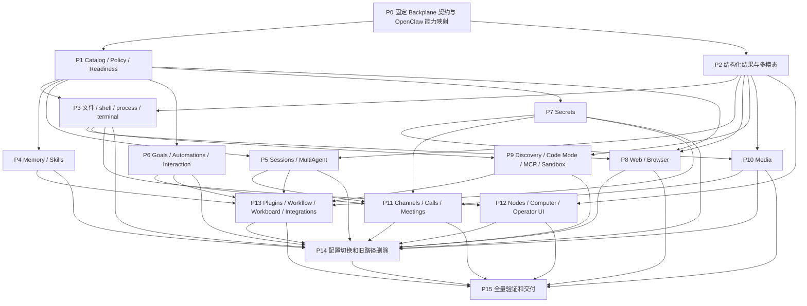

# Synapsis OpenClaw 工具体系全面替换实施计划

> **For agentic workers:** 使用 `subagent-driven-development` 或 `executing-plans` 按独立子项目执行；有依赖的任务串行，无依赖的任务可并行。每个子项目限定文件责任和 scoped tests。任务使用 `- [ ]` 跟踪；worktree 一律位于 `.trees/<branch-name>`。

**Goal:** 删除旧工具及其执行旁路，基于 `backplane_agent_runtime` 的原生契约，参考固定 OpenClaw 基线补齐工具能力，保留现有运行时和持久业务能力。

**Architecture:** 用户已确认保留 Elixir/Phoenix、Concord 和 Backplane，并明确以 Backplane 契约为准。优先复用原生 profile/bundle，缺失的领域能力按其 descriptor/backend/result 协议扩展，统一接入现有 Conversation/ToolCatalog。所有入口共用准入、权限、执行日志、资源和取消链，不再包裹旧 Registry/Gateway/Executor。

**Tech Stack:** Elixir/OTP、Phoenix LiveView、Concord、TOML Config.Store、Backplane runtime/AI/MCP/skill protocols、Gaoxy.Test、DuskmoonBundler/npm workspaces；窄用途 JS/浏览器 helper 由 Port 监督。

**状态：** 用户已授权开始实施。已完成 P0 契约/来源基础、P1a 原生 catalog 组合、P1b 独立的执行前 Policy/Readiness 检查、P1c 原始权限快照编译与动态审批；P1d 增加有界 freshness 证据组件和原生 catalog publication 观察用例。当前并行批次补充原生资源生命周期观察与 P2a 独立结果持久化投影。Backplane 四包统一使用 1.10.31。P0 的完整证据、P1 的生产接线和 P2 的多模态全链仍未完成，未切换生产执行链，也未声明工具全面对齐。

**设计与基线：** [设计](../specs/2026-10-23-openclaw-tool-alignment-design.md)、[170 项能力参考 JSON](../specs/2026-10-23-openclaw-tool-alignment-baseline.json)、[逐项覆盖矩阵](../specs/2026-10-23-openclaw-tool-alignment-coverage.md)。OpenClaw pin：`488631c18fae7cc541ba8fc8beff6cbb0438787b`。活动运行时契约基线为 alignment 工作树的 `backplane_agent_runtime 1.10.31`，以 `mix.lock` 的 artifact checksum 和包内公开 API 固定；保留 1.10.28、1.10.30 历史夹具。

**阅读规则：** 下列阶段中的 OpenClaw 工具名、schema、profile 和 controls 是能力索引与比较样本，不是强制本地接口。P0 将其映射到 Backplane 原生工具或宿主描述符；多对一、一对多均可。冲突时遵循 Backplane 的身份、准入、授权、结果和生命周期契约，记录行为差异与未覆盖能力；不为同名外观重建运行时或修改已授权调用。

---

## 1. 完成标准与执行约束

1. 67 个 core catalog 名、34 个插件声明中的 103 个独有名，共 170 个上游参考项，以及实际装配的 runtime controls 均有能力映射与验收项；不要求新增 170 个同名工具，不把可选/未配置解释成能力已完成。
2. 所有实际工具通过 Backplane 原生契约验证。另对照上游 factory 的条件、action、输入约束、成功/拒绝/超时/取消/恢复/多模态结果，记录等价点、宿主适配及缺口；同名或 schema 相似不能证明能力已覆盖。
3. 复用现有 SessionAdapter、Provider adapters、Runtime.Store 和 Concord CAS，以及适用的 Backplane 原生 local/collaboration/interactive/services/dynamic/CodeMode/extensions bundle；不重复实现已具备的工具与基础设施。
4. 开发中可在独立测试环境使用新 catalog；不引入运行时自动 fallback。最终产品只保留新的执行链。
5. 旧历史只读兼容；配置显式、幂等迁移；权限不得因为合并工具或 `full` profile 自动扩大。
6. 全部测试按任务范围运行。遇到范围外失败列出并停止，不能顺手修复其他子系统；Mix/Devenv builds 串行，不能用并行子代理同时占用同一 build tree。
7. 单元/契约、真实浏览器、真实外部账号、发布/部署分别记录。完成 mock 不能给 live verification 打勾。
8. 每个任务先添加列出的行为用例，证明集成或能力缺口，再实现最小变更并运行对应 scoped tests。该计划是多子系统的总计划；实际接口以 P0 固定的 Backplane 原生契约及能力映射为准，不从参考名称臆造参数。

## 2. 阶段与并行依赖



P14 的代码准备可以早于长尾实现完成；实际整体切换要求覆盖矩阵所有配置中已使用的能力可用，且资源已 settled。只有 P15 覆盖全部目标后才能称“全面对齐”。部署不属于本次计划编写的授权动作。

**实施依赖细化（2026-10-23）：** P1 中 Backplane 原生 bundle 的组合、严格准入，以及原生 `prepare_tool/2` 上的独立宿主 Policy/Readiness 检查，可在原生契约夹具通过后实施，不依赖全部 OpenClaw factory 的导出。此细化只推进原生基础；P0 保持进行中，参考 action 的宿主 adapter、业务分类与配置迁移、能力等价验收、Worker 接线和整体切换仍须满足各自的来源、权限、结果与生命周期前置验证。

P2a 也可按已核对的原生 `{:ok, map}`、`{:error, Error}`、invocation-bound Rejection 和 Conversation 结果独立准备投影，再经现有 Part/Message/Store 持久化；不依赖全部参考 factory。这个切片不安装执行消费者、不改变 provider 编码，也不证明媒体可用性。P2 的全链验收仍须逐段接线和验证。

| 并行工作线 | 独占责任 | 共享依赖 |
| --- | --- | --- |
| A：基础执行 | P1、P3、P5、P9；原生 bundle 装配、agent tools/catalog 和 SessionAdapter 接口 | 与 B 约定原生结果的持久化/展示投影；P5 不依赖 #74 |
| B：数据与产品投影 | P2、P7、P12；data/provider/result、server/web/cli 展示 | 不能与 A 同时修改 SessionAdapter；按阶段合入 |
| C：领域与集成 | P4、P6、P8、P10、P11、P13 的独立目录 | P1 descriptor/policy 与 P2 result 协议稳定后分批开展 |

实际 worker 只有可用并发数时才调度。新建工作树放在 `.trees/codex/openclaw-<task>`；当前有界批次共用既有 alignment 工作树，按文件独占责任：资源 worker 只新增生命周期测试，投影 worker 只新增 helper/测试，协调者负责 data 字段/序列化与文档。公共契约按依赖串行确认，所有 Mix/Devenv 命令共用一个独占构建时段，不覆盖其他任务文件。禁止以并行工作为由绕过显式依赖。

## 3. 文件职责

以下 **Create** 路径是拟新增文件；**Modify/Retire** 指本轮已核对存在的路径。运行前先确认工作区变更，保护用户已有依赖/transport/测试修改。

| 区域 | 文件及责任 |
| --- | --- |
| 规范采集 | Create `scripts/openclaw/capture-contracts.mjs`、`scripts/openclaw/verify-baseline.py`；上游样本放 `apps/synapsis_agent/test/fixtures/openclaw/`，原生契约样本放 `test/fixtures/backplane/`，能力映射单独建账 |
| catalog | Create `apps/synapsis_agent/lib/synapsis/agent/tools/{capability_map,catalog,profiles,readiness,policy,permission_snapshot,backend}.ex`；复用 Backplane descriptor 协议，不新增本地 Contract 类型；仅缺失领域能力新增 adapter |
| 结果/交互 | Create `agent/tools/{result_projection,interactions,approval}.ex`；Modify data Part.ToolResult、ProviderMessages、MessageMapper、MCP.Response、worker/runtime.ex 及客户端投影；执行返回仍采用原生结果协议 |
| resources | 复用原生 local/ResourceRegistry；仅额外领域资源 Create `agent/tools/execution/{terminal,resource_owner}.ex` 等 adapter，不重复实现已有 exec/write_stdin 执行器 |
| 领域 adapters | Create `agent/tools/{filesystem,memory,skills,sessions,collaboration,goals,automations,secrets,browser,media,messaging,nodes,operator_ui,plugins,workflows,workboard,external_agents,github}.ex` 或对应目录；只转换契约并调用所属领域服务 |
| 配置 | Create `apps/synapsis_data/lib/synapsis/config/tool_migration.ex`；Modify Config.Store types/reader/schema、AgentConfigs、Toolset、SessionPermission、daemon/toolsets 与 resolver |
| helper | Create `packages/tool-host/`；固定 IPC、依赖和资源终止协议，使用 `mix npm.install` 管理workspace，不另加bun构建链 |
| 文档 | 实施完成时更新 `docs/architecture/05_TOOLS.md`、`08_SUBAGENTS.md`、相关 ADR/guardrails、PRD及 README；不得提前把提案写成已实现事实 |

## 4. 任务清单

### P0：固定 Backplane 契约、OpenClaw 参考与能力映射

**Scope:** 固定实际运行时契约，独立采集上游参考样本，再建立能力映射；不执行真实供应商、渠道、安装或设备操作。

**Create:** 上表两个采集/验证脚本；`apps/synapsis_agent/test/synapsis/agent/tools/{baseline,conformance,publication,resource_lifecycle}_test.exs`；`test/fixtures/openclaw/<pin>/` 与 `test/fixtures/backplane/1.10.31/`；历史 `1.10.28/`、`1.10.30/` 保留。

- [x] 固定 Backplane 1.10.31 包版本、artifact checksum、公开 API、可选 preparation callbacks 与来源 hash；采集 7 个原生 family、60 个 descriptor、schema、安全属性、binding 类型与 exact grants/revisions。profiles 与 unconfigured 快照仍与历史相同；captured public API 与 1.10.30 相同。17 项 conformance 测试验证部分执行边界和 API 证据，不代表全部资源或供应商可用。
- [ ] 补齐 operation、结果/拒绝、资源与 catalog publication 的完整观察样本。现有 conformance 已验证先提交意图、拒绝身份及不确定结果；本批补充以下有界进程资源观察，实际 shell/PTY/Code Mode/设备及完整恢复样本仍待实现。原生契约测试不能用 OpenClaw schema 替代。
- [x] 原生 ResourceRegistry/Conversation/Session 的有界观察：foreign/stale handle 不触发 cleanup，精确 release 只清理一次；owner death 关闭准入且不触碰其他 owner；cleanup timeout 后任务终止但实际资源仍存活，保留 uncertain 状态并拒绝重用；取消/期限到达停止真实 provider/资源进程。借用 registry 的 Conversation 终止后外部基础设施和其他 owner 仍存活；Session.close 只关闭资源，Session 进程终止另清理其自有 registry/supervisor。非 terminal run 恢复进入 recovery_required，不重放或改写 EphemeralStore。不是实际命令、完整 Concord 或恢复后 Session binding 验收；此版本 Session 只创建自有 registry，没有可用的 registry 借用接口。
- [x] P1d 补充原生 publication 行为观察：producer 内 token-bound stage 与可信宿主 receipt 对账；当前批次继续使用旧 catalog，成功结算并提交批次后下一 provider 才看到新 revision；失败/error-marked/cancel 丢弃暂存，陈旧 run/incarnation/revision、非 +1 更新与冲突发布原子拒绝，已发布 receipt 可重放、旧 effect token 不可复用。仅隔离 Conversation/EphemeralStore，不等于完整 Concord 恢复或生产 publication。
- [x] 校验附件的 67 core、174 manifests、34 tool manifests、109 plugin names、170 union，并记录来源 SHA-256。采集前后逐 blob 核对完整固定 tree；更新 pin 仍须单独评审新增/删除/动作变化。
- [ ] 从固定 tree 和实际 tool factory 导出 schema，覆盖 primary/child/scheduled、coding/messaging/minimal/full、有无凭据/插件/视觉/设备/客户端等代表性 context；记录 schema variant 与 eligibility。
- [ ] 扫描实际 plugin 注册与工具装配，补齐 manifest 外动态声明。`search/find/grep/glob` 仅是 runtime facts 认可名，在没有 factory 证据前标为 recognized-only；不凭此新增四个默认工具。
- [ ] 每个 callable action 至少保存 valid、invalid、denied、unavailable 与 effect/结果期望；资源型另存 timeout/cancel/owner-loss/restore。不把随机 ID、时间戳和provider敏感内容固化为golden。
- [x] 为全部 170 项建立逐工具初步映射和处置，区分 12 项原生复用候选、145 项宿主扩展、12 项宿主适配与 1 项缺口；所有实现证据保持未完成。另记录 controls 和 recognized-only 名字。
- [ ] 逐参考 action 记录目标工具/服务、原生 profile/descriptor、输入结果转换、`native-reuse/host-extension/host-adapted/gap`、权限上限、行为差异和验收证据；保留未覆盖状态，不因工具名不同重复实现。
- [x] 实际复制的来源快照保留并验证适用 LICENSE；本批没有复制 TypeBox 依赖实现，只记录其版本和文件 hash。不预设后续实现文件同一许可证。

**已实现的采集/验证接口（采集输出目录须不存在）：**

```sh
node scripts/openclaw/capture-contracts.mjs --source /tmp/openclaw-488631c --pin 488631c18fae7cc541ba8fc8beff6cbb0438787b --out /tmp/openclaw-reference-capture --offline
python3 scripts/openclaw/verify-baseline.py --manifest docs/superpowers/specs/2026-10-23-openclaw-tool-alignment-baseline.json --fixtures apps/synapsis_agent/test/fixtures/openclaw/488631c
devenv shell --no-tui -- mix test apps/synapsis_agent/test/synapsis/agent/tools/baseline_test.exs apps/synapsis_agent/test/synapsis/agent/tools/conformance_test.exs apps/synapsis_agent/test/synapsis/agent/tools/catalog_test.exs
```

采集和验证脚本已新增；source 参数只接受逐 blob 校验且 commit 匹配的完整 checkout。`--offline` 禁止网络/安装/发送等 effect。验证结果区分来源错误（退出 1）和有效来源但覆盖不完整（退出 2）；不能把后者当作 P0 完成。

当前还保存了 5 个来源可追踪的 recipe：voice-call schema、Canvas schema/factory、llm-task schema/factory。后两组实际 factory 返回的 descriptor 与 schema 定义匹配，未调用 `execute`；它们只证明元数据构造，不证明动态注册、运行时 eligibility、授权或执行效果。真实固定源码已用 Node 24.22.1 与 TypeBox 1.3.37 重复采集并逐字节核对，适用许可证随源码快照保存。详见 [采集说明](../../../scripts/openclaw/README.md)。

### P1：基于原生契约的 Catalog、Policy、Readiness

**Create:** `agent/tools/{capability_map,catalog,profiles,readiness,policy,permission_snapshot,freshness,backend,approval}.ex`；相同命名的 `agent/tools/*_test.exs`。
**Modify:** `apps/synapsis_agent/mix.exs` 的 MCP umbrella dependency；暂不切换 Worker。

本批实现 `Catalog.compose/4` 和独立的 `Policy.prepare_tool/2`、`Policy.evaluate/2`、`Readiness.check/2`、`PermissionSnapshot.compile/4`、`Approval.request/3`、`Approval.resolve/4`、`Freshness.capture/3` 与 `Freshness.check/2`。组合器显式选择、核对 caller/run 和授权上限后，重新进行原生 strict admission。Policy 使用可信宿主 context 中的 scope、逐工具 revision、分类函数及精确 action/resource 决策；Readiness 要求同 scope、同 revision 的明确证据。它们只在隔离 Conversation 测试中通过原生 hooks 启用。完整配置/业务分类迁移、真实宿主审批端点、生产 publication 和执行接线仍属于后续 P1 工作；不能以本批测试通过勾选整个 P1。

- [x] P1a：实现原生 descriptor 组合、显式 none/选择、caller/run fence、重名拒绝及从授权上限缩小 grants/revisions；真实原生 strict admission 的组合测试通过。
- [x] P1a 补充：Backplane 1.10.30 的 fingerprinted collaboration binding 成套保留，选中名称和 `:none` 同时收窄 binding authority；陈旧/伪造身份和替换 manager 被拒绝。仅测试自定义契约，不增加生产别名。
- [x] P1b：在原生 `prepare_tool/2` 上执行无副作用的 Policy/Readiness 检查；按 exact caller/run/incarnation/catalog/tool revision fence 和 tool/action/resource 决策拒绝缺失、陈旧、不支持及不可用输入。未解决的 ask 返回 approval-required。原生 Conversation 的 allow/deny/ask/stale-readiness 测试验证拒绝不提交工具意图、不调用 backend；自定义 raw input 的保留目前仅有直接单元覆盖。
- [x] P1c：从显式 raw SessionPermission 编译有限 exact tool/action/resource 的权限快照；四级设置在 interactive/autonomous 都生效；session 与完整记录 fingerprint 必须匹配可信 scope。只保留精确名称及旧解析器可表达的 `name(*)`，未知名称、窄模式、歧义或畸形数据要求 needs_review，不丢弃限制、不补默认值、不做工具别名。动态 ask 通过原生 interact 暂停，再由认证宿主按原生 interaction/operation/scope 解答；回答后刷新策略、readiness、身份、分类目标与到期时间。无生产接线。
- [x] P1d：`Freshness.capture/3` 从显式 raw permission 与有限 provider/credential ID 读取当前证据；缺失、畸形、不可用或读取失败均拒绝。只返回身份和指纹，不输出配置、明文凭据或运行句柄。`check/2` 校验 canonical evidence 后严格比较；隔离原生测试分别在 Policy 之前和 Approval.refresh 中调用，证明权限变化/审批中凭据轮换时无工具意图或 effect。没有修改生产 Policy、Approval、SessionAdapter 或 Worker。

**P1c 权限源与边界：** 编译器不调用旧 Registry、PolicySnapshot、CapabilityPolicy 或 Grant；也不使用缺失记录时会补默认值的 `Permission.session_config/1`。可信宿主负责读取原始记录、给出预期 fingerprint、有限分类目标及新鲜 readiness；fingerprint 只是记录内容身份，不提供单调版本、实时撤销或 ABA 检测。四个 allow 字段必须显式存在，无人值守不会跳过其中任一限制。当前 `/4` 接口只知道 bindings 中的工具，因此集合外的 override 即使可能属于未选中工具，也要求人工迁移审查。

**P1c 动态审批边界：** 只接受不可变原 invocation 的 `:approved`，拒绝编辑和畸形回答；回答后允许期限缩短，禁止延长，并再次核对实际 action/resource。原生 Conversation 继续拥有 interaction ID、单次解答、取消和持久化；没有本地审批账本或 legacy Grant。host expiry 在请求、解答与刷新后执行检查，没有自动到期 timer，过期的人类等待仍可保持 pending。`Approval.resolve/4` 仅处理本模块含 scope 的动态请求。descriptor 的 `requires_approval` 是独立原生 gate；当前测试只证明该 gate 仍独立，尚不支持安全的双审批宿主接线。后续必须禁止静态 gate 编辑绕过分类，并在其等待后重查动态 policy/expiry，不能把本批检查称为全流程持续 freshness。Backplane 1.10.30 缺少有效 resolver identity 的结构校验，已登记 [backplane#80](https://github.com/gsmlg-opt/backplane/issues/80)（Bug、needed）；适配器按 issue 注释先验证可信宿主的非空身份，不修改依赖。上游已在 `1e9b0366` 修复并关闭该 issue，但本批活动 1.10.31 包仍不含该提交，不能因 issue 关闭移除当前版本所需的验证。

**P1d 时效与发布边界：** 默认 reader 使用公开 Store/Config.Store/Providers/Credentials API；permission 不补默认值，provider 同时验证当前可用性与 authentication_generation，credential 先验证可解析再取版本。`PermissionSnapshot.validate/2` 复用原始结构/语法/session 校验，不替代 exact binding/target 的 compile。当前证据不覆盖 MCP live discovery、OAuth 全部状态或 generation 以外的配置；跨 store 采样不原子，也不证明远端授权、实时撤销或 ABA 防护。真实 readiness 仍须独立校验。publication 只发布原生 catalog，不刷新静态 provider_context；旧 policy/readiness scope 对新 revision 仍会拒绝。生产接线须解决原生下一 provider 请求前的可信 context 重建，不能仅靠事件处理刷新后宣称没有竞态。

- [ ] 用 Backplane fixtures 验证 descriptor 的 tool_name/tool_revision/schema/backend/backend_context/safety；宿主 backend 导出 execute/1，结果遵循 `{:ok, map}`、`{:error, Error}` 或 invocation-bound Rejection，不另定义运行时协议。
- [ ] 从原生 `bundle.registry.tools` 取得 descriptors，按 P0 映射补宿主 descriptors，拒绝重名；构造完整 exact grants/revision map，调用 `Backplane.AgentRuntime.ToolCatalog.admit_batch/2` 并成套传递 registry/tools/authority。沿用 SessionAdapter 已有 strict admission 组合方式，不在授权后改名或复用不匹配 grants。
- [ ] 原生 profiles 按当前公开接口显式选择；OpenClaw minimal/coding/messaging/full 只作能力分组参考。显式 none、deny、credentials、device/client readiness、无人值守和 action policy 均不因 bundle 合并扩权。
- [ ] 配置名称/参数迁移在最终 descriptor 准入前完成；source/credential/policy revision fencing 和不可用原因可追踪。active catalog 仅走受支持的 stage_catalog publication，不能后台直接改列表；MCP不可信annotation默认不升级为只读授权。
- [ ] 将旧 deny/ask/allow 和安全能力迁到新 policy；按 action+资源求权限，维持 invocation/argument digest/interaction到期校验，不调用旧 Gateway。

**验收例，行为型测试而非mock内部调用：**

```elixir
test "strict admission refuses a descriptor missing from exact grants", %{
  native_descriptors: descriptors,
  authority: authority
} do
  [candidate | _] = descriptors
  denied = %{authority | grants: List.delete(authority.grants, candidate.tool_name)}

  assert {:error, _reason} =
           Backplane.AgentRuntime.ToolCatalog.admit_batch(descriptors,
             authority: denied,
             mode: :strict
           )
end
```

测试 setup 从 P0 原生 fixture 构造有效的 descriptors 与对应 run 的 authority；只删除其中一项 grant，再直接验证公开 admission API 拒绝完整候选集合。另用 effect counter 验证 revision/schema/approval 拒绝时无进程启动或终止，不用自定义 Contract 或模拟的本地授权 API 代替运行时边界。

**当前批次 Run:** `MIX_ENV=test devenv shell --no-tui -- mix test apps/synapsis_agent/test/synapsis/agent/tools/`。未来 profiles、完整宿主审批、生产 publication/context 刷新与执行接线分别新增对应 scoped tests。

### P2：结构化结果与多模态全链保真

**Create:** `apps/synapsis_agent/lib/synapsis/agent/tools/result_projection.ex` 及 `test/synapsis/agent/tools/result_test.exs`。
**Modify:** `apps/synapsis_data/lib/synapsis/{part/tool_result,part,message}.ex` 及对应 tests；后续再接 agent runtime `provider_messages.ex`、`provider_events.ex`、`session/worker/runtime.ex`、provider `message_mapper.ex`、MCP `response.ex`、server channels/controllers、CLI SSE解析和 web 结果组件。

**P2a 有界切片：** `Part.ToolResult.projection` 是可选 opaque map，`content` 保持旧文本；data 层仅保存/读取，不依赖 runtime。agent helper `ResultProjection.to_part/3` 把受检原生公共结果转为 `%{"version" => 1, "result" => portable_native_map}`；`from_part/1` 校验 v1 投影并可只读解析旧字符串。保留原生字段名、内容顺序、structured/artifacts/progress/details 和其他可移植公共字段，不新增 backend 返回协议。非文本只留在投影，不生成 JSON 文本或 unsupported 成功占位；这不证明 provider 支持这些 block。

原生 Error 仅保留有效 class、固定安全 message 和可移植 details，丢弃 cause；拒绝 proof 使用原生验证，且 operation.tool_call_id 必须匹配展示的 tool_use_id。proof 身份和操作上下文不持久化。明确 auth/runtime 容器及非可移植值递归拒绝，key collision/版本/内外错误状态不一致拒绝。任意公共文本或 metadata 中的秘密无法从内容推断，可信调用者仍须提供公共结果。

Part dump/load/cast 与 Message.encode/Concord read 保留 projection，nil 时不增加序列化字段。实际 `Store.commit_turn` 测试验证富结果保真、旧 turn 不变和同一 turn 幂等覆盖。`Session.Snapshot.encode_message` 委托 Message.encode；本批没有调用 snapshot 的全历史重写路径，也没有安装新的生产结果 producer/consumer。

- [x] P2a：实现上述独立 helper、可选 opaque 字段与旧格式兼容，并通过真实 Concord per-turn roundtrip；明确 auth/runtime 容器的大小写/分隔符变体递归拒绝，只转换受支持 type/status enum atom。按原生默认集合/深度/节点/字节预算在 JSON 前逐步规范化，再进行原生 Validation/Serialization；精确容器深度边界与原生一致。
- [x] P2b 前置切片：在 provider MessageMapper 消费可选 v1 projection，旧 nil 路径保持原样。用原生 Validation 校验预算与可移植性，仅显式 text/image 内容进入原生 Codec；Anthropic 保持顺序，OpenAI/Google 不支持的工具媒体明确拒绝。结构化 sidecar 只保留在存储，不隐式字符串化；无可支持内容时明确失败。暂不切换 ProviderMessages/Worker producer，避免现有无 content 的 collaboration 返回在 replay 时回归。
- [ ] 将版本化持久化/展示投影接到生产结果路径：ordered content blocks、structured content、错误、details、媒体引用、分页/截断、任务状态；保留旧字符串读取兼容。外部 isError 转为受检原生结果，不定义另一个 backend 返回协议。
- [ ] 将 text/image/audio/resource/link 从 MCP 到 Conversation、provider、Concord、API/SSE和客户端逐段保真，移除原先通用JSON字符串化和unsupported占位的成功路径。
- [ ] 大媒体经 Workspace blob和有权限引用交付；provider不支持相应block时能力装配或执行明确拒绝。
- [ ] 对旧历史只读解析，确保不修改既有transcript、不执行旧tool call、重复terminal事件不重复append。

**Run，先新建 `agent/tools/result_test.exs`：**

```sh
devenv shell --no-tui -- mix test apps/synapsis_agent/test/synapsis/agent/tools/result_test.exs apps/synapsis_agent/test/synapsis/agent/runtime/provider_messages_test.exs apps/synapsis_agent/test/synapsis/agent/runtime/provider_events_test.exs
devenv shell --no-tui -- mix test apps/synapsis_provider/test/synapsis/provider/protocol_codec_integration_test.exs apps/synapsis_mcp/test/synapsis/mcp/tool_call_contract_test.exs
```

**Pass:** 包含文本、图片及结构化字段的一次工具调用，经真实本地provider协议fixture及Concord重读后保持顺序、归属和内容；secret/token不进入任何结果。

### P3：文件、shell、process、共享终端

**Create:** `agent/tools/filesystem/`、`agent/tools/execution/`；`agent/tools/{filesystem,execution,process_lifecycle,terminal}_test.exs`。
**Reuse:** Workspace PathResolver/Permissions/FileDocuments/blob、Backplane 原生 `exec_command/write_stdin/apply_patch/view_image` 及 ResourceRegistry；先验证集成与权限，再只补缺失领域能力。

- [ ] 将 `ls/read/write/edit/apply_patch` 的参考动作映射到原生工具或必要宿主 adapter；验证分页continuation、图像读取、编辑、无变化、rename/delete和不确定写入证据；每种路径都验证项目/Workspace权限。
- [ ] 以原生 exec_command/write_stdin 覆盖 shell/process 交互；核对句柄、poll/log/stdin/kill/timeout、输出预算、PTY和目标路由的实际支持。缺口单列，不另建 OpenClaw exec/process 调度器，不把旧一次性 `/bin/sh` 当成backend。
- [ ] 核对短命令与后台服务的能力差异；Stop、kill、资源归属与存续遵循 Backplane 生命周期，不能为匹配上游参数绕过 owner/fence；资源仅能被授权owner访问。
- [ ] 实现 operator `terminal` 共享输入的显式权限，和process后台命令分开管理；客户端未连接或sandbox不允许时不构造该工具。
- [ ] 验证超时、child crash、owner death、重启旧handle拒绝；OS隔离、平台PTY、run间资源存续任何不满足处先定依赖issue，不用字符串过滤伪装隔离。

**Run:** `devenv shell --no-tui -- mix test apps/synapsis_agent/test/synapsis/agent/tools/filesystem_test.exs apps/synapsis_agent/test/synapsis/agent/tools/execution_test.exs apps/synapsis_agent/test/synapsis/agent/tools/process_lifecycle_test.exs apps/synapsis_agent/test/synapsis/agent/tools/terminal_test.exs apps/synapsis_workspace/test/synapsis/workspace/file_documents_test.exs apps/synapsis_workspace/test/synapsis/workspace/permissions_test.exs`。

### P4：Memory、Skills、个人指令

**Create:** `agent/tools/{memory,host_memory,skills,personal_instructions}.ex` 和对应限定测试；core `memory/{scoped_reader,host_agent}.ex`；memory/skill持久服务按需增量修改，不换掉已有数据authority。

- [x] P4a 有界切片：新增 core `Memory.ScopedReader` 与原生 `synapsis::memory_search`/`synapsis::memory_read` descriptor，读取真实 FileAdapter 项目记录。可信宿主固定 project/session/run 身份，模型只能提供 query/limit 或 memory_id；不经旧工具、Retriever、缓存或 touch_accessed。读取前缩小目录，拒绝静态 symlink、hardlink、越界和记录归属不符；限制候选数、文件、输出与执行期限，错误不伪装为空结果。仅项目 scope；缺少可验证项目关联的 session 记录不开放。引用为真实 semantic record ID，检索为有界词面匹配；不是 OpenClaw 文件行号、向量或全 corpus 等价实现。文件描述符与前后身份检查不能宣称原子的 openat 防替换保证。
- [x] P4b host-agent 切片：通过 core `Memory.HostAgent` 接本机 `4222` 的公共 recall API，agent `Tools.HostMemory` 提供原生 `memory::recall`（`memory.read` 权限）。可信宿主绑定 source/loopback endpoint/run；模型只能给 query/limit，资源与引用标明 host 默认分区，不声称项目/session 隔离。保留受检 online/offline、canonical/provisional 与 stale 状态；不可用、超限及畸形结果显式失败，无旧文件回退。HTTP 接收字节/总期限与 owner-loss 清理有界，不复制 host gateway 凭据，不继承全局 Req 默认认证或 transport hooks，不声明远端取消或 retry-safe。生产 config、目录和全局 Memory adapter 尚不切换。
- [ ] 实现 `memory_search/memory_get` 和 memory-core `intent`；按pin约定接长期记忆、会话检索、引用/行号与检索不可用状态。host-backed exact read 等待 [backplane#84](https://github.com/gsmlg-opt/backplane/issues/84)，项目过滤的离线一致性等待 [backplane#83](https://github.com/gsmlg-opt/backplane/issues/83)；两者均为独立 blocker，不做本地替代。
- [ ] 接 `memory_store/recall/forget`、`wiki_apply/get/lint/search/status` 的可选契约，补关键词/向量/混合检索；索引能力与实际可用embedding分开报告。
- [ ] 实现 installed-eligible `skills_search/skills_read` 和 `skill_workshop` 创建、验证、版本/归档/恢复；保持现有source UUID/revision/digest及agent分配，不把skill文本执行成工具。
- [ ] `personal_instructions` 绑定认证requester，不绑定session owner或任意传入ID；共享会话跨用户测试必须隔离。
- [ ] 旧 memory_save/update/session_summarize/todo projection 的业务数据在新tool或host hook可达；使用可选memory插件不丢既有记忆。

**Run:** `devenv shell --no-tui -- mix test apps/synapsis_agent/test/synapsis/agent/tools/memory_test.exs apps/synapsis_agent/test/synapsis/agent/tools/skills_test.exs apps/synapsis_core/test/synapsis/skill_catalog_test.exs apps/synapsis_workspace/test/synapsis/workspace/file_documents_test.exs`。

### P5：持久 Sessions、子代理与外部会话身份

**Create:** `agent/tools/{sessions,collaboration,presence,task_suggestions}.ex` 和相应测试。
**Modify:** 现有 `agent/runtime/session_adapter.ex`、Sessions领域服务、Worker runtime及相关UI；保持现有Journal/Store。

- [ ] 先独立实现 `sessions/sessions_create/list/history/search/session_status`、`presence`、`suggest_task/dismiss_task`；历史分页、可见范围、当前requester、建议未执行/非持久语义按fixtures验证。
- [ ] `agents_list` 提供可用配置agent目录；当前child roster由 `subagents` 提供，不混用。
- [ ] 直接复用原生 collaboration_v2 的 `spawn_agent/send_message/followup_task/interrupt_agent/list_agents/wait_agent`，在准入前选定该 bundle；将上游 sessions_spawn/send/wait/yield/subagents 参考动作逐项映射并记录差异。#74 是可选名称扩展，不作为本阶段前置条件，不改写已准入 invocation。
- [ ] 覆盖task/session持久性区别、followup、嵌套、独立模型/推理参数、collector输出、root/child权限与预算继承、等待环、容量拒绝、owner loss和未知结果。只有实际缺失的必需能力路由上游；参数表达不同不自动成为 blocker，也不能静默忽略行为差异。
- [ ] subagents=false仍走Conversation，只减少协作catalog；跨任意历史session发送通过Sessions服务，不能用MultiAgent.snapshot替代。

**Run:** `devenv shell --no-tui -- mix test apps/synapsis_agent/test/synapsis/agent/tools/sessions_test.exs apps/synapsis_agent/test/synapsis/agent/tools/collaboration_test.exs apps/synapsis_agent/test/synapsis/session/worker_runtime_test.exs apps/synapsis_agent/test/synapsis/session/worker_subagents_test.exs apps/synapsis_agent/test/synapsis/agent/runtime/store_test.exs apps/synapsis_data/test/synapsis/runtime/store_test.exs`。

P5 使用现有 MultiAgent 生命周期推进原生协作集成，不依赖自定义名称接口，也不在 Synapsis 实现临时子代理管理器。持久会话与跨会话权限仍须单独实现和验证。

### P6：Goals、进度、交互、决策与 Automations

**Create:** `agent/tools/{goals,progress,interactions,decisions,automations}.ex` 及相应测试；data新增所需data-only目标/automation记录。
**Reuse:** Routines/Heartbeat/Daemon运行链，保持Daemon→Sessions→Worker。

- [ ] `create/get/update_goal` 严格保留显式目标请求、显式预算、完成/blocked状态约束；todo转换不自动创建目标或预算。`progress_card` 保留root资格和持久parent归属。
- [ ] 优先复用 Backplane interactive 控制族表达用户输入与审批，经可信primary surface解答并暂停执行budget，拒绝child/无人值守不支持的交互；一次回答只推进对应interaction，记录与上游 ask_user 的映射差异。
- [ ] `decision_evaluate` 按version/tagged inputs实现boolean/choice/score/sort/tags/box和provider-neutral结果/usage，unsupported明确返回。
- [ ] `automations` actions=`status/list/get/add/update/remove/run/runs/wake`，覆盖at/every/cron/stream/event、管理场景on-exit、timezone、systemEvent/agentTurn/script payload和none/announce/webhook投递。
- [ ] 保存creator authority与工具权限上限，启用/禁用trigger时裁剪schema；重启、取消、自删scope、run-once、重复触发和事件游标都有契约测试。现有UI建立的routine可从新工具查询和管理。

**Run:** `devenv shell --no-tui -- mix test apps/synapsis_agent/test/synapsis/agent/tools/goals_test.exs apps/synapsis_agent/test/synapsis/agent/tools/automations_test.exs apps/synapsis_agent/test/synapsis/agent/tools/interactions_test.exs apps/synapsis_agent/test/synapsis/agent/tools/decisions_test.exs apps/synapsis_agent/test/synapsis/agent/routine_trigger_test.exs apps/synapsis_agent/test/synapsis/agent/routines_test.exs`。

### P7：Secrets、凭据引用与输出隔离

**Create:** `agent/tools/secrets.ex`、core凭据输入/egress服务、必要data-only引用记录、`agent/tools/secrets_test.exs`。
**Modify:** Credentials metadata API、server可信输入endpoint和web安全输入组件。

- [ ] `request/list/delete` 只向模型提供metadata/SecretRef；秘密通过可信UI直接进加密store，不经过prompt/tool result/日志/SSE/history。
- [ ] secret注入按entry+destination+invocation授权，区分env可读值和protected secret；代理/进程grant随退出、取消、timeout撤销。
- [ ] 已有provider Credential保持独立UUID、空值保留和rotation fencing；不能把通用secret请求误写成修改provider认证。
- [ ] 用标记secret做全链泄漏检查：模型请求、文本结果、Concord、client DOM、日志均不得出现明文。subagent/无人值守不能索取凭据。

**Run:** `devenv shell --no-tui -- mix test apps/synapsis_agent/test/synapsis/agent/tools/secrets_test.exs apps/synapsis_provider/test/synapsis/provider_credentials_test.exs apps/synapsis_mcp/test/synapsis/mcp/credential_rotation_test.exs`。外部真实凭据仅在用户实际配置后另记live验证。

### P8：Web 与 Browser

**Create:** `agent/tools/web/`、`agent/tools/browser.ex`、`packages/tool-host/src/browser/`；`agent/tools/{web,browser}_test.exs`。

- [ ] 优先用原生 services profile + 宿主 adapter/configuration 覆盖 web_search/web_fetch；核对搜索供应商、引用、正文提取、缓存/大小/重定向/timeout及网络policy。Tavily/Firecrawl 参考能力按原生 descriptor 扩展，不要求保留其外观 schema。
- [ ] browser实现实际schema列出的所有动作，含status/start/stop/tabs/open/navigate/snapshot/act/screenshot/requests/errors/text/emulate/doctor等；稳定ref失效需重取，不猜旧ref。
- [ ] 支持host/sandbox/node、managed/existing-session/remote CDP profiles所需路由与权限；缺目标时不悄悄切回host。浏览器helper经Port接受窄IPC，取消清理自己创建的资源。
- [ ] 本地fixture站点验证点击/填表/导航/下载、网络错误、移动模拟、截图多模态送模、停止和重开；不使用真实登录账号测试。

**Run:** `devenv shell --no-tui -- mix test apps/synapsis_agent/test/synapsis/agent/tools/web_test.exs apps/synapsis_agent/test/synapsis/agent/tools/browser_test.exs`；随后由隔离浏览器访问fixture站点，保存截图/DOM/console证据。HTTP/provider用Gaoxy.Test。

### P9：Tool Search、Code Mode、MCP、Sandbox 统一接入

**Create:** 原生 dynamic/CodeMode 配置与宿主接入所需的 `agent/tools/{discovery,code_mode,mcp}.ex` 和对应测试；不新增另一套 Code Mode executor。
**Modify:** MCP.Server/Response及facade、Sandbox.Bridge；替换旧catalog registration，不能让mcp/sandbox反向依赖agent。

- [ ] 优先复用原生 dynamic 工具框架；将 tool_search/tool_describe/dispatch_action 的发现、描述与分发能力映射到同一授权catalog，保留direct-only能力，不强制三个参考名称或 schema。
- [ ] 复用原生 CodeMode profile/bundle 的工具名、等待、恢复及 continuation；核对精简目录、MCP命名空间、shell桥接、direct-only媒体。不得为兼容 OpenClaw exec/wait 外观新建 JS 调度器；provider batch 名称仍须无冲突。
- [ ] 测试原生装配条件、显式启用/禁用、模型支持、executor失败、审批budget暂停、continuation恢复和嵌套调用身份；对上游互斥/awaitResults/restartSafe 等行为单列能力映射和缺口，不照搬为执行规则。
- [ ] MCP改为可信session/run dispatcher+不可变source snapshot，保留source UUID、all/selected/none、刷新/撤权/同名替换fencing、调用超时及caller-owned取消；按pin接resources与事件协议，`mcp_events`纳入工具覆盖。
- [ ] Sandbox reverse calls只能使用注入的同一dispatcher，移除allow_missing_session/yolo；缺run/session绑定零副作用；嵌套调用同样先提交执行意图。

**Run:** `devenv shell --no-tui -- mix test apps/synapsis_agent/test/synapsis/agent/tools/discovery_test.exs apps/synapsis_agent/test/synapsis/agent/tools/code_mode_test.exs apps/synapsis_mcp/test/synapsis/mcp/server_test.exs apps/synapsis_mcp/test/synapsis/mcp/tool_call_contract_test.exs apps/synapsis_sandbox/test/synapsis/sandbox/bridge_test.exs apps/synapsis_agent/test/synapsis/session/mcp_refresh_test.exs`。

### P10：图像、PDF、语音、视频、音乐与远程分析

**Create:** `agent/tools/media/`、provider capability adapters、blob交付组件；`agent/tools/{media,pdf,media_lifecycle}_test.exs`。

- [ ] 复用原生 view_image，补齐 pdf 的文本/分页/原生视觉宿主能力；保持已实现用户图片输入，验证Agent主动文件读取和 provider 结果投影。
- [ ] 实现 `image_generate/video_generate/music_generate/tts`、入站音视频理解与STT，异步生成有submission、task ID、取消、完成投递、失败和重启不重放状态。
- [ ] 接 `x_search/code_execution` 的真实provider协议，不在本地伪造远程执行；接 `local_image` 可选本地模型能力。
- [ ] 按pin供应商capability逐项建立fixture与adapter，保留不同编辑/参考媒体/异步限制；具体provider未配置只影响readiness，不删除实现验收项。
- [ ] 用小型本地图片/PDF/音视频fixture验证解析与媒体引用，再单列真实provider输出的成本/授权和live证据，不在测试调用真实API。

**Run:** `devenv shell --no-tui -- mix test apps/synapsis_agent/test/synapsis/agent/tools/media_test.exs apps/synapsis_agent/test/synapsis/agent/tools/pdf_test.exs apps/synapsis_agent/test/synapsis/agent/tools/media_lifecycle_test.exs`；仅运行本任务新增的provider adapter scoped tests，使用Gaoxy.Test。

### P11：消息、渠道、电话与会议

**Create:** `agent/tools/messaging/`、core渠道服务与provider/transport adapters、`agent/tools/{messaging,meetings,transcripts}_test.exs`。

- [ ] `message` 保留实际渠道支持的动作，`conversations_list/send/turn` 使用精确conversationRef、相关reply和参与者authority；内部AgentMessages不冒充外部渠道。
- [ ] 为pin的channel manifest逐项实现传输、thread/reply、附件、反应/投票等支持动作及readiness；权限不支持的动作从schema裁剪。不能只挑一个聊天渠道后称完成。
- [ ] 飞书14项、`zalouser`、WhatsApp登录/电话、`voice_call/facetime_call/talk_voice`、`google_meet/slack_huddles/teams_meetings/zoom_meetings` 全部逐action实现；硬件/账号依赖独立标记。
- [ ] 实现 `transcripts` 捕获/读取/授权、语音会话生命周期和会议结束清理；退出后不得继续录音或沿用capture grant。
- [ ] Automations announce/webhook与媒体完成投递复用相同渠道服务，失败/重复/uncertain delivery不盲目重发；保留requester和目的地记录。

**Run:** `devenv shell --no-tui -- mix test apps/synapsis_agent/test/synapsis/agent/tools/messaging_test.exs apps/synapsis_agent/test/synapsis/agent/tools/meetings_test.exs apps/synapsis_agent/test/synapsis/agent/tools/transcripts_test.exs`。真实发送、登录、呼叫和会议要有实际授权，不能拿测试fixture当已接通证据。

### P12：设备节点、桌面手机、交互面板与门户

**Create:** `agent/tools/{nodes,computer,mobile_ui,operator_ui,portal}.ex`；设备协议、server/web presenter及相应测试。

- [ ] nodes支持配对/状态/能力/通知/摄像/屏幕/位置及pin列出的全部动作；`computer/mobile_ui` 按设备支持动作构建schema，权限和目标离线明确拒绝，不回退到其他设备。
- [ ] `file_fetch/dir_list/dir_fetch/file_write` 及 `node_inference` 走节点/文件传递服务，不能误用同名旧file_write；大文件blob、链接权限和目标路径分别校验。
- [ ] 分别实现 `screen/theme/dashboard/show_widget/canvas/portal`：operator panes、持久布局、内联widget、配对Mac panel和local web app入口各有独立归属，不全部用HTML字符串代替。
- [ ] widget/页面嵌入需来源与能力隔离、可撤销媒体/portal引用；停止/归档会话时按资源合同关闭，不能留下未知公开入口。
- [ ] Linux/macOS/Windows/Android/iOS及特定Mac canvas等实际平台支持以pin设备矩阵建账；无真实设备只完成协议fixture，live栏保留未验证。

**Run:** `devenv shell --no-tui -- mix test apps/synapsis_agent/test/synapsis/agent/tools/nodes_test.exs apps/synapsis_agent/test/synapsis/agent/tools/operator_ui_test.exs apps/synapsis_agent/test/synapsis/agent/tools/portal_test.exs`，再运行本任务新增web测试和浏览器E2E。UI使用DuskMoon/LiveView及现有asset构建链。

### P13：插件生命周期、工作流、Workboard 与外部集成

本阶段分四个可独立提交、验证的子项目，不能做成一个巨型PR。每个插件的确切名字和来源见覆盖矩阵，以下任务必须覆盖全部分配项。

**P13A — 插件与宿主管理。** Create `agent/tools/plugins.ex`、core integration lifecycle/config服务及 `agent/tools/plugins_test.exs`。实现 `plugins` 的list/inspect/search/install/enable/disable/uninstall/reload/reloadAndResume、capability review、generation drain/activate/dispose；`gateway/openclaw` 映射Synapsis host配置/更新/修复委派，逐action保留host-adapted差异。外部TS插件不能直接当可信Elixir模块加载；使用显式包格式/manifest与受限host bridge，不以MCP CRUD替代插件生命周期。`crabbox`、`autoreview`、`visitor_invite/revoke/list` 归本子项目，保持隔离/身份/撤权语义。

**P13B — Workflow 与呈现。** Create `agent/tools/workflows.ex`、持久continuation记录及 `agent/tools/workflows_test.exs`。实现 `llm-task` 的单次JSON/schema校验及明确model/auth override权；`lobster` 的pipeline、审批/输入checkpoint、resume token与已完成步骤不重跑；`diffs` 实现渲染/交付而非直接改文件。无同步LLM阻塞Worker，全部使用监督任务。

**P13C — Workboard 与讨论。** Create `agent/tools/workboard.ex`、data-only boards/items/claims/events stores及 `agent/tools/workboard_test.exs`。逐项覆盖38个workboard工具和 `discussion`，包括board CRUD、link、claim/lease/heartbeat/reclaim、附件、通知游标、proof/log/violation、dispatch/release、block/unblock/move、specify/decompose。持久状态仍用Concord/文件；实际工作通过Sessions/Conversation，不另建执行调度authority。测试重复claim、lease过期、旧worker提交、取消、幂等通知推进和数据隔离。

**P13D — GitHub、外部 Codex 与1Password。** Create `agent/tools/{github,external_agents}.ex`、对应adapter和测试。实现 `github_identity_status/publish/read/search`，保持选择的身份、draft PR、工作树与session绑定；Codex七项区分外部Codex会话和Synapsis子代理，检查目标owner、interrupt和发送权限；`onepassword` 使用受监督CLI/协议，不暴露明文秘密。真实PR/消息/凭据操作只有任务明确授权时执行。

**Run，四条串行执行：**

```sh
devenv shell --no-tui -- mix test apps/synapsis_agent/test/synapsis/agent/tools/plugins_test.exs
devenv shell --no-tui -- mix test apps/synapsis_agent/test/synapsis/agent/tools/workflows_test.exs
devenv shell --no-tui -- mix test apps/synapsis_agent/test/synapsis/agent/tools/workboard_test.exs
devenv shell --no-tui -- mix test apps/synapsis_agent/test/synapsis/agent/tools/github_test.exs apps/synapsis_agent/test/synapsis/agent/tools/external_agents_test.exs
```

### P14：配置迁移、统一入口、旧工具删除

**Create:** `config/tool_migration.ex`、`agent/tools/{migration,retirement}_test.exs`。
**Modify/Retire:** 设计文档第8节及下表列出的完整调用链；按caller逐项删除，保留领域服务。

- [ ] 提供dry-run差异、受保护备份、schema版本和幂等迁移；一对多工具映射保留action限制和deny，无法等价映射的配置明确needs_review。MCP `none`、旧session显式选择和历史provider身份保持。
- [ ] SessionAdapter从新catalog取得完整bundle，不再调用旧ToolRegistry/SessionTools/ToolBackend。开启/关闭子代理、mode/model变化、queue、approval和terminal append使用同一Conversation路径。
- [ ] 删除Worker的legacy graph/QueryLoop/StreamingExecutor回合路径；删除ToolDispatcher独立调用，MCP与Sandbox旧Registry/Executor依赖退出。
- [ ] 将Health/UI/toolsets/MCP计数、PromptBuilder/MessageBuilder、daemon heartbeat/dream提示和工具选择改为新catalog/readiness；新UI完整显示目录再允许配置，不因为当前未配置就隐藏整个能力类别。
- [ ] 执行caller audit后删除旧Builtin/Registry/Gateway/Executor、旧concrete工具、旧behavior和仅供旧路径使用的nodes；新旧同名工具按module/source/schema provenance核查。
- [ ] 切换演练先settle或保留unknown outcome fence，验证备份恢复不把新格式数据交给旧binary，也不自动重放外部动作。

| 必须退出的旧路径 | 实际位置 |
| --- | --- |
| 启动和重注册 | `apps/synapsis_agent/lib/synapsis_agent/application.ex`、`apps/synapsis_core/lib/synapsis_core/application.ex`、`tool/registry.ex` |
| 定义与执行内核 | `apps/synapsis_core/lib/synapsis/tool.ex`、`tool/{builtin,behaviour,registry,gateway,executor,permission,permissions,capability_policy}.ex`、`tool/capability/` |
| 当前Runtime旧包装 | `apps/synapsis_agent/lib/synapsis/agent/runtime/{tool_registry,session_tools,tool_backend}.ex` 及 `session_adapter.ex` host_bundle |
| 另一执行owner | `agent/query_loop.ex`、`query_loop/`、`streaming_executor.ex`、Worker legacy分支与 `worker/io_handler.ex` dispatch_tools |
| 独立工具分派 | `apps/synapsis_core/lib/synapsis/agent/tool_dispatcher.ex`；旧tool_dispatch/approval_gate/tool_execute等graph nodes按caller核查 |
| 支持层旁路 | `apps/synapsis_mcp/lib/synapsis/mcp/server.ex`旧注册；`apps/synapsis_sandbox/lib/synapsis/sandbox/bridge.ex`旧Executor调用；空`workspace/tools.ex` |
| 目录消费者 | HealthController、agent_live/toolsets、mcp_live/index、resolver/config/message_builder、daemon/toolsets与execution提示 |

**Run:** 新retirement/migration测试，加以下已存在行为回归：

```sh
devenv shell --no-tui -- mix test apps/synapsis_agent/test/synapsis/agent/tools/retirement_test.exs apps/synapsis_agent/test/synapsis/agent/tools/migration_test.exs apps/synapsis_agent/test/synapsis/session/worker_runtime_test.exs apps/synapsis_agent/test/synapsis/session/interactive_characterization_test.exs apps/synapsis_agent/test/synapsis/agent/daemon_tools_integration_test.exs apps/synapsis_agent/test/synapsis/agent/daemon_toolsets_test.exs
devenv shell --no-tui -- mix test apps/synapsis_server/test/synapsis_server/channels/session_channel_test.exs apps/synapsis_server/test/synapsis_server/controllers/session_controller_test.exs apps/synapsis_web/test/synapsis_web/live/agent_live/toolsets_test.exs apps/synapsis_web/test/synapsis_web/live/agent_live/sessions_test.exs
```

旧实现耦合测试只有对应安全/行为要求已转移到新tests时才能删除；不通过删除回归要求消除失败。

### P15：全量契约、产品与包装验证

**Create:** `agent/tools/{acceptance,qa_recovery}_test.exs`、逐能力证据ledger；QA插件两个工具仅在隔离测试构造。
**Modify:** 相关架构/PRD/guardrails/README、packaging/workflow依赖与scope内release smoke。

- [ ] 逐项核对覆盖矩阵，170个静态参考项及P0动态增量都有能力映射、行为差异与action/条件/失败/生命周期证据；实际目标工具全部通过 Backplane 原生契约验证，controls有各自装配证明。未覆盖能力仍为未完成，recognized-only名字不虚构factory，不用工具名称/数量一致代替功能验收。
- [ ] 运行真实本地Concord、provider fixture、MCP服务器、子代理、Sandbox reverse call的组合测试；验证commit拒绝零副作用、未知结果保留和restart不重放。
- [ ] 用 `qa_restart_wait/qa_restart_unsafe_probe` 验证restart-safe与unsafe边界；生产catalog拒绝这些测试专用工具。
- [ ] 浏览器覆盖聊天工具结果、图片/PDF、进程流、审批/取消、子代理、计划任务、动态widget和工具配置；验证真实served assets/DOM/console，证据标明端口与构建。
- [ ] 对所有已支持发布平台验证helper/PTY/browser/native依赖的可用性、版本与终止；缺backend时readiness正确，不声称该平台完整可用。
- [ ] 每个外部provider/channel/device分别记录implemented/local_contract_verified/live_verified/blocked；保持未验证项，不能用总测试数填补。
- [ ] 更新旧文档错误描述与目录；在项目政策允许时写一份整体架构/行为/证据说明的Agent Note，label `project: synapsis`，不逐任务写状态笔记。

**Run，限定改动范围后串行：**

```sh
python scripts/openclaw/verify-baseline.py --manifest docs/superpowers/specs/2026-10-23-openclaw-tool-alignment-baseline.json --fixtures apps/synapsis_agent/test/fixtures/openclaw/488631c --require-coverage
devenv shell --no-tui -- mix test apps/synapsis_agent/test/synapsis/agent/tools/acceptance_test.exs apps/synapsis_agent/test/synapsis/agent/tools/qa_recovery_test.exs apps/synapsis_agent/test/synapsis/session/release_readiness_test.exs
devenv shell --no-tui -- sh -c 'cd apps/synapsis_web && mix assets.build'
git diff --check
```

相关hook/helper新增后另运行本任务定义的npm tests和typecheck；不将每个任务扩大成全umbrella suite。发布、推送、安装或部署若被后续明确授权，再执行相应流程并分别报告结果。

## 5. 可复用回归与旧数据去向

| 当前能力/工具 | 新去向与保留条件 |
| --- | --- |
| 文件工具、grep/glob/list_dir | 原生local工具及必要文件/搜索宿主扩展；旧窄搜索权限不自动授任意exec |
| bash | 原生exec_command/write_stdin及必要资源扩展；不自动注册上游别名，资源存续和timeout按旧policy上限迁移 |
| todo_read/write、plan mode | 现有todo保留作宿主数据，进度投影到progress_card；goal仅显式创建，mode为host policy |
| task、teammate、team_delete与旧协作包装 | 原生collaboration_v2六工具和单一MultiAgent；持久Sessions扩展独立处理，不依赖#74 |
| agent_send/ask/reply/handoff/discover/inbox/status | Sessions/AgentMessages领域服务保留，映射持久会话通信、目录及handoff工作流；空agent_status不算新状态实现 |
| memory_save/update、session_summarize | 新memory/intent/可选memory插件及宿主摘要hook；保留文件、scope和作者归属 |
| skill | 新skills_search/read/workshop；保留assignment/source revision/digest |
| tool_search | 新structured discovery；不复用旧mark_loaded行为 |
| mcp:* | 新动态catalog保留源UUID、选择策略和raw工具名映射；不恢复旧Registry |
| Workspace VFS | FileDocuments/PathResolver与blob权限；不同资源协议明确处理，不假设通用双向Projection |
| sleep、ask_user | sleep按上游actual factory/harness归属处理，不凭空添加core名；ask_user使用新primary interaction接口 |

## 6. 阻塞、风险和停止条件

| 条件 | 处理 |
| --- | --- |
| 仅因原生工具名与OpenClaw不同 | 使用Backplane原生契约并记录映射；[backplane#74](https://github.com/gsmlg-opt/backplane/issues/74)已关闭、1.10.29起提供可选自定义binding，不阻塞P5 |
| 新发现内部依赖缺少PTY/资源转移/schema/JS所需能力 | 检查package source并查重，Feature/Bug+internal request+severity；blocker不做本地绕过，标真实callsite |
| host Memory 离线回退不保留项目过滤 | [backplane#83](https://github.com/gsmlg-opt/backplane/issues/83)，Bug、internal request、blocker；项目/session 隔离任务停止，显式 host 默认分区 recall 独立继续 |
| host Memory 缺少授权后的精确记录读取 API | [backplane#84](https://github.com/gsmlg-opt/backplane/issues/84)，Feature、internal request、blocker；不以 list 扫描、recall trace 或 device slot 伪造 get/read |
| 未配置账号/provider/device | 不伪造readiness或live通过；实现和本地契约可继续，外部验证明确未完成 |
| 无法等价迁移既有权限或历史格式 | dry-run标needs_review并阻止该配置启用；不静默改成full、不重写历史 |
| 范围外测试失败 | 记录范围和失败，停止当前子项目；不得扩大修改修复 |
| 上游pin更新 | 单独更新基线和diff评审，未核对的滚动最新不能改变本次验收目标 |

## 7. 本轮实际交付

已实现：Backplane 原生契约采集脚本及活动 1.10.31 / 历史 1.10.28、1.10.30 夹具；OpenClaw 固定源码采集/验证脚本、来源与许可证快照及 5 个 schema/factory recipe；170 项逐工具初步能力映射；原生 Catalog 组合、binding fidelity、独立 Policy/Readiness preparation、P1c 原始权限快照编译与动态审批，以及 P1d freshness 证据组件和原生 publication 观察用例。四包从 1.10.30 统一更新到 1.10.31，锁文件只改变这四项，无额外依赖变化。组合器仍只缩小显式授权上限，不重命名工具、不改变 schema/backend binding、不调用旧执行器。

1.10.31 的源码差异是 Codex.Session 终止时清理自有 ResourceRegistry（#79）；已核对上游源码/测试，本批新增本仓有界资源生命周期观察，包含 close/termination 与实际外部 registry 所有权。没有执行上游完整测试套件。Conversation、ToolCatalog、Approval 与 preparation 公开契约未变；7 类/60 个 descriptor、unconfigured profiles 与历史相同，captured public API 与 1.10.30 相同。静态审批编辑不会重跑宿主 prepare_tool，人类等待也不提供绝对 host expiry timer。

P1d 已记录的本地验证：整个工具目录十个文件共 **107 项 Elixir 测试，0 失败**（seed 450228）；工具目录 source/test、四个 Mixfile 与原生采集脚本的格式检查通过。publication 单独 4 项通过（seed 347998）；freshness/permission snapshot 单独 25 项通过（seed 855981）。初始测试先证明 helper/API 缺失，再复现畸形 provider 被规范化后错误生成 evidence，最后验证默认 reader 在规范化前检查持久字段并拒绝。独立 spec 评审通过。测试使用脚本化 provider、惰性 backend、本地 Store/Config.Store 和 ephemeral journal，不访问真实供应商。

P1d 在私有 1.10.31 依赖上重跑的兼容范围：provider codec/adapter/三种 transport **65 项**、MCP transport/call/Backplane client/skill loader **41 项**、core SkillCatalog **6 项**、Python verifier **10 项**全部通过；原生采集与 `--offline --check` 均通过。协议 HTTP 验证使用 Gaoxy.Test。Node 采集器 16 项与 OpenClaw 固定源码逐字节复采仍属于更早批次证据。P2a 批次没有变更依赖/采集器，不重复该兼容范围；这些局部证据不代表真实供应商授权、线上升级或全量回归。

P2a 与资源并行批次新增：独立 `ResultProjection`、data 的可选字段和序列化保留、原生 ResourceRegistry/Conversation/Session 生命周期测试。先复现 data 丢字段和 helper 缺失，再补齐实现。独立 spec/quality 审查促成明确运行时容器/凭据键拦截、JSON 前预算、非法 options 的安全拒绝、原生精确深度边界，以及真实外部 registry teardown 证据；最终两项审查通过。清理超时中的 monitor race 和 encoder tracing 的首次加载顺序依赖也已消除，没有修改依赖。

P2a 切片已记录的集成验证：data 的 `part_test.exs`、`message_test.exs` **47 项**；agent/tools 十二个文件 **133 项**（既有 107 + resource 7 + result 19），合计 **180 项、0 失败**，seed `171463`。精确深度边界修复后的 result 单独 **19 项、0 失败**（seed `928937`），先前同 seed 已复现边界拒绝与 trace 首次加载问题。本批八个 source/test 文件的格式检查及 diff whitespace 检查通过。复现：

```sh
MIX_ENV=test devenv shell --no-tui -- mix test apps/synapsis_data/test/synapsis/part_test.exs apps/synapsis_data/test/synapsis/message_test.exs apps/synapsis_agent/test/synapsis/agent/tools/
```

P2a 切片没有修改 Worker、ProviderMessages、MessageMapper、MCP.Response 或 UI/API 消费者；其媒体证据只在独立投影里保留。后续 P2b 已补充下述可选 provider 消费分支，尚未接入 runtime producer。实际命令/PTY/Code Mode/设备清理、完整 Concord 恢复与恢复后 Session binding 尚未验证。

P2b/P4a 工具切片已补 provider 可选 v1 消费，以及真实 FileAdapter 项目记录的原生 Memory search/read。provider 不依赖 agent helper，仅将受检 text/image 内容送入原生 Codec；sidecar 不转发，无明确内容时失败，nil 旧映射不变。Gaoxy HTTP 验证合成 Anthropic 内容顺序和不支持结果零请求；OpenAI/Google 维持原生非文本拒绝。Memory 有精确分类/授权、归属/链接/类型检查、读取前目录限制、完整有界摘要匹配、限额与 guardian 清理；只输出公共记录引用，不经过旧工具或缓存/统计写入。真实 FileAdapter.store 与原生 Execution 分别证明数据兼容、只读及执行/拒绝边界。session scope、OpenClaw 文件行号/vector/corpus、实际 view_image 与完整 runtime producer 接线仍未实现。

新测试先复现 provider 忽略 projection 和 Memory API 缺失。独立审查及回归用例补齐了调用方退出的孤儿进程、截断前检索、归档 marker 与 tags 的畸形值拒绝；YAML pairs 检查重复键，普通 map 解析保留 `{}` 与 `[]` 的类型差异。只有合法归档时间才排除记录，损坏数据不再表现为空命中。两个切片分别通过独立 spec 和 quality 审查。最终限定范围 **248 项、0 失败**：provider **97**、core Memory **12**、agent/tools **139**，seed `578467`；本轮六个 source/test 的格式检查通过。测试不访问真实供应商。复现：

```sh
MIX_ENV=test devenv shell --no-tui -- mix test \
  apps/synapsis_core/test/synapsis/memory/scoped_reader_test.exs \
  apps/synapsis_agent/test/synapsis/agent/tools/ \
  apps/synapsis_provider/test/synapsis/provider/message_mapper_test.exs \
  apps/synapsis_provider/test/synapsis/provider/message_mapper_projection_test.exs \
  apps/synapsis_provider/test/synapsis/provider/protocol_codec_integration_test.exs \
  apps/synapsis_provider/test/synapsis/provider/request_history_test.exs \
  apps/synapsis_provider/test/synapsis/provider/adapter_test.exs \
  apps/synapsis_provider/test/synapsis/provider/transport/anthropic_test.exs \
  apps/synapsis_provider/test/synapsis/provider/transport/openai_test.exs \
  apps/synapsis_provider/test/synapsis/provider/transport/google_test.exs --seed 578467
```

本轮没有修改依赖、来源采集/映射或 data，未重复 P0 verifier/采集器；170 项参考的完整实现证据仍为 planned/unverified。主目录 67 项原有 dirty/untracked 文件内容和状态保全；alignment 的 292 项原有文件中只有计划与设计这两个约定文档被修改，其余内容保全，新增 dirty 范围为约定六个 source/test。HEAD/branch 不变，没有提交、推送或生产目录/执行链切换。

freshness 默认 reader 读取明确 permission、当前 provider 可用性/认证 generation 与可解析 credential 的内容版本；只返回 opaque 指纹/身份，错误经过清理。隔离原生 hooks 证明 Policy 前权限变化，以及动态审批中凭据轮换，都产生零工具意图/副作用；新鲜 allow/ask 对照只执行一次。原始结构/语法/session 校验共用 PermissionSnapshot.validate/2，授权仍须 exact compile。跨 store 采样不原子，内容指纹不提供单调版本或 ABA 防护；MCP live discovery、generation 以外的配置/OAuth 状态和远端授权尚未覆盖。生产 Policy/Approval、SessionAdapter 与 Worker 没有接入该 helper。

publication 观察使用原生 strict admission、catalog_snapshot、token-bound stage_catalog 和 EphemeralStore，证明当前工具批次不使用暂存的新工具，producer 成功结算且批次提交后下一 provider 才看到新 revision；失败/error-marked/cancel 丢弃暂存，陈旧 run/incarnation/revision、非 +1 更新与冲突更新不改变活动目录。published receipt 可对账重放，失效 effect token 不可重用。publication 不会刷新静态 provider_context；生产接线仍须解决下一请求前匹配新 revision 的 context 重建，不能依靠事件回调宣称没有竞态。这不是完整 Concord publication 恢复证明。

P1d 完整性验证器默认与 `--require-coverage` 均退出 2：来源清单有效，分别有 **2,572 / 2,754 项证据缺口**。P2a 没有修改能力映射或来源夹具，未重跑该范围。缺口按 factory/context/action/registration 分解，不等于尚缺同等数量的工具，也不能用 scoped tests 替代；170 项能力映射依旧全部 planned/unverified。OpenClaw pin 保持 `488631c18fae7cc541ba8fc8beff6cbb0438787b`。

实现位于 `.trees/codex/openclaw-alignment`，基于 `94c54ecfeda0725d0ba0771c1877f6cc13084da8` 的未提交工作；原始工作区和 unrelated 变更按本批快照保全。未合入 `main`。

**P4b host Memory（2026-10-24）：** 用户指定 `4222` 后，核对相邻 Backplane checkout `8e11bf07933e091e10924dfac6be040614682ca5` 的公开 MemoryRouter/Facade 与真实记录格式，新增 `Memory.HostAgent` 和 `Tools.HostMemory` 四个 source/test 文件。source ID 与 endpoint 固定在可信 context，路由 agent ID 不充当项目授权；只提供真正的 `memory::recall`，不新增本地 runtime、认证或记忆存储。默认 host 分区召回与项目文件记忆保持明确来源。

接收阶段限制 256 KiB body，公共结果及工具 text+structured 各有 64 KiB 上限；连接、接收、总期限、owner-loss 与受限 reader 均有实际测试。独立 spec 审查补齐 mirror 只有 `canonical_id` 的非空记录和 disputed 状态，保留 provisional 的不同本地 ID；quality 审查补齐 Req 全局默认配置隔离。从干净的 `Req.Request` 安装标准 steps 后只合并明确选项，回归分别证明不继承 auth/Cookie/API-key、plugins、adapter 或 finch_request，也不修改全局默认值。错误不变成空命中，原生 grants/revision/context 拒绝发生在 HTTP 和持久化意图之前。

两阶段独立审查通过。最终限定 **179 项、0 失败**，seed `830817`：core 项目/host Memory **32**，agent/tools **147**；四个新增 Elixir 文件格式检查通过。fixture HTTP 不调用真实 provider。最终命令：

```sh
MIX_ENV=test devenv shell --no-tui -- mix test \
  apps/synapsis_core/test/synapsis/memory/scoped_reader_test.exs \
  apps/synapsis_core/test/synapsis/memory/host_agent_test.exs \
  apps/synapsis_agent/test/synapsis/agent/tools
```

证据位于 `/tmp/synapsis-host-memory-neul9wyf/{final-scoped-tests,final-format,live-recall}.log`；初始缺失 API、真实 mirror 以及 Req 默认配置注入的 red/green 分别保留在 `/tmp/synapsis-host-memory-*.log`。4222 的 MCP initialize 自报 `backplane-host-agent-memory 1.10.32`；实际 discovery/list/recall 成功，新代码也通过原生 ToolCatalog 准入后调用 backend，返回 host_default、online/canonical、stale=false、零命中和非空文本。现场验证只覆盖当前空结果，不证明非空 corpus、向量/reranker、真实离线或生产 Conversation 接线。host 读取可能写 trace/receipt/统计，现场未创建、更新或删除记忆内容。exact read 与项目过滤继续分别等待 #84/#83；生产目录、配置和全局 Memory adapter 尚未切换。

仍未完成：Backplane operation/实际 OS 与设备资源/完整恢复观察，全部 OpenClaw factory/动态注册/代表性装配/action/资源样本，P1 的真实业务分类与配置迁移、MCP/source freshness、完整宿主审批、profiles、生产 publication/context 刷新和执行接线，P2 的多模态生产全链，以及后续领域 adapter 和旧执行链切换。resolver identity 缺口 [backplane#80](https://github.com/gsmlg-opt/backplane/issues/80) 已由上游提交 `1e9b0366e29cb7b5e26c80e656efc8afc8866eb9` 关闭；后续核对发现 GitHub 已在 `2026-10-23T14:59:44Z` 发布 v1.10.32（`512066a9e0555b5350a5cd9167da869f03981496`），但同期 runtime/AI/MCP/skill 四个 Hex API 的 latest stable 均仍为 1.10.31。本轮工具切片保持已安装 1.10.31，当前包未包含该校验；不在测试中途改用 Git/本地依赖，宿主的非阻塞 workaround 继续保留。GitHub release 和 Hex quartet 的可用性分别记录，待正式包可用并更新四包后重新验证。静态第二 gate 的宿主 freshness/expiry、自动到期 timer、真实认证端点和 UI 均未实现；现有 SessionAdapter 继续使用 legacy Grant。可选 allowed_origin 与 Responses 客户端尚未采用。真实 provider、渠道、设备与浏览器验收未进行；没有提交、推送、发布、部署或服务重启。本批通过不等同 P0、P1、P2 或全面对齐完成。
