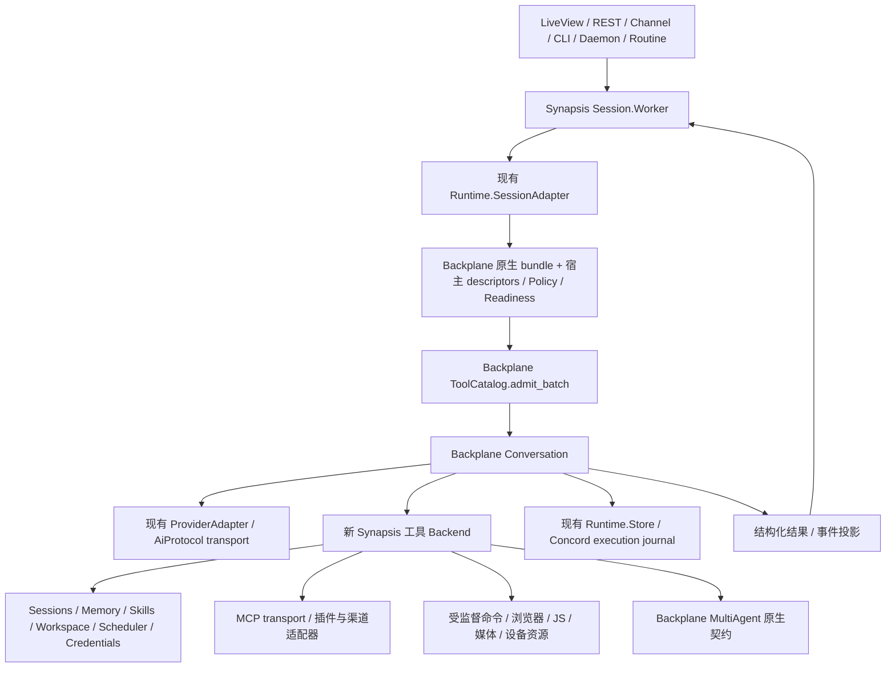

# Synapsis 全面替换旧工具并对齐 OpenClaw：设计提案

**日期：** 2026-10-23（Asia/Shanghai）。
**状态：** 用户已确认架构并授权实施。本文描述完整目标；已实现原生契约夹具、参考能力映射、catalog 组合和独立的 Policy/Readiness、权限快照、动态审批与 freshness 证据组件，补充原生 publication 与有界资源生命周期观察；P2a 准备独立结果投影及可选存储字段。实际进度与未完成项见[实施计划](../plans/2026-10-23-openclaw-tool-alignment.md)。尚未切换会话执行链或完成全面对齐。
**已确认决策：** 用户选择保留 Elixir/Phoenix、Concord 和 Backplane，并进一步明确以 `backplane_agent_runtime` 的契约为准；OpenClaw 是工具能力的对齐参考。
**执行入口：** [实施计划](../plans/2026-10-23-openclaw-tool-alignment.md)。
**清单附件：** [机器可读基线](2026-10-23-openclaw-tool-alignment-baseline.json)、[全量覆盖矩阵](2026-10-23-openclaw-tool-alignment-coverage.md)。

## 1. 目标与范围

删除 Synapsis 旧工具定义、注册、授权执行包装和旧 provider/tool 调度旁路，以 `backplane_agent_runtime` 的描述符、准入、操作、结果和生命周期契约构建新的工具体系。OpenClaw 固定版本用于完整核对工具能力。保留现有领域服务，使用现有 Backplane Conversation 作为唯一回合执行 owner。

“对齐”必须逐项核对动作集合、输入约束、默认值与边界、结果、错误、分页与截断、异步任务、取消、审批、身份归属、启用条件及模型实际可见性。每项记录 OpenClaw 参考行为到 Backplane 原生工具或宿主扩展的映射和差异；不要求名称、参数 schema、profile 或等待协议逐字相同。行为差异须显式记录，不能通过改名宣称等价。

契约优先级为：`backplane_agent_runtime` 的公开运行时契约 → Synapsis 的领域、存储与权限边界 → OpenClaw 的参考接口。出现冲突时保留 Backplane 的身份、授权和生命周期要求，使用原生表达或记录能力缺口；不以 OpenClaw 外观替换执行协议，也不建立第二套本地 Contract/Operation/Execution 协议。

完整范围包括固定基线的核心目录、仓库内插件声明的工具、runtime-only controls、Tool Search、Code Mode，以及外接 MCP/client 工具的动态接入协议。可选功能仍按插件、凭据、设备、客户端能力及权限启用，不把全部工具默认发给模型。

以下是目标产品边界，而非移植 OpenClaw 整个产品：Synapsis 保留自身 UI、身份系统、Concord/TOML/文件存储、Provider transport、发布与部署流程。外部 OpenClaw Gateway 不作为必需运行依赖。允许使用受监督的窄用途浏览器/JavaScript/设备辅助进程；它们只实现 backend，不拥有会话和授权。

## 2. 已核对基线

| 项目 | 固定事实 |
| --- | --- |
| Synapsis | `main`，`94c54ecfeda0725d0ba0771c1877f6cc13084da8`，加调查时未提交的依赖、HTTP/SSE、测试和文档修改；这些修改不属于本计划文档交付 |
| 运行时依赖 | alignment 工作树的 `backplane_agent_runtime`、`backplane_ai_protocol`、`backplane_mcp_protocol`、`backplane_skill_protocol` 已一起更新到 1.10.31；历史夹具保留 1.10.28、1.10.30，原始工作区保持原样。版本锁定不代表线上进程已升级 |
| OpenClaw | [`488631c18fae7cc541ba8fc8beff6cbb0438787b`](https://github.com/openclaw/openclaw/tree/488631c18fae7cc541ba8fc8beff6cbb0438787b)，本次重新固定，后续不跟随滚动 HEAD |
| 核心目录 | `src/agents/tool-catalog.ts` 的 67 个唯一 canonical 名，11 组 |
| 插件目录 | 扫描 174 个 `extensions/*/openclaw.plugin.json`；34 个声明 `contracts.tools`，共 109 个唯一插件工具名，其中 6 个与核心目录重叠 |
| 能力参考索引 | 核心目录与插件声明的并集为 170 个唯一上游工具名，插件独有 103 个；不是目标运行时工具数量或默认启用数量，多项可以映射到同一原生工具，一项也可以拆为多个受控能力 |
| 目录外控制 | 实际 discovery/collector 的 `tool_search/tool_describe/dispatch_action/structured_output`；Code Mode 的 `exec/wait` 单独记账。runtime facts 另认可 `search/find/grep/glob`，但本 pin 没有对应 core factory，暂只记录 recognition，不新增四个默认工具 |
| 历史差异 | 上轮比较 pin 为 `c4c89c1`；新 pin 不含核心 `heartbeat_respond`，不能继续把该旧名字作为本次交付目标 |

这是一份**上游静态能力参考**，不是 Synapsis 的可执行 catalog 或已经运行生成的完整 schema 快照。阶段 P0 必须补充各 factory 在代表性环境下的实际工具装配、action schema、动态注册和条件变化，再逐项映射到当前 Backplane 的公开契约。任何发现必须追加到可审阅差异记录；不能以 170 这个数字掩盖 manifest 外动态工具，也不能用“optional”跳过能力缺口。

原 [2026-10-07 Codex 迁移计划](../plans/2026-10-07-codex-tool-runtime-migration.md) 保留为历史研究；本次使用 Backplane 契约并参考 OpenClaw 补齐能力，不限定为旧计划的 Codex 工具目录，也不排除复用其原生工具。旧计划“尚未引入 Runtime、需要从零新增 Concord journal”等事实已过期，不再作为任务执行依据。

## 3. 方案评估和选择

| 方案 | 收益 | 代价 | 决策 |
| --- | --- | --- | --- |
| 基于 Backplane 契约，参考 OpenClaw 补齐能力 | 复用现成工具、领域模型、存储和生命周期；统一执行契约 | 需要逐项证明能力映射、扩展和差异 | **用户已选择并澄清** |
| Node 辅助服务托管整个 OpenClaw 工具层 | 更易复用 TypeScript factory | OpenClaw factory 依赖 Gateway/会话/插件上下文，容易形成第二套 authority；版本与发布复杂 | 不作为主架构；只允许窄用途 backend helper |
| 迁移 OpenClaw Gateway/runtime | 最大程度复用上游产品 | 会替换 Synapsis 身份、运行时、持久化及产品架构，范围远超工具迁移 | 不采用 |

## 4. 目标架构与所有权

### 4.1 保留的机制

- `Synapsis.Session.Worker`：会话身份、输入队列、live read authority、展示、回合边界和 transcript append。
- `Synapsis.Agent.Runtime.{SessionAdapter,ProviderAdapter,ProviderMessages,ProviderEvents,Store}` 与 data-only `Synapsis.Runtime.Store`：扩展现有实现，不另起执行日志或会话控制器。
- Backplane `Conversation`、ToolCatalog、Execution、MultiAgent：执行、准入、承认后的副作用、子代理生命周期、取消与不确定结果。
- Backplane 已公开的工具 profile、MultiAgent 与 CodeMode：先评估并复用原生 bundle；工具名和 schema 随所选原生契约保留，不在授权后重写。
- Config.Store、Providers/Models/Credentials、MCP transport、SkillCatalog、Memory、Workspace、Daemon/Routines/Heartbeat：保持领域 authority，新增宿主适配。

### 4.2 新模块边界

| 层 | 责任与计划路径 |
| --- | --- |
| agent | 新 `apps/synapsis_agent/lib/synapsis/agent/tools/`：能力映射、catalog、profiles、readiness、policy、backend、interactions、结果投影和必要的领域 adapter；只装配 Backplane 原生 bundle 与符合其契约的宿主描述符，不另定义运行时 Contract |
| data | 扩展 `Part.ToolResult`、配置迁移及必要的资源/任务记录；工具不在 data 执行，不添加数据库或 Phoenix/runtime 依赖 |
| core | 保留记忆、技能、会话等共享服务；抽取旧工具实现内真正独立的领域功能，新增跨渠道/插件服务时保持无 Phoenix/runtime 执行依赖 |
| provider | 保留现有 HTTP/SSE 与 codec；保真传递结构化 content blocks、media references、工具名及调用身份 |
| mcp | 继续拥有发现、连接、调用句柄、取消和凭据刷新；返回新 catalog 消费的数据，不再向旧 Registry 注册 |
| sandbox | 只接受宿主注入的 run/session 绑定 dispatcher；不反向依赖 agent，不自行执行工具 |
| workspace | 文件/资源权限、blob、索引和真实路径解析；已有 Projection 仅覆盖 skill/memory/todo，不能冒充通用双向文档投影 |
| server/web/cli | 新结果和 interaction 的投影、媒体交付、操作面板、配置、工具目录及公共协议；通过领域/agent API 向内调用 |
| helper package | 按 P8/P9 增加 `packages/tool-host/`，经 Port 监督浏览器/JS 执行；Node helper 不接收完整 credentials、可变 permission 或会话控制权 |

`synapsis_agent` 当前只在 test 依赖 MCP。计划将该依赖提升为正常 umbrella dependency：MCP 依赖 core/data/provider，不依赖 agent，因此不形成环。Sandbox 保持 callback 注入，禁止新增 core→agent、mcp→agent 或 workspace→agent 依赖。

### 4.3 单一 catalog、准入和执行

先选用 Backplane 已公开的 profile/bundle；缺少的领域能力由可信 host adapter 按 `Backplane.AgentRuntime.ToolCatalog` 描述符协议声明和准入。OpenClaw manifest 只提供能力来源，不能作为可执行描述符直接信任或导入。不得在准入后替换原生工具名、参数或 backend，也不得继续通过 `Synapsis.Tool.Registry/Gateway/Executor` 执行新工具。

每份不可变 catalog snapshot 记录 Backplane package/version、原生 descriptor/revision、source UUID/revision、profile、readiness、policy revision、backend binding，以及关联的 OpenClaw 参考项。配置或凭据变化重新生成合法的 admitted bundle；旧审批、旧插件注册或旧 run 的 handle 不能授权新版本工具。合并原生和宿主工具须保留 registry/tools/authority 的一致性，不拼接已授权列表绕过重新准入。

`subagents=false` 只移除协作能力；根回合仍由 Conversation 执行。Daemon、Routine、Heartbeat、MCP、Code Mode 嵌套调用和 Sandbox reverse call 都走同一执行入口。

### 4.4 Backplane 契约与现成能力

以下核对基于 alignment 工作树的 `backplane_agent_runtime 1.10.31`；P0 固定版本、artifact checksum 与对应来源，并保留 1.10.28、1.10.30 历史夹具。`Codex.Contract`/profiles 是可复用的 descriptor/bundle 构造器，不是所有宿主工具必须采用的命名空间。

| 边界 | 必须遵守的公开契约 | 本地依据 |
| --- | --- | --- |
| Descriptor | 非空 `tool_name`、正整数 `tool_revision`、`schema`、导出 `execute/1` 的 backend、map 型 `backend_context`；`safety.read_only/retry_safe/parallel_safe` 均为布尔值，按需声明审批 | `deps/backplane_agent_runtime/lib/backplane/agent_runtime/tool_catalog.ex:148`、`:235`、`:607` |
| Admission | authority 的 caller/run、exact grants 与逐工具 revision 必须匹配完整候选集合；strict admission 后成套传递 registry/tools/authority | `tool_catalog.ex:113`、`:157`；`apps/synapsis_agent/lib/synapsis/agent/runtime/session_adapter.ex:642` |
| Operation | run/incarnation/step/attempt/invocation/tool/revision/catalog/tool_call/turn 身份由 runtime 传递；校验、审批和预算保留后，持久化 intent 成功才调用 backend | `deps/backplane_agent_runtime/lib/backplane/agent_runtime/execution.ex:14`、`:85`、`:213` |
| Preparation | 1.10.30 的可选 `ConversationAdapter.prepare_tool/2` 在最终 schema/grant、原生审批与 invocation 提交前运行；只能允许、修改 input 或拒绝，descriptor/backend/catalog/authority 保持原生身份；hook 不得 dispatch effect | `deps/backplane_agent_runtime/lib/backplane/agent_runtime/conversation_adapter.ex`、`conversation.ex` |
| Result | backend 返回 `{:ok, map}`、`{:error, Error}` 或精确绑定 invocation 的 `{:rejected, Rejection}`；写操作普通错误不能证明未执行，不确定结果不得自动重放 | `deps/backplane_agent_runtime/lib/backplane/agent_runtime/tool_effects.ex:18`、`:28`、`:81` |
| Owner / publication | Conversation 拥有 run；恢复非终态先进入 recovery_required。运行中 catalog 发布使用有 revision/fence 的 `stage_catalog/2`，仅限受支持的 active tool 阶段，producer 成功结算后生效 | `deps/backplane_agent_runtime/lib/backplane/agent_runtime/conversation.ex:23`、`:131`、`:2185`、`:2372` |

组合时从原生 `bundle.registry.tools` 取 descriptors，与宿主 descriptors 合并并拒绝重名，重新构造完整的 exact grants/revision map，再调用 `ToolCatalog.admit_batch/2`。当前没有通用 rename/reauthorize API；不得仅拼接 provider tools 或套用旧 grants。配置变化也不代表能在任意后台时刻强制替换 active catalog。

1.10.31 的源码差异集中于 `Codex.Session.terminate/2` 清理其自有 ResourceRegistry（[backplane#79](https://github.com/gsmlg-opt/backplane/issues/79)）；借用资源的所有权规则不变，Session 的 closed 状态也不等于进程已终止。本仓新增原生生命周期观察，分别验证 close 后资源释放/registry 仍存活，以及 Session 终止后自有 registry/supervisor 退出。外部 registry 的借用由 Conversation/catalog 接线证明；此版本 Session 本身只创建自有 registry，不能用未支持的参数声称完成借用。测试使用真实惰性进程，不证明 OS/PTY/设备清理。Conversation、ToolCatalog、Approval 等公开契约未变。`prepare_tool/2` 仍只运行一次；原生静态审批编辑会重跑准入/schema/grants/静态审批，不会重新执行宿主 preparation。人类等待仍会暂停运行时计时器，不能把发行说明解释成新的宿主 freshness 或绝对过期回调。

| 能力参考 | 优先复用 | 仍需验证或补齐 |
| --- | --- | --- |
| shell、process、patch、主动读图 | 原生 `exec_command/write_stdin/apply_patch/view_image` | 路径与权限集成；长驻后台服务、PTY、跨回合存续等逐项记录实际差异 |
| 子代理创建、通信、等待、取消 | 原生 collaboration_v2 的 `spawn_agent/send_message/followup_task/interrupt_agent/list_agents/wait_agent` | 持久会话管理与跨会话权限由 Synapsis 服务补齐；不能与子代理树混同 |
| 用户交互、计划与时间 | 原生 interactive 控制族、`update_plan`、`clock::curr_time/sleep` | 可信 surface、root/child、无人值守和现有业务状态集成 |
| Web、搜索、生成媒体 | 原生 services profiles 与宿主 adapter/configuration | profile 不提供网络、凭据或真实供应商授权；仍须实现适配与结果保真 |
| 动态发现、Code Mode、扩展 | 原生 dynamic / CodeMode / extensions profiles | 宿主声明、工具来源、权限和产品展示；不据此宣称兼容 OpenClaw 插件包 |

## 5. 完整工具范围及兼容规则

### 5.1 上游核心能力索引

下表名字均为 OpenClaw 来源索引，不指定最终模型侧工具名或 schema。P0 为每个 action 建立到 Backplane 原生/宿主描述符的映射；原生工具已覆盖的能力只补集成与验证，不重写实现。

| 分组 | OpenClaw 参考工具 | 实施任务 |
| --- | --- | --- |
| fs，5 | `ls/read/write/edit/apply_patch` | P3 |
| runtime，4 | `exec/process/code_execution/secrets` | P3/P7/P10 |
| web，3 | `web_search/web_fetch/x_search` | P8/P10 |
| memory，3 | `memory_search/memory_get/personal_instructions` | P4 |
| sessions，19 | `presence/sessions/sessions_create/sessions_list/sessions_history/sessions_search/conversations_list/conversations_send/conversations_turn/sessions_send/sessions_spawn/github_identity_status/github_publish/agents_wait/sessions_yield/subagents/session_status/suggest_task/dismiss_task` | P5/P6/P11/P12 |
| ui，8 | `browser/screen/theme/dashboard/terminal/portal/canvas/show_widget` | P3/P8/P9/P12 |
| messaging，1 | `message` | P11 |
| automation，4 | `automations/gateway/plugins/openclaw` | P6/P13 |
| nodes，3 | `nodes/computer/mobile_ui` | P12 |
| agents，10 | `decision_evaluate/agents_list/get_goal/create_goal/update_goal/progress_card/ask_user/skill_workshop/skills_search/skills_read` | P4/P5/P6 |
| media，7 | `view_image/image_generate/music_generate/video_generate/transcripts/tts/pdf` | P10/P11 |

完整插件工具逐名列入附件，包含 workboard 38 项、飞书 14 项、Codex 外部会话 7 项、memory-wiki 5 项等；`qa_restart_wait/qa_restart_unsafe_probe` 单列测试能力，不默认生产暴露。全部 34 个声明工具的插件都有实施任务和验收责任。

### 5.2 profiles、名称与启用条件

- 原生 profile 的名字、schema 和控制语义遵循当前 Backplane 公开契约。OpenClaw `minimal/coding/messaging/full` 仅作为能力分组参考；Synapsis 按现有显式选择、deny 和权限上限组装目标 bundle，不自动复制上游默认启用规则。
- 上游目录有一个名字不等于本地应暴露同名工具。动态 schema、子代理资格、模型视觉能力、渠道支持动作及可选插件仍须参与 readiness 和权限检查。
- `cron→automations`、`bash→exec`、`apply-patch→apply_patch`、`tool_call→dispatch_action` 保留为 OpenClaw 来源事实；不自动注册为本地别名。确需迁移旧配置时，在准入前解析为明确的目标能力、参数和权限，完整身份在最终 descriptor 确定后生成；禁止授权后改写。
- Backplane 原生工具不是待删除的“旧 Synapsis 工具”。退役按实现 provenance、revision 与调用链验证，不按简单字符串黑名单验证；同名旧实现不能继续隐藏在新 backend 后。
- MCP/client 动态工具保留 source UUID、raw name 映射与 schema revision，按 Backplane 准入规则检查冲突，不强制套用 OpenClaw 命名规则。

### 5.3 与宿主身份绑定的工具

上游 `sessions_*` 中的持久会话不同于 MultiAgent 子代理树；`agents_list` 也不同于当前树的 roster。持久会话由 Synapsis 领域服务提供宿主描述符；子代理使用 Backplane 原生协作 bundle。身份转换使用可逆、带 scope 的 UUID/session key 映射，不能把任意历史会话当 active child，也不为外观一致重写已准入的协作调用。

`gateway/plugins/openclaw`、`presence/personal_instructions`、`screen/theme/dashboard/portal`、`github_publish` 涉及宿主自身能力。它们映射到 Synapsis 的配置、会话、设备、UI、发布服务，不操作一个隐含的外部 OpenClaw 安装。P0 逐 action 标记 `native-reuse`、`host-extension`、`host-adapted` 或 `gap`，记录目标描述符、输入/结果转换和行为差异。OpenClaw 专属动作须有明确的宿主处理或缺口记录，不能返回伪成功，也不能仅靠相同工具名宣称兼容。

外部供应商和设备覆盖按 pin 的 capability/provider/channel manifests 建账，P10/P11/P12 必须逐项处理。不得自行挑一个供应商后称全部完成；用户没有提供真实账号的项可以完成实现及本地契约证明，但真实授权/E2E状态必须保持未验证。

## 6. 持久化、权限和多模态

### 6.1 执行和资源生命周期

继续使用已实现的 acknowledged Concord execution journal 与 invocation fencing：先提交执行意图，再产生副作用；session live broadcast 与 turn snapshot 边界保持现有设计。提交失败的副作用次数必须为零。

新增 `process`、浏览器会话、媒体任务、workflow continuation、门户和终端资源都具有明确的 session/run/incarnation、owner、deadline、取消和恢复状态。不得持久化 PID/Port/closure/grant/credential。重启后不能复用旧进程句柄或自动重放不确定 mutation。

上游 `exec yieldMs/background` 作为短命令与独立后台服务的能力参考，目标使用 Backplane 原生执行、等待与 ResourceRegistry 规则。已有 Backplane run 结束即清理的资源不能未经验证就宣称支持跨回合 process。原生规则不能表达的必需后台服务能力须记录差异、按依赖规则建立 issue，只阻塞相应缺失能力；不能通过改变原生清理或等待协议实现外观兼容。

### 6.2 权限与交互

权限按 action 和资源计算：`process.poll/kill`、`browser.snapshot/act`、`automations.list/add/remove`、跨会话 read/send、远端执行与 secret egress 不能只按一个粗粒度工具名分类。

沿用现有 deny/ask/allow 与无人值守边界，改由新 Policy + Backplane 执行链承接。审批绑定 run/session/incarnation、tool/schema revision、arguments digest、interaction ID、到期时间和可信请求者。拒绝、过期、重复或跨会话答案不得 dispatch。取消撤销等待与未执行授权。

P1b 首先实现独立的 `prepare_tool/2` 宿主检查：可信 context 提供 caller/run/incarnation/catalog scope、精确工具 revision、输入分类与 action/resource 决策，以及 readiness 证据；这些是宿主进程内元数据，不是新的运行时 Operation/Contract。缺失、陈旧、无法分类或不可用均拒绝，未解决的 `ask` 返回 approval-required。尚未完成的配置迁移、凭据 revision 与人工审批不能由 `:allow` 推断；现有 SessionAdapter 的 legacy Grant resolver 也不能用作原生 permission proof。

P1c 在隔离范围加入原始权限快照与动态审批。`PermissionSnapshot.compile/4` 只接受显式 raw SessionPermission、可信 scope/bindings 和有限 exact targets；scope 增加 session_id 与完整记录 fingerprint。编译保留工具 qualifier，四级 allow 设置在两种 mode 下都有效；未知工具 override、窄模式、重叠及畸形数据返回 needs_review，不自动重命名或按基础设置放行。fingerprint 不是实时撤销或 ABA fence，配置迁移与生产 freshness 接线仍待宿主实现。

`Policy.evaluate/2` 保持无交互求值；只有 ask 才经 `Approval` 调用原生 interact。可信宿主解答精确的 interaction/operation/scope，原生 runtime 保有取消、单次使用与持久化；批准后刷新当前身份、policy/readiness、action/resource 和期限。动态请求禁止 input 编辑；没有第二套 Grant/审批账本，host TTL 只在请求/解答/复查时校验，没有自动 timer。这个 resolver 仅支持本模块动态请求；原生 descriptor 审批仍是独立 gate，双审批的宿主接线尚未支持，后续须禁止静态编辑绕过分类并在其等待后重查动态 policy/expiry。当前不宣称跨两次等待的持续 freshness。原生 resolver identity 的结构校验缺口见 [backplane#80](https://github.com/gsmlg-opt/backplane/issues/80)；上游提交 `1e9b0366` 已修复并关闭 issue，但当前 1.10.31 发布包尚不含此修复，宿主验证继续保留。结构校验不能替代认证；尚未接入真实 UI、Worker 或 SessionAdapter。

P1d 增加独立 `Freshness.capture/3` 与 `check/2`：显式 raw permission、当前 provider 可用性/认证 generation、可解析 credential 的内容版本生成不含秘密的证据。默认 reader 复用公开存储 API，并拒绝缺失/畸形/不可用数据；`PermissionSnapshot.validate/2` 只复用结构/语法/session 校验，授权仍须 exact compiler 与原生准入。隔离 hooks 在 Policy 前和 Approval.refresh 中重新采样比较，变化时不提交工具意图、不 dispatch。该检查未自动接入普通 allow 或生产链。跨 store 读取不原子、内容指纹没有 ABA 防护；provider generation 未涵盖的配置/OAuth 状态和 MCP live discovery 不属于当前证据，不能据此标 readiness 或远端授权成功。

原生 publication 用例验证 token-bound stage、成功批次后发布、下一 provider 生效，以及失败/取消丢弃、stale fence 和 receipt replay。publication 不刷新静态 provider_context；生产调用方还须在下一 provider 请求前构建匹配新 catalog revision 的 policy/readiness/freshness，旧 scope 会被拒绝。仅靠 publication 事件回调无法证明刷新先于下一请求。本批没有新增 catalog manager 或生产发布服务。

无人值守 heartbeat/routine 默认不给人工交互、凭据索取、通用写 shell 或跨渠道发送权；具体动作只继承创建者已批准的能力上限，不能从后来参与者处扩权。shell PathGuard 不是 OS sandbox；需要隔离的 profile 必须提供真实 filesystem/network 隔离与越界测试。

### 6.3 结果与媒体

P2 以 Backplane 的 operation/result/error 协议为执行边界，扩展 Synapsis 的版本化持久化与展示投影，保留 ordered content blocks、structured content、错误、媒体引用、分页、任务/进程状态及可信 provenance。投影不是第二套运行时返回协议；外部 `isError` 等字段后续经受检转换后进入原生结果。

P2a 的独立 `ResultProjection.to_part/3`/`from_part/1` 准备 `%{"version" => 1, "result" => portable_native_map}`。`Part.ToolResult.projection` 可选保存该数据；data 只把它作为 opaque map，Part 和 Message 的序列化路径保留它，nil 时保持原有字段布局。`content` 继续是旧文本视图，混合 block 只提取实际 text；媒体和结构化值保留在 projection，不使用通用 JSON 文本代替。原生 Error 使用安全 message、有效 class 和公共 details，丢弃 cause；Rejection 通过原生 proof 及 exact tool_call_id 验证后仅保留结果，operation/authority/proof 和运行时对象不进入存储。未知版本、key collision、内外错误标志不一致和非可移植值明确拒绝。此接口无法识别任意字符串内的秘密，可信调用者须提供公共数据。

`Store.commit_turn` 与 Message 重读的真实本地测试证明投影保真、先前 turn 不变及同一 turn 幂等；旧字符串只读解析不恢复执行能力。`Session.Snapshot.encode_message/1` 复用 Message.encode，但本批没有改动或调用其全历史重写路径。

P2b 先补 provider 消费端：`MessageMapper` 对可选 v1 projection 运行原生可移植性/预算检查，再将明确的 text/image 内容交给原生 Codec；旧 nil projection 映射保持原样。消费 block 及 image data 的字段集封闭，畸形或歧义 payload 明确拒绝；metadata/structured/artifacts 等 sidecar 只在存储中保留，不向模型发送。Anthropic 支持有序 text/image 工具内容，现有 OpenAI/Google codec 对非文本明确拒绝。缺少明确内容、structured-only、空内容或未知 block 不生成 JSON/blank 成功占位；原生 Error 的投影若没有明确 content，也尚不能直接 replay。

这只是后续 producer 接线的前置能力。ProviderMessages、Worker、MCP.Response 和 API/SSE/CLI/web 路径仍待替换；现有无 content 的 collaboration 返回还依赖旧文本化路径，因此不能先启用严格 producer 再令既有子代理结果失效。Gaoxy 的合成媒体样本证明新 provider 消费端，不证明实际 `view_image` 原始二进制已经适配，也不是 MCP→provider→Concord→客户端的全链多模态支持。

大媒体存放 workspace blob；模型和客户端得到受权限控制的引用。图片/音频只能在对应 provider 支持的 message block 上传递；不支持时报告该能力缺失，不把 base64 或 URL 当普通文本塞给模型后称多模态已完成。

旧字符串结果正常读取；旧历史不会整体重写，旧调用只用于展示/上下文，不重新执行、不复活旧handle。外部 MCP/plugin 的文本和 schema 描述按不可信输入处理，不进入可信系统指令。

### 6.4 项目记忆的有界读取

P4a 的 core `Memory.ScopedReader` 直接读取现有 FileAdapter Markdown/YAML 项目记录，保留既有存储 authority；不经过旧 Tool、Retriever、缓存或访问统计写入。agent `Tools.Memory` 提供原生 `synapsis::memory_search`/`synapsis::memory_read` descriptor，可信宿主固定 run/incarnation/catalog、project/session 和根目录；模型只提供 query/limit 或记录 ID。`classify/2` 返回精确的 `memory.search`/`memory.read` action 与项目/会话/记录 resource，native grants 和执行 fence 仍独立必需。宿主负责验证 project/session 关联，构造 descriptor 不等于完成认证或生产接线。

读取前把候选限定到项目目录，校验路径及记录 ID/scope/scope_id，拒绝 symlink、hardlink、畸形或重复归属字段。最多扫描 128 个目录项、读取 64 KiB 文件、返回 20 条记录；摘要最多 8 KiB，领域结果和工具的 text+structured 合计分别受 64 KiB 上限约束。词面匹配在截断前的完整有界摘要上进行，公开结果只含明确字段与 semantic record ID 引用。没有伪造文件行号或 OpenClaw corpus/vector 等价性。

隔离 guardian 监控调用方，拥有一秒期限，并链接有 heap 上限的读取进程；调用方退出、期限或读取进程故障都有明确结算。超限、不可用和读取错误不会伪装成零命中，归档记录排除。现有 session 记录没有可验证的项目关联，因此当前明确不支持 session/shared/agent fallback。fd 与读取前后目录/文件身份检查拒绝可观察的替换，但不提供原子 openat/no-follow 对敌意并发 rename 的保证。旧 API 和生产 dispatcher 尚未切换。

### 6.5 Backplane host-agent Memory

用户指定本机 host agent 的 `4222` Memory 服务作为可接入的记忆来源。目标为复用 Backplane 的公共 `memory::recall` 及 host 既有 canonical/mirror/provisional authority：core 负责有界 HTTP 领域调用，agent 只声明原生 ToolEffects descriptor、精确 `memory.read` 权限和结果展示。现有项目文件记忆继续保持独立来源；旧 `ServiceAdapter` 的占位回退不能代表 host 接入。

宿主可信绑定明确的 source ID、literal-loopback endpoint、逻辑 agent ID 与 run/incarnation/catalog。模型只能提供 query/limit；不接受 scope、project、session、namespace、partition 或 shared-access 选择。host 本地 HTTP 没有独立 bearer-auth plug，gateway 凭据由 host 持有，因此本切片仅连接 loopback，不复制 LLM/provider 凭据或发明另一种认证。source ID 与 endpoint 进入资源身份，授权范围明确为 host 的默认分区；路径中的 agent ID 是调用上下文，不是项目或会话隔离证明。生产 source/config 的绑定和目录安装仍待统一接线。

调用使用 `/memory/:agent_id/call/recall`；只保留受检公共结果、真实记录 ID 引用和 online/offline、canonical/provisional、stale 等状态。mirror 的 `canonical_id`-only 记录可直接引用；provisional 的本地 ID 与 canonical ID 可能合法不同，不能强行等同。不可用、畸形结果、超限和期限分别返回显式错误，不回退到项目文件、不把失败当作空结果。从干净的 Req.Request 安装标准 steps 并仅合并本调用的明确选项，避免继承全局认证头、Cookie 或 transport hooks。HTTP 接收阶段即限制字节，禁用重试/跳转，调用方退出或期限到达时清理本地工作；本地取消不能证明远端 recall/trace 已取消。read-only 只表示不修改记忆内容：host 仍可能写 trace、receipt、访问统计或 audit，并可能调用 embedding/reranker，故不声明 retry-safe。

当前上游契约没有 canonical 记录的精确 get/read-by-ID；`recall_explain` 是 trace，`slot_read` 是设备本地槽位，不能替代。另有项目过滤在离线 mirror 回退中丢失的缺口。按 ID 读取和项目/会话隔离分别等待 [backplane#84](https://github.com/gsmlg-opt/backplane/issues/84)、[backplane#83](https://github.com/gsmlg-opt/backplane/issues/83)，不扫描 list 或在本地过滤后宣称具备上游缺失的契约。host-default-partition recall 可以独立推进。

## 7. Tool Search 与 Code Mode

Tool Search 先从**已授权且 ready 的完整目录**构建可搜索集合，遵循 Backplane 的动态工具注册与调用契约；`tool_search/tool_describe/dispatch_action` 是 OpenClaw 的参考流程，不强制成为三个本地工具。搜索不是授权，也不是旧 Registry 的 `mark_loaded`。可信宿主与不可信 MCP/client schema 分别处理。

Code Mode 优先复用 Backplane 原生 CodeMode profile/bundle、工具名、等待与 continuation 协议。OpenClaw 的 `exec({title, code, ...})/wait({runId})` 和 shell `exec` 仅保留为来源能力，不移植其同名外观或装配互斥规则。最终 provider batch 仍须名称无冲突，并完整通过 Backplane 准入。

组合执行沿用同一授权、审批暂停、执行意图、资源 owner 和取消链。恢复 continuation 不能重跑已有副作用；direct-only 多模态结果及输出限制须有实测。原生 CodeMode 未覆盖的参考能力逐项记录并扩展，不因 schema 不同重建 JavaScript 调度器或第二套执行协议。

## 8. 旧体系退出与兼容

所有开发在明确的迁移分支/worktree 进行。新 backend 在独立契约测试中完成后再切换部署；发布物不提供“新工具失败就调用旧工具”的 fallback。

1. 配置迁移生成受保护备份和 dry-run 报告；经 Config.Store 原子、幂等更新工具选择、toolsets、daemon profiles、审批策略及 session capability flags。
2. 旧窄工具集不能直接迁成 `full` 或 unrestricted `exec`；一对多映射保留 action 上限。无法无损映射的项目标记 `needs_review` 并阻止该配置启用，不静默删除 deny 或把 `none` 变为全部。
3. todo/plan mode、memory、AgentMessages、workspace、routine 保留业务数据，迁入对应新工具或宿主流程。`session_summarize` 变为宿主摘要服务，不把旧工具名留下继续执行。
4. 切换前等待回合和资源 settled；无法确认外部结果的 run 留在 recovery fence，不能通过回滚重放。
5. 全部入口切换后删除 Builtin、旧 Registry、Gateway/Executor、旧 ToolDispatcher、旧 SessionTools/ToolBackend 包装、Worker legacy graph/QueryLoop/StreamingExecutor 和旧 Sandbox 直调入口。
6. 按真实 caller 删除 graph nodes；其他仍使用的纯 graph/checkpoint 基础设施不在本次无差别删除范围。

回滚采用部署/配置备份恢复边界，不在同一进程内切回旧 dispatcher。带新日志格式或新资源的存储不能交给不认识它的旧二进制；切换方案必须验证格式版本和恢复前置条件。

## 9. 已确认上游依赖

### MultiAgent：可选名称扩展，不阻塞原生协作

`backplane_agent_runtime 1.10.28` 的 `Codex.MultiAgent` 公开原生 V1/V2 协作契约，并在 `action(profile, operation.tool_name)` 中匹配其原生名称。宿主可直接复用该 bundle 和生命周期；它不提供任意外部工具名的动作绑定，但这不是原生协作能力缺失。

此前因要求 OpenClaw 同名外观而创建的 Feature、`internal request`：
[gsmlg-opt/backplane#74](https://github.com/gsmlg-opt/backplane/issues/74)。

该 issue 已关闭，并从 Backplane 1.10.29 提供 `MultiAgent.bind_contract/3`、`call_bound/2`。宿主自定义 descriptor 必须在准入前绑定；fingerprinted `collaboration_binding` 和 authority 的逐工具 binding 共同保持操作身份，binding 受 manager lifetime 限制。1.10.30 延续该能力。

本计划仍优先选用原生协作 descriptor；自定义外观是可选项，#74 不是 P5 或整体切换的前置条件。不能将已准入的 `sessions_spawn` 改写为 `spawn_agent`，也不能本地创建第二个子代理管理器。本批不增加生产别名，只补组合器保留和收窄 binding 的契约验证。

其他 shell/PTY/资源转移、provider content schema 或 Code Mode 缺口目前是待验证门槛，不先捏造已确认缺陷。发现内组织依赖真实缺口时查重、建 issue、定 severity、在真实 callsite 标注；blocker 不做本地 workaround。

## 10. 交付验收与决策边界

- **能力覆盖：** 170 项上游参考索引和额外 controls 每项都有来源、action fixture、Backplane 目标映射、复用/扩展/宿主适配/缺口分类、行为差异、owner、阶段、readiness 与证据；P0 动态发现增量也无遗漏。目标工具数量与名称不以 170 项上游索引为验收标准。
- **实现覆盖：** 每项区分 planned、implemented、local_contract_verified、live_verified、blocked。未实现的 optional 工具仍算未完成，隐藏工具不等于实现了工具。
- **契约与执行证明：** 原生工具和宿主扩展均通过 Backplane descriptor/admission/operation/result 契约；根/子代理、subagents=false、daemon、MCP、Sandbox、嵌套调用共用准入和权限；commit拒绝零副作用、unknown outcome不重放、旧审批与旧handle不能推进新run。
- **产品证明：** 实际浏览器验证进程流、审批/取消、读图/PDF、消息与widget；检查served assets、DOM与console。单元/DOM测试与真实浏览器证据分开记录。
- **外部证明：** 每个渠道/provider/设备单列真实账号授权和 E2E；mock契约测试不能替代。缺用户账号不阻止写完实现，但该项不能标live_verified。
- **退役证明：** 源码caller audit无旧执行链；原有业务数据、历史和显式工具选择仍可读，权限无静默扩大。
- **运行边界：** 已进入 P0/P1 基础实施；参考 schema 采集与原生准入测试不等于真实工具执行或产品切换。没有提交/推送、发布、部署或服务重启。

用户已确认保留现有架构并以 Backplane 契约为准。未完成的宿主扩展、权限、结果和生命周期工作仍是实施目标；不得因计划已授权或基础测试通过而表述为已经实现。
